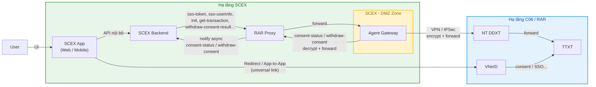
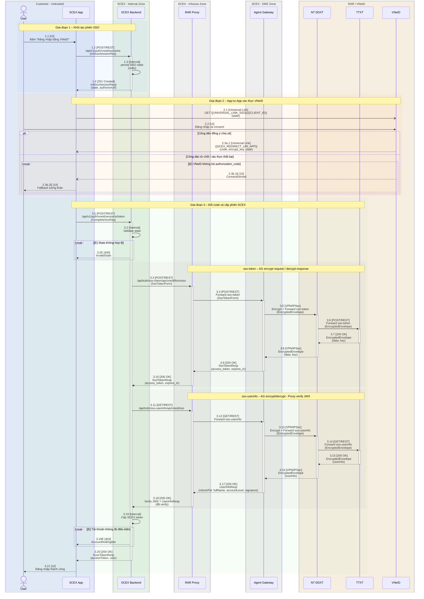
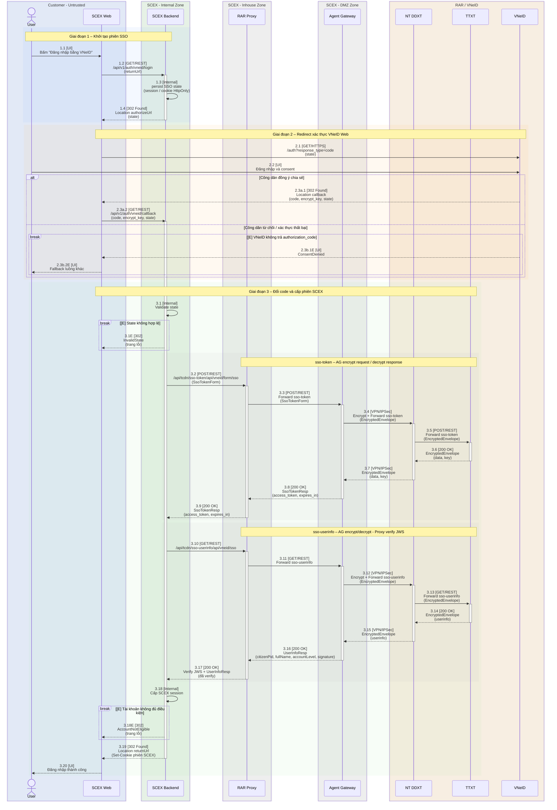
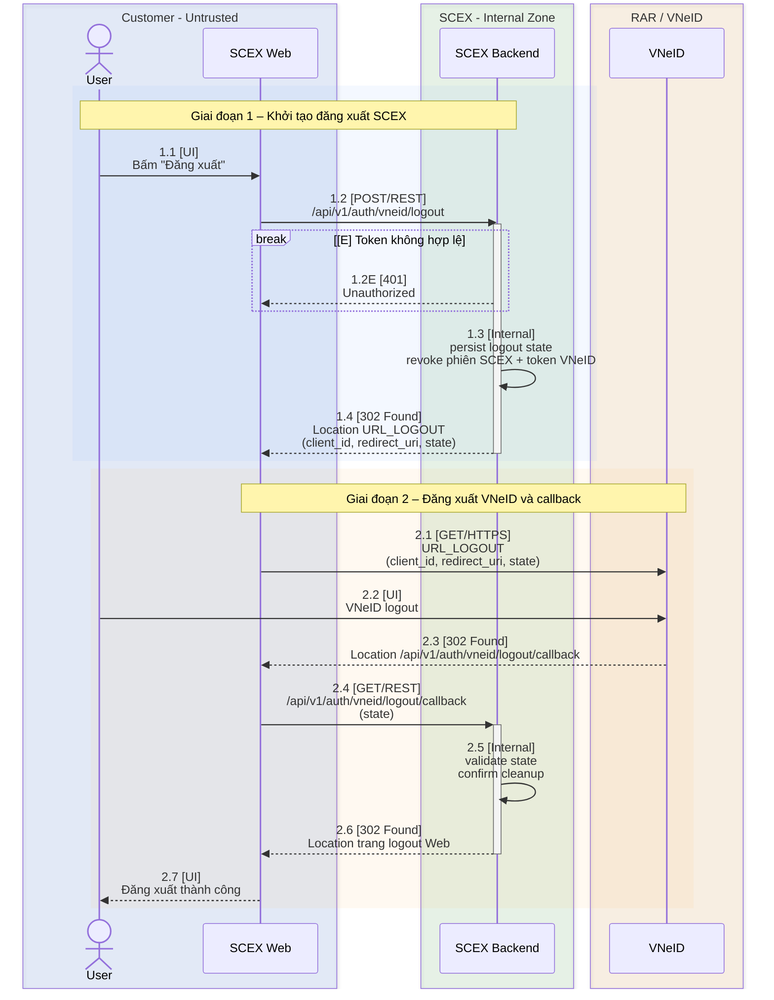
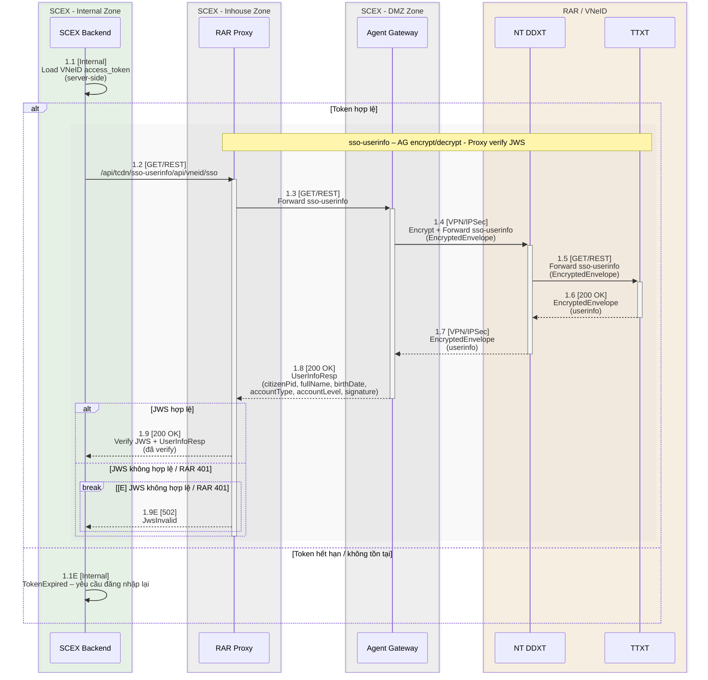
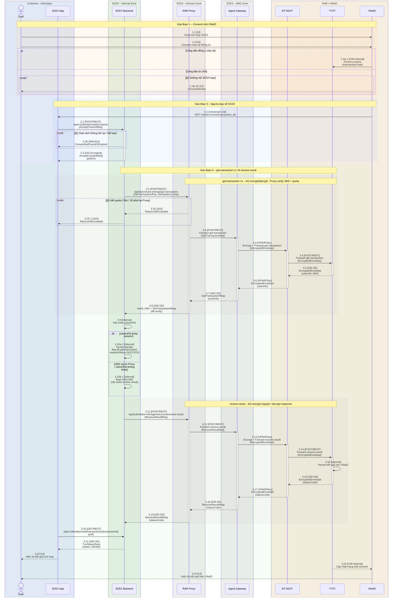
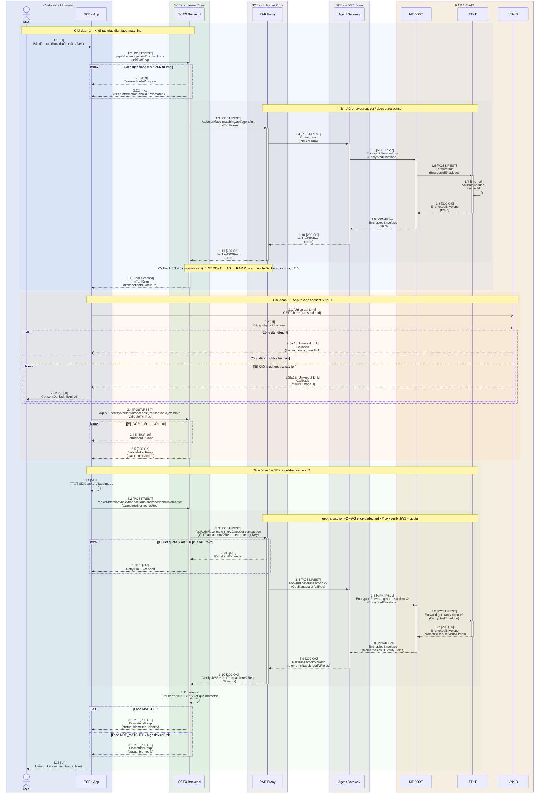
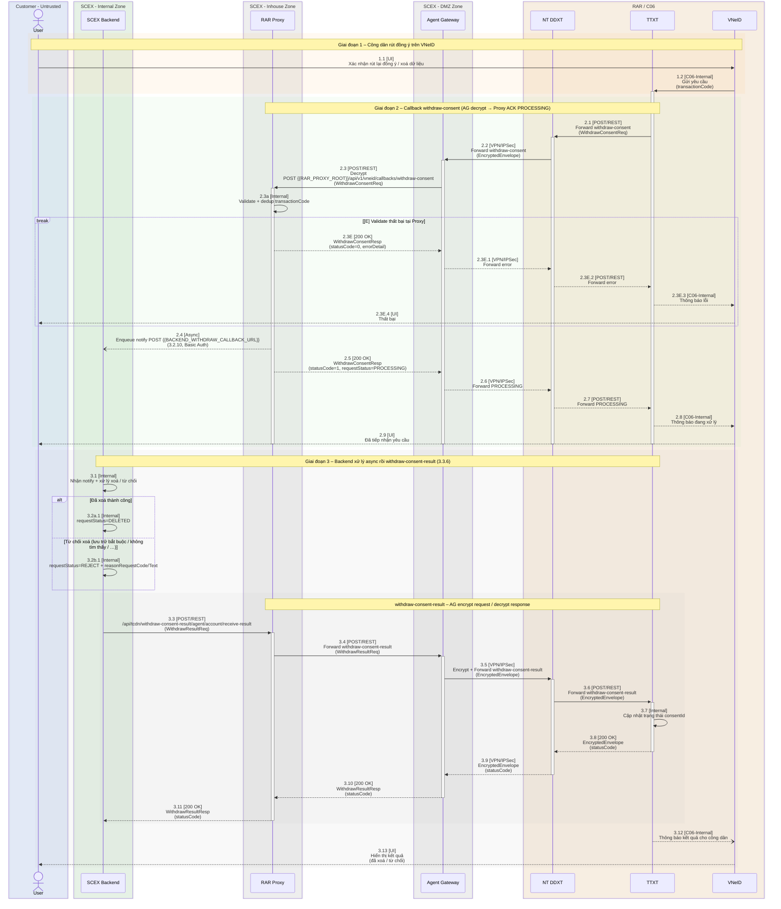
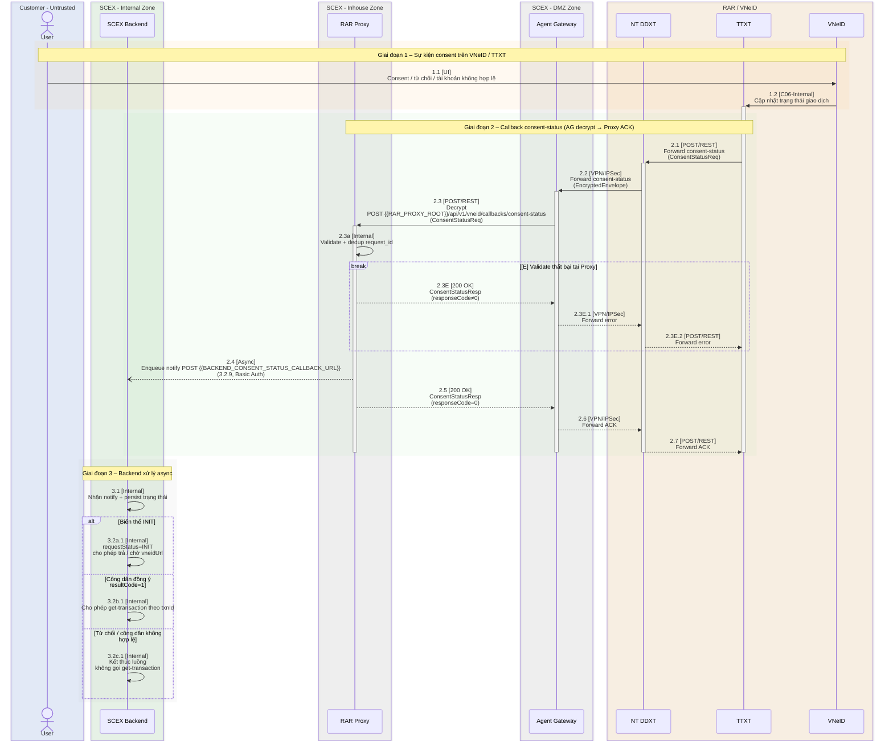

# Yêu cầu Tích hợp kết nối từ SCEX $\leftrightarrow$ RAR (C06)

| Trường     | Giá trị      |
| ---------- | ------------ |
| Trạng thái | Draft        |
| Phiên bản  | 1.0          |
| Người viết | <a>duc.mm<a> |

### Bảng viết tắt

| Từ viết tắt   | Ý nghĩa                                                                                                                                                                                                                                                                                                                                                |
| ------------- | ------------------------------------------------------------------------------------------------------------------------------------------------------------------------------------------------------------------------------------------------------------------------------------------------------------------------------------------------------ |
| TTXT          | Trung tâm xác thực                                                                                                                                                                                                                                                                                                                                     |
| NT DDXT       | Nền tảng định danh xác thực                                                                                                                                                                                                                                                                                                                            |
| Agent Gateway | Máy chủ Agent Gateway của RAR/C06 đặt tại vùng DMZ SCEX<br>**Encrypt** request trước khi gửi đi; **Decrypt** response khi nhận về                                                                                                                                                                                                                      |
| RAR Proxy     | Service trung gian inhouse SCEX<br>Forward plaintext Backend ↔ Agent Gateway;<br>**Verify chữ ký JWS** (`userInfo` / `biometricResult`); **đếm quota** `get-transaction` (3 lần / 30 phút / giao dịch);<br>**dedup** `Idempotency-Key` outbound; **entrypoint inbound** 3.1.4 / 3.1.5;<br>**registry** callback URL theo Backend; notify async Backend |

### Bảng mapping định danh transaction id

Canonical phía SCEX: **`transactionId`**.  
Các tên trên wire dưới đây **cùng chỉ một mã giao dịch**, trừ `consentId`.

| Canonical (SCEX) | Tên trên wire     | Hệ thống        | Ngữ cảnh                                                             |
| ---------------- | ----------------- | --------------- | -------------------------------------------------------------------- |
| `transactionId`  | `transactionId`   | SCEX API        | Path/body API nội bộ (mục 3.2.x)                                     |
| `transactionId`  | `transactionId`   | RAR             | Body `get-transaction` (mục 3.3.2 / 3.3.3)                           |
| `transactionId`  | `txnId`           | RAR             | Response `init` (mục 3.3.1)                                          |
| `transactionId`  | `transactionCode` | RAR             | Persist consent; `withdraw-consent`; sso-userinfo                    |
| `transactionId`  | `transaction_id`  | VNeID deep link | Path universal link (mục 3.1.3)                                      |
| —                | `consentId`       | TTXT            | Trạng thái consent nội bộ RAR; chưa confirm có trùng `transactionId` |

Trên diagram: hop SCEX dùng `transactionId`; hop RAR giữ tên field trên wire (`txnId`, `transactionCode`, `transactionId`).

> [!NOTE]
> Các tên trên wire (`txnId`, `transactionCode`, `transaction_id`, `transactionId`) **cùng chỉ một mã giao dịch** canonical `transactionId`. Trừ `consentId` (TTXT).

### Bảng mapping correlation — Header `request_id` / Body `requestId`

| Vị trí           | Tên field    | Hệ thống / chiều                   | Ý nghĩa                                                                                                         |
| ---------------- | ------------ | ---------------------------------- | --------------------------------------------------------------------------------------------------------------- |
| Header           | `request_id` | SCEX → Agent Gateway (mặc định)    | Mã hop hiện tại do **SCEX** tự dinh                                                                             |
| Header           | `request_id` | RAR → SCEX callback (3.1.4, 3.1.5) | Mã hop hiện tại do **Nền tảng** sinh                                                                            |
| Body JSON (RAR)  | `requestId`  | Response `init` (3.3.1)            | Echo header `request_id` của hop `init` đó                                                                      |
| Body JSON (RAR)  | `requestId`  | Callback 3.1.4 biến thể 2/3        | Tham chiếu header `request_id` SCEX đã gửi ở `init` — **không** trùng header `request_id` của callback hiện tại |
| Body JSON (SCEX) | `requestId`  | Envelope App/Web ↔ Backend (3.2.x) | Correlation nội bộ hop App ↔ Backend; không thay header RAR                                                     |

> [!NOTE]
> Header `request_id` **không** map sang `transactionId`. Body `requestId` **không bắt buộc** trên mọi request/response — một số API không có field này. Chi tiết correlation & idempotency: mục **3.0.4.5**.

## 1. Tổng quan & Phạm vi Tích hợp

### 1.1 Mục tiêu

Tài liệu này mô tả yêu cầu kỹ thuật kết nối SCEX với RAR / C06 (qua RAR Proxy → Agent Gateway) để bổ sung **VNeID** như một phương thức xác thực song song bên cạnh phương thức hiện tại (email/SĐT + OTP, eKYC qua NFC Căn cước công dân), phục vụ:

- Xác thực định danh khi mở tài khoản giao dịch tài sản mã hoá trên SCEX
- Liên kết VNeID cho tài khoản SCEX đã tồn tại
- Đăng nhập lại bằng VNeID sau khi đã liên kết
- Áp dụng cho cả ứng dụng di động (app-to-app) và nền web (quét mã QR)

Việc tích hợp nhằm mở rộng khả năng tiếp cận cho người dùng không có thiết bị NFC, đồng thời tận dụng dữ liệu định danh đã được Bộ Công an xác thực (tài khoản VNeID mức 2) để rút ngắn thời gian eKYC.

### 1.2 Sơ đồ kiến trúc kết nối



- RAR Proxy nằm inhouse SCEX, là điểm vào chung: nhiều hệ thống SCEX gọi RAR Proxy; forward plaintext Backend ↔ Agent Gateway và **verify chữ ký JWS** (`userInfo` / `biometricResult` / `signature`) trước khi trả Backend. Proxy cũng là **choke point duy nhất** enforce **quota** `get-transaction` (3 lần / 30 phút theo 1 `transactionId`) và **dedup outbound** theo `Idempotency-Key` — không để từng Backend đếm riêng.
- Inbound callback từ RAR (3.1.4 `consent-status`, 3.1.5 `withdraw-consent`): Agent Gateway decrypt rồi gọi **RAR Proxy** (`{{RAR_PROXY_ROOT}}`). Proxy ack đồng bộ về Agent Gateway, rồi **notify bất đồng bộ** tới SCEX Backend theo **callback URL đã đăng ký** trên RAR Proxy
- Agent Gateway đặt tại vùng DMZ SCEX, là điểm gọi API ra RAR. **encrypt** payload trước khi gửi đi và **decrypt** response (kể cả inbound callback) khi nhận về; khóa RSA gắn HSM tại Agent Gateway.
- SCEX Backend không gọi thẳng Agent Gateway / TTXT / NT DDXT; luôn qua `RAR Proxy` → `Agent Gateway` → VPN/IPSec → `NT DDXT` → `TTXT` (và ngược lại trên chiều response). Backend nhận plaintext đã verify; **không** encrypt/decrypt envelope, **không** verify JWS, và **không** là nơi enforce quota RAR (có thể giữ hint local để tránh gọi thừa). Agent Gateway **không** gọi thẳng Backend cho 3.1.4 / 3.1.5.
- App-to-App / redirect SSO đi trực tiếp `SCEX App` ↔ `VNeID`, không qua RAR Proxy / Agent Gateway.

> [!IMPORTANT]
> Backend **không** gọi thẳng Agent Gateway / TTXT / NT DDXT — luôn qua `RAR Proxy` → `Agent Gateway`. Inbound **3.1.4** / **3.1.5** kết thúc tại RAR Proxy (ACK đồng bộ rồi notify Backend async). App-to-App / redirect SSO đi thẳng `SCEX App` ↔ `VNeID`, không qua Proxy / Agent Gateway.

### 1.3 Phạm vi kết nối

#### Source System / Target System

| Kết nối                 | Source                         | Target                         | Giao thức                                               |
| ----------------------- | ------------------------------ | ------------------------------ | ------------------------------------------------------- |
| API Backend → RAR Proxy | SCEX Backend                   | RAR Proxy                      | REST/JSON qua HTTPS (internal)                          |
| Forward vào RAR         | RAR Proxy                      | Agent Gateway → NT DDXT → TTXT | REST/JSON qua HTTPS; VPN/IPSec                          |
| Callback từ RAR → SCEX  | TTXT → NT DDXT → Agent Gateway | RAR Proxy → SCEX Backend(s)    | VPN/IPSec; REST/JSON qua HTTPS; notify theo URL đăng ký |
| App-to-App (Mobile)     | SCEX App (Mobile)              | VNeID App                      | Universal Link                                          |
| Redirect SSO (Web)      | SCEX App (Web)                 | VNeID Web                      | HTTP 302 Redirect (HTTPS)                               |

##### Hop nội bộ SCEX Backend ↔ RAR Proxy

Đoạn `SCEX Backend` ↔ `RAR Proxy` (gọi ra service-code và **notify async** `consent-status` / `withdraw-consent` từ Proxy về Backend) nằm hoàn toàn trong hạ tầng nội bộ SCEX: không đi ra Internet, không đi qua DMZ. Auth trên hop này **không** thuộc chuẩn RAR / Agent Gateway (`api_key`, `target_code`, …).

- Inbound **3.1.4** kết thúc tại RAR Proxy (ACK `responseCode=0` sau validate + enqueue); notify Backend **không** chặn response về Agent Gateway.
- Inbound **3.1.5** kết thúc tại RAR Proxy (ACK `PROCESSING`); notify Backend **không** chặn response về Agent Gateway.
- Nhiều SCEX Backend: mỗi Backend **PHẢI** đăng ký sẵn 2 callback URL trên Proxy (`consentStatusCallbackUrl`, `withdrawConsentCallbackUrl` — mục 3.0.1). RAR Proxy route notify link callback mà các SCEX Backend đã đăng ký

> [!TIP]
> Khuyến nghị **HTTP Basic Authentication** trên HTTPS cho hop Backend ↔ Proxy. Scheme cụ thể (Basic Auth hay phương án nội bộ tương đương) do team triển khai tự quyết định lúc go-live; tài liệu này không bắt buộc một cơ chế cố định.

> [!WARNING]
> Trên hop Backend → Proxy, với `init` và `get-transaction`, Backend **PHẢI** forward header `Idempotency-Key` (SCEX-internal, không thuộc chuẩn RAR). RAR Proxy **PHẢI** dedup theo key trong TTL 30 phút: cùng key → trả cached response, **không** forward Agent Gateway, **không** tăng bộ đếm quota. Quota `get-transaction` đếm theo `transactionId`, tối đa 3 lần **forward thật** tới Agent Gateway trong 30 phút.

#### In scope

| STT | Service-code            | Mô tả                                                    | Luồng áp dụng                           |
| --- | ----------------------- | -------------------------------------------------------- | --------------------------------------- |
| 1   | sso-token               | Lấy access_token VNeID sau khi user đăng nhập thành công | Đăng nhập SSO (App + Web)               |
| 2   | sso-userinfo            | Lấy thông tin người dùng khi đã có access_token          | Đăng nhập SSO (App + Web)               |
| 3   | share-info              | Chia sẻ thông tin định danh điện tử từ VNeID             | Mở tài khoản, Liên kết VNeID            |
| 4   | face-matching           | Xác thực ảnh mặt (Face Matching + Liveness Detection)    | eKYC khi mở tài khoản, xác minh lại     |
| 5   | biometric-share-info    | Chia sẻ thông tin định danh kèm xác thực ảnh mặt         | eKYC khi mở tài khoản, xác minh lại     |
| 6   | verify-info             | Xác thực thông tin công dân (đối khớp true/false)        | Liên kết VNeID, xác minh lại (PCRT)     |
| 7   | withdraw-consent        | Nhận yêu cầu rút lại đồng ý chia sẻ dữ liệu từ VNeID     | Rút lại đồng ý (RAR → SCEX)             |
| 8   | withdraw-consent-result | Trả kết quả xử lý yêu cầu xoá dữ liệu                    | Trả kết quả rút lại đồng ý (SCEX → RAR) |

**Phạm vi kết nối bao gồm:**

- Kết nối API giữa SCEX Backend và RAR Proxy (inhouse): Proxy forward plaintext tới Agent Gateway (vùng DMZ SCEX), verify JWS khi response có chữ ký, **đếm quota** `get-transaction` và **dedup** `Idempotency-Key` outbound, cho tất cả service-code liệt kê trên
- Kết nối App-to-App (universal link) giữa SCEX Mobile App và VNeID App
- Redirect SSO giữa SCEX Web và VNeID Web (bao gồm cả đăng xuất)
- Callback API từ RAR (qua Agent Gateway decrypt → **RAR Proxy** ACK → notify async SCEX Backend theo URL đã đăng ký) — mục **3.1.4** và **3.1.5**

#### Out of scope

| STT | Hạng mục                                                                                                    | Lý do                                     |
| --- | ----------------------------------------------------------------------------------------------------------- | ----------------------------------------- |
| 1   | Dịch vụ `create-account` (luồng xuất phát từ VNeID)                                                         | Chưa có thông tin ở thời điểm hiện tại    |
| 2   | Dịch vụ định danh tổ chức                                                                                   | Chưa có thông tin ở thời điểm hiện tại    |
| 3   | Các service-code từ 7–18 trong bảng mã RAR:<br>create-credit-card, create-ewallet-account, ...vnpay-querydr | Không thuộc nghiệp vụ SCEX                |
| 4   | Chi tiết kết nối vật lý của Agent Gateway (cấu hình mạng, VPN/IPSec, firewall rules)                        | Thuộc phạm vi tài liệu hạ tầng mạng riêng |
| 6   | Các nghiệp vụ thoả thuận offline giữa SCEX và RAR                                                           | Không thuộc phạm vi kỹ thuật              |

## 2. Yêu cầu Nghiệp vụ & Luồng dữ liệu

### 2.0 Tần suất trao đổi (Integration Frequency)

Phần này định nghĩa tần suất trao đổi dữ liệu cho từng luồng tích hợp giữa SCEX và RAR/C06:

#### 1. Real-time (Thời gian thực):

- **Áp dụng cho:** Luồng đăng nhập SSO, và luồng chia sẻ thông tin + sinh trắc học (outbound `init` / `get-transaction`).
- **Đặc điểm:** Sync API, phục vụ thao tác trực tiếp của người dùng trên App/Web.
- **Ràng buộc hiệu năng:** Thời gian phản hồi API (Response Time) < `xx` giây, Timeout = `xx` giây.

> [!WARNING]
> SLA / timeout Real-time còn placeholder `xx` giây — chưa chốt với RAR / C06. Bổ sung số liệu cụ thể trước go-live.

#### 2. Near-realtime (Gần thời gian thực / Bất đồng bộ):

- **Áp dụng cho:**
  - Callback kết quả xác nhận chia sẻ (`consent-status`, mục 3.1.4) — ACK tại Proxy, notify Backend async.
  - Luồng rút lại đồng ý chia sẻ dữ liệu (`withdraw-consent`, `withdraw-consent-result`).
- **Đặc điểm:** Phản hồi (ACK) tức thì tại RAR Proxy; xử lý nghiệp vụ tại Backend bất đồng bộ. Withdraw: kết quả cuối qua 3.3.6 trong tối đa **72 giờ**.

#### 3. Batch:

- **Áp dụng cho:** Các luồng nghiệp vụ tra cứu đối soát khác.
- **Đặc điểm:** background job, để tối ưu hệ thống.

### 2.1 Luồng đăng nhập SSO

Trên sequence diagram: `[Internal]` = xử lý nội bộ trong một participant; `[C06-Internal]` = message liên hệ thống trong nội bộ C06 (VNeID ↔ TTXT), ngoài phạm vi SCEX.

#### Luồng đăng nhập - APP



Chi tiết từng bước: xem [Bảng SD-RAR-sso-app-01](#sd-rar-sso-app-01--chi-tiết-luồng-đăng-nhập-sso--app) trong Appendix.

#### Luồng đăng nhập - WEB



Chi tiết từng bước: xem [Bảng SD-RAR-sso-web-01](#sd-rar-sso-web-01--chi-tiết-luồng-đăng-nhập-sso--web) trong Appendix.

#### Luồng đăng xuất (chỉ Web)



Chi tiết từng bước: xem [Bảng SD-RAR-sso-web-logout-01](#sd-rar-sso-web-logout-01--chi-tiết-luồng-đăng-xuất-sso--web) trong Appendix.

Quy ước placeholder: `{{NAME}}` = tham số môi trường (mục 3.0.1); `{name}` = path/query của một request. Tài liệu RAR dùng `$[name]` — map `$[client_id]` → `{{CLIENT_ID}}`.

```
WEB: {{URL_SSO}}/auth?response_type=code&client_id={{CLIENT_ID}}&scope=openid&redirect_uri={{SCEX_REDIRECT_URI}}&state={state}

APP:  {{UNIVERSAL_LINK_SSO}}/{{CLIENT_ID}}?state={state}

Callback Web: {{SCEX_REDIRECT_URI}}?code={code}&encrypt_key={encrypt_key}&state={state}

Callback App: {{SCEX_REDIRECT_URI_APP}}?code={code}&encrypt_key={encrypt_key}&state={state}

LOGOUT: {{URL_LOGOUT}}?client_id={{CLIENT_ID}}&redirect_uri={{SCEX_LOGOUT_REDIRECT_URI}}&state={state}
```

#### Cơ chế sinh state

`state` dùng để chống tấn công CSRF. `state` do SCEX Backend tạo, và RAR trả về nguyên vẹn qua callback url.

> [!WARNING]
> `state` CSRF: SecureRandom (không random từ tệp số có sẵn hay datetime); TTL ngắn; chỉ dùng 1 lần; độ dài đủ lớn (≥ 16 byte).

#### Sau khi đăng nhập SSO, có access_token

Có thể lấy thông tin SSO, bao gồm:

- CCCD
- Họ và tên
- Ngày tháng năm sinh
- Loại tài khoản (cá nhân, tổ chức)
- Mức định danh



Chi tiết từng bước: xem [Bảng SD-RAR-sso-userinfo-01](#sd-rar-sso-userinfo-01--chi-tiết-lấy-userinfo-sau-khi-có-access_token) trong Appendix.

### 2.2 Luồng chia sẻ thông tin từ VNeID App (RAR $\rightarrow$ SCEX)



Chi tiết từng bước: xem [Bảng SD-RAR-share-vneid-01](#sd-rar-share-vneid-01--chi-tiết-luồng-chia-sẻ-thông-tin-từ-vneid-app-rar--scex) trong Appendix.

> [!NOTE]
> Khi `init` bằng service-code nào (`…/api/tcdn/{service-code}/api/agent/init`) thì lấy kết quả theo đúng service-code đó (`…/api/tcdn/{service-code}/…/get-transaction`). Sinh trắc học dùng path **v2**.

### 2.3 Luồng định danh eKYC - chia sẻ dữ liệu và xác thực ảnh mặt (SCEX $\rightarrow$ RAR)


Chi tiết từng bước: xem [Bảng SD-RAR-ekyc-bio-01](#sd-rar-ekyc-bio-01--chi-tiết-luồng-ekyc-chia-sẻ-dữ-liệu-và-xác-thực-ảnh-mặt-scex--rar) trong Appendix.

### 2.4 Luồng định danh eKYC - xác thực ảnh mặt (SCEX $\rightarrow$ RAR)



Chi tiết từng bước: xem [Bảng SD-RAR-ekyc-face-01](#sd-rar-ekyc-face-01--chi-tiết-luồng-ekyc-xác-thực-ảnh-mặt-scex--rar) trong Appendix.

#### Phân biệt

|                | Chia sẻ                                          | Xác thực                                                                                                            |
| -------------- | ------------------------------------------------ | ------------------------------------------------------------------------------------------------------------------- |
| Request (init) | CCCD: bắt buộc<br>Tên, Ngày sinh: không bắt buộc | CCCD: bắt buộc<br>Các field cần xác thực: giới tính, CMND, địa chỉ                                                  |
| Response       | Các field đồng ý chia sẻ                         | Các field gửi lên sẽ trả về true/false<br>Các field không gửi sẽ trả về thông tin nếu user đồng ý chia sẻ hoặc null |
| Sinh trắc học  | Không có                                         | Trả về BiometricResult                                                                                              |

### 2.5 Luồng rút lại yêu cầu đồng ý chia sẻ

Xuất phát từ VNeID (RAR → SCEX). Service-code: `withdraw-consent` (API III.4.1), `withdraw-consent-result`.

Áp dụng khi công dân rút lại đồng ý chia sẻ trên ứng dụng **VNeID** (không xuất phát từ SCEX App). SCEX nhận yêu cầu qua Agent Gateway → RAR Proxy.

> [!IMPORTANT]
> RAR Proxy ACK đồng bộ **luôn** `requestStatus=PROCESSING`, enqueue notify Backend bất đồng bộ, rồi Backend **luôn** gọi `withdraw-consent-result` (mục 3.3.6) với `DELETED` hoặc `REJECT` trong tối đa 72 giờ — kể cả khi chưa `get-transaction`. SCEX **không** trả `DELETED` trên inbound 3.1.5.

> [!NOTE]
> SCEX cần cung cấp link công bố rủi ro khi rút lại đồng ý (mục 3.0.2). UX kết quả chỉ trên VNeID; SCEX App **không** tham gia luồng.



Chi tiết từng bước: xem [Bảng SD-RAR-withdraw-01](#sd-rar-withdraw-01--chi-tiết-rút-đồng-ý--ack-processing--backend-async) trong Appendix.

- Rút lại đồng ý áp dụng: (1) consent chưa / đã get-transaction, (2) đồng ý dài hạn SSO “Không hỏi lại”, (3) yêu cầu xoá dữ liệu đã chia sẻ — confirm với RAR phạm vi cụ thể cho SCEX.
- Notify bước 2.4 dùng `{{BACKEND_WITHDRAW_CALLBACK_URL}}` = `withdrawConsentCallbackUrl` đã đăng ký (mục **3.2.10** / 3.0.1). Routing chi tiết: TBD.

> [!CAUTION]
> Open Issue: khi rút lại chia sẻ (chia sẻ dữ liệu / xác thực khuôn mặt), cần xoá gì phía SCEX? Khách hàng cũng có dữ liệu nhập vào SCEX; đồng thời audit theo Nghị quyết 05 (tối thiểu 10 năm) — tiêu chí xoá nghiệp vụ vs giữ còn chưa chốt.

### 2.6 Luồng nhận thông báo kết quả xác nhận chia sẻ (RAR → SCEX)

Xuất phát từ Nền tảng sau `init` (RAR → SCEX). Callback: `consent-status` (API III.2.2 / mục **3.1.4**).

Áp dụng khi NT DDXT gửi trạng thái consent về SCEX: `INIT`, đồng ý / từ chối (`resultCode` `1`/`2`), hoặc thông tin công dân không hợp lệ (`resultCode` `-17`). SCEX nhận qua Agent Gateway → **RAR Proxy**.

> [!IMPORTANT]
> RAR Proxy ACK đồng bộ **luôn** `responseCode=0` sau validate + enqueue (hoặc `responseCode≠0` khi lỗi biên tại Proxy). Notify Backend bất đồng bộ theo `consentStatusCallbackUrl` đã đăng ký. SCEX **không** trả `responseCode=1` (“không tìm thấy giao dịch”) trên hop inbound AG → Proxy — trường hợp đó Backend xử lý nội bộ sau notify.

> [!NOTE]
> **Lệch RAR III.2.2:** RAR cho phép ACK đồng bộ kèm `responseCode=1` khi lookup thất bại. SCEX chọn Proxy-first async giống 3.1.5 để giữ SLA < 3s và hỗ trợ nhiều Backend.



Chi tiết từng bước: xem [Bảng SD-RAR-consent-status-01](#sd-rar-consent-status-01--chi-tiết-callback-consent-status--ack-proxy--notify-backend) trong Appendix.

- URL đăng ký với C06 / Agent Gateway: **`{{RAR_PROXY_ROOT}}`** (không dùng `{{SCEX_API_ROOT}}`).
- Notify bước 2.4 dùng `{{BACKEND_CONSENT_STATUS_CALLBACK_URL}}` = `consentStatusCallbackUrl` đã đăng ký (mục **3.2.9** / 3.0.1). Routing chi tiết: TBD.

## 3. Giao diện tích hợp / Interface Specification

### 3.0 Thông tin cấu hình kết nối

#### 3.0.1 Tham số theo môi trường

**Quy ước placeholder trong tài liệu này:**

| Ký hiệu    | Dùng cho                                                       | Ví dụ                                                                                             |
| ---------- | -------------------------------------------------------------- | ------------------------------------------------------------------------------------------------- |
| `{{NAME}}` | Tham số môi trường (bảng dưới)                                 | `{{CLIENT_ID}}`, `{{URL_SSO}}`                                                                    |
| `{name}`   | Path/query parameter của một request                           | `{transactionId}`, `{code}`                                                                       |
| `$[name]`  | Ký hiệu trong tài liệu RAR — **không dùng** trong tài liệu này | `$[client_id]` → `{{CLIENT_ID}}`; `$[transaction_id]` → `{transaction_id}` (deep link, mục 3.1.3) |

> [!NOTE]
> Tài liệu này **không dùng** ký hiệu `$[name]` của RAR. Map `$[client_id]` → `{{CLIENT_ID}}`; `$[transaction_id]` → `{transaction_id}` (deep link, mục 3.1.3).

| Placeholder                               | Ý nghĩa                                                                                                                                                                            | UAT                                                                      | Production | Nguồn                                                  |
| ----------------------------------------- | ---------------------------------------------------------------------------------------------------------------------------------------------------------------------------------- | ------------------------------------------------------------------------ | ---------- | ------------------------------------------------------ |
| `{{SCEX_API_ROOT}}`                       | Root domain API Backend của SCEX (API App/Web 3.2.1–3.2.8, redirect SSO 3.1.1/3.1.2). **Không** dùng cho inbound 3.1.4 / 3.1.5; notify 3.2.9 / 3.2.10 dùng URL đăng ký per Backend | `<điền>`                                                                 | `<điền>`   | SCEX                                                   |
| `{{RAR_PROXY_ROOT}}`                      | Root domain RAR Proxy — inbound callback từ Agent Gateway (**3.1.4** consent-status và **3.1.5** withdraw-consent)                                                                 | `<điền>`                                                                 | `<điền>`   | SCEX                                                   |
| `{{BACKEND_CONSENT_STATUS_CALLBACK_URL}}` | Placeholder diagram: URL notify 3.1.4 = `consentStatusCallbackUrl` đã đăng ký (mục **3.2.9**)                                                                                      | —                                                                        | —          | SCEX (per Backend)                                     |
| `{{BACKEND_WITHDRAW_CALLBACK_URL}}`       | Placeholder diagram: URL notify 3.1.5 = `withdrawConsentCallbackUrl` đã đăng ký (mục **3.2.10**)                                                                                   | —                                                                        | —          | SCEX (per Backend)                                     |
| `{{SCEX_WEB_ROOT}}`                       | Root domain Web App của SCEX                                                                                                                                                       | `<điền>`                                                                 | `<điền>`   | SCEX                                                   |
| `{{SCEX_UNIVERSAL_LINK}}`                 | Universal Link của SCEX Mobile App (consent, mục 3.1.3) — **không** dùng làm callback SSO App                                                                                      | `<điền>`                                                                 | `<điền>`   | SCEX                                                   |
| `{{SCEX_REDIRECT_URI}}`                   | Callback Url luồng SSO **Web** — nhận `code` tại endpoint 3.1.1; đăng ký trước với VNeID (`TL HD Tích hợp SSO` mục 3.1)                                                            | `<điền>`                                                                 | `<điền>`   | SCEX                                                   |
| `{{SCEX_REDIRECT_URI_APP}}`               | Callback link luồng SSO **App** — đăng ký trước với VNeID (`TL HD Tích hợp SSO` mục 3.2). VNeID mở App kèm `code`; **không** đi qua 3.1.1                                          | `<điền>`                                                                 | `<điền>`   | SCEX                                                   |
| `{{SCEX_LOGOUT_REDIRECT_URI}}`            | Redirect URI sau đăng xuất VNeID (mục 3.1.2)                                                                                                                                       | `<điền>`                                                                 | `<điền>`   | SCEX                                                   |
| `{{AGENT_GW_DOMAIN}}`                     | Domain Agent Gateway (đặt tại vùng DMZ SCEX)                                                                                                                                       | `<điền>`                                                                 | `<điền>`   | RAR / SCEX                                             |
| `{{AGENT_GW_PORT}}`                       | Port Agent Gateway                                                                                                                                                                 | `<điền>`                                                                 | `<điền>`   | RAR / SCEX                                             |
| `{{URL_SSO}}`                             | URL trang đăng nhập VNeID (Web)                                                                                                                                                    | `https://sso-uatvneid.dancuquocgia.com`                                  | `<điền>`   | RAR                                                    |
| `{{URL_LOGOUT}}`                          | URL đăng xuất VNeID (Web)                                                                                                                                                          | `https://sso-uatvneid.dancuquocgia.com/api/idp/sso/login-actions/logout` | `<điền>`   | RAR                                                    |
| `{{UNIVERSAL_LINK_SSO}}`                  | Universal Link đăng nhập VNeID (App)                                                                                                                                               | `https://universal.dancuquocgia.com/login-sso`                           | `<điền>`   | RAR                                                    |
| `{{UNIVERSAL_LINK_SHARE}}`                | Universal Link consent chia sẻ (App)                                                                                                                                               | `https://universal.dancuquocgia.com/share`                               | `N/A`      | RAR                                                    |
| `{{CLIENT_ID}}`                           | Mã đăng ký của SCEX trên hệ thống SSO VNeID                                                                                                                                        | `<điền>`                                                                 | `<điền>`   | RAR cấp                                                |
| `{{CLIENT_SECRET}}`                       | Secret key SSO của SCEX                                                                                                                                                            | `<điền>`                                                                 | `<điền>`   | RAR cấp                                                |
| `{{API_KEY}}`                             | API key gọi qua Agent Gateway                                                                                                                                                      | `<điền>`                                                                 | `<điền>`   | RAR cấp                                                |
| `{{TARGET_CODE}}`                         | Mã mục đích chia sẻ / xử lý thông tin                                                                                                                                              | `<điền>`                                                                 | `<điền>`   | RAR cấp                                                |
| `{{ORG_CODE}}`                            | Mã TCDN của SCEX do Nền tảng cấp                                                                                                                                                   | `<điền>`                                                                 | `<điền>`   | RAR cấp                                                |
| `{{ORG_CONNECTION_CODE}}`                 | Mã đơn vị kết nối — query param `code`, chỉ môi trường non-prod                                                                                                                    | `<điền>`                                                                 | `N/A`      | RAR cấp                                                |
| `{{RSA_PRIVATE_KEY}}`                     | Private key RSA của SCEX để Agent Gateway / HSM giải mã `encrypt_key` / `key`                                                                                                      | `<điền>`                                                                 | `<điền>`   | SCEX sinh, đăng ký public key với RAR; dùng tại AG/HSM |
| `{{RAR_JWS_PUBLIC_KEY}}`                  | Public key RAR để RAR Proxy verify chữ ký JWS của `userInfo` / `biometricResult`                                                                                                   | `<điền>`                                                                 | `<điền>`   | RAR cấp; dùng tại RAR Proxy                            |

##### Registry callback URL theo SCEX Backend (ops / config trên RAR Proxy)

Nhiều SCEX Backend dùng chung một RAR Proxy. Mỗi Backend **PHẢI** đăng ký **hai** callback URL nội bộ với Proxy (ops/config — **chưa** đặc tả API đăng ký; xem Open Issue `OI-PROXY-REG`).

| `backendId`     | `consentStatusCallbackUrl` (notify 3.1.4 → mục **3.2.9**)                 | `withdrawConsentCallbackUrl` (notify 3.1.5 → mục **3.2.10**)                |
| --------------- | ------------------------------------------------------------------------- | --------------------------------------------------------------------------- |
| ví dụ `ekyc`    | `https://ekyc.internal/api/v1/internal/vneid/callbacks/consent-status`    | `https://ekyc.internal/api/v1/internal/vneid/callbacks/withdraw-consent`    |
| ví dụ `account` | `https://account.internal/api/v1/internal/vneid/callbacks/consent-status` | `https://account.internal/api/v1/internal/vneid/callbacks/withdraw-consent` |

> [!IMPORTANT]
> Mỗi Backend **PHẢI** đăng ký hai URL nội bộ trên Proxy (`consentStatusCallbackUrl`, `withdrawConsentCallbackUrl`). C06 / Agent Gateway **chỉ** biết `{{RAR_PROXY_ROOT}}` — **không** đăng ký URL từng Backend với C06. Canonical path: `/api/v1/internal/vneid/callbacks/consent-status` (3.2.9) và `…/withdraw-consent` (3.2.10). Auth hop Proxy → Backend: HTTP Basic trên HTTPS (§1.3) — **không** dùng `api_key` RAR.

> [!WARNING]
> **Routing** (chọn `backendId` khi callback tới): **TBD** — intent hiện tại: map `transactionCode` / `txnId` / body `requestId` (init) → `backendId` đã bind lúc Backend gọi `init` qua Proxy. Open Issue `OI-PROXY-ROUTE`.

> [!CAUTION]
> `{{CLIENT_SECRET}}`: SCEX Backend giữ (server-side) và gửi trên hop Backend → RAR Proxy → Agent Gateway (form `sso-token`, mục 3.3.4) — **không** đưa xuống App/Web, tài liệu vận hành client, hay log.
> `{{RSA_PRIVATE_KEY}}`: chỉ dùng tại Agent Gateway / HSM — **không** đưa vào tài liệu vận hành client hay response App/Web.

#### 3.0.2 Đường link SCEX phải công bố cho VNeID

| STT | Nội dung công bố                                                                                                    | URL      | Nguồn |
| --- | ------------------------------------------------------------------------------------------------------------------- | -------- | ----- |
| 1   | Điều khoản và cam kết sử dụng dữ liệu được chia sẻ                                                                  | `<điền>` | SCEX  |
| 2   | Công bố thông tin rủi ro khi công dân rút lại sự đồng ý chia sẻ dữ liệu, tổ chức doanh nghiệp thực hiện xoá dữ liệu | `<điền>` | SCEX  |

#### 3.0.3 Header dùng chung khi gọi qua Agent Gateway

| Key            | Type     | Required | Description                                                                                                                                                                                                                                                                                                                           |
| -------------- | -------- | :------: | ------------------------------------------------------------------------------------------------------------------------------------------------------------------------------------------------------------------------------------------------------------------------------------------------------------------------------------- |
| `Content-Type` | `String` | **Yes**  | `application/json; charset=utf-8` (riêng RAR `sso-token` dùng `application/x-www-form-urlencoded`; API nội bộ 3.2.2 dùng JSON)                                                                                                                                                                                                        |
| `api_key`      | `String` | **Yes**  | `{{API_KEY}}` — do Tổ chức cung cấp dịch vụ cấp                                                                                                                                                                                                                                                                                       |
| `target_code`  | `String` | **Yes**  | `{{TARGET_CODE}}` — mã mục đích chia sẻ / xử lý thông tin, dùng để VNeID hiển thị đúng nội dung cho công dân                                                                                                                                                                                                                          |
| `request_id`   | `String` | **Yes**  | Mã hop hiện tại do **phía gửi** tự sinh (UUID v4, duy nhất trên hệ thống của bên gửi). Mục 3.0.3 áp dụng chiều **SCEX → Agent Gateway**: mặc định SCEX sinh. Chiều ngược (3.1.4, 3.1.5): Nền tảng sinh. Ngoại lệ 3.3.6.1: **echo** header đã nhận ở 3.1.5 — **không** tự sinh. **Không** đồng nhất với body `requestId` (mục 3.0.4.5) |
| `request_time` | `String` | **Yes**  | Thời gian yêu cầu, định dạng `ddMMyyyyHHmmss`                                                                                                                                                                                                                                                                                         |

> [!WARNING]
> Nếu `request_time` lệch quá 2 phút so với thời gian hệ thống Nền tảng, request bị coi là timeout. SCEX **PHẢI** đồng bộ NTP trên toàn bộ node gọi ra Agent Gateway.

#### 3.0.4 Format thống nhất

> [!IMPORTANT]
> Quy ước canonical cho mọi API trong mục 3. Chi tiết từng endpoint (3.1._, 3.2._) **PHẢI** tuân theo mục này. Ví dụ JSON ở các mục sau nếu lệch (ví dụ `error` Title Case thay vì catalog PascalCase) thì lấy **3.0.4** làm chuẩn.

##### 3.0.4.1 Envelope

| Hop                                                               | Envelope                        | HTTP                                                |
| ----------------------------------------------------------------- | ------------------------------- | --------------------------------------------------- |
| App/Web → SCEX Backend (3.2.1–3.2.8)                              | SCEX success / SCEX error       | 2xx / 4xx / 5xx + JSON                              |
| RAR Proxy → SCEX Backend (3.2.9, 3.2.10)                          | SCEX success / SCEX error       | `202` / `200` / 4xx / 5xx + JSON (không “luôn 200”) |
| Browser redirect (3.1.1, 3.1.2, 3.2.3, 3.2.4 logout — thành công) | **Không** envelope              | `302` + `Location`                                  |
| RAR → SCEX callback (3.1.4, 3.1.5)                                | RAR inbound                     | **Luôn** HTTP `200`; lỗi nằm trong body             |
| SCEX → RAR qua Agent Gateway (3.3.1–3.3.3, 3.3.5)                 | RAR outbound (`responseCode`)   | Thường HTTP `200`; lỗi nằm trong `responseCode`     |
| SCEX → RAR `receive-result` (3.3.6)                               | RAR outbound (`statusCode`)     | Thường HTTP `200`;                                  |
| SCEX → RAR `sso-token` (3.3.4)                                    | OIDC token set (sau AG decrypt) | HTTP `200`; xem mục 3.3.4                           |

**SCEX success** (App/Web ← Backend):

```json
{
  "code": 200,
  "message": "Success",
  "data": {},
  "requestId": "7f3a91c4-9d2e-4b18-a6c0-1e5f8a2b4d70"
}
```

- `code` = HTTP status (number).
- `data` bắt buộc khi thành công (object, có thể `{}`).
- `requestId` bắt buộc — correlation hop App ↔ Backend; **không** thay header RAR `request_id`. Xem mục 3.0.4.5.

**SCEX error** — xem mục 3.0.4.4. Cùng họ envelope; không có `data` trừ khi cần context an toàn (ví dụ `transactionId` đang conflict).

**RAR inbound** — hai biến thể, **không** trộn với envelope SCEX (`code` / `message` / `data`):

Consent-status (3.1.4) — RAR Proxy ACK đồng bộ sau validate + enqueue (luôn `responseCode=0` khi thành công biên; lỗi biên → `responseCode≠0`):

```json
{
  "responseCode": "0",
  "description": "",
  "responseTime": "12082026091900"
}
```

Withdraw-consent (3.1.5) — RAR Proxy ACK đồng bộ (luôn `PROCESSING`):

```json
{
  "statusCode": 1,
  "requestStatus": "PROCESSING"
}
```

- `responseCode` (3.1.4 / 3.3.1–3.3.3) và `statusCode` (3.1.5 / 3.3.6) **không** thay thế lẫn nhau.
- **RAR outbound** (SCEX Backend ← Proxy, sau AG decrypt) — họ `responseCode` (mục 3.3.1–3.3.3):

```json
{
  "responseCode": "0",
  "description": "Success!",
  "responseTime": "24032026135411",
  "data": {}
}
```

- `responseCode` parse **string** theo bảng đặc tả III.2.1 / IV.4; sample RAR đôi khi ghi number — SCEX chuẩn hoá về string khi map lỗi.
- EncryptedEnvelope (Agent Gateway ↔ NT DDXT) **không** thuộc mục 3.0.4 — hop nội bộ RAR; SCEX Backend thấy plaintext sau AG decrypt.

##### 3.0.4.2 Naming & casing

| Thành phần                                | Quy ước                                   | Ví dụ                                                                                 |
| ----------------------------------------- | ----------------------------------------- | ------------------------------------------------------------------------------------- |
| JSON body SCEX / payload RAR              | `camelCase` (gồm correlation `requestId`) | `citizenPid`, `expiresAt`, `serviceCode`, `requestId`                                 |
| Header gọi Agent Gateway / callback RAR   | `snake_case` (chuẩn RAR)                  | `api_key`, `request_id`, `request_time`, `target_code`, `org_code`, `service_code`    |
| Header SCEX-internal                      | HTTP canonical / kebab                    | `Idempotency-Key`, `X-Device-Id`, `X-Platform`, `Authorization`                       |
| Query / path error page (không phải JSON) | Giữ `snake_case` cho correlation trên URL | `/auth/vneid/error?error=InvalidState&request_id={uuid}`                              |
| DTO / schema name                         | `PascalCase`                              | `ScexErrorEnvelope`, `InitSsoSessionResp`                                             |
| Enum nghiệp vụ / status                   | `SCREAMING_SNAKE`                         | `INITIATED`, `COMPLETED`, `MATCHED`, `DELETED`                                        |
| Catalog lỗi SCEX (`error`)                | `PascalCase`                              | `InvalidState`, `RetryLimitExceeded` (mục 3.0.6)                                      |
| Path                                      | `kebab-case` + version                    | `/api/v1/auth/vneid/sessions`                                                         |
| Query RAR / deep link                     | Giữ nguyên RAR (`snake_case`)             | `encrypt_key`, `transaction_id` → map sang `encryptKey` / `transactionId` ở body SCEX |

> [!WARNING]
> **KHÔNG ĐƯỢC** map tên field hai lần khi forward RAR → client, trừ PII masking (`citizenPid` → `maskedCitizenPid`, mục 3.0.4.7). Header `request_id` và body `requestId` là **hai lớp correlation khác nhau** — không đổi casing lẫn nhau; xem mục 3.0.4.5.

##### 3.0.4.3 Ngày & giờ

| Loại field                                        | Format                                       | Timezone                                     | Ai convert                                                                                                                            |
| ------------------------------------------------- | -------------------------------------------- | -------------------------------------------- | ------------------------------------------------------------------------------------------------------------------------------------- |
| Header `request_time` / body `responseTime` (RAR) | `ddMMyyyyHHmmss` (14 ký tự, không separator) | `Asia/Ho_Chi_Minh` (UTC+7), **không** offset | SCEX Backend / RAR Proxy: UTC nội bộ → local trước khi gửi; parse ngược khi nhận. Cửa sổ lệch ±2 phút so với NTP Nền tảng (mục 3.0.3) |
| Timestamp SCEX (`expiresAt`, audit)               | ISO 8601 `YYYY-MM-DDTHH:mm:ss.sssZ`          | UTC (`Z`)                                    | Backend lưu/trả UTC. FE convert sang local khi hiển thị                                                                               |
| Ngày lịch (`birthDate`)                           | `dd-MM-yyyy`                                 | Không TZ (calendar date)                     | Không convert. Giữ nguyên khi gọi RAR `init` và khi trả client                                                                        |
| TTL nghiệp vụ                                     | Giây / phút (số), không phải datetime        | —                                            | `state` 300s; giao dịch / Idempotency 30 phút; cửa sổ `request_time` 2 phút                                                           |

- SCEX **PHẢI** đồng bộ NTP trên mọi node gọi Agent Gateway.
- FE **không** gửi `ddMMyyyyHHmmss`.

##### 3.0.4.4 Error format (SCEX)

Áp dụng response lỗi App/Web ← Backend. Callback RAR **không** dùng schema này.

```json
{
  "code": 400,
  "error": "InvalidState",
  "message": "state hết hạn, đã dùng, hoặc không khớp device",
  "details": [
    {
      "field": "state",
      "reason": "EXPIRED",
      "message": "state TTL 300s đã hết"
    }
  ],
  "requestId": "7f3a91c4-9d2e-4b18-a6c0-1e5f8a2b4d70"
}
```

| Field       | Bắt buộc | Ý nghĩa                                                                                                                                                       |
| ----------- | :------: | ------------------------------------------------------------------------------------------------------------------------------------------------------------- |
| `code`      | **Yes**  | HTTP status (number)                                                                                                                                          |
| `error`     | **Yes**  | Catalog mục 3.0.6 (`PascalCase`). FE i18n theo field này — **không** parse `message`                                                                          |
| `message`   | **Yes**  | Câu tiếng Việt cho log/ops; không thay catalog                                                                                                                |
| `details`   |    No    | Mảng object `{ field?, reason?, message }`. Validation nhiều field → nhiều phần tử. `reason` dùng `SCREAMING_SNAKE` (`EXPIRED`, `INVALID_FORMAT`, `MISMATCH`) |
| `data`      |    No    | Context an toàn (ví dụ `transactionId` lúc 409). **Không** nhét PII raw                                                                                       |
| `requestId` | **Yes**  | Correlation hop App ↔ Backend (mục 3.0.4.5)                                                                                                                   |

> [!WARNING]
> Map RAR `responseCode` → SCEX: Backend **PHẢI** dịch sang `error` catalog + `details[].reason`; **KHÔNG ĐƯỢC** đẩy raw mã RAR (ví dụ `-20`) xuống client mà không có `error` SCEX.

##### 3.0.4.5 Correlation ID & Idempotency

Hai lớp correlation **khác nhau** — không trộn:

| Lớp          | Tên field           | Vị trí                       | Ai sinh                                                                                                                           |
| ------------ | ------------------- | ---------------------------- | --------------------------------------------------------------------------------------------------------------------------------- |
| Hop hiện tại | Header `request_id` | Header HTTP (RAR / callback) | **Client đầu gửi** của hop đó (UUID v4). Ngoại lệ 3.3.6.1: echo header đã nhận ở 3.1.5                                            |
| Tham chiếu   | Body `requestId`    | JSON body                    | Giá trị tham chiếu request gốc/liên quan — **không** bắt buộc echo header hop hiện tại trừ khi API nói rõ (ví dụ `init` response) |

**Correlation — Header `request_id` (mã hop hiện tại)**

| Chiều                                                                            | Ai sinh                                          | TTL / replay / dedup                                                                                                                                                                                                          |
| -------------------------------------------------------------------------------- | ------------------------------------------------ | ----------------------------------------------------------------------------------------------------------------------------------------------------------------------------------------------------------------------------- |
| SCEX → Agent Gateway (`init`, `get-transaction`, `sso-token`, `sso-userinfo`, …) | SCEX (UUID v4)                                   | Replay cùng `request_id` + `request_time` ngoài cửa sổ ±2 phút → RAR timeout; trong cửa sổ: xem idempotency từng API                                                                                                          |
| RAR → SCEX callback 3.1.4                                                        | Nền tảng (UUID)                                  | **RAR Proxy** dedup theo header `request_id` (Proxy-first), cache ACK `responseCode=0` / lỗi biên; enqueue notify Backend **một lần**. Retry AG **không** enqueue notify lần 2. Backend dedup notify lần hai                  |
| RAR → SCEX callback 3.1.5                                                        | Nền tảng (UUID)                                  | **RAR Proxy** dedup theo `transactionCode` (Proxy-first), cache `PROCESSING` / `statusCode=0`; lưu header `request_id` để Backend echo ở `withdraw-consent-result` (3.3.6.1). Retry AG **không** enqueue notify Backend lần 2 |
| SCEX → Agent Gateway 3.3.6.1                                                     | **Echo** header nhận ở 3.1.5 — **không** tự sinh | Cùng ràng buộc `request_time` ±2 phút                                                                                                                                                                                         |

**Correlation — Body `requestId` (mã tham chiếu; không bắt buộc mọi API)**

| Ngữ cảnh                                                                |      Có `requestId`?       | Ý nghĩa                                                                                                                                       |
| ----------------------------------------------------------------------- | :------------------------: | --------------------------------------------------------------------------------------------------------------------------------------------- |
| Response `init` (3.3.1) khi `responseCode = 0`                          | **Yes** (`data.requestId`) | Echo header `request_id` của **hop `init` đó**                                                                                                |
| Callback 3.1.4 biến thể 2/3 (đồng ý / từ chối / công dân không hợp lệ)  |          **Yes**           | Tham chiếu header `request_id` SCEX đã gửi ở `init` — **không** trùng header `request_id` của callback hiện tại (hai UUID **phải khác nhau**) |
| Callback 3.1.4 biến thể 1 (`INIT`)                                      |           **No**           | Chỉ `transactionCode` + `requestStatus`                                                                                                       |
| Response 3.1.4 (ACK)                                                    |           **No**           | Chỉ `responseCode` / `description` / `responseTime`                                                                                           |
| Request / response 3.1.5 (`withdraw-consent`)                           |           **No**           | Body chỉ `transactionCode`; response `statusCode` / `requestStatus`                                                                           |
| Request / response 3.3.6 (`receive-result` / `withdraw-consent-result`) |           **No**           | Correlation qua header `request_id` (echo)                                                                                                    |
| Response `get-transaction` (3.3.2, 3.3.3)                               |           **No**           | Envelope nguồn RAR không có field này                                                                                                         |
| Response `sso-token` (3.3.4) / `sso-userinfo` (3.3.5)                   |           **No**           | OIDC token set / userinfo — không có `requestId`                                                                                              |
| Envelope SCEX App/Web ↔ Backend (3.2.x)                                 |          **Yes**           | UUID v4 correlation hop nội bộ; **không** bắt buộc trùng UUID với header RAR trên hop khác                                                    |

**Idempotency (`Idempotency-Key`)** — header SCEX-internal, **không** thuộc chuẩn RAR:

| Hạng mục                  | Quy ước                                                                                                                                     |
| ------------------------- | ------------------------------------------------------------------------------------------------------------------------------------------- |
| Format                    | UUID v4                                                                                                                                     |
| Bắt buộc                  | Mọi `POST` khởi tạo giao dịch (3.2.5 identity); optional ở 3.2.1                                                                            |
| TTL                       | 30 phút (khớp TTL giao dịch RAR)                                                                                                            |
| Replay cùng key trong TTL | Trả **cached response** (cùng `transactionId` / `state`). RAR Proxy **không** forward Agent Gateway, **không** tăng quota `get-transaction` |
| Replay khác key           | Request mới — có thể tạo giao dịch thứ hai / tiêu quota                                                                                     |
| Hết TTL                   | Key hết hiệu lực; client **PHẢI** sinh key mới                                                                                              |

Hai lớp outbound: App → Backend (chống double-submit) và Backend → Proxy (chống retry timeout tạo giao dịch kép).

> [!WARNING]
> **KHÔNG ĐƯỢC** dùng `Idempotency-Key` trên callback RAR — dùng header `request_id` (3.1.4) hoặc `transactionCode` (3.1.5).

**Consent-status (3.1.4) — Proxy-first / Backend-second:**

| Tầng                          | Vai trò                                                                                                                                                                                             |
| ----------------------------- | --------------------------------------------------------------------------------------------------------------------------------------------------------------------------------------------------- |
| **RAR Proxy** (entrypoint AG) | Dedup inbound theo header `request_id`. Cache ACK `responseCode=0` (hoặc lỗi biên). Enqueue notify Backend **một lần** theo `consentStatusCallbackUrl`; retry AG trả cache, **không** enqueue lần 2 |
| **SCEX Backend**              | Dedup notify cùng `request_id` / `txnId` / `transactionCode` — không tạo job xử lý thứ hai (at-least-once từ durable queue). “Không tìm thấy giao dịch” xử lý nội bộ — **không** đẩy lên hop AG     |

**Withdraw-consent (3.1.5) — Proxy-first / Backend-second:**

| Tầng                          | Vai trò                                                                                                                                                                                                                                       |
| ----------------------------- | --------------------------------------------------------------------------------------------------------------------------------------------------------------------------------------------------------------------------------------------- |
| **RAR Proxy** (entrypoint AG) | Dedup inbound theo `transactionCode` (TTL ≥ 72h hoặc đến khi 3.3.6 gửi xong). Cache response `PROCESSING` / `statusCode=0`. Enqueue notify Backend **một lần** theo `withdrawConsentCallbackUrl`; retry AG trả cache, **không** enqueue lần 2 |
| **SCEX Backend**              | Dedup notify cùng `transactionCode` — không tạo job xoá thứ hai (at-least-once từ durable queue)                                                                                                                                              |

##### 3.0.4.6 Format response 302 & xử lý phía FE

Áp dụng 3.1.1, 3.1.2, 3.2.3, 3.2.4 (logout Web). App mobile **không** dùng 302 — dùng JSON 3.2.1 / 3.2.2.

**Thành công — login Web** (sau callback 3.1.1):

```
HTTP/1.1 302 Found
Location: {{SCEX_WEB_ROOT}}{returnUrl}
Set-Cookie: scex_session=...; HttpOnly; Secure; SameSite=Lax
```

> [!WARNING]
> `returnUrl` **PHẢI** là path tương đối đã validate (chống open redirect). Default `/` nếu thiếu. Reject URL tuyệt đối.

**Thành công — logout** (3.1.2):

```
HTTP/1.1 302 Found
Location: {{SCEX_WEB_ROOT}}/logout
```

Phiên nội bộ **PHẢI** xoá trước khi redirect, kể cả khi `state` logout lệch.

**Lỗi trên callback trình duyệt** (không JSON):

```
HTTP/1.1 302 Found
Location: {{SCEX_WEB_ROOT}}/auth/vneid/error?error=InvalidState&request_id={uuid}
```

- `error` = catalog mục 3.0.6. **Không** `Set-Cookie` phiên.
- Lỗi hop RAR (ví dụ JWS sai) cùng pattern: `error=JwsInvalid` (hoặc mã gateway tương ứng).

**FE Web PHẢI:**

1. Để browser follow `Location` (full navigation) — **không** `fetch` callback rồi parse JSON.
2. Trang `/auth/vneid/error` đọc query `error` → i18n; hiển thị `request_id` cho support; **không** tin message trên URL.
3. Sau login thành công: cookie đã set → gọi API nội bộ bình thường; **không** đọc token VNeID từ URL (không có).
4. `returnUrl` chỉ path nội bộ; reject URL tuyệt đối.

Lỗi **trước** khi rời SCEX (ví dụ `returnUrl` không hợp lệ ở 3.2.3) vẫn trả JSON SCEX error (không 302).

##### 3.0.4.7 Masking PII trong response

Áp dụng response App/Web.

> [!CAUTION]
> Callback RAR và hop Proxy ↔ Agent Gateway **không** mask (RAR cần raw) nhưng **KHÔNG ĐƯỢC** log raw. `faceImage` / ảnh mặt / JWS `userInfo` và token VNeID (`access_token`, `refresh_token`, `id_token`) **không bao giờ** trả client và **không bao giờ** log.

| Field                                                     | Response client                                                              | Log                                 |
| --------------------------------------------------------- | ---------------------------------------------------------------------------- | ----------------------------------- |
| `citizenPid` (12 số)                                      | Đổi tên `maskedCitizenPid`: 4 đầu + `******` + 2 cuối (ví dụ `0361******58`) | Mask cùng rule hoặc hash            |
| `fullName`                                                | Cho phép trên màn đã auth; **không** dump toàn bộ `userInfo`                 | Mask                                |
| `birthDate`                                               | Cho phép `dd-MM-yyyy` nếu màn cần                                            | Mask                                |
| `faceImage` / ảnh mặt / JWS `userInfo`                    | **Không bao giờ** trả                                                        | **Không bao giờ** log               |
| Token VNeID (`access_token`, `refresh_token`, `id_token`) | **Không** rời Backend                                                        | Không log                           |
| `code`, `encrypt_key`                                     | Không log; `encryptKey` chỉ trên request App → Backend rồi xoá               | Không log                           |
| Score sinh trắc số                                        | Không trả; chỉ nhãn `HIGH` / `MEDIUM` / `LOW`                                | —                                   |
| `deviceRisk.isHighRisk`                                   | Cho phép (bool)                                                              | Yes                                 |
| `deviceRisk.flags`                                        | **Không** trả (tránh lộ chi tiết detection)                                  | Enum name (`REPACK`, …)             |
| `biometricResult.errorDetail`                             | **Không** trả raw; map sang `error` catalog + `message` chuẩn                | Mask (cắt độ dài; mask CCCD nếu có) |

Nguyên tắc: tối thiểu field cho màn hình; kiểm tra ownership `transactionId` theo JWT trước khi trả identity.

#### 3.0.5 Mã lỗi HTTP thống nhất

| HTTP Status | Kiểu lỗi                | Nội dung                                                           |
| ----------- | ----------------------- | ------------------------------------------------------------------ |
| `200`       | `SUCCESS`               | Yêu cầu thực hiện thành công                                       |
| `401`       | `ACCESS_TOKEN`          | Token hết hạn (nếu có)                                             |
| `403`       | `FORBIDDEN`             | Không có quyền truy cập dịch vụ                                    |
| `404`       | `NOT_FOUND`             | Địa chỉ yêu cầu không tồn tại                                      |
| `500`       | `INTERNAL SERVER ERROR` | Lỗi trong quá trình xử lý — hệ thống chủ động đưa ra lỗi chi tiết  |
| `501`       | `BIOMETRIC ERROR`       | Lỗi xác thực sinh trắc học — hệ thống chủ động đưa ra lỗi chi tiết |

#### 3.0.6 Catalog lỗi SCEX trên sequence diagram

Các mã dưới đây xuất hiện trên diagram mục 2. Envelope JSON dùng cùng `error` code. Mã HTTP RAR (200/401/403/404/500/501) xem mục 3.0.5. Mapping đầy đủ RAR `responseCode` → SCEX: mục 3.0.6.1.

| `error`                         | HTTP                | Ý nghĩa                                                                                                           | API / nguồn                 |
| ------------------------------- | ------------------- | ----------------------------------------------------------------------------------------------------------------- | --------------------------- |
| `ConsentDenied`                 | — (UI VNeID)        | Công dân từ chối chia sẻ / không trả `code`                                                                       | RAR consent UI              |
| `InvalidState`                  | `400` / `302` (Web) | `state` hết hạn, đã dùng, hoặc không khớp device                                                                  | 3.2.1 / 3.2.3               |
| `AccountNotEligible`            | `403` / `302` (Web) | `accountLevel` ≠ 2 hoặc `accountType` ≠ 1 (tổ chức out of scope)                                                  | 3.2.2                       |
| `TokenExpired`                  | — (internal)        | `access_token` VNeID hết hạn / không tồn tại; yêu cầu đăng nhập lại                                               | 3.3.5 sso-userinfo          |
| `JwsInvalid`                    | `502` / —           | RAR Proxy verify JWS `userInfo` / `biometricResult` thất bại                                                      | Proxy / 3.3.5 / 3.2.7       |
| `ConsentNotFoundOrExpired`      | `404` / `410`       | Không tìm thấy giao dịch hoặc hết hạn 30 phút                                                                     | 3.2.6 / 3.2.8               |
| `TransactionInProgress`         | `409`               | Giao dịch đang mở (SCEX) hoặc RAR `responseCode=-4`                                                               | 3.2.5 / 3.3.1               |
| `CitizenInformationInvalid`     | `422`               | RAR `responseCode=-17` — thông tin công dân không hợp lệ; giao dịch kết thúc; **không** retry cùng thông tin      | 3.2.5 / 3.3.1               |
| `CitizenInformationMismatch`    | `422`               | RAR `responseCode=-20` — dữ liệu công dân không khớp CSDL; được sửa rồi thử lại                                   | 3.2.5 / 3.3.1               |
| `ServiceEntitlementExceeded`    | `403`               | RAR `responseCode=-16` — vượt hạn mức / hết hiệu lực hợp đồng dịch vụ                                             | 3.2.5 / 3.3.1               |
| `UnregisteredVerificationField` | `400`               | RAR `responseCode=-18` — field không nằm trong cấu hình dịch vụ                                                   | 3.2.5 / 3.3.1               |
| `ServiceForbidden`              | `403`               | RAR `responseCode=-19` — tổ chức không có quyền dùng dịch vụ                                                      | 3.2.5 / 3.3.1               |
| `InvalidRequest`                | `400`               | RAR `responseCode=-5` — đầu vào API không hợp lệ; hoặc validation SCEX (vd. `returnUrl`, `citizenPid`)            | 3.2.3 / 3.2.5 / 3.3.1–3.3.3 |
| `OrganizationNotFound`          | `403`               | RAR `responseCode=-6` — không tìm thấy tổ chức                                                                    | 3.3.1                       |
| `ServiceNotFound`               | `404`               | RAR `responseCode=-7` — không tìm thấy dịch vụ / chưa cấu hình                                                    | 3.3.1                       |
| `InvalidApiPath`                | `502`               | RAR `responseCode=-8` — đường dẫn API không hợp lệ (lỗi SCEX path)                                                | 3.3.x                       |
| `TransactionNotFound`           | `404`               | RAR `responseCode=-9` — không tìm thấy mã giao dịch                                                               | 3.3.2 / 3.3.3               |
| `ConsentTimeout`                | `410`               | RAR `responseCode=-14` — hết thời gian chờ xác nhận chia sẻ / trả kết quả                                         | 3.3.1–3.3.3                 |
| `RequiredFieldNull`             | `422`               | RAR `responseCode=-15` — trường bắt buộc null sau khi công dân chia sẻ                                            | 3.3.2 / 3.3.3               |
| `DataRetrievalFailed`           | `502`               | RAR `responseCode=-1` — không lấy được thông tin                                                                  | 3.3.2 / 3.3.3               |
| `AgentConfigNotFound`           | `502`               | RAR `responseCode=-12` — không tìm thấy cấu hình agent                                                            | 3.3.1                       |
| `BiometricVerificationFailed`   | `422` / `502`       | `biometricResult.statusCode != 1` (0) hoặc hop RAR HTTP `501 BIOMETRIC ERROR`                                     | 3.2.7 / 3.3.3               |
| `InvalidCitizenPidFormat`       | `400`               | `biometricResult.statusCode = 2` — số CCCD không đúng định dạng                                                   | 3.2.7 / 3.3.3               |
| `ForbiddenOrGone`               | `403` / `410`       | IDOR (`transactionId` không thuộc session) hoặc hết hạn 30 phút                                                   | 3.2.6                       |
| `RetryLimitExceeded`            | `410`               | Hết quota 3 lần gọi `get-transaction` / 30 phút (enforce tại RAR Proxy)                                           | Proxy / 3.3.2 / 3.3.3       |
| `TooManyRequests`               | `429`               | Rate limit SCEX (vd. 10 req/phút/thiết bị, 60 req/phút/IP)                                                        | 3.2.1                       |
| `Unauthorized`                  | `401`               | Token SCEX không hợp lệ hoặc đã hết hạn                                                                           | 3.2.4                       |
| `WithdrawNotFound`              | — (internal)        | Không tìm thấy `transactionCode` khi Backend xử lý notify — phản hồi qua 3.3.6 `REJECT`, **không** trả trên 3.1.5 | Backend / 3.3.6             |
| `WithdrawIdempotentReplay`      | — (internal)        | Retry AG / notify trùng `transactionCode` — trả cache, không tạo job mới                                          | Proxy / Backend / 3.1.5     |
| `WithdrawDeadlineExceeded`      | — (ops alert)       | Job withdraw vượt 72h kể từ `receivedAt`                                                                          | Backend / 4.1               |
| `WithdrawResultRetryExhausted`  | — (ops alert)       | Hết retry gọi 3.3.6                                                                                               | Backend / 4.3               |
| `WithdrawNotifyRetryExhausted`  | — (ops alert)       | Hết retry notify Proxy → Backend (3.1.5)                                                                          | Proxy / 4.3                 |
| `ConsentNotifyRetryExhausted`   | — (ops alert)       | Hết retry notify Proxy → Backend (3.1.4)                                                                          | Proxy / 4.3                 |

##### 3.0.6.1 Mapping RAR `responseCode` → SCEX

Nguồn: `tcdn_spec_api@3.3 .docx` mục IV.4. Backend **PHẢI** dịch mọi `responseCode` sang `error` catalog + `details[].reason`; **KHÔNG ĐƯỢC** đẩy raw mã RAR xuống client.

Quy ước cột:

- `retryable = no`: không retry **cùng payload / cùng thông tin công dân**. Có thể khởi tạo giao dịch mới sau khi sửa dữ liệu hoặc ops xử lý.
- `terminal transaction = yes`: giao dịch hết hiệu lực ngay sau khi RAR trả mã.
- `-2`, `-3`, `-10`: TCDN **không** cần xử lý (IV.4) — nếu nhận được → log + ignore; **không** map xuống App.
- `1` (đồng ý chia sẻ), `SHARED` / `NOT SHARED` / `INIT`: trạng thái callback, **không** thuộc error catalog.

| RAR code     | SCEX error                         | HTTP              | retryable                         | terminal transaction | client message                                       | ops action                                                             |
| ------------ | ---------------------------------- | ----------------- | --------------------------------- | -------------------- | ---------------------------------------------------- | ---------------------------------------------------------------------- |
| `0`          | — (success)                        | `200` / `201`     | —                                 | no                   | Thành công                                           | —                                                                      |
| `1`          | — (status / callback `resultCode`) | — (callback)      | —                                 | no                   | Công dân đồng ý chia sẻ                              | Tiếp tục `get-transaction` theo luồng                                  |
| `2`          | `ConsentDenied`                    | — (UI / callback) | yes (init giao dịch mới)          | yes                  | Công dân từ chối chia sẻ                             | Không gọi `get-transaction`                                            |
| `-1`         | `DataRetrievalFailed`              | `502`             | hạn chế (retry mạng)              | no                   | Không lấy được thông tin                             | Kiểm tra hop AG / RAR; alert nếu lặp                                   |
| `-2`         | — (không map client)               | —                 | —                                 | —                    | —                                                    | Log + ignore (nội bộ Nền tảng ↔ VNeID)                                 |
| `-3`         | — (không map client)               | —                 | —                                 | —                    | —                                                    | Log + ignore (TCDN không xử lý)                                        |
| `-4`         | `TransactionInProgress`            | `409`             | chờ / không init mới              | no                   | Giao dịch đang xử lý, vui lòng chờ                   | Trả `data.transactionId` đang mở nếu có; không gọi `init` lần 2        |
| `-5`         | `InvalidRequest`                   | `400`             | no (sửa payload)                  | no                   | Đầu vào yêu cầu không hợp lệ                         | Kiểm tra schema / field bắt buộc                                       |
| `-6`         | `OrganizationNotFound`             | `403`             | no                                | no                   | Không tìm thấy tổ chức                               | Kiểm tra cấu hình tổ chức / `target_code`                              |
| `-7`         | `ServiceNotFound`                  | `404`             | no                                | no                   | Không tìm thấy dịch vụ                               | Kiểm tra `service-code` và đăng ký dịch vụ                             |
| `-8`         | `InvalidApiPath`                   | `502`             | no                                | no                   | Đường dẫn API không hợp lệ                           | Sửa path SCEX → AG                                                     |
| `-9`         | `TransactionNotFound`              | `404`             | no                                | no                   | Không tìm thấy mã giao dịch                          | Kiểm tra `transactionId` / `consentId`                                 |
| `-10`        | — (không map client)               | —                 | —                                 | —                    | —                                                    | Log + ignore (TCDN không xử lý)                                        |
| `-11`        | `ConsentDenied`                    | `422`             | yes (init giao dịch mới)          | yes                  | Công dân không đồng ý chia sẻ thông tin              | Hướng dẫn user; khởi tạo giao dịch khác                                |
| `-12`        | `AgentConfigNotFound`              | `502`             | no                                | no                   | Không tìm thấy cấu hình agent                        | Liên hệ ops kiểm tra Agent Gateway                                     |
| `-14`        | `ConsentTimeout`                   | `410`             | yes (init giao dịch mới)          | yes                  | Hết thời gian chờ xác nhận / trả kết quả             | Khởi tạo giao dịch khác                                                |
| `-15`        | `RequiredFieldNull`                | `422`             | no (cùng dịch vụ + cùng công dân) | no                   | Trường bắt buộc thiếu giá trị                        | Hướng dẫn công dân kiểm tra thông tin / review cấu hình field bắt buộc |
| `-16`        | `ServiceEntitlementExceeded`       | `403`             | no (đến khi gia hạn)              | no                   | Dịch vụ hết hạn mức / hết hiệu lực                   | Alert quota/contract; liên hệ gia hạn                                  |
| `-17`        | `CitizenInformationInvalid`        | `422`             | **no** cùng thông tin             | **yes**              | Thông tin công dân không hợp lệ; kiểm tra trên VNeID | **Không** retry cùng CCCD; hướng dẫn user VNeID                        |
| `-18`        | `UnregisteredVerificationField`    | `400`             | no (sửa payload/config)           | no                   | Trường gửi lên không thuộc cấu hình dịch vụ          | Review field vs service config                                         |
| `-19`        | `ServiceForbidden`                 | `403`             | no                                | no                   | Tổ chức không có quyền dùng dịch vụ                  | Kiểm tra entitlement tài khoản tổ chức                                 |
| `-20`        | `CitizenInformationMismatch`       | `422`             | **yes** sau khi sửa dữ liệu       | no                   | Thông tin công dân không khớp CSDL                   | Cho sửa PID/họ tên/ngày sinh; có thể chỉ gửi field bắt buộc            |
| `SHARED`     | — (status)                         | —                 | —                                 | —                    | Đã chia sẻ dữ liệu                                   | Cập nhật trạng thái giao dịch                                          |
| `NOT SHARED` | — (status)                         | —                 | —                                 | —                    | Chia sẻ không thành công                             | Cập nhật trạng thái giao dịch                                          |
| `INIT`       | — (status)                         | —                 | —                                 | —                    | Công dân đã nhận yêu cầu trên VNeID                  | Cho phép trả / chờ `vneidUrl` theo cấu hình                            |

**Nguồn SCEX-internal (không phải `responseCode` RAR):** giao dịch đang mở cùng `citizenPid` + `serviceCode` → `TransactionInProgress` / HTTP `409` (cùng semantics với `-4`).

**Biometric `statusCode` trong `biometricResult` (III.2.4) — không trộn với withdraw `errorDetail`:**

| `statusCode`     | SCEX error                    | HTTP App                              | `details[].reason`    | Ghi chú                                          |
| ---------------- | ----------------------------- | ------------------------------------- | --------------------- | ------------------------------------------------ |
| `0`              | `BiometricVerificationFailed` | `422` (hoặc `502` nếu hop HTTP `501`) | `BIOMETRIC_FAILED`    | Có `errorDetail`; **không** trả raw xuống client |
| `1` + `result=0` | — (success envelope)          | `200`                                 | —                     | `NOT_MATCHED` — **không** dùng `errorDetail`     |
| `2`              | `InvalidCitizenPidFormat`     | `400`                                 | `INVALID_CCCD_FORMAT` | Có `errorDetail`; **không** trả raw xuống client |

### 3.1. API phía SCEX

#### 3.1.0. Danh sách các API

Nhóm này gồm các endpoint **SCEX xây dựng** để VNeID / RAR gọi vào (inbound).

**Base URL:**

| Nhóm                 | Base URL                     | Ghi chú                                                                                   |
| -------------------- | ---------------------------- | ----------------------------------------------------------------------------------------- |
| 3.1.1, 3.1.2         | `https://{{SCEX_API_ROOT}}`  | Backend (redirect SSO)                                                                    |
| 3.1.3                | Universal Link / Web root    | Deep link — không dùng API root                                                           |
| **3.1.4**, **3.1.5** | `https://{{RAR_PROXY_ROOT}}` | **RAR Proxy** — URL đăng ký trong Agent Gateway trỏ tới Proxy, **không** trỏ SCEX Backend |

##### Bảng danh sách

| Mục   | API                            | Method | Endpoint                                                                                                      | Kiểu hop                                         | Auth                                 | Response                                                            |
| ----- | ------------------------------ | ------ | ------------------------------------------------------------------------------------------------------------- | ------------------------------------------------ | ------------------------------------ | ------------------------------------------------------------------- |
| 3.1.1 | SSO callback Web — nhận `code` | `GET`  | `/api/v1/auth/vneid/callback`                                                                                 | Browser redirect                                 | Public (`state` + rate limit)        | `302` — **không** JSON envelope. **Chỉ SSO Web**                    |
| 3.1.2 | Logout callback                | `GET`  | `/api/v1/auth/vneid/logout/callback`                                                                          | Browser redirect                                 | Public (`state` + rate limit)        | `302` — **không** JSON envelope. Chỉ SSO Web                        |
| 3.1.3 | Consent Universal Link         | `GET`  | `{{SCEX_UNIVERSAL_LINK}}/vneid/consent/{transaction_id}` · `{{SCEX_WEB_ROOT}}/vneid/consent/{transaction_id}` | Deep link / App-to-Web                           | Không (validate nghiệp vụ phía sau)  | `200` — mở màn hình xử lý tiếp trong App/Web                        |
| 3.1.4 | Consent status callback        | `POST` | `/api/v1/vneid/callbacks/consent-status`                                                                      | Server-to-server (Agent Gateway → **RAR Proxy**) | `api_key` + allowlist IP (tại Proxy) | HTTP `200` + envelope RAR (`responseCode`); ACK **sau enqueue**     |
| 3.1.5 | Withdraw-consent callback      | `POST` | `/api/v1/vneid/callbacks/withdraw-consent`                                                                    | Server-to-server (Agent Gateway → **RAR Proxy**) | `api_key` + allowlist IP (tại Proxy) | HTTP `200` + envelope RAR (`statusCode`); ACK **luôn** `PROCESSING` |

##### Quy ước chung

| Hạng mục             | Quy ước                                                                                                                                                                                                  |
| -------------------- | -------------------------------------------------------------------------------------------------------------------------------------------------------------------------------------------------------- |
| Đăng ký URL (C06)    | Path **PHẢI** đăng ký trước với RAR trên `{{RAR_PROXY_ROOT}}`. **KHÔNG ĐƯỢC** dùng IP hoặc `localhost`. **3.1.4 và 3.1.5** đều đăng ký URL Proxy — **không** đăng ký URL từng Backend với C06.           |
| Đăng ký URL (Proxy)  | Mỗi SCEX Backend **PHẢI** đăng ký `consentStatusCallbackUrl` và `withdrawConsentCallbackUrl` trên RAR Proxy (mục 3.0.1).                                                                                 |
| Envelope             | Redirect (3.1.1, 3.1.2): **KHÔNG ĐƯỢC** trả JSON. Callback (3.1.4, 3.1.5): dùng envelope RAR, **không** dùng envelope SCEX (`code` / `message` / `data`).                                                |
| HTTP status callback | **PHẢI** trả HTTP `200` kể cả khi nghiệp vụ lỗi. Lỗi thể hiện qua `responseCode` (3.1.4) hoặc `statusCode` (3.1.5) — hai field này **không** thay thế lẫn nhau.                                          |
| Idempotency          | 3.1.4 theo header `request_id` tại **RAR Proxy** (Proxy-first). 3.1.5 theo `transactionCode` tại **RAR Proxy** (Proxy-first). Backend dedup notify lần hai. Retry từ RAR **không** enqueue notify lần 2. |
| Timestamp header     | Callback dùng `request_time` dạng `ddMMyyyyHHmmss` (không dùng ISO 8601 của mục 3.2).                                                                                                                    |
| Logging              | **KHÔNG ĐƯỢC** log `code`, `encrypt_key`, PII.                                                                                                                                                           |
| Consent ACK          | 3.1.4: Proxy **PHẢI** ACK `responseCode=0` đồng bộ sau validate + enqueue — **không** chờ Backend.                                                                                                       |
| Withdraw ACK         | 3.1.5: Proxy **PHẢI** ACK `PROCESSING` đồng bộ **không** chờ Backend. Xử lý xoá bất đồng bộ tại Backend; kết quả cuối qua 3.3.6.                                                                         |

##### Ràng buộc bắt buộc

> [!WARNING]
> `encrypt_key` (3.1.1) **PHẢI** parse từ raw query string — **KHÔNG ĐƯỢC** dùng `getQueryParam` có sẵn (giá trị có thể chứa `+`, `/`, `=`). `transaction_id` / `result` từ deep link (3.1.3) là dữ liệu không tin cậy — **KHÔNG ĐƯỢC** tin `result`; **PHẢI** đối chiếu `get-transaction`. Universal Link **PHẢI** cấu hình `apple-app-site-association` (iOS) và `assetlinks.json` (Android).

> [!IMPORTANT]
> Callback inbound **PHẢI** đi qua Agent Gateway → **RAR Proxy**; SCEX **PHẢI** allowlist IP nguồn tại Proxy. Agent Gateway **không** gọi thẳng Backend.

#### 3.1.1. Redirect URI SSO — nhận `code` sau đăng nhập VNeID (chỉ luồng Web)

`GET` `https://{{SCEX_API_ROOT}}/api/v1/auth/vneid/callback`

**Mô tả:** URL do SCEX xây dựng và đăng ký với RAR làm **Callback Url luồng SSO Web** (`TL HD Tích hợp SSO` mục 3.1). VNeID điều hướng trình duyệt về kèm mã `code` sau khi xác thực thành công.

Endpoint này **chỉ phục vụ luồng Web**. Luồng App **không** gọi endpoint này.

**Cách App nhận `code`:** VNeID trả về **Callback link** riêng `{{SCEX_REDIRECT_URI_APP}}` (Universal Link, đăng ký trước với VNeID — `TL HD Tích hợp SSO` mục 3.2). OS mở SCEX App kèm `code` / `encrypt_key` / `state`; App parse query rồi `POST` lên mục 3.2.2. `{{SCEX_UNIVERSAL_LINK}}` (mục 3.1.3) chỉ dùng cho consent, **không** phải callback SSO App.

**Authentication:** Public endpoint (điều hướng trình duyệt). Bảo vệ bằng `state` + rate limit.

##### Cấu trúc

```
{{SCEX_REDIRECT_URI}}?code={code}&encrypt_key={encrypt_key}&state={state}
```

Callback App (không phải endpoint này):

```
{{SCEX_REDIRECT_URI_APP}}?code={code}&encrypt_key={encrypt_key}&state={state}
```

##### Path / Query Parameters

| Field         | Type     | Required | Description                                                                                                            |
| :------------ | :------- | :------: | :--------------------------------------------------------------------------------------------------------------------- |
| `code`        | `String` | **Yes**  | Code xác thực thành công; Backend Web đổi `access_token` tại chỗ qua mục 3.3.4 (không đi qua 3.2.2)                    |
| `encrypt_key` | `String` |    No    | AES secret key đã được VNeID mã hoá bằng RSA. Nếu có giá trị thì dữ liệu bước sau được mã hoá; nếu không thì plaintext |
| `state`       | `String` |   No\*   | Giá trị SCEX đã gửi lúc authorize Web (mục 3.2.3), VNeID trả lại nguyên văn                                            |

\* RAR không bắt buộc; SCEX bắt buộc để chống CSRF.

##### Responses

**`302 Found`** — Hợp lệ: SCEX validate `state`, đổi `code` lấy token, lấy userinfo, cấp SCEX token rồi redirect về Web App.

**`302 Found` → trang lỗi** — `state` không hợp lệ / hết hạn / đã dùng, hoặc thiếu `code`.

Endpoint này **KHÔNG ĐƯỢC** trả JSON envelope vì là redirect trên trình duyệt.

##### Ràng buộc từ RAR

> [!WARNING]
> **KHÔNG ĐƯỢC** dùng hàm `getQueryParam` có sẵn để đọc `encrypt_key`. Cảnh báo tường minh trong `tcdn_spec_api@3.3 .docx` mục III.3.2 và `TL HD Tích hợp SSO` mục 4.2: giá trị CÓ THỂ chứa `+`, `/`, `=` làm sai lệch parse tự động. **PHẢI** parse thủ công từ raw query string. Cùng ràng buộc khi App parse `{{SCEX_REDIRECT_URI_APP}}`. `{{SCEX_REDIRECT_URI}}` và `{{SCEX_REDIRECT_URI_APP}}` **PHẢI** nằm trong danh sách đã đăng ký; **KHÔNG ĐƯỢC** dùng IP hoặc `localhost`.

##### Quyết định của SCEX

> [!IMPORTANT]
> SCEX **không** gộp một `redirect_uri` chung cho Web và App. Hai callback đăng ký song song với VNeID: Web = `{{SCEX_REDIRECT_URI}}` (endpoint này); App = `{{SCEX_REDIRECT_URI_APP}}` (Universal Link → App → 3.2.2). OAuth yêu cầu `redirect_uri` lúc đổi token (3.3.4) **PHẢI** khớp giá trị đã dùng lúc authorize. `state` **PHẢI** validate (tồn tại, chưa dùng, TTL 300s) rồi vô hiệu hoá ngay; `code` chỉ dùng 1 lần — chống double-submit.

> [!CAUTION]
> **KHÔNG ĐƯỢC** log `code` và `encrypt_key`.

##### Example cURL

```bash
curl -i "https://{{SCEX_API_ROOT}}/api/v1/auth/vneid/callback?code=a0c106c9-26ae-450e-89e7-cc9900f95428&encrypt_key=OJkjyfkxJ8mIYCGsyvihdEYVJr%2BUaSBO&state=8f14e45fceea167a5a36dedd4bea2543"
```

#### 3.1.2. Redirect URI sau đăng xuất VNeID

`GET` `https://{{SCEX_API_ROOT}}/api/v1/auth/vneid/logout/callback`

**Mô tả:** URL do SCEX xây dựng. VNeID điều hướng về sau khi đăng xuất thành công. Chỉ áp dụng SSO Web.

**Authentication:** Public endpoint. Bảo vệ bằng `state` + rate limit.

##### Path / Query Parameters

| Field   | Type     | Required | Description                                        |
| :------ | :------- | :------: | :------------------------------------------------- |
| `state` | `String` |   No\*   | Giá trị SCEX đã gửi ở mục 3.2.4, dùng để đối chiếu |

> [!NOTE]
> **Chưa chốt (OI-15):** cần confirm về việc VNeID có hỗ trợ trả về param gửi sang khi logout (`state`) hay không.

##### Responses

**`302 Found`** — SCEX validate `state` (nếu có), xoá phiên đăng nhập nội bộ, redirect về trang logout của Web App.

##### Ràng buộc từ RAR

- Endpoint này chỉ áp dụng SSO Web. App mobile không có luồng logout qua VNeID.

##### Quyết định của SCEX

> [!IMPORTANT]
> SCEX **PHẢI** xoá phiên đăng nhập nội bộ, không phụ thuộc kết quả đăng xuất phía VNeID. Nếu `state` không hợp lệ hoặc thiếu, vẫn xoá phiên nội bộ và ghi log cảnh báo — **KHÔNG ĐƯỢC** để phiên treo.

##### Example cURL

```bash
curl -i "https://{{SCEX_API_ROOT}}/api/v1/auth/vneid/logout/callback?state=8f14e45fceea167a"
```

#### 3.1.3. Universal Link / URL redirect nhận transaction_id từ VNeID

`GET` `{{SCEX_UNIVERSAL_LINK}}/vneid/consent/{transaction_id}` (App-to-App)
`GET` `https://{{SCEX_WEB_ROOT}}/vneid/consent/{transaction_id}` (App-to-Web)

**Mô tả:** Đường dẫn do SCEX xây dựng và cung cấp cho VNeID. VNeID dùng để switch App-to-App (hoặc App-to-Web) trả `transaction_id` về ứng dụng SCEX (canonical SCEX: `transactionId` — xem bảng mapping).

**Authentication:** Không áp dụng (deep link). Xử lý nghiệp vụ phía sau **PHẢI** xác thực.

##### Cấu trúc

Ký hiệu `$[…]` dưới đây trích từ tài liệu RAR; tương đương `{transaction_id}` / `{result}`. Dấu `|` là **ký tự phân cách** trên URL (encode `%7C`), không phải nghĩa "hoặc".

| Luồng                                                       | Cấu trúc                                |
| ----------------------------------------------------------- | --------------------------------------- |
| Xuất phát từ ứng dụng SCEX                                  | `URL_TCDN/[$transaction_id]\|[$result]` |
| Xuất phát từ ứng dụng VNeID (công dân chọn SCEX trên VNeID) | `URL_TCDN/[$transaction_id]`            |

##### Path / Query Parameters

| Field            | Type     |          Required           | Description                                             |
| :--------------- | :------- | :-------------------------: | :------------------------------------------------------ |
| `transaction_id` | `String` |           **Yes**           | Mã giao dịch xin consent                                |
| `result`         | `String` | Chỉ luồng xuất phát từ SCEX | Kết quả: `1` đã đồng ý · `2` không đồng ý · `3` hết hạn |

##### Responses

**`200 OK`** — Mở đúng màn hình xử lý tiếp trong ứng dụng SCEX. App/Web sau đó gọi API nội bộ

##### Ràng buộc từ RAR

- Dấu phân cách giữa `transaction_id` và `result` trong luồng xuất phát từ SCEX là ký tự `|`. **PHẢI** URL-encode thành `%7C` khi xử lý.

##### Quyết định của SCEX

> [!WARNING]
> `transaction_id` nhận từ deep link là dữ liệu không tin cậy — validate ở Backend trước khi xử lý nghiệp vụ. **KHÔNG ĐƯỢC** tin `result` từ deep link; **PHẢI** đối chiếu với kết quả `get-transaction`. Dấu `|` **PHẢI** URL-encode thành `%7C`. Universal Link **PHẢI** cấu hình `apple-app-site-association` (iOS) và `assetlinks.json` (Android) để tránh bị app khác hijack. Nếu app SCEX chưa được cài, App-to-Web **PHẢI** có trang fallback.

##### Example cURL

```bash
# App-to-Web, luồng xuất phát từ SCEX (result = 1: đã đồng ý)
curl -i "https://{{SCEX_WEB_ROOT}}/vneid/consent/9baf1668-a0da-4f9a-b9ac-5eef6f5da5f6%7C1"

# App-to-App, luồng xuất phát từ VNeID
curl -i "{{SCEX_UNIVERSAL_LINK}}/vneid/consent/02d73def-fe15-418c-b97c-37c8214e3ba6"
```

#### 3.1.4. API nhận thông báo kết quả xác nhận chia sẻ của công dân

`POST` `https://{{RAR_PROXY_ROOT}}/api/v1/vneid/callbacks/consent-status`

**Mô tả:** Callback từ NT DDXT tới SCEX sau `init`. Payload gồm ba biến thể:

- Tài khoản VNeID không hợp lệ
- VNeID đã hiển thị màn consent (`INIT`)
- Hoặc công dân đã đồng ý / từ chối chia sẻ.

Hop inbound: NT DDXT → Agent Gateway (decrypt) → **RAR Proxy**. Proxy ACK đồng bộ rồi notify bất đồng bộ tới SCEX Backend theo `consentStatusCallbackUrl` đã đăng ký (mục 3.0.1).

**Hệ thống xây dựng:** SCEX — endpoint trên **RAR Proxy**. URL do SCEX định nghĩa và cấu hình sẵn trong Agent Gateway (**trỏ tới RAR Proxy**, không trỏ SCEX Backend). Agent Gateway **không** gọi thẳng Backend.

**Authentication:** `api_key` do SCEX cấp cho RAR (chuỗi 32–64 ký tự) + allowlist IP Agent Gateway (**tại RAR Proxy**). NÊN mTLS trên hop AG → Proxy.

##### Headers

| Key            | Type     | Required | Description                                                 |
| :------------- | :------- | :------: | :---------------------------------------------------------- |
| `Content-Type` | `String` | **Yes**  | `application/json; charset=utf-8`                           |
| `api_key`      | `String` | **Yes**  | API key do SCEX cung cấp cho RAR, chuỗi 32–64 ký tự         |
| `request_id`   | `String` | **Yes**  | Mã yêu cầu do Nền tảng sinh, duy nhất trên hệ thống của RAR |
| `request_time` | `String` | **Yes**  | `ddMMyyyyHHmmss`                                            |

##### Request Body

Bản tin có 3 biến thể tuỳ tình huống. RAR Proxy **PHẢI** validate schema tối thiểu và forward nguyên văn tới Backend. Backend **PHẢI** xử lý được cả 3.

**Biến thể 1 — VNeID đã hiển thị màn consent thành công (trạng thái `INIT`):**

| Field             | Type     | Required | Description    | Constraints |
| :---------------- | :------- | :------: | :------------- | :---------- |
| `transactionCode` | `String` | **Yes**  | Mã giao dịch   | —           |
| `requestStatus`   | `String` | **Yes**  | Giá trị `INIT` | —           |

Biến thể này **không** có field `requestId` trong body.

```json
{
  "transactionCode": "02d73def-fe15-418c-b97c-37c8214e3ba6",
  "requestStatus": "INIT"
}
```

**Biến thể 2 — công dân đồng ý / từ chối chia sẻ:**

| Field        | Type     | Required | Description                                                                                                                                                   | Constraints |
| :----------- | :------- | :------: | :------------------------------------------------------------------------------------------------------------------------------------------------------------ | :---------- |
| `requestId`  | `String` | **Yes**  | Tham chiếu header `request_id` SCEX đã gửi ở `init` (mục 3.3.1). **Không** tham chiếu header `request_id` của callback hiện tại — hai UUID **phải khác nhau** | —           |
| `resultCode` | `String` | **Yes**  | `1` đồng ý chia sẻ · `2` không đồng ý chia sẻ — giá trị RAR `1`/`2`                                                                                           | —           |
| `resultDesc` | `String` |    No    | Mô tả chi tiết `resultCode`                                                                                                                                   | —           |
| `txnId`      | `String` | **Yes**  | Mã giao dịch dùng để truy vấn thông tin công dân (khi công dân đồng ý)                                                                                        | —           |
| `data`       | `Object` |    No    | Dữ liệu trả thêm tuỳ cấu hình; không có thì field này không xuất hiện                                                                                         | —           |

```json
{
  "requestId": "25a00741-9d9f-4f99-9a75-892ecd6a964d",
  "resultCode": "1",
  "resultDesc": "Success!",
  "txnId": "63d57f38-99dc-4c53-b05c-57dd24ec386d"
}
```

**Biến thể 3 — thông tin công dân không hợp lệ (tài khoản mức 1, bị khoá, CCCD hết hạn, không tồn tại…):**

```json
{
  "requestId": "25a00741-9d9f-4f99-9a75-892ecd6a964d",
  "resultCode": "-17",
  "resultDesc": "Thông tin công dân không hợp lệ, vui lòng kiểm tra chi tiết trên ứng dụng VNeID",
  "txnId": "22c3cf62-b6bd-4b04-b8ba-e29a5d03ac42"
}
```

##### Responses

RAR Proxy **PHẢI** trả `HTTP 200` với bản tin JSON theo đúng cấu trúc RAR quy định (không dùng envelope của SCEX):

**`200 OK`** — Tiếp nhận thành công (ACK đồng bộ tại RAR Proxy sau validate + enqueue; **không** chờ Backend)

```json
{
  "responseCode": "0",
  "description": "",
  "responseTime": "12082026091900"
}
```

**`200 OK`** — Lỗi validate tại Proxy (chỉ lỗi biên)

```json
{
  "responseCode": "1",
  "description": "request_time lệch quá 2 phút so với thời gian hệ thống",
  "responseTime": "12082026091900"
}
```

| Field          | Type          | Required | Description                           |
| :------------- | :------------ | :------: | :------------------------------------ |
| `responseCode` | `String(2)`   | **Yes**  | `0` thành công; khác `0` là lỗi       |
| `description`  | `String(100)` | **Yes**  | Mô tả lỗi khi `responseCode` khác `0` |
| `responseTime` | `String`      | **Yes**  | `ddMMyyyyHHmmss`                      |

Response ACK **không** có field `requestId` (mục 3.0.4.5).

> [!NOTE]
> **Lệch RAR III.2.2 / quyết định SCEX:** RAR cho phép ACK đồng bộ `responseCode=1` khi “không tìm thấy giao dịch”. SCEX **không** dùng nhánh đó trên hop AG → Proxy: Proxy chỉ trả `responseCode≠0` khi lỗi biên (`api_key`, `request_time`, schema). “Không tìm thấy giao dịch” xử lý nội bộ tại Backend sau notify — **không** đẩy ngược lên Agent Gateway.
>
> Hai chỗ trong `tcdn_spec_api@3.3 .docx` mục III.2.2 không khớp nhau: ghi chú mẫu API Specs ghi `"responseCode": 1 //0: thành công, 1: không thành công`, trong khi bảng đặc tả Response body ghi `0: thành công, Khác 0: Lỗi`. SCEX chọn theo bảng đặc tả: `0` = thành công.

##### Thông báo bất đồng bộ RAR Proxy → SCEX Backend

| Hạng mục     | Quy ước                                                                                                                                                                   |
| ------------ | ------------------------------------------------------------------------------------------------------------------------------------------------------------------------- |
| Path         | Mục **3.2.9** — `POST {{consentStatusCallbackUrl}}` (canonical `/api/v1/internal/vneid/callbacks/consent-status`). Placeholder: `{{BACKEND_CONSENT_STATUS_CALLBACK_URL}}` |
| Auth         | HTTP Basic trên HTTPS (§1.3) — **không** dùng `api_key` RAR                                                                                                               |
| Payload      | Body 3 biến thể + forward header RAR cần thiết (`request_id`, `request_time`) — chi tiết mục **3.2.9**                                                                    |
| Hành vi      | **Durable queue**, at-least-once. **Không** chặn HTTP inbound AG → Proxy                                                                                                  |
| Backend      | Mục **3.2.9**: nhận notify → persist `INITIATED` / `CONSENT_GRANTED` / `CONSENT_DENIED` / `FAILED` **bất đồng bộ**. **Không** trả envelope RAR cho Agent Gateway          |
| Routing      | Chọn `backendId` / URL: **TBD** (intent: Backend đã `init` / sở hữu `transactionCode` / `txnId`) — Open Issue `OI-PROXY-ROUTE`                                            |
| Retry notify | Bounded; Backend idempotent theo header `request_id` (mục 3.2.9). `202`/`200` dừng retry; `429`/`5xx` retry; `400`/`401`/`403` không retry                                |

##### State model

**RAR Proxy**

| Trạng thái     | Ý nghĩa                                                   |
| -------------- | --------------------------------------------------------- |
| `RECEIVED`     | Đã nhận + validate request từ AG                          |
| `ACK` (cached) | Đã trả `responseCode=0` cho AG; dùng cho retry idempotent |
| `NOTIFIED`     | Đã enqueue notify Backend thành công                      |

**SCEX Backend** (sau notify mục **3.2.9**)

| Trạng thái                                                    | Ý nghĩa                         |
| ------------------------------------------------------------- | ------------------------------- |
| `RECEIVED`                                                    | Đã nhận notify từ Proxy (3.2.9) |
| `INITIATED` / `CONSENT_GRANTED` / `CONSENT_DENIED` / `FAILED` | Persist theo map mục 3.2.9      |

Một header `request_id` = một tiến trình notify. Retry AG: trả cache ACK, **không** enqueue lần 2.

##### Ràng buộc từ RAR

- Thời gian phản hồi ACK inbound dưới 3s (chỉ validate + enqueue tại Proxy).
- Với `resultCode = 1`, Backend dùng `txnId` để gọi `get-transaction`.
- Endpoint **PHẢI** idempotent tại RAR Proxy theo header `request_id`: cùng `request_id` gửi lại nhiều lần chỉ enqueue notify một lần, vẫn trả `responseCode = 0`.
- **PHẢI** trả HTTP 200 kể cả khi validate lỗi. Lỗi biên thể hiện qua `responseCode`, không qua HTTP status.

> [!WARNING]
> Với biến thể 3, SCEX Backend **PHẢI** dừng luồng nghiệp vụ, **KHÔNG ĐƯỢC** switch sang VNeID, và hiển thị thông báo hướng dẫn công dân kiểm tra lại trên app VNeID — mã giao dịch đã hết hiệu lực. Với `resultCode = 2`, kết thúc luồng và thông báo cho user; **KHÔNG ĐƯỢC** gọi `get-transaction`.

##### Quyết định của SCEX

- SCEX chọn ngưỡng chờ 3 giây sau `init` trước khi switch App-to-App sang VNeID.
- SCEX phải quyết định có bật nhận trạng thái `INIT` hay không (RAR cấu hình theo yêu cầu TCDN). Nếu bật, luồng là: `init` → nhận `INIT` (qua Proxy notify) → mới switch sang VNeID.
- Inbound 3.1.4 **không** phụ thuộc Backend sống: Proxy vẫn ACK sau khi enqueue thành công.

##### Example cURL

```bash
curl --location 'https://{{RAR_PROXY_ROOT}}/api/v1/vneid/callbacks/consent-status' \
  --header 'Content-Type: application/json; charset=utf-8' \
  --header 'api_key: <api_key SCEX cấp cho RAR>' \
  --header 'request_id: a1b2c3d4-e5f6-4789-a012-3456789abcde' \
  --header 'request_time: 12082026091900' \
  --data '{
    "requestId": "25a00741-9d9f-4f99-9a75-892ecd6a964d",
    "resultCode": "1",
    "resultDesc": "Success!",
    "txnId": "63d57f38-99dc-4c53-b05c-57dd24ec386d"
  }'
```

> [!NOTE]
> Header `request_id` = UUID do Nền tảng sinh cho **hop callback này**. Body `requestId` = echo header `request_id` SCEX đã gửi ở `init` (khớp ví dụ 3.3.1) — **hai giá trị khác nhau**.

#### 3.1.5. API nhận yêu cầu rút lại đồng ý chia sẻ / xoá dữ liệu (`withdraw-consent`)

`POST` `https://{{RAR_PROXY_ROOT}}/api/v1/vneid/callbacks/withdraw-consent`

**Mô tả:** Callback từ Nền tảng định danh khi công dân yêu cầu rút lại sự đồng ý chia sẻ dữ liệu hoặc yêu cầu SCEX xoá dữ liệu đã chia sẻ trên ứng dụng **VNeID** (không xuất phát từ SCEX App). Hop inbound: NT DDXT → Agent Gateway (decrypt) → **RAR Proxy**.

**Hệ thống xây dựng:** SCEX — endpoint trên **RAR Proxy**. URL do SCEX định nghĩa và cấu hình sẵn trong Agent Gateway (**trỏ tới RAR Proxy**, không trỏ SCEX Backend). Agent Gateway **không** gọi thẳng Backend.

**Authentication:** `api_key` do SCEX cấp cho RAR + allowlist IP Agent Gateway (**tại RAR Proxy**). NÊN mTLS trên hop AG → Proxy.

##### Headers

| Key            | Type     | Required | Description                                                            |
| :------------- | :------- | :------: | :--------------------------------------------------------------------- |
| `Content-Type` | `String` | **Yes**  | `application/json; charset=utf-8`                                      |
| `api_key`      | `String` | **Yes**  | API key do SCEX cung cấp cho RAR                                       |
| `org_code`     | `String` | **Yes**  | `{{ORG_CODE}}`. Mã TCDN của SCEX do Nền tảng cấp                       |
| `service_code` | `String` | **Yes**  | Giá trị cố định `withdraw-consent`                                     |
| `request_id`   | `String` | **Yes**  | Mã yêu cầu do Nền tảng sinh. SCEX **PHẢI** lưu để dùng ở mục **3.3.6** |
| `request_time` | `String` | **Yes**  | `ddMMyyyyHHmmss`. Lệch > 2 phút so với NTP → Proxy trả `statusCode=0`  |

##### Request Body

| Field             | Type     | Required | Description                                                                                                                             | Constraints |
| :---------------- | :------- | :------: | :-------------------------------------------------------------------------------------------------------------------------------------- | :---------- |
| `transactionCode` | `String` | **Yes**  | Mã giao dịch cần rút lại đồng ý / xoá dữ liệu. Chính là mã SCEX đã dùng khi `init` (mục 3.3.1) và `get-transaction` (mục 3.3.2 / 3.3.3) | —           |

**Example Request:**

```json
{
  "transactionCode": "22fc12e0-be90-4519-8ef6-cdeca95ae22b"
}
```

##### Responses

**`200 OK`** — Tiếp nhận thành công (ACK đồng bộ tại RAR Proxy; **luôn** `PROCESSING`)

```json
{
  "statusCode": 1,
  "requestStatus": "PROCESSING"
}
```

RAR Proxy trả response này **ngay sau** khi validate + enqueue notify Backend — **không** chờ SCEX Backend xử lý xoá. Kết quả cuối (`DELETED` | `REJECT`) **luôn** gửi qua mục **3.3.6** (`withdraw-consent-result`), kể cả khi SCEX chưa gọi `get-transaction`.

**`200 OK`** — Không thành công (chỉ lỗi validate tại Proxy)

```json
{
  "statusCode": 0,
  "errorDetail": "request_time lệch quá 2 phút so với thời gian hệ thống"
}
```

| Field           | Type           | Required | Description                                                                     |
| :-------------- | :------------- | :------: | :------------------------------------------------------------------------------ |
| `statusCode`    | `number(1)`    | **Yes**  | `1` thành công, `0` không thành công                                            |
| `requestStatus` | `string(100)`  |    No    | Thành công inbound: **chỉ** `PROCESSING` (SCEX không dùng `DELETED` trên 3.1.5) |
| `errorDetail`   | `string(4000)` |    No    | Mô tả chi tiết lỗi, bắt buộc khi `statusCode = 0`                               |

Request body và response **không** có field `requestId` — correlation hop này chỉ qua header `request_id` (persist để echo ở 3.3.6.1; mục 3.0.4.5).

**Lỗi `statusCode=0` chỉ khi Proxy tự phát hiện:** thiếu field, `api_key` sai, `request_time` lệch, hoặc rule validate khác tại biên. **Không** hỏi Backend để trả `statusCode=0` (ví dụ “không tìm thấy `transactionCode`”) — trường hợp đó Backend xử lý async và phản hồi qua 3.3.6 (`REJECT` hoặc tương đương).

##### Thông báo bất đồng bộ RAR Proxy → SCEX Backend

| Hạng mục     | Quy ước                                                                                                                                                                  |
| ------------ | ------------------------------------------------------------------------------------------------------------------------------------------------------------------------ |
| Path         | Mục **3.2.10** — `POST {{withdrawConsentCallbackUrl}}` (canonical `/api/v1/internal/vneid/callbacks/withdraw-consent`). Placeholder: `{{BACKEND_WITHDRAW_CALLBACK_URL}}` |
| Auth         | HTTP Basic trên HTTPS (§1.3) — **không** dùng `api_key` RAR                                                                                                              |
| Payload      | Body `transactionCode` + forward header RAR (`request_id`, `request_time`, `org_code`, `service_code`) — chi tiết mục **3.2.10**                                         |
| Hành vi      | **Durable queue**, at-least-once. **Không** chặn HTTP inbound AG → Proxy                                                                                                 |
| Backend      | Mục **3.2.10**: nhận notify → xử lý withdraw **bất đồng bộ** → gọi 3.3.6. **Không** trả envelope RAR cho Agent Gateway                                                   |
| Routing      | Chọn `backendId` / URL: **TBD** (intent: Backend đã `init` / sở hữu `transactionCode`) — Open Issue `OI-PROXY-ROUTE`                                                     |
| Retry notify | Bounded; Backend idempotent theo `transactionCode` (mục 3.2.10). `202`/`200` dừng retry; `429`/`5xx` retry; `400`/`401`/`403` không retry                                |

##### State model

**RAR Proxy**

| Trạng thái                | Ý nghĩa                                                                |
| ------------------------- | ---------------------------------------------------------------------- |
| `RECEIVED`                | Đã nhận + validate request từ AG                                       |
| `PROCESSING` (ACK cached) | Đã trả `statusCode=1` + `PROCESSING` cho AG; dùng cho retry idempotent |
| `NOTIFIED`                | Đã enqueue notify Backend thành công                                   |

**SCEX Backend** (sau notify mục **3.2.10**)

| Trạng thái            | Ý nghĩa                          |
| --------------------- | -------------------------------- |
| `RECEIVED`            | Đã nhận notify từ Proxy (3.2.10) |
| `DELETED` \| `REJECT` | Kết quả xử lý → gửi 3.3.6        |

Một `transactionCode` = một tiến trình. Retry AG: trả cache `PROCESSING`, **không** enqueue lần 2.

**Persist** (Proxy cache + Backend): `transactionCode`, `request_id`, `withdrawStatus`, `receivedAt`, `deadlineAt` (= `receivedAt` + 72h), `notifiedAt`, `resultSentAt`. `hasFetchedData` dùng nội bộ Backend khi quyết `DELETED`/`REJECT`

##### Ràng buộc từ RAR / quyết định SCEX

> [!IMPORTANT]
> **Lệch III.4.1 case 1:** RAR cho phép inbound `DELETED` sync và không gọi result API khi chưa `get-transaction`. SCEX **không** dùng nhánh đó: inbound **luôn** `PROCESSING`; kết quả cuối **luôn** qua 3.3.6 trong tối đa **72 giờ**. SCEX **PHẢI** lưu `request_id` nhận được trong header — mục **3.3.6** **PHẢI** echo đúng giá trị này. Endpoint **PHẢI** idempotent theo `transactionCode` tại RAR Proxy.

> [!NOTE]
> SCEX **PHẢI** công bố link "Công bố thông tin rủi ro khi công dân rút lại sự đồng ý chia sẻ dữ liệu" (mục **3.0.2**). Cơ sở pháp lý: Nghị định 13/2023/NĐ-CP về quyền rút lại sự đồng ý của chủ thể dữ liệu. **PHẢI** trả HTTP 200 kể cả khi validate lỗi (`statusCode = 0` + `errorDetail`).

##### Example cURL

```bash
curl --location 'https://{{RAR_PROXY_ROOT}}/api/v1/vneid/callbacks/withdraw-consent' \
  --header 'Content-Type: application/json; charset=utf-8' \
  --header 'api_key: <api_key SCEX cấp cho RAR>' \
  --header 'org_code: {{ORG_CODE}}' \
  --header 'service_code: withdraw-consent' \
  --header 'request_id: 5e8c1b47-9f30-4a2d-b6e1-7c04a9f2d813' \
  --header 'request_time: 12082026092000' \
  --data '{
    "transactionCode": "22fc12e0-be90-4519-8ef6-cdeca95ae22b"
  }'
```

### 3.2. API nội bộ SCEX

#### 3.2.0. Danh sách các API

Nhóm này gồm các API nội bộ SCEX: (1) App/Web ↔ Backend, (2) **RAR Proxy → Backend** (notify sau inbound 3.1.4 / 3.1.5). SCEX tự định nghĩa path, field và mã trạng thái.

> [!IMPORTANT]
> Endpoint nhóm 3.2 **KHÔNG ĐƯỢC** phơi ra RAR / Agent Gateway / C06.

**Base URL:**

| Nhóm                           | Base URL                                                                                          | Ghi chú                                                                                                                      |
| ------------------------------ | ------------------------------------------------------------------------------------------------- | ---------------------------------------------------------------------------------------------------------------------------- |
| 3.2.1–3.2.8 (App/Web)          | `https://{{SCEX_API_ROOT}}`                                                                       | Root Backend phục vụ App/Web                                                                                                 |
| **3.2.9**, **3.2.10** (notify) | URL đã đăng ký per Backend (`consentStatusCallbackUrl` / `withdrawConsentCallbackUrl`, mục 3.0.1) | Host nội bộ từng Backend; canonical path `/api/v1/internal/vneid/callbacks/…` — **không** dùng chung một `{{SCEX_API_ROOT}}` |

##### Bảng danh sách — SSO

| Mục   | API                       | Method | Endpoint                            | Client     | Auth            | Response                                         |
| ----- | ------------------------- | ------ | ----------------------------------- | ---------- | --------------- | ------------------------------------------------ |
| 3.2.1 | Khởi tạo phiên SSO        | `POST` | `/api/v1/auth/vneid/sessions`       | Mobile App | Public          | `201` + envelope SCEX (`state`, `authorizeUrl`)  |
| 3.2.2 | Hoàn tất SSO — đổi `code` | `POST` | `/api/v1/auth/vneid/sessions/token` | Mobile App | Public          | `200` + envelope SCEX (`accessToken`)            |
| 3.2.3 | Khởi tạo SSO (Web)        | `GET`  | `/api/v1/auth/vneid/login`          | Web        | Public          | `302` sang VNeID — **không** JSON khi thành công |
| 3.2.4 | Đăng xuất VNeID (Web)     | `POST` | `/api/v1/auth/vneid/logout`         | Web        | Bearer + Cookie | `302` sang VNeID. Chỉ SSO Web                    |

##### Bảng danh sách — Định danh / xác thực

| Mục   | API                          | Method | Endpoint                                                         | Client     | Auth   | Response                                                             |
| ----- | ---------------------------- | ------ | ---------------------------------------------------------------- | ---------- | ------ | -------------------------------------------------------------------- |
| 3.2.5 | Khởi tạo giao dịch định danh | `POST` | `/api/v1/identity/vneid/transactions`                            | App / Web  | Bearer | `201` + envelope SCEX (`transactionId`, `vneidUrl`)                  |
| 3.2.6 | Validate giao dịch           | `POST` | `/api/v1/identity/vneid/transactions/{transactionId}/validate`   | App / Web  | Bearer | `200` + envelope SCEX (`status`, `nextAction`)                       |
| 3.2.7 | Submit sinh trắc học         | `POST` | `/api/v1/identity/vneid/transactions/{transactionId}/biometrics` | Mobile App | Bearer | `200` + envelope SCEX                                                |
| 3.2.8 | Tra cứu trạng thái / kết quả | `GET`  | `/api/v1/identity/vneid/transactions/{transactionId}`            | App / Web  | Bearer | `200` + envelope SCEX (đọc trạng thái đã lưu, không gọi RAR mỗi lần) |

##### Bảng danh sách — Notify từ RAR Proxy

| Mục    | API                                   | Method | Endpoint                                            | Client    | Auth       | Response                                         |
| ------ | ------------------------------------- | ------ | --------------------------------------------------- | --------- | ---------- | ------------------------------------------------ |
| 3.2.9  | Nhận consent-status (forward 3.1.4)   | `POST` | `/api/v1/internal/vneid/callbacks/consent-status`   | RAR Proxy | HTTP Basic | `202` RECEIVED / `200` DUPLICATE + envelope SCEX |
| 3.2.10 | Nhận withdraw-consent (forward 3.1.5) | `POST` | `/api/v1/internal/vneid/callbacks/withdraw-consent` | RAR Proxy | HTTP Basic | `202` RECEIVED / `200` DUPLICATE + envelope SCEX |

##### Quy ước chung

Envelope, naming, datetime, error, correlation / idempotency, 302, và masking PII: **xem mục 3.0.4** (canonical). Các quy ước dưới đây là lựa chọn thiết kế bổ sung của SCEX cho nhóm 3.2, không phải yêu cầu từ RAR.

| Hạng mục        | Quy ước                                                                                                                     |
| --------------- | --------------------------------------------------------------------------------------------------------------------------- |
| Authentication  | App/Web: `Authorization: Bearer <scex_jwt>`, trừ Public (3.2.1, 3.2.2, 3.2.3). Notify 3.2.9 / 3.2.10: **HTTP Basic** (§1.3) |
| Endpoint Public | **PHẢI** có rate limit và chống bruteforce                                                                                  |
| Ngoại lệ 302    | 3.2.3 và 3.2.4 (logout) thành công trả `302` — không JSON envelope (chi tiết mục 3.0.4.6)                                   |
| Notify ACK      | 3.2.9 / 3.2.10: ACK nhanh sau persist/enqueue; **không** chờ `get-transaction` hay 3.3.6. Không envelope RAR                |

##### Ràng buộc bảo mật bắt buộc

Token VNeID (`access_token` / `refresh_token` / `id_token`) **KHÔNG ĐƯỢC** rời khỏi SCEX Backend. Client chỉ nhận SCEX token.

`userInfo` dạng JWS của RAR cũng **KHÔNG ĐƯỢC** trả nguyên văn về client. **RAR Proxy PHẢI** verify chữ ký JWS (`{{RAR_JWS_PUBLIC_KEY}}`) trước khi trả Backend. Backend **không** tin JWS chưa verify; Backend parse payload đã verify rồi lọc field theo nhu cầu màn hình trước khi trả client.

- PII (`citizenPid`, `fullName`, `birthDate`, ảnh mặt, `faceImage`) **KHÔNG ĐƯỢC** log raw. **PHẢI** masking theo mục 3.0.4.7.
- `state` **PHẢI** sinh bằng `SecureRandom` (không random từ tệp số có sẵn hay từ datetime), tối thiểu 16 byte, TTL 300 giây, chỉ dùng 1 lần.
- `transactionId` nhận từ client / deep link **PHẢI** kiểm tra quyền sở hữu theo `userId` trong JWT trước khi xử lý nghiệp vụ.
- Endpoint notify 3.2.9 / 3.2.10 **PHẢI** allowlist IP RAR Proxy; **KHÔNG ĐƯỢC** phơi ra Internet / C06.

#### 3.2.1. Khởi tạo phiên đăng nhập VNeID (Mobile App)

`POST` `https://{{SCEX_API_ROOT}}/api/v1/auth/vneid/sessions`

**Mô tả:** App yêu cầu Backend khởi tạo phiên đăng nhập SSO. Backend sinh `state`, lưu lại, và trả universal link để App mở sang VNeID.

**Hệ thống xây dựng:** SCEX Backend (client: SCEX Mobile App)

**Authentication:** Public (chưa đăng nhập)

##### Headers

| Key               | Type     | Required | Description                                               |
| :---------------- | :------- | :------: | :-------------------------------------------------------- |
| `Content-Type`    | `String` | **Yes**  | `application/json`                                        |
| `X-Device-Id`     | `String` | **Yes**  | Định danh thiết bị, dùng cho rate limit và chống lạm dụng |
| `X-Platform`      | `String` | **Yes**  | `ios` \| `android`                                        |
| `Idempotency-Key` | `String` |    No    | UUID; trả lại cùng `state` nếu gọi lại trong TTL          |

##### Request Body

| Field     | Type     | Required | Description              | Constraints                          |
| :-------- | :------- | :------: | :----------------------- | :----------------------------------- |
| `purpose` | `String` |    No    | Mục đích phiên đăng nhập | `login` (mặc định) \| `link-account` |

**Example Request:**

```json
{
  "purpose": "login"
}
```

##### Responses

**`201 Created`** — Khởi tạo thành công

```json
{
  "code": 201,
  "message": "Success",
  "data": {
    "state": "8f14e45fceea167a5a36dedd4bea2543",
    "expiresAt": "2026-08-12T09:20:00Z",
    "authorizeUrl": "https://universal.dancuquocgia.com/login-sso/{{CLIENT_ID}}?state=8f14e45fceea167a5a36dedd4bea2543"
  },
  "requestId": "7f3a91c4-9d2e-4b18-a6c0-1e5f8a2b4d72"
}
```

| Field          | Type     | Description                                            |
| :------------- | :------- | :----------------------------------------------------- |
| `state`        | `String` | Giá trị chống CSRF; App PHẢI gửi lại ở mục 3.2.2       |
| `expiresAt`    | `String` | Thời điểm `state` hết hạn (ISO 8601 UTC), TTL 300 giây |
| `authorizeUrl` | `String` | Universal link để App mở sang VNeID                    |

**`429 Too Many Requests`**

```json
{
  "code": 429,
  "error": "TooManyRequests",
  "message": "Vượt rate limit, thử lại sau 60 giây",
  "details": [
    {
      "reason": "RATE_LIMIT_EXCEEDED",
      "message": "Tối đa 10 req/phút/thiết bị hoặc 60 req/phút/IP"
    }
  ],
  "requestId": "7f3a91c4-9d2e-4b18-a6c0-1e5f8a2b4d72"
}
```

**`503 Service Unavailable`** — Không dựng được phiên do cấu hình SSO thiếu hoặc VNeID không khả dụng.

##### Quyết định của SCEX

- `state` **PHẢI** sinh bằng `SecureRandom`, ≥ 16 byte, TTL 300 giây, dùng 1 lần duy nhất.
- Backend **PHẢI** lưu `state` kèm `X-Device-Id` và `purpose`.
- Callback App là `{{SCEX_REDIRECT_URI_APP}}`, đăng ký trước với VNeID (`TL HD Tích hợp SSO` mục 3.2). `authorizeUrl` **không** truyền `redirect_uri` trên query (cấu trúc UL App — `TL HD Tích hợp SSO` 4.1).
- Rate limit **NÊN** áp dụng: 10 req/phút/thiết bị, 60 req/phút/IP.
- Nếu VNeID không khả dụng, **PHẢI** trả `503` để App fallback sang phương thức khác hiện có (OTP / NFC). **KHÔNG ĐƯỢC** chặn luồng chính.

##### Example cURL

```bash
curl -X POST 'https://{{SCEX_API_ROOT}}/api/v1/auth/vneid/sessions' \
  -H 'Content-Type: application/json' \
  -H 'X-Device-Id: 6f1a7c2e-9b34-4d05-8a11-c7e2f4b0d913' \
  -H 'X-Platform: ios' \
  -d '{"purpose": "login"}'
```

#### 3.2.2. Hoàn tất đăng nhập VNeID — đổi `authorizationCode` lấy SCEX token

`POST` `https://{{SCEX_API_ROOT}}/api/v1/auth/vneid/sessions/token`

**Mô tả:** App gửi `authorizationCode` và `state` nhận được từ VNeID qua Callback link `{{SCEX_REDIRECT_URI_APP}}` (Universal Link — **không** qua endpoint 3.1.1). Backend validate `state`, gọi `sso-token` (với `redirect_uri={{SCEX_REDIRECT_URI_APP}}`) và `sso-userinfo`, kiểm tra điều kiện nghiệp vụ, rồi cấp SCEX access token.

**Hệ thống xây dựng:** SCEX Backend (client: SCEX Mobile App)

**Authentication:** Public (chưa đăng nhập)

##### Headers

| Key            | Type     | Required | Description                              |
| :------------- | :------- | :------: | :--------------------------------------- |
| `Content-Type` | `String` | **Yes**  | `application/json`                       |
| `X-Device-Id`  | `String` | **Yes**  | **PHẢI** khớp giá trị đã gửi ở mục 3.2.1 |

##### Request Body

| Field               | Type     | Required | Description                                            | Constraints                     |
| :------------------ | :------- | :------: | :----------------------------------------------------- | :------------------------------ |
| `authorizationCode` | `String` | **Yes**  | Mã `code` VNeID trả về qua `{{SCEX_REDIRECT_URI_APP}}` | Dùng 1 lần                      |
| `state`             | `String` | **Yes**  | Giá trị nhận từ mục 3.2.1                              | Phải còn hiệu lực, chưa sử dụng |
| `encryptKey`        | `String` |    No    | Giá trị `encrypt_key` VNeID trả kèm (nếu có)           | —                               |

**Example Request:**

```json
{
  "authorizationCode": "a0c106c9-26ae-450e-89e7-cc9900f95428",
  "state": "8f14e45fceea167a5a36dedd4bea2543",
  "encryptKey": "OJkjyfkxJ8mIYCGsyvihdEYVJr+UaSBO8ccyL2KiuYESqamq"
}
```

##### Responses

**`200 OK`** — Đăng nhập thành công

```json
{
  "code": 200,
  "message": "Success",
  "data": {
    "accessToken": "eyJhbGciOiJSUzI1NiIsInR5cCI6IkpXVCJ9...",
    "refreshToken": "eyJhbGciOiJIUzI1NiIsInR5cCI6IkpXVCJ9...",
    "tokenType": "Bearer",
    "expiresIn": 3600,
    "user": {
      "userId": "usr_9921a",
      "maskedCitizenPid": "0361******58",
      "fullName": "Nguyễn Đức An",
      "accountLevel": 2,
      "kycStatus": "VERIFIED",
      "vneidLinked": true
    }
  },
  "requestId": "7f3a91c5-9d2e-4b18-a6c0-1e5f8a2b4d72"
}
```

**`400 Bad Request`** — `state` không hợp lệ / hết hạn / đã dùng

```json
{
  "code": 400,
  "error": "InvalidState",
  "message": "state hết hạn, đã dùng, hoặc không khớp device",
  "details": [
    {
      "field": "state",
      "reason": "EXPIRED",
      "message": "state TTL 300s đã hết hoặc đã dùng"
    }
  ],
  "requestId": "7f3a91c5-9d2e-4b18-a6c0-1e5f8a2b4d72"
}
```

**`403 Forbidden`** — Không đáp ứng điều kiện nghiệp vụ

```json
{
  "code": 403,
  "error": "AccountNotEligible",
  "message": "Tài khoản VNeID không đủ điều kiện đăng nhập SCEX",
  "details": [
    {
      "field": "accountLevel",
      "reason": "MISMATCH",
      "message": "accountLevel phải bằng 2"
    },
    {
      "field": "accountType",
      "reason": "MISMATCH",
      "message": "accountType phải là cá nhân (1)"
    }
  ],
  "requestId": "7f3a91c5-9d2e-4b18-a6c0-1e5f8a2b4d72"
}
```

**`502 Bad Gateway`** — Lỗi khi gọi sang Agent Gateway (`sso-token` / `sso-userinfo` thất bại).

##### Quyết định của SCEX

- **PHẢI** validate `state` trước mọi thứ: tồn tại, chưa dùng, chưa hết TTL, khớp `X-Device-Id`. Sai bất kỳ điều kiện nào thì trả `400` và ghi log cảnh báo bảo mật.
- **PHẢI** vô hiệu hoá `state` ngay sau khi validate thành công (one-time use), trước khi gọi ra RAR.
- **PHẢI** kiểm tra `accountLevel = 2` và `accountType = 1` (cá nhân); không đạt thì trả `403`.
- **RAR Proxy PHẢI** verify chữ ký JWS trong response của `sso-userinfo` (`{{RAR_JWS_PUBLIC_KEY}}`) trước khi trả Backend. Backend **không** tin dữ liệu chưa verify.
- **KHÔNG ĐƯỢC** trả `access_token` / `refresh_token` / `id_token` của VNeID về App. Token VNeID lưu server-side, gắn với phiên nội bộ.
- `citizenPid` trả về client **PHẢI** masked; giá trị đầy đủ chỉ dùng nội bộ.
- Rate limit **NÊN** áp dụng: 10 req/phút/thiết bị.
- `authorizationCode` chỉ dùng 1 lần; **PHẢI** chống double-submit khi App retry.

##### Example cURL

```bash
curl -X POST 'https://{{SCEX_API_ROOT}}/api/v1/auth/vneid/sessions/token' \
  -H 'Content-Type: application/json' \
  -H 'X-Device-Id: 6f1a7c2e-9b34-4d05-8a11-c7e2f4b0d913' \
  -d '{
    "authorizationCode": "a0c106c9-26ae-450e-89e7-cc9900f95428",
    "state": "8f14e45fceea167a5a36dedd4bea2543"
  }'
```

#### 3.2.3. Khởi tạo đăng nhập VNeID (Web — HTTP 302)

`GET` `https://{{SCEX_API_ROOT}}/api/v1/auth/vneid/login`

**Mô tả:** Web App điều hướng người dùng tới endpoint này. Backend tạo và lưu `state` vào session, rồi trả `HTTP 302` sang trang đăng nhập VNeID.

**Hệ thống xây dựng:** SCEX Backend (client: SCEX Web)

**Authentication:** Public (chưa đăng nhập)

##### Headers

| Key      | Type     | Required | Description                              |
| :------- | :------- | :------: | :--------------------------------------- |
| `Cookie` | `String` |    No    | Session cookie hiện có (nếu đã có phiên) |

##### Path / Query Parameters

| Field       | Type     | Required | Description                                                  |
| :---------- | :------- | :------: | :----------------------------------------------------------- |
| `returnUrl` | `String` |    No    | Đường dẫn nội bộ để redirect về sau khi đăng nhập thành công |
| `purpose`   | `String` |    No    | `login` (mặc định) \| `link-account`                         |

##### Responses

**`302 Found`** — Điều hướng sang VNeID

```
HTTP/1.1 302 Found
Location: {{URL_SSO}}/auth?response_type=code&client_id={{CLIENT_ID}}&scope=openid&redirect_uri={{SCEX_REDIRECT_URI}}&state=8f14e45fceea167a
Set-Cookie: scex_sso_state=...; HttpOnly; Secure; SameSite=Lax; Max-Age=300
```

**`400 Bad Request`** — `returnUrl` không hợp lệ

```json
{
  "code": 400,
  "error": "InvalidRequest",
  "message": "returnUrl không hợp lệ",
  "details": [
    {
      "field": "returnUrl",
      "reason": "INVALID_FORMAT",
      "message": "returnUrl phải là đường dẫn tương đối trong domain SCEX"
    }
  ],
  "requestId": "7f3a91c6-9d2e-4b18-a6c0-1e5f8a2b4d72"
}
```

**`503 Service Unavailable`** — Cấu hình SSO thiếu hoặc VNeID không khả dụng.

##### Quyết định của SCEX

- `state` **PHẢI** lưu vào server-side session (hoặc cookie `HttpOnly; Secure; SameSite=Lax` có ký), TTL 300 giây, dùng 1 lần.
- `returnUrl` **PHẢI** validate là đường dẫn tương đối trong domain của SCEX (chống open redirect). **KHÔNG ĐƯỢC** nhận URL tuyệt đối từ bên ngoài.
- Rate limit **NÊN** áp dụng: 30 req/phút/IP.
- Nếu VNeID không khả dụng, **NÊN** redirect về trang đăng nhập thường của SCEX kèm thông báo; **KHÔNG ĐƯỢC** chặn luồng chính.

##### Example cURL

```bash
curl -i 'https://{{SCEX_API_ROOT}}/api/v1/auth/vneid/login?returnUrl=%2Fdashboard'
```

#### 3.2.4. Đăng xuất VNeID (Web — HTTP 302)

`POST` `https://{{SCEX_API_ROOT}}/api/v1/auth/vneid/logout`

**Mô tả:** Web App yêu cầu đăng xuất. Backend tạo `state`, trả `HTTP 302` sang URL đăng xuất của VNeID. Chỉ áp dụng Web; App mobile không có luồng đăng xuất qua VNeID.

**Hệ thống xây dựng:** SCEX Backend (client: SCEX Web)

**Authentication:** Required

##### Headers

| Key             | Type     | Required | Description                 |
| :-------------- | :------- | :------: | :-------------------------- |
| `Authorization` | `String` | **Yes**  | `Bearer <scex_jwt>`         |
| `Cookie`        | `String` | **Yes**  | Session cookie của SCEX Web |

##### Responses

**`302 Found`** — Điều hướng sang trang đăng xuất VNeID

```
HTTP/1.1 302 Found
Location: {{URL_LOGOUT}}?client_id={{CLIENT_ID}}&redirect_uri={{SCEX_LOGOUT_REDIRECT_URI}}&state=8f14e45fceea167a
```

**`401 Unauthorized`** — Token không hợp lệ hoặc đã hết hạn

```json
{
  "code": 401,
  "error": "Unauthorized",
  "message": "Token không hợp lệ hoặc đã hết hạn",
  "details": [
    {
      "reason": "INVALID_TOKEN",
      "message": "Thiếu hoặc sai Bearer token SCEX"
    }
  ],
  "requestId": "7f3a91c7-9d2e-4b18-a6c0-1e5f8a2b4d72"
}
```

##### Quyết định của SCEX

- Phiên nội bộ của SCEX **PHẢI** được xoá dù VNeID có đăng xuất thành công hay không.
- Chỉ áp dụng Web SSO. Client mobile gọi endpoint đăng xuất nội bộ thông thường, không qua VNeID.
- **PHẢI** revoke cả `refreshToken` của SCEX và xoá token VNeID đang giữ server-side.

##### Example cURL

```bash
curl -i -X POST 'https://{{SCEX_API_ROOT}}/api/v1/auth/vneid/logout' \
  -H 'Authorization: Bearer <scex_jwt>' \
  -H 'Cookie: scex_session=...'
```

#### 3.2.5. Khởi tạo giao dịch định danh / xác thực với VNeID

`POST` `https://{{SCEX_API_ROOT}}/api/v1/identity/vneid/transactions`

**Mô tả:** App/Web yêu cầu Backend khởi tạo giao dịch chia sẻ thông tin / xác thực sinh trắc học / xác thực thông tin công dân. Backend gọi `init` (mục 3.3.1) ra Agent Gateway và trả `transactionId` kèm universal link sang VNeID.

**Hệ thống xây dựng:** SCEX Backend (client: SCEX Mobile App / SCEX Web)

**Authentication:** Required

##### Headers

| Key               | Type     | Required | Description                                      |
| :---------------- | :------- | :------: | :----------------------------------------------- |
| `Authorization`   | `String` | **Yes**  | `Bearer <scex_jwt>`                              |
| `Content-Type`    | `String` | **Yes**  | `application/json`                               |
| `Idempotency-Key` | `String` | **Yes**  | UUID; chống tạo trùng giao dịch khi client retry |

##### Request Body

| Field          | Type     | Required | Description                                                   | Constraints                                                                |
| :------------- | :------- | :------: | :------------------------------------------------------------ | :------------------------------------------------------------------------- |
| `serviceCode`  | `String` | **Yes**  | Loại dịch vụ cần dùng                                         | `share-info` \| `face-matching` \| `biometric-share-info` \| `verify-info` |
| `citizenPid`   | `String` | **Yes**  | Số định danh cá nhân                                          | 12 ký tự số                                                                |
| `fullName`     | `String` |    No    | Họ và tên đầy đủ                                              | Max 100 ký tự                                                              |
| `birthDate`    | `String` |    No    | Ngày sinh                                                     | `dd-MM-yyyy`                                                               |
| `verifyFields` | `Object` |    No    | Chỉ dùng với `verify-info`; các field cần đối khớp true/false | Chỉ chứa field đã đăng ký trong cấu hình dịch vụ với RAR                   |

**Example Request:**

```json
{
  "serviceCode": "biometric-share-info",
  "citizenPid": "036188001958",
  "fullName": "Nguyễn Thị Huế",
  "birthDate": "24-04-1988"
}
```

**Example Request — `verify-info`:**

```json
{
  "serviceCode": "verify-info",
  "citizenPid": "036188001958",
  "verifyFields": {
    "fullName": "Nguyễn Thị Huế",
    "birthDate": "24-04-1988",
    "permanentCityCode": "01"
  }
}
```

##### Responses

**`201 Created`** — Khởi tạo thành công

```json
{
  "code": 201,
  "message": "Success",
  "data": {
    "transactionId": "9baf1668-a0da-4f9a-b9ac-5eef6f5da5f6",
    "serviceCode": "biometric-share-info",
    "status": "INITIATED",
    "vneidUrl": "https://universal.dancuquocgia.com/share/9baf1668-a0da-4f9a-b9ac-5eef6f5da5f6",
    "expiresAt": "2026-08-12T09:45:00Z"
  },
  "requestId": "7f3a91c8-9d2e-4b18-a6c0-1e5f8a2b4d72"
}
```

**`400 Bad Request`** — Dữ liệu không hợp lệ

```json
{
  "code": 400,
  "error": "InvalidRequest",
  "message": "Dữ liệu đầu vào không hợp lệ",
  "details": [
    {
      "field": "citizenPid",
      "reason": "INVALID_FORMAT",
      "message": "citizenPid phải gồm 12 chữ số"
    },
    {
      "field": "serviceCode",
      "reason": "INVALID_FORMAT",
      "message": "serviceCode không được hỗ trợ"
    }
  ],
  "requestId": "7f3a91c8-9d2e-4b18-a6c0-1e5f8a2b4d72"
}
```

**`409 Conflict`** — Đã có giao dịch đang mở cho cùng `citizenPid` + `serviceCode` (hoặc RAR `-4`)

```json
{
  "code": 409,
  "error": "TransactionInProgress",
  "message": "Giao dịch đang xử lý, vui lòng chờ",
  "details": [
    {
      "field": "citizenPid",
      "reason": "TRANSACTION_IN_PROGRESS",
      "message": "An active transaction already exists for this citizen and service"
    }
  ],
  "data": { "transactionId": "9baf1668-a0da-4f9a-b9ac-5eef6f5da5f6" },
  "requestId": "7f3a91c8-9d2e-4b18-a6c0-1e5f8a2b4d72"
}
```

**`422 Unprocessable Entity`** — RAR từ chối khởi tạo (`responseCode` khác `0`; ví dụ `-20`)

```json
{
  "code": 422,
  "error": "CitizenInformationMismatch",
  "message": "Thông tin công dân không khớp CSDL",
  "details": [
    {
      "reason": "CITIZEN_INFORMATION_MISMATCH",
      "message": "Kiểm tra lại CCCD / họ tên / ngày sinh rồi thử lại"
    }
  ],
  "requestId": "7f3a91c8-9d2e-4b18-a6c0-1e5f8a2b4d72"
}
```

**`422 Unprocessable Entity`** — RAR `-17` (thông tin công dân không hợp lệ; giao dịch kết thúc)

```json
{
  "code": 422,
  "error": "CitizenInformationInvalid",
  "message": "Thông tin công dân không hợp lệ; kiểm tra trên VNeID",
  "details": [
    {
      "reason": "CITIZEN_INFORMATION_INVALID",
      "message": "Không retry cùng thông tin công dân"
    }
  ],
  "requestId": "7f3a91c8-9d2e-4b18-a6c0-1e5f8a2b4d72"
}
```

**`502 Bad Gateway`** — Không gọi được Agent Gateway.

##### Ràng buộc từ RAR

- Giao dịch có TTL 30 phút. `expiresAt` **PHẢI** phản ánh đúng ràng buộc này.
- Với `responseCode = -17` (thông tin công dân không hợp lệ), giao dịch hết hiệu lực ngay.

##### Quyết định của SCEX

- `Idempotency-Key` bắt buộc phía App → Backend: cùng key trong 30 phút **PHẢI** trả lại đúng `transactionId` đã tạo, không gọi `init` lần nữa.
- Backend **PHẢI** forward cùng `Idempotency-Key` xuống RAR Proxy trên hop `init`. Proxy **PHẢI** dedup: cùng key trong TTL 30 phút → trả cached response, **không** forward Agent Gateway (tránh timeout rồi retry tạo txn thứ hai).
- Backend **PHẢI** map `responseCode` của RAR sang catalog SCEX (mục 3.0.6.1) + HTTP + `details[].reason`; **KHÔNG ĐƯỢC** đẩy nguyên mã lỗi RAR (ví dụ `-20`) xuống client.
- Khi nhận `responseCode = -17` → `CitizenInformationInvalid`: Backend **KHÔNG ĐƯỢC** cho client retry với cùng `citizenPid` / cùng thông tin công dân.
- Khi nhận `responseCode = -20` → `CitizenInformationMismatch`: client **CÓ THỂ** sửa dữ liệu rồi thử lại.
- Nếu SCEX bật cấu hình nhận trạng thái `INIT`, Backend **CHỈ** trả `vneidUrl` sau khi nhận được callback `INIT`, hoặc trả kèm cờ để client chờ. (Cần chốt lại phương án).
- `citizenPid` gửi lên **PHẢI** khớp với chủ tài khoản đang đăng nhập (chống lấy định danh của người khác).
- **KHÔNG ĐƯỢC** log `citizenPid` raw.

##### Example cURL

```bash
curl -X POST 'https://{{SCEX_API_ROOT}}/api/v1/identity/vneid/transactions' \
  -H 'Authorization: Bearer <scex_jwt>' \
  -H 'Content-Type: application/json' \
  -H 'Idempotency-Key: 4d9f2a10-6c31-4b8e-9f02-1a7c3e5b8d64' \
  -d '{
    "serviceCode": "biometric-share-info",
    "citizenPid": "036188001958",
    "fullName": "Nguyễn Thị Huế",
    "birthDate": "24-04-1988"
  }'
```

#### 3.2.6. Validate giao dịch khi App được VNeID mở lại

`POST` `https://{{SCEX_API_ROOT}}/api/v1/identity/vneid/transactions/{transactionId}/validate`

**Mô tả:** Sau khi VNeID switch App-to-App về SCEX, App gọi endpoint này để Backend xác thực `transactionId` (giá trị nhận từ deep link `transaction_id`) thuộc về phiên hiện tại và còn hiệu lực, trước khi cho phép bước tiếp theo.

**Hệ thống xây dựng:** SCEX Backend (client: SCEX Mobile App / SCEX Web)

**Authentication:** Required

##### Headers

| Key             | Type     | Required | Description         |
| :-------------- | :------- | :------: | :------------------ |
| `Authorization` | `String` | **Yes**  | `Bearer <scex_jwt>` |
| `Content-Type`  | `String` | **Yes**  | `application/json`  |

##### Path / Query Parameters

| Field           | Type     | Required | Description                                                       |
| :-------------- | :------- | :------: | :---------------------------------------------------------------- |
| `transactionId` | `String` | **Yes**  | Mã giao dịch nhận được từ deep link (`transaction_id`, mục 3.1.3) |

##### Request Body

| Field    | Type     | Required | Description                                 | Constraints       |
| :------- | :------- | :------: | :------------------------------------------ | :---------------- |
| `result` | `String` |    No    | Giá trị `result` nhận từ deep link (nếu có) | `1` \| `2` \| `3` |

**Example Request:**

```json
{
  "result": "1"
}
```

##### Responses

**`200 OK`** — Giao dịch hợp lệ, cho phép bước tiếp theo

```json
{
  "code": 200,
  "message": "Success",
  "data": {
    "transactionId": "9baf1668-a0da-4f9a-b9ac-5eef6f5da5f6",
    "serviceCode": "biometric-share-info",
    "status": "CONSENT_GRANTED",
    "nextAction": "SUBMIT_BIOMETRICS",
    "expiresAt": "2026-08-12T09:45:00Z"
  },
  "requestId": "7f3a91c9-9d2e-4b18-a6c0-1e5f8a2b4d72"
}
```

| `status`          | Ý nghĩa                                 |
| :---------------- | :-------------------------------------- |
| `INITIATED`       | Đã khởi tạo, chưa có kết quả consent    |
| `CONSENT_GRANTED` | Công dân đã đồng ý chia sẻ              |
| `CONSENT_DENIED`  | Công dân không đồng ý chia sẻ           |
| `FAILED`          | Giao dịch thất bại (vd. `-17` từ 3.2.9) |
| `EXPIRED`         | Giao dịch hết hiệu lực                  |
| `COMPLETED`       | Đã lấy và xử lý xong dữ liệu            |

| `nextAction`        | Ý nghĩa                             |
| :------------------ | :---------------------------------- |
| `SUBMIT_BIOMETRICS` | Cần thực hiện sinh trắc học qua SDK |
| `FETCH_RESULT`      | Có thể tra kết quả ngay             |
| `NONE`              | Không có bước tiếp theo             |

**`403 Forbidden`** — Giao dịch không thuộc người dùng đang đăng nhập

```json
{
  "code": 403,
  "error": "ForbiddenOrGone",
  "message": "Giao dịch không thuộc phiên đăng nhập hiện tại",
  "details": [
    {
      "field": "transactionId",
      "reason": "MISMATCH",
      "message": "transactionId không thuộc session hiện tại"
    }
  ],
  "requestId": "7f3a91c9-9d2e-4b18-a6c0-1e5f8a2b4d72"
}
```

**`404 Not Found`** — Không tìm thấy giao dịch

**`410 Gone`** — Giao dịch đã hết hiệu lực (quá 30 phút)

```json
{
  "code": 410,
  "error": "ConsentNotFoundOrExpired",
  "message": "Giao dịch đã hết hiệu lực, vui lòng khởi tạo lại",
  "details": [
    {
      "field": "transactionId",
      "reason": "EXPIRED",
      "message": "TTL giao dịch 30 phút đã hết"
    }
  ],
  "requestId": "7f3a91c9-9d2e-4b18-a6c0-1e5f8a2b4d72"
}
```

##### Ràng buộc từ RAR

- Giao dịch hết hiệu lực sau 30 phút; khi quá hạn PHẢI trả `410 Gone`.

##### Quyết định của SCEX

- **KHÔNG ĐƯỢC** tin `result` từ deep link. Trạng thái thật lấy từ persist sau notify mục **3.2.9** (forward 3.1.4) hoặc từ `get-transaction`. `result` chỉ dùng để tối ưu UX (hiển thị sớm), không dùng làm căn cứ nghiệp vụ.
- **PHẢI** kiểm tra `transactionId` thuộc về `userId` trong JWT (chống IDOR).
- **KHÔNG ĐƯỢC** tiết lộ thông tin nội bộ trong `404` vượt mức cần thiết; không phân biệt "không tồn tại" và "không thuộc bạn" ra ngoài mức cần thiết.

##### Example cURL

```bash
curl -X POST 'https://{{SCEX_API_ROOT}}/api/v1/identity/vneid/transactions/9baf1668-a0da-4f9a-b9ac-5eef6f5da5f6/validate' \
  -H 'Authorization: Bearer <scex_jwt>' \
  -H 'Content-Type: application/json' \
  -d '{"result": "1"}'
```

#### 3.2.7. Submit dữ liệu sinh trắc học / hoàn tất luồng

`POST` `https://{{SCEX_API_ROOT}}/api/v1/identity/vneid/transactions/{transactionId}/biometrics`

**Mô tả:** App gửi chuỗi dữ liệu ảnh mặt do SDK của TTXT sinh ra. Backend gọi `get-transaction` v2 để lấy kết quả sinh trắc học và dữ liệu công dân.

**Hệ thống xây dựng:** SCEX Backend (client: SCEX Mobile App)

**Authentication:** Required

##### Headers

| Key               | Type     | Required | Description                                                                                                                       |
| :---------------- | :------- | :------: | :-------------------------------------------------------------------------------------------------------------------------------- |
| `Authorization`   | `String` | **Yes**  | `Bearer <scex_jwt>`                                                                                                               |
| `Content-Type`    | `String` | **Yes**  | `application/json`                                                                                                                |
| `Idempotency-Key` | `String` | **Yes**  | UUID; chống gọi trùng phía App → Backend; Backend forward xuống Proxy để dedup outbound (không đủ để thay bộ đếm quota tại Proxy) |

##### Path / Query Parameters

| Field           | Type     | Required | Description  |
| :-------------- | :------- | :------: | :----------- |
| `transactionId` | `String` | **Yes**  | Mã giao dịch |

##### Request Body

| Field         | Type     | Required | Description                              | Constraints                            |
| :------------ | :------- | :------: | :--------------------------------------- | :------------------------------------- |
| `faceImage`   | `String` | **Yes**  | Chuỗi dữ liệu ảnh do SDK của TTXT trả ra | Không phải ảnh raw tự chụp / tự encode |
| `requestType` | `String` | **Yes**  | Loại xác thực đã dùng ở SDK              | `sdk-liveness-match` \| `sdk-match`    |

**Example Request:**

```json
{
  "faceImage": "AAABsWU3NmU2MWQ2YTY0NjRlODMyNzRmNWUxZmVlZWJmNzMy...",
  "requestType": "sdk-liveness-match"
}
```

##### Responses

**`200 OK`** — Xác thực thành công

```json
{
  "code": 200,
  "message": "Success",
  "data": {
    "transactionId": "9baf1668-a0da-4f9a-b9ac-5eef6f5da5f6",
    "status": "COMPLETED",
    "biometric": {
      "result": "MATCHED",
      "faceMatchConfidence": "HIGH",
      "livenessPassed": true,
      "deviceRisk": { "isHighRisk": false }
    },
    "identity": {
      "maskedCitizenPid": "0361******58",
      "fullName": "Nguyễn Đức An",
      "birthDate": "24-04-1988",
      "verified": true
    }
  },
  "requestId": "7f3a91ca-9d2e-4b18-a6c0-1e5f8a2b4d72"
}
```

**`200 OK`** — Xác thực không khớp

```json
{
  "code": 200,
  "message": "Success",
  "data": {
    "transactionId": "9baf1668-a0da-4f9a-b9ac-5eef6f5da5f6",
    "status": "FAILED",
    "biometric": {
      "result": "NOT_MATCHED",
      "faceMatchConfidence": "LOW",
      "livenessPassed": true,
      "deviceRisk": { "isHighRisk": true }
    }
  },
  "requestId": "7f3a91ca-9d2e-4b18-a6c0-1e5f8a2b4d72"
}
```

**`400 Bad Request`** — Thiếu / sai định dạng `faceImage` hoặc `requestType`.

**`409 Conflict`** — Giao dịch không ở trạng thái cho phép submit sinh trắc học.

**`410 Gone`** — Giao dịch hết hiệu lực (30 phút) → `ConsentNotFoundOrExpired` (xem ví dụ mục 3.2.6). Hết quota 3 lần gọi `get-transaction` / 30 phút tại Proxy:

```json
{
  "code": 410,
  "error": "RetryLimitExceeded",
  "message": "Đã hết số lần lấy dữ liệu cho giao dịch này",
  "details": [
    {
      "reason": "QUOTA_EXCEEDED",
      "message": "Tối đa 3 lần get-transaction / 30 phút / transactionId"
    }
  ],
  "requestId": "7f3a91ca-9d2e-4b18-a6c0-1e5f8a2b4d72"
}
```

**`502 Bad Gateway`** — Lỗi khi gọi Agent Gateway.

**`422 Unprocessable Entity`** — `biometricResult.statusCode = 0` (xác thực sinh trắc thất bại)

```json
{
  "code": 422,
  "error": "BiometricVerificationFailed",
  "message": "Xác thực sinh trắc học không thành công",
  "details": [
    {
      "reason": "BIOMETRIC_FAILED",
      "message": "Vui lòng thử lại hoặc liên hệ hỗ trợ"
    }
  ],
  "requestId": "7f3a91ca-9d2e-4b18-a6c0-1e5f8a2b4d72"
}
```

**`400 Bad Request`** — `biometricResult.statusCode = 2` (CCCD sai định dạng)

```json
{
  "code": 400,
  "error": "InvalidCitizenPidFormat",
  "message": "Số CCCD không đúng định dạng",
  "details": [
    {
      "reason": "INVALID_CCCD_FORMAT",
      "message": "Kiểm tra lại số CCCD rồi thử lại"
    }
  ],
  "requestId": "7f3a91ca-9d2e-4b18-a6c0-1e5f8a2b4d72"
}
```

##### Ràng buộc từ RAR

- Tối đa 3 lần gọi `get-transaction` trong 30 phút cho mỗi giao dịch. Hết quota thì RAR từ chối; SCEX **PHẢI** phản ánh bằng `410 Gone`.

##### Quyết định của SCEX

- **RAR Proxy PHẢI** đếm và chặn quota theo `transactionId` (canonical), cửa sổ 30 phút, tối đa 3 lần **forward thật** tới Agent Gateway — trước khi gọi ra RAR. Backend **không** là nơi enforce quota (CÓ THỂ giữ hint local để tránh gọi thừa).
- Backend **PHẢI** forward `Idempotency-Key` xuống Proxy. Proxy **PHẢI** dedup: cùng key trong TTL 30 phút → trả cached, **không** forward AG, **không** tăng bộ đếm. Replay cùng key **không** tiêu quota.
- Hết quota tại Proxy → Proxy trả `410`; Backend map sang `RetryLimitExceeded` cho App. Client retry mạng **KHÔNG ĐƯỢC** tạo lời gọi mới ra RAR khi cùng `Idempotency-Key`.
- **RAR Proxy PHẢI** verify chữ ký JWS của `biometricResult` và `userInfo` (`{{RAR_JWS_PUBLIC_KEY}}`) trước khi trả Backend. Backend **không** tin dữ liệu chưa verify.
- `faceMatch.score` và `liveness.score` là số liệu nội bộ; **KHÔNG ĐƯỢC** trả về client, chỉ trả nhãn định tính (`HIGH` / `MEDIUM` / `LOW`). Điểm số lưu lại để admin nghiệp vụ tra cứu.
- Khi `deviceRisk.isHighRisk = true`, **PHẢI** kích hoạt chính sách rủi ro của SCEX (chặn / xác thực bổ sung / cảnh báo vận hành); **KHÔNG ĐƯỢC** bỏ qua.
- Backend **PHẢI** persist `deviceRisk.flags` (number + enum name theo catalog 3.3.3 / III.2.4) cho audit; log enum names; **KHÔNG ĐƯỢC** trả `flags` xuống App — chỉ `isHighRisk` (3.0.4.7).
- Khi `biometricResult.statusCode != 1`: map `errorDetail` → catalog (`BiometricVerificationFailed` / `InvalidCitizenPidFormat`); **KHÔNG ĐƯỢC** trả raw `errorDetail` xuống client; log bản đã mask. Nhánh `statusCode = 1` + `result = 0` vẫn `200` + `NOT_MATCHED` (không dùng `errorDetail`).
- `faceImage` **KHÔNG ĐƯỢC** lưu sau khi giao dịch hoàn tất, **KHÔNG ĐƯỢC** log.
- `faceImage` là payload lớn (chuỗi dữ liệu ảnh từ SDK). **NÊN** nâng giới hạn body size của API gateway / reverse proxy cho riêng endpoint này, và cân nhắc nén ở tầng transport. Nếu kích thước vượt ngưỡng chấp nhận được, **CÓ THỂ** để App upload ảnh qua endpoint riêng rồi truyền `fileRefLink`, nhưng **PHẢI** đảm bảo dữ liệu vẫn nguyên vẹn đúng định dạng SDK sinh ra khi Backend gửi sang RAR.
- Với luồng xuất phát từ VNeID, sau khi xử lý nghiệp vụ xong Backend **PHẢI** gọi `receive-result` (mục 3.3 — receive-result share-info).

##### Example cURL

```bash
curl -X POST 'https://{{SCEX_API_ROOT}}/api/v1/identity/vneid/transactions/9baf1668-a0da-4f9a-b9ac-5eef6f5da5f6/biometrics' \
  -H 'Authorization: Bearer <scex_jwt>' \
  -H 'Content-Type: application/json' \
  -H 'Idempotency-Key: b71c4e93-2f85-4a06-9d13-8e5a0c7f2b41' \
  -d '{
    "faceImage": "AAABsWU3NmU2MWQ2YTY0NjRlODMyNzRmNWUxZmVlZWJmNzMy...",
    "requestType": "sdk-liveness-match"
  }'
```

#### 3.2.8. Tra cứu trạng thái và kết quả giao dịch

`GET` `https://{{SCEX_API_ROOT}}/api/v1/identity/vneid/transactions/{transactionId}`

**Mô tả:** Trả trạng thái hiện tại và kết quả của giao dịch. Dùng cho các dịch vụ không có sinh trắc học (`share-info`, `verify-info`) và để App polling / khôi phục trạng thái sau khi bị ngắt giữa luồng.

**Hệ thống xây dựng:** SCEX Backend (client: SCEX Mobile App / SCEX Web)

**Authentication:** Required

##### Headers

| Key             | Type     | Required | Description         |
| :-------------- | :------- | :------: | :------------------ |
| `Authorization` | `String` | **Yes**  | `Bearer <scex_jwt>` |

##### Path / Query Parameters

| Field           | Type      | Required | Description                                                       |
| :-------------- | :-------- | :------: | :---------------------------------------------------------------- |
| `transactionId` | `String`  | **Yes**  | Mã giao dịch (path)                                               |
| `includeResult` | `Boolean` |    No    | `true` để trả kèm dữ liệu định danh đã đối khớp. Mặc định `false` |

##### Responses

**`200 OK`** — Dịch vụ chia sẻ thông tin (`share-info`)

```json
{
  "code": 200,
  "message": "Success",
  "data": {
    "transactionId": "087f0479-98e8-4f37-a312-a7e24399e26a",
    "serviceCode": "share-info",
    "status": "COMPLETED",
    "createdAt": "2026-08-12T09:15:00Z",
    "completedAt": "2026-08-12T09:18:22Z",
    "identity": {
      "maskedCitizenPid": "0361******58",
      "fullName": "Nguyễn Thị Huế",
      "birthDate": "24-04-1988",
      "genderCode": "3",
      "nationalityCode": "VN",
      "permanentAddress": "Khu Đô Thị Hai Bên Đường Lê Trọng Tấn",
      "livingPlaceAddress": "Khu Đô Thị Hai Bên Đường Lê Trọng Tấn",
      "idCardExpireDate": "30-12-2030"
    }
  },
  "requestId": "7f3a91cb-9d2e-4b18-a6c0-1e5f8a2b4d72"
}
```

**`200 OK`** — Dịch vụ xác thực thông tin (`verify-info`); kết quả đối khớp

```json
{
  "code": 200,
  "message": "Success",
  "data": {
    "transactionId": "087f0479-98e8-4f37-a312-a7e24399e26a",
    "serviceCode": "verify-info",
    "status": "COMPLETED",
    "verifyResult": {
      "fullName": true,
      "birthDate": true,
      "nationalityCode": false,
      "citizenPid": true,
      "permanentCityCode": true
    },
    "sharedFields": {
      "dateOfIssue": "23-07-2024",
      "issuingAuthority": "Cục Cảnh sát quản lý hành chính về trật tự xã hội"
    }
  },
  "requestId": "7f3a91cb-9d2e-4b18-a6c0-1e5f8a2b4d72"
}
```

**`200 OK`** — Công dân từ chối chia sẻ

```json
{
  "code": 200,
  "message": "Success",
  "data": {
    "transactionId": "087f0479-98e8-4f37-a312-a7e24399e26a",
    "status": "CONSENT_DENIED",
    "reason": "Công dân không đồng ý chia sẻ thông tin"
  },
  "requestId": "7f3a91cb-9d2e-4b18-a6c0-1e5f8a2b4d72"
}
```

**`200 OK`** — Thông tin công dân không hợp lệ (`resultCode=-17` từ notify 3.2.9)

```json
{
  "code": 200,
  "message": "Success",
  "data": {
    "transactionId": "087f0479-98e8-4f37-a312-a7e24399e26a",
    "status": "FAILED",
    "reason": "Thông tin công dân không hợp lệ. Vui lòng kiểm tra lại trên ứng dụng VNeID."
  },
  "requestId": "7f3a91cb-9d2e-4b18-a6c0-1e5f8a2b4d72"
}
```

**`403 Forbidden`** — Giao dịch không thuộc người dùng đang đăng nhập.

**`404 Not Found`** — Không tìm thấy giao dịch.

**`429 Too Many Requests`** — Vượt giới hạn polling.

##### Ràng buộc từ RAR

- Khi cần gọi `get-transaction`, quota tối đa 3 lần / 30 phút / giao dịch được enforce tại **RAR Proxy** (không phải từng Backend).

##### Quyết định của SCEX

- Endpoint này KHÔNG ĐƯỢC gọi ra RAR mỗi lần được gọi. Backend đọc từ trạng thái đã lưu (persist sau notify mục **3.2.9** hoặc sau `get-transaction`); chỉ gọi `get-transaction` khi trạng thái là `CONSENT_GRANTED` và chưa lấy dữ liệu. Mọi lần gọi đó đi qua Proxy — Proxy đếm/chặn quota và dedup theo `Idempotency-Key` forwarded.
- Rate limit polling NÊN áp dụng: 12 req/phút/giao dịch (5 giây/lần).
- PHẢI kiểm tra quyền sở hữu giao dịch theo `userId` trong JWT.
- `citizenPid` trả về PHẢI luôn masked. Chỉ trả các field tối thiểu mà màn hình cần; KHÔNG ĐƯỢC dump toàn bộ `userInfo`.
- Endpoint này là cơ chế khôi phục trạng thái khi luồng bị ngắt giữa chừng: người dùng không mất dữ liệu đã nhập và CÓ THỂ tiếp tục từ bước dở dang.
- `verifyResult` chỉ trả `true`/`false` cho các field SCEX đã gửi lên; `sharedFields` chứa các field công dân đồng ý chia sẻ thêm.

##### Example cURL

```bash
curl -X GET 'https://{{SCEX_API_ROOT}}/api/v1/identity/vneid/transactions/087f0479-98e8-4f37-a312-a7e24399e26a?includeResult=true' \
  -H 'Authorization: Bearer <scex_jwt>'
```

#### 3.2.9. Nhận thông báo consent-status từ RAR Proxy (forward 3.1.4)

`POST` `{consentStatusCallbackUrl}` — canonical path: `/api/v1/internal/vneid/callbacks/consent-status`

URL đầy đủ = `consentStatusCallbackUrl` đã đăng ký của Backend sở hữu giao dịch (mục 3.0.1). Placeholder diagram: `{{BACKEND_CONSENT_STATUS_CALLBACK_URL}}`.

**Mô tả:** RAR Proxy gọi sau khi ACK inbound 3.1.4. Backend nhận body 3 biến thể (forward nguyên văn từ mục 3.1.4), persist trạng thái giao dịch, rồi trả ACK nhanh. **Không** chờ `get-transaction`. Endpoint này **không** phơi ra Agent Gateway / C06.

**Hệ thống xây dựng:** SCEX Backend (client: RAR Proxy)

**Authentication:** HTTP Basic trên HTTPS (§1.3); **không** `api_key` RAR.

##### Headers

| Key             | Type     | Required | Description                                                             |
| :-------------- | :------- | :------: | :---------------------------------------------------------------------- |
| `Content-Type`  | `String` | **Yes**  | `application/json; charset=utf-8`                                       |
| `Authorization` | `String` | **Yes**  | `Basic <credentials>` — credential đăng ký giữa Proxy và Backend        |
| `request_id`    | `String` | **Yes**  | Forward từ inbound 3.1.4 — mã do Nền tảng sinh; key idempotency Backend |
| `request_time`  | `String` | **Yes**  | Forward từ inbound 3.1.4 — `ddMMyyyyHHmmss`                             |

##### Request Body

Body **PHẢI** forward nguyên văn 3 biến thể của mục **3.1.4** (không remap field). Schema tối thiểu đã validate tại Proxy.

**Biến thể 1 — `INIT`:**

```json
{
  "transactionCode": "02d73def-fe15-418c-b97c-37c8214e3ba6",
  "requestStatus": "INIT"
}
```

**Biến thể 2 — đồng ý / từ chối:**

```json
{
  "requestId": "25a00741-9d9f-4f99-9a75-892ecd6a964d",
  "resultCode": "1",
  "resultDesc": "Success!",
  "txnId": "63d57f38-99dc-4c53-b05c-57dd24ec386d"
}
```

**Biến thể 3 — công dân không hợp lệ (`resultCode = -17`):**

```json
{
  "requestId": "25a00741-9d9f-4f99-9a75-892ecd6a964d",
  "resultCode": "-17",
  "resultDesc": "Thông tin công dân không hợp lệ, vui lòng kiểm tra chi tiết trên ứng dụng VNeID",
  "txnId": "22c3cf62-b6bd-4b04-b8ba-e29a5d03ac42"
}
```

##### Responses

**`202 Accepted`** — Nhận mới, đã enqueue/persist

```json
{
  "code": 202,
  "message": "Accepted",
  "data": {
    "status": "RECEIVED"
  },
  "requestId": "7f3a91c4-9d2e-4b18-a6c0-1e5f8a2b4d80"
}
```

**`200 OK`** — Replay idempotent (cùng `request_id` đã xử lý)

```json
{
  "code": 200,
  "message": "Success",
  "data": {
    "status": "DUPLICATE"
  },
  "requestId": "7f3a91c4-9d2e-4b18-a6c0-1e5f8a2b4d80"
}
```

**`400 Bad Request`** — Schema / header thiếu (poison sau Proxy). Proxy **không** retry.

**`401 Unauthorized` / `403 Forbidden`** — Auth thất bại. Proxy **không** retry (ops).

**`429 Too Many Requests` / `5xx`** — Proxy retry bounded (`ConsentNotifyRetryExhausted` khi cạn).

| Field (data) | Type     | Description                              |
| :----------- | :------- | :--------------------------------------- |
| `status`     | `String` | `RECEIVED` (mới) \| `DUPLICATE` (replay) |

`requestId` trong envelope = correlation hop Proxy → Backend (UUID); **không** thay header RAR `request_id`.

##### Map trạng thái nội bộ (sau persist)

| Biến thể 3.1.4       | `status` Backend (để 3.2.6 / 3.2.8 đọc) | Hành vi tiếp theo                                                             |
| :------------------- | --------------------------------------- | ----------------------------------------------------------------------------- |
| `requestStatus=INIT` | `INITIATED`                             | Cho phép / chờ switch VNeID nếu bật nhận `INIT`                               |
| `resultCode=1`       | `CONSENT_GRANTED`                       | Lưu `txnId`; 3.2.6 / 3.2.8 **CÓ THỂ** gọi `get-transaction` qua Proxy         |
| `resultCode=2`       | `CONSENT_DENIED`                        | Kết thúc luồng; **KHÔNG ĐƯỢC** gọi `get-transaction`                          |
| `resultCode=-17`     | `FAILED`                                | Dừng luồng; **KHÔNG ĐƯỢC** switch VNeID; **KHÔNG ĐƯỢC** gọi `get-transaction` |

**Không tìm thấy giao dịch** → vẫn trả `202` + xử lý nội bộ (log / metrics). **KHÔNG ĐƯỢC** trả `404` — tránh Proxy retry vô hạn. **Không** đẩy lỗi ngược lên hop AG → Proxy.

##### Quyết định của SCEX

- ACK **PHẢI** nhanh: persist/enqueue rồi trả; **không** chờ `get-transaction`.
- Idempotency Backend theo header `request_id` (cùng key Proxy-first ở 3.1.4). Replay → `200 DUPLICATE`, không tạo job lần 2.
- Envelope SCEX (`code` / `message` / `data`) — **không** dùng `responseCode` RAR trên hop này.
- Endpoint **PHẢI** allowlist IP Proxy; **KHÔNG ĐƯỢC** đăng ký URL này với C06.

##### Example cURL

```bash
curl -X POST 'https://ekyc.internal/api/v1/internal/vneid/callbacks/consent-status' \
  -H 'Content-Type: application/json; charset=utf-8' \
  -H 'Authorization: Basic <credentials>' \
  -H 'request_id: a1b2c3d4-e5f6-4789-a012-3456789abcde' \
  -H 'request_time: 12082026091900' \
  -d '{
    "requestId": "25a00741-9d9f-4f99-9a75-892ecd6a964d",
    "resultCode": "1",
    "resultDesc": "Success!",
    "txnId": "63d57f38-99dc-4c53-b05c-57dd24ec386d"
  }'
```

#### 3.2.10. Nhận yêu cầu withdraw-consent từ RAR Proxy (forward 3.1.5)

`POST` `{withdrawConsentCallbackUrl}` — canonical path: `/api/v1/internal/vneid/callbacks/withdraw-consent`

URL đầy đủ = `withdrawConsentCallbackUrl` đã đăng ký của Backend sở hữu `transactionCode` (mục 3.0.1). Placeholder diagram: `{{BACKEND_WITHDRAW_CALLBACK_URL}}`.

**Mô tả:** RAR Proxy gọi sau khi ACK inbound 3.1.5 (`PROCESSING`). Backend nhận `transactionCode`, persist header `request_id` để echo ở 3.3.6, enqueue job xoá/từ chối, rồi trả ACK nhanh. Kết quả cuối **luôn** gửi qua mục **3.3.6** trong tối đa 72 giờ. Endpoint này **không** phơi ra Agent Gateway / C06.

**Hệ thống xây dựng:** SCEX Backend (client: RAR Proxy)

**Authentication:** HTTP Basic trên HTTPS (§1.3) + allowlist IP RAR Proxy. **Không** Bearer JWT App; **không** `api_key` RAR.

##### Headers

| Key             | Type     | Required | Description                                                       |
| :-------------- | :------- | :------: | :---------------------------------------------------------------- |
| `Content-Type`  | `String` | **Yes**  | `application/json; charset=utf-8`                                 |
| `Authorization` | `String` | **Yes**  | `Basic <credentials>` — credential đăng ký giữa Proxy và Backend  |
| `request_id`    | `String` | **Yes**  | Forward từ inbound 3.1.5 — **PHẢI** lưu để echo ở mục **3.3.6.1** |
| `request_time`  | `String` | **Yes**  | Forward từ inbound 3.1.5 — `ddMMyyyyHHmmss`                       |
| `org_code`      | `String` | **Yes**  | Forward từ inbound 3.1.5 — `{{ORG_CODE}}`                         |
| `service_code`  | `String` | **Yes**  | Forward từ inbound 3.1.5 — giá trị cố định `withdraw-consent`     |

##### Request Body

Body **PHẢI** forward nguyên văn mục **3.1.5** (không remap field):

| Field             | Type     | Required | Description                                                             |
| :---------------- | :------- | :------: | :---------------------------------------------------------------------- |
| `transactionCode` | `String` | **Yes**  | Mã giao dịch cần rút lại đồng ý / xoá dữ liệu (cùng mã dùng lúc `init`) |

```json
{
  "transactionCode": "22fc12e0-be90-4519-8ef6-cdeca95ae22b"
}
```

##### Responses

**`202 Accepted`** — Nhận mới, đã enqueue job withdraw

```json
{
  "code": 202,
  "message": "Accepted",
  "data": {
    "status": "RECEIVED"
  },
  "requestId": "7f3a91c4-9d2e-4b18-a6c0-1e5f8a2b4d81"
}
```

**`200 OK`** — Replay idempotent (cùng `transactionCode` đã xử lý)

```json
{
  "code": 200,
  "message": "Success",
  "data": {
    "status": "DUPLICATE"
  },
  "requestId": "7f3a91c4-9d2e-4b18-a6c0-1e5f8a2b4d81"
}
```

**`400 Bad Request`** — Schema / header thiếu (poison). Proxy **không** retry.

**`401 Unauthorized` / `403 Forbidden`** — Auth thất bại. Proxy **không** retry (ops).

**`429 Too Many Requests` / `5xx`** — Proxy retry bounded (`WithdrawNotifyRetryExhausted` khi cạn).

| Field (data) | Type     | Description                              |
| :----------- | :------- | :--------------------------------------- |
| `status`     | `String` | `RECEIVED` (mới) \| `DUPLICATE` (replay) |

##### Hành vi sau ACK

| Bước | Hành vi                                                                                                                                     |
| ---- | ------------------------------------------------------------------------------------------------------------------------------------------- |
| 1    | Persist `transactionCode`, header `request_id`, `receivedAt`, `deadlineAt` (= `receivedAt` + 72h)                                           |
| 2    | Job nền: xoá dữ liệu được phép → `DELETED`; không tìm thấy / lưu trữ bắt buộc / từ chối → `REJECT`                                          |
| 3    | **Luôn** gọi `withdraw-consent-result` (mục **3.3.6**) với `DELETED` \| `REJECT`; header `request_id` **echo** giá trị đã nhận ở notify này |

**Không tìm thấy `transactionCode`** → vẫn trả `202` trên notify; job gửi 3.3.6 `REJECT`. **KHÔNG ĐƯỢC** trả `404` trên hop này.

##### Quyết định của SCEX

- ACK **PHẢI** nhanh: enqueue rồi trả; **không** chờ 3.3.6.
- Idempotency Backend theo `transactionCode` (cùng key Proxy-first ở 3.1.5). Replay → `200 DUPLICATE`, không tạo job xoá lần 2.
- Envelope SCEX — **không** dùng `statusCode` / `requestStatus` RAR trên hop này.
- Endpoint **PHẢI** allowlist IP Proxy; **KHÔNG ĐƯỢC** đăng ký URL này với C06.

##### Example cURL

```bash
curl -X POST 'https://ekyc.internal/api/v1/internal/vneid/callbacks/withdraw-consent' \
  -H 'Content-Type: application/json; charset=utf-8' \
  -H 'Authorization: Basic <credentials>' \
  -H 'request_id: b2c3d4e5-f6a7-4890-b123-456789abcdef' \
  -H 'request_time: 12082026093000' \
  -H 'org_code: {{ORG_CODE}}' \
  -H 'service_code: withdraw-consent' \
  -d '{
    "transactionCode": "22fc12e0-be90-4519-8ef6-cdeca95ae22b"
  }'
```

### 3.3. API do RAR cung cấp

Nhóm này gồm các endpoint **RAR / Nền tảng cung cấp** qua Agent Gateway. SCEX Backend gọi ra: **SCEX Backend → RAR Proxy (plaintext) → Agent Gateway (encrypt) → NT DDXT → TTXT**; response ngược lại AG decrypt, Proxy verify JWS khi có chữ ký.

`service-code` trong path là **một path segment**, không phải một API riêng. Tám service-code in-scope map xuống **sáu endpoint HTTP** dưới đây. `withdraw-consent` (inbound) **không** thuộc 3.3 — xem mục **3.1.5**.

#### 3.3.0. Danh sách các API

**Base URL:** `https://{{AGENT_GW_DOMAIN}}:{{AGENT_GW_PORT}}`

Placeholder `<domain>:<port>` trong tài liệu RAR map sang `{{AGENT_GW_DOMAIN}}:{{AGENT_GW_PORT}}` (mục 3.0.1). SCEX **không** gọi origin RAR/VNeID cho các API mục 3.3.

##### Bảng danh sách — 6 endpoint

| Mục   | API                    | Method | Endpoint                                                | Chiều      | Auth                                       | Response envelope                               |
| ----- | ---------------------- | ------ | ------------------------------------------------------- | ---------- | ------------------------------------------ | ----------------------------------------------- |
| 3.3.1 | `init`                 | `POST` | `/api/tcdn/{service-code}/api/agent/init`               | SCEX → RAR | `api_key` + headers 3.0.3                  | `responseCode` + `data.txnId`                   |
| 3.3.2 | `get-transaction` (v1) | `POST` | `/api/tcdn/{service-code}/api/get-transaction`          | SCEX → RAR | `api_key` + headers 3.0.3                  | `responseCode` + `userInfo` (JWS)               |
| 3.3.3 | `get-transaction` (v2) | `POST` | `/api/tcdn/{service-code}/v2/api/get-transaction`       | SCEX → RAR | `api_key` + headers 3.0.3 + `request_type` | `responseCode` + `biometricResult` + `userInfo` |
| 3.3.4 | `sso-token`            | `POST` | `/api/tcdn/sso-token/api/vneid/form/sso`                | SCEX → RAR | `api_key` + form `client_*`                | OIDC token set (sau AG decrypt)                 |
| 3.3.5 | `sso-userinfo`         | `GET`  | `/api/tcdn/sso-userinfo/api/vneid/sso`                  | SCEX → RAR | `api_key` + `Authorization: Bearer`        | userinfo (sau AG decrypt); Proxy verify JWS     |
| 3.3.6 | `receive-result`       | `POST` | `/api/tcdn/{service-code}/agent/account/receive-result` | SCEX → RAR | `api_key` + delta header 3.3.6.1           | `statusCode` (không trộn `responseCode`)        |

##### Ma trận service-code × endpoint × luồng

| Service-code              | 3.3.1 init | 3.3.2 v1 | 3.3.3 v2 | 3.3.4 | 3.3.5 | 3.3.6 | Luồng nghiệp vụ                              |
| ------------------------- | :--------: | :------: | :------: | :---: | :---: | :---: | -------------------------------------------- |
| `share-info`              |     x      |    x     |          |       |       | 6.2†  | Chia sẻ thông tin (TCDN-init / VNeID-init)   |
| `face-matching`           |     x      |          |    x     |       |       | 6.2†  | Xác thực ảnh mặt                             |
| `biometric-share-info`    |     x      |          |    x     |       |       | 6.2†  | Chia sẻ + sinh trắc                          |
| `verify-info`             |     x      |    x     |          |       |       | 6.2†  | Đối khớp true/false                          |
| `sso-token`               |            |          |          |   x   |       |       | SSO App + Web                                |
| `sso-userinfo`            |            |          |          |       |   x   |       | SSO App + Web                                |
| `withdraw-consent-result` |            |          |          |       |       |  6.1  | Sau 3.1.5 PROCESSING                         |
| `withdraw-consent`        |     —      |    —     |    —     |   —   |   —   |   —   | **Inbound** — mục **3.1.5**, không thuộc 3.3 |

##### Quy ước chung

| Hạng mục             | Quy ước                                                                                                                                                                       |
| -------------------- | ----------------------------------------------------------------------------------------------------------------------------------------------------------------------------- |
| Hop                  | Backend → Proxy (plaintext) → AG (encrypt) → NT DDXT → TTXT; AG decrypt response; Proxy verify JWS `userInfo` / `biometricResult` / `signature` nếu có                        |
| Query non-prod       | `?code={{ORG_CONNECTION_CODE}}` trên mọi API 3.3 gọi Agent Gateway. **Prod: bỏ param này** (III.2.1 / III.2.3 / III.2.4 / III.4.2)                                            |
| Headers chung        | Xem mục **3.0.3**. Delta từng API: bảng dưới                                                                                                                                  |
| Envelope             | Họ `responseCode` (3.3.1–3.3.3): mục 3.0.4.1. Họ `statusCode` (3.3.6): **không** trộn. SSO token (3.3.4): OIDC set sau decrypt                                                |
| `responseCode`       | Parse **string**; `0` = thành công; khác `0` → map catalog SCEX (3.0.6) + IV.4. Sample RAR đôi khi ghi number — chuẩn hoá về string                                           |
| Idempotency outbound | Header SCEX-internal `Idempotency-Key` trên `init` / `get-transaction`: Proxy dedup TTL 30 phút — cùng key → cached, **không** forward AG, **không** tăng quota (mục 3.0.4.5) |
| Logging              | **KHÔNG ĐƯỢC** log `code`, `client_secret`, `access_token`, `faceImage`, raw JWS, PII                                                                                         |

> [!CAUTION]
> **KHÔNG ĐƯỢC** log `code`, `client_secret`, `access_token`, `faceImage`, raw JWS, PII trên hop 3.3.

##### Delta header so với mục 3.0.3

| API          | Delta                                                                                                                                                        |
| ------------ | ------------------------------------------------------------------------------------------------------------------------------------------------------------ |
| 3.3.1, 3.3.2 | Đúng bộ 3.0.3 (`Content-Type: application/json; charset=utf-8`, `api_key`, `target_code={{TARGET_CODE}}`, `request_id` UUID v4 do SCEX sinh, `request_time`) |
| 3.3.3        | Thêm `request_type`: `sdk-liveness-match` \| `sdk-match` (III.1.2 / III.2.4)                                                                                 |
| 3.3.4        | `Content-Type: application/x-www-form-urlencoded`; thêm `accept: application/json, text/plain, */*` (đã ghi chú ở 3.0.3)                                     |
| 3.3.5        | Thêm `Authorization: Bearer {access_token}`; GET — không body                                                                                                |
| 3.3.6.1      | `request_id` **PHẢI** echo giá trị nhận ở 3.1.5 (**không** tự sinh); `target_code` = literal `WITHDRAW-CONSENT-RESULT` (**không** `{{TARGET_CODE}}`)         |

##### Ràng buộc & quota (gộp — nguồn III.1.2 / III.2.3 / III.2.4)

| #   | Ràng buộc                                                                                                                  | Enforce                                                                           |
| --- | -------------------------------------------------------------------------------------------------------------------------- | --------------------------------------------------------------------------------- |
| 1   | Tối đa **3** lần gọi `get-transaction` (v1 hoặc v2) / **30 phút** / `transactionId` kể từ khi công dân xác nhận trên VNeID | **RAR Proxy** đếm forward thật tới AG; vượt → `RetryLimitExceeded` (3.0.6)        |
| 2   | `transactionId` hết hạn sau **30 phút** kể từ thời điểm ghi nhận công dân xác nhận                                         | RAR; SCEX dừng luồng / `ConsentNotFoundOrExpired`                                 |
| 3   | Mặc định **10.000** lần gọi `get-transaction` / ngày / cặp `(target_code, service_code)`                                   | Phía RAR (`responseCode=-16`); SCEX **không** tự enforce trừ khi RAR confirm thêm |
| 4   | `request_time` lệch > **2 phút** so với NTP Nền tảng → timeout                                                             | RAR                                                                               |

> [!WARNING]
> Quota / TTL (enforce tại **RAR Proxy** / RAR): tối đa **3** lần gọi `get-transaction` (v1 hoặc v2) / **30 phút** / `transactionId`; giao dịch hết hạn sau **30 phút**; `request_time` lệch > **2 phút** so với NTP Nền tảng → timeout. Chi tiết bảng trên; API 3.3.2 / 3.3.3 chỉ cross-ref mục 3.3.0.

##### Assumptions (SCEX)

- Quota 10.000/ngày do RAR enforce; SCEX chỉ map `responseCode=-16`.
- Sample III.2.4 có body “verify-info + faceImage” trên v2 — **không** map vào SCEX (`verify-info` của SCEX đi **v1**, mục 3.3.2.2).
- EncryptedEnvelope `{data, key}` trên hop AG↔NT (SSO / một số response) do **Agent Gateway unwrap**; Backend nhận plaintext sau decrypt (khớp sequence mục 2.1).
- Wire 3.3 **chỉ** field có trong `tcdn_spec_api@3.3 .docx`. Wrapper nội bộ `sharedFields` / `verifyResult` (mục 3.2.8) **không** xuất hiện trên wire RAR.

#### 3.3.1. Khởi tạo yêu cầu (`init`)

`POST` `https://{{AGENT_GW_DOMAIN}}:{{AGENT_GW_PORT}}/api/tcdn/{service-code}/api/agent/init`

**Mô tả:** SCEX gửi yêu cầu khởi tạo giao dịch chia sẻ thông tin / xác thực sinh trắc / xác thực thông tin công dân. Agent Gateway chuyển tiếp tới Nền tảng. Nguồn: `tcdn_spec_api@3.3 .docx` III.2.1.

**Hệ thống xây dựng:** RAR / Nền tảng (SCEX là client gọi qua RAR Proxy → Agent Gateway).

**Authentication:** `api_key` do RAR cấp (`{{API_KEY}}`).

##### Headers

Theo mục 3.0.3 + delta 3.3.0 (không có `request_type`).

##### Path / Query Parameters

| Field            | Type  | Required | Description                                                                |
| :--------------- | :---- | :------: | :------------------------------------------------------------------------- |
| `{service-code}` | path  | **Yes**  | `share-info` \| `biometric-share-info` \| `face-matching` \| `verify-info` |
| `code`           | query | Non-prod | `{{ORG_CONNECTION_CODE}}`; prod: N/A                                       |

##### Request Body — hai semantics

**Semantics A — chia sẻ / sinh trắc** (`share-info`, `biometric-share-info`, `face-matching`): bắt buộc `citizenPid`; `fullName` / `birthDate` không bắt buộc (III.2.1).

| Field        | Type             | Required | Description         | Constraints                                              |
| :----------- | :--------------- | :------: | :------------------ | :------------------------------------------------------- |
| `citizenPid` | `String` (12 số) | **Yes**  | Số định danh / CCCD | 12 ký tự số                                              |
| `fullName`   | `String`(100)    |    No    | Họ và tên đầy đủ    | Có thể cấu hình `fullNameUpper` / `fullNameSrch` với RAR |
| `birthDate`  | `String`(20)     |    No    | Ngày sinh           | `dd-MM-yyyy`                                             |

**Semantics B — xác thực thông tin** (`verify-info`): `citizenPid` bắt buộc. Field gửi lên → kết quả `true`/`false` ở `get-transaction`. Field không gửi → dữ liệu công dân đồng ý chia sẻ. **Chỉ gửi field đã đăng ký trong cấu hình dịch vụ với RAR** (khớp `verifyFields` ở 3.2.5). Catalog field không đóng; sample III.2.1 gồm thêm: `nationalityCode`, `permanentVillageCode`, `permanentDistrictCode`, `permanentCityCode`, …

###### 3.3.1.1. `share-info`

**Example Request:**

```json
{
  "citizenPid": "036188001958",
  "fullName": "Nguyễn Thị Huế",
  "birthDate": "24-04-1988"
}
```

###### 3.3.1.2. `biometric-share-info`

Cùng schema Semantics A. Sau consent, lấy kết quả bằng **3.3.3** (v2 + `faceImage`).

###### 3.3.1.3. `face-matching`

Cùng schema Semantics A. Sau consent, lấy kết quả bằng **3.3.3**.

###### 3.3.1.4. `verify-info`

**Example Request:**

```json
{
  "citizenPid": "036188001958",
  "fullName": "Nguyễn Thị Huế",
  "birthDate": "24-04-1988",
  "nationalityCode": "VN",
  "permanentVillageCode": "09877",
  "permanentDistrictCode": null,
  "permanentCityCode": "01"
}
```

##### Responses (chung mọi service-code)

**`200 OK`** — Thành công

```json
{
  "description": "Success!",
  "data": {
    "txnId": "e9ac4603-05dd-4dd0-8090-325887fa2f45",
    "requestId": "25a00741-9d9f-4f99-9a75-892ecd6a964d"
  },
  "responseTime": "24032026135411",
  "responseCode": "0"
}
```

| Field            | Type          | Required | Description                                                                                                                  |
| :--------------- | :------------ | :------: | :--------------------------------------------------------------------------------------------------------------------------- |
| `responseCode`   | `String`(2)   | **Yes**  | `0` thành công; khác `0` lỗi (IV.4). Init thường gặp: `-2`, `-5`, `-6`, `-7`, `-8`, `-12`, `-14`, `-16`, `-18`, `-19`, `-20` |
| `description`    | `String`(100) | **Yes**  | Mô tả khi lỗi                                                                                                                |
| `responseTime`   | `String`      | **Yes**  | `ddMMyyyyHHmmss`                                                                                                             |
| `data`           | `Object`      | **Yes**  | Khi thành công                                                                                                               |
| `data.txnId`     | `String`      |  Yes\*   | Mã giao dịch — canonical SCEX `transactionId`                                                                                |
| `data.requestId` | `String`      |  Yes\*   | Echo header `request_id` của **hop `init` này** (không phải mã hop khác). Xem mục 3.0.4.5                                    |

\* Khi `responseCode = 0`. Lỗi: `data` có thể `null`.

**`200 OK`** — Không thành công

```json
{
  "responseCode": "-7",
  "description": "Service not found.",
  "responseTime": "30092024190321",
  "data": null
}
```

##### Ràng buộc từ RAR

- SCEX **PHẢI** cung cấp URL công bố “Điều khoản và cam kết sử dụng dữ liệu được chia sẻ” (III.2.1; mục 3.0.2).
- Sau khi nhận `txnId`, chuyển hướng user sang VNeID theo `{{UNIVERSAL_LINK_SHARE}}/{txnId}` (III.2.5 / mục 3.3.7). Dịch vụ này chỉ trên App VNeID, không WEB VNeID.
- `request_time` lệch > 2 phút → timeout.

##### Quyết định của SCEX

- Backend lưu `txnId` = `transactionId`; forward `Idempotency-Key` xuống Proxy khi gọi từ 3.2.5.
- Map `responseCode` theo bảng 3.0.6.1 — **không** gộp `-17` / `-20` / giao dịch đang mở vào cùng một `error`. Ví dụ: `-17` → `CitizenInformationInvalid`; `-20` → `CitizenInformationMismatch`; `-4` / SCEX txn mở → `TransactionInProgress`.
- **Không** tin deep-link `result`; luôn đối chiếu callback 3.1.4 / `get-transaction`.

##### Example cURL

```bash
curl --location 'https://{{AGENT_GW_DOMAIN}}:{{AGENT_GW_PORT}}/api/tcdn/share-info/api/agent/init?code={{ORG_CONNECTION_CODE}}' \
  --header 'Content-Type: application/json; charset=utf-8' \
  --header 'api_key: {{API_KEY}}' \
  --header 'target_code: {{TARGET_CODE}}' \
  --header 'request_id: 25a00741-9d9f-4f99-9a75-892ecd6a964d' \
  --header 'request_time: 24032026135400' \
  --data '{
    "citizenPid": "036188001958",
    "fullName": "Nguyễn Thị Huế",
    "birthDate": "24-04-1988"
  }'
```

#### 3.3.2. Lấy kết quả v1 — không ảnh mặt (`get-transaction`)

`POST` `https://{{AGENT_GW_DOMAIN}}:{{AGENT_GW_PORT}}/api/tcdn/{service-code}/api/get-transaction`

**Mô tả:** Truy vấn kết quả dữ liệu công dân đồng ý chia sẻ hoặc kết quả xác thực thông tin — **dịch vụ không bao gồm xác thực ảnh mặt**. Nguồn: III.2.3; hợp nhất III.1.2 (nhánh không mặt) — cùng endpoint, khác luồng khởi phát.

**Hệ thống xây dựng:** RAR / Nền tảng.

**Luồng áp dụng:**

| Luồng      | Điều kiện gọi                                                                  | service-code                |
| ---------- | ------------------------------------------------------------------------------ | --------------------------- |
| TCDN-init  | Sau 3.1.4 `resultCode=1` (công dân đồng ý)                                     | `share-info`, `verify-info` |
| VNeID-init | Sau 3.1.3 deep link — **không** tin `result`; **PHẢI** gọi API này để xác nhận | `share-info`, `verify-info` |

**Authentication:** `api_key`.

##### Headers

Theo mục 3.0.3 (không có `request_type`).

##### Path / Query Parameters

| Field            | Type  | Required | Description                   |
| :--------------- | :---- | :------: | :---------------------------- |
| `{service-code}` | path  | **Yes**  | `share-info` \| `verify-info` |
| `code`           | query | Non-prod | `{{ORG_CONNECTION_CODE}}`     |

##### Request Body

| Field           | Type     | Required | Description                                                |
| :-------------- | :------- | :------: | :--------------------------------------------------------- |
| `transactionId` | `String` | **Yes**  | Mã giao dịch từ `init` (`txnId`) hoặc deep link / callback |

```json
{
  "transactionId": "087f0479-98e8-4f37-a312-a7e24399e26a"
}
```

##### Responses — envelope chung

| Field          | Type          | Required | Description                                                                                                                                   |
| :------------- | :------------ | :------: | :-------------------------------------------------------------------------------------------------------------------------------------------- |
| `responseCode` | `String`(2)   | **Yes**  | `0` thành công. Thường gặp: `-1`, `-4`, `-5`, `-6`, `-7`, `-8`, `-9`, `-11`, `-12`, `-14`, `-15`, `-16`, `-17`, `-19`, `-20` (IV.4 / III.2.3) |
| `description`  | `String`(100) | **Yes**  | Mô tả lỗi                                                                                                                                     |
| `responseTime` | `String`      | **Yes**  | `ddMMyyyyHHmmss`                                                                                                                              |
| `data`         | `Object`      | **Yes**  | `biometric` (0/1), `pid` (thường `null`)                                                                                                      |
| `userInfo`     | `String`      | **Yes**  | JWS Base64: `<header>.<payload>.<signature>`. Proxy **PHẢI** verify bằng `{{RAR_JWS_PUBLIC_KEY}}`                                             |

Envelope nguồn RAR **không** có field `requestId` trong response (correlation chỉ qua header `request_id` của hop này — mục 3.0.4.5).

###### 3.3.2.1. `share-info` — `userInfo` = dữ liệu công dân

Sau khi Proxy verify + parse payload JWS, các field có thể có (tuỳ consent / cấu hình; III.2.3):

| Field                                                                                                                                                                | Type          | Required\* | Description                                                                                       |
| :------------------------------------------------------------------------------------------------------------------------------------------------------------------- | :------------ | :--------: | :------------------------------------------------------------------------------------------------ |
| `fullName`                                                                                                                                                           | `String`(100) |     x      | Họ và tên                                                                                         |
| `birthDate`                                                                                                                                                          | `String`(20)  |     x      | `dd-MM-yyyy`                                                                                      |
| `citizenPid`                                                                                                                                                         | `String`(12)  |     x      | Số định danh                                                                                      |
| `dateOfIssue`                                                                                                                                                        | `String`(20)  |            | Ngày cấp                                                                                          |
| `issuingAuthority`                                                                                                                                                   | `String`(100) |            | Nơi cấp                                                                                           |
| `nationalityCode`                                                                                                                                                    | `String`(2)   |            | Quốc tịch                                                                                         |
| `permanentAddress` / `permanentVillageCode` / `permanentVillageText` / `permanentDistrictCode` / `permanentDistrictText` / `permanentCityCode` / `permanentCityText` |               |            | Thường trú                                                                                        |
| `livingPlaceAddress` / `livingPlaceVillageCode` / … / `livingPlaceCityText`                                                                                          |               |            | Nơi ở hiện tại                                                                                    |
| `idCardExpireDate`                                                                                                                                                   | `String`      |            | Hết hạn CCCD                                                                                      |
| `genderCode`                                                                                                                                                         | `String`(10)  |            | Giới tính (IV.5.1)                                                                                |
| `identifyNumber`                                                                                                                                                     | `String`(20)  |            | Số CMND — sample RAR đôi khi viết `indentifyNumber` (typo); SCEX parse theo tên thực tế trên wire |

\* “Required” theo bảng RAR khi field nằm trong cấu hình dịch vụ và công dân đồng ý chia sẻ.

**Example Response (rút gọn):**

```json
{
  "description": "Success!",
  "responseTime": "24032026135443",
  "responseCode": "0",
  "data": { "biometric": 0, "pid": null },
  "userInfo": "<JWS header.payload.signature>"
}
```

###### 3.3.2.2. `verify-info` — `userInfo` = map mixed-type

Cùng envelope. Payload sau parse JWS:

- Field SCEX **đã gửi** ở `init` → `true` / `false` (khớp / không khớp CSDL).
- Field **không gửi** ở `init` nhưng công dân đồng ý chia sẻ → giá trị dữ liệu (string / null).

> [!WARNING]
> **KHÔNG ĐƯỢC** đưa wrapper nội bộ `verifyResult` / `sharedFields` (mục 3.2.8) lên wire 3.3 — Backend tách sau khi Proxy verify.

**Example payload sau parse:**

```json
{
  "fullName": true,
  "birthDate": true,
  "nationalityCode": false,
  "citizenPid": true,
  "dateOfIssue": "23-07-2024",
  "issuingAuthority": "Cục Cảnh sát quản lý hành chính về trật tự xã hội",
  "permanentVillageCode": true,
  "permanentCityCode": true
}
```

##### Ràng buộc từ RAR

- Quota / TTL: mục 3.3.0.
- `resultCode=2` / từ chối chia sẻ: **KHÔNG ĐƯỢC** gọi `get-transaction` (xử lý ở 3.1.4).

##### Quyết định của SCEX

- Proxy đếm quota theo `transactionId`; Backend map lỗi RAR → catalog 3.0.6.
- PII / raw JWS **không** trả client; mask theo 3.0.4.7.

##### Example cURL

```bash
curl --location 'https://{{AGENT_GW_DOMAIN}}:{{AGENT_GW_PORT}}/api/tcdn/share-info/api/get-transaction?code={{ORG_CONNECTION_CODE}}' \
  --header 'Content-Type: application/json; charset=utf-8' \
  --header 'api_key: {{API_KEY}}' \
  --header 'target_code: {{TARGET_CODE}}' \
  --header 'request_id: 7f3a91c4-9d2e-4b18-a6c0-1e5f8a2b4d70' \
  --header 'request_time: 24032026135400' \
  --data '{ "transactionId": "087f0479-98e8-4f37-a312-a7e24399e26a" }'
```

#### 3.3.3. Lấy kết quả v2 — có ảnh mặt (`get-transaction`)

`POST` `https://{{AGENT_GW_DOMAIN}}:{{AGENT_GW_PORT}}/api/tcdn/{service-code}/v2/api/get-transaction`

**Mô tả:** Truy vấn kết quả xác thực sinh trắc học và/hoặc dữ liệu công dân — **dịch vụ bao gồm xác thực ảnh mặt**. Nguồn: III.2.4; hợp nhất III.1.2 (nhánh có mặt).

**Hệ thống xây dựng:** RAR / Nền tảng.

**Luồng áp dụng:**

| Luồng      | Điều kiện gọi                                            | service-code                            |
| ---------- | -------------------------------------------------------- | --------------------------------------- |
| TCDN-init  | Sau consent + App có `faceImage` từ SDK TTXT (qua 3.2.7) | `biometric-share-info`, `face-matching` |
| VNeID-init | Sau 3.1.3 + sinh trắc phía SCEX                          | `biometric-share-info`, `face-matching` |

**Authentication:** `api_key`.

##### Headers

Theo mục 3.0.3, **cộng**:

| Key            | Type     | Required | Description                                                                                           |
| :------------- | :------- | :------: | :---------------------------------------------------------------------------------------------------- |
| `request_type` | `String` | **Yes**  | `sdk-liveness-match` (liveness + face match) \| `sdk-match` (chỉ face match). Nguồn III.1.2 / III.2.4 |

##### Path / Query Parameters

| Field            | Type  | Required | Description                               |
| :--------------- | :---- | :------: | :---------------------------------------- |
| `{service-code}` | path  | **Yes**  | `biometric-share-info` \| `face-matching` |
| `code`           | query | Non-prod | `{{ORG_CONNECTION_CODE}}`                 |

##### Request Body

| Field           | Type              | Required | Description                                                                                  |
| :-------------- | :---------------- | :------: | :------------------------------------------------------------------------------------------- |
| `transactionId` | `String`          | **Yes**  | Mã giao dịch                                                                                 |
| `faceImage`     | `String` (Base64) | **Yes**  | Chuỗi ảnh do SDK TTXT trả — bắt buộc với `biometric-share-info` và `face-matching` (III.2.4) |

```json
{
  "transactionId": "9baf1668-a0da-4f9a-b9ac-5eef6f5da5f6",
  "faceImage": "AAABsWU3NmU2MWQ2YTY0NjRlODMyNzRmNWUxZmVlZWJmNzMy..."
}
```

##### Responses

Envelope giống 3.3.2 (`responseCode`, `description`, `responseTime`) kèm:

| Field                  | Type           | Required  | Description                                                                                                                  |
| :--------------------- | :------------- | :-------: | :--------------------------------------------------------------------------------------------------------------------------- |
| `data.biometric`       | `number`       |  **Yes**  | 0 không đồng ý / 1 đồng ý xác thực sinh trắc                                                                                 |
| `data.biometricResult` | `String` (JWS) | **Yes\*** | Kết quả sinh trắc — Proxy **PHẢI** verify. Sample API Specs đôi khi nhúng object; wire chuẩn = chuỗi JWS (III.1.2 / III.2.4) |
| `userInfo`             | `String` (JWS) | **Yes\*** | Dữ liệu công dân (khi dịch vụ chia sẻ kèm) — verify như 3.3.2                                                                |

\* Khi `responseCode = 0` và dịch vụ trả field tương ứng. Envelope nguồn **không** có body `requestId` (mục 3.0.4.5).

**Payload `biometricResult` sau parse JWS** (III.2.4 / III.1.2):

| Field             | Type     | Required | Description                                                                                                           |
| :---------------- | :------- | :------: | :-------------------------------------------------------------------------------------------------------------------- |
| `transId`         | `String` | **Yes**  | Mã giao dịch                                                                                                          |
| `statusCode`      | `number` | **Yes**  | `0` thất bại; `1` thành công; `2` CCCD sai định dạng (III.2.4)                                                        |
| `data`            | `Object` | Khi `1`  | Bắt buộc khi `statusCode = 1`                                                                                         |
| `data.result`     | `number` | Khi `1`  | 0 không xác thực / 1 xác thực                                                                                         |
| `data.liveness`   | `Object` |    No    | **Chỉ** khi `request_type = sdk-liveness-match`: `result` (0/1), `score` (float)                                      |
| `data.faceMatch`  | `Object` | Khi `1`  | `result` (0/1), `score` (float), `confidence` (1 Thấp / 2 TB / 3 Cao)                                                 |
| `data.deviceRisk` | `Object` | Khi `1`  | `isHighRisk` (bool), `flags` (array number — catalog bên dưới)                                                        |
| `errorDetail`     | `String` | Khi `≠1` | Nội dung lỗi xác thực sinh trắc — **bắt buộc** khi `statusCode != 1` (III.2.4). Không trộn với withdraw `errorDetail` |

**Catalog `deviceRisk.flags`** (nguồn III.2.4; mã `7` và `9` **không** định nghĩa — không bịa):

|  Mã | Enum name             | Ý nghĩa (ngắn)       |
| --: | --------------------- | -------------------- |
|   1 | `REPACK`              | App bị đóng gói lại  |
|   2 | `EMULATOR`            | Máy ảo / emulator    |
|   3 | `HOOK`                | Hook framework       |
|   4 | `DEBUG`               | Chế độ debug         |
|   5 | `ROOT`                | Thiết bị root        |
|   6 | `UNLOCK_BOOTLOADER`   | Bootloader đã unlock |
|   8 | `VIRTUAL_ENVIRONMENT` | Môi trường ảo        |
|  10 | `ADB`                 | ADB bật              |
|  11 | `DEVELOPMENT_SETTING` | Development settings |

Ví dụ: `flags: [2, 3, 4]`.

**Lưu / expose `deviceRisk`:**

| Field                        | Lưu server-side | Audit / log           | Trả App (3.2.7) |
| ---------------------------- | :-------------: | --------------------- | :-------------: |
| `isHighRisk`                 |     **Yes**     | Yes                   |     **Yes**     |
| `flags` (number + enum name) |     **Yes**     | Enum name (không PII) |    **Không**    |

**`errorDetail` khi `statusCode != 1`:** Backend map sang catalog 3.0.6.1 (`BiometricVerificationFailed` / `InvalidCitizenPidFormat`); **KHÔNG ĐƯỢC** trả raw `errorDetail` xuống client; log/audit bản đã mask (3.0.4.7).

###### 3.3.3.1. `biometric-share-info`

Có `biometricResult` + `userInfo` (PII như 3.3.2.1).

###### 3.3.3.2. `face-matching`

Có `biometricResult`; `userInfo` tuỳ cấu hình dịch vụ.

**Ghi chú:** Sample III.2.4 có ví dụ “verify-info + faceImage” trên v2 — **ngoài map SCEX** (SCEX `verify-info` dùng 3.3.2).

##### Ràng buộc từ RAR

- Quota / TTL: mục 3.3.0.
- `faceImage` **không** phải ảnh raw tự chụp / tự encode ngoài SDK.

##### Quyết định của SCEX

- 3.2.7 map `requestType` → header `request_type`; score số **không** trả client — chỉ nhãn `HIGH` / `MEDIUM` / `LOW` (3.0.4.7).
- JWS sai → `JwsInvalid` (3.0.6).
- Persist `deviceRisk.flags` server-side + audit enum names; **không** expose `flags` cho App — chỉ `isHighRisk`.
- `statusCode != 1` → map `errorDetail` theo 3.0.6.1; không đẩy raw xuống client.

##### Example cURL

```bash
curl --location 'https://{{AGENT_GW_DOMAIN}}:{{AGENT_GW_PORT}}/api/tcdn/biometric-share-info/v2/api/get-transaction?code={{ORG_CONNECTION_CODE}}' \
  --header 'Content-Type: application/json; charset=utf-8' \
  --header 'api_key: {{API_KEY}}' \
  --header 'target_code: {{TARGET_CODE}}' \
  --header 'request_id: 7f3a91c4-9d2e-4b18-a6c0-1e5f8a2b4d71' \
  --header 'request_time: 24032026140000' \
  --header 'request_type: sdk-liveness-match' \
  --data '{
    "transactionId": "9baf1668-a0da-4f9a-b9ac-5eef6f5da5f6",
    "faceImage": "AAABsWU3NmU2MWQ2YTY0NjRlODMyNzRmNWUxZmVlZWJmNzMy..."
  }'
```

#### 3.3.4. Lấy access_token VNeID (`sso-token`)

`POST` `https://{{AGENT_GW_DOMAIN}}:{{AGENT_GW_PORT}}/api/tcdn/sso-token/api/vneid/form/sso`

**Mô tả:** Đổi `authorization_code` (từ redirect / universal link SSO) lấy bộ token OIDC VNeID. Nguồn: III.3.3; ngữ nghĩa OIDC: `TL HD Tích hợp SSO` 4.3. **Không** gọi URL token trực tiếp VNeID.

**Hệ thống xây dựng:** RAR / Nền tảng (qua Agent Gateway).

**Authentication:** `api_key` + `client_id` / `client_secret` trong form body (server-side).

##### Headers

| Key            | Type     | Required | Description                         |
| :------------- | :------- | :------: | :---------------------------------- |
| `Content-Type` | `String` | **Yes**  | `application/x-www-form-urlencoded` |
| `accept`       | `String` | **Yes**  | `application/json, text/plain, */*` |
| `api_key`      | `String` | **Yes**  | `{{API_KEY}}`                       |
| `target_code`  | `String` | **Yes**  | `{{TARGET_CODE}}`                   |
| `request_id`   | `String` | **Yes**  | UUID v4 do SCEX sinh                |
| `request_time` | `String` | **Yes**  | `ddMMyyyyHHmmss`                    |

##### Request Body (form-urlencoded)

| Field           | Type     | Required | Description                                                                                                                                              |
| :-------------- | :------- | :------: | :------------------------------------------------------------------------------------------------------------------------------------------------------- |
| `client_id`     | `String` | **Yes**  | `{{CLIENT_ID}}`                                                                                                                                          |
| `client_secret` | `String` | **Yes**  | `{{CLIENT_SECRET}}`                                                                                                                                      |
| `grant_type`    | `String` | **Yes**  | Literal `authorization_code`                                                                                                                             |
| `code`          | `String` | **Yes**  | Code từ callback Web (3.1.1) hoặc App (3.2.2 / `{{SCEX_REDIRECT_URI_APP}}`)                                                                              |
| `redirect_uri`  | `String` |   No\*   | **PHẢI** khớp giá trị đã dùng lúc authorize — `{{SCEX_REDIRECT_URI}}` cho luồng Web, `{{SCEX_REDIRECT_URI_APP}}` cho luồng App. **Không** IP / localhost |

\* RAR đánh dấu optional trên bảng; SCEX **PHẢI** luôn gửi đúng URI đã dùng lúc authorize (Web ≠ App).

##### Responses

**Lớp hop AG ↔ NT:** bảng III.3.3 “Respond body” mô tả `{ data, key }` (AES + RSA-wrap). **SCEX Backend** nhận plaintext **sau AG decrypt** (khớp sequence 2.1) — OIDC token set:

| Field                     | Type     | Required | Description                            |
| :------------------------ | :------- | :------: | :------------------------------------- |
| `access_token`            | `String` | **Yes**  | Bearer token phiên VNeID               |
| `expires_in`              | `Number` | **Yes**  | Giây                                   |
| `refresh_expires_in`      | `Number` | **Yes**  | Giây                                   |
| `refresh_token`           | `String` | **Yes**  | Refresh                                |
| `token_type`              | `String` | **Yes**  | `Bearer`                               |
| `id_token`                | `String` | **Yes**  | OIDC id_token                          |
| `not-before-policy`       | `String` |    No    | Không dùng                             |
| `session_state` / `scope` |          |    No    | Sample API Specs; không bắt buộc xử lý |

OIDC token set **không** có field `requestId` (correlation chỉ qua header `request_id` của hop này — mục 3.0.4.5).

**Mâu thuẫn RAR (ghi tại chỗ):** API Specs sample trả thẳng token set; bảng “Respond body” ghi `{data,key}`. SCEX chọn theo hop đã chốt: Backend thấy token set sau AG decrypt.

##### Ràng buộc từ RAR

- `code` one-time; `request_time` ±2 phút.
- **Không** dùng Token Endpoint URL trong `TL HD Tích hợp SSO` trực tiếp.

##### Quyết định của SCEX

- Token VNeID **KHÔNG ĐƯỢC** rời SCEX Backend (3.2 / 3.0.4.7).
- Retry: 0 trên hop này (`code` one-time).
- `redirect_uri` theo nguồn `code`: callback Web (3.1.1) → `{{SCEX_REDIRECT_URI}}`; API 3.2.2 (App) → `{{SCEX_REDIRECT_URI_APP}}`. **KHÔNG ĐƯỢC** luôn gửi `{{SCEX_REDIRECT_URI}}`.

##### Example cURL

```bash
curl --location 'https://{{AGENT_GW_DOMAIN}}:{{AGENT_GW_PORT}}/api/tcdn/sso-token/api/vneid/form/sso?code={{ORG_CONNECTION_CODE}}' \
  --header 'accept: application/json, text/plain, */*' \
  --header 'content-type: application/x-www-form-urlencoded' \
  --header 'api_key: {{API_KEY}}' \
  --header 'target_code: {{TARGET_CODE}}' \
  --header 'request_id: 7f3a91c4-9d2e-4b18-a6c0-1e5f8a2b4d72' \
  --header 'request_time: 24032026140000' \
  --data-urlencode 'code=<authorization_code>' \
  --data-urlencode 'grant_type=authorization_code' \
  --data-urlencode 'client_id={{CLIENT_ID}}' \
  --data-urlencode 'redirect_uri={{SCEX_REDIRECT_URI}}' \
  --data-urlencode 'client_secret={{CLIENT_SECRET}}'
```

Luồng App: cùng form, nhưng `redirect_uri={{SCEX_REDIRECT_URI_APP}}`.

#### 3.3.5. Lấy userInfo VNeID (`sso-userinfo`)

`GET` `https://{{AGENT_GW_DOMAIN}}:{{AGENT_GW_PORT}}/api/tcdn/sso-userinfo/api/vneid/sso`

**Mô tả:** Lấy thông tin công dân sau khi đã có `access_token`. Nguồn: III.3.4; `TL HD Tích hợp SSO` 4.4. **Không** gọi Userinfo URL trực tiếp VNeID.

**Hệ thống xây dựng:** RAR / Nền tảng.

**Authentication:** `api_key` + `Authorization: Bearer {access_token}`.

##### Headers

| Key             | Type     | Required | Description                       |
| :-------------- | :------- | :------: | :-------------------------------- |
| `Content-Type`  | `String` | **Yes**  | `application/json; charset=utf-8` |
| `Authorization` | `String` | **Yes**  | `Bearer {access_token}` từ 3.3.4  |
| `api_key`       | `String` | **Yes**  | `{{API_KEY}}`                     |
| `target_code`   | `String` | **Yes**  | `{{TARGET_CODE}}`                 |
| `request_id`    | `String` | **Yes**  | UUID v4                           |
| `request_time`  | `String` | **Yes**  | `ddMMyyyyHHmmss`                  |

##### Request Body

N/A (GET).

##### Responses — hai lớp

**Lớp 1 — trên wire AG ↔ NT (và có thể thấy trước unwrap):**

```json
{
  "data": "<AES ciphertext>",
  "key": "<RSA-wrapped AES key>"
}
```

| Field  | Type     | Required | Description                                         |
| :----- | :------- | :------: | :-------------------------------------------------- |
| `data` | `String` | **Yes**  | AES ciphertext                                      |
| `key`  | `String` |    No    | RSA-wrap AES key; nếu thiếu → plaintext giống lớp 2 |

Agent Gateway decrypt bằng `{{RSA_PRIVATE_KEY}}` tại AG/HSM; Backend nhận lớp 2.

**Lớp 2 — sau giải mã (bảng III.3.4):**

| Field             | Type              | Required | Description               |
| :---------------- | :---------------- | :------: | :------------------------ |
| `citizenPid`      | `String`          |          | Số định danh              |
| `fullName`        | `String`          |          | Họ tên                    |
| `birthDate`       | `String`          |          | `DD-MM-YYYY`              |
| `accountType`     | `String` / number |          | `1` cá nhân · `2` tổ chức |
| `accountLevel`    | `Integer`         |          | Mức tài khoản VNeID       |
| `transactionCode` | `String`          |          | Mã giao dịch SSO          |
| `signature`       | `String`          |          | Chữ ký                    |

Userinfo plaintext **không** có field `requestId` (correlation chỉ qua header `request_id` của hop này — mục 3.0.4.5).

##### Ràng buộc từ RAR

- Token hết hạn / không hợp lệ → HTTP 401 phía RAR; SCEX map `TokenExpired` (3.0.6).
- **Không** refresh token trong luồng login (sequence 2.1).

##### Quyết định của SCEX

- Chỉ nhận `accountType = 1` và `accountLevel = 2` — khác → `AccountNotEligible` (3.2.2).
- PII mask trước khi trả client; không log raw.

##### Example cURL

```bash
curl --location 'https://{{AGENT_GW_DOMAIN}}:{{AGENT_GW_PORT}}/api/tcdn/sso-userinfo/api/vneid/sso?code={{ORG_CONNECTION_CODE}}' \
  --header 'Content-Type: application/json; charset=utf-8' \
  --header 'Authorization: Bearer <access_token>' \
  --header 'api_key: {{API_KEY}}' \
  --header 'target_code: {{TARGET_CODE}}' \
  --header 'request_id: 7f3a91c4-9d2e-4b18-a6c0-1e5f8a2b4d73' \
  --header 'request_time: 24032026140100'
```

#### 3.3.6. Trả kết quả xử lý (`receive-result`)

`POST` `https://{{AGENT_GW_DOMAIN}}:{{AGENT_GW_PORT}}/api/tcdn/{service-code}/agent/account/receive-result`

**Mô tả:** SCEX trả kết quả xử lý về Nền tảng qua Agent Gateway. Cùng path pattern cho `withdraw-consent-result` (III.4.2) và các dịch vụ trả kết quả (III.5).

##### 3.3.6.1. `withdraw-consent-result`

`POST` `https://{{AGENT_GW_DOMAIN}}:{{AGENT_GW_PORT}}/api/tcdn/withdraw-consent-result/agent/account/receive-result`

**Mô tả:** Trả kết quả xử lý yêu cầu xoá dữ liệu sau inbound 3.1.5. Nguồn: III.4.2.

**Hệ thống xây dựng:** RAR nhận; SCEX Backend gọi qua Proxy → AG.

**Authentication:** `api_key`.

###### Headers

| Key            | Type     | Required | Description                                                     |
| :------------- | :------- | :------: | :-------------------------------------------------------------- |
| `Content-Type` | `String` | **Yes**  | `application/json; charset=utf-8`                               |
| `api_key`      | `String` | **Yes**  | `{{API_KEY}}`                                                   |
| `request_id`   | `String` | **Yes**  | **Echo** `request_id` nhận ở 3.1.5 — **không** tự sinh          |
| `target_code`  | `String` | **Yes**  | Literal `WITHDRAW-CONSENT-RESULT` (**không** `{{TARGET_CODE}}`) |
| `request_time` | `String` | **Yes**  | `ddMMyyyyHHmmss`                                                |

> [!IMPORTANT]
> `request_id` **PHẢI** echo giá trị nhận ở 3.1.5 — **không** tự sinh. `target_code` = literal `WITHDRAW-CONSENT-RESULT` (**không** `{{TARGET_CODE}}`).

###### Path / Query Parameters

| Field  | Type  | Required | Description               |
| :----- | :---- | :------: | :------------------------ |
| `code` | query | Non-prod | `{{ORG_CONNECTION_CODE}}` |

###### Request Body

| Field               | Type           |           Required           | Description                                                                                                                                |
| :------------------ | :------------- | :--------------------------: | :----------------------------------------------------------------------------------------------------------------------------------------- |
| `requestStatus`     | `String`       |           **Yes**            | `DELETED` \| `REJECT`. Bảng III.4.2 ghi type `number(1)` nhưng value là string — **mâu thuẫn RAR**; SCEX dùng **string** (đã chốt ở 3.1.5) |
| `reasonRequestCode` | `String`(100)  |         Khi `REJECT`         | Mã lý do thống nhất với RAR (Open Issue)=                                                                                                  |
| `reasonRequestText` | `String`(1000) | Khi `reasonRequestCode` null | Chi tiết từ chối                                                                                                                           |

**Example — ĐÃ XÓA:**

```json
{
  "requestStatus": "DELETED",
  "reasonRequestCode": null,
  "reasonRequestText": null
}
```

**Example — TỪ CHỐI:**

```json
{
  "requestStatus": "REJECT",
  "reasonRequestCode": "<mã đăng ký với RAR>",
  "reasonRequestText": "Không tìm thấy giao dịch / dữ liệu thuộc phạm vi lưu trữ bắt buộc"
}
```

###### Responses

```json
{ "statusCode": 1 }
```

```json
{
  "statusCode": 0,
  "errorDetail": "Mô tả lỗi"
}
```

| Field         | Type           | Required | Description                           |
| :------------ | :------------- | :------: | :------------------------------------ |
| `statusCode`  | `number`(1)    | **Yes**  | `1` thành công · `0` không thành công |
| `errorDetail` | `String`(4000) | Khi `0`  | Mô tả lỗi                             |

Request / response **không** có body `requestId` — correlation qua header `request_id` (echo từ 3.1.5; mục 3.0.4.5).

**Mâu thuẫn RAR (ghi tại chỗ):** III.4.2 trích “bảng Mã dịch vụ **V.3**” và “API **III.4.2.1**” — không tồn tại; đúng là **IV.3**. SCEX không dựa vào số mục chết.

###### Ràng buộc từ RAR

- SCEX cung cấp URL công bố rủi ro khi rút đồng ý / xoá dữ liệu (III.4.2; mục 3.0.2).
- `request_time` ±2 phút; SLA kết quả ≤ 72 giờ kể từ `receivedAt` (mục 4.1).

###### Quyết định của SCEX

- **Luôn** gọi 3.3.6.1 sau inbound PROCESSING (kể cả khi chưa `get-transaction`)
- `statusCode=0` → retry durable queue (`WithdrawResultRetryExhausted` khi cạn).
- Không tìm thấy `transactionCode` khi xử lý async → `REJECT` (không trả trên 3.1.5).

###### Example cURL

```bash
curl --location 'https://{{AGENT_GW_DOMAIN}}:{{AGENT_GW_PORT}}/api/tcdn/withdraw-consent-result/agent/account/receive-result?code={{ORG_CONNECTION_CODE}}' \
  --header 'Content-Type: application/json; charset=utf-8' \
  --header 'api_key: {{API_KEY}}' \
  --header 'request_id: <request_id từ 3.1.5>' \
  --header 'target_code: WITHDRAW-CONSENT-RESULT' \
  --header 'request_time: 24032026150000' \
  --data '{ "requestStatus": "DELETED" }'
```

##### 3.3.6.2. `share-info` / `verify-info` / `face-matching` / `biometric-share-info` — placeholder

Path: `POST /api/tcdn/{service-code}/agent/account/receive-result` với `{service-code}` là một trong bốn mã trên (hoặc mã `*-result` nếu RAR cấp riêng — **chưa confirm**).

Envelope generic III.5: `requestStatus` = `SUCCESS` \| `FAILURE`, kèm `transactionId`, `reasonRequestCode` / `reasonRequestText` khi thất bại.

#### 3.3.7. URL / Universal link do RAR cung cấp (không phải API)

Không phải REST qua Agent Gateway. Giá trị môi trường nằm ở mục **3.0.1** — **không** lặp giá trị tại đây.

| Mục đích            | Placeholder / cấu trúc                                                                            | Nguồn RAR                         | Dùng ở SCEX |
| ------------------- | ------------------------------------------------------------------------------------------------- | --------------------------------- | ----------- |
| Đăng nhập SSO Web   | `{{URL_SSO}}/auth?response_type=code&client_id={{CLIENT_ID}}&scope=openid&redirect_uri=…&state=…` | III.3.1; `TL HD Tích hợp SSO` 4.1 | 3.2.3       |
| Đăng nhập SSO App   | `{{UNIVERSAL_LINK_SSO}}/{{CLIENT_ID}}`                                                            | III.3.1; `TL HD Tích hợp SSO` 4.1 | 3.2.1       |
| Đăng xuất SSO Web   | `{{URL_LOGOUT}}?client_id={{CLIENT_ID}}&redirect_uri=…`                                           | III.3.5; `TL HD Tích hợp SSO` 4.5 | 3.2.4       |
| Consent chia sẻ App | `{{UNIVERSAL_LINK_SHARE}}/{transactionId}`                                                        | III.2.5                           | Sau 3.3.1   |

Redirect / Universal Link **phía SCEX** (nhận callback): mục 3.1.1 (Web, `{{SCEX_REDIRECT_URI}}`); `{{SCEX_REDIRECT_URI_APP}}` (App — Universal Link, **không** phải endpoint 3.1.1); mục 3.1.2, 3.1.3.

#### 3.3.8. Bảng đối chiếu service-code → endpoint → mục nguồn

| Mục SCEX | Endpoint                                                      | service-code                                                 | Mục nguồn `tcdn_spec_api@3.3 .docx`                         | Ghi chú                     |
| -------- | ------------------------------------------------------------- | ------------------------------------------------------------ | ----------------------------------------------------------- | --------------------------- |
| 3.3.1    | `POST …/{service-code}/api/agent/init`                        | share-info, biometric-share-info, face-matching, verify-info | III.2.1 (~L655–929)                                         | 2 semantics body            |
| 3.3.2    | `POST …/{service-code}/api/get-transaction`                   | share-info, verify-info                                      | III.2.3 (~L1128–1541) + III.1.2 nhánh không mặt (~L469–652) | Hợp nhất F1                 |
| 3.3.3    | `POST …/{service-code}/v2/api/get-transaction`                | biometric-share-info, face-matching                          | III.2.4 (~L1542–2171) + III.1.2 nhánh có mặt                | `request_type`, `faceImage` |
| 3.3.4    | `POST …/sso-token/api/vneid/form/sso`                         | sso-token                                                    | III.3.3 (~L2363–2539); OIDC: `TL HD Tích hợp SSO` 4.3       | form-urlencoded             |
| 3.3.5    | `GET …/sso-userinfo/api/vneid/sso`                            | sso-userinfo                                                 | III.3.4 (~L2540–2660); `TL HD Tích hợp SSO` 4.4             | 2 lớp encrypt               |
| 3.3.6.1  | `POST …/withdraw-consent-result/agent/account/receive-result` | withdraw-consent-result                                      | III.4.2 (~L2869–3036)                                       | delta header                |
| 3.3.6.2  | `POST …/{service-code}/agent/account/receive-result`          | 4 dịch vụ chia sẻ                                            | III.5 (~L3037–4282)                                         | Blocker B1                  |
| 3.3.7    | URL / UL                                                      | —                                                            | III.2.5, III.3.1, III.3.5                                   | Trỏ 3.0.1                   |
| —        | (inbound)                                                     | withdraw-consent                                             | III.4.1                                                     | Mục **3.1.5**               |
| —        | (inbound)                                                     | consent-status                                               | III.2.2                                                     | Mục **3.1.4**               |

## 4. Yêu cầu Phi chức năng (NFR)

### 4.1 SLA

- Thời gian xác thực và đối khớp (SCEX ↔ RAR/C06 ↔ VNeID) không kéo dài quá `xx` giây, để không làm gián đoạn trải nghiệm người dùng.
- Chi tiết timeout / latency từng API (init, get-transaction, sso-token, sso-userinfo, Face Matching…) cần confirm thêm với RAR / C06 và bổ sung số liệu cụ thể.
- **Consent-status (3.1.4):** ACK đồng bộ tại RAR Proxy **&lt; 3 giây** (chỉ validate + enqueue) — **không** chờ SCEX Backend. `request_time` lệch &gt; 2 phút so với NTP → Proxy trả `responseCode≠0`.
- **Withdraw-consent (3.1.5):** ACK đồng bộ tại RAR Proxy **&lt; 3 giây** (chỉ validate + enqueue) — **không** chờ SCEX Backend. `request_time` lệch &gt; 2 phút so với NTP → Proxy trả `statusCode=0`.
- **Withdraw xử lý + 3.3.6:** SLA ≤ **72 giờ** kể từ `receivedAt`. Timeout gọi `withdraw-consent-result`: `request_time` lệch &gt; 2 phút = timeout RAR; retry qua durable queue, bounded.

### 4.2 Data Retention

- Log xác thực và lịch sử truy cập liên quan lưu trữ tối thiểu 10 năm, theo Nghị quyết 05/2025/NQ-CP.
- Audit trail withdraw (`request_id`, `transactionCode`, kết quả) giữ tối thiểu theo NQ 05; tiêu chí xoá dữ liệu nghiệp vụ vs giữ (Open Issue).

> [!CAUTION]
> Log / audit ≥ 10 năm theo Nghị quyết 05/2025/NQ-CP, trong khi tiêu chí xoá dữ liệu nghiệp vụ khi withdraw còn Open Issue — cần chốt trước go-live để không xung đột retention vs quyền rút đồng ý.

### 4.3 Khả năng phục hồi / dự phòng

- Nếu kết nối với VNeID gián đoạn giữa chừng (app-to-app hoặc quét mã QR), người dùng không mất dữ liệu đã nhập trước đó và có thể tiếp tục hoặc quay lại bước trước, không phải làm lại từ đầu.
- Khi VNeID không khả dụng (chưa cài app, tài khoản chưa đạt mức 2, lỗi kết nối…), người dùng vẫn hoàn tất được tạo tài khoản hoặc đăng nhập qua phương thức hiện có (OTP / NFC), không bị chặn luồng chính.
- **Consent-status / Withdraw:** durable queue cho **notify** Proxy → Backend (theo URL đã đăng ký từng Backend) và cho **3.3.6**; job resume sau sự cố. Inbound **3.1.4** và **3.1.5** **không** phụ thuộc Backend sống — Proxy vẫn ACK sau khi enqueue thành công.

## 5. Yêu cầu Bảo mật & Tuân thủ

- **Agent Gateway → RAR Proxy (3.1.4 và 3.1.5):** mTLS (**NÊN**) + IP allowlist (**PHẢI**); không expose Internet. Rotate `api_key`; rate limit theo IP / `api_key`.
- **RAR Proxy → SCEX Backend (notify consent-status / withdraw-consent):** HTTP Basic trên HTTPS theo §1.3 — theo từng `consentStatusCallbackUrl` / `withdrawConsentCallbackUrl` đã đăng ký.
- TBD: Authentication / Authorization cho các API khác ngoài callback inbound.
- TBD: Mã hóa kênh truyền (TLS) — bổ sung chi tiết ngoài hop đã nêu.
- TBD: Mã hóa / bảo vệ dữ liệu nhạy cảm (PII / Tokenization)

> [!CAUTION]
> Inbound AG → Proxy: mTLS (**NÊN**) + IP allowlist (**PHẢI**); không expose Internet. TBD còn lại: AuthZ các API khác ngoài callback inbound; TLS chi tiết ngoài hop đã nêu; mã hoá / bảo vệ PII (tokenization).

## 6. Xử lý lỗi & Giám sát

### 6.1 Mã lỗi

Xem catalog lỗi SCEX tại [mục 3.0.6](#306-catalog-lỗi-scex-trên-sequence-diagram). Mapping RAR `responseCode` → SCEX (HTTP / retryable / terminal / client message / ops) tại [mục 3.0.6.1](#3061-mapping-rar-responsecode--scex). Mã HTTP thống nhất phía RAR tại [mục 3.0.5](#305-mã-lỗi-http-thống-nhất).

### 6.2 Audit Logging

- Ghi nhận log xác thực gồm tối thiểu: thời điểm, phương thức, kết quả (thành công, thất bại và lý do nếu có).
- Cho phép admin nghiệp vụ truy vấn lịch sử chi tiết việc chia sẻ thông tin từ VNeID: thời điểm, trường dữ liệu đã chia sẻ, kết quả đối khớp; và truy vấn điểm Face Matching của từng lần xác thực.
- **Withdraw deletion audit trail** (bất biến): ai yêu cầu (RAR `request_id` + `transactionCode`), khi nào (`receivedAt` / `resultSentAt`), kết quả (`DELETED` / `REJECT` / lỗi validate `statusCode=0`), lý do REJECT (`reasonRequestCode` — giá trị cụ thể). Mask PII.
- Dữ liệu nhạy cảm trong log phải được masking / hạn chế truy cập theo chính sách bảo vệ dữ liệu cá nhân của SCEX.
- Cơ sở pháp lý kỳ vọng lưu vết đầy đủ: Nghị quyết 05/2025/NQ-CP.

### 6.3 Monitoring

- Alert khi: notify Proxy → Backend retry cạn (`ConsentNotifyRetryExhausted` cho 3.1.4; `WithdrawNotifyRetryExhausted` cho 3.1.5); job withdraw &gt; 72h (`WithdrawDeadlineExceeded`); retry 3.3.6 cạn (`WithdrawResultRetryExhausted`); phát sinh `REJECT` (ops review).
- TBD: Monitoring / alerting cho các luồng SSO / identity còn lại.

# Appendix

## Bảng phụ chi tiết Sequence Diagram

### SD-RAR-sso-app-01 – Chi tiết luồng đăng nhập SSO — APP

| STT         | Source        | Target        | Protocol       | API / Endpoint / Topic                             | Description                                                                                                                                                                          | Payload / Schema                                                                                                  | Error & Retry Policy                                                                                                                                  | Data Classification | Trace ID                     |
| ----------- | ------------- | ------------- | -------------- | -------------------------------------------------- | ------------------------------------------------------------------------------------------------------------------------------------------------------------------------------------ | ----------------------------------------------------------------------------------------------------------------- | ----------------------------------------------------------------------------------------------------------------------------------------------------- | ------------------- | ---------------------------- |
| **1.1**     | User          | SCEX App      | UI             | Nút Đăng nhập bằng VNeID                           | Công dân chọn VNeID (song song OTP/NFC).                                                                                                                                             | —                                                                                                                 | VNeID không khả dụng → fallback OTP/NFC (mục 4.3).                                                                                                    | Public              | NFR-4.3                      |
| **1.2**     | SCEX App      | SCEX Backend  | REST / HTTPS   | `POST /api/v1/auth/vneid/sessions`                 | Khởi tạo phiên SSO. Public. Header bắt buộc `X-Device-Id`, `X-Platform`. Auth: chưa đăng nhập.                                                                                       | **Req:** `InitSsoSessionReq` (`purpose`)<br>**Header:** `Idempotency-Key` (optional)                              | Timeout TBD (mục 2.0 / 4.1).<br>Retry: cùng Idempotency-Key trả lại `state`.<br>429: 10 req/phút/thiết bị, 60 req/phút/IP.<br>503 → fallback OTP/NFC. | Internal            | API-3.2.1                    |
| **1.3**     | SCEX Backend  | SCEX Backend  | Internal       | Persist SSO state                                  | `SecureRandom` ≥ 16 byte, TTL 300s, one-time. Lưu kèm `X-Device-Id`, `purpose`.                                                                                                      | **Out:** `state`, `expiresAt`                                                                                     | Thiếu cấu hình → 503.                                                                                                                                 | Internal            | API-3.2.1                    |
| **1.4**     | SCEX Backend  | SCEX App      | HTTP           | `201 Created`                                      | Trả `state` + `authorizeUrl` do Backend dựng.                                                                                                                                        | **Resp:** `InitSsoSessionResp` (`state`, `expiresAt`, `authorizeUrl`)                                             | Envelope lỗi `code` / `message` / `requestId`.                                                                                                        | Internal            | API-3.2.1                    |
| **2.1**     | SCEX App      | VNeID App     | Universal Link | `GET {{UNIVERSAL_LINK_SSO}}/{{CLIENT_ID}}?state=`  | App-to-App, không qua RAR Proxy / Agent Gateway. Callback App `{{SCEX_REDIRECT_URI_APP}}` đã đăng ký với RAR (`TL HD Tích hợp SSO` 3.2). Fire-and-forget.                            | **Query:** `state` (passthrough)                                                                                  | Không mở được VNeID → fallback OTP/NFC.                                                                                                               | Internal            | RAR-III.3.1                  |
| **2.2**     | User          | VNeID App     | UI             | Login + consent OIDC                               | Công dân đăng nhập VNeID và xác nhận chia sẻ. SCEX không tham gia.                                                                                                                   | Consent UI phía VNeID                                                                                             | Ngoài phạm vi SCEX.                                                                                                                                   | PII                 | RAR-rar_sso-4                |
| **2.3a.1**  | VNeID App     | SCEX App      | Universal Link | `{{SCEX_REDIRECT_URI_APP}}?code&encrypt_key&state` | VNeID mở lại SCEX App qua Callback link đã đăng ký. Parse `encrypt_key` từ raw query (không `getQueryParam`). **Không** đi qua 3.1.1.                                                | **Query:** `code`, `encrypt_key?`, `state`                                                                        | Thiếu `code` → không gọi 3.1. Không log `code` / `encrypt_key`.                                                                                       | Sensitive           | RAR-III.3.2                  |
| **2.3b.1E** | VNeID App     | SCEX App      | UI             | ConsentDenied                                      | Nhánh từ chối: VNeID không trả `code` (`TL HD Tích hợp SSO` bước 7.1).                                                                                                               | —                                                                                                                 | Không gọi 3.1.                                                                                                                                        | Public              | RAR-rar_sso-4                |
| **2.3b.2E** | SCEX App      | User          | UI             | Fallback OTP/NFC                                   | Thông báo thất bại; giữ phương thức hiện có.                                                                                                                                         | —                                                                                                                 | Không retry universal link tự động.                                                                                                                   | Public              | NFR-4.3                      |
| **3.1**     | SCEX App      | SCEX Backend  | REST / HTTPS   | `POST /api/v1/auth/vneid/sessions/token`           | App gửi `code` + `state`. `X-Device-Id` phải khớp 1.2.                                                                                                                               | **Req:** `CompleteSsoReq` (`authorizationCode`, `state`, `encryptKey?`)                                           | Timeout TBD — phải đủ cho 3.3–3.18.<br>Retry: 0; chống double-submit (`code` one-time).<br>Rate limit 10 req/phút/thiết bị.                           | Sensitive           | API-3.2.2                    |
| **3.2**     | SCEX Backend  | SCEX Backend  | Internal       | Validate state                                     | Tồn tại, chưa dùng, TTL 300s, khớp `X-Device-Id`. Vô hiệu hoá `state` trước khi gọi RAR.                                                                                             | `state` + `X-Device-Id` + `purpose`                                                                               | Sai → 3.2E.                                                                                                                                           | Internal            | API-3.2.2                    |
| **3.2E**    | SCEX Backend  | SCEX App      | HTTP           | `400 InvalidState`                                 | State hết hạn / đã dùng / không khớp device. Ghi log cảnh báo bảo mật.                                                                                                               | Envelope lỗi                                                                                                      | Retry: 0. Dừng luồng.                                                                                                                                 | Internal            | API-3.2.2                    |
| **3.3**     | SCEX Backend  | RAR Proxy     | REST / HTTPS   | `POST /api/tcdn/sso-token/api/vneid/form/sso`      | Đổi `code` lấy `access_token`. `redirect_uri` **PHẢI** = `{{SCEX_REDIRECT_URI_APP}}` (khớp callback lúc authorize App). Auth: `api_key` + `client_id`/`client_secret` (server-side). | **Req:** `SsoTokenForm` (`code`, `grant_type`, `client_id`, `client_secret`, `redirect_uri`)                      | Timeout TBD (mục 4.1).<br>`request_time` lệch > 2 phút → RAR timeout.<br>Retry: 0 (`code` one-time).<br>Lỗi hop/RAR → 502.                            | Sensitive           | API-SPEC-3.3.4 / RAR-III.3.3 |
| **3.4**     | RAR Proxy     | Agent Gateway | REST / HTTPS   | Forward `POST /api/tcdn/sso-token/...`             | Proxy **forward plaintext** `SsoTokenForm` tới Agent Gateway. Không encrypt/decrypt tại Proxy.                                                                                       | **Req:** `SsoTokenForm`                                                                                           | Timeout TBD. Proxy lỗi → 502.                                                                                                                         | Sensitive           | API-SPEC-3.3.4 / RAR-III.3.3 |
| **3.5**     | Agent Gateway | NT DDXT       | VPN / IPSec    | Encrypt + Forward sso-token                        | AG **encrypt** request rồi forward qua tunnel VPN/IPSec sang NT DDXT. Khóa RSA tại AG/HSM.                                                                                           | **Req:** `EncryptedEnvelope`                                                                                      | Tunnel down / encrypt lỗi / timeout → 502.                                                                                                            | Sensitive           | API-SPEC-3.3.4 / RAR-III.3.3 |
| **3.6**     | NT DDXT       | TTXT          | REST / HTTPS   | Forward sso-token                                  | NT DDXT forward request đã mã hoá tới TTXT.                                                                                                                                          | **Req:** `EncryptedEnvelope` (passthrough)                                                                        | Hop RAR lỗi → 502.                                                                                                                                    | Sensitive           | API-SPEC-3.3.4 / RAR-III.3.3 |
| **3.7**     | TTXT          | NT DDXT       | HTTP           | `200 OK`                                           | TTXT trả envelope mã hoá.                                                                                                                                                            | **Resp:** `EncryptedEnvelope` (`data`, `key`) → `access_token`, `expires_in`                                      | 401/403/500 theo API-SPEC 3.0.5.                                                                                                                      | Sensitive           | API-SPEC-3.3.4 / RAR-III.3.3 |
| **3.8**     | NT DDXT       | Agent Gateway | VPN / IPSec    | EncryptedEnvelope                                  | NT DDXT forward response về AG qua VPN/IPSec.                                                                                                                                        | **Resp:** `EncryptedEnvelope` (passthrough)                                                                       | Tunnel down → 502.                                                                                                                                    | Sensitive           | API-SPEC-3.3.4 / RAR-III.3.3 |
| **3.9**     | Agent Gateway | RAR Proxy     | HTTP           | `200 OK`                                           | AG **decrypt** EncryptedEnvelope (RSA+AES), trả plaintext `SsoTokenResp` về Proxy.                                                                                                   | **Resp:** `SsoTokenResp` (`access_token`, `expires_in`)                                                           | Giải mã lỗi → 502.                                                                                                                                    | Sensitive           | API-SPEC-3.3.4 / RAR-III.3.3 |
| **3.10**    | RAR Proxy     | SCEX Backend  | HTTP           | `200 OK`                                           | Proxy forward plaintext đã decrypt. Token VNeID không rời Backend.                                                                                                                   | **Resp:** `SsoTokenResp` (`access_token`, `expires_in`)                                                           | Proxy lỗi → 502.                                                                                                                                      | Sensitive           | API-SPEC-3.3.4 / RAR-III.3.3 |
| **3.11**    | SCEX Backend  | RAR Proxy     | REST / HTTPS   | `GET /api/tcdn/sso-userinfo/api/vneid/sso`         | Lấy userinfo. Cùng path AG encrypt/decrypt như 3.3–3.10. Auth: `Bearer {access_token}` + `api_key`.                                                                                  | **Header:** `Authorization`, `api_key`, `target_code`, `request_id`, `request_time`                               | Timeout TBD.<br>Retry: 0. 401 token hết hạn → 502 (không refresh trong luồng login).                                                                  | Sensitive           | API-SPEC-3.3.5 / RAR-III.3.4 |
| **3.12**    | RAR Proxy     | Agent Gateway | REST / HTTPS   | Forward `GET /api/tcdn/sso-userinfo/...`           | Proxy **forward plaintext** request tới Agent Gateway.                                                                                                                               | **Req:** plaintext headers/body                                                                                   | Proxy lỗi → 502.                                                                                                                                      | Sensitive           | API-SPEC-3.3.5 / RAR-III.3.4 |
| **3.13**    | Agent Gateway | NT DDXT       | VPN / IPSec    | Encrypt + Forward sso-userinfo                     | AG **encrypt** request rồi forward qua VPN/IPSec sang NT DDXT.                                                                                                                       | **Req:** `EncryptedEnvelope`                                                                                      | Tunnel down / encrypt lỗi / timeout → 502.                                                                                                            | Sensitive           | API-SPEC-3.3.5 / RAR-III.3.4 |
| **3.14**    | NT DDXT       | TTXT          | REST / HTTPS   | Forward sso-userinfo                               | NT DDXT forward request đã mã hoá tới TTXT.                                                                                                                                          | **Req:** `EncryptedEnvelope` (passthrough)                                                                        | Hop RAR lỗi → 502.                                                                                                                                    | Sensitive           | API-SPEC-3.3.5 / RAR-III.3.4 |
| **3.15**    | TTXT          | NT DDXT       | HTTP           | `200 OK`                                           | TTXT trả envelope userinfo.                                                                                                                                                          | **Resp:** `EncryptedEnvelope` → `citizenPid`, `fullName`, `birthDate`, `accountType`, `accountLevel`, `signature` | 401 nếu `access_token` không hợp lệ.                                                                                                                  | PII                 | API-SPEC-3.3.5 / RAR-III.3.4 |
| **3.16**    | NT DDXT       | Agent Gateway | VPN / IPSec    | EncryptedEnvelope                                  | NT DDXT forward response về AG qua VPN/IPSec.                                                                                                                                        | **Resp:** `EncryptedEnvelope` (passthrough)                                                                       | Tunnel down → 502.                                                                                                                                    | PII                 | API-SPEC-3.3.5 / RAR-III.3.4 |
| **3.17**    | Agent Gateway | RAR Proxy     | HTTP           | `200 OK`                                           | AG **decrypt** envelope, trả plaintext `UserInfoResp` (kèm `signature` JWS) về Proxy.                                                                                                | **Resp:** `UserInfoResp` (`citizenPid`, `fullName`, `birthDate`, `accountType`, `accountLevel`, `signature`)      | Giải mã lỗi → 502.                                                                                                                                    | PII                 | API-SPEC-3.3.5 / RAR-III.3.4 |
| **3.18**    | RAR Proxy     | SCEX Backend  | HTTP           | `200 OK`                                           | Proxy **verify JWS** bằng `{{RAR_JWS_PUBLIC_KEY}}` rồi trả plaintext đã verify. PII không log raw.                                                                                   | **Resp:** `UserInfoResp` (đã verify)                                                                              | JWS sai → 502 `JwsInvalid`.                                                                                                                           | PII                 | API-SPEC-3.3.5 / RAR-III.3.4 |
| **3.19**    | SCEX Backend  | SCEX Backend  | Internal       | Cấp SCEX token                                     | Tin payload đã verify từ Proxy. Chỉ nhận `accountLevel=2`, `accountType=1`. Token VNeID lưu server-side.                                                                             | **In:** userinfo đã verify từ 3.18<br>**Out:** SCEX session + JWT                                                 | Không đủ điều kiện → 3.19E.                                                                                                                           | PII                 | API-3.2.2                    |
| **3.19E**   | SCEX Backend  | SCEX App      | HTTP           | `403 AccountNotEligible`                           | `accountLevel` ≠ 2 hoặc `accountType` ≠ 1 (tổ chức out of scope).                                                                                                                    | Envelope lỗi                                                                                                      | Retry: 0. Dừng luồng.                                                                                                                                 | Internal            | API-3.2.2                    |
| **3.20**    | SCEX Backend  | SCEX App      | HTTP           | `200 OK`                                           | Trả phiên SCEX. `citizenPid` masked. Không trả token VNeID.                                                                                                                          | **Resp:** `ScexTokenResp` (`accessToken`, `refreshToken`, `user`)                                                 | 400 / 403 / 502 xem các bước E.                                                                                                                       | PII                 | API-3.2.2                    |
| **3.21**    | SCEX App      | User          | UI             | Màn hình sau đăng nhập                             | Lưu SCEX token (Keychain/Keystore).                                                                                                                                                  | SCEX token                                                                                                        | Hết hạn: refresh phiên nội bộ, không gọi lại VNeID.                                                                                                   | Sensitive           | API-3.2.2                    |

### SD-RAR-sso-web-01 – Chi tiết luồng đăng nhập SSO — WEB

| STT         | Source        | Target        | Protocol     | API / Endpoint / Topic                        | Description                                                                                                                                                         | Payload / Schema                                                                                                  | Error & Retry Policy                                                                                                                            | Data Classification | Trace ID                     |
| ----------- | ------------- | ------------- | ------------ | --------------------------------------------- | ------------------------------------------------------------------------------------------------------------------------------------------------------------------- | ----------------------------------------------------------------------------------------------------------------- | ----------------------------------------------------------------------------------------------------------------------------------------------- | ------------------- | ---------------------------- |
| **1.1**     | User          | SCEX Web      | UI           | Nút Đăng nhập bằng VNeID                      | Công dân chọn VNeID trên Web (song song OTP/NFC).                                                                                                                   | —                                                                                                                 | VNeID không khả dụng → fallback OTP/NFC (mục 4.3).                                                                                              | Public              | NFR-4.3                      |
| **1.2**     | SCEX Web      | SCEX Backend  | REST / HTTPS | `GET /api/v1/auth/vneid/login`                | Web điều hướng tới endpoint khởi tạo SSO. Query `returnUrl` (optional), `purpose`. Auth: chưa đăng nhập.                                                            | **Query:** `returnUrl?`, `purpose?`                                                                               | Timeout TBD.<br>Rate limit 30 req/phút/IP.<br>`returnUrl` tuyệt đối ngoài domain → 400.<br>503 → fallback OTP/NFC.                              | Internal            | API-3.2.17                   |
| **1.3**     | SCEX Backend  | SCEX Backend  | Internal     | Persist SSO state                             | `SecureRandom` ≥ 16 byte, TTL 300s, one-time. Lưu session / cookie `HttpOnly; Secure; SameSite=Lax`.                                                                | **Out:** `state`, `expiresAt`                                                                                     | Thiếu cấu hình → 503.                                                                                                                           | Internal            | API-3.2.17                   |
| **1.4**     | SCEX Backend  | SCEX Web      | HTTP         | `302 Found`                                   | Browser follow Location sang VNeID authorize URL kèm `state`.                                                                                                       | **Location:** `{{URL_SSO}}/auth?...&state=`                                                                       | Envelope lỗi không áp dụng (redirect).                                                                                                          | Internal            | API-3.2.17 / RAR-III.3.1     |
| **2.1**     | SCEX Web      | VNeID Web     | HTTPS        | `GET {{URL_SSO}}/auth`                        | Redirect trình duyệt; không qua RAR Proxy / Agent Gateway.                                                                                                          | **Query:** `response_type=code`, `client_id`, `scope=openid`, `redirect_uri`, `state`                             | Không mở được VNeID → fallback OTP/NFC.                                                                                                         | Internal            | RAR-III.3.1 / API-SPEC-3.2.1 |
| **2.2**     | User          | VNeID Web     | UI           | Login + consent OIDC                          | Công dân đăng nhập VNeID và xác nhận chia sẻ. SCEX không tham gia.                                                                                                  | Consent UI phía VNeID                                                                                             | Ngoài phạm vi SCEX.                                                                                                                             | PII                 | RAR-rar_sso-4                |
| **2.3a.1**  | VNeID Web     | SCEX Web      | HTTP         | `302 Found` Location `{{SCEX_REDIRECT_URI}}`  | VNeID redirect trình duyệt về Callback Url Web đã đăng ký kèm `code`.                                                                                               | **Query:** `code`, `encrypt_key?`, `state`                                                                        | Thiếu `code` → không vào giai đoạn 3. Không log `code` / `encrypt_key`. Parse `encrypt_key` từ raw query.                                       | Sensitive           | API-3.1.1 / RAR-III.3.2      |
| **2.3a.2**  | SCEX Web      | SCEX Backend  | REST / HTTPS | `GET /api/v1/auth/vneid/callback`             | Browser hit redirect URI đã đăng ký với RAR. Public endpoint; bảo vệ bằng `state` + rate limit.                                                                     | **Query:** `code`, `encrypt_key?`, `state`                                                                        | Timeout TBD — phải đủ cho 3.2–3.17.<br>Retry: 0; chống double-submit (`code` one-time).                                                         | Sensitive           | API-3.1.1                    |
| **2.3b.1E** | VNeID Web     | SCEX Web      | UI           | ConsentDenied                                 | Nhánh từ chối: VNeID không redirect kèm `code`.                                                                                                                     | —                                                                                                                 | Không gọi callback token exchange.                                                                                                              | Public              | RAR-rar_sso-4 / OI-16        |
| **2.3b.2E** | SCEX Web      | User          | UI           | Fallback OTP/NFC                              | Thông báo thất bại; giữ phương thức hiện có.                                                                                                                        | —                                                                                                                 | Không retry authorize URL tự động.                                                                                                              | Public              | NFR-4.3                      |
| **3.1**     | SCEX Backend  | SCEX Backend  | Internal     | Validate state                                | Tồn tại, chưa dùng, TTL 300s. Vô hiệu hoá `state` trước khi gọi RAR.                                                                                                | `state` + `purpose`                                                                                               | Sai → 3.1E.                                                                                                                                     | Internal            | API-3.1.1                    |
| **3.1E**    | SCEX Backend  | SCEX Web      | HTTP         | `302` InvalidState                            | State hết hạn / đã dùng. Redirect trang lỗi Web (callback **không** trả JSON). Ghi log cảnh báo bảo mật.                                                            | Location trang lỗi                                                                                                | Retry: 0. Dừng luồng.                                                                                                                           | Internal            | API-3.1.1                    |
| **3.2**     | SCEX Backend  | RAR Proxy     | REST / HTTPS | `POST /api/tcdn/sso-token/api/vneid/form/sso` | Đổi `code` lấy `access_token`. `redirect_uri` **PHẢI** = `{{SCEX_REDIRECT_URI}}` (khớp authorize Web). Auth: `api_key` + `client_id`/`client_secret` (server-side). | **Req:** `SsoTokenForm` (`code`, `grant_type`, `client_id`, `client_secret`, `redirect_uri`)                      | Timeout TBD (mục 4.1).<br>`request_time` lệch > 2 phút → RAR timeout.<br>Retry: 0 (`code` one-time).<br>Lỗi hop/RAR → 502 → redirect trang lỗi. | Sensitive           | API-SPEC-3.3.4 / RAR-III.3.3 |
| **3.3**     | RAR Proxy     | Agent Gateway | REST / HTTPS | Forward `POST /api/tcdn/sso-token/...`        | Proxy **forward plaintext** `SsoTokenForm` tới AG. Không encrypt/decrypt tại Proxy.                                                                                 | **Req:** `SsoTokenForm`                                                                                           | Timeout TBD. Proxy lỗi → 502.                                                                                                                   | Sensitive           | API-SPEC-3.3.4 / RAR-III.3.3 |
| **3.4**     | Agent Gateway | NT DDXT       | VPN / IPSec  | Encrypt + Forward sso-token                   | AG **encrypt** request rồi forward qua tunnel. Khóa RSA tại AG/HSM.                                                                                                 | **Req:** `EncryptedEnvelope`                                                                                      | Tunnel down / encrypt lỗi / timeout → 502.                                                                                                      | Sensitive           | API-SPEC-3.3.4 / RAR-III.3.3 |
| **3.5**     | NT DDXT       | TTXT          | REST / HTTPS | Forward sso-token                             | NT DDXT forward request đã mã hoá tới TTXT.                                                                                                                         | **Req:** `EncryptedEnvelope` (passthrough)                                                                        | Hop RAR lỗi → 502.                                                                                                                              | Sensitive           | API-SPEC-3.3.4 / RAR-III.3.3 |
| **3.6**     | TTXT          | NT DDXT       | HTTP         | `200 OK`                                      | TTXT trả envelope mã hoá.                                                                                                                                           | **Resp:** `EncryptedEnvelope` (`data`, `key`) → `access_token`, `expires_in`                                      | 401/403/500 theo API-SPEC 3.0.5.                                                                                                                | Sensitive           | API-SPEC-3.3.4 / RAR-III.3.3 |
| **3.7**     | NT DDXT       | Agent Gateway | VPN / IPSec  | EncryptedEnvelope                             | NT DDXT forward response về AG qua VPN/IPSec.                                                                                                                       | **Resp:** `EncryptedEnvelope` (passthrough)                                                                       | Tunnel down → 502.                                                                                                                              | Sensitive           | API-SPEC-3.3.4 / RAR-III.3.3 |
| **3.8**     | Agent Gateway | RAR Proxy     | HTTP         | `200 OK`                                      | AG **decrypt** EncryptedEnvelope, trả plaintext `SsoTokenResp` về Proxy.                                                                                            | **Resp:** `SsoTokenResp` (`access_token`, `expires_in`)                                                           | Giải mã lỗi → 502.                                                                                                                              | Sensitive           | API-SPEC-3.3.4 / RAR-III.3.3 |
| **3.9**     | RAR Proxy     | SCEX Backend  | HTTP         | `200 OK`                                      | Proxy forward plaintext đã decrypt. Token VNeID không rời Backend.                                                                                                  | **Resp:** `SsoTokenResp` (`access_token`, `expires_in`)                                                           | Proxy lỗi → 502.                                                                                                                                | Sensitive           | API-SPEC-3.3.4 / RAR-III.3.3 |
| **3.10**    | SCEX Backend  | RAR Proxy     | REST / HTTPS | `GET /api/tcdn/sso-userinfo/api/vneid/sso`    | Lấy userinfo. Auth: `Bearer {access_token}` + `api_key`.                                                                                                            | **Header:** `Authorization`, `api_key`, `target_code`, `request_id`, `request_time`                               | Timeout TBD.<br>Retry: 0. 401 token hết hạn → 502 (không refresh trong luồng login).                                                            | Sensitive           | API-SPEC-3.3.5 / RAR-III.3.4 |
| **3.11**    | RAR Proxy     | Agent Gateway | REST / HTTPS | Forward `GET /api/tcdn/sso-userinfo/...`      | Proxy **forward plaintext** request tới AG.                                                                                                                         | **Req:** plaintext headers/body                                                                                   | Proxy lỗi → 502.                                                                                                                                | Sensitive           | API-SPEC-3.3.5 / RAR-III.3.4 |
| **3.12**    | Agent Gateway | NT DDXT       | VPN / IPSec  | Encrypt + Forward sso-userinfo                | AG **encrypt** request rồi forward qua VPN/IPSec.                                                                                                                   | **Req:** `EncryptedEnvelope`                                                                                      | Tunnel down / encrypt lỗi / timeout → 502.                                                                                                      | Sensitive           | API-SPEC-3.3.5 / RAR-III.3.4 |
| **3.13**    | NT DDXT       | TTXT          | REST / HTTPS | Forward sso-userinfo                          | NT DDXT forward request đã mã hoá tới TTXT.                                                                                                                         | **Req:** `EncryptedEnvelope` (passthrough)                                                                        | Hop RAR lỗi → 502.                                                                                                                              | Sensitive           | API-SPEC-3.3.5 / RAR-III.3.4 |
| **3.14**    | TTXT          | NT DDXT       | HTTP         | `200 OK`                                      | TTXT trả envelope userinfo.                                                                                                                                         | **Resp:** `EncryptedEnvelope` → `citizenPid`, `fullName`, `birthDate`, `accountType`, `accountLevel`, `signature` | 401 nếu `access_token` không hợp lệ.                                                                                                            | PII                 | API-SPEC-3.3.5 / RAR-III.3.4 |
| **3.15**    | NT DDXT       | Agent Gateway | VPN / IPSec  | EncryptedEnvelope                             | NT DDXT forward response về AG.                                                                                                                                     | **Resp:** `EncryptedEnvelope` (passthrough)                                                                       | Tunnel down → 502.                                                                                                                              | PII                 | API-SPEC-3.3.5 / RAR-III.3.4 |
| **3.16**    | Agent Gateway | RAR Proxy     | HTTP         | `200 OK`                                      | AG **decrypt** envelope, trả plaintext `UserInfoResp` (kèm `signature`) về Proxy.                                                                                   | **Resp:** `UserInfoResp` (`citizenPid`, `fullName`, `birthDate`, `accountType`, `accountLevel`, `signature`)      | Giải mã lỗi → 502.                                                                                                                              | PII                 | API-SPEC-3.3.5 / RAR-III.3.4 |
| **3.17**    | RAR Proxy     | SCEX Backend  | HTTP         | `200 OK`                                      | Proxy **verify JWS** bằng `{{RAR_JWS_PUBLIC_KEY}}` rồi trả plaintext đã verify. PII không log raw.                                                                  | **Resp:** `UserInfoResp` (đã verify)                                                                              | JWS sai → 502 `JwsInvalid`.                                                                                                                     | PII                 | API-SPEC-3.3.5 / RAR-III.3.4 |
| **3.18**    | SCEX Backend  | SCEX Backend  | Internal     | Cấp SCEX session                              | Tin payload đã verify từ Proxy. Chỉ nhận `accountLevel=2`, `accountType=1`. Token VNeID lưu server-side.                                                            | **In:** userinfo đã verify từ 3.17<br>**Out:** SCEX session cookie / JWT                                          | Không đủ điều kiện → 3.18E.                                                                                                                     | PII                 | API-3.1.1                    |
| **3.18E**   | SCEX Backend  | SCEX Web      | HTTP         | `302` AccountNotEligible                      | `accountLevel` ≠ 2 hoặc `accountType` ≠ 1. Redirect trang lỗi Web.                                                                                                  | Location trang lỗi                                                                                                | Retry: 0. Dừng luồng.                                                                                                                           | Internal            | API-3.1.1                    |
| **3.19**    | SCEX Backend  | SCEX Web      | HTTP         | `302 Found`                                   | Redirect về `returnUrl` nội bộ; Set-Cookie phiên SCEX. Không trả token VNeID về client.                                                                             | **Location:** `returnUrl`<br>**Set-Cookie:** phiên SCEX                                                           | 502 hop RAR → redirect trang lỗi.                                                                                                               | PII                 | API-3.1.1                    |
| **3.20**    | SCEX Web      | User          | UI           | Màn hình sau đăng nhập                        | Hiển thị đăng nhập thành công; session cookie đã set.                                                                                                               | SCEX session                                                                                                      | Hết hạn: refresh phiên nội bộ, không gọi lại VNeID.                                                                                             | Sensitive           | API-3.1.1                    |

### SD-RAR-sso-web-logout-01 – Chi tiết luồng đăng xuất SSO — WEB

| STT      | Source       | Target       | Protocol     | API / Endpoint / Topic                   | Description                                                                                                                | Payload / Schema                                            | Error & Retry Policy                                                | Data Classification | Trace ID                     |
| -------- | ------------ | ------------ | ------------ | ---------------------------------------- | -------------------------------------------------------------------------------------------------------------------------- | ----------------------------------------------------------- | ------------------------------------------------------------------- | ------------------- | ---------------------------- |
| **1.1**  | User         | SCEX Web     | UI           | Nút Đăng xuất                            | Công dân chọn đăng xuất trên Web SSO.                                                                                      | —                                                           | —                                                                   | Public              | API-3.2.18                   |
| **1.2**  | SCEX Web     | SCEX Backend | REST / HTTPS | `POST /api/v1/auth/vneid/logout`         | Yêu cầu đăng xuất. Auth: Bearer SCEX JWT + session cookie. Chỉ áp dụng Web.                                                | **Header:** `Authorization`, `Cookie`                       | Timeout TBD.<br>401 → 1.2E.                                         | Internal            | API-3.2.18                   |
| **1.2E** | SCEX Backend | SCEX Web     | HTTP         | `401 Unauthorized`                       | Token / session không hợp lệ hoặc đã hết hạn.                                                                              | Envelope lỗi                                                | Retry: 0. Dừng luồng.                                               | Internal            | API-3.2.18                   |
| **1.3**  | SCEX Backend | SCEX Backend | Internal     | Persist logout state; revoke phiên       | Sinh `state` TTL ngắn, one-time. **Xoá phiên SCEX + revoke token VNeID server-side trước**, không phụ thuộc kết quả VNeID. | **Out:** `state`                                            | Thiếu cấu hình → vẫn xoá phiên local, ghi log.                      | Sensitive           | API-3.2.18                   |
| **1.4**  | SCEX Backend | SCEX Web     | HTTP         | `302 Found`                              | Browser follow Location sang URL đăng xuất VNeID.                                                                          | **Location:** `{{URL_LOGOUT}}?client_id&redirect_uri&state` | `id_token_hint` optional — OI-08 chưa chốt; không gắn trên diagram. | Internal            | API-3.2.18 / RAR-III.3.5     |
| **2.1**  | SCEX Web     | VNeID Web    | HTTPS        | `GET {{URL_LOGOUT}}`                     | Redirect trình duyệt; không qua RAR Proxy / Agent Gateway.                                                                 | **Query:** `client_id`, `redirect_uri`, `state`             | Ngoài phạm vi SCEX nếu VNeID lỗi.                                   | Internal            | RAR-III.3.5 / API-SPEC-3.2.4 |
| **2.2**  | User         | VNeID Web    | UI           | VNeID logout                             | Công dân xác nhận / hoàn tất đăng xuất phía VNeID.                                                                         | —                                                           | Ngoài phạm vi SCEX.                                                 | Public              | RAR-III.3.5                  |
| **2.3**  | VNeID Web    | SCEX Web     | HTTP         | `302 Found` Location logout callback     | VNeID redirect về `{{SCEX_LOGOUT_REDIRECT_URI}}`. Query param thực tế: OI-15 chưa chốt.                                    | **Location:** `/api/v1/auth/vneid/logout/callback`          | Không phụ thuộc query param cho đến khi RAR confirm (OI-15).        | Internal            | API-3.1.2 / OI-15            |
| **2.4**  | SCEX Web     | SCEX Backend | REST / HTTPS | `GET /api/v1/auth/vneid/logout/callback` | Browser hit logout callback. Public endpoint; bảo vệ bằng `state` + rate limit.                                            | **Query:** `state?`                                         | Timeout TBD.                                                        | Internal            | API-3.1.2                    |
| **2.5**  | SCEX Backend | SCEX Backend | Internal     | Validate state; confirm cleanup          | Đối chiếu `state` nếu có. State sai / thiếu: vẫn confirm cleanup phiên (đã revoke ở 1.3), ghi log cảnh báo.                | `state`                                                     | Không để phiên treo.                                                | Internal            | API-3.1.2 / OI-08            |
| **2.6**  | SCEX Backend | SCEX Web     | HTTP         | `302 Found`                              | Redirect về trang logout của Web App.                                                                                      | **Location:** trang logout Web                              | —                                                                   | Public              | API-3.1.2                    |
| **2.7**  | SCEX Web     | User         | UI           | Đăng xuất thành công                     | Hiển thị màn hình sau đăng xuất.                                                                                           | —                                                           | —                                                                   | Public              | API-3.2.18                   |

### SD-RAR-sso-userinfo-01 – Chi tiết lấy userinfo sau khi có access_token

| STT      | Source        | Target        | Protocol     | API / Endpoint / Topic                     | Description                                                                                                                           | Payload / Schema                                                                                                  | Error & Retry Policy                                         | Data Classification | Trace ID                     |
| -------- | ------------- | ------------- | ------------ | ------------------------------------------ | ------------------------------------------------------------------------------------------------------------------------------------- | ----------------------------------------------------------------------------------------------------------------- | ------------------------------------------------------------ | ------------------- | ---------------------------- |
| **1.1**  | SCEX Backend  | SCEX Backend  | Internal     | Load VNeID `access_token` (server-side)    | Đọc token VNeID đã lưu sau SSO; token **không** rời Backend / không trả client. Guard `alt`: hợp lệ → 1.2; hết hạn / không có → 1.1E. | `access_token`, `expires_in`                                                                                      | Không có / hết hạn → 1.1E (nhánh `else`, không gọi hop RAR). | Sensitive           | API-SPEC-3.3.5               |
| **1.1E** | SCEX Backend  | SCEX Backend  | Internal     | TokenExpired                               | Nhánh `else` của 1.1: yêu cầu đăng nhập lại SSO; **không** gọi hop RAR.                                                               | —                                                                                                                 | Retry: 0.                                                    | Internal            | API-SPEC-3.3.5               |
| **1.2**  | SCEX Backend  | RAR Proxy     | REST / HTTPS | `GET /api/tcdn/sso-userinfo/api/vneid/sso` | Lấy userinfo với `Bearer {access_token}` + `api_key`.                                                                                 | **Header:** `Authorization`, `api_key`, `target_code`, `request_id`, `request_time`                               | Timeout TBD.<br>Retry: 0. 401 → 502 / 1.9E.                  | Sensitive           | API-SPEC-3.3.5 / RAR-III.3.4 |
| **1.3**  | RAR Proxy     | Agent Gateway | REST / HTTPS | Forward `GET /api/tcdn/sso-userinfo/...`   | Proxy **forward plaintext** request tới AG.                                                                                           | **Req:** plaintext headers/body                                                                                   | Proxy lỗi → 502.                                             | Sensitive           | API-SPEC-3.3.5 / RAR-III.3.4 |
| **1.4**  | Agent Gateway | NT DDXT       | VPN / IPSec  | Encrypt + Forward sso-userinfo             | AG **encrypt** request rồi forward qua VPN/IPSec.                                                                                     | **Req:** `EncryptedEnvelope`                                                                                      | Tunnel down / encrypt lỗi / timeout → 502.                   | Sensitive           | API-SPEC-3.3.5 / RAR-III.3.4 |
| **1.5**  | NT DDXT       | TTXT          | REST / HTTPS | Forward sso-userinfo                       | NT DDXT forward request đã mã hoá tới TTXT.                                                                                           | **Req:** `EncryptedEnvelope` (passthrough)                                                                        | Hop RAR lỗi → 502.                                           | Sensitive           | API-SPEC-3.3.5 / RAR-III.3.4 |
| **1.6**  | TTXT          | NT DDXT       | HTTP         | `200 OK`                                   | TTXT trả envelope userinfo.                                                                                                           | **Resp:** `EncryptedEnvelope` → `citizenPid`, `fullName`, `birthDate`, `accountType`, `accountLevel`, `signature` | 401 nếu `access_token` không hợp lệ.                         | PII                 | API-SPEC-3.3.5 / RAR-III.3.4 |
| **1.7**  | NT DDXT       | Agent Gateway | VPN / IPSec  | EncryptedEnvelope                          | NT DDXT forward response về AG.                                                                                                       | **Resp:** `EncryptedEnvelope` (passthrough)                                                                       | Tunnel down → 502.                                           | PII                 | API-SPEC-3.3.5 / RAR-III.3.4 |
| **1.8**  | Agent Gateway | RAR Proxy     | HTTP         | `200 OK`                                   | AG **decrypt** envelope, trả plaintext `UserInfoResp` (kèm `signature`) về Proxy.                                                     | **Resp:** `UserInfoResp` (`citizenPid`, `fullName`, `birthDate`, `accountType`, `accountLevel`, `signature`)      | Giải mã lỗi → 502.                                           | PII                 | API-SPEC-3.3.5 / RAR-III.3.4 |
| **1.9**  | RAR Proxy     | SCEX Backend  | HTTP         | `200 OK`                                   | Proxy **verify JWS** bằng `{{RAR_JWS_PUBLIC_KEY}}` rồi trả plaintext đã verify. PII không log raw.                                    | **Resp:** `UserInfoResp` (đã verify)                                                                              | JWS sai → 1.9E / 502 `JwsInvalid`.                           | PII                 | API-SPEC-3.3.5 / RAR-III.3.4 |
| **1.9E** | RAR Proxy     | SCEX Backend  | HTTP         | `502` JwsInvalid                           | Nhánh lỗi của 1.9: verify JWS thất bại / RAR 401 — không forward dữ liệu; Backend xử lý (re-login hoặc lỗi nghiệp vụ).                | —                                                                                                                 | Retry: 0.                                                    | Internal            | API-SPEC-3.3.5               |

### SD-RAR-share-vneid-01 – Chi tiết luồng chia sẻ thông tin từ VNeID App (RAR → SCEX)

| STT         | Source        | Target        | Protocol       | API / Endpoint / Topic                                       | Description                                                                              | Payload / Schema                                                                 | Error & Retry Policy                                                                                                                                                         | Data Classification | Trace ID                 |
| ----------- | ------------- | ------------- | -------------- | ------------------------------------------------------------ | ---------------------------------------------------------------------------------------- | -------------------------------------------------------------------------------- | ---------------------------------------------------------------------------------------------------------------------------------------------------------------------------- | ------------------- | ------------------------ |
| **1.1**     | User          | VNeID App     | UI             | Chọn tích hợp SCEX                                           | Công dân chọn dịch vụ SCEX trên VNeID.                                                   | —                                                                                | Ngoài phạm vi SCEX.                                                                                                                                                          | Public              | RAR-III.2                |
| **1.2**     | User          | VNeID App     | UI             | Consent chia sẻ                                              | Công dân xác nhận chia sẻ thông tin định danh.                                           | Consent UI phía VNeID                                                            | Ngoài phạm vi SCEX.                                                                                                                                                          | PII                 | RAR-III.2                |
| **1.3a.1**  | VNeID App     | TTXT          | C06-Internal   | Persist consent                                              | TTXT lưu consent, sinh `transactionCode`.                                                | `transactionCode`                                                                | Ngoài phạm vi SCEX.                                                                                                                                                          | Internal            | RAR-III.2                |
| **1.3b.1E** | VNeID App     | User          | UI             | ConsentDenied                                                | Từ chối: không mở SCEX App.                                                              | —                                                                                | Dừng luồng.                                                                                                                                                                  | Public              | RAR-III.2                |
| **2.1**     | VNeID App     | SCEX App      | Universal Link | `GET {{SCEX_UNIVERSAL_LINK}}/vneid/consent/{transaction_id}` | App-to-App về SCEX. Không tin `result` deep link.                                        | Path: `transaction_id`                                                           | App chưa cài → App-to-Web fallback.                                                                                                                                          | Internal            | API-3.1.3                |
| **2.2**     | SCEX App      | SCEX Backend  | REST / HTTPS   | `POST /api/v1/identity/vneid/consents`                       | App gửi `transactionCode`; Backend xử lý async. Auth: Bearer SCEX JWT.                   | **Req:** `AcceptConsentReq` (`transactionCode`)<br>**Header:** `Idempotency-Key` | Timeout TBD.<br>Retry: cùng Idempotency-Key.<br>404/410 → 2.2E.                                                                                                              | Sensitive           | API-SPEC-3.2.23          |
| **2.2E**    | SCEX Backend  | SCEX App      | HTTP           | `404/410` ConsentNotFoundOrExpired                           | RAR không tìm thấy / hết hạn 30 phút.                                                    | Envelope lỗi                                                                     | Retry: 0. Dừng luồng.                                                                                                                                                        | Internal            | API-SPEC-3.2.23          |
| **2.3**     | SCEX Backend  | SCEX App      | HTTP           | `202 Accepted`                                               | Tiếp nhận; App poll `pollUrl`.                                                           | **Resp:** `AcceptConsentResp` (`status=PROCESSING`, `pollUrl`)                   | Idempotent theo `transactionCode`.                                                                                                                                           | Internal            | API-SPEC-3.2.23          |
| **3.1**     | SCEX Backend  | RAR Proxy     | REST / HTTPS   | `POST /api/tcdn/share-info/api/get-transaction`              | Lấy dữ liệu công dân (v1, không ảnh mặt). Backend forward `Idempotency-Key`.             | **Req:** `GetTransactionReq` (`transactionId`)<br>**Header:** `Idempotency-Key`  | Timeout TBD.<br>Retry: 0.<br>Quota 3/30 phút đếm tại Proxy (theo `transactionId`, chỉ lần forward thật).<br>Cùng Idempotency-Key → cached, không tăng đếm.<br>Lỗi hop → 502. | Sensitive           | API-SPEC-3.3.2           |
| **3.1E**    | RAR Proxy     | SCEX Backend  | HTTP           | `410` RetryLimitExceeded                                     | Hết quota 3 lần / 30 phút tại Proxy — chưa forward AG.                                   | Envelope lỗi                                                                     | Retry: 0. Backend map → App `3.1E.1`.                                                                                                                                        | Internal            | Proxy / API-3.2.6        |
| **3.1E.1**  | SCEX Backend  | SCEX App      | HTTP           | `410` RetryLimitExceeded                                     | Map lỗi quota từ Proxy xuống App.                                                        | Envelope lỗi                                                                     | Retry: 0. Dừng luồng.                                                                                                                                                        | Internal            | API-3.2.7                |
| **3.2**     | RAR Proxy     | Agent Gateway | REST / HTTPS   | Forward get-transaction                                      | Proxy **forward plaintext** tới AG chỉ khi còn quota / không cache-hit.                  | **Req:** `GetTransactionReq`                                                     | Proxy lỗi → 502.                                                                                                                                                             | Sensitive           | API-SPEC-3.3.2           |
| **3.3**     | Agent Gateway | NT DDXT       | VPN / IPSec    | Encrypt + Forward get-transaction                            | AG **encrypt** rồi forward qua VPN/IPSec.                                                | `EncryptedEnvelope`                                                              | Tunnel down / encrypt lỗi → 502.                                                                                                                                             | Sensitive           | API-SPEC-3.3.2           |
| **3.4**     | NT DDXT       | TTXT          | REST / HTTPS   | Forward get-transaction                                      | NT DDXT forward tới TTXT.                                                                | `EncryptedEnvelope`                                                              | Hop RAR lỗi → 502.                                                                                                                                                           | Sensitive           | API-SPEC-3.3.2           |
| **3.5**     | TTXT          | NT DDXT       | HTTP           | `200 OK`                                                     | TTXT trả envelope userInfo JWS.                                                          | **Resp:** `EncryptedEnvelope` (`userInfo`)                                       | `responseCode` ≠ 0 theo API-SPEC 3.2.0.6.                                                                                                                                    | PII                 | API-SPEC-3.3.2           |
| **3.6**     | NT DDXT       | Agent Gateway | VPN / IPSec    | EncryptedEnvelope                                            | Forward response về AG.                                                                  | Passthrough                                                                      | Tunnel down → 502.                                                                                                                                                           | PII                 | API-SPEC-3.3.2           |
| **3.7**     | Agent Gateway | RAR Proxy     | HTTP           | `200 OK`                                                     | AG **decrypt**, trả plaintext `GetTransactionResp` về Proxy.                             | **Resp:** `GetTransactionResp` (`userInfo`)                                      | Giải mã lỗi → 502.                                                                                                                                                           | PII                 | API-SPEC-3.3.2           |
| **3.8**     | RAR Proxy     | SCEX Backend  | HTTP           | `200 OK`                                                     | Proxy **verify JWS** bằng `{{RAR_JWS_PUBLIC_KEY}}` rồi trả đã verify. PII không log raw. | **Resp:** `GetTransactionResp` (đã verify)                                       | JWS sai → 502 `JwsInvalid`.                                                                                                                                                  | PII                 | API-SPEC-3.3.2           |
| **3.9**     | SCEX Backend  | SCEX Backend  | Internal       | Đối chiếu citizenPid                                         | Tin payload đã verify từ Proxy; khớp chủ tài khoản đang đăng nhập.                       | userInfo đã verify                                                               | Không khớp → 3.10b.1.                                                                                                                                                        | PII                 | API-SPEC-3.2.23          |
| **3.10a.1** | SCEX Backend  | SCEX Backend  | Internal       | Persist SUCCESS                                              | Lưu identity; flag đã get-transaction; `requestStatus=SUCCESS`.                          | —                                                                                | —                                                                                                                                                                            | PII                 | API-SPEC-3.3.6.2         |
| **3.10b.1** | SCEX Backend  | SCEX Backend  | Internal       | Mark FAILURE                                                 | Vẫn phải gọi receive-result để không treo giao dịch VNeID.                               | `requestStatus=FAILURE` + reason                                                 | OI-03/OI-04 reason codes TBD.                                                                                                                                                | Internal            | API-SPEC-3.3.6.2 / OI-03 |
| **3.11**    | SCEX Backend  | RAR Proxy     | REST / HTTPS   | `POST /api/tcdn/share-info/agent/account/receive-result`     | Bắt buộc sau get-transaction (luồng VNeID-originated). Durable queue + retry.            | **Req:** `ReceiveResultReq` (`requestStatus`, `transactionId`, …)                | Timeout TBD.<br>Retry có giới hạn (durable queue).<br>Lỗi hop → 502.                                                                                                         | Sensitive           | API-SPEC-3.3.6.2         |
| **3.12**    | RAR Proxy     | Agent Gateway | REST / HTTPS   | Forward receive-result                                       | Proxy **forward plaintext** tới AG.                                                      | `ReceiveResultReq`                                                               | Proxy lỗi → 502.                                                                                                                                                             | Sensitive           | API-SPEC-3.3.6.2         |
| **3.13**    | Agent Gateway | NT DDXT       | VPN / IPSec    | Encrypt + Forward receive-result                             | AG **encrypt** rồi forward.                                                              | `EncryptedEnvelope`                                                              | Tunnel down / encrypt lỗi → 502.                                                                                                                                             | Sensitive           | API-SPEC-3.3.6.2         |
| **3.14**    | NT DDXT       | TTXT          | REST / HTTPS   | Forward receive-result                                       | Forward tới TTXT.                                                                        | `EncryptedEnvelope`                                                              | Hop RAR lỗi → 502.                                                                                                                                                           | Sensitive           | API-SPEC-3.3.6.2         |
| **3.15**    | TTXT          | TTXT          | Internal       | Persist kết quả                                              | Cập nhật trạng thái cho VNeID App.                                                       | —                                                                                | Ngoài phạm vi SCEX.                                                                                                                                                          | Internal            | API-SPEC-3.3.6.2         |
| **3.16**    | TTXT          | NT DDXT       | HTTP           | `200 OK`                                                     | ACK tiếp nhận.                                                                           | `statusCode`, `transId`                                                          | `statusCode=0` → retry durable.                                                                                                                                              | Internal            | API-SPEC-3.3.6.2         |
| **3.17**    | NT DDXT       | Agent Gateway | VPN / IPSec    | EncryptedEnvelope                                            | Forward response.                                                                        | Passthrough                                                                      | Tunnel down → 502.                                                                                                                                                           | Internal            | API-SPEC-3.3.6.2         |
| **3.18**    | Agent Gateway | RAR Proxy     | HTTP           | `200 OK`                                                     | AG **decrypt** ACK, trả plaintext về Proxy.                                              | **Resp:** `ReceiveResultResp` (`statusCode`)                                     | Giải mã lỗi → 502.                                                                                                                                                           | Internal            | API-SPEC-3.3.6.2         |
| **3.19**    | RAR Proxy     | SCEX Backend  | HTTP           | `200 OK`                                                     | Proxy forward plaintext ACK.                                                             | **Resp:** `ReceiveResultResp` (`statusCode`)                                     | Proxy lỗi → 502.                                                                                                                                                             | Internal            | API-SPEC-3.3.6.2         |
| **3.20**    | SCEX App      | SCEX Backend  | REST / HTTPS   | `GET /api/v1/identity/vneid/transactions/{transactionId}`    | App poll trạng thái.                                                                     | Query: `includeResult?`                                                          | Rate limit 12 req/phút/giao dịch.                                                                                                                                            | Internal            | API-3.2.8                |
| **3.21**    | SCEX Backend  | SCEX App      | HTTP           | `200 OK`                                                     | Trả status + identity masked.                                                            | **Resp:** `TxnStatusResp`                                                        | 403/404 theo ownership.                                                                                                                                                      | PII                 | API-3.2.8                |
| **3.22**    | SCEX App      | User          | UI             | Kết quả tích hợp                                             | Hiển thị kết quả trên SCEX.                                                              | —                                                                                | —                                                                                                                                                                            | Public              | API-3.2.8                |
| **3.23**    | TTXT          | VNeID App     | C06-Internal   | Cập nhật consent                                             | VNeID lấy kết quả xử lý TCDN.                                                            | —                                                                                | Ngoài phạm vi SCEX.                                                                                                                                                          | Internal            | API-SPEC-3.3.6.2         |
| **3.24**    | VNeID App     | User          | UI             | Kết quả trên VNeID                                           | Hiển thị SUCCESS/FAILURE cho công dân.                                                   | —                                                                                | Ngoài phạm vi SCEX.                                                                                                                                                          | Public              | API-SPEC-3.3.6.2         |

### SD-RAR-ekyc-bio-01 – Chi tiết luồng eKYC chia sẻ dữ liệu và xác thực ảnh mặt (SCEX → RAR)

| STT         | Source        | Target        | Protocol       | API / Endpoint / Topic                                       | Description                                                                                          | Payload / Schema                                                                                                | Error & Retry Policy                                                                                                                             | Data Classification | Trace ID                   |
| ----------- | ------------- | ------------- | -------------- | ------------------------------------------------------------ | ---------------------------------------------------------------------------------------------------- | --------------------------------------------------------------------------------------------------------------- | ------------------------------------------------------------------------------------------------------------------------------------------------ | ------------------- | -------------------------- |
| **1.1**     | User          | SCEX App      | UI             | Nhập CCCD / bắt đầu eKYC                                     | Công dân khởi tạo eKYC qua VNeID.                                                                    | —                                                                                                               | Fallback OTP/NFC nếu VNeID không khả dụng (NFR-4.3).                                                                                             | Public              | NFR-4.3                    |
| **1.2**     | SCEX App      | SCEX Backend  | REST / HTTPS   | `POST /api/v1/identity/vneid/transactions`                   | Khởi tạo giao dịch `biometric-share-info`.                                                           | **Req:** `InitTxnReq` (`serviceCode`, `citizenPid`, `fullName?`, `birthDate?`)<br>**Header:** `Idempotency-Key` | Timeout TBD — đủ cho 1.3–1.11.<br>409/422 → 1.2E.<br>Idempotency 30 phút.                                                                        | PII                 | API-3.2.5                  |
| **1.2E**    | SCEX Backend  | SCEX App      | HTTP           | `409` TransactionInProgress / `4xx` catalog 3.0.6.1          | Giao dịch đang mở (`409`) hoặc RAR từ chối (`-17`/`-20`/…).                                          | Envelope lỗi (`error` PascalCase)                                                                               | `-17` → `CitizenInformationInvalid`: không retry cùng CCCD. `-20` → `CitizenInformationMismatch`: sửa rồi thử lại.                               | Internal            | API-3.2.5                  |
| **1.3**     | SCEX Backend  | RAR Proxy     | REST / HTTPS   | `POST /api/tcdn/biometric-share-info/api/agent/init`         | Gọi init qua Proxy; forward `Idempotency-Key`.                                                       | **Req:** `InitTxnForm` (`citizenPid`, `fullName?`, `birthDate?`)<br>**Header:** `Idempotency-Key`               | Timeout TBD.<br>`request_time` lệch > 2 phút → RAR timeout.<br>Proxy dedup cùng key TTL 30 phút → cached, không forward AG.<br>Lỗi hop → 502.    | PII                 | API-SPEC-3.3.1             |
| **1.4**     | RAR Proxy     | Agent Gateway | REST / HTTPS   | Forward init                                                 | Proxy **forward plaintext** tới AG.                                                                  | `InitTxnForm`                                                                                                   | Proxy lỗi → 502.                                                                                                                                 | PII                 | API-SPEC-3.3.1             |
| **1.5**     | Agent Gateway | NT DDXT       | VPN / IPSec    | Encrypt + Forward init                                       | AG **encrypt** rồi forward.                                                                          | `EncryptedEnvelope`                                                                                             | Tunnel down / encrypt lỗi → 502.                                                                                                                 | PII                 | API-SPEC-3.3.1             |
| **1.6**     | NT DDXT       | TTXT          | REST / HTTPS   | Forward init                                                 | Forward tới TTXT.                                                                                    | `EncryptedEnvelope`                                                                                             | Hop RAR lỗi → 502.                                                                                                                               | PII                 | API-SPEC-3.3.1             |
| **1.7**     | TTXT          | TTXT          | Internal       | Validate; tạo txnId                                          | TTL giao dịch 30 phút.                                                                               | `txnId`                                                                                                         | `responseCode` ≠ 0.                                                                                                                              | Internal            | API-SPEC-3.3.1             |
| **1.8**     | TTXT          | NT DDXT       | HTTP           | `200 OK`                                                     | Trả txnId mã hoá.                                                                                    | `EncryptedEnvelope` (`txnId`)                                                                                   | —                                                                                                                                                | Internal            | API-SPEC-3.3.1             |
| **1.9**     | NT DDXT       | Agent Gateway | VPN / IPSec    | EncryptedEnvelope                                            | Forward response.                                                                                    | Passthrough                                                                                                     | Tunnel down → 502.                                                                                                                               | Internal            | API-SPEC-3.3.1             |
| **1.10**    | Agent Gateway | RAR Proxy     | HTTP           | `200 OK`                                                     | AG **decrypt**, trả plaintext `InitTxnC06Resp`.                                                      | **Resp:** `InitTxnC06Resp` (`txnId`)                                                                            | Giải mã lỗi → 502.                                                                                                                               | Internal            | API-SPEC-3.3.1             |
| **1.11**    | RAR Proxy     | SCEX Backend  | HTTP           | `200 OK`                                                     | Proxy forward plaintext.                                                                             | **Resp:** `InitTxnC06Resp` (`txnId`)                                                                            | Proxy lỗi → 502.                                                                                                                                 | Internal            | API-SPEC-3.3.1             |
| **1.12**    | SCEX Backend  | SCEX App      | HTTP           | `201 Created`                                                | Trả `transactionId` + `vneidUrl`.                                                                    | **Resp:** `InitTxnResp`                                                                                         | INIT callback optional — OI TBD.                                                                                                                 | Internal            | API-3.2.5                  |
| **2.1**     | SCEX App      | VNeID App     | Universal Link | `GET {{UNIVERSAL_LINK_SHARE}}/{transactionId}`               | Fire-and-forget mở VNeID.                                                                            | Path: `transactionId`                                                                                           | Không mở được → fallback.                                                                                                                        | Internal            | API-3.1.3 / RAR            |
| **2.2**     | User          | VNeID App     | UI             | Login + consent                                              | Công dân đồng ý chia sẻ.                                                                             | Consent UI                                                                                                      | Ngoài phạm vi SCEX.                                                                                                                              | PII                 | RAR-III.2                  |
| **2.3a.1**  | VNeID App     | SCEX App      | Universal Link | Callback `transaction_id\|result`                            | `result=1` đồng ý. Không tin `result` làm căn cứ.                                                    | Query/path: `transaction_id`, `result`                                                                          | Parse `\|` → `%7C`.                                                                                                                              | Sensitive           | API-3.1.3                  |
| **2.3b.1E** | VNeID App     | SCEX App      | Universal Link | Callback `result=2 hoặc 3`                                   | Từ chối / hết hạn — **không** gọi get-transaction.                                                   | `result`                                                                                                        | Dừng giai đoạn 3.                                                                                                                                | Public              | API-3.1.3                  |
| **2.3b.2E** | SCEX App      | User          | UI             | ConsentDenied / Expired                                      | Thông báo thất bại.                                                                                  | —                                                                                                               | Không retry universal link tự động.                                                                                                              | Public              | NFR-4.3                    |
| **2.4**     | SCEX App      | SCEX Backend  | REST / HTTPS   | `POST .../transactions/{transactionId}/validate`             | Validate ownership + trạng thái thật.                                                                | **Req:** `ValidateTxnReq` (`result?`)                                                                           | 403/410 → 2.4E.                                                                                                                                  | Sensitive           | API-3.2.6                  |
| **2.4E**    | SCEX Backend  | SCEX App      | HTTP           | `403/410` ForbiddenOrGone                                    | IDOR hoặc hết hạn 30 phút.                                                                           | Envelope lỗi                                                                                                    | Retry: 0.                                                                                                                                        | Internal            | API-3.2.6                  |
| **2.5**     | SCEX Backend  | SCEX App      | HTTP           | `200 OK`                                                     | Cho phép bước sinh trắc.                                                                             | **Resp:** `ValidateTxnResp` (`status`, `nextAction`)                                                            | —                                                                                                                                                | Internal            | API-3.2.6                  |
| **3.1**     | SCEX App      | SCEX App      | SDK            | TTXT SDK capture                                             | Sinh `faceImage` (`sdk-liveness-match` / `sdk-match`).                                               | `faceImage`, `requestType`                                                                                      | SDK lỗi → không gọi 3.2.                                                                                                                         | Sensitive           | OI-SDK                     |
| **3.2**     | SCEX App      | SCEX Backend  | REST / HTTPS   | `POST .../transactions/{transactionId}/biometrics`           | Submit ảnh mặt; Backend gọi get-transaction v2 qua Proxy.                                            | **Req:** `CompleteBiometricsReq` (`faceImage`, `requestType`)<br>**Header:** `Idempotency-Key`                  | Timeout TBD — đủ cho 3.3–3.10.<br>Không log `faceImage`.                                                                                         | Sensitive           | API-3.2.7                  |
| **3.3**     | SCEX Backend  | RAR Proxy     | REST / HTTPS   | `POST /api/tcdn/biometric-share-info/v2/api/get-transaction` | get-transaction v2 (có ảnh mặt). Forward `Idempotency-Key`.                                          | **Req:** `GetTransactionV2Req` (`transactionId`, `faceImage`)<br>**Header:** `Idempotency-Key`                  | Timeout TBD.<br>Quota 3/30 phút đếm tại Proxy theo `transactionId`.<br>Cùng key → cached, không tăng đếm.<br>Header `request_type` khi dùng SDK. | Sensitive           | API-SPEC-3.3.3             |
| **3.3E**    | RAR Proxy     | SCEX Backend  | HTTP           | `410` RetryLimitExceeded                                     | Hết quota 3 lần / 30 phút tại Proxy — chưa forward AG.                                               | Envelope lỗi                                                                                                    | Retry: 0. Backend map → App `3.3E.1`.                                                                                                            | Internal            | Proxy / API-3.2.6          |
| **3.3E.1**  | SCEX Backend  | SCEX App      | HTTP           | `410` RetryLimitExceeded                                     | Map lỗi quota từ Proxy xuống App.                                                                    | Envelope lỗi                                                                                                    | Retry: 0. Dừng luồng.                                                                                                                            | Internal            | API-3.2.7 / API-SPEC-3.3.3 |
| **3.4**     | RAR Proxy     | Agent Gateway | REST / HTTPS   | Forward get-transaction v2                                   | Proxy **forward plaintext** tới AG chỉ khi còn quota / không cache-hit.                              | `GetTransactionV2Req`                                                                                           | Proxy lỗi → 502.                                                                                                                                 | Sensitive           | API-SPEC-3.3.3             |
| **3.5**     | Agent Gateway | NT DDXT       | VPN / IPSec    | Encrypt + Forward get-transaction v2                         | AG **encrypt** rồi forward.                                                                          | `EncryptedEnvelope`                                                                                             | Tunnel down / encrypt lỗi → 502.                                                                                                                 | Sensitive           | API-SPEC-3.3.3             |
| **3.6**     | NT DDXT       | TTXT          | REST / HTTPS   | Forward get-transaction v2                                   | Forward tới TTXT.                                                                                    | `EncryptedEnvelope`                                                                                             | Hop RAR lỗi → 502.                                                                                                                               | Sensitive           | API-SPEC-3.3.3             |
| **3.7**     | TTXT          | NT DDXT       | HTTP           | `200 OK`                                                     | Trả biometricResult + userInfo JWS.                                                                  | `EncryptedEnvelope`                                                                                             | `responseCode` ≠ 0 / 501 BIOMETRIC ERROR.                                                                                                        | PII / Sensitive     | API-SPEC-3.3.3             |
| **3.8**     | NT DDXT       | Agent Gateway | VPN / IPSec    | EncryptedEnvelope                                            | Forward response.                                                                                    | Passthrough                                                                                                     | Tunnel down → 502.                                                                                                                               | PII / Sensitive     | API-SPEC-3.3.3             |
| **3.9**     | Agent Gateway | RAR Proxy     | HTTP           | `200 OK`                                                     | AG **decrypt**, trả plaintext về Proxy.                                                              | **Resp:** `GetTransactionV2Resp`                                                                                | Giải mã lỗi → 502.                                                                                                                               | PII / Sensitive     | API-SPEC-3.3.3             |
| **3.10**    | RAR Proxy     | SCEX Backend  | HTTP           | `200 OK`                                                     | Proxy **verify JWS** `biometricResult` + `userInfo` bằng `{{RAR_JWS_PUBLIC_KEY}}` rồi trả đã verify. | **Resp:** `GetTransactionV2Resp` (đã verify)                                                                    | JWS sai → 502 `JwsInvalid`.                                                                                                                      | PII / Sensitive     | API-SPEC-3.3.3             |
| **3.11**    | SCEX Backend  | SCEX Backend  | Internal       | Xử lý kết quả biometric + identity                           | Tin payload đã verify từ Proxy; xử lý nghiệp vụ.                                                     | JWS đã verify                                                                                                   | —                                                                                                                                                | PII / Sensitive     | API-3.2.7                  |
| **3.12a.1** | SCEX Backend  | SCEX App      | HTTP           | `200 OK` (`status`, `identity`)                              | Face MATCHED; identity masked.                                                                       | **Resp:** `BiometricsResp`                                                                                      | Không trả score số; chỉ nhãn HIGH/MEDIUM/LOW.                                                                                                    | PII                 | API-3.2.7                  |
| **3.12b.1** | SCEX Backend  | SCEX App      | HTTP           | `200 OK` (`status`, `biometric`)                             | NOT_MATCHED / high deviceRisk.                                                                       | **Resp:** `BiometricsResp`                                                                                      | Kích hoạt chính sách rủi ro SCEX.                                                                                                                | Sensitive           | API-3.2.7                  |
| **3.13**    | SCEX App      | User          | UI             | Kết quả eKYC                                                 | Hiển thị thành công / thất bại.                                                                      | —                                                                                                               | —                                                                                                                                                | Public              | API-3.2.7                  |

### SD-RAR-ekyc-face-01 – Chi tiết luồng eKYC xác thực ảnh mặt (SCEX → RAR)

| STT         | Source        | Target        | Protocol       | API / Endpoint / Topic                                | Description                                                                                                | Payload / Schema                                                     | Error & Retry Policy                                                                                      | Data Classification | Trace ID          |
| ----------- | ------------- | ------------- | -------------- | ----------------------------------------------------- | ---------------------------------------------------------------------------------------------------------- | -------------------------------------------------------------------- | --------------------------------------------------------------------------------------------------------- | ------------------- | ----------------- |
| **1.1**     | User          | SCEX App      | UI             | Bắt đầu xác thực khuôn mặt                            | Công dân chọn face-matching.                                                                               | —                                                                    | Fallback OTP/NFC (NFR-4.3).                                                                               | Public              | NFR-4.3           |
| **1.2**     | SCEX App      | SCEX Backend  | REST / HTTPS   | `POST /api/v1/identity/vneid/transactions`            | `serviceCode=face-matching`; CCCD bắt buộc; field xác thực (giới tính, CMND, địa chỉ) theo bảng Phân biệt. | **Req:** `InitTxnReq`                                                | Timeout TBD.<br>409/422 → 1.2E.                                                                           | PII                 | API-3.2.5         |
| **1.2E**    | SCEX Backend  | SCEX App      | HTTP           | `409` TransactionInProgress / `4xx` catalog 3.0.6.1   | Giao dịch đang mở hoặc RAR từ chối (map 3.0.6.1).                                                          | Envelope lỗi (`error` PascalCase)                                    | `-17` → `CitizenInformationInvalid`: không retry cùng CCCD. `-20` → sửa rồi thử lại.                      | Internal            | API-3.2.5         |
| **1.3**     | SCEX Backend  | RAR Proxy     | REST / HTTPS   | `POST /api/tcdn/face-matching/api/agent/init`         | Init face-matching; forward `Idempotency-Key`.                                                             | **Req:** `InitTxnForm`<br>**Header:** `Idempotency-Key`              | Timeout TBD.<br>Proxy dedup cùng key TTL 30 phút → cached, không forward AG.<br>Lỗi hop → 502.            | PII                 | API-SPEC-3.3.1    |
| **1.4**     | RAR Proxy     | Agent Gateway | REST / HTTPS   | Forward init                                          | Proxy **forward plaintext** tới AG.                                                                        | `InitTxnForm`                                                        | Proxy lỗi → 502.                                                                                          | PII                 | API-SPEC-3.3.1    |
| **1.5**     | Agent Gateway | NT DDXT       | VPN / IPSec    | Encrypt + Forward init                                | AG **encrypt** rồi forward.                                                                                | `EncryptedEnvelope`                                                  | Tunnel down / encrypt lỗi → 502.                                                                          | PII                 | API-SPEC-3.3.1    |
| **1.6**     | NT DDXT       | TTXT          | REST / HTTPS   | Forward init                                          | Forward tới TTXT.                                                                                          | `EncryptedEnvelope`                                                  | Hop RAR lỗi → 502.                                                                                        | PII                 | API-SPEC-3.3.1    |
| **1.7**     | TTXT          | TTXT          | Internal       | Validate; tạo txnId                                   | TTL 30 phút.                                                                                               | `txnId`                                                              | `responseCode` ≠ 0.                                                                                       | Internal            | API-SPEC-3.3.1    |
| **1.8**     | TTXT          | NT DDXT       | HTTP           | `200 OK`                                              | Trả txnId.                                                                                                 | `EncryptedEnvelope`                                                  | —                                                                                                         | Internal            | API-SPEC-3.3.1    |
| **1.9**     | NT DDXT       | Agent Gateway | VPN / IPSec    | EncryptedEnvelope                                     | Forward response.                                                                                          | Passthrough                                                          | Tunnel down → 502.                                                                                        | Internal            | API-SPEC-3.3.1    |
| **1.10**    | Agent Gateway | RAR Proxy     | HTTP           | `200 OK`                                              | AG **decrypt**, trả plaintext `InitTxnC06Resp`.                                                            | **Resp:** `InitTxnC06Resp` (`txnId`)                                 | Giải mã lỗi → 502.                                                                                        | Internal            | API-SPEC-3.3.1    |
| **1.11**    | RAR Proxy     | SCEX Backend  | HTTP           | `200 OK`                                              | Proxy forward plaintext.                                                                                   | **Resp:** `InitTxnC06Resp` (`txnId`)                                 | Proxy lỗi → 502.                                                                                          | Internal            | API-SPEC-3.3.1    |
| **1.12**    | SCEX Backend  | SCEX App      | HTTP           | `201 Created`                                         | Trả `transactionId` + `vneidUrl`.                                                                          | **Resp:** `InitTxnResp`                                              | —                                                                                                         | Internal            | API-3.2.5         |
| **2.1**     | SCEX App      | VNeID App     | Universal Link | `GET {{UNIVERSAL_LINK_SHARE}}/{transactionId}`        | Mở VNeID.                                                                                                  | Path: `transactionId`                                                | Không mở được → fallback.                                                                                 | Internal            | API-3.1.3         |
| **2.2**     | User          | VNeID App     | UI             | Login + consent                                       | Consent trên VNeID.                                                                                        | Consent UI                                                           | Ngoài phạm vi SCEX.                                                                                       | PII                 | RAR-III.2         |
| **2.3a.1**  | VNeID App     | SCEX App      | Universal Link | Callback `transaction_id\|result`                     | `result=1`.                                                                                                | `transaction_id`, `result`                                           | Không tin `result`.                                                                                       | Sensitive           | API-3.1.3         |
| **2.3b.1E** | VNeID App     | SCEX App      | Universal Link | Callback `result=2 hoặc 3`                            | Từ chối / hết hạn.                                                                                         | `result`                                                             | Không gọi get-transaction.                                                                                | Public              | API-3.1.3         |
| **2.3b.2E** | SCEX App      | User          | UI             | ConsentDenied / Expired                               | Thông báo thất bại.                                                                                        | —                                                                    | Không retry tự động.                                                                                      | Public              | NFR-4.3           |
| **2.4**     | SCEX App      | SCEX Backend  | REST / HTTPS   | `POST .../transactions/{transactionId}/validate`      | Validate ownership.                                                                                        | **Req:** `ValidateTxnReq`                                            | 403/410 → 2.4E.                                                                                           | Sensitive           | API-3.2.6         |
| **2.4E**    | SCEX Backend  | SCEX App      | HTTP           | `403/410` ForbiddenOrGone                             | IDOR / hết hạn.                                                                                            | Envelope lỗi                                                         | Retry: 0.                                                                                                 | Internal            | API-3.2.6         |
| **2.5**     | SCEX Backend  | SCEX App      | HTTP           | `200 OK`                                              | `status`, `nextAction`.                                                                                    | **Resp:** `ValidateTxnResp`                                          | —                                                                                                         | Internal            | API-3.2.6         |
| **3.1**     | SCEX App      | SCEX App      | SDK            | TTXT SDK capture                                      | Sinh `faceImage`.                                                                                          | `faceImage`, `requestType`                                           | SDK lỗi → dừng.                                                                                           | Sensitive           | OI-SDK            |
| **3.2**     | SCEX App      | SCEX Backend  | REST / HTTPS   | `POST .../transactions/{transactionId}/biometrics`    | Submit biometrics; Backend gọi get-transaction v2 qua Proxy.                                               | **Req:** `CompleteBiometricsReq`<br>**Header:** `Idempotency-Key`    | Không log `faceImage`. Timeout TBD — đủ cho 3.3–3.10.                                                     | Sensitive           | API-3.2.7         |
| **3.3**     | SCEX Backend  | RAR Proxy     | REST / HTTPS   | `POST /api/tcdn/face-matching/v2/api/get-transaction` | get-transaction v2. Forward `Idempotency-Key`.                                                             | **Req:** `GetTransactionV2Req`<br>**Header:** `Idempotency-Key`      | Timeout TBD.<br>Quota 3/30 phút đếm tại Proxy theo `transactionId`.<br>Cùng key → cached, không tăng đếm. | Sensitive           | API-SPEC-3.3.3    |
| **3.3E**    | RAR Proxy     | SCEX Backend  | HTTP           | `410` RetryLimitExceeded                              | Hết quota 3/30 phút tại Proxy — chưa forward AG.                                                           | Envelope lỗi                                                         | Retry: 0. Backend map → App `3.3E.1`.                                                                     | Internal            | Proxy / API-3.2.6 |
| **3.3E.1**  | SCEX Backend  | SCEX App      | HTTP           | `410` RetryLimitExceeded                              | Map lỗi quota từ Proxy xuống App.                                                                          | Envelope lỗi                                                         | Retry: 0. Dừng luồng.                                                                                     | Internal            | API-SPEC-3.3.3    |
| **3.4**     | RAR Proxy     | Agent Gateway | REST / HTTPS   | Forward get-transaction v2                            | Proxy **forward plaintext** tới AG chỉ khi còn quota / không cache-hit.                                    | `GetTransactionV2Req`                                                | Proxy lỗi → 502.                                                                                          | Sensitive           | API-SPEC-3.3.3    |
| **3.5**     | Agent Gateway | NT DDXT       | VPN / IPSec    | Encrypt + Forward get-transaction v2                  | AG **encrypt** rồi forward.                                                                                | `EncryptedEnvelope`                                                  | Tunnel down / encrypt lỗi → 502.                                                                          | Sensitive           | API-SPEC-3.3.3    |
| **3.6**     | NT DDXT       | TTXT          | REST / HTTPS   | Forward get-transaction v2                            | Forward tới TTXT.                                                                                          | `EncryptedEnvelope`                                                  | Hop RAR lỗi → 502.                                                                                        | Sensitive           | API-SPEC-3.3.3    |
| **3.7**     | TTXT          | NT DDXT       | HTTP           | `200 OK`                                              | `biometricResult` + field true/false / shared null.                                                        | `EncryptedEnvelope`                                                  | 501 BIOMETRIC ERROR.                                                                                      | PII / Sensitive     | API-SPEC-3.3.3    |
| **3.8**     | NT DDXT       | Agent Gateway | VPN / IPSec    | EncryptedEnvelope                                     | Forward response.                                                                                          | Passthrough                                                          | Tunnel down → 502.                                                                                        | PII / Sensitive     | API-SPEC-3.3.3    |
| **3.9**     | Agent Gateway | RAR Proxy     | HTTP           | `200 OK`                                              | AG **decrypt**, trả plaintext về Proxy.                                                                    | **Resp:** `GetTransactionV2Resp` (`biometricResult`, `verifyFields`) | Giải mã lỗi → 502.                                                                                        | PII / Sensitive     | API-SPEC-3.3.3    |
| **3.10**    | RAR Proxy     | SCEX Backend  | HTTP           | `200 OK`                                              | Proxy **verify JWS** bằng `{{RAR_JWS_PUBLIC_KEY}}` rồi trả đã verify.                                      | **Resp:** `GetTransactionV2Resp` (đã verify)                         | JWS sai → 502 `JwsInvalid`.                                                                               | PII / Sensitive     | API-SPEC-3.3.3    |
| **3.11**    | SCEX Backend  | SCEX Backend  | Internal       | Đối khớp field + xử lý kết quả biometric              | Tin payload đã verify; field gửi lên → true/false; field không gửi → share hoặc null.                      | JWS đã verify                                                        | —                                                                                                         | PII / Sensitive     | API-3.2.7         |
| **3.12a.1** | SCEX Backend  | SCEX App      | HTTP           | `200 OK` (`status`, `biometric`, `identity`)          | MATCHED + BiometricResult + verify.                                                                        | **Resp:** `BiometricsResp`                                           | Không trả score số.                                                                                       | PII                 | API-3.2.7         |
| **3.12b.1** | SCEX Backend  | SCEX App      | HTTP           | `200 OK` (`status`, `biometric`)                      | NOT_MATCHED / high deviceRisk.                                                                             | **Resp:** `BiometricsResp`                                           | Chính sách rủi ro SCEX.                                                                                   | Sensitive           | API-3.2.7         |
| **3.13**    | SCEX App      | User          | UI             | Kết quả xác thực ảnh mặt                              | Hiển thị kết quả.                                                                                          | —                                                                    | —                                                                                                         | Public              | API-3.2.7         |

### SD-RAR-withdraw-01 – Chi tiết rút đồng ý — ACK PROCESSING + Backend async

| STT        | Source        | Target        | Protocol     | API / Endpoint / Topic                                                | Description                                                                                                                                                                                                       | Payload / Schema                                                                                                 | Error & Retry Policy                                                         | Data Classification | Trace ID                    |
| ---------- | ------------- | ------------- | ------------ | --------------------------------------------------------------------- | ----------------------------------------------------------------------------------------------------------------------------------------------------------------------------------------------------------------- | ---------------------------------------------------------------------------------------------------------------- | ---------------------------------------------------------------------------- | ------------------- | --------------------------- |
| **1.1**    | User          | VNeID App     | UI           | Xác nhận rút / xoá                                                    | Công dân yêu cầu rút đồng ý trên VNeID.                                                                                                                                                                           | —                                                                                                                | Ngoài phạm vi SCEX.                                                          | Public              | RAR-III.4.1                 |
| **1.2**    | VNeID App     | TTXT          | C06-Internal | Gửi yêu cầu                                                           | Kèm `transactionCode`.                                                                                                                                                                                            | `transactionCode`                                                                                                | Ngoài phạm vi SCEX.                                                          | Internal            | RAR-III.4.1                 |
| **2.1**    | TTXT          | NT DDXT       | REST / HTTPS | Forward withdraw-consent                                              | Bắt đầu callback inbound.                                                                                                                                                                                         | **Req:** `WithdrawConsentReq`                                                                                    | —                                                                            | Sensitive           | API-3.1.5                   |
| **2.2**    | NT DDXT       | Agent Gateway | VPN / IPSec  | Forward withdraw-consent                                              | Qua tunnel tới AG tại SCEX (có thể envelope mã hoá).                                                                                                                                                              | `EncryptedEnvelope` / `WithdrawConsentReq`                                                                       | Tunnel down → RAR retry.                                                     | Sensitive           | API-3.1.5                   |
| **2.3**    | Agent Gateway | RAR Proxy     | REST / HTTPS | `POST {{RAR_PROXY_ROOT}}/api/v1/vneid/callbacks/withdraw-consent`     | AG **decrypt** rồi POST plaintext tới Proxy (3.1.5). AG **không** gọi thẳng Backend.                                                                                                                              | **Req:** `WithdrawConsentReq`<br>**Header:** `api_key`, `org_code`, `service_code`, `request_id`, `request_time` | Giải mã / AG lỗi → 502. Validate Proxy thất bại → 2.3E.                      | Sensitive           | API-3.1.5                   |
| **2.3a**   | RAR Proxy     | RAR Proxy     | Internal     | Validate + dedup `transactionCode`                                    | Proxy-first idempotency; cache ACK.                                                                                                                                                                               | —                                                                                                                | Replay → trả cache, không enqueue lần 2.                                     | Internal            | API-3.1.5                   |
| **2.3E**   | RAR Proxy     | Agent Gateway | HTTP         | `200 OK` statusCode=0                                                 | Chỉ lỗi validate tại Proxy (thiếu field, `api_key`, `request_time`, …).                                                                                                                                           | **Resp:** `WithdrawConsentResp`                                                                                  | Retry: RAR có thể gửi lại.                                                   | Internal            | API-3.1.5                   |
| **2.3E.1** | Agent Gateway | NT DDXT       | VPN / IPSec  | Forward error                                                         | Passthrough.                                                                                                                                                                                                      | —                                                                                                                | —                                                                            | Internal            | API-3.1.5                   |
| **2.3E.2** | NT DDXT       | TTXT          | REST / HTTPS | Forward error                                                         | —                                                                                                                                                                                                                 | —                                                                                                                | —                                                                            | Internal            | API-3.1.5                   |
| **2.3E.3** | TTXT          | VNeID App     | C06-Internal | Thông báo lỗi                                                         | —                                                                                                                                                                                                                 | —                                                                                                                | Ngoài phạm vi SCEX.                                                          | Public              | RAR-III.4.1                 |
| **2.3E.4** | VNeID App     | User          | UI           | Thất bại                                                              | —                                                                                                                                                                                                                 | —                                                                                                                | —                                                                            | Public              | RAR-III.4.1                 |
| **2.4**    | RAR Proxy     | SCEX Backend  | Async        | `POST {{BACKEND_WITHDRAW_CALLBACK_URL}}` (mục **3.2.10**)             | Durable queue notify theo `withdrawConsentCallbackUrl` (canonical `/api/v1/internal/vneid/callbacks/withdraw-consent`); HTTP Basic (§1.3); **không** `api_key`; **không** chặn ACK inbound. Routing Backend: TBD. | **Req:** `transactionCode` + header RAR (`request_id`, `request_time`, `org_code`, `service_code`)               | At-least-once; Backend dedup theo `transactionCode`. `202`/`200` dừng retry. | Sensitive           | API-3.2.10                  |
| **2.5**    | RAR Proxy     | Agent Gateway | HTTP         | `200 OK` PROCESSING                                                   | ACK đồng bộ ngay sau enqueue; **không** chờ Backend. Timeout inbound &lt; 3s chỉ phụ thuộc Proxy.                                                                                                                 | **Resp:** `WithdrawConsentResp` (`statusCode=1`, `PROCESSING`)                                                   | Idempotent. SLA xử lý Backend + 3.3.6 ≤ 72h.                                 | Internal            | API-3.1.5                   |
| **2.6**    | Agent Gateway | NT DDXT       | VPN / IPSec  | Forward PROCESSING                                                    | Passthrough.                                                                                                                                                                                                      | —                                                                                                                | —                                                                            | Internal            | API-3.1.5                   |
| **2.7**    | NT DDXT       | TTXT          | REST / HTTPS | Forward PROCESSING                                                    | —                                                                                                                                                                                                                 | —                                                                                                                | —                                                                            | Internal            | API-3.1.5                   |
| **2.8**    | TTXT          | VNeID App     | C06-Internal | Thông báo đang xử lý                                                  | —                                                                                                                                                                                                                 | —                                                                                                                | Ngoài phạm vi SCEX.                                                          | Internal            | RAR-III.4.1                 |
| **2.9**    | VNeID App     | User          | UI           | Đã tiếp nhận                                                          | UX chỉ trên VNeID; không push SCEX App.                                                                                                                                                                           | —                                                                                                                | —                                                                            | Public              | RAR-III.4.1                 |
| **3.1**    | SCEX Backend  | SCEX Backend  | Internal     | Xử lý xoá dữ liệu (async) sau 3.2.10                                  | Job nền sau notify 3.2.10; SLA 72h. Xung đột lưu 10 năm (NQ 05) vs quyền xoá (NĐ 13) — OI.                                                                                                                        | —                                                                                                                | Job giám sát không vượt 72h.                                                 | PII                 | API-3.2.10 / API-SPEC-3.3.6 |
| **3.2a.1** | SCEX Backend  | SCEX Backend  | Internal     | requestStatus=DELETED                                                 | Đã xoá được phần dữ liệu cho phép.                                                                                                                                                                                | `DELETED`                                                                                                        | —                                                                            | Internal            | API-SPEC-3.3.6              |
| **3.2b.1** | SCEX Backend  | SCEX Backend  | Internal     | requestStatus=REJECT                                                  | Từ chối xoá / không tìm thấy / lưu trữ bắt buộc.                                                                                                                                                                  | `REJECT` + `reasonRequestCode/Text`                                                                              | Mã lý do đăng ký trước với RAR (OI).                                         | Internal            | API-SPEC-3.3.6              |
| **3.3**    | SCEX Backend  | RAR Proxy     | REST / HTTPS | `POST /api/tcdn/withdraw-consent-result/agent/account/receive-result` | **Luôn** gọi sau inbound PROCESSING; `request_id` trùng header 2.3; `target_code=WITHDRAW-CONSENT-RESULT`.                                                                                                        | **Req:** `WithdrawResultReq`                                                                                     | Timeout / `request_time` lệch &gt; 2 phút → retry durable queue.             | Sensitive           | API-SPEC-3.3.6              |
| **3.4**    | RAR Proxy     | Agent Gateway | REST / HTTPS | Forward withdraw-consent-result                                       | Proxy **forward plaintext** tới AG.                                                                                                                                                                               | `WithdrawResultReq`                                                                                              | Proxy lỗi → 502.                                                             | Sensitive           | API-SPEC-3.3.6              |
| **3.5**    | Agent Gateway | NT DDXT       | VPN / IPSec  | Encrypt + Forward withdraw-consent-result                             | AG **encrypt** rồi forward.                                                                                                                                                                                       | `EncryptedEnvelope`                                                                                              | Tunnel down / encrypt lỗi → 502.                                             | Sensitive           | API-SPEC-3.3.6              |
| **3.6**    | NT DDXT       | TTXT          | REST / HTTPS | Forward withdraw-consent-result                                       | Forward tới TTXT.                                                                                                                                                                                                 | `EncryptedEnvelope`                                                                                              | Hop RAR lỗi → 502.                                                           | Sensitive           | API-SPEC-3.3.6              |
| **3.7**    | TTXT          | TTXT          | Internal     | Cập nhật consentId                                                    | Lưu DELETED/REJECT.                                                                                                                                                                                               | —                                                                                                                | Ngoài phạm vi SCEX.                                                          | Internal            | API-SPEC-3.3.6              |
| **3.8**    | TTXT          | NT DDXT       | HTTP         | `200 OK`                                                              | ACK.                                                                                                                                                                                                              | `statusCode`                                                                                                     | `statusCode=0` → retry.                                                      | Internal            | API-SPEC-3.3.6              |
| **3.9**    | NT DDXT       | Agent Gateway | VPN / IPSec  | EncryptedEnvelope                                                     | Forward response.                                                                                                                                                                                                 | Passthrough                                                                                                      | Tunnel down → 502.                                                           | Internal            | API-SPEC-3.3.6              |
| **3.10**   | Agent Gateway | RAR Proxy     | HTTP         | `200 OK`                                                              | AG **decrypt** ACK, trả plaintext về Proxy.                                                                                                                                                                       | **Resp:** `WithdrawResultResp` (`statusCode`)                                                                    | Giải mã lỗi → 502.                                                           | Internal            | API-SPEC-3.3.6              |
| **3.11**   | RAR Proxy     | SCEX Backend  | HTTP         | `200 OK`                                                              | Proxy forward plaintext ACK.                                                                                                                                                                                      | **Resp:** `WithdrawResultResp` (`statusCode`)                                                                    | Proxy lỗi → 502.                                                             | Internal            | API-SPEC-3.3.6              |
| **3.12**   | TTXT          | VNeID App     | C06-Internal | Thông báo kết quả                                                     | Push kết quả cho công dân.                                                                                                                                                                                        | —                                                                                                                | Ngoài phạm vi SCEX.                                                          | Internal            | API-SPEC-3.3.6              |
| **3.13**   | VNeID App     | User          | UI           | Hiển thị kết quả                                                      | Đã xoá / từ chối.                                                                                                                                                                                                 | —                                                                                                                | —                                                                            | Public              | API-SPEC-3.3.6              |

### SD-RAR-consent-status-01 – Chi tiết callback consent-status — ACK Proxy + notify Backend

| STT        | Source        | Target        | Protocol     | API / Endpoint / Topic                                          | Description                                                                                                                                                                              | Payload / Schema                                                                   | Error & Retry Policy                                                    | Data Classification | Trace ID    |
| ---------- | ------------- | ------------- | ------------ | --------------------------------------------------------------- | ---------------------------------------------------------------------------------------------------------------------------------------------------------------------------------------- | ---------------------------------------------------------------------------------- | ----------------------------------------------------------------------- | ------------------- | ----------- |
| **1.1**    | User          | VNeID App     | UI           | Consent / từ chối / tài khoản không hợp lệ                      | Sự kiện trên VNeID sau `init`.                                                                                                                                                           | —                                                                                  | Ngoài phạm vi SCEX.                                                     | Public              | RAR-III.2.2 |
| **1.2**    | VNeID App     | TTXT          | C06-Internal | Cập nhật trạng thái giao dịch                                   | TTXT chuẩn bị callback 3 biến thể (`INIT` / đồng ý-từ chối / `-17`).                                                                                                                     | `transactionCode` / `txnId` / `resultCode`                                         | Ngoài phạm vi SCEX.                                                     | Internal            | RAR-III.2.2 |
| **2.1**    | TTXT          | NT DDXT       | REST / HTTPS | Forward consent-status                                          | Bắt đầu callback inbound.                                                                                                                                                                | **Req:** `ConsentStatusReq` (3 biến thể — mục 3.1.4)                               | —                                                                       | Sensitive           | API-3.1.4   |
| **2.2**    | NT DDXT       | Agent Gateway | VPN / IPSec  | Forward consent-status                                          | Qua tunnel tới AG tại SCEX.                                                                                                                                                              | `EncryptedEnvelope` / `ConsentStatusReq`                                           | Tunnel down → RAR retry.                                                | Sensitive           | API-3.1.4   |
| **2.3**    | Agent Gateway | RAR Proxy     | REST / HTTPS | `POST {{RAR_PROXY_ROOT}}/api/v1/vneid/callbacks/consent-status` | AG **decrypt** rồi POST plaintext tới Proxy (3.1.4). AG **không** gọi thẳng Backend.                                                                                                     | **Req:** `ConsentStatusReq`<br>**Header:** `api_key`, `request_id`, `request_time` | Giải mã / AG lỗi → 502. Validate Proxy thất bại → 2.3E.                 | Sensitive           | API-3.1.4   |
| **2.3a**   | RAR Proxy     | RAR Proxy     | Internal     | Validate + dedup header `request_id`                            | Proxy-first idempotency; cache ACK `responseCode=0`.                                                                                                                                     | —                                                                                  | Replay → trả cache, không enqueue lần 2.                                | Internal            | API-3.1.4   |
| **2.3E**   | RAR Proxy     | Agent Gateway | HTTP         | `200 OK` responseCode≠0                                         | Chỉ lỗi validate tại Proxy (thiếu field, `api_key`, `request_time`, schema).                                                                                                             | **Resp:** `ConsentStatusResp`                                                      | Retry: RAR có thể gửi lại.                                              | Internal            | API-3.1.4   |
| **2.3E.1** | Agent Gateway | NT DDXT       | VPN / IPSec  | Forward error                                                   | Passthrough.                                                                                                                                                                             | —                                                                                  | —                                                                       | Internal            | API-3.1.4   |
| **2.3E.2** | NT DDXT       | TTXT          | REST / HTTPS | Forward error                                                   | —                                                                                                                                                                                        | —                                                                                  | —                                                                       | Internal            | API-3.1.4   |
| **2.4**    | RAR Proxy     | SCEX Backend  | Async        | `POST {{BACKEND_CONSENT_STATUS_CALLBACK_URL}}` (mục **3.2.9**)  | Durable queue notify theo `consentStatusCallbackUrl` (canonical `/api/v1/internal/vneid/callbacks/consent-status`); HTTP Basic (§1.3); **không** chặn ACK inbound. Routing Backend: TBD. | **Req:** body 3 biến thể + header RAR (`request_id`, `request_time`)               | At-least-once; Backend dedup theo `request_id`. `202`/`200` dừng retry. | Sensitive           | API-3.2.9   |
| **2.5**    | RAR Proxy     | Agent Gateway | HTTP         | `200 OK` responseCode=0                                         | ACK đồng bộ ngay sau enqueue; **không** chờ Backend. Timeout inbound &lt; 3s chỉ phụ thuộc Proxy.                                                                                        | **Resp:** `ConsentStatusResp` (`responseCode=0`)                                   | Idempotent. Không trả `responseCode=1` từ lookup Backend.               | Internal            | API-3.1.4   |
| **2.6**    | Agent Gateway | NT DDXT       | VPN / IPSec  | Forward ACK                                                     | Passthrough.                                                                                                                                                                             | —                                                                                  | —                                                                       | Internal            | API-3.1.4   |
| **2.7**    | NT DDXT       | TTXT          | REST / HTTPS | Forward ACK                                                     | —                                                                                                                                                                                        | —                                                                                  | —                                                                       | Internal            | API-3.1.4   |
| **3.1**    | SCEX Backend  | SCEX Backend  | Internal     | Nhận notify 3.2.9 + persist trạng thái                          | Job nền sau 3.2.9; map biến thể → `INITIATED` / `CONSENT_GRANTED` / `CONSENT_DENIED` / `FAILED`.                                                                                         | —                                                                                  | Không tìm thấy giao dịch → xử lý nội bộ; **không** đẩy lên AG.          | Sensitive           | API-3.2.9   |
| **3.2a.1** | SCEX Backend  | SCEX Backend  | Internal     | requestStatus=INIT                                              | Biến thể 1 — cho phép trả / chờ `vneidUrl` theo cấu hình.                                                                                                                                | `INIT` → `INITIATED`                                                               | —                                                                       | Internal            | API-3.2.9   |
| **3.2b.1** | SCEX Backend  | SCEX Backend  | Internal     | Cho phép get-transaction                                        | Biến thể 2 — `resultCode=1`; dùng `txnId`.                                                                                                                                               | → `CONSENT_GRANTED`                                                                | —                                                                       | Internal            | API-3.2.9   |
| **3.2c.1** | SCEX Backend  | SCEX Backend  | Internal     | Kết thúc luồng                                                  | `resultCode=2` hoặc `-17`; **không** gọi get-transaction.                                                                                                                                | → `CONSENT_DENIED` / `FAILED`                                                      | —                                                                       | Internal            | API-3.2.9   |

### Open Issues (bổ sung liên quan callback Proxy)

> [!NOTE]
> `OI-PROXY-ROUTE` (ưu tiên **Cao**) và `OI-PROXY-REG` (ưu tiên **Trung bình**) còn chặn go-live routing / đăng ký callback Proxy — cần chốt trước khi nhiều Backend dùng chung một RAR Proxy.

| ID             | Mục                   | Mô tả                                                                                                                                                       | Ưu tiên    |
| -------------- | --------------------- | ----------------------------------------------------------------------------------------------------------------------------------------------------------- | ---------- |
| OI-PROXY-ROUTE | 3.0.1 / 3.1.4 / 3.1.5 | Thuật toán RAR Proxy chọn `backendId` khi nhận callback (bind lúc `init` theo `transactionCode` / `txnId` / `requestId`, hay phương án khác) — thiết kế sau | Cao        |
| OI-PROXY-REG   | 3.0.1                 | API / ops quy trình đăng ký / xoá `consentStatusCallbackUrl` và `withdrawConsentCallbackUrl` trên Proxy                                                     | Trung bình |
