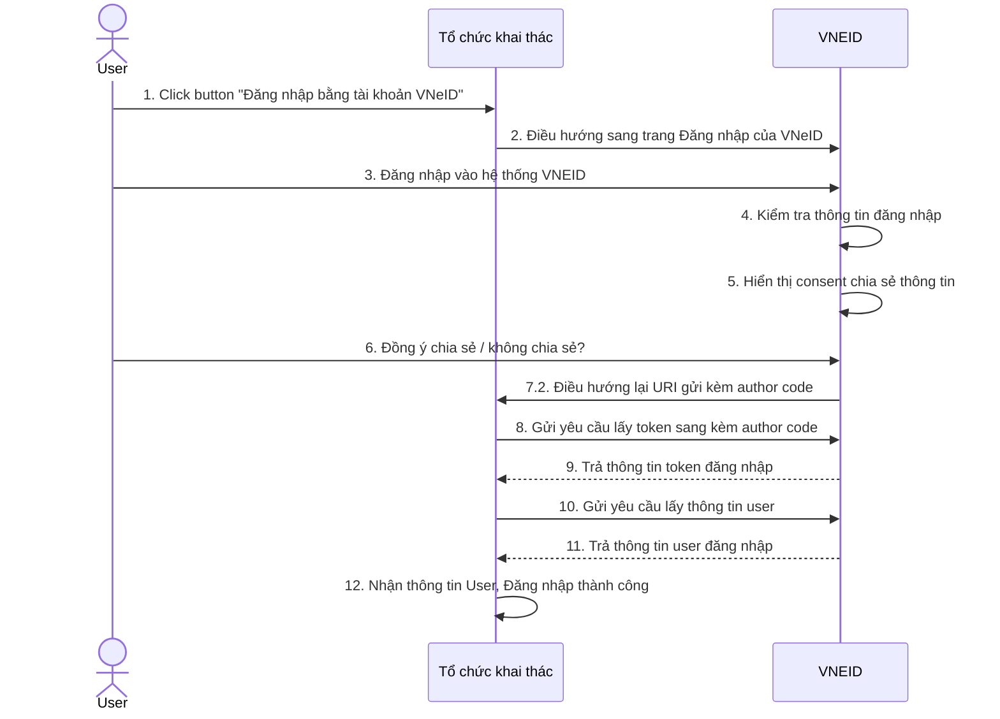
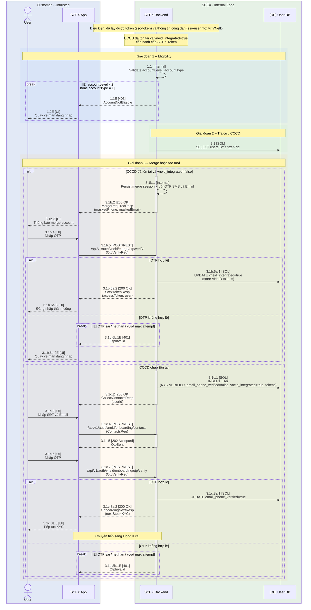

## Luồng tích hợp SSO VNeID (sequence diagram)

**Digram từ RAR**

### Bước 12: Kiểm tra thông tin và merge account
Sau khi lấy được `sso-token` và thông tin người dùng qua `sso=userinfo`, chi tiết bước 12 sẽ theo flow dưới đây
##### Các thông tin lấy được từ VNeID

- CCCD
- Họ và tên
- Ngày tháng năm sinh
- Loại tài khoản (cá nhân, tổ chức)
- Mức định danh

_ở sequence digram ký hiệu là accountType và accountLevel_

##### Các thông tin có trong token trả về:

- access_token, expires
- refresh_token, expires
- id_token

### SD-SSO-merge-account-01 – Chi tiết kiểm tra thông tin và merge account

| STT                                            | Description                                                                                                                                                                                                                      |
| ---------------------------------------------- | -------------------------------------------------------------------------------------------------------------------------------------------------------------------------------------------------------------------------------- |
| **1.1** Validate eligibility                   | Kiểm tra `accountLevel = 2` và `accountType = 1` (cá nhân) sau khi đã có UserInfoResp từ VNeID. Không đạt → 1.1E.                                                                                                                |
| **1.1E** 403 AccountNotEligible                | Từ chối đăng nhập SSO: định danh mức 1 hoặc tài khoản tổ chức. Response lỗi của `POST /api/v1/auth/vneid/sessions/token` (`error=AccountNotEligible`). Dừng luồng.                                                               |
| **1.2E** Quay về màn đăng nhập                 | App thông báo không đủ điều kiện; không tạo tài khoản mới và không merge.                                                                                                                                                        |
| **2.1** SELECT users BY citizenPid             | Tra cứu tài khoản SCEX theo CCCD (`citizenPid`).                                                                                                                                                                                 |
| **3.1b.1** Persist merge session + gửi OTP     | Account đã tồn tại, `vneid_integrated=false`. Lưu merge session; gửi OTP tới SĐT/Email **của account SCEX sẵn có** (không lấy từ VNeID). |
| **3.1b.2** 200 OK MergeRequiredResp            | Response đầu của `sessions/token`: yêu cầu xác nhận merge. Trả `maskedPhone`, `maskedEmail`, `mergeSessionId`.                                                                                                                   |
| **3.1b.3** Thông báo merge account             | Hiển thị SĐT/Email đã mask; hướng dẫn công dân nhập OTP.                                                                                                                                                                         |
| **3.1b.4** Nhập OTP                            | Công dân nhập OTP nhận được (không persist phía client).                                                                                                                                                                         |
| **3.1b.5** Verify OTP merge                    | App gọi `POST /api/v1/auth/vneid/merge/otp/verify` với `mergeSessionId` và `otp`. Sai / hết hạn / vượt max attempt → 3.1b.6b.1E.                                                                                                 |
| **3.1b.6a.1** UPDATE vneid_integrated=true     | OTP đúng: gắn VNeID vào account hiện có; lưu `access_token` / `refresh_token` / `id_token` server-side (không trả App). Idempotent theo `mergeSessionId`.                                                                        |
| **3.1b.6a.2** 200 OK ScexTokenResp             | Cấp phiên SCEX sau merge (`accessToken`, `user`; `vneidLinked=true`).                                                                                                                                                            |
| **3.1b.6a.3** Đăng nhập thành công             | Công dân vào ứng dụng với phiên SCEX vừa cấp.                                                                                                                                                                                    |
| **3.1b.6b.1E** 401 OtpInvalid                  | OTP sai, hết hạn, hoặc vượt max attempt (tối đa 5 lần / session rồi khóa merge session).                                                                                                                                         |
| **3.1b.6b.2E** Quay về màn đăng nhập           | Merge thất bại; không cấp SCEX token; `vneid_integrated` giữ `false`.                                                                                                                                                            |
| **3.1c.1** INSERT user                         | CCCD chưa có trên SCEX: tạo user `kycStatus=VERIFIED`, `email_phone_verified=false`, `vneid_integrated=true`; lưu token VNeID server-side. Unique theo `citizenPid`.                                                             |
| **3.1c.2** 200 OK CollectContactsResp          | Response đầu của `sessions/token`: yêu cầu thu thập SĐT/Email. Trả `userId`, `onboardingSessionId`.                                                                                                                              |
| **3.1c.3** Nhập SĐT và Email                   | Công dân nhập SĐT và Email để verify.                                                                                                                                                                                            |
| **3.1c.4** Submit contacts + gửi OTP           | App gọi `POST /api/v1/auth/vneid/onboarding/contacts`. Backend lưu contacts tạm; gửi OTP SMS + Email trong cùng cửa sổ xử lý. OTP TTL 5 phút.                                                                                    |
| **3.1c.5** 202 Accepted OtpSent                | Đã nhận contacts và đã kích hoạt gửi OTP. Trả `otpExpiresIn`.                                                                                                                                                                    |
| **3.1c.6** Nhập OTP                            | Công dân nhập OTP xác minh contacts.                                                                                                                                                                                             |
| **3.1c.7** Verify OTP onboarding               | App gọi `POST /api/v1/auth/vneid/onboarding/otp/verify` với `onboardingSessionId` và `otp`. Sai / hết hạn / vượt max attempt → 3.1c.8b.1E.                                                                                       |
| **3.1c.8a.1** UPDATE email_phone_verified=true | OTP đúng: đánh dấu SĐT/Email đã verify.                                                                                                                                                                                          |
| **3.1c.8a.2** 200 OK OnboardingNextResp        | Chỉ định bước tiếp theo là eKYC hiện có (`nextStep=KYC`).                                                                                                                                                                        |
| **3.1c.8a.3** Tiếp tục KYC                     | Handoff sang luồng eKYC (không vẽ biometric trên diagram này). Xem SD-RAR-ekyc-bio-01 (`scex-rar.md` mục 2.3).                                                                                                                   |
| **3.1c.8b.1E** 401 OtpInvalid                  | OTP sai / hết hạn / vượt max attempt (tối đa 5 lần / session). App tự đưa về màn đăng nhập.                                                                                                                                      |
