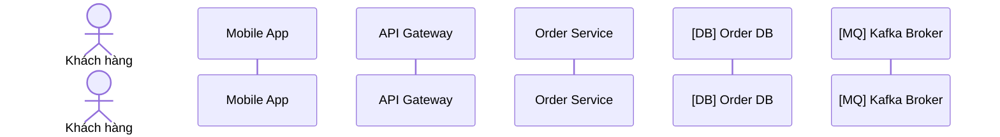
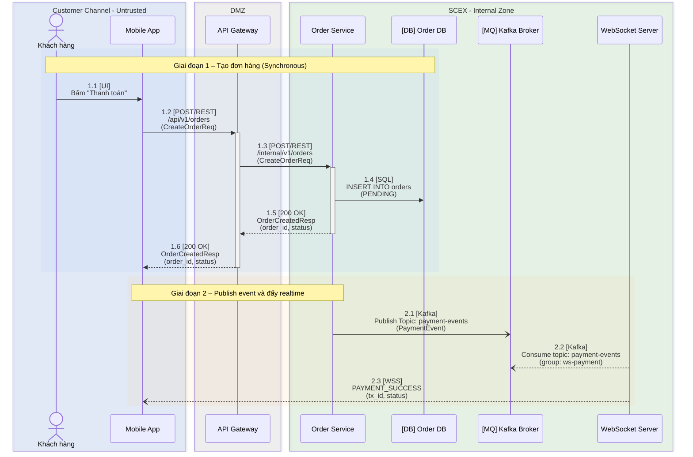

# Hướng dẫn chuẩn hóa Sequence Diagram

**Phiên bản:** 1.1  
**Ngày ban hành:** 2026-08-17  
**Trạng thái:** Draft  
**Author:** ĐỨC MAI MINH  
**Đối tượng áp dụng:** BA, SA, Dev, QA, SRE  
**Phạm vi artifact:** Mọi Sequence Diagram trong IRD, SAD, TDD, ADR (integration, API, event-driven, real-time, liên hệ thống)  
**Chu kỳ review:** 6 tháng / hoặc khi có thay đổi lớn về công nghệ tích hợp hay phiên bản Mermaid trên renderer đích

---

## 1. Mục đích & Phạm vi áp dụng

Tài liệu này quy định **chuẩn bắt buộc** khi mô tả luồng tương tác (interaction flow) trong các tài liệu kiến trúc và thiết kế kỹ thuật.

Mục tiêu:

- Đảm bảo BA, SA, Dev, QA và SRE hiểu **cùng một ngôn ngữ** về ranh giới nghiệp vụ và kỹ thuật.
- Giảm thiểu hiểu nhầm khi triển khai, test và vận hành.
- Tạo tính nhất quán, dễ bảo trì và dễ audit.
- Thu hẹp từ vựng Mermaid xuống **Safe Subset** đủ mô tả mọi luồng SCEX, tránh phụ thuộc renderer.

Phạm vi áp dụng: Mọi Sequence Diagram xuất hiện trong IRD, SAD, TDD, ADR liên quan đến integration, API, event-driven, real-time và các luồng liên hệ thống.

---

## 2. Nguyên tắc cốt lõi

| Nguyên tắc                        | Mô tả ngắn                                                                                                                                               |
| --------------------------------- | -------------------------------------------------------------------------------------------------------------------------------------------------------- |
| **Visual + Detail Separation**    | Sequence Diagram chỉ thể hiện cái nhìn trực quan. Mọi thông tin kỹ thuật chi tiết (NFR, timeout, retry, schema, classification) phải nằm trong bảng phụ. |
| **Hierarchical Numbering**        | Đánh số phân cấp **thủ công**. Cấm `autonumber` trên artifact chính thức.                                                                                |
| **Consistent Labeling**           | Nhãn trên mũi tên ngắn gọn, đúng cấu trúc, đúng **arrow type**, xuống dòng theo mục 4.1.                                                                 |
| **Traceability**                  | Mỗi step trên diagram map **1-1** với đúng một dòng bảng phụ; bảng phụ map tiếp tới API spec ID và requirement ID.                                       |
| **Causal Completeness**           | Không được xuất hiện lifeline "mọc từ hư không". Mọi participant hành động ở giai đoạn N phải đã nhận message ở giai đoạn N hoặc N−1.                    |
| **NFR & Error Handling bắt buộc** | Timeout, Retry, Error Policy, Idempotency ghi trong bảng phụ. Luồng lỗi phải có `alt` / `break` (hoặc diagram lỗi riêng được liên kết).                  |
| **Safe Subset first**             | Chỉ dùng feature Extended khi đã render thử trên **đúng renderer đích**.                                                                                 |

---

## 3. Best Practice 1 – Đánh số Step (Step Numbering)

**Quy tắc bắt buộc:** Sử dụng **Hierarchical / Nested Numbering** (số thập phân), đánh **thủ công**.

- **Số nguyên** (`1`, `2`, `3`…): Đại diện cho **nhóm hành động lớn / giai đoạn logic** (Main Logical Block). Số nguyên **không** đứng một mình trên mũi tên.
- **Số thập phân cấp 1** (`1.1`, `1.2`, `2.1`…): Đại diện cho **từng message / call / response** cụ thể. **Step đầu tiên của mỗi nhóm phải là `x.1`** — không dùng `1.0`, `2.0`.
- **Cấp nhánh và cấp sâu:** xem mục 3.1. Không dùng đồng thời `1.2.1` và `1.2.a` cho cùng một quy ước — chốt theo mục 3.1.

**CẤM `autonumber`:**

- `autonumber` (kể cả `autonumber <start> <increment>` từ Mermaid v11.15.0+) **chỉ được dùng khi phác thảo**.
- Phải **xóa trước khi đưa vào IRD/SAD/TDD/ADR**.
- Lý do: Mermaid chèn 1, 2, 3… vào đầu mỗi mũi tên → số kép (`1  1.1 [POST/REST]…`) và **không làm được phân cấp lồng nhau** (`2.4a.1`).

**Ví dụ cấu trúc nhóm:**

```
1. Khởi tạo & Xác thực
   1.1  Request authentication
   1.2  Validate token
   1.3  Response success / fail
2. Xử lý nghiệp vụ chính
   2.1  ...
3. Thông báo kết quả & Cleanup
```

**Lợi ích:** Khi thảo luận chỉ cần nói “lỗi ở bước 2.4a.1” thay vì “mũi tên thứ 7 từ trên xuống”.

### 3.1. Đánh số bên trong fragment

| Fragment                  | Quy tắc số                                                                 | Ví dụ                                              |
| ------------------------- | -------------------------------------------------------------------------- | -------------------------------------------------- |
| `alt` / `critical option` | Hậu tố **chữ cái** ở cấp nhánh; step trong nhánh thêm cấp thập phân        | Nhánh: `2.4a`, `2.4b`. Step: `2.4a.1`, `2.4a.2`    |
| `opt`                     | Giữ số tuần tự của luồng chính; ghi `[OPT]` trên nhãn khối                 | `opt [OPT] Gửi email xác nhận` → step `2.5`, `2.6` |
| `loop`                    | Giữ số tuần tự; ghi `[LOOP xN]` trên nhãn khối (N = số lần hoặc điều kiện) | `loop [LOOP x3] Retry charge` → step `2.3`, `2.4`  |
| `par`                     | Mỗi nhánh song song một hậu tố chữ cái, cùng cấp                           | `2.5a.1` (ghi audit) và `2.5b.1` (gửi notify)      |
| `break`                   | Hậu tố **`E`** (Exception exit)                                            | `2.6E`                                             |

Không đánh số lại từ `1.1` khi vào trong fragment. Số nhánh kế thừa số step tại điểm rẽ.

---

## 4. Best Practice 2 – Nội dung nhãn trên mũi tên (Message Label)

Nhãn trên mũi tên **không được viết dài dòng**, cũng **không được viết quá ngắn** đến mức không hiểu được.

**Cấu trúc chuẩn bắt buộc:**

```
[Số Step]  [Giao thức / Phương thức]  :  Tên hành động / Endpoint / Topic  (Payload chính)
```

Trên artifact chính thức, cấu trúc trên **phải** được render xuống dòng theo mục 4.1 (không để cả ba phần trên một dòng ngang).

### 4.1. Xuống dòng nhãn (bắt buộc)

Mọi nhãn mũi tên có `[TAG]` trên IRD/SAD/TDD/ADR **phải** tách dòng bằng `<br>` (không dùng `<br/>`). Giữ số step cùng dòng với `[TAG]`. **Không** bọc quote quanh toàn bộ nhãn.

| Số phần                             | Quy tắc | Ví dụ                                                     |
| ----------------------------------- | ------- | --------------------------------------------------------- |
| **3 phần** `[TAG] action (payload)` | 3 dòng  | `1.2 [POST/REST]<br>/api/v1/orders<br>(CreateOrderReq)`   |
| **2 phần** (không có `(...)` cuối)  | 2 dòng  | `3.11 [GET/REST]<br>/api/tcdn/sso-userinfo/api/vneid/sso` |
| Status ngắn                         | 2 dòng  | `1.2E [401]<br>Unauthorized`                              |

Quy tắc bổ sung:

- Mọi `(...)` **cuối nhãn** đều là dòng 3 — kể cả `(poll)`, `(redis)`, `(đã verify)`, `(CreateOrderReq, Idempotency-Key)`.
- Nếu action đã có `<br>` nội bộ (vd Internal dài): chỉ chèn `<br>` sau `[TAG]`, **không** xóa `<br>` cũ. Ví dụ: `1.3 [Internal]<br>persist logout state<br>revoke phiên SCEX + token VNeID`.
- Áp dụng mọi `[TAG]`: `[POST/REST]`, `[GET/REST]`, `[200 OK]`, `[UI]`, `[Internal]`, `[VPN/IPSec]`, `[Universal Link]`, `[Kafka]`, `[SQL]`, `[gRPC]`, `[WSS]`, …

Ví dụ forward / VPN (kiểu IRD liên hệ thống):

```
3.4 [POST/REST]<br>Forward sso-token<br>(SsoTokenForm)
3.5 [VPN/IPSec]<br>Encrypt + Forward sso-token<br>(EncryptedEnvelope)
```

**Ví dụ chuẩn theo từng loại giao tiếp:**

| Loại luồng              | Ví dụ nhãn chuẩn                                                      |
| ----------------------- | --------------------------------------------------------------------- |
| Tác vụ UI               | `1.1 [UI]<br>Bấm "Thanh toán"`                                        |
| REST API (Sync)         | `1.2 [POST/REST]<br>/api/v1/orders<br>(CreateOrderReq)`               |
| Response HTTP           | `1.6 [200 OK]<br>OrderCreatedResp<br>(order_id, status)`              |
| WebSocket (server push) | `2.3 [WSS]<br>PAYMENT_SUCCESS<br>(tx_id, status)`                     |
| Kafka publish           | `2.1 [Kafka]<br>Publish Topic: payment-events<br>(PaymentEvent)`      |
| Kafka consume (poll)    | `2.2 [Kafka]<br>Consume topic: payment-events<br>(group: ws-payment)` |
| Internal / DB           | `1.4 [SQL]<br>INSERT INTO orders<br>(PENDING)`                        |
| gRPC                    | `2.2 [gRPC]<br>PaymentService.Charge<br>(ChargeRequest)`              |

**Lưu ý:**

- Luôn ghi rõ method + path hoặc topic name (+ consumer group khi consume).
- Payload chỉ ghi tên schema hoặc các field quan trọng nhất.
- Không viết mô tả nghiệp vụ dài trên mũi tên.
- Thiếu `[Protocol]` là vi phạm — kể cả bước consume / forward.
- Nhãn còn để cả `[TAG]`, path và `(payload)` trên một dòng ngang = vi phạm mục 4.1.

---

## 5. Quy tắc mũi tên (Arrow Type ↔ Ngữ nghĩa)

Đây là **từ vựng bắt buộc**. Chọn sai mũi tên = mô tả sai kiến trúc (sync bị vẽ thành async, broker bị vẽ như đang gọi consumer).

| Mermaid  | Hình thức        | Ngữ nghĩa bắt buộc                               | Dùng khi                                                           |
| -------- | ---------------- | ------------------------------------------------ | ------------------------------------------------------------------ |
| `->>`    | liền, mũi kín    | **Sync request**                                 | REST/gRPC request, SQL query, lệnh gọi **chờ kết quả**             |
| `-->>`   | nét đứt, mũi kín | **Sync response / return**                       | HTTP response, gRPC reply, DB result set                           |
| `-)`     | liền, mũi hở     | **Async fire-and-forget**                        | Publish Kafka/MQ/SNS, gửi event **không chờ** xử lý                |
| `--)`    | nét đứt, mũi hở  | **Async delivery / callback**                    | Consume topic (consumer poll), webhook từ đối tác, WSS server push |
| `-x`     | liền, dấu X      | **Message thất bại / bị hủy**                    | Timeout, circuit breaker mở, request bị reject                     |
| `--x`    | nét đứt, dấu X   | **Response mất / không tới**                     | Callback không nhận được, response bị drop                         |
| `<<->>`  | liền, 2 đầu      | **Kênh song hướng** (Extended, v11.0.0+)         | Thiết lập WSS / gRPC bidirectional stream                          |
| `<<-->>` | nét đứt, 2 đầu   | Kênh song hướng ở mức logic (Extended, v11.0.0+) | Phiên duplex                                                       |

**CẤM:**

| Mermaid                                     | Lý do                                                         |
| ------------------------------------------- | ------------------------------------------------------------- |
| `->` , `-->` (không mũi)                    | Mất hướng gọi → gây tranh cãi khi review                      |
| Half-arrows (`-\|`, `-//`, …), central `()` | Chỉ có từ v11.12.3+, nhiều biến thể, không cần thiết cho SCEX |

Tám loại được phép là đủ mô tả mọi luồng. Không liệt kê thêm biến thể.

**Quy tắc hướng cho Kafka / MQ:**

- Publish: `Producer-)Broker` (fire-and-forget).
- Consume: Kafka/RabbitMQ là **pull-based**. Broker **không** chủ động gọi consumer. Mũi tên phải là `Consumer--)Broker` với nhãn `Consume topic: … (group: …)` — **không** vẽ `Broker->>Consumer`.

**Quy tắc hướng cho WebSocket:**

- Client gửi frame: `App->>WS` (nếu chờ ack) hoặc `App-)WS` (nếu không chờ).
- Server push: `WS--)App`.
- Thiết lập kênh duplex: `<<->>` chỉ khi renderer ≥ v11.0.0; nếu không, vẽ hai mũi `->>` / `--)` và `Note` “kênh WSS đã mở”.

---

## 6. Participant, Box, Activation, Note

### 6.1. Khai báo Participant

- **Khai báo toàn bộ participant ở đầu diagram** — không khai ngầm giữa chừng.
- Thứ tự trái → phải: **caller → callee** / theo lớp kiến trúc (Untrusted → DMZ → Internal → Data/MQ).
- Phân biệt loại participant. Safe Subset dùng **tiền tố naming**; stereotype JSON chỉ dùng khi renderer hỗ trợ (xem mục 9).

**Safe Subset (bắt buộc mặc định):**



Tiền tố gợi ý: `[GW]` boundary, `[SVC]` control, `[ENT]` entity, `[DB]` database, `[COL]` collections, `[MQ]` queue.

**Extended (Mermaid v11.12.3+, chỉ khi đã render thử):**

```
actor  User as Khách hàng
participant GW@{ "type": "boundary" }   as API Gateway
participant Core@{ "type": "control" }  as Order Service
participant DB@{ "type": "database" }   as Order DB
participant MQ@{ "type": "queue" }      as Kafka Broker
```

Đủ loại: `boundary`, `control`, `entity`, `database`, `collections`, `queue`. Nếu Extended không render được → fallback về naming convention ở trên.

### 6.2. `box` — nhóm trust zone / ownership

Bắt buộc nhóm participant theo **trust zone** hoặc **ownership** (SCEX vs đối tác, DMZ vs Internal). Quan trọng với luồng SCEX ↔ C06 / VNeID.

```
box rgba(120,170,255,0.15) Customer Channel (Untrusted)
    actor User
    participant App
end
box rgba(150,220,150,0.15) SCEX - Internal Zone
    participant Core
    participant DB
end
```

Hai cạm bẫy:

1. **Màu phải đứng TRƯỚC description.** Sai: `box SCEX Internal rgba(...)`.
2. **Không dùng hex color** (`#rrggbb`) — ký tự `#` bị Mermaid hiểu là comment. Dùng `rgba(...)`. Alpha thấp (`0.08`–`0.18`) để an toàn dark theme.

### 6.3. Activation

- Bật activation cho **mọi sync call** (`->>` / `-->>`) để thấy cửa sổ xử lý.
- **Phải cân bằng:** mỗi `activate` có đúng một `deactivate`.
- Ưu tiên shorthand `->>+` / `-->>-` khi activation nằm trọn trong một nhánh tuyến tính.
- **Chuyển sang `activate` / `deactivate` tường minh** khi activation **bắc qua biên** `alt` / `opt` / `loop` / `par` / `critical` / `break`. Shorthand trong nhánh `alt` rất dễ mất cân bằng và làm vỡ diagram.
- Async (`-)` / `--)`) **không** bắt buộc activation (không có cửa sổ chờ). Nếu bật, vẫn phải cân bằng.

### 6.4. `Note`

| Cú pháp                              | Dùng cho                                                |
| ------------------------------------ | ------------------------------------------------------- |
| `Note over A,B`                      | Phân tách giai đoạn logic                               |
| `Note right of X` / `Note left of X` | Ràng buộc kỹ thuật **ngắn** (ví dụ: “TLS 1.2+”, “mTLS”) |

**CẤM** đưa NFR / timeout / retry / SLA / idempotency vào `Note`. Các thông tin đó thuộc **bảng phụ** (Visual + Detail Separation).

### 6.5. `create` / `destroy` (Extended, v10.3.0+; bug fix v10.7.0+)

Dùng cho participant có vòng đời ngắn: session SSO, token tạm, `transaction_id`, saga instance. Phù hợp luồng VNeID / thanh toán.

Chỉ dùng sau khi renderer đích đã xác nhận. Fallback Safe Subset: `Note over X: tạo session` / `Note over X: hủy session` — không tạo lifeline giả.

---

## 7. Control-flow fragment (cú pháp Mermaid)

Mục 3 nói _khi nào_ đánh số nhánh. Mục này nói _viết thế nào_.

| Mermaid                   | Dùng cho                                                                     |
| ------------------------- | ---------------------------------------------------------------------------- |
| `alt … else … end`        | 2+ nhánh **loại trừ nhau** (success/fail, in-stock/out-of-stock)             |
| `opt … end`               | Nhánh tùy chọn, **không** có `else`                                          |
| `loop … end`              | Retry, polling, batch, phân trang                                            |
| `par … and … end`         | Gọi song song (fan-out)                                                      |
| `critical … option … end` | Bước bắt buộc thành công + xử lý từng tình huống lỗi                         |
| `break … end`             | Dừng luồng do exception — bắt buộc có trên luồng lỗi VNeID / cổng thanh toán |

Ví dụ `alt` + activation tường minh (bắc qua biên nhánh):

```
App->>GW: 1.2 [POST/REST]<br>/api/v1/orders<br>(CreateOrderReq)
activate GW
alt Token hợp lệ
    GW->>Core: 1.2a.1 [POST/REST]<br>/internal/v1/orders<br>(CreateOrderReq)
    activate Core
    Core-->>GW: 1.2a.2 [200 OK]<br>OrderCreatedResp<br>(order_id)
    deactivate Core
else Token hết hạn
    GW-->>App: 1.2b.1 [401]<br>Unauthorized
end
deactivate GW
```

Ví dụ `break`:

```
break [E] VNeID trả lỗi xác thực
    IdP-->>App: 2.6E [401]<br>VNeIDAuthFailed
end
```

---

## 8. Best Practice 3 – Bảng phụ chi tiết (Sequence Step Specification Table)

Sequence Diagram chỉ là **Visual View**.  
Mọi thông tin kỹ thuật, NFR, error handling phải nằm trong **bảng phụ** đặt **ngay bên dưới** diagram. Không có bảng phụ = diagram chưa hoàn chỉnh.

### 8.1. Cấu trúc cột bắt buộc

| Cột                        | Mô tả                                                                      | Bắt buộc |
| -------------------------- | -------------------------------------------------------------------------- | -------- |
| **STT (Step)**             | Số step theo hierarchical numbering                                        | Có       |
| **Source**                 | Bên gửi                                                                    | Có       |
| **Target**                 | Bên nhận                                                                   | Có       |
| **Protocol**               | Giao thức (REST/HTTPS, Kafka, gRPC, WSS, SQL…)                             | Có       |
| **API / Endpoint / Topic** | Đường dẫn hoặc tên topic (+ consumer group nếu consume)                    | Có       |
| **Description**            | Mô tả nghiệp vụ + kỹ thuật ngắn gọn                                        | Có       |
| **Payload / Schema**       | Input & Output (tên schema hoặc field chính — **không** paste JSON đầy đủ) | Có       |
| **Error & Retry Policy**   | Timeout, Retry, DLQ, Idempotency, Status code lỗi                          | Có       |
| **Data Classification**    | `Public` / `Internal` / `PII` / `Sensitive` (kể cả sinh trắc học)          | Có       |
| **Trace ID**               | API spec ID (vd `3.2.5`) và/hoặc requirement ID (`BR-…` / `FR-…`)          | Có       |

`Data Classification` là **bắt buộc**, không phải khuyến nghị. Mọi luồng VNeID / định danh / thanh toán đều chạm dữ liệu cá nhân theo Nghị định 13/2023/NĐ-CP.

### 8.2. Cột khuyến nghị bổ sung

- Authentication / Authorization
- SLA / Response Time target
- Idempotency Key
- Circuit Breaker / Rate Limit

Định dạng ô và bộ số step đầy đủ: xem **mục 14.B** (cùng một luồng với diagram 14.A — map 1-1).

---

## 9. Baseline phiên bản Mermaid & tương thích renderer

Repo nằm trên GitLab; tài liệu còn xuất sang Confluence / Word. Mỗi nơi bundle **một version Mermaid khác nhau**. Người viết phải chia feature theo nhóm sau.

| Nhóm                                | Feature                                                                                                                           | Version tối thiểu           |
| ----------------------------------- | --------------------------------------------------------------------------------------------------------------------------------- | --------------------------- |
| **Safe Subset (bắt buộc dùng)**     | `->>`, `-->>`, `-)`, `--)`, `-x`, `--x`, `alt` / `opt` / `loop` / `par` / `critical` / `break`, `box`, `rect`, `Note`, activation | v10.x                       |
| Extended                            | `create` / `destroy`                                                                                                              | v10.3.0+ (bug fix v10.7.0+) |
| Extended                            | `<<->>` / `<<-->>` bidirectional                                                                                                  | v11.0.0+                    |
| Extended                            | stereotype `@{ "type": … }`, half-arrows, central `()`                                                                            | v11.12.3+                   |
| Extended — **vẫn CẤM trên IRD/SAD** | `autonumber <start> <increment>`                                                                                                  | v11.15.0+                   |

**Quy tắc:**

1. Người viết **phải render thử trên đúng renderer đích** trước khi commit.
2. Nếu Extended không render được → fallback Safe Subset (ví dụ: thay stereotype bằng `[DB] Order DB`; thay `<<->>` bằng hai mũi + `Note`).
3. Ví dụ mẫu trong tài liệu governance này **chỉ dùng Safe Subset**, trừ khi đoạn đó được đánh dấu _Extended_.

---

## 10. Cạm bẫy cú pháp Mermaid

| Cạm bẫy                                   | Hệ quả                                             | Cách xử lý                                                                                              |
| ----------------------------------------- | -------------------------------------------------- | ------------------------------------------------------------------------------------------------------- |
| Từ `end` trong tên participant hoặc nhãn  | **Vỡ diagram** (đóng block sớm)                    | Bọc `(end)`, `[end]`, hoặc `"end"`. Tiếng Việt thường an toàn; nhãn kỹ thuật kiểu `/api/v1/end` thì vỡ. |
| `;`                                       | Mermaid hiểu là ngắt dòng                          | Escape thành `#59;`                                                                                     |
| `#`                                       | Comment                                            | Escape thành `#35;`. **Hệ quả:** hex color `#ff0000` không dùng được.                                   |
| Hex color trong `box` / `rect`            | Màu bị nuốt vì `#` = comment                       | Dùng `rgba(r,g,b,a)`                                                                                    |
| `rect rgb(240, 248, 255)` (màu đặc, sáng) | Dark theme: chữ sáng trên nền sáng, không đọc được | Bắt buộc `rgba(...)` alpha thấp, vd `rect rgba(120,170,255,0.08)`                                       |
| Xuống dòng trong nhãn                     | Nhãn dài / 1 dòng ngang khó đọc                    | **Bắt buộc** `<br>` theo mục 4.1 (`[TAG]<br>action<br>(payload)`). Không dùng `<br/>`.                  |
| Xuống dòng trong **tên** participant      | Không dùng `<br>` trực tiếp                        | Phải qua `as` alias                                                                                     |
| Comment                                   | Dính vào statement nếu cùng dòng                   | `%%` và **phải nằm trên dòng riêng**                                                                    |
| Dấu `:` trong nội dung nhãn               | An toàn                                            | Chỉ `:` **đầu tiên** (sau arrow) là ký tự phân tách `Participant: message`                              |

---

## 11. Giới hạn khả đọc

| Ngưỡng         | Giá trị                    | Khi vượt                                                      |
| -------------- | -------------------------- | ------------------------------------------------------------- |
| Lifeline       | tối đa **7–9**             | Tách diagram theo trust zone hoặc theo giai đoạn              |
| Step / diagram | tối đa **20–25**           | Tách; liên kết bằng số step (`xem SD-02 bước 3.x`)            |
| Use case       | **1 diagram = 1 use case** | Không ghép “đăng nhập + thanh toán + hoàn tiền” trên một hình |

Mỗi diagram có ID ổn định: `SD-<domain>-<use-case>-<nn>` (vd `SD-ORD-create-order-01`).

---

## 12. Lưu trữ & vòng đời artifact

| Hạng mục            | Quy định                                                                                                                          |
| ------------------- | --------------------------------------------------------------------------------------------------------------------------------- |
| Nguồn sự thật       | Embed khối ` ```mermaid ` trong markdown IRD/SAD. Đây là bản được review.                                                         |
| File sidecar `.mmd` | Bắt buộc khi diagram > ~15 step hoặc dùng chung nhiều tài liệu. Đặt cạnh markdown, cùng stem: `SD-ORD-create-order-01.mmd`.       |
| Export PNG/SVG      | Bắt buộc khi phát hành Word / Confluence **nếu** renderer đích không chạy Mermaid. File ảnh không thay thế source `.md` / `.mmd`. |
| Naming              | `SD-<domain>-<use-case>-<nn>.mmd` (chữ thường, gạch ngang).                                                                       |
| Review              | SA review đúng arrow / numbering / bảng 1-1 / Safe Subset.                                                                        |
| Approve             | Architecture Owner hoặc Lead SA approve trước khi đóng IRD/SAD.                                                                   |
| Sửa diagram         | Đổi step → cập nhật **cùng lúc** bảng phụ và mọi tham chiếu `xem SDx bước y`.                                                     |

---

## 13. Anti-patterns

Không làm các việc sau:

1. Viết mô tả nghiệp vụ dài trên mũi tên.
2. Vẽ quá 9 lifeline trên một diagram.
3. Dùng `->` / `-->` (không mũi).
4. Ghép nhiều use case trên một hình.
5. Copy toàn bộ JSON schema vào bảng phụ.
6. Bỏ luồng lỗi (không `alt` / `break`, cũng không có diagram lỗi liên kết).
7. Để `autonumber` trong IRD/SAD.
8. API Gateway `INSERT` thẳng vào DB — Gateway chỉ route; service (control) mới ghi DB.
9. Vẽ `Broker->>Consumer` cho Kafka/MQ pull-based.
10. Dùng hex color hoặc `rgb()` đặc (vỡ dark theme / vỡ vì `#`).
11. Nhét timeout / retry / SLA vào `Note`.
12. Khai participant ngầm giữa diagram.
13. Dùng `1.0` làm step đầu.
14. Bảng phụ lệch số step so với diagram.
15. Để cả `[TAG]`, path và `(payload)` trên một dòng ngang — vi phạm mục 4.1.

---

## 14. Ví dụ hoàn chỉnh (Mermaid + Bảng phụ)

Luồng: khách hàng tạo đơn (sync) → Order Service persist → publish event → WebSocket consumer poll → đẩy realtime. Happy path; luồng lỗi phải có `alt`/`break` hoặc `SD-ORD-create-order-02` (error).

### 14.A. Sequence Diagram (Mermaid) — Safe Subset

Không dùng `autonumber`. Màu `rgba` alpha thấp. Arrow đúng ngữ nghĩa. `Core` nhận call từ `GW` trước khi publish.



### 14.B. Bảng phụ chi tiết (đặt ngay dưới diagram)

**Bảng SD-ORD-create-order-01 – Chi tiết luồng Tạo đơn hàng & Thanh toán**

| STT     | Source           | Target        | Protocol     | API / Endpoint / Topic                        | Description                                     | Payload / Schema                                                                       | Error & Retry Policy                                                     | Data Classification | Trace ID              |
| ------- | ---------------- | ------------- | ------------ | --------------------------------------------- | ----------------------------------------------- | -------------------------------------------------------------------------------------- | ------------------------------------------------------------------------ | ------------------- | --------------------- |
| **1.1** | Khách hàng       | Mobile App    | UI           | Nút Thanh toán                                | Khách bấm thanh toán trên app                   | —                                                                                      | —                                                                        | Public              | FR-ORD-01             |
| **1.2** | Mobile App       | API Gateway   | REST / HTTPS | `POST /api/v1/orders`                         | App gửi yêu cầu tạo đơn                         | **Req:** `CreateOrderReq` (`user_id`, `items`, `total_amount`)<br>**Auth:** Bearer JWT | Timeout 5s<br>Retry: 0 (bắt buộc Idempotency-Key)<br>400/422 nếu invalid | PII                 | API-3.2.5 / FR-ORD-01 |
| **1.3** | API Gateway      | Order Service | REST / HTTPS | `POST /internal/v1/orders`                    | Gateway ủy quyền, **không** ghi DB              | **Req:** `CreateOrderReq`                                                              | Timeout 3s<br>Retry: 0<br>502 nếu Core down                              | PII                 | API-3.2.5             |
| **1.4** | Order Service    | Order DB      | TCP / SQL    | `INSERT INTO orders`                          | Persist đơn trạng thái PENDING                  | Table: `orders`                                                                        | Transaction timeout 3s                                                   | PII                 | FR-ORD-02             |
| **1.5** | Order Service    | API Gateway   | HTTP         | `200 OK`                                      | Core trả `order_id`, `status`                   | **Resp:** `OrderCreatedResp`                                                           | 422 nếu hết hàng                                                         | Internal            | API-3.2.5             |
| **1.6** | API Gateway      | Mobile App    | HTTP         | `200 OK` / `4xx`                              | Trả về client                                   | **Resp:** `OrderCreatedResp` (`order_id`, `status`)                                    | 422 nếu hết hàng                                                         | Internal            | API-3.2.5 / FR-ORD-01 |
| **2.1** | Order Service    | Kafka Broker  | Kafka        | Topic: `payment-events`                       | Publish event sau khi persist (fire-and-forget) | Schema: `PaymentEventAvro`                                                             | Retention 7 ngày<br>DLQ: `payment-dlq`                                   | Internal            | FR-ORD-03             |
| **2.2** | WebSocket Server | Kafka Broker  | Kafka        | Topic: `payment-events` (group: `ws-payment`) | Consumer **poll** — không phải broker gọi WS    | Schema: `PaymentEventAvro`                                                             | Retry poll theo backoff của consumer<br>DLQ: `payment-dlq`               | Internal            | FR-ORD-03             |
| **2.3** | WebSocket Server | Mobile App    | WSS          | Event: `PAYMENT_SUCCESS`                      | Server push realtime kết quả                    | Frame: `{event, tx_id, status}`                                                        | Auto-reconnect 3s (Exponential Backoff)                                  | Internal            | FR-ORD-04             |

Chín step trên diagram = chín dòng bảng. Lệch số = chưa đạt Traceability.

### 14.C. Minh họa đánh số nhánh lỗi (không thay thế 14.A)

```
alt Thanh toán thành công
    Core-)Kafka: 2.4a.1 [Kafka]<br>Publish Topic: payment-events<br>(PaymentEvent)
else Cổng thanh toán từ chối
    Core-->>GW: 2.4b.1 [422]<br>PaymentRejected
end
```

---

## 15. Checklist trước khi submit tài liệu

Trước khi đưa Sequence Diagram vào IRD/SAD, người viết phải tự kiểm tra:

- [ ] Đã dùng Hierarchical Numbering; step đầu mỗi nhóm là `x.1` (không có `x.0`)
- [ ] **Không còn `autonumber`**
- [ ] Nhãn mũi tên đúng cấu trúc `[Số] [Protocol] …`
- [ ] Nhãn mũi tên đã tách dòng theo mục 4.1 (`[TAG]<br>…`, payload `(…)` trên dòng riêng nếu có)
- [ ] **Arrow đúng bảng ngữ nghĩa** mục 5 (không `->` / `-->` / half-arrow)
- [ ] Kafka consume là `Consumer--)Broker`, không phải `Broker->>Consumer`
- [ ] Mọi participant khai báo ở đầu, trái → phải theo lớp kiến trúc
- [ ] Đã nhóm `box` theo trust zone / ownership
- [ ] Màu `rgba` alpha thấp — không hex, không `rgb()` đặc
- [ ] Activation cân bằng; shorthand không bắc qua biên `alt`/`loop`
- [ ] Chỉ dùng Safe Subset, **hoặc** đã render thử Extended trên renderer đích
- [ ] Có bảng phụ ngay bên dưới diagram
- [ ] Số step trên diagram khớp **100%** với bảng phụ (map 1-1)
- [ ] Đã điền **Trace ID** và **Data Classification**
- [ ] Timeout + Retry + Error Policy nằm ở bảng phụ, **không** nằm trong `Note`
- [ ] Payload/Schema được tham chiếu (không copy schema dài)
- [ ] `Note` / `rect` chỉ phân tách giai đoạn hoặc ràng buộc kỹ thuật ngắn
- [ ] ≤ 9 lifeline, ≤ 25 step, 1 use case / diagram
- [ ] Có luồng lỗi (`alt`/`break`) hoặc liên kết diagram lỗi
- [ ] Đã render thử trên renderer đích trước khi commit

---

## 16. Liên kết với các nguyên tắc kiến trúc khác

Tài liệu này bổ sung và phải tuân thủ các nguyên tắc sau trong mục **Architecture Principles & Guidelines**:

- API-First
- Cloud-Native
- Event-Driven Architecture
- Observability by Design
- Security by Design
- Idempotency & Exactly-once (khi áp dụng)

---

## 17. Changelog

| Phiên bản | Ngày       | Tác giả      | Mô tả                                                         |
| --------- | ---------- | ------------ | ------------------------------------------------------------- |
| 1.1       | 2026-08-17 | ĐỨC MAI MINH | Thêm mục 4.1: xuống dòng nhãn mũi tên bằng `<br>` (bắt buộc). |
| 1.0       | —          | ĐỨC MAI MINH | Ban hành lần đầu.                                             |
