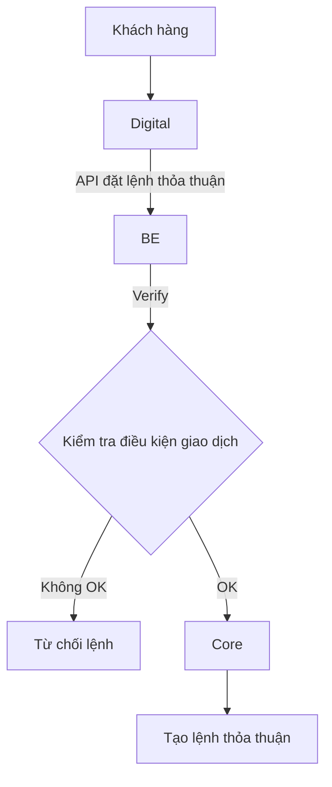

# 2.2 Tích hợp lệnh thỏa thuận với khách hàng

Hệ thống cho phép khách hàng thực hiện **giao dịch thỏa thuận với SCEX** đối với các mã được cấu hình cho phép tự doanh. Digital là kênh giao dịch, hệ thống cung cấp API và dữ liệu realtime để Digital hiển thị và thực hiện đặt lệnh.

## 2.2.1. Danh sách mã và điều kiện giao dịch

Digital gọi API để lấy danh sách các mã **được phép tự doanh** và trạng thái giao dịch tương ứng.

Đối với mỗi mã, hệ thống cung cấp:

- Mã giao dịch.
- Tên tài sản.
- Hướng giao dịch được phép: **Mua / Bán / Mua & Bán**.
- Giá giao dịch hiện tại.
- Khối lượng/giá trị giao dịch tối thiểu.
- Khối lượng/giá trị giao dịch tối đa theo từng chiều.

Digital chỉ hiển thị và cho phép khách hàng lựa chọn các mã đang ở trạng thái **được phép tự doanh**.

---

## 2.2.2. Cung cấp giá Realtime và hạn mức giao dịch

Hệ thống cung cấp dữ liệu realtime cho Digital thông qua **Kafka**.

Dữ liệu realtime bao gồm:

- Mã giao dịch.
- Giá mua tự doanh.
- Giá bán tự doanh.
- Khối lượng/giá trị tối thiểu Mua.
- Khối lượng/giá trị tối đa Mua.
- Khối lượng/giá trị tối thiểu Bán.
- Khối lượng/giá trị tối đa Bán.
- Thời điểm cập nhật.
- Trạng thái dữ liệu.

Khi giá tham chiếu hoặc cấu hình giá tự doanh thay đổi, hệ thống thực hiện **publish message qua Kafka** để Digital cập nhật thông tin realtime.

> **Lưu ý:** Nếu nghiệp vụ đang quản lý theo **giá trị giao dịch** thay vì **khối lượng**, cần thống nhất thuật ngữ trên Digital là "Giá trị tối thiểu/tối đa" để tránh hiểu nhầm với Quantity.

---

## 2.2.3. Đặt lệnh thỏa thuận

Khách hàng thực hiện đặt lệnh thỏa thuận trên Digital.

Digital gọi **API đặt lệnh thỏa thuận** do hệ thống cung cấp.

Luồng xử lý:

### Quy tắc xử lý

**Bước 1 – Digital gửi yêu cầu**

Digital gửi thông tin đặt lệnh gồm tối thiểu:

- Customer ID.
- Mã giao dịch.
- Chiều giao dịch: Mua/Bán.
- Giá.
- Khối lượng hoặc giá trị giao dịch.
- Thông tin định danh request/order.

**Bước 2 – BE tiếp nhận và Verify**

BE thực hiện kiểm tra/verify các điều kiện cần thiết trước khi đưa lệnh vào Core, bao gồm:

- Mã có được phép tự doanh hay không.
- Chiều giao dịch có được phép hay không.
- Giá giao dịch có đúng giá tự doanh hiện hành hay không.
- Khối lượng/giá trị giao dịch có nằm trong giới hạn tối thiểu/tối đa hay không.
- Các điều kiện nghiệp vụ khác theo quy định của giao dịch thỏa thuận.

**Bước 3 – Đẩy lệnh vào Core**

Chỉ khi kết quả **Verify = OK**, BE mới thực hiện đẩy lệnh vào Core (order API đặt lệnh thỏa thuận vào core như luồng đặt lệnh thỏa thuận trên Portal).

Nếu Verify không OK:

- Không đẩy lệnh vào Core.
- Trả kết quả từ chối về Digital.
- Trả mã lỗi và thông báo lỗi tương ứng.

### Nguyên tắc quan trọng

> **Verify thành công là điều kiện bắt buộc trước khi lệnh được đẩy vào Core.**

Lệnh chưa Verify thành công **không được tạo/gửi vào Core**.
