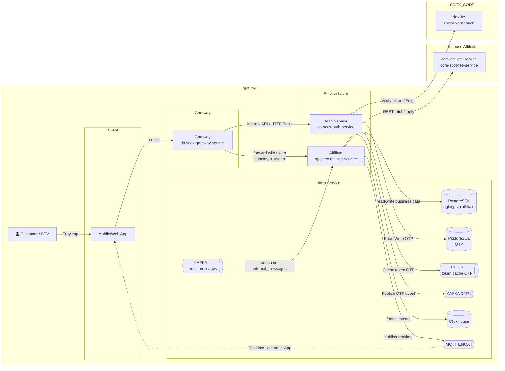
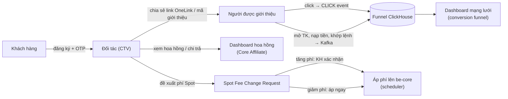
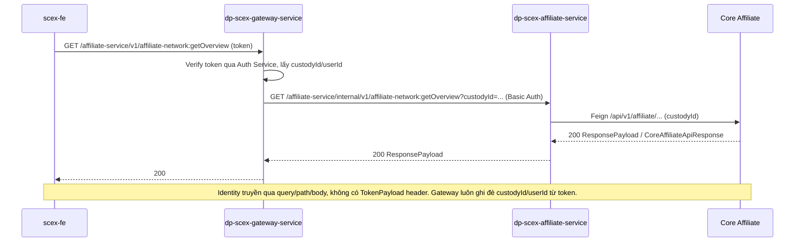
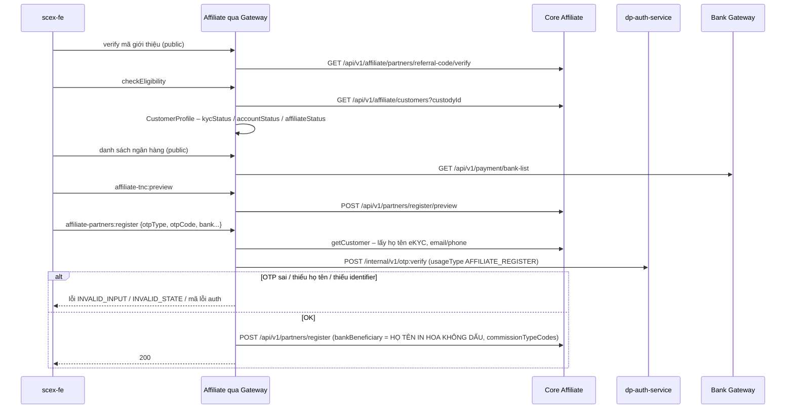
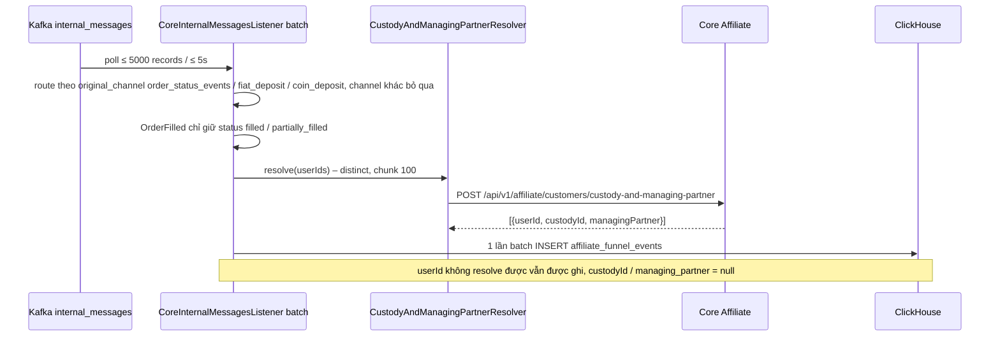
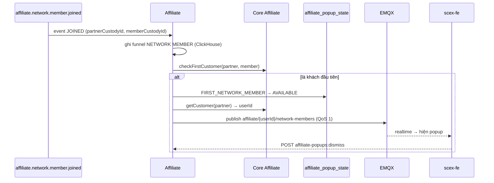
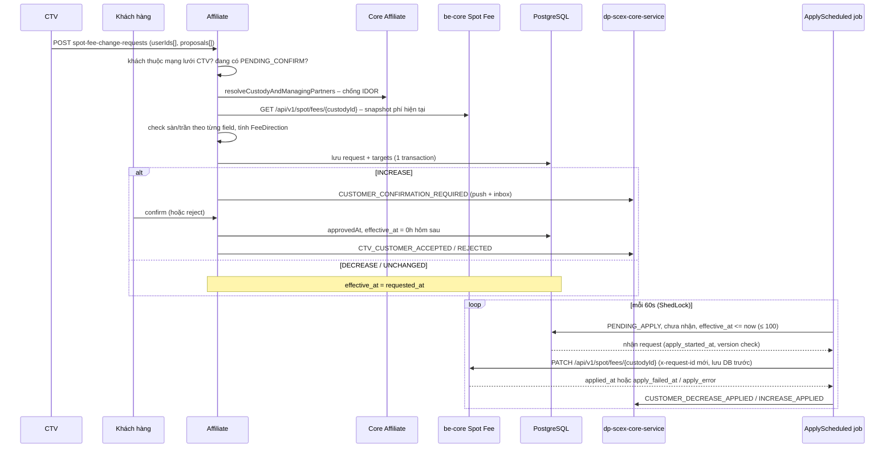
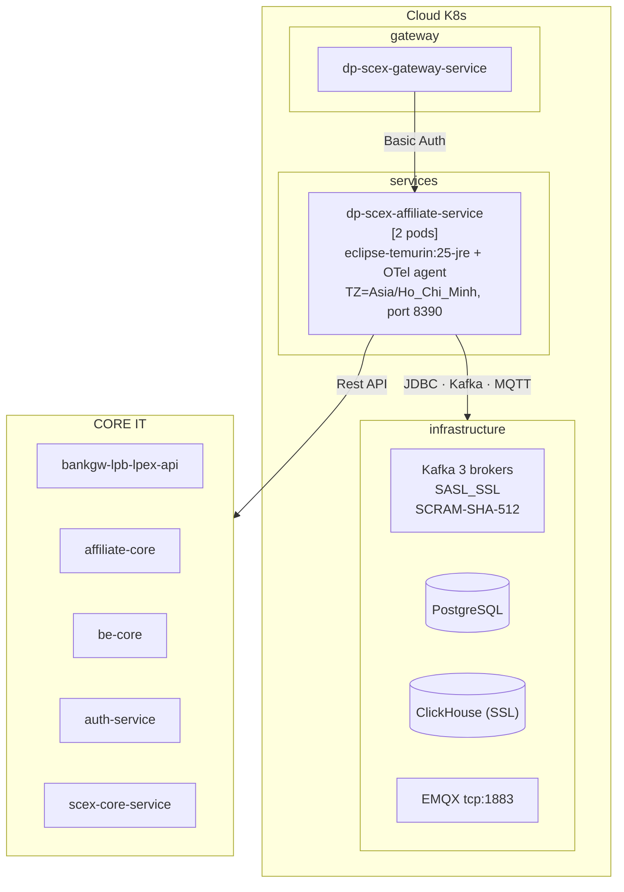

# HIGH LEVEL DESIGN — AFFILIATE DIGITAL

> Tài liệu mô tả **nguyên trạng** hệ thống Affiliate đã triển khai và đang vận hành. Không trình bày phương án thay thế.

## Thông tin tài liệu

| Thuộc tính         | Giá trị                                                                                                                                                              |
| ------------------ | -------------------------------------------------------------------------------------------------------------------------------------------------------------------- |
| Hệ thống           | SCEX Digital Platform — Affiliate (`dp-scex-affiliate-service`)                                                                                                      |
| Mã tài liệu        | HLD-DIGITAL-AFFILIATE                                                                                                                                                |
| Loại               | High Level Design — nguyên trạng (as-in)                                                                                                                             |
| Phiên bản tài liệu | 1.0                                                                                                                                                                  |
| Phiên bản service  | 2.0 (19/10/2026)                                                                                                                                                     |
| Trạng thái         | Current                                                                                                                                                              |
| Mức bảo mật        | Internal                                                                                                                                                             |
| Stack              | Spring Boot 4.0.3 · Java 25 · PostgreSQL (JPA + Liquibase) · ClickHouse (JdbcTemplate) · Kafka (SASL_SSL) · MQTT/EMQX (Paho v5) · OpenFeign (HttpClient5) · ShedLock |
| Repository         | `gitlab.scex.com.vn/digital/backend/dp-scex-affiliate-service`                                                                                                       |
| Ngày cập nhật      | 2026-10-20                                                                                                                                                           |

### Lịch sử thay đổi

| Phiên bản | Ngày       | Tác giả | Thay đổi chính                   | Trạng thái |
| --------- | ---------- | ------- | -------------------------------- | ---------- |
| 1.0       | 2026-10-20 | duc.mm  | Tổng hợp từ cac tài liệu hiện có | Current    |

### Tài liệu tham chiếu

| ID     | Tài liệu                       | Phiên bản / ngày | Vai trò                     | Link                                                                                                  |
| ------ | ------------------------------ | ---------------- | --------------------------- | ----------------------------------------------------------------------------------------------------- |
| REF-01 | Digital Product system service | -                | Tổng quan Digital           | [System Service](https://confluence.scex.com.vn/spaces/DIGITAL/pages/166464/System+services)          |
| REF-01 | Affiliate Service              | v4, 2026-10-20   | Nguồn nguyên trạng vận hành | [Confluence 10564647](https://confluence.scex.com.vn/spaces/DIGITAL/pages/10564647/Affiliate+Service) |

---

### 1. Tổng quan hệ thống

`dp-scex-affiliate-service` là backend chương trình **Affiliate / IB** (Introducing Broker, CTV) của SCEX. Service đóng vai trò **BFF + orchestrator** giữa `dp-scex-gateway-service` và các hệ thống CORE IT.

Dữ liệu gốc — đối tác, hoa hồng, mạng lưới, chi trả, biểu phí đang áp dụng — nằm ở **Core Affiliate** và **be-core**. Service chỉ sở hữu ba nhóm dữ liệu: vòng đời yêu cầu đổi phí Spot, trạng thái popup, và funnel event log.

#### Chức năng chính

| #   | Chức năng                     | Mô tả                                                                                                                                                  |
| --- | ----------------------------- | ------------------------------------------------------------------------------------------------------------------------------------------------------ |
| F1  | Onboarding đối tác            | Kiểm tra điều kiện (eKYC, trạng thái tài khoản), verify mã giới thiệu, preview hợp đồng/T&C, danh sách ngân hàng nhận hoa hồng, đăng ký đối tác có OTP |
| F2  | Dashboard hoa hồng và chi trả | Kỳ hiện tại, tổng quan theo trạng thái, biểu đồ theo ngày/kỳ, nguồn phát sinh hoa hồng, lịch sử và tổng quan chi trả                                   |
| F3  | Dashboard mạng lưới           | Tổng quan, conversion funnel, hoạt động gần đây, danh sách khách hàng / Sub-IB                                                                         |
| F4  | Hồ sơ đối tác                 | Thông tin cơ bản, hồ sơ đầy đủ kèm invite link AppsFlyer OneLink, đổi tài khoản ngân hàng nhận hoa hồng (có OTP)                                       |
| F5  | Loại hoa hồng và lookup       | Danh mục loại hoa hồng, cấu hình phí theo loại, option tra cứu cho UI                                                                                  |
| F6  | Set phí Spot                  | CTV đề xuất phí riêng; khách hàng xác nhận nếu tăng phí; scheduler áp phí lên be-core; vận hành retry/mark request kẹt; push notification              |
| F7  | Ghi nhận funnel               | Consume Kafka (khớp lệnh, nạp tiền, thành viên mới) và click link giới thiệu, ghi ClickHouse để tính conversion funnel                                 |
| F8  | Popup và realtime             | Popup thành viên đầu tiên (Kafka → DB → MQTT), popup Spot fee, dismiss/reset                                                                           |

#### Đối tượng sử dụng

| Đối tượng                  | Kênh                                                                                                                        | Ghi chú                                                      |
| -------------------------- | --------------------------------------------------------------------------------------------------------------------------- | ------------------------------------------------------------ |
| Đối tác / CTV (IB)         | `scex-fe` (`web-app` + `dax-mobile`) → `dp-scex-gateway-service` (`dp-api` / `dp-api-uat`, prefix `/affiliate-service/...`) | Dashboard, đăng ký, set phí Spot                             |
| Khách hàng thuộc mạng lưới | `scex-fe`                                                                                                                   | Xác nhận / từ chối đề xuất tăng phí, nhận popup              |
| Người dùng chưa đăng nhập  | Trang mã giới thiệu của `scex-fe` (route `/public/**`)                                                                      | Verify mã, ghi click, xem phí công ty                        |
| Vận hành / Admin           | Gọi thẳng `/internal/v1/admin/**`, `:retry` (không qua Gateway)                                                             | Xử lý request Spot fee kẹt, commission-types, `popups:reset` |
| Hệ thống khác              | Kafka (`internal_messages`, `affiliate.network.member.joined`)                                                              | Core đẩy sự kiện vào                                         |

Phần tích hợp affiliate phía client hiện chỉ có trên các branch `feat/*`, `uat-scex`, `update/spotFeenNoti` của `scex-fe`. `dp-scex-website` chỉ là landing page, không gọi service này.

#### Phạm vi hệ thống

| In-scope                                                                        | Out-of-scope                                                              |
| ------------------------------------------------------------------------------- | ------------------------------------------------------------------------- |
| Orchestrate onboarding đối tác (eligibility, OTP, gọi Core register)            | Tính và chi trả hoa hồng (Core Affiliate)                                 |
| Gom dữ liệu dashboard hoa hồng / mạng lưới / chi trả từ Core                    | Lưu trữ thông tin đối tác, mạng lưới, kỳ hoa hồng (Core Affiliate)        |
| Vòng đời Spot Fee Change Request (tạo, xác nhận, hẹn giờ, áp dụng, retry, mark) | Biểu phí đang áp dụng — nguồn sự thật là be-core                          |
| Funnel event log (ClickHouse) và conversion funnel                              | Xác thực user / phát token (Gateway + Auth Service)                       |
| Popup state và realtime MQTT cho thành viên mới                                 | Gửi push/inbox thực tế (`dp-scex-core-service` → be-core)                 |
| Sinh invite link OneLink (chỉ build URL)                                        | Gỡ phí riêng về mặc định (API DELETE của be-core), rebate, phí ngoài Spot |

### 2. Sơ đồ kiến trúc logic

#### Các khối trên sơ đồ

| Khối                    | Vai trò trong nguyên trạng                                                                                                                                                                                                               |
| ----------------------- | ---------------------------------------------------------------------------------------------------------------------------------------------------------------------------------------------------------------------------------------- |
| Client                  | `scex-fe`: web-app và `dax-mobile` (Affiliate Dashboard, Set phí Spot), cộng trang mã giới thiệu khi chưa đăng nhập (`/public/**`). Client subscribe MQTT để nhận popup realtime.                                                        |
| Gateway                 | `dp-scex-gateway-service`. `/v1/affiliate-*` yêu cầu JWT; `/public/v1/affiliate-*` không token. Verify token qua Auth, ghi đè `custodyId` / `userId` rồi forward sang Affiliate bằng HTTP Basic.                                         |
| Affiliate               | `dp-scex-affiliate-service`, context-path `/affiliate-service`, port 8390. Đọc/ghi PostgreSQL nghiệp vụ, ghi funnel ClickHouse, consume `internal_messages`, publish EMQX, gọi REST sang Inhouse Affiliate.                              |
| Auth Service            | `dp-scex-auth-service`. Affiliate chỉ gọi `POST /internal/v1/otp:verify` (Feign `auth-service`, base path `/auth-service`). Auth tự publish Kafka OTP, cache token OTP trên Redis, đọc/ghi PostgreSQL OTP, và verify token với `dax-be`. |
| PostgreSQL nghiệp vụ    | `fee_change_request`, `fee_change_request_target`, `affiliate_popup_state`, `shedlock`.                                                                                                                                                  |
| ClickHouse              | Bảng `affiliate_funnel_events`.                                                                                                                                                                                                          |
| Kafka internal messages | Nguồn sự kiện funnel và topic `affiliate.network.member.joined`.                                                                                                                                                                         |
| EMQX                    | Topic `affiliate/{userId}/network-members`, QoS 1.                                                                                                                                                                                       |
| Inhouse Affiliate       | `core-affiliate-service` (đối tác, hoa hồng, mạng lưới) và `core-spot-fee-service` (GET/PATCH phí Spot trên be-core).                                                                                                                    |
| `dax-be`                | Xác thực token cho Auth. Affiliate không gọi trực tiếp.                                                                                                                                                                                  |

Bốn thành phần có trong vận hành nhưng không nằm trên sơ đồ Digital: vận hành gọi thẳng `/internal/v1/admin/**`, Bank Gateway LPB, `dp-scex-core-service` (notification), AppsFlyer OneLink. Chi tiết ở mục 5.

#### Cấu trúc bên trong Affiliate

Service đang chạy theo hexagonal. `domain` và `usecase` là Java thuần, không phụ thuộc Spring.

| Layer     | Phụ thuộc            | Nội dung                                                                                                                                                                                        |
| --------- | -------------------- | ----------------------------------------------------------------------------------------------------------------------------------------------------------------------------------------------- |
| `domain`  | Chỉ Lombok           | Khoảng 45 class. Aggregate `FeeChangeRequest` (trạng thái tính từ mốc thời gian, không set tay), `FeeDirection`, `CustomerProfile.isEligibleForAffiliate`, `FunnelEvent`, `AffiliatePopupState` |
| `usecase` | `domain`             | Khoảng 60 use case và port (connector, repo, notifier, `TransactionExecutor`)                                                                                                                   |
| `service` | `domain` + `usecase` | 9 REST controller, 2 Kafka listener, 2 scheduled job, 5 Feign client, JPA, ClickHouse, MQTT, security. Demo bean `@Primary` chỉ khi `demo-data.enabled`                                         |

| Package                                                                  | Vai trò                                                           |
| ------------------------------------------------------------------------ | ----------------------------------------------------------------- |
| `onboarding`                                                             | Đăng ký đối tác, verify mã giới thiệu, ghi click                  |
| `dashboard/commission`, `network`, `partner`, `commissiontype`, `lookup` | Đọc và chuẩn hoá dữ liệu từ Core Affiliate cho dashboard          |
| `dashboard/spotfee` (+ `admin`)                                          | Spot Fee Change Request — domain duy nhất có state machine và job |
| `dashboard/funnelevent`, `shared/funnelevent`                            | Ingest sự kiện Kafka vào ClickHouse                               |
| `popup`, `shared/popup`                                                  | Popup state, trigger, dismiss                                     |

Input adapter: Onboarding, Commission, Network, Partner, CommissionType, Lookup, SpotFee, AdminSpotFee, Popup; listener `CoreInternalMessagesListener` (batch) và `NetworkMemberEventsListener`; job `ApplyScheduled` / `ExpirePending` FeeChangeRequests. Output adapter: JPA PostgreSQL, `FunnelEventRepoImpl` (ClickHouse), Feign `core-affiliate`, `core-spot-fee`, `bank-gateway`, `auth`, `notification`, `MqttNetworkMemberNotifier`, `CoreSpotFeeNotificationSender`, `PartnerInviteLinkGeneratorImpl`.

### 3. Các luồng nghiệp vụ chính

#### 3.1 Luồng đối tác

#### 3.2 Pattern chung: Client → Gateway → Affiliate → Core

#### 3.3 Đăng ký đối tác

#### 3.4 Funnel từ Kafka `internal_messages`

Nguồn event khác ngoài batch này: **CLICK** (`:recordClick`, gọi đồng bộ, IP được hash) và **NETWORK_MEMBER** (topic `affiliate.network.member.joined`).

#### 3.5 Thành viên đầu tiên trong mạng lưới

#### 3.6 Spot Fee Change Request

Tăng phí: khách xác nhận, `effective_at` là 0h ngày hôm sau. Giảm phí hoặc không đổi: `effective_at` bằng `requested_at`, job áp ngay khi đến hạn. Job giữ lock ShedLock, mỗi 60 giây, tối đa 100 request.

### 4. Danh sách các thành phần chính

Sizing lấy theo mô tả vận hành hiện tại. Repo service không có Helm/K8s manifest; số pod theo tài liệu kiến trúc nền tảng, CPU/RAM là ước lượng cho JVM Java 25 với lưu lượng hiện tại. Cần đối chiếu cấu hình triển khai thực tế của DevOps.

| Thành phần                                     | Chức năng chính                                                                        | Tech stack                                             | Sizing (ước lượng)                                                            | Repository                                     |
| ---------------------------------------------- | -------------------------------------------------------------------------------------- | ------------------------------------------------------ | ----------------------------------------------------------------------------- | ---------------------------------------------- |
| REST API (`/affiliate-service/internal/v1/**`) | 9 controller, khoảng 55 endpoint cho dashboard, onboarding, Spot fee, popup, admin     | Spring MVC, Spring Security (Basic), Feign HttpClient5 | 2 pod; khoảng 0.5–1 vCPU, 1–1.5 GiB RAM/pod; Feign timeout 30s                | `dp-scex-affiliate-service` (module `service`) |
| Kafka consumer `funnel-events`                 | Batch ingest `internal_messages` → ClickHouse                                          | Spring Kafka, batch listener                           | 5000 records/poll, poll 5s, fetch-min 1MB; dự kiến vài trăm msg/s peak        | cùng repo                                      |
| Kafka consumer `network-event`                 | Realtime `affiliate.network.member.joined` → popup + MQTT                              | Spring Kafka                                           | fetch-max-wait 500ms, lưu lượng thấp                                          | cùng repo                                      |
| Scheduler Spot fee                             | Apply / Expire request, ShedLock                                                       | Spring `@Scheduled`, ShedLock JDBC                     | 60s/lượt, ≤ 100 request/lượt, 1 pod chạy mỗi lượt                             | cùng repo                                      |
| Business logic                                 | Khoảng 60 use case, ports                                                              | Java 25 thuần (không Spring)                           | —                                                                             | module `usecase`                               |
| Domain model                                   | Aggregate, rule                                                                        | Java 25 thuần                                          | —                                                                             | module `domain`                                |
| PostgreSQL schema                              | `fee_change_request`, `fee_change_request_target`, `affiliate_popup_state`, `shedlock` | PostgreSQL + Liquibase (`changelog-2026.09.xml`)       | Nhỏ: vài nghìn – vài chục nghìn row/tháng                                     | cùng repo (`db/changelog`)                     |
| ClickHouse table                               | `affiliate_funnel_events`                                                              | ClickHouse (SSL), JDBC 0.9                             | Lớn nhất của service: tăng theo số lệnh khớp và nạp tiền của khách có đối tác | DDL nằm ngoài repo                             |
| MQTT publisher                                 | Topic `affiliate/{userId}/network-members`                                             | Paho MQTT v5, QoS 1                                    | Rất thấp                                                                      | cùng repo                                      |

### 5. Các thành phần phụ thuộc

PostgreSQL OTP, Redis token cache OTP, Kafka OTP và `dax-be` thuộc Auth Service trên sơ đồ Digital. Affiliate không kết nối trực tiếp tới chúng.

| Thành phần                                                  | Loại (Internal/External) | Chức năng                                                                     | Cách kết nối                                                                                                                     | Authen/Author                                                                                                | Fallback khi down                                                                                                                                |
| ----------------------------------------------------------- | ------------------------ | ----------------------------------------------------------------------------- | -------------------------------------------------------------------------------------------------------------------------------- | ------------------------------------------------------------------------------------------------------------ | ------------------------------------------------------------------------------------------------------------------------------------------------ |
| `dp-scex-gateway-service`                                   | Internal (upstream)      | Cửa vào duy nhất cho client, verify token, ghi đè custodyId/userId            | HTTPS → `/affiliate-service/internal/**`                                                                                         | HTTP Basic `ROLE_SYSTEM` (BCrypt, `endpoint.internal.password`)                                              | Gateway down thì client không gọi được                                                                                                           |
| Vận hành / Admin                                            | Internal (upstream)      | Retry, commission-types, `popups:reset`                                       | HTTP thẳng `/internal/v1/admin/**`, không qua Gateway                                                                            | HTTP Basic                                                                                                   | Không áp dụng cho client                                                                                                                         |
| Core Affiliate (`affiliate-core`)                           | External (CORE IT)       | Khách hàng, đối tác, hoa hồng, mạng lưới, chi trả, resolve userId → custodyId | Feign `core-affiliate-service`, timeout 30s. UAT: `https://internal-uat.scex.com.vn/affiliate-core`                              | Mạng nội bộ, không credential                                                                                | Không có fallback. Dashboard/onboarding trả lỗi Core nguyên văn. Resolver funnel bỏ qua chunk lỗi: event vẫn ghi nhưng `managing_partner` = null |
| be-core Spot Fee                                            | External (CORE IT)       | GET / PATCH phí Spot theo custodyId (bps)                                     | Feign `core-spot-fee-service`, HttpClient5 (cần PATCH). UAT: `https://internal-api-uat.scex.com.vn/be-core`                      | Header `Dx-Internal-App: digital`, `Dx-Internal-Service: DP_SCEX_AFFILIATE`; `x-request-id` không được trùng | Tạo request: lỗi, không lưu gì. Job apply: target `FAILED` + `apply_error`, không tự retry — vận hành gọi `:retry`                               |
| Bank Gateway LPB (`bankgw-lpb-lpex-api`)                    | External                 | Danh sách ngân hàng                                                           | Feign `bank-gateway-service`. UAT: `https://internal-uat.scex.com.vn/bankgw-lpb-lpex-api`                                        | —                                                                                                            | Endpoint danh sách ngân hàng trả lỗi; không cache                                                                                                |
| Auth Service (`dp-scex-auth-service`, path `/auth-service`) | Internal                 | Verify OTP khi đăng ký / đổi tài khoản ngân hàng                              | Feign `auth-service` → `POST /internal/v1/otp:verify`. UAT: `https://internal-uat.scex.com.vn/auth-service`                      | Basic `SERVICE_INTERNAL_BASIC_AUTH`                                                                          | Đăng ký / đổi ngân hàng bị chặn, lỗi trả về client                                                                                               |
| `dp-scex-core-service` (`/scex-core-service`)               | Internal                 | Gửi push + inbox Spot fee                                                     | Feign `notification-service` → `POST /internal/v1/notifications:send`. UAT: `https://internal-uat.scex.com.vn/scex-core-service` | Basic `SERVICE_INTERNAL_BASIC_AUTH`                                                                          | Best-effort: lỗi chỉ log, transaction đã commit, notification bị mất (không outbox)                                                              |
| PostgreSQL nghiệp vụ                                        | Infra                    | State Spot fee, popup, ShedLock                                               | JDBC (Hikari), Liquibase                                                                                                         | user/password env                                                                                            | Spot fee và popup lỗi; scheduler dừng vì không lấy được lock                                                                                     |
| ClickHouse                                                  | Infra                    | Funnel event log                                                              | JDBC SSL (`clickHouseJdbcTemplate`)                                                                                              | user/password + CA cert                                                                                      | Insert lỗi → `DefaultErrorHandler` retry batch rồi bỏ qua, có thể mất event. Dashboard funnel lỗi                                                |
| Kafka                                                       | Infra                    | Nguồn sự kiện funnel và network member                                        | SASL_SSL, SCRAM-SHA-512, truststore JKS. Broker UAT `10.69.30.21-23:9092`                                                        | user/password consumer                                                                                       | Không có event mới; khi lên lại đọc tiếp từ offset đã commit                                                                                     |
| EMQX                                                        | Infra                    | Realtime popup thành viên mới                                                 | Paho MQTT v5, auto-reconnect. UAT `tcp://10.69.8.68:1883`                                                                        | user/password                                                                                                | Best-effort: lỗi chỉ log. Popup vẫn `AVAILABLE` trong DB, client thấy qua `getVisibility` lần sau                                                |
| AppsFlyer OneLink (`scex.onelink.me`)                       | External                 | Invite link                                                                   | Chỉ build URL từ config, không gọi API                                                                                           | —                                                                                                            | Không phụ thuộc runtime                                                                                                                          |

### 6. Sơ đồ kiến trúc deployment thực tế

#### Sơ đồ triển khai

Affiliate chạy 2 pod trên Cloud K8s. Ảnh triển khai dưới đây là view của service Affiliate; Auth và hạ tầng OTP/Redis của Auth nằm trên sơ đồ Digital (mục 2), không nằm trong box này.

#### Các config quan trọng

Giá trị dưới đây là UAT hoặc mặc định trong repo. Không ghi secret. Production dùng cùng key, domain bỏ hậu tố `-uat`; giá trị prod không lưu trong repo.

| Key                                                                             | Giá trị (UAT / mặc định)                               | Ý nghĩa                                                     |
| ------------------------------------------------------------------------------- | ------------------------------------------------------ | ----------------------------------------------------------- |
| `server.port` / context-path                                                    | `8390` / `/affiliate-service`                          | Cổng và context của service                                 |
| `CORE_AFFILIATE_BASE_URL`                                                       | `https://internal-uat.scex.com.vn/affiliate-core`      | Core Affiliate                                              |
| `CORE_SPOT_FEE_BASE_URL`                                                        | `https://internal-api-uat.scex.com.vn/be-core`         | be-core Spot fee                                            |
| `BANK_GATEWAY_BASE_URL`                                                         | `https://internal-uat.scex.com.vn/bankgw-lpb-lpex-api` | Danh sách ngân hàng                                         |
| `AUTH_SERVICE_INTERNAL_BASE_URL`                                                | `https://internal-uat.scex.com.vn/auth-service`        | Verify OTP                                                  |
| `SCEX_CORE_SERVICE_INTERNAL_BASE_URL`                                           | `https://internal-uat.scex.com.vn/scex-core-service`   | Push và inbox                                               |
| `MQTT_BROKER_URL`                                                               | `tcp://10.69.8.68:1883`                                | EMQX                                                        |
| `kafka.topics.*`                                                                | `internal_messages`, `affiliate.network.member.joined` | Hai topic consumer                                          |
| `affiliate.demo-data.enabled`                                                   | `false`                                                | Phải set rõ ở mọi env. Bean demo có `matchIfMissing = true` |
| `affiliate.funnel.consumer.enabled`, `affiliate.network-event.consumer.enabled` | `true`                                                 | Bật/tắt từng consumer                                       |
| `affiliate.register.default-commission-type-codes`                              | `COMM_SPDV`                                            | Loại hoa hồng gán khi đăng ký                               |
| `affiliate.onelink.*`                                                           | env                                                    | pid, campaign, deep link value                              |
| `affiliate.spot-fee.confirm-expires-in`                                         | `24h`                                                  | Hạn khách hàng xác nhận tăng phí                            |
| `affiliate.spot-fee.company-fee.maker-rate` / `taker-rate`                      | `0.0010` / `0.0005`                                    | Biểu phí công ty trên banner. Chưa có API Core              |
| `affiliate.spot-fee.bound.default-bounds`                                       | floor `0`, ceiling `1`                                 | Sàn/trần chung                                              |
| `affiliate.spot-fee.scheduler.fixed-delay-ms` / `batch-limit`                   | `60000` / `100`                                        | Nhịp job apply                                              |

#### Môi trường

| Môi trường | Branch                | Ghi chú                                                                                                      |
| ---------- | --------------------- | ------------------------------------------------------------------------------------------------------------ |
| SIT        | `sit` (`origin/HEAD`) | Dev tích hợp                                                                                                 |
| UAT        | `uat`                 | Domain `internal-uat.scex.com.vn`, `internal-api-uat.scex.com.vn`; client `dp-api-uat.scex.com.vn`           |
| Production | `prod`                | Cùng cấu trúc, domain không có hậu tố `-uat`. Client `dp-api.scex.com.vn`. Giá trị prod không lưu trong repo |

Image `eclipse-temurin:25-jre`, gắn OpenTelemetry agent, `TZ=Asia/Ho_Chi_Minh`.

### 7. Observability & Monitoring

Ngoài metric mặc định của Spring / Grafana / ELK, service phơi Actuator và trace OTel. Chưa có custom metric (`MeterRegistry` không có trong code).

| Nguồn                              | Metric                                                                | Ghi chú                                                                                                                                  |
| ---------------------------------- | --------------------------------------------------------------------- | ---------------------------------------------------------------------------------------------------------------------------------------- |
| Actuator                           | `/actuator/health`, `/info`, `/prometheus`                            | Micrometer Prometheus                                                                                                                    |
| Spring Kafka (Micrometer mặc định) | `kafka.consumer.*`, đặc biệt consumer lag của group `*-funnel-events` | Dùng để tune batch sizing (đã ghi chú trong `application.yml`)                                                                           |
| OpenTelemetry agent                | Trace HTTP / Feign / JDBC / Kafka                                     | `trace_id` có trong log pattern                                                                                                          |
| Custom metric                      | Chưa có                                                               | Đề xuất trong tài liệu vận hành, chưa triển khai: số request Spot fee `FAILED` hoặc kẹt, độ trễ apply, số event funnel thiếu attribution |

#### Troubleshoot

| Triệu chứng                           | Kiểm tra                                                                                                                                                                             |
| ------------------------------------- | ------------------------------------------------------------------------------------------------------------------------------------------------------------------------------------ |
| Request Spot fee không được áp        | `GET /internal/v1/admin/spot-fee-change-requests:stuck` → xem `applyError` → `:retry` → nếu lỗi vĩnh viễn thì `:mark` kèm `reason`                                                   |
| Funnel không tăng                     | Consumer lag group `*-funnel-events`; log `internal_messages: failed to parse`; ClickHouse insert lỗi; Core `custody-and-managing-partner` lỗi (log `dropping them from this batch`) |
| Popup thành viên mới không hiện       | Log `[MQTT] Failed to publish`; `affiliate_popup_state` có `AVAILABLE` hay không                                                                                                     |
| Dữ liệu dashboard giả cho một đối tác | `affiliate.demo-data.enabled` thiếu trong config → bean demo bật (custodyId `34931241`)                                                                                              |
| Đăng ký báo lỗi OTP                   | Log Feign `auth-service`; kiểm tra email/phone của khách trên Core                                                                                                                   |

#### Known issues

- Job apply Spot fee không tự retry. Target `FAILED` chờ vận hành gọi `:retry` hoặc `:mark`.
- Notification (`dp-scex-core-service`) và MQTT là best-effort: lỗi chỉ được log, không có outbox. Popup vẫn `AVAILABLE` trong DB nên client có thể thấy ở lần `getVisibility` sau.
- ClickHouse insert lỗi có thể làm mất event funnel sau khi `DefaultErrorHandler` bỏ qua batch.
- `affiliate.demo-data.enabled` phải được set tường minh. Thiếu key thì bean demo bật vì `matchIfMissing = true`.
