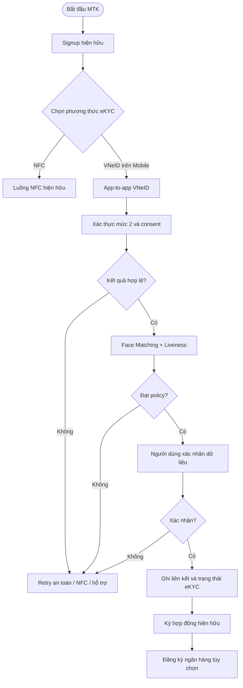
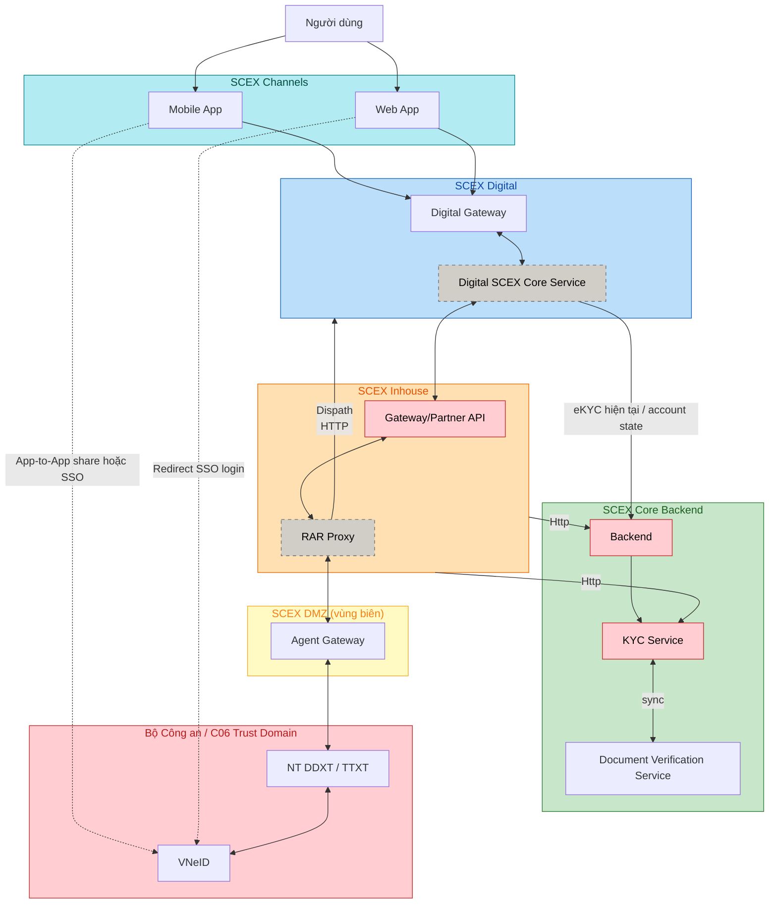
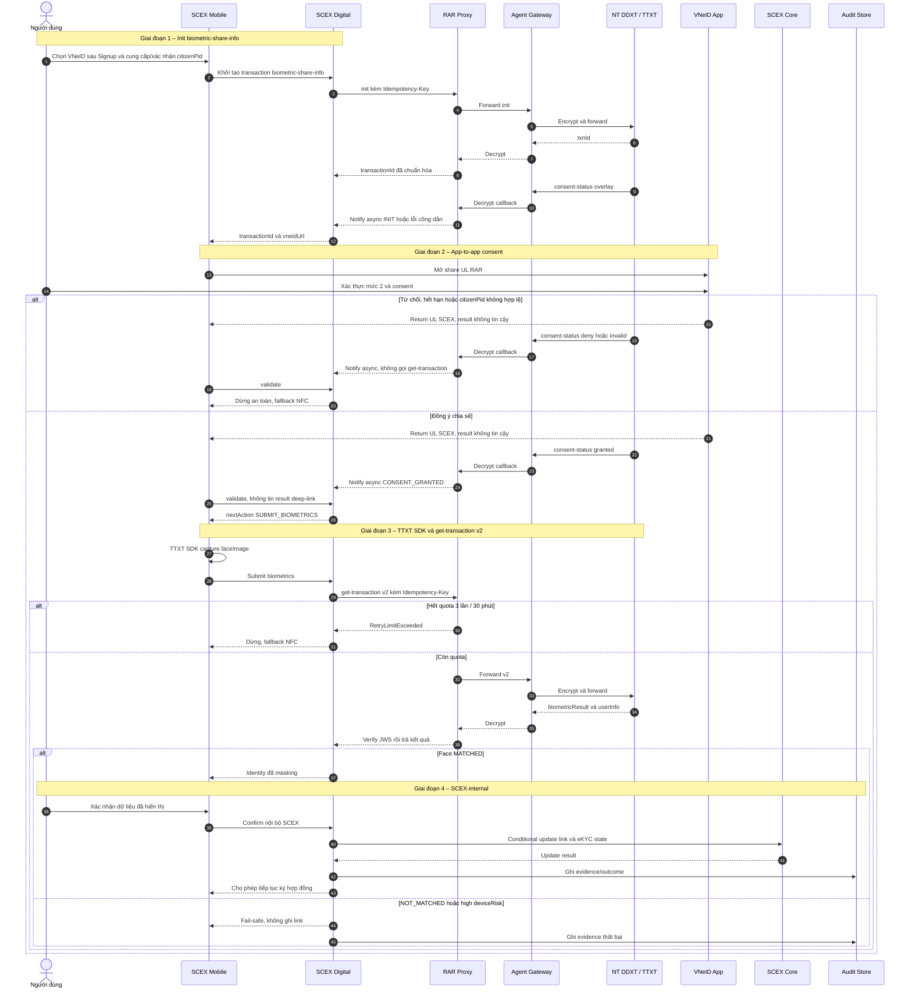
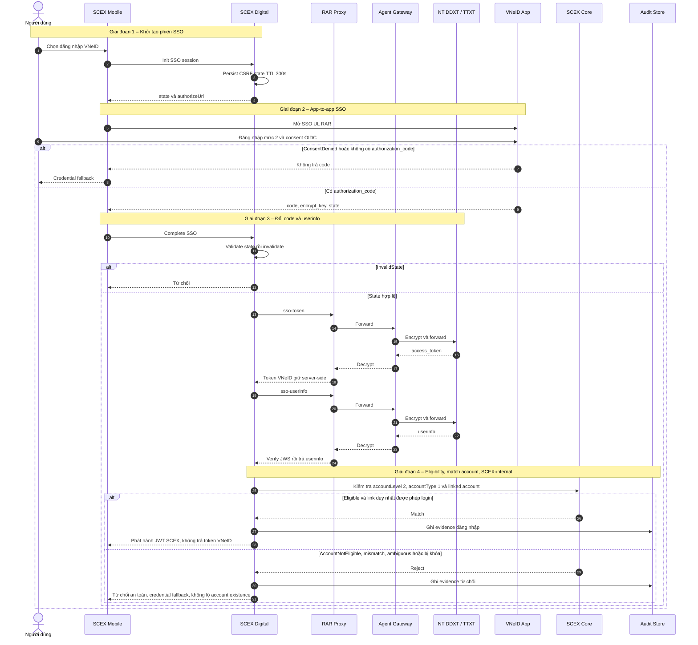
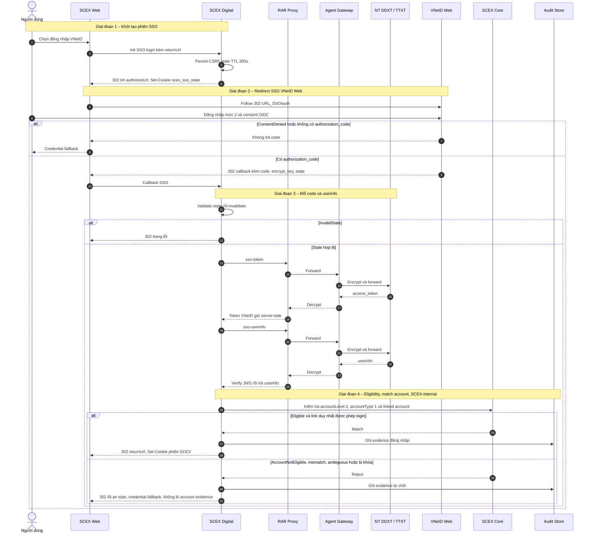

# HIGH LEVEL DESIGN — TÍCH HỢP VNeID (C06) CHO ĐĂNG KÝ VÀ XÁC THỰC TÀI KHOẢN SCEX

> **Quy ước thông tin thiếu:** `TBD — <nội dung cần bổ sung>; Owner: <vai trò>; Gate: <thời điểm phải có>` biểu thị dữ liệu chưa có trong BRD. Các mục này không được hiểu là quyết định kiến trúc đã được phê duyệt.

---

# 1. Quản trị tài liệu

## 1.1 Thông tin tài liệu

| Thuộc tính                         | Giá trị                                                               |
| ---------------------------------- | --------------------------------------------------------------------- |
| Tên giải pháp/hệ thống             | Tích hợp VNeID (C06) cho đăng ký, liên kết và xác thực tài khoản SCEX |
| Mã tài liệu                        | HLD-DIGITAL-C06-VNEID                                                 |
| Business Owner                     | [TBD] — Product/Business Owner                                        |
| System/Service Owner               | [TBD] — SCEX System Owner                                             |
| Solution Architect                 | [TBD]                                                                 |
| Tech Lead(s)                       | [TBD] — Mobile, Web, Backend/Integration                              |
| Security/Privacy Reviewer          | [TBD] — ATTT và DPO/Privacy                                           |
| Infrastructure/Operations Reviewer | [TBD] — Infrastructure/SRE                                            |
| Repository/Link                    | [Confluence page]                                                     |
| Tài liệu thay thế bởi/thay thế cho | N/A                                                                   |
| Ngày review tiếp theo              | [chưa có]                                                             |

## 1.2 Lịch sử thay đổi

| Phiên bản | Ngày       | Tác giả | Thay đổi chính    | Trạng thái |
| --------- | ---------- | ------- | ----------------- | ---------- |
| 0.1       | 2026-09-07 | duc.mm  | Khởi tạo tài liệu | Draft      |

## 1.3 Review và phê duyệt

| Vai trò                 | Người/đơn vị | Phạm vi review                                                           | Kết quả | Ngày  | Bằng chứng/link |
| ----------------------- | ------------ | ------------------------------------------------------------------------ | ------- | ----- | --------------- |
| Business Owner          | [TBD]        | Mục tiêu, phạm vi, trạng thái tài khoản, quy tắc nghiệp vụ               | Pending | [TBD] | [TBD]           |
| Solution Architecture   | -            | Boundary, view, interface, quyết định, NFR                               | Pending | [TBD] | [TBD]           |
| An toàn thông tin       | -            | ATTT cấp độ 3 (tối thiểu), API, identity, biometric, threat/control      | Pending | [TBD] | [TBD]           |
| Hạ tầng/Vận hành/SRE    | -            | Deployment, capacity, SLO, DR, operability                               | Pending | [TBD] | [TBD]           |
| Pháp chế/Compliance/AML | -            | Căn cứ pháp lý, PCRT/KYC, thời hạn lưu trữ                               | Pending | [TBD] | [TBD]           |

## 1.4 Tài liệu tham chiếu

| ID     | Tài liệu/tiêu chuẩn                                                  | Phiên bản/ngày | Vai trò trong HLD                              | Link        |
| ------ | -------------------------------------------------------------------- | -------------- | ---------------------------------------------- | ----------- |
| REF-01 | BRD: Cơ chế tạo tài khoản và đăng nhập qua tích hợp VNeID trên SCEX  |                | Nguồn yêu cầu nghiệp vụ                        | [BRD VNeID] |
| REF-05 | Đặc tả API/dữ liệu của nền tảng định danh và dữ liệu dân cư RAR/C06  |                | Hợp đồng tích hợp trực tiếp                    | [TBD]       |
| REF-06 | Nghị định 69/2024/NĐ-CP                                              |                | Điều kiện kết nối và ATTT cấp độ 3 (tối thiểu) | [TBD]       |
| REF-07 | Nghị quyết 05/2025/NQ-CP                                             |                | KYC và lưu trữ tối thiểu 10 năm                | [TBD]       |
| REF-08 | Nghị định 284/2026/NĐ-CP                                             |                | Nghĩa vụ xác minh danh tính                    | [TBD]       |
| REF-09 | Luật Bảo vệ dữ liệu cá nhân 91/2025/QH15 và Nghị định 356/2025/NĐ-CP |                | Consent và xử lý dữ liệu cá nhân               | [TBD]       |

## 1.5 Thuật ngữ và từ viết tắt

| Thuật ngữ                            | Định nghĩa trong phạm vi tài liệu                                                                                                                                         |
| ------------------------------------ | ------------------------------------------------------------------------------------------------------------------------------------------------------------------------- |
| SCEX                                 | Nền tảng cung cấp tài khoản và giao dịch tài sản mã hóa thuộc phạm vi giải pháp                                                                                           |
| VNeID                                | Ứng dụng định danh và xác thực điện tử quốc gia; tài khoản mức 2 là điều kiện mục tiêu theo BRD                                                                           |
| C06                                  | Cục Cảnh sát quản lý hành chính về trật tự xã hội, trực thuộc Bộ Công an; là cơ quan chủ quản trực tiếp của RAR.                                                          |
| RAR                                  | Trung tâm Nghiên cứu - ứng dụng dữ liệu dân cư và căn cước công dân, trực thuộc C06.                                                                                      |
| Nền tảng định danh và dữ liệu dân cư | Nền tảng do RAR/C06 vận hành mà SCEX kết nối trực tiếp để sử dụng các dịch vụ định danh, xác thực và đối chiếu dữ liệu dân cư theo đặc tả được phê duyệt.                 |
| MTK                                  | Luồng Mở tài khoản Giao dịch tài sản mã hóa                                                                                                                               |
| Signup                               | Giai đoạn tạo credential SCEX: OTP số điện thoại, OTP email và đặt mật khẩu                                                                                               |
| Xác thực định danh                   | Giai đoạn eKYC bằng VNeID hoặc NFC, tách biệt với Signup và ký hợp đồng giao dịch                                                                                         |
| Liên kết VNeID                       | Gắn định danh VNeID mức 2 đã xác minh với một tài khoản SCEX                                                                                                              |
| PCRT                                 | Phòng chống rửa tiền; ngữ cảnh xác minh lại nêu trong BRD                                                                                                                 |
| Face Matching                        | So khớp khuôn mặt người dùng với ảnh sinh trắc học tham chiếu                                                                                                             |
| Liveness Detection                   | Kiểm tra người thao tác là người thật, chống ảnh/video giả mạo                                                                                                            |
| Consent                              | Sự đồng ý chủ động, rõ ràng của người dùng đối với việc chia sẻ/xử lý dữ liệu                                                                                             |
| Correlation ID                       | Mã liên kết các thông điệp trong một giao dịch; mỗi bên gửi tự sinh ID cho thông điệp của mình, mã tham chiếu trong body (nếu contract yêu cầu) trỏ tới yêu cầu liên quan |

---

# 2. Tóm tắt điều hành

## 2.1 Vấn đề và giá trị giải pháp

SCEX hiện dùng email/số điện thoại với OTP cho Signup và NFC căn cước công dân cho eKYC. NFC tạo rào cản cho người dùng có thiết bị không hỗ trợ hoặc thao tác quét không ổn định. Đồng thời, xác minh danh tính là điều kiện bắt buộc trước khi người dùng được cấp quyền giao dịch.

Giải pháp bổ sung VNeID mức 2 như một phương thức xác thực định danh song song với NFC trên mobile. Kỳ vọng là tăng khả năng tiếp cận, rút ngắn eKYC, tận dụng dữ liệu đã được cơ quan có thẩm quyền xác thực và vẫn duy trì phương thức hiện hữu khi VNeID không khả dụng.

## 2.2 Giải pháp đề xuất

Giải pháp giữ nguyên chuỗi MTK gồm Signup → Xác thực định danh → Ký hợp đồng → Đăng ký ngân hàng (tùy chọn), chỉ bổ sung VNeID tại giai đoạn Xác thực định danh trên **mobile**. eKYC dùng `biometric-share-info` app-to-app tới share UL RAR. Đăng nhập dùng SSO OIDC: mobile app-to-app SSO UL, web redirect tới VNeID Web. SCEX kết nối trực tiếp với nền tảng định danh và dữ liệu dân cư do RAR/C06 vận hành.

Ở mức logic, SCEX cần một lớp điều phối định danh và RAR Proxy để cô lập contract của RAR/C06, quản lý phiên, consent evidence, đối khớp dữ liệu, Face Matching/Liveness, liên kết tài khoản, audit và fallback. Ranh giới triển khai vật lý của các thành phần này chưa được BRD quy định và phải được chốt ở design review.

## 2.3 Kết quả và chỉ số thành công

| ID    | Kết quả mong đợi                                          | Chỉ số/đơn vị                                                      | Baseline | Target                                               | Thời điểm đo           | Owner                   |
| ----- | --------------------------------------------------------- | ------------------------------------------------------------------ | -------- | ---------------------------------------------------- | ---------------------- | ----------------------- |
| BR-01 | Người không dùng được NFC vẫn hoàn tất xác thực định danh | Tỷ lệ hoàn tất eKYC bằng VNeID                                     | [TBD]    | [TBD] — Product Owner bổ sung                        | [TBD]                  | Product Owner           |
| BR-02 | Danh tính được xác minh trước khi cấp quyền giao dịch     | Tỷ lệ tài khoản có bằng chứng eKYC hợp lệ trước khi enable trading | [TBD]    | 100%                                                 | [TBD]                  | Compliance/System Owner |
| BR-03 | Duy trì hành trình khi VNeID không khả dụng               | Tỷ lệ người dùng được cung cấp fallback hợp lệ                     | [TBD]    | 100% trường hợp lỗi đã phân loại                     | [TBD]                  | Product Owner           |
| BR-04 | Có bằng chứng consent và xác thực truy vấn được           | Tỷ lệ giao dịch có audit record bắt buộc                           | [TBD]    | 100% giao dịch khởi tạo                              | [TBD]                  | Data/Compliance Owner   |
| BR-05 | Đáp ứng lưu trữ theo BRD                                  | Thời hạn lưu audit xác thực                                        | [TBD]    | Tối thiểu 10 năm, chờ Legal xác nhận phạm vi dữ liệu | Production             | Data Owner              |
| BR-06 | Trải nghiệm xác thực không bị kéo dài                     | p95/p99 end-to-end latency                                         | [TBD]    | TBD — BRD chỉ nêu “vài giây”                         | Performance test/pilot | Product Owner/SRE       |

## 2.4 Tóm tắt phạm vi

### Trong phạm vi

- Xác thực định danh VNeID trong MTK
- Liên kết VNeID cho tài khoản hiện hữu
- Xác minh lại PCRT
- Đăng nhập lại bằng VNeID
- Mobile app-to-app (eKYC share UL và login SSO UL)
- Web login SSO redirect
- Face Matching/Liveness
- Đối khớp dữ liệu
- Consent
- Audit/admin query
- Fallback NFC/credential
- Hủy liên kết VNeID

### Ngoài phạm vi

- eKYC VNeID trên web
- Định danh tổ chức
- Chi tiết eContract và mở TK Ngân Hàng
- Chi tiết API/schema/physical deployment chưa có nguồn

### Giai đoạn sau

- Hủy liên kết/liên kết lại
- Các use case bổ sung khi có phê duyệt

## 2.5 Tác động và quyết định cần phê duyệt

| Hạng mục                                   | Tóm tắt                                                                                                                                                        |
| ------------------------------------------ | -------------------------------------------------------------------------------------------------------------------------------------------------------------- |
| Người dùng bị ảnh hưởng                    | Khách cá nhân, Product/CS, Compliance/AML, Vận hành, ATTT, admin nghiệp vụ                                                                                     |
| Hệ thống/dữ liệu bị ảnh hưởng              | Mobile, Web, Authentication/Account, eKYC, Trading Profile, Audit/Observability, Admin; dữ liệu định danh, consent, biometric score và lịch sử xác thực        |
| Thay đổi quy trình vận hành                | Bổ sung giám, tra soát với C06; hỗ trợ lỗi liên kết; quản lý consent/audit; runbook fallback và incident liên tổ chức                                          |
| Rủi ro cao nhất                            | Liên kết sai chủ thể; consent không hợp lệ; giả mạo/replay; phụ thuộc RAR/C06; rò rỉ dữ liệu cá nhân/sinh trắc học; cấp quyền giao dịch khi eKYC chưa hoàn tất |
| Chi phí/capacity chính                     | Phí RAR/C06, lưu audit ≥10 năm, năng lực hỗ trợ và monitoring...                                                                                               |
| Quyết định cần cấp có thẩm quyền phê duyệt | Data sharing/retention; security profile; ngưỡng biometric; SLO/RTO/RPO; target deployment; các rủi ro khác                                                    |

---

# 3. Bối cảnh

## 3.1 Phạm vi giải pháp

System-of-interest là năng lực xác thực định danh, liên kết tài khoản và đăng nhập bằng VNeID trong SCEX, từ khi Mobile/Web khởi tạo phiên đến khi SCEX xác minh kết quả, cập nhật trạng thái và lưu bằng chứng. SCEX kết nối trực tiếp với nền tảng do RAR/C06 vận hành; VNeID, RAR/C06 và nền tảng định danh/dữ liệu dân cư nằm ngoài trust domain SCEX.

Phạm vi chi tiết và ngoài phạm vi được chốt tại mục 2.4. Signup credential, ký hợp đồng, đăng ký ngân hàng và giao dịch không được thiết kế lại trong tài liệu này; các hệ thống đó chỉ nhận trạng thái eKYC/liên kết phù hợp.

## 3.2 Hiện trạng và thay đổi

| Nội dung       | Hiện trạng                                 | Sau thay đổi                                                                     |
| -------------- | ------------------------------------------ | -------------------------------------------------------------------------------- |
| Signup         | Số điện thoại + OTP, email + OTP, mật khẩu | Giữ nguyên                                                                       |
| eKYC           | NFC CCCD gắn chip                          | Mobile thêm VNeID mức 2 song song với NFC; NFC vẫn là fallback                   |
| Mobile         | Chưa có VNeID                              | Thêm app-to-app share UL (eKYC) và SSO UL (login) tới VNeID                      |
| Web            | Chưa có VNeID                              | Thêm SSO cho login                                                               |
| Account        | Chưa có liên kết VNeID                     | Thêm trạng thái liên kết VNeID, tách khỏi eKYC completion và trading eligibility |
| Đăng nhập/PCRT | Credential và quy trình hiện hữu           | Bổ sung xác thực VNeID cho tài khoản đã liên kết và xác minh lại PCRT            |
| Tích hợp ngoài | FIS                                        | Thêm RAR Proxy kết nối trực tiếp nền tảng RAR/C06                                |
| Audit/vận hành | Chưa có                                    | Thêm consent/eKYC audit, monitoring, tra soát và fallback                        |

Luồng MTK không phải luồng mới hoàn toàn. Đây là mở rộng của luồng hiện hữu tại bước xác thực định danh; các luồng liên kết VNeID, đăng nhập VNeID và vận hành dependency RAR/C06 là năng lực mới.

## 3.3 Các nguyên tắc kiến trúc

1. SCEX Core là source of truth cho transaction và trạng thái; Mobile/Web không tự kết luận eKYC thành công.
2. Channel chỉ gọi lớp điều phối SCEX, không gọi trực tiếp RAR/C06.
3. Mọi giao tiếp RAR/C06 đi qua RAR Proxy với canonical model để cô lập contract ngoài.
4. Chỉ cập nhật account/link/eKYC/trading state sau khi kết quả external đã được xác minh và đủ bằng chứng.
5. Liên kết VNeID, hoàn tất eKYC, ký hợp đồng và quyền giao dịch là các trạng thái riêng.
6. Lỗi, timeout, callback trùng hoặc kết quả không chắc chắn phải fail-safe; không tự cấp quyền và phải có retry/fallback phù hợp.
7. Chỉ lưu raw biometric khi có căn cứ pháp lý, mục đích, retention và phê duyệt riêng.
8. Công nghệ, cluster, sizing... chưa rõ ràng thì cần làm rõ, không suy đoán.

## 3.4 Giả định vàn ràng buộc

---

# 4. Luồng nghiệp vụ

## 4.1 Thay đổi đối với luồng hiện hữu

## 4.2 Các luồng nghiệp vụ trong phạm vi

| Luồng                       | Điểm bắt đầu                                            | Kết quả thành công                                                          | Thất bại/fallback                                                          |
| --------------------------- | ------------------------------------------------------- | --------------------------------------------------------------------------- | -------------------------------------------------------------------------- |
| Mở tài khoản bằng VNeID     | Người dùng đã hoàn tất Signup trên Mobile và chọn VNeID | Có evidence hợp lệ, liên kết VNeID và trạng thái eKYC; tiếp tục ký hợp đồng | Retry theo lỗi được phép, NFC hoặc hỗ trợ                                  |
| Liên kết tài khoản hiện hữu | Người dùng đã đăng nhập SCEX và chọn liên kết           | Một định danh VNeID hợp lệ được gắn với đúng tài khoản                      | Từ chối khi mismatch, duplicate, ambiguous hoặc account không đủ điều kiện |
| Đăng nhập bằng VNeID        | Tài khoản đã có liên kết hợp lệ                         | SCEX phát hành/tiếp tục session theo Auth policy                            | Credential fallback hoặc hỗ trợ; không tiết lộ account existence           |
| Xác minh lại PCRT           | Policy PCRT yêu cầu step-up                             | Evidence mới đáp ứng policy được ghi nhận                                   | Giữ trạng thái hạn chế hiện hữu; fallback/manual path theo policy TBD      |
| Tra soát                    | Admin có quyền và case/purpose hợp lệ                   | Truy xuất evidence đã masking và ghi audit truy cập                         | Từ chối khi thiếu quyền/mục đích; export là quyền riêng                    |

---

# 5. Application architecture

## 5.1 Kiến trúc logic

Luồng backend của nghiệp vụ VNeID đi theo chuỗi **Mobile/Web → Digital Gateway → Digital SCEX Core Service → Gateway/Partner API → RAR Proxy → Agent Gateway → RAR/C06**. Front-channel đi trực tiếp Channel ↔ VNeID và không thay thế backend xác minh: mobile app-to-app (share UL cho eKYC, SSO UL cho login); web chỉ redirect SSO cho login. Các nghiệp vụ eKYC hiện hữu, bao gồm NFC và trạng thái Account/Profile, tiếp tục thuộc SCEX Core Backend.

## 5.2 Thành phần, chức năng và công nghệ

| Thành phần                          | Chức năng chính                                                                                                                          | Công nghệ/triển khai                                 |
| ----------------------------------- | ---------------------------------------------------------------------------------------------------------------------------------------- | ---------------------------------------------------- |
| Mobile App (**update**)             | Khởi tạo đăng nhập SSO qua Digital Gateway; app-to-app share UL (eKYC) và SSO UL (login) với VNeID; TTXT SDK capture faceImage; fallback | Reuse mobile stack hiện hữu;                         |
| Web App (**update**)                | Khởi tạo đăng nhập SSO qua Digital Gateway; redirect tới VNeID Web; fallback credential                                                  | Reuse web stack hiện hữu;                            |
| Digital Gateway                     | Điểm vào SCEX Digital từ Mobile/Web; định tuyến API tới Digital SCEX Core Service                                                        | Reuse Digital ingress/gateway hiện hữu;              |
| Digital SCEX Core Service (**new**) | Điều phối luồng VNeID: transaction/state, policy, idempotency, matching; gọi Inhouse cho RAR và đọc/ghi account state trên SCEX Core     | Thành phần mới                                       |
| Backend (**update**)                | Thông tin về user profile, trạng thái account, ekyc, econtract...                                                                        | Reuse SCEX Core backend hiện hữu; API boundary [TBD] |
| KYC Service (**update**)            | eKYC hiện hữu (NFC); nhận HTTP từ SCEX Inhouse; điều phối xác minh giấy tờ                                                               | Reuse KYC service hiện hữu                           |
| Document Verification Service       | Xác minh giấy tờ/document cho eKYC hiện hữu; đồng bộ với KYC Service                                                                     | Reuse document verification hiện hữu                 |
| Gateway/Partner API (**update**)    | Kênh API nội bộ từ Digital SCEX Core Service vào RAR Proxy; điểm Partner API của Inhouse                                                 | HTTPS nội bộ; AuthN/AuthZ nội bộ [TBD]               |
| RAR Proxy (**new**)                 | Forward request tới Agent Gateway; verify JWS, dedup `Idempotency-Key`, enforce quota và Dispatch HTTP callback về service nội bộ        | Thành phần mới                                       |
| Agent Gateway                       | Encrypt/decrypt RAR envelope; quản lý khóa RSA/HSM; kết nối VPN/IPSec từ SCEX DMZ tới RAR/C06                                            | Đặt tại SCEX DMZ                                     |
| NT DDXT / TTXT                      | Đầu kết nối và xử lý dịch vụ định danh phía RAR/C06                                                                                      | External platform; API/security profile theo REF-05  |
| VNeID                               | Xác thực người dùng, consent; front-channel share UL / SSO UL (App) và redirect SSO (Web login)                                          | External application/platform                        |

## 5.3 Ranh giới và tích hợp

| Giao diện (theo 5.1)                                        | Mục đích                                                                    | Quy tắc mức cao                                                                                                          |
| ----------------------------------------------------------- | --------------------------------------------------------------------------- | ------------------------------------------------------------------------------------------------------------------------ |
| Mobile App / Web App → Digital Gateway                      | Mobile: init/status/confirm/face eKYC và login; Web: login SSO              | Authenticated SCEX session; API versioned; channel không quyết định trạng thái cuối                                      |
| Digital Gateway ↔ Digital SCEX Core Service                 | Route request Digital và điều phối nghiệp vụ VNeID                          | Gateway không giữ trạng thái nghiệp vụ cuối; Digital SCEX Core Service quản lý transaction/state                         |
| Mobile App / Web App ↔ VNeID                                | App-to-app Mobile (share UL eKYC hoặc SSO UL login); Web redirect SSO login | Front-channel trực tiếp với VNeID; không đi qua SCEX Inhouse, RAR Proxy hoặc Agent Gateway; không có eKYC VNeID trên web |
| Digital SCEX Core Service → Backend                         | eKYC hiện tại / account state                                               | SCEX Core giữ ownership; conditional/idempotent update; account binding cần strong consistency                           |
| Digital SCEX Core Service ↔ Gateway/Partner API ↔ RAR Proxy | Digital gọi RAR qua Inhouse                                                 | Chỉ đi qua kênh RAR PROXY (Inhouse); Digital không gọi thẳng RAR Proxy/Agent Gateway/RAR-C06                             |
| RAR Proxy → SCEX Digital (Dispatch HTTP)                    | Callback/notify bất đồng bộ về Digital                                      | RAR Proxy ACK đồng bộ với Agent Gateway rồi Dispatch HTTP theo callback URL đã đăng ký                                   |
| SCEX Inhouse → KYC Service / Backend (HTTP)                 | Inhouse gọi eKYC/account hiện hữu                                           | HTTPS nội bộ; không thay thế ownership của SCEX Core                                                                     |
| Backend → KYC Service ↔ Document Verification Service       | eKYC NFC/document hiện hữu                                                  | Sync nội bộ SCEX Core; tách khỏi luồng VNeID RAR                                                                         |
| RAR Proxy ↔ Agent Gateway ↔ NT DDXT / TTXT                  | Forward API/callback giữa SCEX và RAR/C06                                   | RAR Proxy xử lý plaintext/JWS/quota/dedup/routing; Agent Gateway xử lý envelope crypto và VPN/IPSec                      |
| NT DDXT / TTXT ↔ VNeID                                      | Xác thực và consent phía C06                                                | External; ngoài trust domain SCEX                                                                                        |

Outbound đi theo chiều `Digital SCEX Core Service → Gateway/Partner API → RAR Proxy → Agent Gateway → NT DDXT / TTXT`. Inbound callback đi theo chiều `RAR/C06 → Agent Gateway → RAR Proxy → Dispatch HTTP → SCEX Digital`. Digital SCEX Core Service không tự verify JWS, encrypt/decrypt RAR envelope hoặc đếm quota RAR; các trách nhiệm này lần lượt thuộc RAR Proxy và Agent Gateway.

Quy tắc retry, idempotency, late callback và correlation ID: mục 5.4.

## 5.4 Quy tắc xử lý lỗi và consistency

Không có transaction phân tán atomic giữa SCEX và RAR/C06. Consistency dựa trên state machine, idempotency, reconciliation và bảo vệ terminal state.

- Retry chỉ áp dụng cho lỗi transport/throttling khi thao tác idempotent. Với `init` và `get-transaction`, Digital SCEX Core Service phải truyền `Idempotency-Key` qua Gateway/Partner API; RAR Proxy dedup và enforce quota theo contract. Không tự retry consent, biometric capture hoặc business rejection.
- Mỗi bên gửi tự sinh correlation/request ID cho message của mình; body reference chỉ liên kết yêu cầu liên quan theo contract.
- Invalid, expired, replayed, mismatched hoặc ambiguous result không được thay đổi account state.
- Duplicate callback/state command phải trả cùng logical outcome hoặc bị bỏ qua an toàn.
- Timeout kỹ thuật và session expiry là hai khái niệm khác nhau. eKYC transaction TTL 30 phút; SSO `state` TTL 300 giây. Giá trị SLO kỹ thuật còn lại TBD.
- Partial failure giữa account commit và audit phải được fail-safe/reconcile; không được hoàn tất âm thầm khi thiếu evidence bắt buộc.
- RAR/C06 unavailable hoặc circuit open thì cung cấp NFC/credential/support fallback; không transparent failover sang nguồn định danh chưa được phê duyệt.
- Channel không được tin `result` trên deep-link hoặc return URL; Digital phải `validate` và đối chiếu consent-status/`get-transaction`.
- Từ chối consent, hết hạn consent hoặc RAR `-17` thì không gọi `get-transaction`.
- RAR Proxy enforce quota `get-transaction` 3 lần / 30 phút theo `transactionId`; hết quota là terminal fail-safe, không tự nới quota.
- Late callback không được đảo ngược terminal state.

---

# 6. Sequence diagram (runtime view)

Sequence dưới đây ở mức HLD: eKYC VNeID chỉ trên mobile (`biometric-share-info` app-to-app). Không có luồng eKYC VNeID trên web. Đăng nhập dùng SSO OIDC trên mobile và web. Hop SCEX Digital ↔ RAR Proxy đi qua Internal API Channel (mục 5) nên không vẽ thêm participant đó. Front-channel Channel ↔ VNeID không qua RAR Proxy hoặc Agent Gateway. Bước xác nhận dữ liệu, ghi SCEX Core và audit là SCEX-internal, không phải hop RAR. Xử lý lỗi, retry, quota và terminal state: mục 5.4.

## 6.1 Mobile app-to-app eKYC

## 6.2 Đăng nhập bằng VNeID — Mobile

Đăng nhập là SSO OIDC `authorization_code`, không dùng `init`/`get-transaction`. Token VNeID không rời SCEX Digital. `state` CSRF TTL 300 giây, dùng một lần.

## 6.3 Đăng nhập bằng VNeID — Web

Web login redirect tới VNeID Web (`URL_SSO/auth`). Cookie `scex_sso_state` HttpOnly, TTL 300 giây. Không có eKYC VNeID trên web. Lệch BRD 5.5 (web eKYC/login bằng QR) được ghi tại mục 9.2; HLD không vẽ luồng QR share.

---

# 7. Deployment và sizing

## 7.1 Mô hình triển khai logic

[TBD] Diagram

## 7.2 Phân bổ triển khai

[TBD] Tên cluster, namespace, region/site cụ thể |

## 7.3 Môi trường và phát hành

[TBD]

## 7.4 Dữ liệu đầu vào cần có

[TBD]

## 7.5 Công thức sizing tối thiểu

[TBD]

## 7.6 Kết quả sizing cần phê duyệt

[TBD]

## 7.7 Observability

[TBD]

## 7.8 Dependencies

[TBD]

# 8. Bảo mật, dữ liệu cá nhân, tuân thủ và NFR

NFR của giải pháp bám mô hình kết nối C06/RAR: Agent Gateway đặt tại hạ tầng SCEX (AgentGW Zone / DMZ), kênh VPN Site-to-Site tới TTXT, envelope crypto tại Agent Gateway/HSM, và hop RAR Proxy ↔ Agent Gateway đã được bảo mật theo quy chuẩn. Không tự thêm profile TLS/mTLS/WAF trên hop AG ↔ C06 khi contract đã chốt. Số liệu chưa có trong IRD/BRD để `TBD`.

## 8.1 Kênh kết nối và ranh giới tin cậy

| Hop                                 | Cơ chế bảo mật (nguồn C06/RAR)                                                                                | Hệ quả HLD                                                    |
| ----------------------------------- | ------------------------------------------------------------------------------------------------------------- | ------------------------------------------------------------- |
| RAR Proxy ↔ Agent Gateway           | HTTPS + `api_key`; IP allowlist; không public Internet; Proxy nằm AgentGW Zone làm cầu nối ứng dụng TCDN ↔ AG | Không tự thêm mTLS/WAF như điều kiện C06; AuthN hop này đã có |
| Agent Gateway ↔ NT DDXT / TTXT      | VPN Site-to-Site 2 kênh DC+DR; E2E JWE qua HSM (`ECDH-ES+A128KW`)                                             | Không tự chọn TLS/mTLS thay VPN; khóa RSA/HSM chỉ tại AG      |
| Channel ↔ VNeID (UL / redirect SSO) | HTTPS front-channel; **không** qua Proxy/AG                                                                   | Mã hoá đường truyền theo BRD; `state` one-time                |
| Digital ↔ RAR Proxy                 | HTTPS nội bộ SCEX, ngoài chuẩn RAR (`api_key`, `target_code`)                                                 | HTTP Basic (hoặc tương đương nội bộ)                          |

Invariant:

- Digital/Backend không gọi thẳng Agent Gateway / NT DDXT / TTXT; luôn `RAR Proxy → Agent Gateway → VPN/IPSec → NT DDXT → TTXT`.
- Inbound `consent-status` / `withdraw-consent` kết thúc tại RAR Proxy (ACK đồng bộ rồi notify Backend async); Agent Gateway không gọi thẳng Backend.
- C06 nắm quyền quản trị Agent Gateway; SCEX bảo vệ AgentGW Zone theo chính sách nội bộ và điều kiện ATTT kết nối C06.

## 8.2 Yêu cầu đo được

| ID          | Nhóm         | Yêu cầu/target                                                                                                    | Cách kiểm chứng                      |
| ----------- | ------------ | ----------------------------------------------------------------------------------------------------------------- | ------------------------------------ |
| NFR-SEC-01  | Security     | Front-channel: `state`, `nonce` TTL 300s, dùng một lần; không tin `result` deep-link; token VNeID không ra client | CSRF/replay + token leak test        |
| NFR-PERF-01 | SLA          | Real-time, timeout API 10s với RAR/C06. Withdraw kết quả ≤ 72 giờ                                                 | Latency/ACK/withdraw SLA test        |
| NFR-REL-01  | Resilience   | Fallback NFC/credential khi VNeID/RAR lỗi                                                                         | Fallback/UAT                         |
| NFR-PRV-01  | Privacy      | Consent đúng; mask PII/token trong log                                                                            | DPO/UX review + log scan             |
| NFR-AUD-01  | Audit        | Log xác thực lưu tối thiểu 10 năm (NQ 05); admin query lịch sử chia sẻ và điểm Face Matching                      | Completeness/retrieval test          |
| NFR-COR-01  | Correctness  | Chỉ login khi `accountLevel=2` và `accountType=1`; fail-safe theo mục 5.4                                         | Negative E2E + state transition test |
| NFR-ATT-01  | ATTT kết nối | [TBD]                                                                                                             | ATTT assessment trước kết nối        |

---

# 9. Quyết định kiến trúc và vấn đề còn mở

## 9.1 Quyết định kiến trúc đã chốt

| Quyết định                                                                                                                     | Trạng thái                                     |
| ------------------------------------------------------------------------------------------------------------------------------ | ---------------------------------------------- |
| VNeID chạy song song với NFC/credential                                                                                        | Chốt theo BRD                                  |
| Mobile eKYC dùng app-to-app share UL; mobile login dùng SSO UL; web login dùng redirect SSO OIDC. Không có eKYC VNeID trên web | Chốt theo phạm vi HLD                          |
| Dùng server-side transaction/state machine; channel không là source of truth                                                   | Architecture invariant                         |
| Tập trung RAR/C06 contract tại RAR Proxy với canonical model                                                                   | Architecture invariant                         |
| Tách link, eKYC completion, contract completion và trading eligibility                                                         | Architecture invariant                         |
| Không lưu raw biometric mặc định                                                                                               | Privacy baseline; ngoại lệ cần phê duyệt riêng |

## 9.2 Các vấn đề phải chốt

| 🗹   | Cần chốt                                                                                                            | Owner                             |
| --- | ------------------------------------------------------------------------------------------------------------------- | --------------------------------- |
| -   | API/schema/error/callback/version, deep-link và AuthN/AuthZ/crypto/key profile RAR/C06                              | Inhouse, Digital                  |
| -   | Field set theo purpose, consent/re-consent, residency, retention, disposal, legal hold                              | DPO, Legal, Compliance, Data      |
| -   | Matching/normalization, biometric threshold/attempt, Face/Liveness contract và raw-image policy                     | Compliance, ATTT, Integration     |
| -   | Account state machine, Simulator→Real reuse/step-up và trạng thái sau eKYC trước hợp đồng                           | Product, Account, Compliance, DPO |
| -   | Web login SSO `state` TTL 300 giây; status/callback web login theo contract SSO. Không có vòng đời QR eKYC trên web | Web, Architecture, ATTT           |
| -   | p95/p99, timeout/retry, quota, forecast, SLO, RTO/RPO và cost model                                                 | Product, SRE, FinOps, RAR/C06     |
| -   | Cluster/namespace/topology, reuse/co-deploy/tách SCEX Digital / RAR Proxy / Audit Evidence Store và scaling model   | Architecture, Platform, SRE       |
| -   | Phạm vi hồ sơ ATTT cấp độ 3 và remediation cho solution delta                                                       | ATTT, System Owner                |
| -   | Event set lưu ≥10 năm, integrity, hot/archive, backup, retrieval và chi phí                                         | Compliance, Legal, Data, SRE      |
| -   | Admin RBAC, masking, purpose/case, export và maker-checker                                                          | Compliance, DPO, ATTT             |
| -   | Error taxonomy và nội dung hiển thị không lộ account/PII                                                            | Product, ATTT, Support            |
| -   | BRD 5.5 mô tả eKYC và login web bằng QR; HLD không có eKYC VNeID trên web, login web dùng OIDC                      | Product, Web, Architecture        |
