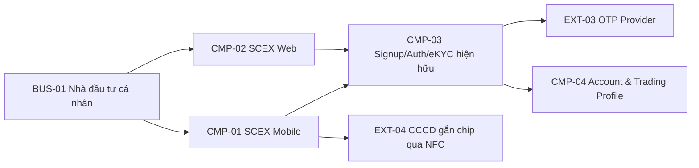
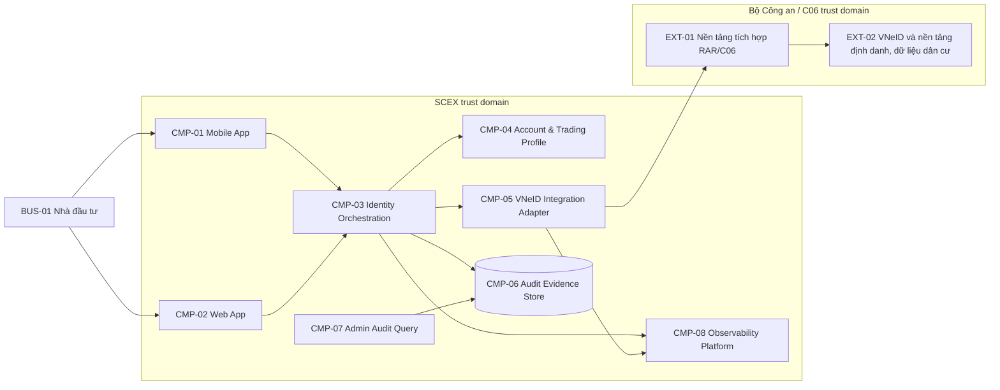
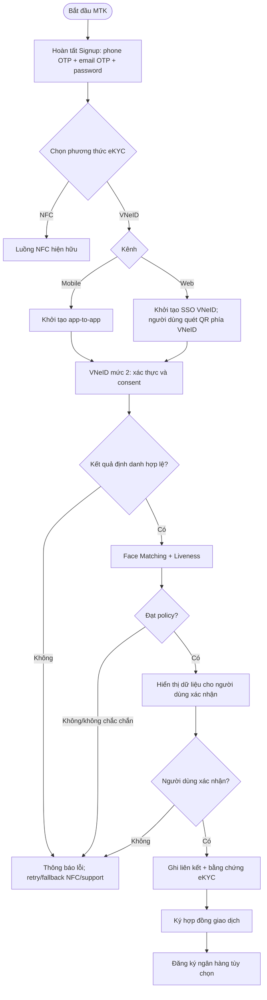
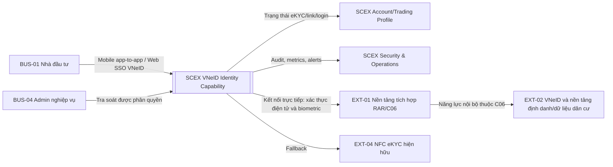
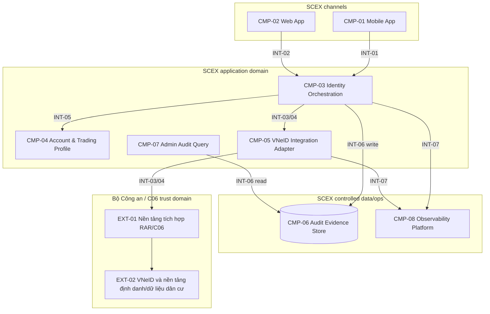
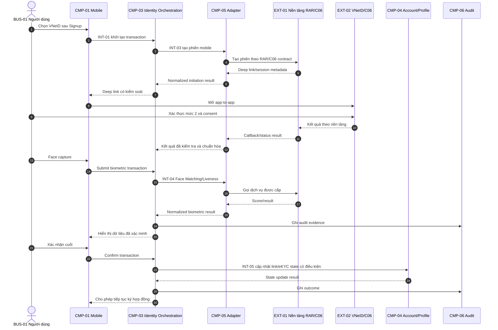
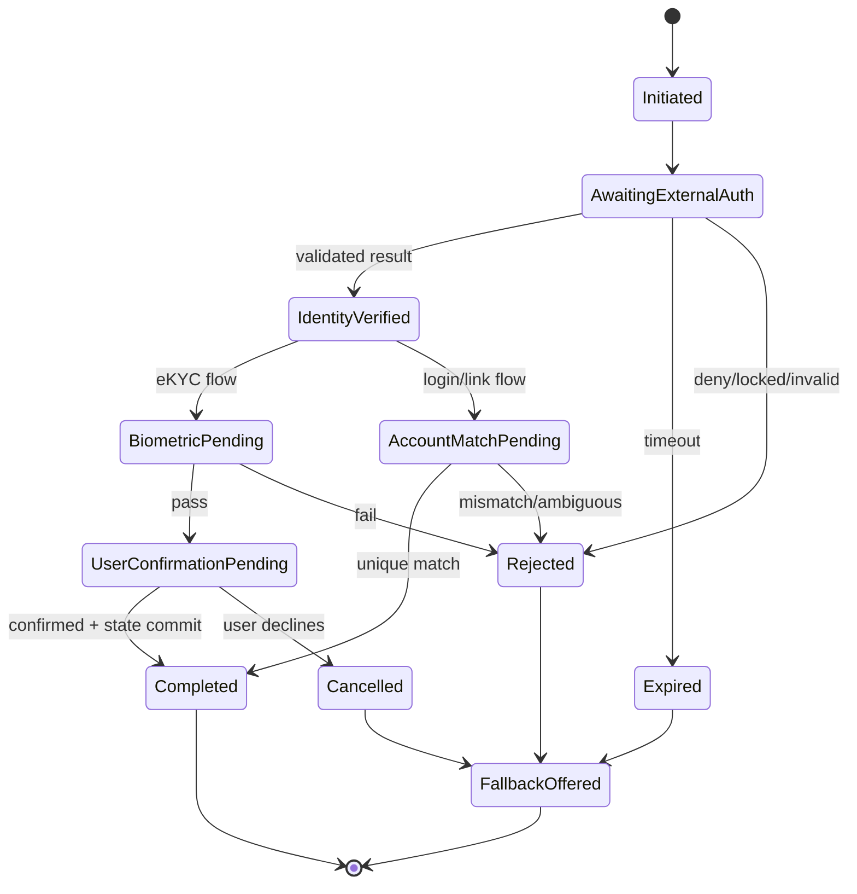
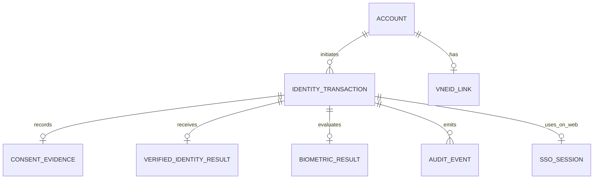
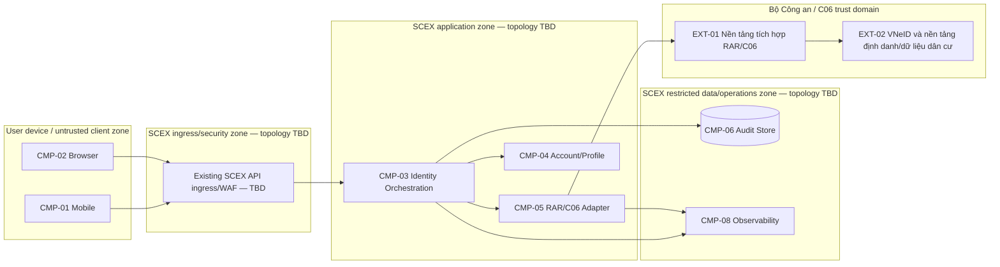

# HIGH LEVEL DESIGN — TÍCH HỢP VNeID (C06) CHO ĐĂNG KÝ VÀ XÁC THỰC TÀI KHOẢN SCEX

> **Quy ước thông tin thiếu:** `TBD — <nội dung cần bổ sung>; Owner: <vai trò>; Gate: <thời điểm phải có>` biểu thị dữ liệu chưa có trong BRD. Các mục này không được hiểu là quyết định kiến trúc đã được phê duyệt.

---

# 1. Quản trị tài liệu

## 1.1 Thông tin tài liệu

| Thuộc tính                         | Giá trị                                                                                                                                                                                                                             |
| ---------------------------------- | ----------------------------------------------------------------------------------------------------------------------------------------------------------------------------------------------------------------------------------- |
| Tên giải pháp/hệ thống             | Tích hợp VNeID (C06) cho đăng ký, liên kết và xác thực tài khoản SCEX                                                                                                                                                               |
| Mã tài liệu                        | HLD-DIGITAL-C06-VNEID                                                                                                                                                                                                               |
| Hồ sơ áp dụng                      | Enhanced                                                                                                                                                                                                                            |
| Lý do chọn hồ sơ/tailoring         | Xử lý dữ liệu định danh và sinh trắc học; tích hợp liên tổ chức; có external exposure; chịu yêu cầu pháp lý, lưu vết và an toàn thông tin cấp độ 3. Các phần chưa có căn cứ trong BRD được giữ ở mức logic và ghi thành open issue. |
| Người xác nhận tailoring           | [TBD] — Solution Architect/ARB; Gate: Architecture approval                                                                                                                                                                         |
| Business Owner                     | [TBD] — Product/Business Owner; Gate: Architecture approval                                                                                                                                                                         |
| System/Service Owner               | [TBD] — SCEX System Owner; Gate: Architecture approval                                                                                                                                                                              |
| Solution Architect                 | [TBD]; Gate: Architecture approval                                                                                                                                                                                                  |
| Tech Lead(s)                       | [TBD] — Mobile, Web, Backend/Integration; Gate: Design review                                                                                                                                                                       |
| Security/Privacy Reviewer          | [TBD] — ATTT và DPO/Privacy; Gate: Architecture approval                                                                                                                                                                            |
| Infrastructure/Operations Reviewer | [TBD] — Infrastructure/SRE; Gate: Architecture approval                                                                                                                                                                             |
| Repository/Link                    | [Confluence page]                                                                                                                                                                                                                   |
| Tài liệu thay thế bởi/thay thế cho | N/A                                                                                                                                                                                                                                 |
| Ngày review tiếp theo              | [chưa có]                                                                                                                                                                                                                           |

## 1.2 Lịch sử thay đổi

| Phiên bản | Ngày       | Tác giả | Thay đổi chính    | Trạng thái |
| --------- | ---------- | ------- | ----------------- | ---------- |
| 0.1       | 2026-09-07 | duc.mm  | Khởi tạo tài liệu | Draft      |

## 1.3 Review và phê duyệt

| Vai trò                 | Người/đơn vị | Phạm vi review                                                           | Kết quả | Ngày  | Bằng chứng/link |
| ----------------------- | ------------ | ------------------------------------------------------------------------ | ------- | ----- | --------------- |
| Business Owner          | [TBD]        | Mục tiêu, phạm vi, trạng thái tài khoản, quy tắc nghiệp vụ               | Pending | [TBD] | [TBD]           |
| Solution Architecture   | SDO          | Boundary, view, interface, quyết định, NFR                               | Pending | [TBD] | [TBD]           |
| An toàn thông tin       | -            | ATTT cấp độ 3 (tối thiểu), API, identity, biometric, threat/control      | Pending | [TBD] | [TBD]           |
| Hạ tầng/Vận hành/SRE    | -            | Deployment, capacity, SLO, DR, operability                               | Pending | [TBD] | [TBD]           |
| Data Owner/DPO          | -            | Consent, dữ liệu cá nhân/sinh trắc học, retention, quyền chủ thể dữ liệu | Pending | [TBD] | [TBD]           |
| Pháp chế/Compliance/AML | -            | Căn cứ pháp lý, PCRT/KYC, thời hạn lưu trữ                               | Pending | [TBD] | [TBD]           |
| ARB                     | -            | Quyết định liên hệ thống và ngoại lệ                                     | Pending | [TBD] | [TBD]           |

## 1.4 Tài liệu tham chiếu

| ID     | Tài liệu/tiêu chuẩn                                                  | Phiên bản/ngày | Vai trò trong HLD                              | Link        |
| ------ | -------------------------------------------------------------------- | -------------- | ---------------------------------------------- | ----------- |
| REF-01 | BRD: Cơ chế tạo tài khoản và đăng nhập qua tích hợp VNeID trên SCEX  |                | Nguồn yêu cầu nghiệp vụ                        | [BRD VNeID] |
| REF-05 | Đặc tả API/dữ liệu của nền tảng định danh và dữ liệu dân cư RAR/C06  |                | Hợp đồng tích hợp trực tiếp                    | [TBD]       |
| REF-06 | Nghị định 69/2024/NĐ-CP                                              |                | Điều kiện kết nối và ATTT cấp độ 3 (tối thiểu) | [TBD]       |
| REF-07 | Nghị quyết 05/2025/NQ-CP                                             |                | KYC và lưu trữ tối thiểu 10 năm                | [TBD]       |
| REF-08 | Nghị định 284/2026/NĐ-CP                                             |                | Nghĩa vụ xác minh danh tính                    | [TBD]       |
| REF-09 | Luật Bảo vệ dữ liệu cá nhân 91/2025/QH15 và Nghị định 356/2025/NĐ-CP |                | Consent và xử lý dữ liệu cá nhân               | [TBD]       |

## 1.5 Thuật ngữ và từ viết tắt

| Thuật ngữ                            | Định nghĩa trong phạm vi tài liệu                                                                                                                                         |
| ------------------------------------ | ------------------------------------------------------------------------------------------------------------------------------------------------------------------------- |
| SCEX                                 | Nền tảng cung cấp tài khoản và giao dịch tài sản mã hóa thuộc phạm vi giải pháp                                                                                           |
| VNeID                                | Ứng dụng định danh và xác thực điện tử quốc gia; tài khoản mức 2 là điều kiện mục tiêu theo BRD                                                                           |
| C06                                  | Cục Cảnh sát quản lý hành chính về trật tự xã hội, trực thuộc Bộ Công an; là cơ quan chủ quản trực tiếp của RAR.                                                          |
| RAR                                  | Trung tâm Nghiên cứu - ứng dụng dữ liệu dân cư và căn cước công dân, trực thuộc C06.                                                                                      |
| Nền tảng định danh và dữ liệu dân cư | Nền tảng do RAR/C06 vận hành mà SCEX kết nối trực tiếp để sử dụng các dịch vụ định danh, xác thực và đối chiếu dữ liệu dân cư theo đặc tả được phê duyệt.                 |
| MTK                                  | Luồng Mở tài khoản Giao dịch tài sản mã hóa                                                                                                                               |
| Signup                               | Giai đoạn tạo credential SCEX: OTP số điện thoại, OTP email và đặt mật khẩu                                                                                               |
| Xác thực định danh                   | Giai đoạn eKYC bằng VNeID hoặc NFC, tách biệt với Signup và ký hợp đồng giao dịch                                                                                         |
| Liên kết VNeID                       | Gắn định danh VNeID mức 2 đã xác minh với một tài khoản SCEX                                                                                                              |
| PCRT                                 | Phòng chống rửa tiền; ngữ cảnh xác minh lại nêu trong BRD                                                                                                                 |
| Face Matching                        | So khớp khuôn mặt người dùng với ảnh sinh trắc học tham chiếu                                                                                                             |
| Liveness Detection                   | Kiểm tra người thao tác là người thật, chống ảnh/video giả mạo                                                                                                            |
| Consent                              | Sự đồng ý chủ động, rõ ràng của người dùng đối với việc chia sẻ/xử lý dữ liệu                                                                                             |
| Correlation ID                       | Mã liên kết các thông điệp trong một giao dịch; mỗi bên gửi tự sinh ID cho thông điệp của mình, mã tham chiếu trong body (nếu contract yêu cầu) trỏ tới yêu cầu liên quan |

---

# 2. Tóm tắt điều hành

## 2.1 Vấn đề và giá trị giải pháp

SCEX hiện dùng email/số điện thoại với OTP cho Signup và NFC căn cước công dân cho eKYC. NFC tạo rào cản cho người dùng có thiết bị không hỗ trợ hoặc thao tác quét không ổn định. Đồng thời, xác minh danh tính là điều kiện bắt buộc trước khi người dùng được cấp quyền giao dịch.

Giải pháp bổ sung VNeID mức 2 như một phương thức xác thực định danh song song với NFC trên mobile và web. Kỳ vọng là tăng khả năng tiếp cận, rút ngắn eKYC, tận dụng dữ liệu đã được cơ quan có thẩm quyền xác thực và vẫn duy trì phương thức hiện hữu khi VNeID không khả dụng.

## 2.2 Giải pháp đề xuất

Giải pháp giữ nguyên chuỗi MTK gồm Signup → Xác thực định danh → Ký hợp đồng → Đăng ký ngân hàng (tùy chọn), chỉ bổ sung VNeID tại giai đoạn Xác thực định danh. Mobile dùng app-to-app/deep link; web dùng SSO VNeID bản Web. SCEX kết nối trực tiếp với nền tảng định danh và dữ liệu dân cư do RAR/C06 vận hành.

Ở mức logic, SCEX cần một lớp điều phối định danh và adapter tích hợp để cô lập contract của RAR/C06, quản lý phiên, consent evidence, đối khớp dữ liệu, Face Matching/Liveness, liên kết tài khoản, audit và fallback. Ranh giới triển khai vật lý của các thành phần này chưa được BRD quy định và phải được chốt ở design review.

## 2.3 Kết quả và chỉ số thành công

| ID    | Kết quả mong đợi                                          | Chỉ số/đơn vị                                                      | Baseline | Target                                               | Thời điểm đo           | Owner                   |
| ----- | --------------------------------------------------------- | ------------------------------------------------------------------ | -------- | ---------------------------------------------------- | ---------------------- | ----------------------- |
| BR-01 | Người không dùng được NFC vẫn hoàn tất xác thực định danh | Tỷ lệ hoàn tất eKYC bằng VNeID                                     | [TBD]    | [TBD] — Product Owner bổ sung                        | [TBD]                  | Product Owner           |
| BR-02 | Danh tính được xác minh trước khi cấp quyền giao dịch     | Tỷ lệ tài khoản có bằng chứng eKYC hợp lệ trước khi enable trading | [TBD]    | 100%                                                 | [TBD]                  | Compliance/System Owner |
| BR-03 | Duy trì hành trình khi VNeID không khả dụng               | Tỷ lệ người dùng được cung cấp fallback hợp lệ                     | [TBD]    | 100% trường hợp lỗi đã phân loại                     | [TBD]                  | Product Owner           |
| BR-04 | Có bằng chứng consent và xác thực truy vấn được           | Tỷ lệ giao dịch có audit record bắt buộc                           | [TBD]    | 100% giao dịch khởi tạo                              | [TBD]                  | Data/Compliance Owner   |
| BR-05 | Đáp ứng lưu trữ theo BRD                                  | Thời hạn lưu audit xác thực                                        | [TBD]    | Tối thiểu 10 năm, chờ Legal xác nhận phạm vi dữ liệu | Production             | Data Owner              |
| BR-06 | Trải nghiệm xác thực không bị kéo dài                     | p95/p99 end-to-end latency                                         | [TBD]    | TBD — BRD chỉ nêu “vài giây”                         | Performance test/pilot | Product Owner/SRE       |

## 2.4 Tóm tắt phạm vi

### Trong phạm vi

- Xác thực định danh VNeID trong MTK
- Liên kết VNeID cho tài khoản hiện hữu
- Xác minh lại PCRT
- Đăng nhập lại bằng VNeID
- Mobile app-to-app
- Web SSO VNeID
- Face Matching/Liveness
- Đối khớp dữ liệu
- Consent
- Audit/admin query
- Fallback NFC/credential

### Ngoài phạm vi

- Hủy liên kết VNeID
- Định danh tổ chức
- Chi tiết eContract và mở TK Ngân Hàng
- Chi tiết API/schema/physical deployment chưa có nguồn

### Giai đoạn sau

- Hủy liên kết/liên kết lại
- Các use case bổ sung khi có phê duyệt

## 2.5 Tác động và quyết định cần phê duyệt

| Hạng mục                                   | Tóm tắt                                                                                                                                                        |
| ------------------------------------------ | -------------------------------------------------------------------------------------------------------------------------------------------------------------- |
| Người dùng bị ảnh hưởng                    | Khách cá nhân, Product/CS, Compliance/AML, Vận hành, ATTT, admin nghiệp vụ                                                                                     |
| Hệ thống/dữ liệu bị ảnh hưởng              | Mobile, Web, Authentication/Account, eKYC, Trading Profile, Audit/Observability, Admin; dữ liệu định danh, consent, biometric score và lịch sử xác thực        |
| Thay đổi quy trình vận hành                | Bổ sung giám, tra soát với C06; hỗ trợ lỗi liên kết; quản lý consent/audit; runbook fallback và incident liên tổ chức                                          |
| Rủi ro cao nhất                            | Liên kết sai chủ thể; consent không hợp lệ; giả mạo/replay; phụ thuộc RAR/C06; rò rỉ dữ liệu cá nhân/sinh trắc học; cấp quyền giao dịch khi eKYC chưa hoàn tất |
| Chi phí/capacity chính                     | Phí RAR/C06, lưu audit ≥10 năm, năng lực hỗ trợ và monitoring...                                                                                               |
| Quyết định cần cấp có thẩm quyền phê duyệt | Data sharing/retention; security profile; ngưỡng biometric; SLO/RTO/RPO; target deployment; các rủi ro khác                                                    |

---

# 3. Bối cảnh và architecture drivers

## 3.1 Mục đích, phạm vi và đối tượng đọc

### Mục đích tài liệu

Khóa các boundary, trách nhiệm, luồng, dữ liệu, kiểm soát và quyết định mức cao để các nhóm Mobile, Web, Backend/Integration, Security, Data và Operations triển khai tương thích; đồng thời cung cấp căn cứ cho ARB và production readiness.  
Tài liệu không thay thế đặc tả API, LLD, threat model, DPIA, test plan hay runbook.

### Phạm vi hệ thống

System-of-interest là năng lực xác thực định danh/liên kết/đăng nhập bằng VNeID trong SCEX, từ khi kênh người dùng khởi tạo phiên đến khi SCEX ghi nhận kết quả, cập nhật liên kết/trạng thái đủ điều kiện và lưu bằng chứng.  
RAR, C06, VNeID và nền tảng định danh/dữ liệu dân cư thuộc trust domain Bộ Công an, nằm ngoài trust domain SCEX; SCEX kết nối trực tiếp qua ranh giới này.  
Signup credential, ký hợp đồng, ngân hàng và trading giữ nguyên, chỉ tích hợp qua trạng thái/kết quả eKYC.

### Đối tượng đọc

| Nhóm đọc                      | Quyết định/concern cần tài liệu trả lời                                          |
| ----------------------------- | -------------------------------------------------------------------------------- |
| Business/Product Owner        | Phạm vi, hành trình, trạng thái, fallback và outcome                             |
| Architect/ARB                 | Boundary, options, dependencies, target và open blockers                         |
| Engineering                   | Component ownership, interface, state, error/idempotency và correspondence rules |
| Security/Privacy              | Trust domain, consent, biometric/PII, crypto, audit và abuse controls            |
| Infrastructure/Operations/SRE | Deployment, SLO, failure ownership, observability, DR và runbook                 |
| QA/Compliance/Audit           | Traceability, evidence, KYC gate, retention và V&V                               |

## 3.2 Stakeholder, concern, viewpoint và view

### 3.2.1 Stakeholder–concern–view map

| ID     | Stakeholder    | Concern/câu hỏi                                                                     | Ưu tiên | View/section giải quyết | Acceptance/evidence                    | Owner xác nhận        | Trạng thái |
| ------ | -------------- | ----------------------------------------------------------------------------------- | ------- | ----------------------- | -------------------------------------- | --------------------- | ---------- |
| CON-01 | Người dùng     | Có hoàn tất eKYC khi không dùng được NFC và có fallback rõ không?                   | High    | VIEW-02, mục 5.2/5.5    | UAT mobile/web và error journeys       | Product Owner         | Open       |
| CON-02 | Compliance     | Có ngăn cấp quyền giao dịch khi chưa xác minh danh tính không?                      | High    | AR-02, CTRL-04, mục 11  | Negative test và audit evidence        | Compliance            | Open       |
| CON-03 | DPO/Người dùng | Consent có chủ động, đúng mục đích và truy vết được không?                          | High    | VIEW-05, CTRL-01, mục 7 | DPIA, consent record, UX approval      | DPO                   | Open       |
| CON-04 | Security       | Có ngăn giả mạo, replay, liên kết nhầm và lạm dụng API không?                       | High    | VIEW-06, mục 7          | Threat model và security test          | ATTT                  | Open       |
| CON-05 | Engineering    | Mobile, web và backend dùng cùng state/contract semantics không?                    | High    | VIEW-03/04, mục 5.4–5.6 | Contract test và state transition test | Tech Leads            | Open       |
| CON-06 | Operations     | Nền tảng RAR/C06 lỗi/timeout thì phát hiện, cô lập và phục hồi thế nào?             | High    | mục 6.4, 8.2–8.4        | SLO, alert, runbook, failover drill    | SRE                   | Open       |
| CON-07 | Audit/Admin    | Có truy vấn được lần chia sẻ, dữ liệu đã chia sẻ, kết quả và điểm face match không? | High    | VIEW-05, mục 7.5/8.2    | Admin UAT và audit query               | Compliance/Data Owner | Open       |
| CON-08 | ARB            | Kết nối RAR/C06 và hạ tầng có đáp ứng ATTT cấp độ 3 không?                          | High    | VIEW-07, mục 5.8/7/11.3 | Hồ sơ cấp độ và assessment             | ARB/ATTT              | Open       |

### 3.2.2 Viewpoint catalog và correspondence rules

| Viewpoint ID | Tên/mục đích        | Stakeholder và concern | Model kind/notation                | Quy ước tạo/đọc                                                                 | Correspondence/consistency rules                            | View/model tạo ra              |
| ------------ | ------------------- | ---------------------- | ---------------------------------- | ------------------------------------------------------------------------------- | ----------------------------------------------------------- | ------------------------------ |
| VP-01        | Context             | CON-05, CON-08         | C4-like context/Mermaid            | System/trust domain; mũi tên là quan hệ logic                                   | Tên/ID external và system phải trùng mọi view               | VIEW-01/03; HLD-DIA-01/04      |
| VP-02        | Business/runtime    | CON-01, CON-02, CON-05 | Flowchart/sequence Mermaid         | Thứ tự thời gian từ trên xuống; không coi callback là sync nếu chưa có contract | Mỗi bước external phải map INT-xx; state map mục 4/5        | VIEW-02/04; HLD-DIA-03/06A–06D |
| VP-03        | Logical application | CON-05, CON-06         | Container/Mermaid + table          | Component logic, không suy diễn deployment                                      | Mỗi component dùng ID CMP-xx và map interface/data owner    | VIEW-03; HLD-DIA-05            |
| VP-04        | Data/lifecycle      | CON-03, CON-07         | Conceptual ER/DFD Mermaid + table  | Chỉ entity/domain; ghi classification và SoR                                    | DATA/DF ID trùng interface/runtime/control view             | VIEW-05; HLD-DIA-07/08         |
| VP-05        | Deployment          | CON-06, CON-08         | Deployment/network Mermaid + table | Zone logic; owner/trust domain rõ; topology chưa có ghi TBD                     | CMP phải map workload/node hoặc ghi deployment boundary TBD | VIEW-07; HLD-DIA-09            |
| VP-06        | Security/control    | CON-03, CON-04, CON-08 | Trust/control matrix               | Trust dựa trên ownership/control plane, không chỉ vị trí mạng                   | Mỗi boundary có INT, auth, data class và CTRL tương ứng     | VIEW-06; mục 7                 |

**Correspondence rules bắt buộc:**

1. `CMP-xx`, `INT-xx`, `DATA-xx` và `DF-xx` dùng nhất quán giữa sơ đồ và bảng.
2. Mọi giao tiếp qua ranh giới SCEX ↔ RAR/C06 phải đi qua `CMP-05`, trừ khi ADR được phê duyệt thay đổi.
3. Chỉ `CMP-04` được cập nhật liên kết/trạng thái tài khoản; kênh người dùng và RAR/C06 không ghi trực tiếp.
4. Chỉ kết quả đã xác minh, còn hiệu lực và gắn đúng transaction mới được dẫn tới thay đổi account state.
5. “Đã liên kết VNeID” không tự đồng nghĩa “đủ quyền giao dịch”; quyền giao dịch còn phụ thuộc trạng thái Hồ sơ giao dịch và hợp đồng.
6. Tên “C06”, “RAR”, “VNeID” và “RAR/C06” không được dùng thay thế nhau cho đến khi REF-05 làm rõ ownership/boundary.

## 3.3 Yêu cầu kiến trúc và truy vết nguồn

| ID    | Yêu cầu                                                                                                                                                   | Nguồn                 | Ưu tiên | Tiêu chí chấp nhận                                                                          | Thành phần/view liên quan |
| ----- | --------------------------------------------------------------------------------------------------------------------------------------------------------- | --------------------- | ------- | ------------------------------------------------------------------------------------------- | ------------------------- |
| AR-01 | VNeID là phương thức eKYC song song với NFC, không thay thế Signup/ký hợp đồng                                                                            | REF-01 §2, §5.1       | Must    | Người dùng chọn được VNeID hoặc NFC; các giai đoạn MTK giữ nguyên                           | VIEW-02, CMP-01/02/03     |
| AR-02 | Không cấp quyền giao dịch trước khi eKYC và điều kiện Hồ sơ giao dịch hoàn tất                                                                            | REF-01 §3, §4.2       | Must    | Negative test chứng minh mọi bypass bị chặn                                                 | CMP-04, CTRL-04           |
| AR-03 | Mobile dùng app-to-app; web dùng SSO VNeID                                                                                                                | Architecture baseline | Must    | UAT trên kênh tương ứng                                                                     | HLD-DIA-06A/06B           |
| AR-04 | Chỉ tài khoản VNeID mức 2 đủ điều kiện                                                                                                                    | REF-01 §1, §5.2, §8   | Must    | Kết quả/claim mức 2 được kiểm tra theo contract                                             | CMP-03/05, INT-03         |
| AR-05 | Consent phải chủ động, rõ mục đích/phạm vi, không mặc định                                                                                                | REF-01 §3, §5.2, §6   | Must    | Có evidence consent trước xử lý dữ liệu                                                     | DATA-03, CTRL-01          |
| AR-06 | Thực hiện Face Matching và Liveness khi xác thực định danh qua VNeID                                                                                      | REF-01 §5.2, §6       | Must    | Có kết quả hợp lệ theo ngưỡng được duyệt                                                    | INT-04, DATA-04           |
| AR-07 | Người dùng xác nhận thông tin nhận được trước khi hoàn tất eKYC                                                                                           | REF-01 §5.2           | Must    | State không chuyển final trước confirmation event                                           | CMP-01/02/03              |
| AR-08 | Liên kết tài khoản hiện hữu chỉ khi thông tin cốt lõi trùng khớp                                                                                          | REF-01 §5.3           | Must    | Họ tên, số định danh, ngày sinh được match theo rule đã duyệt                               | CMP-03/04, DATA-02        |
| AR-09 | Đăng nhập VNeID chỉ cho tài khoản đã liên kết và dữ liệu khớp                                                                                             | REF-01 §5.4           | Must    | Không match thì từ chối và đưa fallback/support                                             | HLD-DIA-06C               |
| AR-10 | Phiên SSO VNeID trên web có thời hạn; hết hạn phải khởi tạo lại phiên, không tái sử dụng phiên cũ. QR do phía VNeID hiển thị/xử lý, không do SCEX quản lý | Architecture baseline | Must    | Replay/expired-session test bị từ chối; không có luồng QR do SCEX render                    | DATA-06, CTRL-06          |
| AR-11 | SCEX kết nối trực tiếp với nền tảng định danh và dữ liệu dân cư do RAR/C06 vận hành                                                                       | Architecture baseline | Must    | Mọi lưu lượng tích hợp đi trực tiếp từ `CMP-05` tới RAR/C06; không có thành phần trung gian | CMP-05, INT-03/04         |
| AR-12 | Gián đoạn không làm mất dữ liệu đã nhập trước đó; có resume/back                                                                                          | REF-01 §7             | Must    | UAT interruption tại mỗi checkpoint                                                         | CMP-03, NFR-REL-02        |
| AR-13 | Mã hóa dữ liệu trên đường truyền                                                                                                                          | REF-01 §7             | Must    | Security configuration/test evidence                                                        | CTRL-07                   |
| AR-14 | Lưu log thời gian, phương thức, kết quả; admin truy vấn chi tiết và face score                                                                            | REF-01 §6, §7         | Must    | Audit completeness 100%; RBAC admin UAT                                                     | CMP-06/07, DATA-05        |
| AR-15 | Audit liên quan được lưu tối thiểu 10 năm theo BRD                                                                                                        | REF-01 §3, §7         | Must    | Retention policy/config + retrieval test                                                    | CMP-06, DATA-05           |
| AR-16 | Có fallback sang NFC/credential khi VNeID không khả dụng                                                                                                  | REF-01 §5.2–5.5, §6   | Must    | Error taxonomy map sang hành động fallback                                                  | VIEW-02/04                |
| AR-17 | Hệ thống kết nối phải đạt ATTT tối thiểu cấp độ 3                                                                                                         | REF-01 §3             | Must    | Hồ sơ/assessment được cấp thẩm quyền chấp thuận                                             | VIEW-06/07                |
| AR-18 | PCRT có thể kích hoạt xác minh lại và khóa dịch vụ giao dịch đến khi thành công                                                                           | REF-01 §4.1, §5.3     | Must    | Rule test theo điều kiện nghiệp vụ được duyệt                                               | CMP-04, DATA-01           |

## 3.4 Giả định

| ID     | Giả định                                                                                         | Cơ sở                 | Owner xác nhận             | Hạn xác nhận          | Tác động nếu sai                                 | Trạng thái |
| ------ | ------------------------------------------------------------------------------------------------ | --------------------- | -------------------------- | --------------------- | ------------------------------------------------ | ---------- |
| ASM-02 | Nền tảng RAR/C06 cung cấp app-to-app, SSO web, callback/status và claim mức VNeID                | Architecture baseline | Integration Owner          | N/A — đã chốt         | N/A                                              | Validated  |
| ASM-03 | Dịch vụ Face Matching/Liveness có thể gọi qua contract được cấp cho SCEX                         | REF-01 §5.2/6         | Security/Integration Owner | Khi nhận REF-05       | Thay đổi eKYC flow và external-platform boundary | Open       |
| ASM-04 | Account/Profile hiện hữu có thể bổ sung link/state mà không phá tương thích                      | Suy ra từ REF-01      | Account Owner              | Design review         | Cần migration/refactor lớn                       | Open       |
| ASM-05 | Người dùng mục tiêu có VNeID mức 2                                                               | REF-01 §8             | Product Owner              | Pilot                 | Conversion thấp; fallback chịu tải cao           | Open       |
| ASM-06 | Có thể dùng lại dữ liệu liên kết cho Simulator → Real Trading mà vẫn phù hợp pháp lý/risk policy | REF-01 §5.6           | Compliance/DPO             | Architecture approval | Phải tái xác thực, đổi flow                      | Open       |

## 3.5 Ràng buộc **[BẮT BUỘC]**

| ID     | Ràng buộc                                                                       | Loại                         | Nguồn/owner           | Hệ quả kiến trúc                                          | Có thể thay đổi?                    |
| ------ | ------------------------------------------------------------------------------- | ---------------------------- | --------------------- | --------------------------------------------------------- | ----------------------------------- |
| CST-01 | SCEX kết nối trực tiếp nền tảng định danh và dữ liệu dân cư do RAR/C06 vận hành | Legal/Government integration | Architecture baseline | Có external government dependency và adapter boundary     | Không                               |
| CST-02 | ATTT tối thiểu cấp độ 3                                                         | Legal/Security               | REF-01/ATTT           | Cần assessment, control và evidence trước go-live         | Không                               |
| CST-03 | Consent chủ động, rõ ràng                                                       | Legal/Privacy                | REF-01/DPO            | Consent là state/evidence bắt buộc                        | Không                               |
| CST-04 | Audit tối thiểu 10 năm theo phạm vi Legal xác nhận                              | Legal/Data                   | REF-01                | Storage, integrity, access và retrieval dài hạn           | Điều kiện theo legal interpretation |
| CST-05 | VNeID song song với phương thức hiện có                                         | Business                     | REF-01                | Không được tạo single point of journey failure            | Có, qua BRD change                  |
| CST-06 | Mobile app-to-app, web SSO VNeID (QR phía VNeID)                                | Technology/UX                | Architecture baseline | Hai runtime pattern nhưng chung state semantics           | Có, nếu platform contract thay đổi  |
| CST-07 | Không lưu tiến trình dở dang trong chính giai đoạn Signup                       | Business                     | REF-01 §5.1           | Resume của VNeID không được hiểu là resume ba bước Signup | Có, qua BRD change                  |

## 3.6 Nguyên tắc và tiêu chuẩn áp dụng **[BẮT BUỘC]**

| ID     | Nguyên tắc/tiêu chuẩn                   | Cách giải pháp tuân thủ                                                        | Ngoại lệ/waiver                 |
| ------ | --------------------------------------- | ------------------------------------------------------------------------------ | ------------------------------- |
| STD-01 | Data minimization và purpose limitation | Chỉ nhận/lưu trường cần cho eKYC/link/login; danh mục trường chờ DPO duyệt     | TBD — OI-04                     |
| STD-02 | Explicit consent                        | Không xử lý kết quả chia sẻ nếu thiếu evidence consent hợp lệ                  | N/A                             |
| STD-03 | Least privilege/segregation of duties   | Admin query read-only theo RBAC; thay đổi state qua service authority          | TBD — OI-20                     |
| STD-04 | Secure integration                      | Adapter, strong workload auth, encryption, replay protection, rate limit       | Crypto/auth profile TBD — OI-14 |
| STD-05 | Fail safely                             | Lỗi/không chắc chắn không tạo link, session hoặc quyền giao dịch; đưa fallback | N/A                             |
| STD-06 | Contract-first/versioned integration    | OpenAPI/schema/error catalog và contract test trước build                      | Contract chưa có — OI-02        |
| STD-07 | Observable/auditable by design          | Correlation, immutable/auditable event, SLI và admin trace                     | Retention/integrity TBD — OI-17 |

## 3.7 Các phương án đã xem xét **[BẮT BUỘC đối với quyết định lớn]**

| Phương án | Sourcing/ownership | Mô tả                                                                       | Lợi ích                                  | Hạn chế/rủi ro                                             | Chi phí vòng đời/độ phức tạp                           | Kết luận                     |
| --------- | ------------------ | --------------------------------------------------------------------------- | ---------------------------------------- | ---------------------------------------------------------- | ------------------------------------------------------ | ---------------------------- |
| A         | Direct/Government  | SCEX kết nối trực tiếp nền tảng RAR/C06                                     | Giảm hop và làm rõ trách nhiệm           | Phụ thuộc vào SLA/năng lực RAR/C06                         | Tích hợp, vận hành, assurance và phối hợp liên cơ quan | Chọn — architecture baseline |
| C         | Reuse              | Duy trì NFC/credential song song với VNeID                                  | Fallback, giảm lock-in và journey outage | Phải vận hành nhiều phương thức                            | Trung bình                                             | Chọn theo BRD                |
| D         | Build              | Thay toàn bộ NFC bằng VNeID                                                 | UX đơn giản hơn                          | Single dependency, trái phạm vi BRD                        | Trung bình/cao                                         | Không chọn                   |
| E         | Build              | Mỗi domain gọi trực tiếp RAR/C06                                            | Nhanh cục bộ                             | Trùng security/contract logic, khó kiểm soát state/version | Cao                                                    | Không khuyến nghị            |
| F         | Build/Reuse        | Một adapter logic tập trung cô lập RAR/C06, các domain dùng contract nội bộ | Nhất quán, dễ thay RAR/C06 và audit      | Cần owner, HA và tránh thành monolith                      | Trung bình                                             | Proposed — chờ ADR-004/ARB   |

---

# 4. Kiến trúc hiện tại, đích và khoảng cách

## 4.1 Baseline architecture **[CÓ ĐIỀU KIỆN: thay đổi hệ thống hiện hữu]**

### 4.1.1 Baseline context/landscape

**VIEW-01 — Baseline Context; VP-01; concern CON-01/05; trạng thái Baseline**

> **HLD-DIA-01 — Baseline System Context/Landscape**



**Legend:** thành phần/ranh giới baseline được suy ra từ BRD, chưa phải inventory triển khai đã xác minh. Ownership chi tiết của `CMP-03/04` cần Account/System Owner xác nhận.

### 4.1.2 Vấn đề của hiện trạng

| ID     | Vấn đề                                              | Bằng chứng      | Ảnh hưởng                      | Root cause/constraint liên quan |
| ------ | --------------------------------------------------- | --------------- | ------------------------------ | ------------------------------- |
| GAP-01 | Thiết bị không hỗ trợ NFC hoặc thao tác quét lỗi    | REF-01 §1       | Người dùng không hoàn tất eKYC | Phụ thuộc hardware/UX NFC       |
| GAP-02 | Chưa có phương thức VNeID cho mobile/web            | REF-01 §1/2     | Hạn chế lựa chọn và conversion | Thiếu integration/capability    |
| GAP-03 | Chưa có data model/state/audit cho VNeID            | BRD yêu cầu mới | Không thể link/login/trace     | Thiếu thiết kế và contract      |
| GAP-04 | Chưa có operating model cho dependency liên tổ chức | BRD nêu rủi ro  | Khó phát hiện và xử lý outage  | Thiếu SLA/runbook/observability |

## 4.2 Target architecture **[BẮT BUỘC]**

**VIEW-03 — Target Logical Overview; VP-01/03; concern CON-03–08; trạng thái Target**

> **HLD-DIA-02 — Target Solution Overview**



**Đặc điểm/định hướng chính:**

1. Giữ VNeID là phương thức song song; mọi lỗi có phân loại phải dẫn tới retry an toàn, fallback hoặc support, không tự cấp quyền.
2. Chỉ giao tiếp external qua adapter logic `CMP-05`; contract vật lý và deployment boundary chờ REF-05/ADR.
3. Dùng một state machine phía server cho mobile và web; client không là source of truth.
4. Account binding và trading eligibility là hai trạng thái khác nhau.
5. Consent, identity result, biometric result và user confirmation là các bằng chứng tách biệt.
6. Deep-link/session token do SCEX phát hành là một lần, có expiry và chống replay. QR trong luồng web là chức năng của app/nền tảng VNeID khi SSO; SCEX không tạo, không hiển thị và không quản lý vòng đời QR. Giá trị cụ thể chờ đặc tả SSO của VNeID/RAR-C06.
7. Lưu audit có kiểm soát truy cập; không mặc định lưu raw biometric/ảnh nếu chưa có legal basis.
8. Mọi callback/status phải gắn transaction, kiểm tra nguồn, tính toàn vẹn, thời hạn và idempotency trước khi thay state.
9. RAR, VNeID và nền tảng định danh/dữ liệu dân cư cùng thuộc trust domain Bộ Công an/C06; RAR trực thuộc C06. Trong phạm vi HLD, SCEX có một ranh giới kết nối trực tiếp từ `CMP-05` tới RAR/C06 qua `INT-03/04`.
10. `CMP-03/05/06` là logical components; có thể triển khai trên service hiện hữu nếu LLD chứng minh cùng invariants và SLO.

## 4.3 Gap analysis **[CÓ ĐIỀU KIỆN: có baseline]**

| ID     | Miền/thành phần        | Baseline                             | Target                                      | Gap                                     | Hành động/work package | Owner             |
| ------ | ---------------------- | ------------------------------------ | ------------------------------------------- | --------------------------------------- | ---------------------- | ----------------- |
| GAP-01 | Channel UX             | NFC/credential                       | VNeID app-to-app và web SSO VNeID song song | UI/deep link/SSO/error journey          | WP-04/WP-05            | Mobile/Web Lead   |
| GAP-02 | Identity orchestration | Luồng hiện hữu chưa có VNeID state   | Shared server-side state machine            | State, matching, confirmation, fallback | WP-03/WP-06            | Backend Lead      |
| GAP-03 | External integration   | Chưa có RAR/C06 contract             | Adapter + secured RAR/C06 integration       | External-platform/API/auth/SLA          | WP-01/WP-03            | Integration Owner |
| GAP-04 | Data/audit             | Chưa có VNeID evidence/link          | Consent/link/transaction/audit entities     | Model, retention, access                | WP-02/WP-06            | Data Owner        |
| GAP-05 | Operations             | Chưa có SLI/runbook RAR/C06          | Observability và dependency ownership       | SLO, alert, incident, DR                | WP-08                  | SRE               |
| GAP-06 | Assurance              | Chưa có threat/DPIA/level-3 evidence | Enhanced assurance package                  | Security/privacy evidence               | WP-02/WP-07            | ATTT/DPO          |

## 4.4 Transition architecture **[CÓ ĐIỀU KIỆN: chuyển đổi nhiều giai đoạn]**

| Giai đoạn                 | Trạng thái kiến trúc                                      | Thành phần tạm thời                                       | Rủi ro/giới hạn                  | Exit criteria                                      |
| ------------------------- | --------------------------------------------------------- | --------------------------------------------------------- | -------------------------------- | -------------------------------------------------- |
| T1 — Contract/Sandbox     | Adapter và state model trong sandbox; chưa bật người dùng | Mock/sandbox RAR/C06                                      | Contract thay đổi                | Contract test và security design pass              |
| T2 — Internal/Pilot       | Mobile/web sau feature flag; NFC giữ nguyên               | Manual support/reconciliation có kiểm soát nếu được duyệt | Volume nhỏ, chưa chứng minh SLO  | UAT, threat/DPIA, level-3 gate, pilot KPI đạt      |
| T3 — Controlled rollout   | Tăng cohort/canary; full monitoring                       | Feature flag/fallback                                     | RAR/C06 capacity và support load | SLO/error/conversion trong guardrail               |
| T4 — General availability | VNeID vận hành song song NFC/credential                   | N/A                                                       | Residual RAR/C06 dependency      | Production readiness và post-implementation review |

---

# 5. Các architecture view

## 5.1 Quy chuẩn sơ đồ **[BẮT BUỘC]**

- Mermaid source được lưu inline trong tài liệu; ID thành phần/giao diện/dữ liệu dùng nhất quán.
- Mũi tên biểu thị hướng yêu cầu/dữ liệu logic, không mặc định là protocol hay trust.
- `SCEX trust domain` và `Bộ Công an/C06 trust domain` phản ánh ownership/control logic; RAR trực thuộc C06. Mọi sơ đồ phải thể hiện kết nối trực tiếp `CMP-05` → `EXT-01` qua `INT-03/04`, không có hop trung gian.
- Sync/async, protocol và callback semantics chỉ được chốt khi có contract; sơ đồ sequence dùng nét đứt cho response/callback logic.
- Không chứa endpoint, field, secret, key, server instance hoặc physical schema.

## 5.2 Business and process view **[CÓ ĐIỀU KIỆN: có thay đổi capability, actor hoặc quy trình]**

### 5.2.1 Business capabilities/actors

| ID     | Capability/actor          | Trách nhiệm                                                          | Thay đổi    | Owner        |
| ------ | ------------------------- | -------------------------------------------------------------------- | ----------- | ------------ |
| BUS-01 | Nhà đầu tư cá nhân        | Chọn phương thức, xác thực, consent, face/liveness, xác nhận dữ liệu | Changed     | N/A          |
| BUS-02 | Product/Customer Support  | Quản lý journey và hỗ trợ lỗi/link                                   | Changed     | TBD          |
| BUS-03 | Compliance/AML            | Xác nhận KYC gate, PCRT và tra soát                                  | Changed     | TBD          |
| BUS-04 | Admin nghiệp vụ           | Truy vấn lịch sử chia sẻ/matching theo quyền                         | New/Changed | TBD          |
| BUS-05 | SCEX Operations/SRE       | Giám sát, incident, dependency và capacity                           | Changed     | TBD          |
| BUS-06 | Nền tảng tích hợp RAR/C06 | Cung cấp năng lực xác thực điện tử theo contract                     | New         | External/TBD |

### 5.2.2 High-level process/workflow

**VIEW-02 — Business Process; VP-02; concern CON-01/02/03; trạng thái Target**

> **HLD-DIA-03 — MTK với phương thức VNeID**



| Bước | Actor               | Input                       | Hoạt động/kết quả               | Business rule | Ngoại lệ chính                            |
| ---- | ------------------- | --------------------------- | ------------------------------- | ------------- | ----------------------------------------- |
| 1    | Người dùng/SCEX     | Phone, email, OTP, password | Hoàn tất Signup liên tục        | AR-01/CST-07  | Dừng giữa Signup phải làm lại Signup      |
| 2    | Người dùng          | Phương thức                 | Chọn VNeID hoặc NFC             | AR-01         | VNeID không đủ điều kiện → NFC            |
| 3    | SCEX/RAR/C06/VNeID  | Transaction/session         | Xác thực VNeID mức 2 và consent | AR-04/05      | Hết hạn, khóa, từ chối consent            |
| 4    | Người dùng/SCEX/C06 | Face capture                | Face Matching + Liveness        | AR-06         | Không đạt/không chắc chắn → fail-safe     |
| 5    | Người dùng/SCEX     | Dữ liệu đã xác minh         | Xác nhận cuối                   | AR-07         | Không xác nhận → không hoàn tất           |
| 6    | SCEX                | Evidence hợp lệ             | Ghi link/eKYC state             | AR-02/08      | Duplicate/replay không tạo link mới       |
| 7    | Người dùng/SCEX     | eKYC complete               | Tiếp tục ký hợp đồng            | BRD §5.1      | Chưa ký thì chưa hoàn tất Hồ sơ giao dịch |

## 5.3 System context view **[BẮT BUỘC]**

**VIEW-03 — System Context; VP-01; concern CON-01–08; trạng thái Target**

> **HLD-DIA-04 — System Context**



| External actor/system                      | Owner/trust domain                 | Mục đích tương tác                                              | Dữ liệu trao đổi      | Criticality |
| ------------------------------------------ | ---------------------------------- | --------------------------------------------------------------- | --------------------- | ----------- |
| Nhà đầu tư                                 | User device/untrusted client       | Khởi tạo, consent qua VNeID, face capture, confirmation         | DATA-01/02/04/06      | High        |
| Nền tảng tích hợp RAR/C06                  | Bộ Công an/C06; RAR trực thuộc C06 | Phiên xác thực, callback/status, dữ liệu định danh và biometric | DATA-01–04            | Critical    |
| VNeID và nền tảng định danh/dữ liệu dân cư | Bộ Công an/C06                     | Xác thực VNeID, đối chiếu dữ liệu định danh, Face/Liveness      | DATA-02/04            | Critical    |
| Account/Trading Profile                    | SCEX; owner TBD                    | Binding, eKYC và eligibility state                              | DATA-01/02            | Critical    |
| NFC eKYC                                   | SCEX/external hiện hữu; owner TBD  | Fallback eKYC                                                   | Dữ liệu eKYC hiện hữu | High        |
| Admin/Observability                        | SCEX privileged/operations domain  | Audit, support, monitoring                                      | DATA-05               | High        |

## 5.4 Logical application/container view **[BẮT BUỘC]**

**VIEW-04 — Logical Application; VP-03; concern CON-04–07; trạng thái Target**

> **HLD-DIA-05 — Logical Application/Container Architecture**



| ID     | Component/subsystem       | Trách nhiệm duy nhất                                                    | Owns data                                       | Exposes/consumes | Technology/runtime                 | Owner                      |
| ------ | ------------------------- | ----------------------------------------------------------------------- | ----------------------------------------------- | ---------------- | ---------------------------------- | -------------------------- |
| CMP-01 | SCEX Mobile App           | Journey app-to-app, face capture, user confirmation, fallback           | Không là SoR                                    | INT-01           | Existing mobile stack; version TBD | Mobile Team                |
| CMP-02 | SCEX Web App              | Web SSO VNeID journey, status update, confirmation, fallback            | Không là SoR                                    | INT-02           | Existing web stack; version TBD    | Web Team                   |
| CMP-03 | Identity Orchestration    | Server-side state machine, policy, matching, idempotency, decision      | DATA-01/03/06 hoặc SoR TBD                      | INT-01–06        | TBD — logical boundary             | Backend/Identity Owner TBD |
| CMP-04 | Account & Trading Profile | SoR cho account binding, eKYC/profile/trading state                     | DATA-02 link/account state                      | INT-05           | Existing service; boundary TBD     | Account Owner TBD          |
| CMP-05 | VNeID Integration Adapter | Cô lập đặc tả/auth/callback/error mapping của kết nối trực tiếp RAR/C06 | Không giữ business SoR; cache tối thiểu nếu cần | INT-03/04        | TBD — logical boundary             | Integration Owner TBD      |
| CMP-06 | Audit Evidence Store      | Lưu evidence truy vết theo retention/integrity policy                   | DATA-05                                         | INT-06           | TBD                                | Data/Compliance Owner TBD  |
| CMP-07 | Admin Audit Query         | Truy vấn read-only, RBAC, masking và audit admin access                 | N/A                                             | INT-06           | Existing/new TBD                   | Operations/Compliance TBD  |
| CMP-08 | Observability Platform    | Metrics/log/traces/alerts kỹ thuật và security                          | Telemetry, không thay audit SoR                 | INT-07           | Existing platform TBD              | SRE/SOC TBD                |

### Quy tắc boundary và dependency

- Channel chỉ gọi `CMP-03`; không gọi trực tiếp RAR/C06/VNeID/C06 và không tự quyết định eKYC success.
- `CMP-03` điều phối; `CMP-04` là authority thay đổi account/link/profile state; `CMP-06` là authority cho audit evidence.
- `CMP-05` xác minh nguồn/tính toàn vẹn/expiry/idempotency của RAR/C06 message trước khi chuyển normalized result nội bộ.
- Không dùng client-returned success/deep-link parameters làm bằng chứng duy nhất; phải xác minh server-to-server/status/callback theo contract.
- Không cho external system ghi trực tiếp database SCEX.
- Contract nội bộ và external phải versioned, backward compatible trong cửa sổ được phê duyệt; deprecation cần owner và deadline.
- Raw biometric image không được persist mặc định; nếu REF-05 buộc lưu, cần DPIA, retention, encryption và approval riêng.

## 5.5 Runtime/scenario view **[BẮT BUỘC cho luồng quan trọng]**

### 5.5.1 Mobile — xác thực định danh và tạo liên kết

> **HLD-DIA-06A — Mobile app-to-app eKYC**



### 5.5.2 Web — SSO VNeID

> **HLD-DIA-06B — Web SSO VNeID eKYC/login**  
> QR là chức năng của app/nền tảng VNeID trong quá trình SSO. SCEX chỉ khởi tạo phiên SSO và nhận kết quả; SCEX không tạo, không render và không quản lý vòng đời QR.

```mermaid
sequenceDiagram
    autonumber
    actor U as BUS-01 Người dùng
    participant W as CMP-02 Web
    participant I as CMP-03 Identity Orchestration
    participant G as CMP-05 Adapter
    participant P as EXT-01 Nền tảng RAR/C06
    participant V as EXT-02 VNeID App

    U->>W: Chọn VNeID
    W->>I: INT-02 khởi tạo web transaction
    I->>G: INT-03 khởi tạo phiên SSO VNeID
    G->>P: Tạo phiên SSO theo đặc tả RAR/C06
    P-->>G: Tham số phiên SSO (VNeID hiển thị QR ở phía VNeID)
    G-->>I: Normalized SSO session metadata
    I-->>W: Hiển thị điểm vào SSO VNeID, không lộ secret
    U->>V: Mở app VNeID và quét QR do VNeID hiển thị
    U->>V: Xác thực và consent
    V-->>P: Kết quả
    P-->>G: Callback/status result
    G-->>I: Validated normalized result
    I-->>W: Cập nhật trạng thái phiên qua cơ chế TBD
    alt Phiên SSO hết hạn
      I-->>W: Mark expired; yêu cầu khởi tạo lại phiên SSO
    else Kết quả hợp lệ
      I-->>W: Tiếp tục matching/confirmation tương ứng
    end
```

### 5.5.3 Đăng nhập lại bằng VNeID

> **HLD-DIA-06C — VNeID login cho tài khoản đã liên kết**

```mermaid
sequenceDiagram
    autonumber
    actor U as BUS-01 Người dùng
    participant C as CMP-01/02 Channel
    participant I as CMP-03 Identity Orchestration
    participant G as CMP-05 Adapter
    participant P as EXT-01/VNeID
    participant A as CMP-04 Account/Profile

    U->>C: Chọn đăng nhập VNeID
    C->>I: Khởi tạo login transaction
    I->>G: Khởi tạo phiên SSO VNeID theo kênh (mobile app-to-app; web dùng QR phía VNeID)
    G->>P: Yêu cầu xác thực
    U->>P: Xác thực; consent/re-consent theo contract TBD
    P-->>G: Identity result
    G-->>I: Validated normalized result
    I->>A: Tìm linked account và kiểm tra trạng thái
    alt Link duy nhất, dữ liệu khớp, account được phép login
      A-->>I: Match
      I-->>C: Phát hành/tiếp tục session theo Auth policy
    else Không match/khóa/ambiguous
      A-->>I: Reject reason
      I-->>C: Từ chối; credential fallback hoặc support
    end
```

### 5.5.4 Failure, timeout, duplicate và fallback

> **HLD-DIA-06D — Fail-safe state handling**



| Step/nhóm            | From         | To         | Interface | Sync/Async        | Timeout            | Retry/backoff                                                | Idempotency                                        | Error/fallback                      | Data classification     |
| -------------------- | ------------ | ---------- | --------- | ----------------- | ------------------ | ------------------------------------------------------------ | -------------------------------------------------- | ----------------------------------- | ----------------------- |
| Khởi tạo             | CMP-01/02    | CMP-03     | INT-01/02 | Sync              | TBD — OI-11        | Retry network có giới hạn                                    | Client idempotency key/transaction ID; profile TBD | Không tạo trùng transaction         | Internal/Confidential   |
| Tạo external session | CMP-03/05    | EXT-01     | INT-03    | TBD theo contract | TBD                | Chỉ retry thao tác được REF-05 định nghĩa là idempotent/safe | RAR/C06 idempotency TBD                            | Offer retry/fallback                | Confidential            |
| Callback/status      | EXT-01       | CMP-05/03  | INT-03    | Async logic       | Session expiry TBD | Không retry business decision tại SCEX; transport policy TBD | Dedup theo external event + transaction            | Reject invalid/expired/replay       | Restricted              |
| Biometric            | CMP-01→03→05 | EXT-01/C06 | INT-04    | Sync/Async TBD    | TBD                | Không tự lặp capture nếu chưa có UX consent                  | Transaction-scoped                                 | Fail-safe/NFC/manual path TBD       | Restricted              |
| State commit         | CMP-03       | CMP-04/06  | INT-05/06 | Sync logic        | TBD                | Retry qua idempotent command/outbox pattern TBD              | Conditional update/version                         | Không cấp quyền nếu partial failure | Confidential/Restricted |

## 5.6 Integration and interface view **[BẮT BUỘC]**

| ID     | Provider              | Consumer      | Purpose                                                                | Protocol/pattern                               | AuthN/AuthZ                                 | Contract/source       | SLA/SLO       | Versioning                    | Data class                      |
| ------ | --------------------- | ------------- | ---------------------------------------------------------------------- | ---------------------------------------------- | ------------------------------------------- | --------------------- | ------------- | ----------------------------- | ------------------------------- |
| INT-01 | CMP-03                | CMP-01        | Mobile init/status/confirm/face submission                             | Existing SCEX API; exact contract TBD          | Existing user/device session + controls TBD | OpenAPI TBD           | TBD           | Versioned/backward compatible | Confidential/Restricted         |
| INT-02 | CMP-03                | CMP-02        | Web init/status/confirm/login qua SSO VNeID                            | REST + update pattern TBD (poll/SSE/WebSocket) | Existing web session + controls TBD         | OpenAPI TBD           | TBD           | Versioned                     | Confidential                    |
| INT-03 | EXT-01/CMP-05         | CMP-05/EXT-01 | Tạo phiên SSO (mobile deep link; web, callback/status, identity result | TBD theo REF-05                                | mTLS/signature/OAuth profile TBD            | REF-05 missing        | TBD           | RAR/C06 version policy TBD    | Restricted                      |
| INT-04 | EXT-01/C06 via CMP-05 | CMP-05        | Face Matching/Liveness                                                 | TBD theo REF-05                                | TBD                                         | REF-05 missing        | TBD           | TBD                           | Restricted biometric            |
| INT-05 | CMP-04                | CMP-03        | Read/update account link, eKYC, PCRT/trading state                     | Internal API/event TBD                         | Workload identity + least privilege         | Internal contract TBD | Critical; TBD | Backward compatible           | Confidential                    |
| INT-06 | CMP-06                | CMP-03/07     | Write/query audit evidence                                             | Internal API/storage interface TBD             | Service identity/RBAC                       | Audit schema TBD      | TBD           | Additive schema               | Restricted                      |
| INT-07 | CMP-08                | CMP-03/05     | Telemetry và alert                                                     | Existing observability protocols TBD           | Workload identity                           | Platform standard TBD | TBD           | N/A                           | Internal; PII prohibited/masked |

### Integration policies

| Chủ đề                        | Quyết định mức cao                                                                                                                                                                                                                                      |
| ----------------------------- | ------------------------------------------------------------------------------------------------------------------------------------------------------------------------------------------------------------------------------------------------------- |
| Timeout budget                | BRD yêu cầu “vài giây” nhưng chưa đo được; end-to-end p95/p99 và per-hop budget phải chốt tại OI-11 trước performance test. External auth có thể kéo dài do thao tác người dùng nên tách technical timeout khỏi session expiry.                         |
| Retry/backoff/jitter          | Chỉ retry lỗi transport/throttling khi operation idempotent; không tự retry consent, biometric capture hay business rejection. Giá trị TBD theo RAR/C06 SLA.                                                                                            |
| Idempotency/deduplication     | Mỗi transaction có ID server-side; init/state commit/callback dedup. External event phải map đúng transaction, purpose và current state.                                                                                                                |
| Ordering/consistency          | State transition có điều kiện/version; late callback không đảo ngược terminal state. Account binding cần strong consistency tại commit.                                                                                                                 |
| Rate limit/quota/backpressure | Per user/device/IP/client/RAR/C06 quota TBD; ưu tiên bảo vệ account/auth platform và RAR/C06 quota.                                                                                                                                                     |
| Circuit breaker/bulkhead      | Áp dụng tại external adapter sau khi có error taxonomy; khi mở circuit, offer fallback và không tạo thêm phiên vô ích.                                                                                                                                  |
| Error model/correlation ID    | Chuẩn hóa RAR/C06 error thành nhóm retryable, user-action, rejected, expired, security-invalid, unknown. Mỗi bên gửi tự sinh header correlation/request ID; body reference chỉ liên kết prior request theo contract, không tái dùng một ID cho mọi hop. |
| Contract compatibility        | Contract-first, schema validation, consumer/provider contract test; breaking change cần version và migration window.                                                                                                                                    |
| Dead-letter/reconciliation    | Callback không xử lý được phải quarantine/DLQ hoặc reconciliation queue theo technology lựa chọn; không silently drop. Thiết kế chi tiết TBD.                                                                                                           |

## 5.7 Data architecture view **[BẮT BUỘC]**

### 5.7.1 Conceptual/logical data model

**VIEW-05 — Data and Evidence; VP-04; concern CON-03/07; trạng thái Target**

> **HLD-DIA-07 — Conceptual/Logical Data Model**



| ID      | Data domain/entity                         | Business owner          | System of record            | Producer/consumer       | Classification                                                                     | Residency                       | Retention/disposal                                                  |
| ------- | ------------------------------------------ | ----------------------- | --------------------------- | ----------------------- | ---------------------------------------------------------------------------------- | ------------------------------- | ------------------------------------------------------------------- |
| DATA-01 | Identity Transaction/State                 | Compliance/Product TBD  | CMP-03 (proposed)           | CMP-01/02/03/05         | Confidential                                                                       | TBD — phải được DPO/Legal duyệt | Transaction retention TBD; audit projection ≥10 năm nếu thuộc scope |
| DATA-02 | Verified Identity Attributes và VNeID Link | Customer/Data Owner TBD | CMP-04 (proposed)           | CMP-03/04/07            | Restricted                                                                         | TBD                             | Field-level retention/deletion TBD — OI-04/16                       |
| DATA-03 | Consent Evidence                           | DPO/Compliance          | CMP-06 hoặc consent SoR TBD | CMP-03/05/07            | Restricted                                                                         | TBD                             | Theo legal basis; tối thiểu đủ chứng minh consent; exact TBD        |
| DATA-04 | Face Matching/Liveness Result/Score        | Compliance/Security     | CMP-06 hoặc eKYC SoR TBD    | CMP-01/03/05/07         | Restricted biometric                                                               | TBD                             | Score/evidence TBD; raw image mặc định không lưu                    |
| DATA-05 | Authentication/Sharing/Audit Event         | Compliance              | CMP-06                      | CMP-03/05/07, Audit/SOC | Restricted                                                                         | TBD                             | Tối thiểu 10 năm theo BRD, phạm vi cần Legal xác nhận               |
| DATA-06 | SSO/Deep-link Session Metadata (SCEX)      | Identity Owner          | CMP-03                      | CMP-01/02/03/05         | Confidential; token/secret không log; QR thuộc phía VNeID, không phải dữ liệu SCEX | TBD                             | Ngắn hạn theo expiry; exact TBD                                     |

### 5.7.2 Data flow and lifecycle

> **HLD-DIA-08 — Data Flow/Lifecycle**

```mermaid
flowchart LR
    C[Collect: init + purpose] --> S[Create SSO session (one-time SCEX token; QR ở phía VNeID)]
    S --> E[External authentication + consent]
    E --> R[Receive and validate result]
    R --> B[Face/Liveness or account match]
    B --> U[User confirmation when eKYC]
    U --> P[Persist minimum link/state]
    P --> A[Append audit evidence]
    A --> Q[Authorized query/monitor]
    Q --> D[Retention expiry, legal hold review, disposal]
```

| Flow ID | Source → Destination           | Data                     | Purpose/legal basis                    | Transform                                  | Encryption                             | Retention                            | Reconciliation                 |
| ------- | ------------------------------ | ------------------------ | -------------------------------------- | ------------------------------------------ | -------------------------------------- | ------------------------------------ | ------------------------------ |
| DF-01   | Channel → CMP-03               | DATA-01/06               | Khởi tạo eKYC/login/link               | Validate, bind session/user/purpose        | Transit required                       | Short-lived/session TBD              | Transaction status             |
| DF-02   | CMP-05 ↔ EXT-01                | DATA-01/02/03/04/06      | Xác thực điện tử theo consent/contract | RAR/C06 ↔ canonical model                  | Transit required; profile TBD          | Minimize; cache TBD                  | Callback/status reconciliation |
| DF-03   | Channel → C06 via SCEX/RAR/C06 | Face capture/DATA-04     | Face Matching/Liveness                 | Image → score/result                       | Transit required; raw image policy TBD | Raw image default no-persist         | Match transaction/result       |
| DF-04   | CMP-03 → CMP-04                | DATA-02 + decision       | Account binding/eKYC state             | Canonical verified attributes → link/state | Transit + at-rest required             | Account/legal policy TBD             | Conditional commit/audit       |
| DF-05   | CMP-03/05 → CMP-06             | DATA-03/04/05            | Evidence, compliance, support          | Mask/minimize/append                       | Transit + at-rest required             | ≥10 năm đối với log thuộc scope      | Completeness check             |
| DF-06   | CMP-06 → CMP-07                | DATA-05 + allowed fields | Admin tra soát                         | RBAC, masking, pagination/export control   | Transit required                       | Query result non-persistent mặc định | Audit mọi admin query          |

### 5.7.3 Data consistency, quality and migration

| Chủ đề                   | Quyết định                                                                                                                                                                             |
| ------------------------ | -------------------------------------------------------------------------------------------------------------------------------------------------------------------------------------- |
| Consistency model        | Strong/conditional consistency cho account binding và eligibility state; eventual chấp nhận cho telemetry. Audit commit coupling/outbox cần LLD chốt để tránh state không có evidence. |
| Transaction boundary     | Không thể atomic xuyên SCEX–RAR/C06; dùng server-side state machine, idempotent messages và terminal-state protection. Local link/state update phải atomic trong `CMP-04`.             |
| Master/reference data    | `CMP-04` là proposed SoR cho account/link; external verified attributes là evidence đầu vào, không cho external ghi trực tiếp. Owner xác nhận tại OI-06.                               |
| Data quality rules       | Core match: họ tên, số định danh, ngày sinh theo BRD; normalization, diacritic, historical values, null và threshold TBD — OI-06.                                                      |
| Lineage/auditability     | Transaction → external session/result → consent → biometric → confirmation → account state, dùng stable IDs và timestamps có đồng bộ thời gian.                                        |
| Schema evolution         | Additive/versioned; field classification và retention metadata bắt buộc; breaking change qua migration/ADR.                                                                            |
| Migration/reconciliation | Không bulk migrate identity. Tài khoản hiện hữu link on-demand; schema/backfill kỹ thuật và reconciliation plan TBD tại mục 9.2.                                                       |

## 5.8 Technology, deployment and network view **[BẮT BUỘC]**

**VIEW-07 — Deployment/Trust Zones; VP-05; concern CON-06/08; trạng thái Target logical**

> **HLD-DIA-09 — Deployment/Technology Architecture**



| Node/platform             | Environment      | Location/zone       | Workload             | HA/scaling                 | Network/trust zone        | Managed by        | Version/lifecycle     |
| ------------------------- | ---------------- | ------------------- | -------------------- | -------------------------- | ------------------------- | ----------------- | --------------------- |
| User channels             | DEV/UAT/PROD     | User device/browser | CMP-01/02            | Client distribution TBD    | Untrusted                 | Mobile/Web Teams  | Existing policy TBD   |
| SCEX ingress              | All              | TBD                 | INT-01/02 protection | TBD                        | SCEX edge/security        | Platform/ATTT TBD | Existing standard TBD |
| SCEX application platform | All/DR           | TBD                 | CMP-03/04/05/07      | TBD — capacity/SLO missing | SCEX application zone     | Platform/SRE TBD  | Existing standard TBD |
| Restricted data platform  | All/DR           | TBD                 | CMP-06               | TBD — ≥10-year retention   | SCEX restricted data zone | Data Platform TBD | Existing standard TBD |
| Observability platform    | All/DR           | TBD                 | CMP-08               | TBD                        | SCEX operations/security  | SRE/SOC           | Existing standard TBD |
| RAR/C06 endpoint          | Sandbox/UAT/PROD | External/TBD        | EXT-01               | Theo RAR/C06 SLA TBD       | External RAR/C06          | RAR/C06           | REF-05 TBD            |
| VNeID/C06                 | External         | External            | EXT-02               | Ngoài kiểm soát SCEX       | Government identity       | External          | Contract TBD          |

### Technology choices

| Layer/capability       | Technology/service                                          | Version policy                          | Lý do/ADR        | Standard status | Exit/replacement trigger                                      |
| ---------------------- | ----------------------------------------------------------- | --------------------------------------- | ---------------- | --------------- | ------------------------------------------------------------- |
| Identity orchestration | TBD — ưu tiên reuse service hiện hữu nếu đáp ứng invariants | Theo SCEX standard                      | ADR-004 proposed | TBD             | Không đáp ứng state/SLO/isolation                             |
| RAR/C06 adapter        | TBD                                                         | Contract/version pin + supported window | ADR-004 proposed | TBD             | RAR/C06/contract thay đổi hoặc concentration risk vượt ngưỡng |
| Audit evidence         | TBD                                                         | Supported/LTS                           | OI-17            | TBD             | Không đáp ứng retention, integrity, query/cost                |
| Web status update      | Polling/SSE/WebSocket TBD                                   | Theo SCEX standard                      | OI-10            | TBD             | Không đáp ứng scale/security/UX                               |
| Biometric capability   | Dịch vụ C06 qua RAR/C06 theo BRD; product cụ thể TBD        | Contract managed                        | ADR-001          | RAR/C06         | Không đạt accuracy/SLA/compliance                             |

## 5.9 Environment and configuration strategy **[BẮT BUỘC]**

| Chủ đề                              | DEV                                       | TEST/UAT                                                   | PROD                                                         | DR                                  |
| ----------------------------------- | ----------------------------------------- | ---------------------------------------------------------- | ------------------------------------------------------------ | ----------------------------------- |
| Topology parity                     | Logical parity; lightweight allowed       | Production-like cho flow/security                          | HA topology TBD                                              | DR topology TBD                     |
| Data policy                         | Synthetic only                            | Synthetic/masked; biometric test set được duyệt            | Real data theo consent/policy                                | Replication theo RPO/residency TBD  |
| Configuration source                | Existing config system TBD                | Promoted config                                            | Controlled/audited config                                    | Synchronized/recoverable TBD        |
| Secrets/key ownership               | Vault/KMS mechanism TBD; không ghi secret | Non-prod isolated                                          | ATTT/Platform custodian TBD                                  | Recovery/rotation TBD               |
| External dependency strategy        | Mock + RAR/C06 sandbox                    | RAR/C06 UAT/certification                                  | RAR/C06 production                                           | RAR/C06 DR/fallback terms TBD       |
| Build/artifact source và provenance | Trusted repo/pipeline TBD                 | Same immutable artifact promoted                           | Trusted registry, SBOM/signature/attestation theo policy TBD | Cùng artifact hoặc verified rebuild |
| IaC/deployment mechanism            | Existing SCEX mechanism TBD               | Automated + approval                                       | Separation of duties + rollback                              | DR activation mechanism TBD         |
| Policy và promotion gates           | Unit/static/contract tests                | E2E, security, privacy, performance, RAR/C06 certification | Go/no-go + evidence                                          | DR exercise + authority TBD         |

---

# 6. Quality attributes và yêu cầu phi chức năng

## 6.1 Quality model coverage và priorities **[BẮT BUỘC]**

| Quality characteristic/concern       | Áp dụng?                         | Scenario/section chứng minh | Ghi chú/trade-off                                               |
| ------------------------------------ | -------------------------------- | --------------------------- | --------------------------------------------------------------- |
| Functional suitability               | Yes                              | AR-01–18, mục 11            | Trạng thái và eligibility phải đúng hơn tối ưu UX               |
| Performance efficiency               | Yes                              | NFR-PERF-01, 6.3            | BRD chưa cho percentile/volume                                  |
| Compatibility/interoperability       | Yes                              | INT-01–07                   | Phụ thuộc RAR/C06 contract/version                              |
| Interaction capability/accessibility | Yes                              | NFR-UX-01/02                | Mobile deep link và web SSO VNeID cần UAT/accessibility         |
| Reliability/resilience               | Yes                              | NFR-REL-01/02, 6.4          | Fallback giảm tác động dependency nhưng không thay eKYC control |
| Security                             | Yes                              | NFR-SEC-01/02, mục 7        | Dữ liệu identity/biometric và external exposure                 |
| Maintainability                      | Yes                              | 5.4–5.6, 6.5                | Adapter/canonical model giảm coupling                           |
| Flexibility/portability              | Yes                              | ADR-004, 5.8                | Tránh RAR/C06 contract lan sang domain/channel                  |
| Safety/harm avoidance                | Yes                              | AR-02, CTRL-04              | Ngăn cấp quyền sai và liên kết nhầm chủ thể                     |
| Concern mở rộng theo bối cảnh        | Privacy, operability, audit cost | mục 7/8/6.7                 | Retention dài hạn và consent là drivers chính                   |

| Rank | Quality attribute                | Business rationale                                     | Trade-off chấp nhận                              | Owner                    |
| ---- | -------------------------------- | ------------------------------------------------------ | ------------------------------------------------ | ------------------------ |
| 1    | Security/Privacy/Correctness     | Sai danh tính hoặc consent gây hậu quả pháp lý/tài sản | Fail-safe và thêm bước xác nhận dù tăng friction | Compliance/DPO/ATTT      |
| 2    | Reliability/Recoverability       | External dependency không được chặn hành trình chính   | Duy trì NFC/credential và state resume           | Product/SRE              |
| 3    | Auditability                     | Cần chứng minh KYC/consent và hỗ trợ tra soát dài hạn  | Chi phí storage/query và governance cao hơn      | Compliance/Data Owner    |
| 4    | Performance/UX                   | eKYC phải đủ nhanh và dễ hoàn tất                      | Không hy sinh control/accuracy để giảm latency   | Product Owner            |
| 5    | Maintainability/Interoperability | RAR/C06 contract có thể đổi                            | Thêm adapter/canonical model                     | Architecture/Engineering |

## 6.2 Quality scenarios **[BẮT BUỘC]**

| ID          | Source            | Stimulus                              | Environment            | Artifact       | Expected response                                            | Measure/threshold                                               | Verification                     |
| ----------- | ----------------- | ------------------------------------- | ---------------------- | -------------- | ------------------------------------------------------------ | --------------------------------------------------------------- | -------------------------------- |
| NFR-SEC-01  | Attacker/client   | Replay phiên SSO/deep link/callback   | Normal/attack          | CMP-03/05      | Từ chối, không đổi state, tạo security event                 | 100% test vectors bị từ chối; TTL TBD                           | Security test                    |
| NFR-SEC-02  | User/RAR/C06      | Kết quả không đủ evidence/không match | Normal                 | CMP-03/04      | Fail-safe; không link/không cấp quyền                        | 0 unauthorized state transitions                                | Negative E2E/audit               |
| NFR-REL-01  | RAR/C06           | VNeID/RAR/C06 unavailable             | Production             | Journey/CMP-05 | Circuit/error rõ; cung cấp NFC/credential fallback           | 100% error classes có mapped action; detection TBD              | Chaos/UAT/runbook drill          |
| NFR-REL-02  | Network/user      | Gián đoạn giữa phiên VNeID            | Mobile/web             | CMP-03         | Không mất dữ liệu trước giai đoạn VNeID; resume/back an toàn | 100% interruption checkpoints pass; expiry TBD                  | E2E interruption test            |
| NFR-PERF-01 | User              | Khởi tạo/xử lý kết quả                | Normal/peak            | CMP-03/05      | Phản hồi trong UX target                                     | TBD — p95/p99 và loại trừ user think time; Owner: Product/SRE   | Load/performance test            |
| NFR-AUD-01  | Auditor/Admin     | Truy vấn một lần xác thực             | Production             | CMP-06/07      | Trả đúng evidence được phép, có audit truy cập               | 100% required fields; latency TBD; retention ≥10 năm theo scope | Audit retrieval/UAT              |
| NFR-DATA-01 | Compliance        | Kiểm tra state trước trading          | Normal                 | CMP-04         | Chỉ enable khi eKYC + contract conditions hợp lệ             | 100% gating test pass                                           | Integration/negative test        |
| NFR-UX-01   | User đủ điều kiện | Thực hiện eKYC mobile/web             | Representative devices | CMP-01/02      | Hiểu điều kiện, consent, lỗi và fallback                     | Completion/accessibility target TBD                             | Moderated UAT/accessibility test |

## 6.3 Performance, scalability and capacity **[BẮT BUỘC]**

| Metric/workload                    | Current/baseline | Forecast horizon  | Normal | Peak/burst | Target                                | Test model/source                    |
| ---------------------------------- | ---------------- | ----------------- | ------ | ---------- | ------------------------------------- | ------------------------------------ |
| VNeID eKYC initiations/concurrency | TBD              | 6/12/36 tháng TBD | TBD    | TBD        | TBD p95/p99 excluding user think time | Product forecast + RAR/C06 quota TBD |
| Login via VNeID RPS                | 0/new            | 6/12/36 tháng TBD | TBD    | TBD        | TBD                                   | Auth traffic forecast                |
| RAR/C06 callbacks/status           | 0/new            | 12 tháng          | TBD    | TBD        | No loss/duplicate side effect         | RAR/C06 SLA/contract                 |
| Audit events/storage               | 0/new            | ≥10 năm           | TBD    | TBD        | 100% required events retained         | Volume model TBD                     |
| Admin audit queries                | 0/new            | 12 tháng          | TBD    | TBD        | Latency/throughput TBD                | Compliance use cases                 |

| Chủ đề                         | Quyết định                                                                                                  |
| ------------------------------ | ----------------------------------------------------------------------------------------------------------- |
| Scaling unit and trigger       | Stateless request/worker và partition key theo transaction/account là hướng đề xuất; technology/metric TBD. |
| Capacity headroom              | TBD — SRE xác định theo forecast và RAR/C06 quota.                                                          |
| Bottleneck/resource limit      | RAR/C06 quota/latency, biometric payload, audit write/query, login burst. Số liệu chưa có.                  |
| Load shedding/backpressure     | Ưu tiên bảo vệ Auth/Account; từ chối có kiểm soát, không queue vô hạn; policy TBD.                          |
| Performance degradation policy | Giữ fallback; không bỏ consent/matching/liveness/audit để giảm latency.                                     |

## 6.4 Availability, resilience and disaster recovery **[BẮT BUỘC]**

| Service/data tier              | Availability SLO         | RTO | RPO                                | Failure domain            | Redundancy/failover                                                   | Backup/restore            | DR test frequency |
| ------------------------------ | ------------------------ | --- | ---------------------------------- | ------------------------- | --------------------------------------------------------------------- | ------------------------- | ----------------- |
| Identity Orchestration/Adapter | TBD — OI-12              | TBD | N/A/TBD state                      | Process/node/zone/RAR/C06 | SCEX HA TBD; RAR/C06 fallback là NFC, không phải transparent failover | Config/state recovery TBD | TBD               |
| Account/VNeID Link             | Inherit account tier TBD | TBD | TBD                                | DB/zone/site              | Existing platform TBD                                                 | Required                  | TBD               |
| Audit Evidence Store           | TBD                      | TBD | TBD consistent with legal evidence | Storage/zone/site         | TBD                                                                   | Required + retrieval test | TBD               |

### Failure mode summary

| Failure                        | Detection                            | Containment                                                               | Degraded behavior                                     | Recovery                                     | Owner/runbook                |
| ------------------------------ | ------------------------------------ | ------------------------------------------------------------------------- | ----------------------------------------------------- | -------------------------------------------- | ---------------------------- |
| RAR/C06/VNeID outage           | INT-03/04 errors, SLI, circuit state | Circuit/bulkhead at CMP-05                                                | Offer NFC/credential; in-flight state pending/expired | RAR/C06 recovery + safe retry/reconciliation | Integration/SRE; runbook TBD |
| Invalid/replayed callback      | Validation/security event            | Reject/quarantine; no state change                                        | User remains pending/fallback                         | Investigate RAR/C06/security                 | SOC/Identity; runbook TBD    |
| Audit write failure            | Write SLI/outbox lag                 | Do not silently complete evidence-required transition; exact coupling TBD | Pause/conditional fail-safe                           | Replay idempotent evidence                   | Data/SRE; OI-17              |
| Account commit partial failure | INT-05 error/version conflict        | No duplicate link; transaction non-final                                  | Retry idempotent/reconcile                            | Conditional retry/manual review              | Account Owner; runbook TBD   |
| Web SSO update channel failure | Client timeout/status mismatch       | Server remains source of truth                                            | Refresh/re-query; khởi tạo lại phiên SSO nếu hết hạn  | Resume from server transaction               | Web/Identity                 |

## 6.5 Maintainability, testability and evolvability **[BẮT BUỘC]**

| Concern                    | Quyết định/target                                                                                                        |
| -------------------------- | ------------------------------------------------------------------------------------------------------------------------ |
| Independent deployability  | Logical adapter và orchestration phải có contract rõ; physical split/co-deploy do LLD quyết định theo platform standard. |
| Backward compatibility     | Additive API/schema; mobile/web version skew được hỗ trợ trong window TBD.                                               |
| Test pyramid/contract test | Unit state/policy → consumer/provider contract → integration sandbox → E2E mobile/web → security/performance/DR.         |
| Feature flag/configuration | Tách enable theo channel/cohort/use case; config audited; không dùng flag để bỏ control bắt buộc.                        |
| Upgrade/patch policy       | Theo SCEX/RAR/C06 support policy; TBD references.                                                                        |
| Technical debt budget      | Không chấp nhận hard-code RAR/C06 schema trong channel/domain; debt khác phải có TD ID/deadline.                         |
| End-of-life/deprecation    | RAR/C06/API/channel version deprecate phải có usage evidence, compatibility window và rollback.                          |

## 6.6 Usability and accessibility **[CÓ ĐIỀU KIỆN: có kênh người dùng]**

| ID        | User/context                               | Requirement/standard                                                                                                                         | Measure                                     | Verification           |
| --------- | ------------------------------------------ | -------------------------------------------------------------------------------------------------------------------------------------------- | ------------------------------------------- | ---------------------- |
| NFR-UX-01 | Mobile, có/không cài VNeID hoặc chưa mức 2 | Nêu rõ điều kiện, lỗi và fallback NFC                                                                                                        | Completion/error comprehension target TBD   | UAT trên device matrix |
| NFR-UX-02 | Web SSO VNeID                              | Hướng dẫn rõ người dùng dùng app VNeID quét QR (do phía VNeID hiển thị); web hiển thị trạng thái phiên và cho khởi tạo lại khi phiên hết hạn | Accessibility/hoàn tất phiên SSO target TBD | Accessibility + E2E    |
| NFR-UX-03 | Mọi kênh                                   | Consent không được preselected; hiển thị mục đích/phạm vi theo approved copy                                                                 | 100% flow đúng approved consent design      | DPO/Legal UX review    |
| NFR-UX-04 | Người dùng bị mismatch                     | Không lộ dữ liệu nhạy cảm; đưa phương thức khác/support                                                                                      | 100% mapped errors                          | Content/security UAT   |

## 6.7 Cost efficiency and sustainability **[CÓ ĐIỀU KIỆN: kiến trúc làm thay đổi đáng kể chi phí/tài nguyên]**

| Cost driver                 | Sizing assumption                    | Unit cost/model               | Guardrail/budget                  | Monitoring/owner    |
| --------------------------- | ------------------------------------ | ----------------------------- | --------------------------------- | ------------------- |
| RAR/C06/C06 transactions    | TBD conversion/login volume          | TBD contract                  | TBD business case                 | Product/Procurement |
| Biometric calls/payload     | Mỗi eKYC cần Face/Liveness theo BRD  | TBD                           | Retry không được nhân call vô hạn | Integration Owner   |
| Audit storage/query ≥10 năm | Event size/volume TBD                | Storage + archive + retrieval | TBD                               | Data Owner/FinOps   |
| Support/incident            | RAR/C06 dependency và linking errors | TBD                           | TBD                               | Operations          |

---

# 7. Security, privacy và compliance architecture

## 7.1 Security/privacy context **[BẮT BUỘC]**

| Nội dung                           | Mô tả                                                                                                                                                                                                          |
| ---------------------------------- | -------------------------------------------------------------------------------------------------------------------------------------------------------------------------------------------------------------- |
| Tài sản cần bảo vệ                 | Account/link state, identity attributes, consent evidence, biometric capture/result/score, transaction/session token, audit trail, service credentials/keys                                                    |
| Threat actors/threat events chính  | Account takeover, malicious client, replay/phishing phiên SSO, callback spoofing, link sai chủ thể, data exfiltration, privileged misuse, RAR/C06 compromise, denial of service, biometric presentation attack |
| Ranh giới tổ chức/trust domain     | SCEX; Bộ Công an/C06 (gồm RAR, VNeID và nền tảng định danh/dữ liệu dân cư); user device. SCEX kết nối trực tiếp từ `CMP-05` tới RAR/C06 qua `INT-03/04`; RAR/C06 vận hành đầu kết nối ngoài SCEX.              |
| Dữ liệu cá nhân/nhạy cảm           | Họ tên, số định danh, ngày sinh, thông tin VNeID chia sẻ, face/biometric result, lịch sử xác thực; field inventory TBD                                                                                         |
| Quy định/chính sách áp dụng        | REF-06–09 và internal policy TBD; applicability cần Legal/DPO xác nhận                                                                                                                                         |
| Risk appetite/acceptance authority | TBD — enterprise risk matrix và authority chưa được BRD cung cấp                                                                                                                                               |

## 7.2 Identity and access architecture **[BẮT BUỘC]**

| Actor/workload       | Identity source                      | Authentication                                    | Authorization model            | Privilege boundary               | Session/token policy          | Owner                    |
| -------------------- | ------------------------------------ | ------------------------------------------------- | ------------------------------ | -------------------------------- | ----------------------------- | ------------------------ |
| Người dùng SCEX      | Existing SCEX account/device session | Credential/OTP hiện hữu; VNeID cho flow tương ứng | Account-scoped policy          | Không thể đổi account khác       | TTL/step-up/revocation TBD    | Auth Owner               |
| Người dùng tại VNeID | VNeID                                | Passcode/biometric do VNeID quản lý               | Theo VNeID/consent             | External trust domain            | Không do SCEX phát hành       | VNeID/RAR/C06            |
| CMP-03 → CMP-04/06   | SCEX workload identity               | mTLS/workload mechanism TBD                       | Least-privilege service policy | Chỉ command/query được cấp       | Short-lived/rotated TBD       | Platform/ATTT            |
| CMP-05 ↔ EXT-01      | SCEX/RAR/C06 workload identity       | TBD — mTLS/signature/OAuth theo contract          | Client/service scopes TBD      | RAR/C06 boundary                 | TTL, rotation, revocation TBD | Integration/ATTT/RAR/C06 |
| Admin nghiệp vụ      | Enterprise IAM TBD                   | MFA/step-up TBD                                   | RBAC/ABAC, case/purpose scope  | Read-only mặc định; export riêng | Short session, full audit     | Compliance/System Owner  |

## 7.3 Security/privacy control matrix **[BẮT BUỘC]**

| ID      | Risk/requirement                   | Prevent/Detect/Respond/Recover | Control design                                                                                                                                                                           | Enforcement point | Owner                | Evidence/verification                           | Residual risk           |
| ------- | ---------------------------------- | ------------------------------ | ---------------------------------------------------------------------------------------------------------------------------------------------------------------------------------------- | ----------------- | -------------------- | ----------------------------------------------- | ----------------------- |
| CTRL-01 | AR-05/Consent                      | Prevent/Detect                 | Consent trước data receipt/use; bind purpose, fields, transaction, timestamp và outcome                                                                                                  | EXT-01/CMP-03/06  | DPO/Identity         | DPIA, UX approval, audit test                   | TBD                     |
| CTRL-02 | Link sai chủ thể                   | Prevent/Detect                 | Unique/approved matching of core identity; no client decision; ambiguity reject/manual policy TBD                                                                                        | CMP-03/04         | Compliance/Account   | Matching test, reconciliation                   | TBD                     |
| CTRL-03 | Biometric spoof/mismatch           | Prevent/Detect                 | Face Matching + Liveness, approved threshold, quality/attempt limits                                                                                                                     | CMP-03/05/EXT     | ATTT/Compliance      | External-platform assessment, PAD/accuracy test | TBD — threshold missing |
| CTRL-04 | Cấp quyền trước KYC                | Prevent/Detect                 | Server-side eligibility gate tách khỏi channel/link state; audit every transition                                                                                                        | CMP-04            | Account/Compliance   | Negative tests, audit query                     | Low/TBD                 |
| CTRL-05 | Callback spoof/tamper              | Prevent/Detect                 | Strong RAR/C06 auth, signature/integrity, schema/source/time/transaction validation                                                                                                      | CMP-05            | Integration/ATTT     | Contract/security test                          | TBD                     |
| CTRL-06 | Replay/session hijack              | Prevent/Detect                 | One-time SSO session/nonce của SCEX, expiry, audience/purpose binding, dedup; QR do phía VNeID nên phishing QR nằm ngoài kiểm soát SCEX (xử lý bằng ràng buộc phiên và xác minh kết quả) | CMP-03/05/01/02   | Identity/ATTT        | Replay test                                     | TBD                     |
| CTRL-07 | Data interception/exposure         | Prevent                        | Encryption in transit/at rest, secret/token redaction, field minimization                                                                                                                | All INT/CMP-06    | ATTT/Data            | Config scan/test                                | TBD — profile missing   |
| CTRL-08 | Abuse/DoS/quota                    | Prevent/Detect/Respond         | Rate limit, attempt limit, WAF/API protection, circuit/bulkhead, alerts                                                                                                                  | Edge/CMP-03/05    | ATTT/SRE             | Load/abuse test                                 | TBD                     |
| CTRL-09 | Privileged misuse                  | Prevent/Detect                 | MFA, least privilege, purpose/case-bound query, masking/export control, admin audit                                                                                                      | CMP-07/06         | System Owner/SOC     | Access review/UAT                               | TBD                     |
| CTRL-10 | Audit loss/tamper                  | Prevent/Detect/Recover         | Append-only/integrity control, time sync, backup, completeness/retrieval checks                                                                                                          | CMP-06            | Data/Compliance      | Restore/integrity audit                         | TBD                     |
| CTRL-11 | Vulnerable supply chain            | Prevent/Detect/Respond         | Trusted CI, dependency scan, SBOM, signed/attested artifact theo policy                                                                                                                  | Build/promotion   | Engineering/ATTT     | Pipeline evidence                               | TBD                     |
| CTRL-12 | Nền tảng RAR/C06 compromise/outage | Detect/Respond/Recover         | SLA, security notification, circuit, fallback, revocation và quy trình phối hợp liên cơ quan                                                                                             | CMP-05/Ops        | Integration/SRE/ATTT | Thỏa thuận/runbook/exercise                     | TBD                     |

## 7.4 Cryptography and secrets **[BẮT BUỘC]**

| Use case                     | Data/key                          | In transit/at rest/in use | Mechanism/profile                                                         | Key owner/custodian           | Rotation/revocation           | Exception |
| ---------------------------- | --------------------------------- | ------------------------- | ------------------------------------------------------------------------- | ----------------------------- | ----------------------------- | --------- |
| Channel ↔ SCEX               | Identity/session/face payload     | In transit                | TLS profile theo SCEX security baseline — TBD                             | Platform/ATTT                 | TBD                           | N/A       |
| SCEX ↔ RAR/C06               | Identity/consent/biometric/result | In transit                | mTLS/JWS/JWE/OAuth hoặc profile khác — **TBD theo REF-05, không tự chọn** | SCEX + RAR/C06 custodians TBD | Rotation/revocation/SLA TBD   | N/A       |
| DATA-02–06                   | PII/biometric/audit               | At rest                   | Encryption/KMS profile TBD                                                | Data/Platform custodian       | Key lifecycle TBD             | N/A       |
| SSO/deep-link session (SCEX) | One-time token/nonce              | In transit/in use         | CSPRNG, signed/encrypted/purpose-bound theo contract TBD                  | Identity/RAR/C06              | Expire/revoke; exact TBD      | N/A       |
| Service credentials          | Client cert/key/secret            | At rest/in use            | Managed vault/KMS; never source/log                                       | Platform/ATTT                 | Automated rotation target TBD | N/A       |

## 7.5 Logging, audit and privacy **[BẮT BUỘC]**

| Event category     | Purpose                   | Required fields                                                                                                    | Prohibited/masked data                                                | Retention                                          | Access/integrity                    | Consumer         |
| ------------------ | ------------------------- | ------------------------------------------------------------------------------------------------------------------ | --------------------------------------------------------------------- | -------------------------------------------------- | ----------------------------------- | ---------------- |
| Business/eKYC      | Chứng minh flow/outcome   | Transaction, account ref pseudonymous, method, timestamps, state transitions, result/reason category, confirmation | Raw secret/token; raw face mặc định; full ID number trong general log | ≥10 năm nếu thuộc legal scope; exact event set TBD | Append/integrity + restricted query | Compliance/Audit |
| Consent            | Chứng minh lawful consent | Purpose, field set/version, user/transaction, action, timestamp, RAR/C06 evidence ref                              | Data ngoài scope; UI token                                            | TBD theo Legal/DPO                                 | Restricted, tamper evident          | DPO/Legal/Audit  |
| Security           | Phát hiện abuse/tamper    | Source, event type, correlation, validation failure, attempt/rate                                                  | Payload PII/biometric/credentials                                     | Security policy TBD                                | SOC only/integrity                  | SOC              |
| System/Integration | Vận hành/SLO              | Endpoint class, latency, status/error category, RAR/C06 correlation                                                | Identity values, face score nếu không cần SLI, secrets                | Ops policy TBD                                     | Role-based                          | SRE/Engineering  |
| Admin access       | Chống lạm dụng            | Admin identity, purpose/case, query scope, fields returned/export, outcome                                         | Unmasked export in log                                                | TBD; phù hợp audit policy                          | Immutable/independent review        | SOC/Compliance   |

## 7.6 Compliance mapping **[CÓ ĐIỀU KIỆN: có regulatory/policy obligations]**

| Obligation/control ref                           | Applicability                      | Architecture response                                             | Evidence                    | Gap/waiver         | Owner            |
| ------------------------------------------------ | ---------------------------------- | ----------------------------------------------------------------- | --------------------------- | ------------------ | ---------------- |
| Nghị định 69/2024/NĐ-CP theo REF-01              | Applicable dự kiến; Legal xác nhận | ATTT cấp độ 3, RAR/C06 boundary, security assurance               | Hồ sơ cấp độ/assessment TBD | OI-15              | ATTT/Legal       |
| Nghị quyết 05/2025/NQ-CP theo REF-01             | Applicable dự kiến                 | KYC gate CTRL-04; audit retention DATA-05                         | Test/config/retrieval TBD   | OI-17              | Compliance/Legal |
| Nghị định 284/2026/NĐ-CP theo REF-01             | Applicable dự kiến                 | Không enable trading nếu chưa xác minh                            | Eligibility test/audit      | Interpretation TBD | Compliance/Legal |
| Luật 91/2025/QH15, NĐ 356/2025/NĐ-CP theo REF-01 | Applicable dự kiến                 | Explicit consent, minimization, purpose/retention/access controls | DPIA/consent evidence       | OI-04/05/16        | DPO/Legal        |
| Internal security/privacy/data policies          | TBD — chưa có reference            | CTRL-01–12, mục 5.9/7                                             | Review evidence TBD         | REF-03/04 thiếu    | ATTT/DPO         |

---

# 8. Observability, vận hành và service readiness

## 8.1 Service ownership and support model **[BẮT BUỘC]**

| Service/component             | Business owner            | Technical owner       | Operations owner        | Support hours/tier  | Escalation                             | External-platform dependency |
| ----------------------------- | ------------------------- | --------------------- | ----------------------- | ------------------- | -------------------------------------- | ---------------------------- |
| CMP-03 Identity Orchestration | TBD                       | Backend/Identity TBD  | SRE TBD                 | TBD                 | Product→Tech→SRE/Security              | EXT-01                       |
| CMP-05 RAR/C06 Adapter        | TBD                       | Integration Owner TBD | SRE TBD                 | TBD aligned RAR/C06 | SCEX external-platform manager→RAR/C06 | EXT-01/C06                   |
| CMP-04 Account/Profile        | TBD                       | Account Owner TBD     | Existing model TBD      | TBD                 | Existing escalation                    | N/A                          |
| CMP-06 Audit Store            | Compliance/Data Owner TBD | Data Platform TBD     | Data Ops/SRE TBD        | TBD                 | Compliance/Data/SRE                    | Storage platform TBD         |
| CMP-07 Admin Query            | Compliance TBD            | Backend TBD           | Application Support TBD | TBD                 | Support→Compliance/Security            | N/A                          |

## 8.2 Observability architecture **[BẮT BUỘC]**

| Signal  | Source/instrumentation                                 | Collection/path                 | Storage/retention              | Key SLI/use                                                                                                           | Alert/dashboard owner    |
| ------- | ------------------------------------------------------ | ------------------------------- | ------------------------------ | --------------------------------------------------------------------------------------------------------------------- | ------------------------ |
| Metrics | CMP-03/05/04/06, edge                                  | Existing metrics pipeline TBD   | Existing policy TBD            | Init success, completion, RAR/C06 latency/error, callback lag, biometric outcome category, audit write, fallback rate | SRE/Product/Security TBD |
| Logs    | Structured logs, PII-safe                              | Existing log pipeline TBD       | Ops policy; không thay DATA-05 | Debug, error taxonomy, correlation                                                                                    | SRE/Engineering          |
| Traces  | INT-01–07 with trace context; external propagation TBD | Existing tracing TBD            | TBD                            | Hop latency, bottleneck, partial failure                                                                              | SRE                      |
| Events  | State/audit/security/deploy/config                     | CMP-06/SIEM/change platform TBD | Theo từng policy               | Eligibility, consent, replay, admin access, deploy correlation                                                        | Compliance/SOC/Ops       |

### Alerting principles

| Condition                       | Signal/threshold                   | Severity   | Window | Routing                     | Automated/manual response           | Runbook |
| ------------------------------- | ---------------------------------- | ---------- | ------ | --------------------------- | ----------------------------------- | ------- |
| RAR/C06 unavailable/error spike | Threshold TBD against SLO          | Sev TBD    | TBD    | SRE + Integration + RAR/C06 | Circuit/fallback; investigate       | TBD     |
| Invalid signature/replay spike  | Security event threshold TBD       | Sev1/2 TBD | TBD    | SOC/ATTT/Identity           | Block/quarantine/rotate if required | TBD     |
| Audit write/reconciliation lag  | Zero-loss objective; threshold TBD | Sev TBD    | TBD    | Data/SRE/Compliance         | Pause/fail-safe/replay              | TBD     |
| eKYC completion drop            | Product funnel threshold TBD       | Sev3/4     | TBD    | Product/Support/SRE         | Diagnose by error category/channel  | TBD     |
| Latency/timeout breach          | p95/p99 TBD                        | Sev TBD    | TBD    | SRE/RAR/C06                 | Degrade/fallback/cap load           | TBD     |

## 8.3 Operability **[BẮT BUỘC]**

| Capability                  | Thiết kế/đầu ra                                                                                 | Owner                         | Ready criteria                        |
| --------------------------- | ----------------------------------------------------------------------------------------------- | ----------------------------- | ------------------------------------- |
| Health/readiness checks     | Internal dependency health; RAR/C06 health không làm local readiness flapping; exact design TBD | SRE                           | Platform standard + alert test        |
| Start/stop/restart          | Stateless/idempotent recovery target; state persisted server-side                               | Engineering/SRE               | Restart không mất/corrupt transaction |
| Configuration change        | Audited config/feature flag, peer approval                                                      | Platform/Owner                | Rollback tested                       |
| Deployment/rollback         | Immutable artifact, controlled rollout                                                          | Engineering/SRE               | Automated health/SLO gate             |
| Backup/restore              | Account/link/audit backups theo RPO                                                             | Data/SRE                      | Restore test đạt targets TBD          |
| Capacity management         | Forecast SCEX + RAR/C06 quota + 10-year audit                                                   | Product/SRE/FinOps            | Capacity review pass                  |
| Certificate/secret rotation | Vault/KMS, dual-key/cert window nếu contract hỗ trợ                                             | ATTT/Platform/RAR/C06         | Rotation drill không outage           |
| Data repair/reconciliation  | Transaction/link/audit consistency report, controlled repair                                    | Account/Data/Compliance       | No silent mutation; full audit        |
| Incident/problem management | Cross-company severity, contacts, evidence, RCA/SLA                                             | SRE/External-platform Manager | Runbook/tabletop complete             |

## 8.4 Dependency and failure ownership **[BẮT BUỘC]**

| Dependency                   | Owner/SLA            | Failure symptom                             | Detection                        | Fallback/degradation                    | Escalation                      | Exit strategy                                                                |
| ---------------------------- | -------------------- | ------------------------------------------- | -------------------------------- | --------------------------------------- | ------------------------------- | ---------------------------------------------------------------------------- |
| Nền tảng RAR/C06             | RAR/C06 — SLA TBD    | Init/callback/biometric errors hoặc latency | INT-03/04 SLI, thông báo RAR/C06 | NFC/credential; không unsafe completion | Integration/SRE/đầu mối RAR-C06 | Adapter + canonical model; duy trì fallback và quy trình phối hợp chính thức |
| VNeID/C06                    | External via RAR/C06 | Locked/unavailable/invalid result           | RAR/C06 result + user report     | NFC/support                             | RAR/C06 escalation              | Maintain other methods                                                       |
| Account/Profile              | SCEX owner TBD       | Cannot match/commit state                   | INT-05 SLI                       | Do not issue link/trading eligibility   | Account/SRE                     | Recover/reconcile                                                            |
| Audit platform               | Data owner TBD       | Missing/lagged evidence/query               | INT-06 SLI/completeness          | Fail-safe policy TBD; no silent loss    | Data/SRE/Compliance             | Export/archive portability TBD                                               |
| Mobile/Web release ecosystem | Channel owners       | Deep link/browser SSO incompatibility       | Client telemetry/UAT             | Credential/NFC/support                  | Channel/Product                 | Version support/device matrix                                                |

---

# 9. Migration, triển khai và roadmap

## 9.1 Work packages and roadmap **[BẮT BUỘC]**

| ID    | Work package/milestone                       | Scope/outcome                                                         | Dependency                      | Owner                     | Target | Entry/exit criteria                      |
| ----- | -------------------------------------------- | --------------------------------------------------------------------- | ------------------------------- | ------------------------- | ------ | ---------------------------------------- |
| WP-01 | Onboarding/pháp lý kết nối trực tiếp RAR/C06 | Xác lập đầu mối, thỏa thuận, REF-05, SLA, DPA/security obligations    | Sponsor/Legal/Integration Owner | TBD                       | TBD    | Thỏa thuận và complete technical pack    |
| WP-02 | Legal/privacy/security architecture          | Legal interpretation, DPIA, threat model, level-3 gap, data inventory | WP-01                           | Legal/DPO/ATTT            | TBD    | Blockers OI-04/05/14–17 closed           |
| WP-03 | Contract/canonical/state design              | API/schema/error/state/idempotency/correlation và ADR                 | WP-01/02                        | Architecture/Integration  | TBD    | Contract review + tests defined          |
| WP-04 | Mobile journey                               | Deep link, consent handoff, face capture, confirmation, fallback      | WP-03                           | Mobile Team               | TBD    | Device/UAT/security pass                 |
| WP-05 | Web journey                                  | QR generation/render/status/expiry/confirmation/fallback              | WP-03                           | Web Team                  | TBD    | Browser/UAT/security/scale pass          |
| WP-06 | Backend/account/audit                        | Orchestration, match, link, eligibility gate, evidence, admin query   | WP-03                           | Backend/Account/Data      | TBD    | Integration/negative/reconciliation pass |
| WP-07 | Assurance testing                            | Contract/E2E/security/privacy/performance/DR/RAR/C06 certification    | WP-04–06                        | QA/ATTT/SRE               | TBD    | Evidence meets section 11                |
| WP-08 | Operations readiness                         | SLO, dashboard, alert, runbook, support, capacity, backup/restore     | WP-06/07                        | SRE/Ops/External-platform | TBD    | Production readiness Go                  |
| WP-09 | Pilot and rollout                            | Feature-flag cohort, monitor, expand/rollback                         | WP-07/08                        | Product/System Owner      | TBD    | Pilot guardrails met                     |
| WP-10 | Post-implementation review                   | Outcome, incidents, SLO, residual risk, HLD update                    | WP-09                           | Business/Architecture     | TBD    | 30/90-day review accepted                |

## 9.2 Data migration **[CÓ ĐIỀU KIỆN: chuyển đổi dữ liệu]**

Không có bulk migration dữ liệu VNeID theo BRD. Tài khoản hiện hữu liên kết on-demand. Tuy nhiên, thay đổi schema/account state và khả năng backfill giá trị mặc định vẫn cần kế hoạch kỹ thuật.

| Dataset                   | Source → Target                       | Volume/window | Mapping/quality                                                       | Reconciliation             | Rollback                                                                          | Owner              |
| ------------------------- | ------------------------------------- | ------------- | --------------------------------------------------------------------- | -------------------------- | --------------------------------------------------------------------------------- | ------------------ |
| Account/eKYC state schema | Existing CMP-04 → extended CMP-04     | TBD           | Existing state → “not linked” mặc định; mapping phải tránh thay quyền | Count/state invariant 100% | Schema backward compatible/feature flag                                           | Account Owner      |
| Existing users            | Không chuyển identity; link on-demand | Theo adoption | Match core fields khi user thực hiện                                  | Link/audit consistency     | Remove invalid new link only qua controlled process; unlink user flow ngoài scope | Compliance/Account |

## 9.3 Release, cutover and rollback **[BẮT BUỘC]**

| Chủ đề                     | Quyết định/kế hoạch mức cao                                                                                           |
| -------------------------- | --------------------------------------------------------------------------------------------------------------------- |
| Release strategy           | Controlled rollout/canary theo channel/cohort được khuyến nghị; cơ chế cụ thể theo platform TBD                       |
| Feature activation         | Server-side flags cho init/login/link/web/mobile; default off đến khi gate đạt                                        |
| Compatibility window       | Mobile/web/backend/RAR/C06 versions TBD; phải hỗ trợ rollback backend/client skew                                     |
| Cutover prerequisites      | REF-05, legal/DPIA/threat/level-3, SLO, capacity, contract/security/E2E tests, runbook, support và approvals          |
| Go/no-go authority         | System Owner + Business + ATTT + Compliance + SRE; ARB nếu có deviation                                               |
| Rollback trigger           | Security/control failure; unauthorized state; audit loss; error/latency/conversion vượt guardrail TBD                 |
| Rollback/recovery approach | Disable VNeID initiation/login/link flags; giữ NFC/credential; bảo toàn/reconcile in-flight/evidence; không xóa audit |
| Hypercare and handover     | TBD duration; daily SLI/error/reconciliation/RAR/C06 review; exit khi guardrails ổn định                              |

## 9.4 Decommissioning **[CÓ ĐIỀU KIỆN: thay thế/ngừng hệ thống]**

N/A — VNeID được bổ sung song song; BRD không yêu cầu ngừng NFC hoặc credential. Nếu đổi/ngừng RAR/C06 sau này, phải có plan export/retention, revoke credential/certificate, xử lý phiên in-flight, xóa dữ liệu theo hợp đồng và duy trì audit evidence.

---

# 10. Quyết định, rủi ro và vấn đề mở

## 10.1 Architecture Decision Record index **[BẮT BUỘC]**

| ADR     | Decision                                                                        | Status                           | Scope/binds                              | Trade-off/consequence                                                               | Link |
| ------- | ------------------------------------------------------------------------------- | -------------------------------- | ---------------------------------------- | ----------------------------------------------------------------------------------- | ---- |
| ADR-001 | SCEX kết nối trực tiếp nền tảng định danh và dữ liệu dân cư do RAR/C06 vận hành | Accepted — architecture baseline | INT-03/04, ranh giới SCEX–Bộ Công an/C06 | Ít hop và ownership rõ hơn; vẫn phụ thuộc SLA/năng lực external government platform | TBD  |
| ADR-002 | Giữ VNeID song song NFC/credential                                              | Accepted từ BRD; cần formal ADR  | Channel/process/fallback                 | Resilience/adoption đổi lấy vận hành nhiều phương thức                              | TBD  |
| ADR-003 | Mobile app-to-app và web SSO VNeID (QR phía VNeID)                              | Accepted từ BRD; cần formal ADR  | CMP-01/02, INT-01–03                     | UX phù hợp kênh đổi lấy hai runtime patterns                                        | TBD  |
| ADR-004 | Adapter/canonical model tập trung cho RAR/C06 integration                       | Proposed                         | CMP-03/05, all domains                   | Consistency/exitability đổi lấy shared-component criticality                        | TBD  |
| ADR-005 | Tách VNeID link, eKYC completion và trading eligibility                         | Proposed dựa trên BRD state      | CMP-03/04, CTRL-04                       | State rõ và an toàn đổi lấy complexity                                              | TBD  |
| ADR-006 | Server-side state machine và one-time SSO transaction                           | Proposed                         | Mobile/web/callback/SSO                  | Chống replay/consistency đổi lấy state operations                                   | TBD  |

## 10.2 Risk and control register **[BẮT BUỘC]**

> Likelihood, Impact và rating phải dùng enterprise risk matrix đang hiệu lực; BRD không cung cấp nên chưa tự gán mức.

| ID      | Risk statement (cause–event–impact)                                                                            | Likelihood | Impact | Inherent rating | Treatment/control                               | Residual rating | Acceptance authority/expiry | Owner                         | Due/status |
| ------- | -------------------------------------------------------------------------------------------------------------- | ---------- | ------ | --------------- | ----------------------------------------------- | --------------- | --------------------------- | ----------------------------- | ---------- |
| RISK-01 | Do matching/binding sai, một định danh có thể gắn nhầm tài khoản, dẫn tới account takeover/tổn thất            | TBD        | TBD    | TBD             | Reduce: CTRL-02/04/06, OI-06/07                 | TBD             | TBD                         | Compliance/Account            | Open       |
| RISK-02 | Do consent/field/purpose không hợp lệ, SCEX có thể xử lý PII trái quy định                                     | TBD        | TBD    | TBD             | Avoid/Reduce: CTRL-01/07, DPIA, OI-04/05        | TBD             | TBD                         | DPO/Legal                     | Open       |
| RISK-03 | Do callback/QR/deep link bị giả mạo hoặc replay, attacker có thể hoàn tất flow trái phép                       | TBD        | TBD    | TBD             | Reduce: CTRL-05/06/08                           | TBD             | TBD                         | ATTT/Identity                 | Open       |
| RISK-04 | Do RAR/C06/VNeID outage hoặc quota, journey có thể gián đoạn và giảm conversion                                | TBD        | TBD    | TBD             | Reduce/Transfer: CTRL-12, fallback, SLA         | TBD             | TBD                         | External-platform/SRE/Product | Open       |
| RISK-05 | Do lộ biometric/identity/audit, chủ thể dữ liệu và SCEX chịu thiệt hại pháp lý/uy tín                          | TBD        | TBD    | TBD             | Avoid/Reduce: minimization, CTRL-07/09/10       | TBD             | TBD                         | DPO/ATTT/Data                 | Open       |
| RISK-06 | Do state/audit partial failure, SCEX có thể cấp quyền không có evidence hoặc không tra soát được               | TBD        | TBD    | TBD             | Reduce: CTRL-04/10, outbox/reconciliation TBD   | TBD             | TBD                         | Account/Data/SRE              | Open       |
| RISK-07 | Do BRD mơ hồ giữa “đã liên kết” và “hoàn tất Hồ sơ giao dịch”, quyền có thể được cấp sai                       | TBD        | TBD    | TBD             | Avoid: ADR-005, OI-19, negative tests           | TBD             | TBD                         | Product/Compliance            | Open       |
| RISK-08 | Do dùng lại VNeID cho Simulator→Real Trading không tái xác thực, evidence có thể quá cũ/không đúng purpose     | TBD        | TBD    | TBD             | Reduce: OI-18, re-auth policy/TTL               | TBD             | TBD                         | Compliance/DPO                | Open       |
| RISK-09 | Do lưu audit ≥10 năm nhưng thiếu retention/cost/integrity design, dữ liệu có thể mất hoặc không truy xuất được | TBD        | TBD    | TBD             | Reduce: CTRL-10, OI-17, restore/retrieval tests | TBD             | TBD                         | Data/Compliance               | Open       |

## 10.3 Technical debt **[BẮT BUỘC nếu chấp nhận giải pháp tạm thời]**

N/A — chưa phê duyệt giải pháp tạm thời. Mọi mock/manual reconciliation trong T1/T2 chỉ dùng non-production/pilot theo approval và không trở thành production debt nếu chưa có `TD-xx`, owner và deadline.

## 10.4 Open issues and decisions pending **[BẮT BUỘC]**

| ID    | Câu hỏi/vấn đề                                                                                                                                                             | Kiến trúc bị ảnh hưởng      | Options                                                 | Decision owner             | Due date                    | Blocker? | Status/outcome |
| ----- | -------------------------------------------------------------------------------------------------------------------------------------------------------------------------- | --------------------------- | ------------------------------------------------------- | -------------------------- | --------------------------- | -------- | -------------- |
| OI-02 | API/schema/error/callback/status/version và certification pack là gì?                                                                                                      | INT-03/04, state            | Theo REF-05                                             | Integration Owner          | Trước Design review         | Yes      | Open           |
| OI-03 | App-to-app deep link/universal link và anti-hijack profile là gì?                                                                                                          | CMP-01, CTRL-06             | Contract/platform options TBD                           | Mobile/ATTT/RAR/C06        | Trước Design review         | Yes      | Open           |
| OI-04 | Chính xác trường dữ liệu nào được chia sẻ/lưu/hiển thị cho từng purpose eKYC, link, login?                                                                                 | DATA-02/03/05               | Minimum field sets TBD                                  | DPO/Compliance/Product     | Trước Architecture approval | Yes      | Open           |
| OI-05 | Login có yêu cầu consent/re-consent mỗi lần không, và evidence nào do RAR/C06 trả?                                                                                         | HLD-DIA-06C, DATA-03        | Per-session/standing consent theo legal+platform        | DPO/Legal/RAR/C06          | Trước Design review         | Yes      | Open           |
| OI-06 | Quy tắc normalize/match họ tên, số định danh, ngày sinh; xử lý thay đổi/thông tin phụ/multiple accounts thế nào?                                                           | CMP-03/04, CTRL-02          | Exact/normalized/manual review                          | Compliance/Account/Data    | Trước Design review         | Yes      | Open           |
| OI-07 | Ngưỡng Face Matching, Liveness, số lần thử, quality check và manual review/fallback là gì?                                                                                 | INT-04, CTRL-03             | Threshold/policy theo risk/external-platform assessment | Compliance/ATTT            | Trước UAT                   | Yes      | Open           |
| OI-08 | Dịch vụ Face/Liveness có đi cùng RAR/C06 hay contract riêng, và có lưu raw image không?                                                                                    | INT-04, DATA-04             | RAR/C06/C06/other approved path                         | Integration/DPO/ATTT       | Trước Architecture approval | Yes      | Open           |
| OI-09 | Account state machine chuẩn là gì, gồm unlink/locked/relink/PCRT và terminal states nào?                                                                                   | CMP-03/04, ADR-005/006      | Extend existing vs new state model                      | Product/Account/Compliance | Trước Design review         | Yes      | Open           |
| OI-10 | Web nhận cập nhật trạng thái phiên SSO bằng polling, SSE hay WebSocket; expiry/refresh của phiên SSO SCEX là gì? QR do phía VNeID nên vòng đời QR không do SCEX định nghĩa | CMP-02, INT-02/03           | Đánh giá scale/security/đặc tả SSO RAR/C06              | Web/Architecture/ATTT      | Trước Design review         | No       | Open           |
| OI-11 | p95/p99, technical timeout, user session expiry, retry/backoff và RAR/C06 quota là bao nhiêu?                                                                              | 5.6, 6.3                    | Theo UX forecast/SLA                                    | Product/SRE/RAR/C06        | Trước performance test      | Yes      | Open           |
| OI-12 | Availability SLO, RTO/RPO, DR và failure-domain targets là gì?                                                                                                             | 6.4, 5.8                    | Theo service tier/NFR baseline                          | System Owner/SRE           | Trước Architecture approval | Yes      | Open           |
| OI-13 | Target deployment/topology/technology có reuse service/platform nào, scaling model ra sao?                                                                                 | CMP-03/05/06, VIEW-07       | Reuse/co-deploy/separate service                        | Architecture/Platform      | Trước Design review         | No       | Open           |
| OI-14 | RAR/C06 AuthN/AuthZ, mTLS/signature/encryption/key rotation/revocation profile là gì?                                                                                      | INT-03/04, mục 7.4          | Theo contract + SCEX baseline                           | ATTT/RAR/C06               | Trước Architecture approval | Yes      | Open           |
| OI-15 | Hồ sơ ATTT cấp độ 3 hiện có bao phủ solution delta không, cần assessment/gap remediation nào?                                                                              | 5.8, 7, 11.3                | Update existing/new assessment                          | ATTT/System Owner          | Trước pilot                 | Yes      | Open           |
| OI-16 | Residency, retention/disposal/legal hold và quyền chủ thể dữ liệu cho DATA-01–04 là gì?                                                                                    | 5.7, 7.5                    | Theo DPIA/legal interpretation                          | DPO/Legal/Data             | Trước Architecture approval | Yes      | Open           |
| OI-17 | Những event nào phải giữ ≥10 năm, integrity/archive/retrieval/backup/cost design thế nào?                                                                                  | DATA-05, CMP-06, NFR-AUD-01 | Hot/warm/archive options TBD                            | Compliance/Legal/Data/SRE  | Trước Design review         | Yes      | Open           |
| OI-18 | Dữ liệu liên kết VNeID được dùng lại cho Simulator→Real Trading trong bao lâu và có cần step-up/re-consent không?                                                          | §5.6 BRD, RISK-08           | Reuse vs re-auth theo age/risk                          | Compliance/DPO/Product     | Trước scope pilot           | Yes      | Open           |
| OI-19 | Sau eKYC thành công nhưng chưa ký hợp đồng, tên state/quyền chính xác là gì? BRD vừa dùng “tài khoản hoạt động, đã liên kết” vừa nói Hồ sơ chưa hoàn tất.                  | CMP-04, ADR-005, RISK-07    | Tách credential/link/profile/trading eligibility        | Product/Compliance/Account | Trước Design review         | Yes      | Open           |
| OI-20 | Admin query RBAC, trường được xem/mask/export, maker-checker và retention của truy vấn là gì?                                                                              | CMP-07, CTRL-09             | Least privilege + purpose/case binding                  | Compliance/DPO/ATTT        | Trước UAT                   | Yes      | Open           |
| OI-21 | Volume forecast, RAR/C06 quota và cost model là gì?                                                                                                                        | 6.3/6.7/8.3                 | Forecast scenarios                                      | Product/FinOps/SRE         | Trước capacity review       | Yes      | Open           |
| OI-22 | Error message nào được phép hiển thị mà không lộ account existence/PII nhưng vẫn “cụ thể” như BRD yêu cầu?                                                                 | Channels/security           | Safe reason taxonomy                                    | Product/ATTT/Support       | Trước UX sign-off           | No       | Open           |

Không chuyển tài liệu sang Approved khi còn open issue `Blocker = Yes`.

---

# 11. Assurance, verification, validation và governance

## 11.1 Requirement–design–assurance traceability **[BẮT BUỘC]**

| Requirement    | Concern/risk      | Design response                               | Component/interface/control | Verification/validation/evidence              | Owner              | Status           |
| -------------- | ----------------- | --------------------------------------------- | --------------------------- | --------------------------------------------- | ------------------ | ---------------- |
| BR-01/AR-01/03 | CON-01            | VIEW-02/04, parallel methods                  | CMP-01/02/03, INT-01/02     | Mobile/web UAT + funnel metric                | Product/QA         | Planned          |
| AR-02          | CON-02/RISK-07    | Eligibility state tách link/eKYC              | CMP-04, CTRL-04, ADR-005    | Negative integration tests + audit            | Compliance/Account | Planned          |
| AR-04/08/09    | RISK-01           | Level-2 validation + core match + unique link | CMP-03/04/05, CTRL-02       | Contract/matching/account takeover tests      | Compliance/QA      | Blocked OI-02/06 |
| AR-05          | CON-03/RISK-02    | Consent evidence/purpose binding              | CTRL-01, DATA-03            | DPIA, UX review, event audit                  | DPO/Legal          | Blocked OI-04/05 |
| AR-06          | RISK-01/03        | Face Matching/Liveness                        | INT-04, CTRL-03             | Accuracy/PAD/external-platform/security tests | ATTT/Compliance    | Blocked OI-07/08 |
| AR-07          | CON-01            | User confirmation before final commit         | CMP-01/02/03                | State transition E2E                          | Product/QA         | Planned          |
| AR-10          | RISK-03           | One-time SSO session/expiry/replay protection | DATA-06, CTRL-06            | Replay/expiry/security tests                  | ATTT/QA            | Blocked OI-10/14 |
| AR-11/17       | CON-08            | Kết nối trực tiếp RAR/C06 + level-3 assurance | CMP-05, VIEW-07             | Architecture/level assessment                 | ATTT/ARB           | Blocked OI-15    |
| AR-12/16       | CON-01/06         | Server state + fallback                       | HLD-DIA-06D, NFR-REL-01/02  | Interruption/chaos/UAT                        | QA/SRE/Product     | Planned          |
| AR-13          | RISK-05           | Encryption/key lifecycle                      | CTRL-07, 7.4                | Config/protocol/security test                 | ATTT               | Blocked OI-14    |
| AR-14/15       | CON-07/RISK-06/09 | Audit SoR/admin query/retention               | CMP-06/07, CTRL-09/10       | Completeness, RBAC, restore/retrieval         | Compliance/Data    | Blocked OI-17/20 |
| AR-18          | CON-02            | PCRT state/gating                             | CMP-04, CTRL-04             | Business rule/negative UAT                    | Compliance/Product | Blocked OI-09    |

## 11.2 Architecture verification and validation plan **[BẮT BUỘC]**

| Architecture/business claim           | Loại         | Method                                                | Environment/context                          | Success criteria                        | Evidence location          | Owner              | Timing                 |
| ------------------------------------- | ------------ | ----------------------------------------------------- | -------------------------------------------- | --------------------------------------- | -------------------------- | ------------------ | ---------------------- |
| Contract/state/callback đúng thiết kế | Verification | Inspection + provider/consumer contract test          | Mock + RAR/C06 sandbox                       | 100% contract/state/error cases pass    | CI/test report TBD         | Integration/QA     | Pre-UAT                |
| Không link/cấp quyền sai              | Verification | Negative E2E, replay, mismatch, partial-failure tests | Production-like UAT                          | 0 unauthorized state transitions        | Security/E2E report        | ATTT/QA/Compliance | Pre-go-live            |
| Consent/privacy control phù hợp       | Verification | Examine/Interview/Test + DPIA                         | Approved UX + RAR/C06 sandbox                | DPO/Legal approve; evidence complete    | DPIA/assessment TBD        | DPO/Legal          | Pre-pilot              |
| ATTT cấp độ 3 đủ phạm vi              | Verification | Gap assessment/inspection/test                        | Target environment                           | Không còn blocker/waiver không hợp lệ   | Hồ sơ cấp độ TBD           | ATTT/System Owner  | Pre-pilot              |
| SLO/capacity/resilience đạt           | Verification | Load/soak/failure/restore test                        | Production-like + RAR/C06 agreed window      | NFR targets TBD đạt                     | Performance/DR report      | SRE/QA             | Pre-go-live            |
| Người không dùng NFC hoàn tất eKYC    | Validation   | Pilot/UAT + funnel                                    | Representative mobile/web/users              | BR-01 target TBD                        | Product dashboard/research | Product Owner      | Pilot + 30/90 days     |
| Error/fallback dễ hiểu và hữu dụng    | Validation   | Moderated UAT/support analysis                        | Device/browser/error scenarios               | Target TBD; no dead-end journeys        | UX report                  | Product/Support    | Pre/post-live          |
| Audit đáp ứng tra soát                | Validation   | Compliance exercise                                   | Representative cases, old/archive simulation | Tìm đúng evidence trong target time TBD | Exercise report            | Compliance         | Pre-go-live + periodic |

## 11.3 Architecture compliance and exceptions **[BẮT BUỘC]**

| Standard/principle          | Compliance                                 | Evidence                   | Deviation        | Compensating control                           | Waiver owner/expiry   |
| --------------------------- | ------------------------------------------ | -------------------------- | ---------------- | ---------------------------------------------- | --------------------- |
| STD-01 Data minimization    | Partial — field inventory thiếu            | DPIA/data inventory TBD    | OI-04/16         | Không ingest/persist field chưa duyệt          | DPO approval required |
| STD-02 Explicit consent     | Design intent comply; chưa verify contract | UX/consent evidence TBD    | OI-05            | Không hoàn tất flow nếu thiếu consent evidence | DPO/Legal             |
| STD-03 Least privilege      | Partial — admin model thiếu                | IAM/RBAC review TBD        | OI-20            | Admin disabled/limited until approved          | ATTT/System Owner     |
| STD-04 Secure integration   | Partial — crypto/auth profile thiếu        | Contract/security test TBD | OI-14            | Không kết nối production                       | No waiver by default  |
| STD-05 Fail safely          | Comply at design level                     | Negative tests planned     | Targets missing  | NFC/credential fallback                        | Product/Compliance    |
| STD-06 Contract-first       | Not yet comply                             | REF-05 missing             | OI-02            | Chỉ mock, không production build freeze        | Architecture          |
| STD-07 Observable/auditable | Partial — retention/store missing          | OI-17                      | Design chưa chốt | No GA until evidence path passes               | Compliance/Data       |

## 11.4 Architecture governance checkpoints **[BẮT BUỘC]**

| Gate/checkpoint            | Timing/trigger                                             | Scope/claim được review                         | Evidence bắt buộc                                                 | Decision authority                             | Outcome/follow-up           |
| -------------------------- | ---------------------------------------------------------- | ----------------------------------------------- | ----------------------------------------------------------------- | ---------------------------------------------- | --------------------------- |
| Architecture approval      | Sau khi có REF-05, trước build/contract commitment lớn     | HLD, RAR/C06, data/control, NFR/risk, blocker   | HLD/ADR/contract summary/DPIA draft/threat model                  | Architect/ARB + ATTT/DPO/Compliance            | Approve/Conditional/Reject  |
| Design/conformance review  | Trước implementation milestone và khi RAR/C06 contract đổi | LLD/API/schema/state/IaC so với HLD             | Contract, models, traceability, test design, cross-view check     | Solution Architect + Tech/Security/Data owners | Deviation/ADR/waiver/action |
| RAR/C06 certification/UAT  | Trước pilot                                                | End-to-end app/QR/callback/biometric/error      | RAR/C06 certification, E2E/security evidence                      | Integration Owner + RAR/C06 + QA/ATTT          | Pass/Conditional/Fail       |
| Production readiness       | Trước go-live/mỗi mở rộng cohort lớn                       | Controls, SLO, capacity, DR, cutover, support   | Test reports, dashboards, runbooks, approvals, open-risk register | System Owner + ATTT/Compliance/SRE/Product     | Go/No-go/Conditional        |
| Post-implementation review | 30/90 ngày sau GA hoặc sau incident trọng yếu              | Outcome, SLO, residual risk, debt, design drift | Metrics, incidents, audit, user/support evidence                  | Business/System Owner + Architecture           | Accept/Remediate/Update HLD |

## 11.5 Definition of Ready for review **[BẮT BUỘC]**

- [x] Mục tiêu, system-of-interest, in-scope/out-of-scope và hồ sơ tailoring đã rõ; owner còn TBD được ghi nhận.
- [x] Stakeholder concerns đã được ánh xạ đến view/section/evidence.
- [x] Viewpoint, view, model và correspondence rules cần thiết đã được định nghĩa.
- [x] Yêu cầu, constraint và assumption có nguồn.
- [x] Target architecture, context, logical, data và deployment logical view đã có.
- [x] Baseline/gap/transition đã có ở mức BRD cho phép.
- [ ] Integration catalog có contract, security, SLO và owner đã xác nhận — chờ OI-02/11/14.
- [x] Quality model coverage đã được kiểm tra.
- [ ] NFR quan trọng có toàn bộ giá trị đo được — chờ OI-11/12/21.
- [ ] Trust domain/ownership, security/privacy controls và residual risk đã được phê duyệt — chờ REF-05, DPIA/threat model.
- [ ] RTO/RPO, backup/restore, support và failure ownership đã chốt — chờ OI-12.
- [x] Quyết định lớn đã có ADR index; formal ADR files còn TBD.
- [x] Mọi blocker hiện biết có owner vai trò và gate/due condition.
- [x] Mermaid source inline, ID và cross-view rules đã có.

## 11.6 Definition of Done/approval gate **[BẮT BUỘC]**

- [ ] Không còn assumption/open issue làm thay đổi kiến trúc nền tảng.
- [ ] Traceability trọng yếu có evidence Pass/Waived hợp lệ.
- [ ] Security/privacy, Infrastructure/Operations, Compliance và owners đã review.
- [ ] Residual risk có owner và đúng cấp thẩm quyền chấp nhận.
- [ ] NFR/SLO/RTO/RPO/capacity có giá trị và verification evidence.
- [ ] Business outcome có target, owner và thời điểm đo.
- [ ] Cutover, rollback, reconciliation và dependency failure đủ chi tiết.
- [ ] Compliance deviation có waiver/compensating control/expiry.
- [ ] LLD/API/schema/runbook/test plan/backlog links tồn tại.
- [ ] Lịch sử/version/status/approvals được cập nhật.
- [ ] HLD và diagram source được review trong source control.

## 11.7 Trigger cập nhật HLD **[BẮT BUỘC]**

Review/cập nhật khi có một trong các điều kiện:

- thay đổi đầu mối, endpoint hoặc mô hình kết nối trực tiếp RAR/C06, hoặc nhận version mới của REF-05;
- thay đổi ownership/trust domain hoặc kết nối trực tiếp/gián tiếp VNeID/C06;
- thay đổi account/eKYC/trading state hoặc quy tắc match/re-auth;
- thay đổi field data, purpose, consent, residency, retention hoặc raw biometric policy;
- thay đổi deep-link, QR, callback, auth/crypto/versioning profile;
- thay đổi target deployment, SLO, RTO/RPO, DR hoặc capacity tier;
- incident/audit/validation phát hiện replay, wrong binding, audit gap hoặc conversion issue;
- thay đổi pháp lý/policy hoặc legal interpretation của REF-06–09;
- ADR mới supersede ADR-001–006 hoặc LLD/implementation vi phạm correspondence rules.

---

# 12. Phụ lục

## 12.1 Danh mục deliverable liên quan **[BẮT BUỘC]**

| Deliverable                             | Bắt buộc khi                                | Owner                                       | Link/status                                                                                     |
| --------------------------------------- | ------------------------------------------- | ------------------------------------------- | ----------------------------------------------------------------------------------------------- |
| BRD/Requirements                        | Mọi giải pháp                               | Product Owner                               | [REF-01](../../../business-requirements-and-product-initiatives/vneid/BRD_VNeId.md) — available |
| HLD diagram source                      | Có diagram                                  | Solution Architect                          | Inline Mermaid trong tài liệu này                                                               |
| Formal ADR files                        | Quyết định RAR/C06, adapter, state, session | Solution Architect/ARB                      | TBD — ADR-001–006 index                                                                         |
| Threat model/security assessment        | External exposure + Restricted data         | ATTT                                        | TBD — blocker                                                                                   |
| DPIA/privacy assessment                 | Xử lý PII/biometric/consent                 | DPO/Legal                                   | TBD — blocker                                                                                   |
| RAR/C06 API/event/data contract         | Có integration                              | Integration Owner                           | TBD — REF-05/blocker                                                                            |
| Data model/dictionary/classification    | Data ownership/transform mới                | Data Owner/DPO                              | TBD                                                                                             |
| LLD                                     | Chi tiết triển khai                         | Tech Leads                                  | TBD                                                                                             |
| Test/performance/DR plan                | Có NFR tương ứng                            | QA/SRE                                      | TBD                                                                                             |
| Runbook/operational readiness checklist | Production service                          | SRE/Ops                                     | TBD                                                                                             |
| Migration/cutover/rollback plan         | Schema/rollout thay đổi                     | Account/Product/SRE                         | TBD                                                                                             |
| ATTT cấp độ 3 evidence/gap assessment   | Kết nối VNeID                               | ATTT/System Owner                           | TBD — blocker                                                                                   |
| RAR/C06 SLA/DPA/support/exit plan       | External dependency                         | Procurement/Legal/External-platform Manager | TBD — blocker                                                                                   |

## 12.2 Căn cứ xây dựng tài liệu

Tài liệu dùng `REF-01` làm nguồn yêu cầu và `REF-02` làm cấu trúc/quality lens. Các tiêu chuẩn/framework được template v1.1 viện dẫn (ISO/IEC/IEEE 42010:2022, TOGAF 10th Edition, COBIT 2019/BAI03, ISO/IEC/IEEE 15288:2023, ISO/IEC 25010:2023, NIST SP 800-160/800-53/800-53A/800-218, ISO/IEC 20000-1:2018, arc42/C4) chỉ định hình cách mô tả và assurance; bản HLD 0.1 không tuyên bố SCEX đã chứng nhận hoặc tuân thủ toàn bộ các nguồn đó.

Các viện dẫn pháp lý tại `REF-06–09` được chép từ BRD để truy vết yêu cầu, chưa phải legal opinion. Pháp chế/DPO phải xác minh applicability, phiên bản và interpretation trước Architecture approval.

## 12.3 Standards-to-HLD crosswalk

| Nguồn/lens             | Khái niệm áp dụng                                             | Mục chính      | Giới hạn/diễn giải                                        |
| ---------------------- | ------------------------------------------------------------- | -------------- | --------------------------------------------------------- |
| ISO/IEC/IEEE 42010     | Stakeholder, concern, viewpoint, view, correspondence         | 3.2, 5         | Owner/concern đầy đủ; physical facts còn TBD              |
| TOGAF                  | Drivers, baseline-target-gap, transition, roadmap, governance | 3–5, 9, 11     | Không thay toàn bộ ADM                                    |
| COBIT 2019/BAI03       | Option/sourcing, ownership, QA, acceptance, traceability      | 1, 3.7, 9, 11  | Control objective mapping chi tiết cần Governance Owner   |
| ISO/IEC/IEEE 15288     | Needs, architecture, V&V, transition/operation                | 3–4, 8–9, 11   | Project lifecycle plan nằm ngoài HLD                      |
| ISO/IEC 25010          | Quality completeness và measurable scenarios                  | 6              | Nhiều threshold còn blocker                               |
| NIST SP 800-160/53/53A | Protection needs, control design/evidence                     | 7, 10, 11      | Control baseline/tailoring nội bộ chưa được cung cấp      |
| NIST SP 800-218        | Secure SDLC/supply chain                                      | 5.9, 7.3, 9.3  | Pipeline details thuộc LLD/SDLC standard                  |
| ISO/IEC 20000-1        | Service ownership, transition, continuity, supplier           | 6.4, 8–9, 11.4 | Không thay SMS/runbook                                    |
| BRD REF-01             | Business scope, journeys, legal constraints, NFR, risk        | Toàn tài liệu  | Không có API/topology/SLO/security profile nên ghi TBD/OI |

## 12.4 Tài liệu nội bộ liên quan

- [SCEX HLD Template v1.1](../hld-template.md)
- [BRD VNeID](../../../business-requirements-and-product-initiatives/vneid/BRD_VNeId.md)
- Hướng dẫn Sequence Diagram: TBD — xác nhận đường dẫn áp dụng trước review.
- NFR Baseline: TBD — REF-03.
- Architecture Decision Records: TBD — tạo ADR-001–006.
- Architecture Governance/ARB Process: TBD — xác nhận quy trình áp dụng.

## 12.5 Ghi chú nguồn và giới hạn bản 0.2

1. Bản 0.2 dựa trên BRD và template; mô hình kết nối trực tiếp RAR/C06 và SSO VNeID là architecture baseline được quy định trong HLD này. Không suy diễn endpoint, field, protocol, crypto algorithm, technology, topology hoặc NFR số liệu khi nguồn chưa có.
2. Các sơ đồ biểu diễn logical target để thống nhất boundary và dependency; không phải deployment inventory.
3. C06 là Cục Cảnh sát quản lý hành chính về trật tự xã hội trực thuộc Bộ Công an; RAR là Trung tâm Nghiên cứu - ứng dụng dữ liệu dân cư và căn cước công dân trực thuộc C06. SCEX kết nối trực tiếp nền tảng định danh và dữ liệu dân cư từ `CMP-05` qua `INT-03/04`; chi tiết endpoint thuộc REF-05.
4. QR là chức năng của app/nền tảng VNeID trong quá trình SSO: trên web, người dùng dùng app VNeID quét QR do phía VNeID hiển thị để đăng nhập. SCEX không tạo, không hiển thị và không quản lý vòng đời QR; SCEX chỉ khởi tạo phiên SSO và nhận kết quả. Mô tả “SCEX hiển thị/tạo mã QR” tại BRD REF-01 §5.5 là không chính xác và không được dùng làm căn cứ thiết kế.
5. Hai mâu thuẫn/điểm mơ hồ nghiệp vụ cần ưu tiên: (a) state “tài khoản hoạt động, đã liên kết” so với Hồ sơ giao dịch chưa ký hợp đồng (`OI-19`); (b) dùng lại liên kết khi Simulator → Real Trading mà không tái xác thực (`OI-18`).
6. Tài liệu chưa đủ điều kiện chuyển `Approved` cho đến khi mọi open issue có `Blocker = Yes` được đóng và Definition of Done đạt.

---
