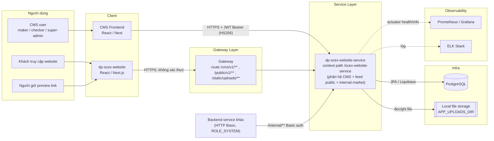
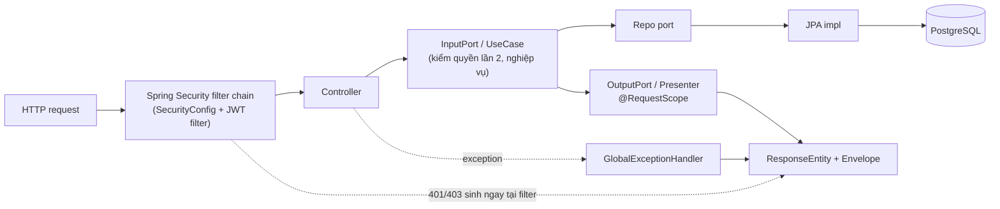
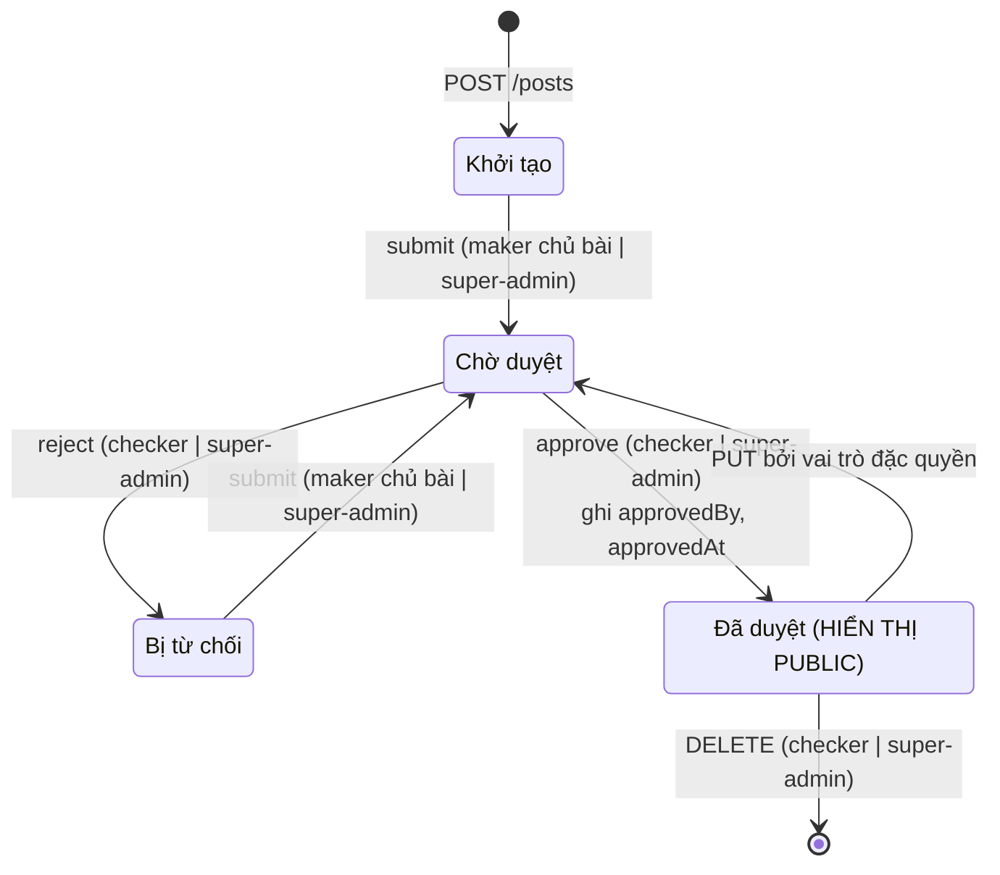
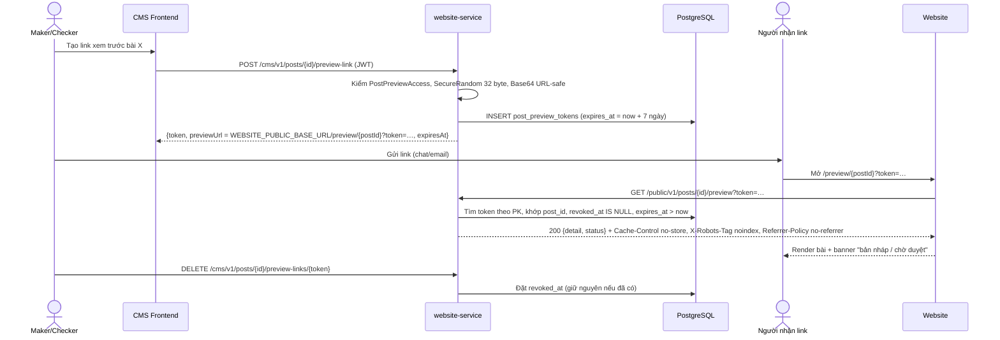
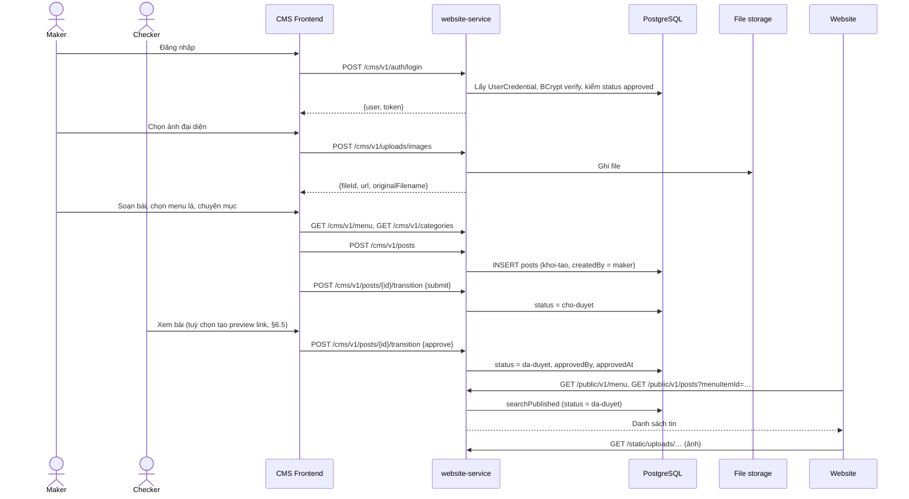
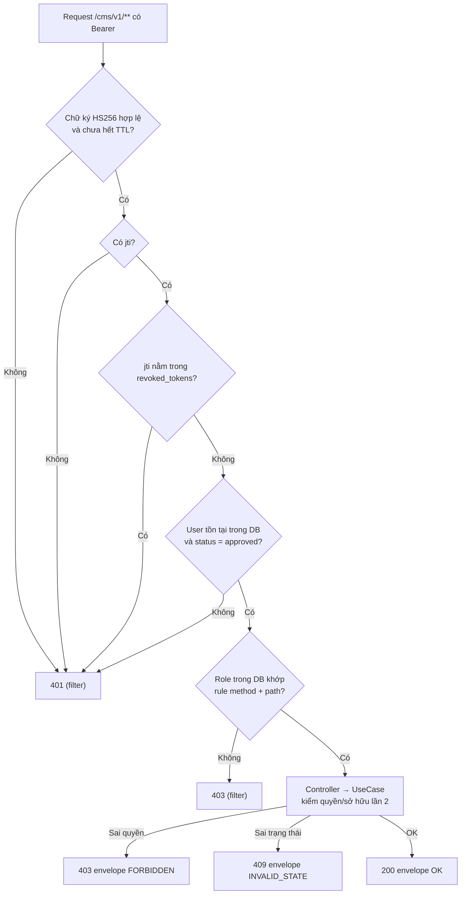
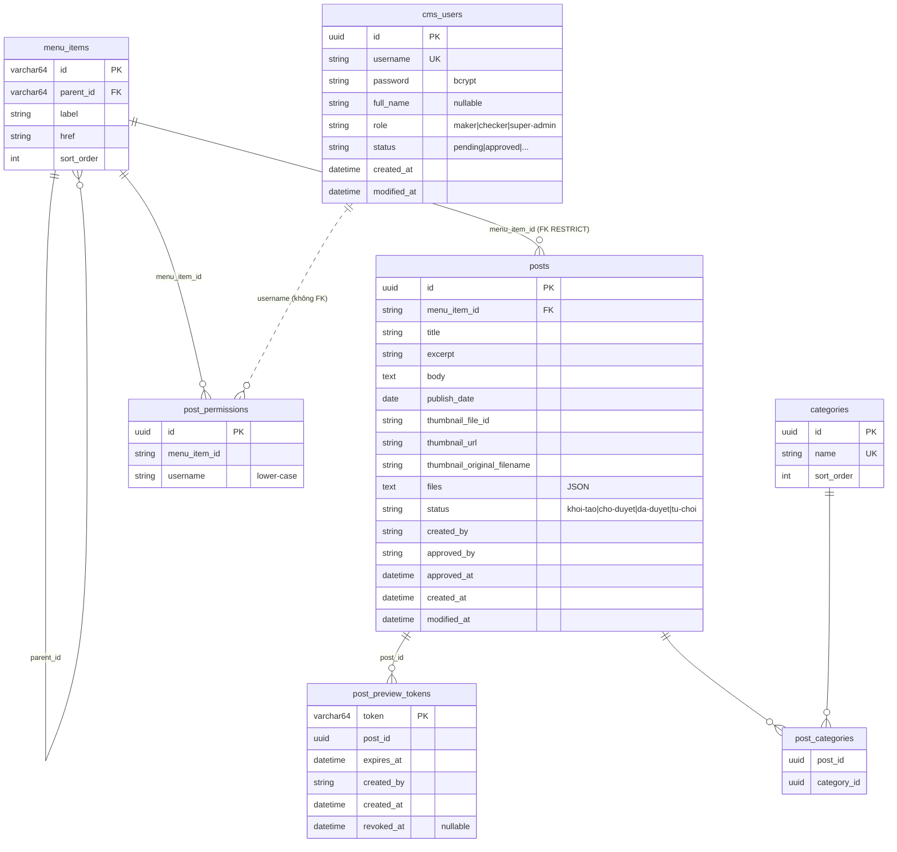

# HIGH LEVEL DESIGN — SCEX WEBSITE CMS

> **Loại tài liệu:** Baseline của hệ thống **đã triển khai**. Tài liệu mô tả hệ thống hiện có: các thành phần, chức năng, ranh giới trách nhiệm, luồng xử lý, dữ liệu và cấu hình. Tài liệu không trình bày bối cảnh, phương án lựa chọn hay sizing.

---

## 1. Quản trị tài liệu

### 1.1 Thông tin tài liệu

| Thuộc tính           | Giá trị                                                            |
| -------------------- | ------------------------------------------------------------------ |
| Hệ thống             | SCEX CMS (`cms-scex`,`dp-scex-website`,`dp-scex-website-service`)  |
| Mã tài liệu          | HLD-DIGITAL-CMS                                                    |
| Thuộc nền tảng       | SCEX Digital Platform                                              |
| Trạng thái hệ thống  | Đã phát triển                                                      |
| System/Service Owner | TBD                                                                |
| Tech Lead            | TBD                                                                |
| Repository           | `dp-scex-website` (backend); frontend CMS và website là repo riêng |

### 1.2 Lịch sử thay đổi

| Phiên bản | Ngày       | Author | Thay đổi                                             | Trạng thái |
| --------- | ---------- | ------ | ---------------------------------------------------- | ---------- |
| 0.1       | 2026-10-16 | duc.mm | Khởi tạo HLD baseline từ BRD, SRS và System services | Draft      |

### 1.3 Tài liệu nguồn

| ID     | Tài liệu                                                           | Confluence page                                                                                                                                      | Vai trò                                                                                           |
| ------ | ------------------------------------------------------------------ | ---------------------------------------------------------------------------------------------------------------------------------------------------- | ------------------------------------------------------------------------------------------------- |
| REF-01 | System services: Tài liệu kiến trúc hệ thống SCEX Digital Platform | [166464](https://confluence.scex.com.vn/spaces/DIGITAL/pages/166464/System+services)                                                                 | Chuẩn kiến trúc chung, hạ tầng nền tảng SCEX Digital Platform                                     |
| REF-02 | BRD: Quản lý & hiển thị tin tức trên website SCEX                  | [10559133](https://confluence.scex.com.vn/spaces/DIGITAL/pages/10559133/BRD+%E2%80%94+Ch%E1%BB%A9c+n%C4%83ng+Tin+t%E1%BB%A9c+tr%C3%AAn+website+SCEX) | Mục tiêu, vai trò, quy trình nghiệp vụ, quyết định phạm vi                                        |
| REF-03 | SRS: Phân hệ CMS của `dp-scex-website-service` (v1.0, 2026-09-09)  | [10559146](https://confluence.scex.com.vn/spaces/DIGITAL/pages/10559146/SRS+%E2%80%94+Ph%C3%A2n+h%E1%BB%87+CMS+dp-scex-website-service)              | Yêu cầu chức năng chi tiết, API, dữ liệu, NFR, cấu hình. Đây là nguồn chân lý khi lệch với REF-02 |

### 1.4 Thuật ngữ

| Thuật ngữ      | Nghĩa                                                                                     |
| -------------- | ----------------------------------------------------------------------------------------- |
| CMS            | Content Management System: công cụ nội bộ để soạn, duyệt và công bố tin trên website SCEX |
| Maker          | Vai trò `maker`: soạn bài của chính mình, gửi duyệt                                       |
| Checker        | Vai trò `checker`: duyệt / từ chối / xoá bài                                              |
| Super-admin    | Vai trò `super-admin`: toàn quyền, quản trị người dùng và cấu trúc menu                   |
| Post           | Bài viết, đơn vị nội dung chính                                                           |
| Menu item      | Nút trên cây điều hướng website. Mỗi bài gắn vào đúng một menu item **lá**                |
| Container item | Menu item có `href = "#"`, chỉ chứa mục con, **không** gắn được bài                       |
| Category       | Chuyên mục gắn nhãn, quan hệ nhiều-nhiều với bài                                          |
| Preview link   | Link bí mật có hạn để xem bài **chưa công bố** trên layout website thật                   |
| Envelope       | Vỏ response chuẩn `{data, code, message, errorFields}`                                    |
| CBTT           | Công bố thông tin (nội dung pháp lý do Legal đăng)                                        |

---

## 2. Phạm vi hệ thống

### 2.1 Hệ thống làm gì

CMS cho phép các phòng ban SCEX (Legal, OPS, Kinh doanh…) **tự đăng tin lên website** mà không cần IT deploy. Mọi nội dung ra công chúng phải qua bước **duyệt maker–checker**. Website hiển thị tin theo **cây menu cấu hình được**. Người duyệt xem trước được bài trên layout thật qua **preview link** có hạn.

| Năng lực                | Mô tả ngắn                                                                         |
| ----------------------- | ---------------------------------------------------------------------------------- |
| Xác thực & phiên CMS    | Đăng nhập username/password, JWT HS256, logout thu hồi token, tự đăng ký chờ duyệt |
| Quản trị người dùng CMS | Tạo/sửa/xoá user, phân vai trò, bảo toàn tối thiểu 1 super-admin                   |
| Quản lý bài viết        | Tạo, sửa, xoá, lọc, gắn chuyên mục, ảnh đại diện, file đính kèm                    |
| Quy trình duyệt         | Máy trạng thái `khoi-tao → cho-duyet → da-duyet / tu-choi`                         |
| Preview link            | Sinh / liệt kê / thu hồi link xem trước, mở bài chưa công bố không cần đăng nhập   |
| Upload & thư viện media | Upload ảnh/file lên local storage, tra cứu thư viện                                |
| Menu điều hướng         | Quản trị cây menu (super-admin), cung cấp menu cho website                         |
| Chuyên mục              | CRUD chuyên mục                                                                    |
| Post-permissions        | Allowlist user theo menu item. **Chỉ lưu trữ, chưa áp dụng** vào luồng bài viết    |
| Feed công khai          | API public cho website: danh sách phân trang, chi tiết, menu                       |

### 2.2 Ngoài phạm vi (theo hiện thực)

| Nội dung                                                     | Ghi chú                                                         |
| ------------------------------------------------------------ | --------------------------------------------------------------- |
| `/internal/v1/**` (market, upload registry) của cùng service | Không phục vụ CMS, nhưng **chạy chung process** (xem §3.2)      |
| Email/thông báo khi có bài chờ duyệt                         | Không có                                                        |
| Lịch sử phiên bản bài viết                                   | Không có                                                        |
| Hẹn giờ công bố theo `publishDate`                           | NEXT-1, chưa hiện thực. `publishDate` hiện chỉ là ngày hiển thị |
| Đa ngôn ngữ nội dung                                         | Đã bỏ cột `languages`                                           |
| Tìm kiếm toàn văn phía public                                | Chỉ CMS có bộ lọc `q`                                           |
| Phân quyền đăng bài theo phòng ban                           | Quyết định D-1: ngoài phạm vi                                   |
| Cấu hình Gateway, CI/CD                                      | Thuộc nền tảng chung (REF-01)                                   |

---

## 3. Vị trí trong SCEX Digital Platform

### 3.1 Sơ đồ ngữ cảnh




### 3.2 Ranh giới process

`dp-scex-website-service` là **một deployable** chứa ba vùng API:

| Vùng     | Prefix (sau context path) | Xác thực                    | Người gọi            | Thuộc phạm vi HLD               |
| -------- | ------------------------- | --------------------------- | -------------------- | ------------------------------- |
| CMS      | `/cms/v1/**`              | JWT Bearer HS256 + vai trò  | CMS Frontend         | Có                              |
| Public   | `/public/v1/**`           | Không                       | Website              | Có (phần posts, menu)           |
| Internal | `/internal/v1/**`         | HTTP Basic (`ROLE_SYSTEM`)  | Backend service khác | Không (market, upload registry) |
| Static   | `/static/uploads/**`      | Không (bỏ qua filter chain) | Website, CMS         | Có                              |
| Actuator | `/actuator/**`            | Không (bỏ qua filter chain) | Hạ tầng giám sát     | Có                              |

---

## 4. Danh mục thành phần

### 4.1 Thành phần runtime

| #   | Thành phần                  | Công nghệ                                | Nhiệm vụ                                                                | Phụ thuộc           |
| --- | --------------------------- | ---------------------------------------- | ----------------------------------------------------------------------- | ------------------- |
| C1  | CMS Frontend                | React/Next (SSR)                         | UI soạn/duyệt bài, quản trị menu, chuyên mục, user. Lưu JWT phía client | Gateway, C3         |
| C2  | Website (`dp-scex-website`) | React / Next.js                          | Render menu, danh sách, chi tiết tin; trang `/preview/{postId}?token=`  | Gateway, C3         |
| C3  | `dp-scex-website-service`   | Spring Boot 3, Java 17+, Gradle 3 module | Toàn bộ nghiệp vụ CMS và feed public (§5)                               | C4, C5              |
| C4  | PostgreSQL                  | PostgreSQL + Liquibase                   | Lưu user, bài, menu, chuyên mục, token preview, token đã thu hồi        | —                   |
| C5  | Local file storage          | Đĩa cục bộ (`APP_UPLOADS_DIR`)           | Lưu ảnh đại diện và file đính kèm, phục vụ qua `/static/uploads/**`     | Volume của pod/host |
| C6  | Gateway                     | Theo nền tảng (REF-01)                   | TLS, route prefix tới C3                                                | —                   |
| C7  | Observability               | Prometheus/Grafana, ELK                  | Health, metric, log                                                     | C3                  |

### 4.2 Thành phần bên trong `dp-scex-website-service`

| Module nghiệp vụ            | Namespace API                                                         | Nhiệm vụ chính                                                               | Bảng chính                          |
| --------------------------- | --------------------------------------------------------------------- | ---------------------------------------------------------------------------- | ----------------------------------- |
| M1 Auth & Session           | `/cms/v1/auth/**`                                                     | Login, register, session, logout; JWT filter cho mọi request CMS             | `cms_users`, `revoked_tokens`       |
| M2 User Admin               | `/cms/v1/users/**`                                                    | CRUD user CMS, guard super-admin cuối                                        | `cms_users`, `post_permissions`     |
| M3 Post                     | `/cms/v1/posts/**`                                                    | CRUD bài, validate, quyền sở hữu                                             | `posts`, `post_categories`          |
| M4 Workflow                 | `/cms/v1/posts/{id}/transition`                                       | Máy trạng thái duyệt bài                                                     | `posts`                             |
| M5 Preview Link             | `/cms/v1/posts/{id}/preview-link(s)`, `/public/v1/posts/{id}/preview` | Sinh/thu hồi/kiểm token, trả bài chưa công bố                                | `post_preview_tokens`, `posts`      |
| M6 Upload & Media           | `/cms/v1/uploads/**`, `/static/uploads/**`                            | Nhận file, lưu đĩa, thư viện media                                           | Lưu file trên đĩa cục bộ            |
| M7 Menu                     | `/cms/v1/menu`, `/public/v1/menu`                                     | Quản trị và cung cấp cây menu                                                | `menu_items`                        |
| M8 Category                 | `/cms/v1/categories/**`                                               | CRUD chuyên mục                                                              | `categories`, `post_categories`     |
| M9 Post-permissions         | `/cms/v1/post-permissions/**`                                         | Lưu allowlist user theo menu item (không áp dụng)                            | `post_permissions`                  |
| M10 Public Feed             | `/public/v1/posts/**`                                                 | Trả bài `da-duyet` cho website                                               | `posts`, `menu_items`, `categories` |
| M11 Bootstrap Seeder        | (startup)                                                             | Seed super-admin đầu tiên nếu chưa có                                        | `cms_users`                         |
| M12 Revoked-token Purge Job | (scheduler)                                                           | Dọn token đã thu hồi và đã hết hạn                                           | `revoked_tokens`                    |
| M13 Cross-cutting           | —                                                                     | `SecurityConfig`, `GlobalExceptionHandler`, `LoggingFilterConfig`, presenter | —                                   |

---

## 5. Kiến trúc nội bộ service

### 5.1 Clean Architecture

| Module Gradle | Nội dung                                                                                                                                                  | Phụ thuộc           |
| ------------- | --------------------------------------------------------------------------------------------------------------------------------------------------------- | ------------------- |
| `domain`      | Record nghiệp vụ thuần: `Post`, `CmsUser`, `MenuItem`, `Category`, `PostPreviewToken`; hằng `UserRoles`, `UserStatuses`, trạng thái bài; `PasswordPolicy` | Không               |
| `useCase`     | Input/Output port, use case, repository port (`PostRepo`, `UserRepo`…)                                                                                    | `domain`            |
| `service`     | Controller, presenter, JPA entity & repo impl, Spring Security, scheduler, lưu file                                                                       | `domain`, `useCase` |



Ý nghĩa khi điều tra lỗi:

- **401/403 không có envelope chuẩn** thường sinh ở filter chain (thiếu token, sai vai trò theo method+path), chưa vào tới controller.
- **403/409 có envelope và message tiếng Việt** sinh ở use case (sai chủ sở hữu, sai trạng thái).
- Khi filter và use case lệch nhau về quyền, **filter thắng** (ví dụ checker sửa bài).

### 5.2 Mô hình bảo mật

| Lớp                  | Cơ chế                                                                                                                                                                                              |
| -------------------- | --------------------------------------------------------------------------------------------------------------------------------------------------------------------------------------------------- |
| Xác thực CMS         | JWT **HS256** ký bằng `AUTH_JWT_SECRET` (≥ 32 byte). Claim: `sub` = username, `role`, `jti`; TTL `AUTH_JWT_TTL_MINUTES`. Token trả trong body, không dùng cookie                                    |
| Kiểm tra mỗi request | Filter giải mã JWT → từ chối nếu thiếu `jti` hoặc `jti` nằm trong `revoked_tokens` → **đọc lại user từ DB** → chỉ cấp quyền khi `status = approved`; quyền lấy từ **role trong DB**, không từ claim |
| Phân quyền lớp 1     | `SecurityConfig` chặn theo method + path (§9)                                                                                                                                                       |
| Phân quyền lớp 2     | Use case kiểm lại vai trò, quyền sở hữu (defense in depth)                                                                                                                                          |
| Danh tính hành động  | `actingUsername`, `actingRole` luôn lấy từ JWT principal, không bao giờ từ request body                                                                                                             |
| Mật khẩu             | BCrypt. Hash chỉ ra khỏi repo qua `UserCredential` cho luồng login                                                                                                                                  |
| Session              | Stateless, CSRF tắt                                                                                                                                                                                 |
| Bỏ qua filter        | `WebSecurity.ignoring()` chỉ cho `/static/uploads/**` và `/actuator/**`. **Không được** bỏ qua `/public/**` vì sẽ vô hiệu hoá toàn bộ filter chain, kể cả chain CMS                                 |
| Log                  | Không log dữ liệu nhạy cảm (`SensitiveDataConstants`, `LoggingFilterConfig`)                                                                                                                        |
| Preview              | Token 256-bit, có hạn, thu hồi được; header chống cache/index/rò referer (§6.5)                                                                                                                     |

---

## 6. Chức năng chi tiết theo module

### 6.1 M1 — Auth & Session

| API                          | Quyền        | Hành vi                                                                                                                                                          |
| ---------------------------- | ------------ | ---------------------------------------------------------------------------------------------------------------------------------------------------------------- |
| `POST /cms/v1/auth/login`    | Công khai    | Xác minh BCrypt → trả `{user, token}`. Sai thông tin → 400 "Tên đăng nhập hoặc mật khẩu không đúng". User khác `approved` → 403 "Tài khoản chưa được phê duyệt"  |
| `POST /cms/v1/auth/register` | Công khai    | Tạo user `maker` / `pending`, không cấp token. Trùng username → 400                                                                                              |
| `GET /cms/v1/auth/session`   | Đã đăng nhập | Đọc lại user từ DB theo `sub`. Không thấy → 401                                                                                                                  |
| `POST /cms/v1/auth/logout`   | Đã đăng nhập | Ghi `jti` vào `revoked_tokens`; token bị từ chối 401 ở mọi request sau. Chỉ ảnh hưởng token đó, không ảnh hưởng thiết bị khác. Logout lại token đã thu hồi → 401 |

Quy tắc:

- **Password policy** (`PasswordPolicy`): ≥ 8 ký tự và ≥ 1 ký tự đặc biệt. Áp tại tạo user, reset mật khẩu, tự đăng ký. Không áp tại login và không áp cho seed bootstrap.
- **Đổi mật khẩu không thu hồi phiên đang mở.** Muốn đuổi phiên ngay: chuyển user sang `pending` rồi `approved` lại.
- **Xoá user / hạ trạng thái** → token mất hiệu lực ngay request kế tiếp (do đọc lại DB).
- **Fail-fast:** service từ chối khởi động nếu `auth.jwt.secret` rỗng hoặc < 256 bit.

**M12 Purge job:** chạy định kỳ theo `auth.revoked-token-purge-ms`, xoá các dòng `revoked_tokens` mà token gốc đã hết hạn.

**M11 Bootstrap seeder:** khi khởi động, nếu không có super-admin `approved` nào, seed một tài khoản từ `AUTH_BOOTSTRAP_USERNAME/_PASSWORD/_FULL_NAME`. Idempotent. Thiếu cấu hình → chỉ log WARN, vẫn khởi động.

### 6.2 M2 — User Admin

Toàn bộ `/cms/v1/users/**` yêu cầu `super-admin` (chặn ở filter).

| API                         | Hành vi                                                                                                                                                   |
| --------------------------- | --------------------------------------------------------------------------------------------------------------------------------------------------------- |
| `GET /cms/v1/users`         | Liệt kê user, không kèm hash                                                                                                                              |
| `POST /cms/v1/users`        | Tạo user `approved` ngay; role chỉ `maker` hoặc `checker`. Username không rỗng, không trùng; `fullName` null được nhưng không được chuỗi trắng            |
| `PUT /cms/v1/users/{id}`    | Cập nhật từng phần (null = giữ nguyên): `role`, `status`, `fullName`, `password`. Nâng lên `super-admin` qua PUT là **lối duy nhất** tạo thêm super-admin |
| `DELETE /cms/v1/users/{id}` | Xoá cứng, đồng thời xoá `post_permissions` của user, nguyên tử                                                                                            |

Guard:

| Guard                    | Quy tắc                                                                                                                                                                                                                           |
| ------------------------ | --------------------------------------------------------------------------------------------------------------------------------------------------------------------------------------------------------------------------------- |
| Tự sửa                   | Không tự đổi `role`/`status` của mình; tự sửa chỉ hợp lệ nếu sau cập nhật vẫn là `super-admin` + `approved`                                                                                                                       |
| Tự xoá                   | Không được                                                                                                                                                                                                                        |
| Super-admin cuối (BR-09) | Không gỡ / hạ / đình chỉ / xoá super-admin `approved` cuối cùng. Kiểm ở use case **và** kiểm lại trong transaction có khoá ghi ở repo (chống race). Khi chỉ còn 1 super-admin approved, xoá cả super-admin `pending` cũng bị chặn |
| Giá trị hiệu lực         | Guard đánh giá trên giá trị sau cập nhật (input nếu có, không thì giá trị hiện tại)                                                                                                                                               |

### 6.3 M3 — Post

| API                         | Quyền (filter)       | Hành vi                                                                                                                                                                                                                         |
| --------------------------- | -------------------- | ------------------------------------------------------------------------------------------------------------------------------------------------------------------------------------------------------------------------------- |
| `GET /cms/v1/posts`         | Đã đăng nhập         | Lọc `menuItemId`, `year`, `q`; bỏ trống = không lọc. **Không phân trang**                                                                                                                                                       |
| `GET /cms/v1/posts/{id}`    | Đã đăng nhập         | Trả bài đầy đủ ở mọi trạng thái                                                                                                                                                                                                 |
| `POST /cms/v1/posts`        | maker, super-admin   | Server đặt `id`, `status = khoi-tao`, `createdBy` = người gọi, `createdAt/modifiedAt`; xoá `approvedBy/approvedAt` nếu client gửi                                                                                               |
| `PUT /cms/v1/posts/{id}`    | maker, super-admin   | Giữ nguyên `createdBy`, `createdAt`, `approvedBy`, `approvedAt`. Maker chỉ sửa bài của mình khi `khoi-tao`/`tu-choi` (sai chủ → 403, sai trạng thái → 409). Vai trò đặc quyền sửa bài `da-duyet` → **tự chuyển về `cho-duyet`** |
| `DELETE /cms/v1/posts/{id}` | checker, super-admin | Xoá ở mọi trạng thái, use case kiểm lại vai trò                                                                                                                                                                                 |

Validate:

- Bắt buộc `menuItemId`, `title`, `excerpt`, `publishDate`. Thiếu → 400 `INVALID_INPUT`, `errorFields` liệt kê **từng** field.
- `menuItemId` phải tồn tại và không phải container (`href = "#"`) → 400 kèm `errorFields`, không để rơi xuống lỗi FK 500.
- Kiểm quyền/sở hữu chạy **trước** validate dữ liệu (người không có quyền nhận 403, không phải 400).
- `categoryIds` → bảng nối `post_categories`. `files` lưu JSON trong cột TEXT. Thumbnail lưu 3 cột `thumbnail_file_id`, `thumbnail_url`, `thumbnail_original_filename`.

### 6.4 M4 — Workflow duyệt

`POST /cms/v1/posts/{id}/transition` với body `{action}`, `action ∈ {submit, approve, reject}`.



| Trạng thái  | Hiển thị public | Ai thao tác tiếp                             |
| ----------- | --------------- | -------------------------------------------- |
| `Khởi tạo`  | Không           | Maker chủ bài: sửa, submit                   |
| `Chờ duyệt` | Không           | Checker: approve / reject                    |
| `Đã duyệt`  | **Có**          | Checker/super-admin: sửa (về chờ duyệt), xoá |
| `Từ chối`   | Không           | Maker chủ bài: sửa, submit lại               |

Quy tắc: kiểm quyền trước máy trạng thái (sai quyền → 403; đúng quyền sai trạng thái → 409 `INVALID_STATE` nêu trạng thái hiện tại). `action` lạ → lỗi. Bài không tồn tại → 404. Không có transition ngầm nào khác. **Bài lên public ngay khi approve**, không phụ thuộc `publishDate`.

### 6.5 M5 — Preview Link

Quyền quản lý link (`PostPreviewAccess`): super-admin, checker (mọi bài), maker (bài của mình).



| API                                               | Quyền (filter)              | Hành vi                                                                                            |
| ------------------------------------------------- | --------------------------- | -------------------------------------------------------------------------------------------------- |
| `POST /cms/v1/posts/{id}/preview-link`            | maker, checker, super-admin | Sinh token, trả `token`, `previewUrl`, `expiresAt`, `createdBy`, `createdAt` (`PostPreviewAccess`) |
| `GET /cms/v1/posts/{id}/preview-links`            | Đã đăng nhập                | Liệt kê link còn dùng được, mới nhất trước (kiểm `PostPreviewAccess` ở use case)                   |
| `DELETE /cms/v1/posts/{id}/preview-links/{token}` | maker, checker, super-admin | Thu hồi; bấm lại vô hại, không dịch `revokedAt` gốc (`PostPreviewAccess`)                          |
| `GET /public/v1/posts/{id}/preview?token=`        | Không                       | Không cần xác thực, trả bài ở mọi trạng thái                                                       |

Kết quả kiểm token:

| Tình huống                                                                            | `code`          | Message                                            |
| ------------------------------------------------------------------------------------- | --------------- | -------------------------------------------------- |
| Token hợp lệ                                                                          | `OK`            | —                                                  |
| Token không tồn tại / thuộc bài khác / thiếu token (link cắt cụt) / bài không tồn tại | `NOT_FOUND`     | "Preview link không hợp lệ" (cố ý không phân biệt) |
| Token đúng nhưng hết hạn hoặc đã thu hồi                                              | `INVALID_STATE` | "Link xem trước đã hết hạn hoặc bị thu hồi"        |

Ghi chú thiết kế: token lưu **clear text** (có chủ ý). Repo tách `findPublishedById` và `findAnyStatusByIdForPreview`; preview là **đường duy nhất** để nội dung chưa công bố ra khỏi hệ thống. Service **từ chối khởi động** nếu thiếu `WEBSITE_PUBLIC_BASE_URL`. Website phải phục vụ route `/preview/{postId}?token=…` khớp `PreviewLinkUrlBuilder`.

### 6.6 M6 — Upload & Media

| API                                                         | Quyền        | Hành vi                                                                                                                                                                 |
| ----------------------------------------------------------- | ------------ | ----------------------------------------------------------------------------------------------------------------------------------------------------------------------- |
| `POST /cms/v1/uploads/images`                               | Đã đăng nhập | Multipart `key` + `file`, trả `UploadedLink {fileId, url, originalFilename}`. Dùng cho cả thumbnail                                                                     |
| `POST /cms/v1/uploads/files`                                | Đã đăng nhập | Upload file đính kèm                                                                                                                                                    |
| `GET /cms/v1/uploads?kind=IMAGE\|FILE&q=&page=0&pageSize=8` | Đã đăng nhập | Thư viện media, mới nhất trước. `kind` bắt buộc (thiếu/sai → 400). `q` không phân biệt hoa thường theo key hoặc tên gốc. `pageSize` mặc định 8, tối đa 50. Đọc thẳng DB |
| `GET /static/uploads/**`                                    | Không        | Phục vụ file đã lưu                                                                                                                                                     |

Giới hạn 50MB/file, 50MB/request. File lưu tại `APP_UPLOADS_DIR`, URL ghép theo `APP_UPLOADS_URL_PREFIX`.

### 6.7 M7 — Menu

| API                   | Quyền        | Hành vi                                              |
| --------------------- | ------------ | ---------------------------------------------------- |
| `GET /cms/v1/menu`    | Đã đăng nhập | Trả cây menu (màn soạn bài cần để chọn `menuItemId`) |
| `PUT /cms/v1/menu`    | super-admin  | **Thay toàn bộ cây** (upsert theo id)                |
| `GET /public/v1/menu` | Không        | Website render thanh điều hướng                      |

Validate `PUT`:

- `id`, `label` không rỗng; `id` duy nhất toàn cây (id lặp sẽ gộp 2 node, mất 1 node).
- `href` bắt đầu `/` hoặc `https://`, hoặc đúng `"#"`; `"#"` chỉ hợp lệ trên item có con.
- Từ chối (409, nêu tên item + số bài) khi: (a) xoá item còn bài, (b) biến item còn bài thành container. Message ưu tiên `label` trong payload.
- Kiểm (a)(b) là **best-effort**: đọc–đếm–ghi ở 3 transaction rời. (a) còn FK `RESTRICT` làm lưới an toàn; (b) **không có lưới**, hậu quả là bài bị "mắc kẹt" không có đường dẫn trên website, phải gán lại menu bằng tay.

Cây lưu phẳng trong `menu_items`, dựng lại theo `parent_id`, thứ tự theo `sort_order`.

### 6.8 M8 — Category

| API                              | Quyền        | Hành vi                                                 |
| -------------------------------- | ------------ | ------------------------------------------------------- |
| `GET /cms/v1/categories`         | Đã đăng nhập | Liệt kê                                                 |
| `POST /cms/v1/categories`        | Đã đăng nhập | Tạo; `name` không rỗng, duy nhất                        |
| `PUT /cms/v1/categories/{id}`    | Đã đăng nhập | Sửa `name`, `sortOrder`; không tồn tại → 404            |
| `DELETE /cms/v1/categories/{id}` | Đã đăng nhập | Từ chối 409 khi còn bài tham chiếu; không tồn tại → 404 |

### 6.9 M9 — Post-permissions

| API                                         | Quyền                | Hành vi                           |
| ------------------------------------------- | -------------------- | --------------------------------- |
| `GET /cms/v1/post-permissions/{menuItemId}` | checker, super-admin | Danh sách username được phép đăng |
| `PUT /cms/v1/post-permissions/{menuItemId}` | super-admin          | Thay toàn bộ danh sách            |

Username lưu chữ thường (từ changelog `2026.8.28`). **Không use case nào đọc bảng này** khi tạo/sửa/duyệt bài (quyết định D-1). Mọi maker đăng được vào mọi menu item.

### 6.10 M10 — Public Feed

| API                         | Hành vi                                                                                                                                                                                                            |
| --------------------------- | ------------------------------------------------------------------------------------------------------------------------------------------------------------------------------------------------------------------ |
| `GET /public/v1/posts`      | Chỉ bài `da-duyet`, mới nhất trước. `page` từ 0 (âm → 0). `pageSize` bỏ trống/≤ 0 → 9, > 50 → 50. `menuItemId` khớp **chính xác** mục lá (cha không kéo bài của con); rỗng = không lọc; không tồn tại → trang rỗng |
| `GET /public/v1/posts/{id}` | Chỉ bài `da-duyet`, khác → `NOT_FOUND`. Bổ sung `body`                                                                                                                                                             |

Dữ liệu danh sách: id, menu item, tiêu đề, mô tả ngắn, ngày đăng, chuyên mục, ảnh đại diện, file đính kèm.
Truy vấn qua `PostRepoImpl.searchPublished`, chỉ lọc `status = da-duyet` (không lọc `publishDate`).

---

## 7. Luồng nghiệp vụ end-to-end

### 7.1 Đăng bài từ soạn đến công bố



### 7.2 Xác thực mỗi request CMS



---

## 8. Mô hình dữ liệu



| Bảng                            | Ai ghi                 | Ai đọc                      | Ghi chú vận hành                                                                                      |
| ------------------------------- | ---------------------- | --------------------------- | ----------------------------------------------------------------------------------------------------- |
| `cms_users`                     | M1 (register), M2, M11 | M1 filter (mỗi request), M2 | Mỗi request CMS có 1 lần đọc bảng này                                                                 |
| `posts`                         | M3, M4                 | M3, M5, M10                 | Index `menu_item_id`, index feed public (changelog `2026.8.24`). Bỏ `type`, `languages` (`2026.8.26`) |
| `menu_items`                    | M7                     | M3 (validate), M7, M10      | Cây phẳng                                                                                             |
| `categories`, `post_categories` | M8, M3                 | M3, M10                     | Tên duy nhất                                                                                          |
| `post_preview_tokens`           | M5                     | M5                          | Index `post_id`; "dùng được" = `revoked_at IS NULL AND expires_at > now`                              |
| `post_permissions`              | M9, M2 (xoá theo user) | M9                          | Không ảnh hưởng nghiệp vụ                                                                             |

- Thời gian dùng `LocalDateTime` theo **giờ hệ thống của service**, không lưu timezone.
- Vai trò và trạng thái lưu `String` (không JPA enum). Nguồn chân lý là hằng `UserRoles`, `UserStatuses`, trạng thái bài.
- Schema chỉ thay đổi qua Liquibase changelog theo ngày; `ddl-auto: none`.

---

## 9. Giao diện API và quy ước lỗi

### 9.1 Envelope

```json
{ "data": {}, "code": "OK", "message": "…", "errorFields": null }
```

Lỗi validate:

```json
{
  "code": "INVALID_INPUT",
  "message": "Thiếu thông tin bắt buộc: excerpt, publishDate",
  "errorFields": [
    {
      "name": "excerpt",
      "message": "excerpt không được để trống",
      "code": "REQUIRED"
    },
    {
      "name": "publishDate",
      "message": "publishDate không được để trống",
      "code": "REQUIRED"
    }
  ]
}
```

### 9.2 Ánh xạ HTTP status theo namespace

| `code`          | `/cms/v1/**` | `/public/v1/**` |
| --------------- | ------------ | --------------- |
| `OK`            | 200          | 200             |
| `INVALID_INPUT` | 400          | 200             |
| `UNAUTHORIZED`  | 401          | 200             |
| `FORBIDDEN`     | 403          | 200             |
| `NOT_FOUND`     | 404          | 200             |
| `INVALID_STATE` | 409          | 200             |
| Không nhận diện | 500          | 200             |

- `/cms/v1/**` dùng `AuthPresenter` (HTTP status thật). `/public/v1/**` dùng `AbstractPresenter`, **luôn 200**, client phải branch theo `code` (cố định bởi `PostPreviewLinkIntegrationTest`).
- 401/403 do Spring Security sinh vẫn là HTTP thật ở cả hai namespace.
- `GlobalExceptionHandler` quy lỗi thiếu field chỉ lộ ở ràng buộc DB về 400 đúng khuôn dạng.

### 9.3 Ma trận phân quyền (hiệu lực thực tế, lớp filter)

| Chức năng                    | Endpoint                                                | maker                                   | checker    | super-admin |
| ---------------------------- | ------------------------------------------------------- | --------------------------------------- | ---------- | ----------- |
| Login / register             | `/cms/v1/auth/login`, `/register`                       | Công khai                               | Công khai  | Công khai   |
| Session / logout             | `/cms/v1/auth/session`, `/logout`                       | ✓                                       | ✓          | ✓           |
| Xem bài                      | `GET /cms/v1/posts[/{id}]`                              | ✓ (tất cả)                              | ✓          | ✓           |
| Tạo bài                      | `POST /cms/v1/posts`                                    | ✓                                       | ✗          | ✓           |
| Sửa bài                      | `PUT /cms/v1/posts/{id}`                                | ✓ (own, `khoi-tao`/`tu-choi`)           | ✗          | ✓           |
| Submit                       | `transition: submit`                                    | ✓ (own)                                 | ✗          | ✓           |
| Approve / reject             | `transition: approve\|reject`                           | ✗                                       | ✓          | ✓           |
| Xoá bài                      | `DELETE /cms/v1/posts/{id}`                             | ✗                                       | ✓          | ✓           |
| Upload ảnh/file, thư viện    | `/cms/v1/uploads/**`                                    | ✓                                       | ✓          | ✓           |
| Preview link — tạo / thu hồi | `POST …/preview-link`, `DELETE …/preview-links/{token}` | ✓ (own)                                 | ✓ (tất cả) | ✓           |
| Preview link — xem danh sách | `GET /cms/v1/posts/{id}/preview-links`                  | ✓ (filter: đã đăng nhập; use case: own) | ✓ (tất cả) | ✓           |
| Xem menu                     | `GET /cms/v1/menu`                                      | ✓                                       | ✓          | ✓           |
| Sửa menu                     | `PUT /cms/v1/menu`                                      | ✗                                       | ✗          | ✓           |
| Chuyên mục (CRUD)            | `/cms/v1/categories/**`                                 | ✓                                       | ✓          | ✓           |
| Post-permissions xem         | `GET /cms/v1/post-permissions/*`                        | ✗                                       | ✓          | ✓           |
| Post-permissions sửa         | `PUT /cms/v1/post-permissions/*`                        | ✗                                       | ✗          | ✓           |
| Quản trị user                | `/cms/v1/users/**`                                      | ✗                                       | ✗          | ✓           |

---

## 10. Triển khai và cấu hình

### 10.1 Triển khai

| Hạng mục    | Hiện trạng                                                                                 |
| ----------- | ------------------------------------------------------------------------------------------ |
| Đóng gói    | Docker (`Dockerfile`, `docker-compose.yml`)                                                |
| Nền tảng    | Kubernetes trên CMC Cloud, CI/CD GitLab CI → Docker Registry → K8s (theo REF-01)           |
| Số instance | **Một instance** (ASM-3): lưu file cục bộ, cache market in-memory. Chưa thiết kế scale-out |
| Health      | `/actuator/health`, `/actuator/info`                                                       |
| Migration   | Liquibase chạy khi khởi động                                                               |

### 10.2 Biến môi trường

| Biến môi trường                                                | Bắt buộc    | Mục đích                                                                        |
| -------------------------------------------------------------- | ----------- | ------------------------------------------------------------------------------- |
| `SERVER_PORT`                                                  | ✓           | Cổng                                                                            |
| `POSTGRESQL_HOST` / `_DB_NAME` / `_USER` / `_PASS` / `_SCHEMA` | ✓           | Kết nối DB + schema Liquibase                                                   |
| `ENDPOINT_INTERNAL_PASSWORD`                                   | ✓           | Mật khẩu Basic cho `/internal/**`                                               |
| `AUTH_JWT_SECRET`                                              | ✓           | Khoá ký HS256, **≥ 32 byte** (thiếu hoặc < 256 bit → service từ chối khởi động) |
| `AUTH_JWT_TTL_MINUTES`                                         | ✓           | Vòng đời token                                                                  |
| `AUTH_BOOTSTRAP_USERNAME` / `_PASSWORD` / `_FULL_NAME`         | ✓ (lần đầu) | Seed super-admin đầu tiên (thiếu cấu hình → chỉ log WARN, vẫn khởi động)        |
| `WEBSITE_PUBLIC_BASE_URL`                                      | ✓           | Gốc URL site public để ghép preview link (thiếu → service từ chối khởi động)    |
| `APP_UPLOADS_DIR` / `APP_UPLOADS_URL_PREFIX`                   | ✓           | Nơi lưu & phục vụ file                                                          |
| `MARKET_*`                                                     | ✓           | Ngoài phạm vi CMS                                                               |

---
