# HIGH LEVEL DESIGN — SCEX SDK

## Thông tin tài liệu

| Thuộc tính         | Giá trị                                                                                                                                                                                                                      |
| ------------------ | ---------------------------------------------------------------------------------------------------------------------------------------------------------------------------------------------------------------------------- |
| Hệ thống           | SCEX Digital Platform — SCEX SDK (B2B2C): `scex-crypto-sdk`, `dp-scex-sdk-gateway-service`, `dp-scex-sdk-service`                                                                                                            |
| Mã tài liệu        | HLD-DIGITAL-SCEX-SDK                                                                                                                                                                                                         |
| Loại               | High Level Design                                                                                                                                                                                                            |
| Phiên bản tài liệu | 1.0                                                                                                                                                                                                                          |
| Phiên bản nguồn    | SA gateway 2.0 và SA service 2.0 (20/10/2026)                                                                                                                                                                                |
| Trạng thái         | Current                                                                                                                                                                                                                      |
| Mức bảo mật        | Internal                                                                                                                                                                                                                     |
| Stack              | Spring Boot 4.0.3 · Java 25 · Gateway: Modulith, JJWT RS256, Bucket4j, HttpClient 5, virtual threads, stateless · Service: PostgreSQL (JPA + Liquibase), Redis (SSL) + Caffeine, Kafka (SASL_SSL), MQTT, OpenFeign, ShedLock |
| Repository         | `gitlab.scex.com.vn/digital/backend/gateway/dp-scex-sdk-gateway-service` · `gitlab.scex.com.vn/digital/backend/dp-scex-sdk-service`                                                                                          |
| Ngày cập nhật      | 2026-10-20                                                                                                                                                                                                                   |

### Lịch sử thay đổi

| Phiên bản | Ngày       | Tác giả | Thay đổi chính                            | Trạng thái |
| --------- | ---------- | ------- | ----------------------------------------- | ---------- |
| 1.0       | 2026-10-20 | duc.mm  | Tổng hợp từ các tài liệu vận hành hiện có | Current    |

### Tài liệu tham chiếu

| ID     | Tài liệu                        | Phiên bản / ngày   | Vai trò                                    | Link                                                                                                                |
| ------ | ------------------------------- | ------------------ | ------------------------------------------ | ------------------------------------------------------------------------------------------------------------------- |
| REF-01 | Sơ đồ thành phần Digital        | 2026-10-20         | Tên khối Digital                           | [digital-component.mmd](../../../../architecture-models-and-diagrams/digital/digital-component.mmd)                 |
| REF-02 | SDK Service                     | SA 2.0, 2026-10-20 | Nguyên trạng `dp-scex-sdk-service`         | [Confluence 10564680](https://confluence.scex.com.vn/spaces/DIGITAL/pages/10564680/SDK+Service)                     |
| REF-03 | SDK gateway service             | SA 2.0, 2026-10-20 | Nguyên trạng `dp-scex-sdk-gateway-service` | [Confluence 10564678](https://confluence.scex.com.vn/spaces/DIGITAL/pages/10564678/SDK+gateway+service)             |
| REF-04 | SRS dp-scex-sdk-gateway-service | v10, 2026-09-21    | Contract gateway còn hiệu lực              | [Confluence 10560627](https://confluence.scex.com.vn/spaces/DIGITAL/pages/10560627/SRS+dp-scex-sdk-gateway-service) |
| REF-05 | SRS - Mini App SCEX             | v6, 2026-09-23     | Contract service còn hiệu lực              | [Confluence 10560569](https://confluence.scex.com.vn/spaces/DIGITAL/pages/10560569/SRS+-+Mini+App+SCEX)             |

Khi SA tháng 10 và SRS tháng 9 lệch nhau, tài liệu này theo SA 20/10/2026.

---

### 1. Tổng quan hệ thống

SCEX SDK là sản phẩm B2B2C của Digital. Đối tác nhúng Mobile SDK (`scex-crypto-sdk`) vào app của họ để người dùng của đối tác mở tài khoản và giao dịch crypto tại SCEX.

Hai service thuộc dự án SDK:

- `dp-scex-sdk-gateway-service` là BFF và cửa vào duy nhất của mini app. Mỗi request đi qua verify access token RS256, rate limit, rồi forward sang backend bằng HTTP Basic. Service stateless, không database. Access token của user dừng tại gateway.
- `dp-scex-sdk-service` là backend nghiệp vụ, context path `/scex-sdk-service`. Service giữ onboarding qua đối tác (mapping danh tính, OTP, session, eKYC, e-contract, token) và forward kèm kiểm tra điều kiện cho giao dịch, ví, nạp/rút. be-core (LPEX-CORE) là nguồn sự thật cho user, số dư, lệnh, nạp/rút.

Base path public của gateway là `/scex-sdk-service`, trùng context path của SDK Service, để toàn bộ bề mặt SDK nằm dưới một path segment ở edge. Feature flag mount riêng dưới `/ff-service`.

#### Chức năng chính

| #   | Thành phần  | Chức năng                        | Mô tả                                                                                                                                                     |
| --- | ----------- | -------------------------------- | --------------------------------------------------------------------------------------------------------------------------------------------------------- |
| F1  | SDK Gateway | Xác thực tại biên                | `JwtAuthFilter` verify RS256 thành `TokenPayload` (`scexUserId`, `partnerId`, `coreUserId`). Route public bỏ qua token                                    |
| F2  | SDK Gateway | Rate limit                       | Bucket4j trong bộ nhớ từng pod. Public 5 rps / burst 10 theo IP. Route có token 20 rps / burst 40 theo `scexUserId`. Vượt ngưỡng trả `429`                |
| F3  | SDK Gateway | Proxy tới SDK Service            | Nhóm route nghiệp vụ SDK: auth/session, eKYC, bảo mật, giao dịch, ví, nạp/rút, thông báo, market, settings. User id lấy từ token, điền vào path hoặc body |
| F4  | SDK Gateway | Proxy tới Core                   | Chuyển đổi crypto → VND (7 route) và điều khoản (2 route) sang `dp-scex-core-service`. Header `X-User-ID` = `coreUserId`                                  |
| F5  | SDK Gateway | Proxy tới Feature Flag           | `GET /ff-service/feature-flags` và `GET /ff-service/configs/{key}`, route public                                                                          |
| F6  | SDK Gateway | Chuẩn hoá header                 | Forward `X-Device-ID` (thay bằng `X-Device-UUID` nếu client gửi UUID), sinh `X-Client-Ip`, `X-User-Agent`, trace id                                       |
| F7  | SDK Gateway | Tài liệu API                     | Swagger UI bật ở sit/uat, tắt ở production qua `SWAGGER_ENABLED`                                                                                          |
| F8  | SDK Service | Đăng nhập / mở tài khoản đối tác | Ba luồng song song: v1 (access code), v2 (OTP phone và email riêng), v3 (`id_token` do partner ký). Mapping `(partnerId, sub)` hoặc `(issuer, sub)`       |
| F9  | SDK Service | Session và token                 | Access token RS256 (`sub` = id local), refresh token gắn `X-Device-ID`, revoke refresh token, phát MQTT access token                                      |
| F10 | SDK Service | eKYC và e-contract               | Token KYC SDK, CCCD, NFC, liveness, KYC bổ sung, poll verdict, ký hợp đồng điện tử                                                                        |
| F11 | SDK Service | Bảo mật giao dịch                | Authenticator (TOTP), Smart OTP v1/v2 (PIN, passkey), trading token, action confirmation / verification (OTP, WebAuthn)                                   |
| F12 | SDK Service | Giao dịch Spot                   | Đặt, huỷ, huỷ tất cả, lệnh mở, lịch sử, đồng bộ lệnh. Mỗi lệnh ghi một dòng `order_execution`. Đặt lệnh và chuyển ví có idempotency key                   |
| F13 | SDK Service | Ví, nạp, rút                     | Số dư coin, PnL trong ngày, chuyển ví funding ↔ spot, nạp crypto, nạp/rút fiat, người thụ hưởng, phí lưu ký, chuyển quyền sở hữu                          |
| F14 | SDK Service | Thông báo realtime               | Danh sách notification / announcement qua be-core. Consume Kafka `internal_messages` rồi publish EMQX                                                     |
| F15 | SDK Service | Thông tin chung                  | Market data, settings, banner, alert, cấu hình partner client, upload file                                                                                |

#### Đối tượng sử dụng

| Đối tượng                   | Kênh                                                                                                    | Ghi chú                                                                                     |
| --------------------------- | ------------------------------------------------------------------------------------------------------- | ------------------------------------------------------------------------------------------- |
| Người dùng cuối của đối tác | `scex-crypto-sdk` nhúng trong app đối tác (iOS/Android) → SDK Gateway                                   | Bearer access token do SDK Service phát. Không gọi thẳng SDK Service                        |
| Đối tác (partner)           | OAuth `token_url` / `user_info_url` theo từng `partner_client` (v1/v2), hoặc `id_token` partner ký (v3) | Onboard partner là thêm dòng dữ liệu. Route public: partner client, config, sign-in         |
| `scex-fe`                   | `dp-scex-gateway-service` → `POST /internal/v1/mqtt-access-tokens` trên SDK Service                     | Chỉ lấy MQTT token (route gateway chính `/scex-core-service/v1/notifications/access-token`) |
| be-core                     | Kafka `internal_messages`                                                                               | Đẩy sự kiện nạp/rút, lệnh, số dư, e-contract. be-core không gọi HTTP vào SDK Service        |
| Kỹ thuật / QA               | Swagger trên sit / uat / sandbox; profile `demo` (`/_demo/**`) trên SDK Service                         | Profile `demo` giả lập partner để chạy v3 khi chưa có partner thật                          |

#### Phạm vi hệ thống

| In-scope                                                                    | Out-of-scope                                                                                  |
| --------------------------------------------------------------------------- | --------------------------------------------------------------------------------------------- |
| Verify token, rate limit, forward request, chuẩn hoá header tại SDK Gateway | Phát token và logic nghiệp vụ (nằm ở SDK Service, không nằm ở gateway)                        |
| Mapping danh tính partner → tài khoản SDK, mở tài khoản tại be-core         | Lưu số dư, địa chỉ ví, sổ lệnh, khớp lệnh (be-core)                                           |
| Phát và quản lý access token RS256, refresh token, MQTT access token        | Verify access token của mini app (làm ở SDK Gateway và EMQX)                                  |
| eKYC (forward KYC Service), e-contract, OTP, Smart OTP, 2FA                 | Chuyển đổi crypto → VND và điều khoản (logic nằm ở `dp-scex-core-service`; gateway chỉ proxy) |
| Forward trading, ví, nạp, rút kèm idempotency và log đối soát               | Feature flag (logic nằm ở `dp-feature-flag-service`; gateway chỉ proxy)                       |
| Push notification từ sự kiện core lên EMQX                                  | Hành vi nội bộ Mobile SDK, routing của app đối tác                                            |
| Proxy `/ff-service` và nhóm conversion / legal terms                        | Client `scex-fe` ngoài đường lấy MQTT token; CMS, Affiliate, Gamification                     |

### 2. Sơ đồ kiến trúc logic

```mermaid
flowchart LR
    subgraph DIGITAL[DIGITAL]
        subgraph CLIENT[Client]
            MOBILE_SDK[Mobile SDK<br/>scex-crypto-sdk]
            SCEX_FE[Mobile/Web<br/>scex-fe]
        end

        subgraph GW[Gateway]
            SDK_GW[SDK Gateway<br/>dp-scex-sdk-gateway-service]
            MAIN_GW[Gateway<br/>dp-scex-gateway-service]
        end

        subgraph SL[Service Layer]
            SDK_SVC[SDK Service<br/>dp-scex-sdk-service]
            FF[Feature Flag<br/>dp-feature-flag-service]
            CORE_SVC[Core<br/>dp-scex-core-service]
        end

        subgraph INFRA[Infra Service]
            PG@{shape: db, label: "PostgreSQL<br/>onboarding SDK"}
            REDIS@{shape: h-cyl, label: "REDIS<br/>cache settings / partner key"}
            KAFKA@{shape: bucket, label: "KAFKA<br/>internal_messages"}
            EMQX@{shape: bolt, label: "MQTT EMQX"}
        end

        MOBILE_SDK -->|"HTTPS Bearer hoặc public"| SDK_GW
        SDK_GW -->|"HTTP Basic + scexUserId"| SDK_SVC
        SDK_GW -->|"HTTP Basic"| FF
        SDK_GW -->|"HTTP Basic + X-User-ID"| CORE_SVC
        SCEX_FE -->|"lấy MQTT token"| MAIN_GW
        MAIN_GW -->|"HTTP Basic"| SDK_SVC

        SDK_SVC -->|"read/write"| PG
        SDK_SVC -->|"cache"| REDIS
        KAFKA -->|"consume internal_messages"| SDK_SVC
        SDK_SVC -->|"produce email OTP"| KAFKA
        SDK_SVC -->|"publish QoS 1"| EMQX
        EMQX -.->|"subscribe notifications/users/id"| MOBILE_SDK
        EMQX -.->|"subscribe"| SCEX_FE
    end

    subgraph CORE_IT["CORE IT / LPEX"]
        BE_CORE[be-core]
        KYC[KYC Service]
        MKT[market-data]
        VOICE[voice-otp]
        FILE_SVC[file-service]
    end

    subgraph PARTNER_EXT[Partner]
        PARTNER_OAUTH["Partner OAuth<br/>token_url / userinfo"]
    end

    SDK_SVC -->|"Feign"| BE_CORE
    SDK_SVC -->|"Feign"| KYC
    SDK_SVC -->|"Feign"| MKT
    SDK_SVC -->|"Feign"| VOICE
    SDK_SVC -->|"Feign"| FILE_SVC
    SDK_SVC -->|"OAuth v1/v2"| PARTNER_OAUTH
    BE_CORE -->|"sự kiện tài khoản"| KAFKA
```

#### Các khối trên sơ đồ

| Khối          | Vai trò trong nguyên trạng                                                                                                                                                            |
| ------------- | ------------------------------------------------------------------------------------------------------------------------------------------------------------------------------------- |
| Mobile SDK    | `scex-crypto-sdk`, nhúng trong app đối tác. Client duy nhất của SDK Gateway. Subscribe EMQX để nhận push. REST là nguồn khi mở lại màn hình hoặc reconnect                            |
| `scex-fe`     | App SCEX. Với SDK chỉ lấy MQTT access token qua Gateway chính, rồi subscribe EMQX. Nghiệp vụ app SCEX đi `dp-scex-gateway-service`, không đi SDK Gateway                              |
| SDK Gateway   | `dp-scex-sdk-gateway-service`, context public `/scex-sdk-service` và `/ff-service`. Verify JWT, rate limit, forward. Stateless                                                        |
| Gateway       | `dp-scex-gateway-service`. Caller thứ hai của SDK Service, chỉ `POST /internal/v1/mqtt-access-tokens`                                                                                 |
| SDK Service   | `dp-scex-sdk-service`, context `/scex-sdk-service`. Nhận HTTP Basic từ hai gateway. Giữ state onboarding trên PostgreSQL, gọi CORE IT và partner, consume/produce Kafka, publish EMQX |
| Feature Flag  | `dp-feature-flag-service`. SDK Gateway proxy hai route public                                                                                                                         |
| Core          | `dp-scex-core-service`. Conversion và điều khoản. SDK Gateway gửi `coreUserId`, không đi qua SDK Service                                                                              |
| PostgreSQL    | State SDK: user, partner, session, refresh token, OTP, eKYC, e-contract, `order_execution`, `wallet_transfers`, `action_audit_log`, ShedLock                                          |
| Redis         | Cache settings và partner key (SSL). Caffeine là L1 trong process của SDK Service                                                                                                     |
| Kafka         | Consume `internal_messages` (sự kiện be-core). Produce `base_notification.internal` (email OTP)                                                                                       |
| EMQX          | Push topic `notifications/users/{id}`, QoS 1. Best-effort                                                                                                                             |
| be-core       | Nguồn sự thật user, số dư, lệnh, nạp/rút, notification, settings, Smart OTP, 2FA                                                                                                      |
| KYC Service   | Phiên eKYC, CCCD, NFC, liveness, verdict                                                                                                                                              |
| market-data   | Klines, order book, ticker, recent trades                                                                                                                                             |
| voice-otp     | OTP bằng cuộc gọi                                                                                                                                                                     |
| file-service  | Upload file người dùng và ảnh giấy tờ                                                                                                                                                 |
| Partner OAuth | v1/v2 gọi online theo URL của từng `partner_client`. v3 verify `id_token` offline bằng public key đã lưu, không có kết nối lúc sign-in                                                |

Khối Observability trên sơ đồ Digital (Prometheus/Grafana, ELK) đang nối với CMS. Hai service SDK chưa expose `/actuator/prometheus` và chưa gắn OpenTelemetry agent. Chi tiết mục 7.

#### Cấu trúc bên trong SDK Gateway

Gateway là proxy thuần. Không có tầng `domain` / `usecase`, không database, không state. Các feature module không phụ thuộc lẫn nhau (Spring Modulith kiểm tra). DTO được nhân bản theo module.

| Thành phần          | Vai trò                                                                                                                   |
| ------------------- | ------------------------------------------------------------------------------------------------------------------------- |
| `_infra/_security`  | `SecurityConfig` stateless và `PUBLIC_PATTERNS`, `JwtAuthFilter`, `JwtAuthParser` (public key base64 PEM), `TokenPayload` |
| `_infra/_ratelimit` | `RateLimitFilter` chạy sau JWT filter. `RateLimitKeyResolver` chọn IP hoặc `scexUserId`. Bucket nằm trong bộ nhớ từng pod |
| `_infra/_http`      | `RestClient` theo `internal-services.services.<name>`, pool HttpClient 5, forward header, log request, decode lỗi         |
| Feature module      | Controller public + client `@HttpExchange` + config downstream. Khoảng 24 module tới 3 backend                            |

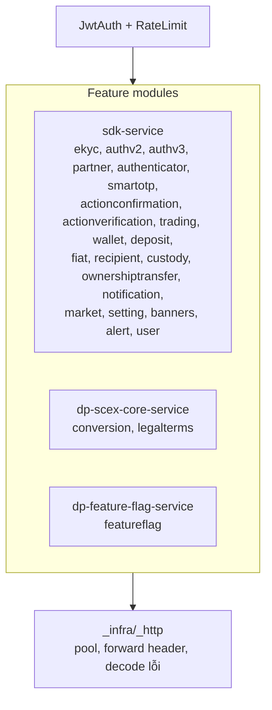

Route public: `/scex-sdk-service/public/**`, `/ff-service/feature-flags`, `/actuator/health`. Mọi route còn lại yêu cầu Bearer. Gateway không có route chuyển tiếp tự do và không expose API quản trị partner của SDK Service.

#### Cấu trúc bên trong SDK Service

Clean Architecture. `domain` và `usecase` là Java thuần. Không gọi code chéo domain: dữ liệu đồng bộ đi qua port của domain gọi; phản ứng bất đồng bộ đi qua `ApplicationEventPublisher`.

| Layer     | Nội dung                                                                                                     |
| --------- | ------------------------------------------------------------------------------------------------------------ |
| `domain`  | Entity và rule, không phụ thuộc framework                                                                    |
| `usecase` | Use case, InputPort/OutputPort, connector interface và DTO                                                   |
| `service` | Controller, Presenter, Feign client và ConnectorImpl, JPA, Kafka, MQTT, security, scheduler, profile `_demo` |

| Domain                                                                        | Số route    | Vai trò                                                                                        |
| ----------------------------------------------------------------------------- | ----------- | ---------------------------------------------------------------------------------------------- |
| `opening`                                                                     | 30          | Sign-in v1/v2/v3, verify OTP, refresh/revoke, eKYC, e-contract, me / profile / onboarding-info |
| `partner`                                                                     | 8           | Cấu hình partner client, session v3                                                            |
| `trading`                                                                     | 9           | Lệnh Spot                                                                                      |
| `notification`                                                                | 12          | Notification, announcement, cài đặt, MQTT access token                                         |
| `smartotp` / `authenticator` / `actionconfirmation` / `actionverification`    | 8/4/6/2     | Bảo mật giao dịch                                                                              |
| `wallet` / `deposit` / `fiat` / `recipient` / `custody` / `ownershiptransfer` | 5/5/6/5/3/2 | Ví, nạp, rút, người thụ hưởng, phí lưu ký                                                      |
| `market` / `setting` / `banner` / `alert` / `user` / `otp`                    | 8/1/1/1/1/1 | Thông tin chung, upload file, OTP                                                              |
| `withdrawal`                                                                  | 0           | Kafka handler sự kiện rút crypto, không có route REST                                          |

Khoảng 41 controller, khoảng 118 route dưới `/internal/**`, HTTP Basic. Profile `demo` thêm khoảng 20 route `/_demo/**`. `CoreEventListener` có 9 `CoreEventHandler`. Endpoint quản trị partner không được SDK Gateway route. Trên production, partner và partner client cấu hình qua database.

### 3. Các luồng nghiệp vụ chính

#### Luồng onboarding

```mermaid
flowchart LR
  openSdk["App đối tác mở SDK"]
  signIn["Sign-in qua partner<br/>v1 / v2 / v3"]
  verifyOtp["Verify OTP<br/>phone và email"]
  openAccount["Mở tài khoản tại be-core<br/>nhận coreId"]
  ekyc["eKYC: CCCD, NFC, liveness"]
  contract["Ký e-contract"]
  smartOtp["Smart OTP / 2FA"]
  trade["Nạp tiền, giao dịch, rút"]
  events["Sự kiện core Kafka<br/>sang MQTT"]

  openSdk --> signIn --> verifyOtp --> openAccount --> ekyc --> contract --> smartOtp --> trade --> events
```

#### 3.1 Pipeline một request

SDK Gateway chọn đúng một backend cho mỗi route. Không fan-out, không retry, không circuit breaker.

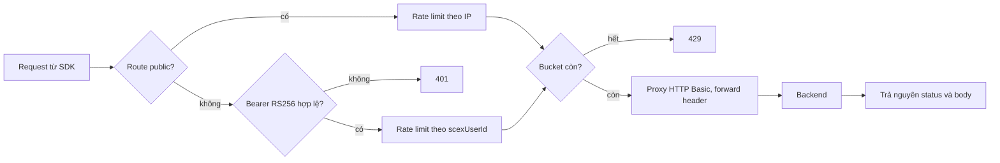

`Backend` là một trong ba: SDK Service (đa số route), `dp-scex-core-service` (conversion, điều khoản), `dp-feature-flag-service` (`/ff-service`). Access token của mini app không có trong request xuống backend.

Lỗi do gateway tự sinh dùng HTTP status thật (401 token, 400 validation, 404 route, 429, 500). Body và status từ backend được trả lại nguyên trạng.

#### 3.2 Đăng nhập qua đối tác

Ba luồng chạy song song. Client chọn bằng endpoint.

| Luồng                            | Định danh                                            | Gọi partner | Mở tài khoản tại be-core                                              | Prefetch eKYC                               |
| -------------------------------- | ---------------------------------------------------- | ----------- | --------------------------------------------------------------------- | ------------------------------------------- |
| v1 `POST /public/v1/auth:signIn` | Access code đổi tại `token_url` / `user_info_url`    | Có, online  | `register` lúc sign-in. `coreId` khi verify cả hai OTP trong một call | Có                                          |
| v2 `POST /public/v2/auth:signIn` | Như v1                                               | Có, online  | Chỉ sau khi verify phone và email, mỗi kênh một call, thứ tự tuỳ ý    | Có                                          |
| v3 `createSession` + `signIn`    | `id_token` do partner ký. SDK Service verify offline | Không       | Như v2, dùng lại endpoint OTP v2                                      | Không, vì không có access token của partner |

Mapping v1/v2 theo `(partnerId, sub)`. Câu chữ SA ghi v3 theo `(issuer, sub)` của `partner_client`. Ảnh sequence v3 tìm `scex_user` theo `(partnerId, sub)`. Email và phone chỉ dùng để từ chối khi đã tồn tại ở local hoặc ở core (`PERMISSION_DENIED`). Chúng không dùng để gắn vào tài khoản có sẵn. Lookup core lỗi lúc sign-in cũng bị từ chối, để tránh tạo trùng.

##### v2 — access code

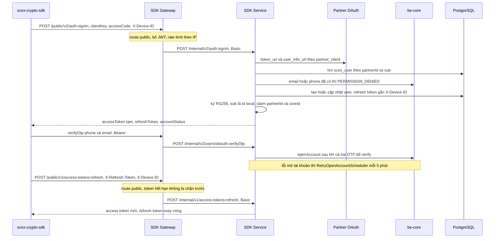

##### v3 — id_token

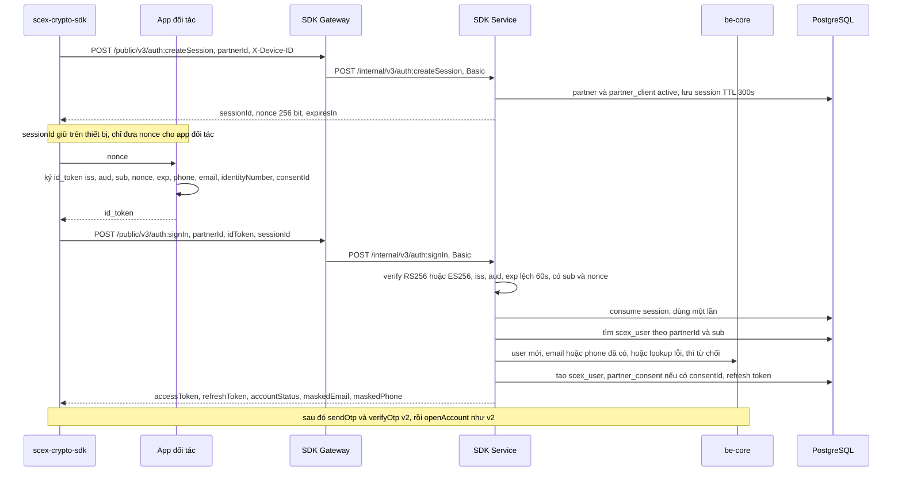

Điểm vận hành của v3:

- Session bị đốt trước khi so nonce. `id_token` sai nonce không thử lại trên cùng session. Hết hạn, đã dùng, không tồn tại, hoặc thuộc app khác đều trả cùng một lỗi.
- Mọi lỗi verify trả `PERMISSION_DENIED`. Lý do chỉ nằm trong log. Sai chữ ký được log `error` để cập nhật `partner_client.id_token_public_key`.
- Mỗi partner client một public key (RS256 hoặc ES256). `kid` không chọn key. Đổi key qua `PUT /internal/v1/partner-clients/{clientKey}/id-token-public-key`. Chưa có hai key song song lúc rotate.
- `partner_consent` là insert-only, một dòng mỗi `consentId`. Ghi lỗi chỉ log, sign-in vẫn tiếp tục. Token không có `consentId` thì không ghi.
- `PurgeExpiredAuthSessionsScheduler` chạy mỗi ngày, xoá `partner_auth_session` đã hết hạn. Dòng đã dùng được giữ đến hết hạn để replay bị báo đã dùng.
- Profile `demo`: `POST /_demo/partner/oidc/authorize` ký `id_token` bằng private key tester upload.

Refresh nằm trên route public, header `X-Refresh-Token` và `X-Device-ID`, xử lý local, không gọi downstream ngoài SDK Service. Refresh token xoay vòng. Token bị từ chối khi `X-Device-ID` khác thiết bị lúc sign-in. Revoke xoá refresh token. Access token đã cấp còn hiệu lực đến khi hết TTL (`SCEX_TOKEN_TTL_SECONDS`).

#### 3.3 Đặt lệnh

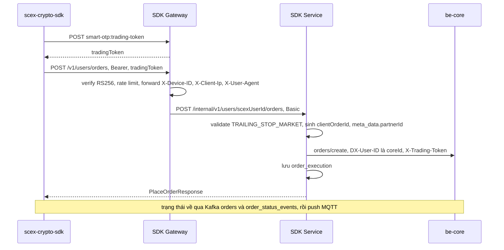

Đặt lệnh và chuyển ví mang idempotency key do client sinh. Key đã có thì trả response đã lưu, không gọi lại be-core. Service không retry lệnh ghi xuống be-core. Timeout được đối soát bằng log đã lưu và trạng thái trên be-core. `POST /v1/users/orders/{orderId}:sync` đồng bộ trạng thái từ core. Request GET xuống be-core không ghi log đối soát.

#### 3.4 eKYC

Mọi bước REST đi qua SDK Gateway. Sơ đồ dưới gom gateway vào SDK Service.

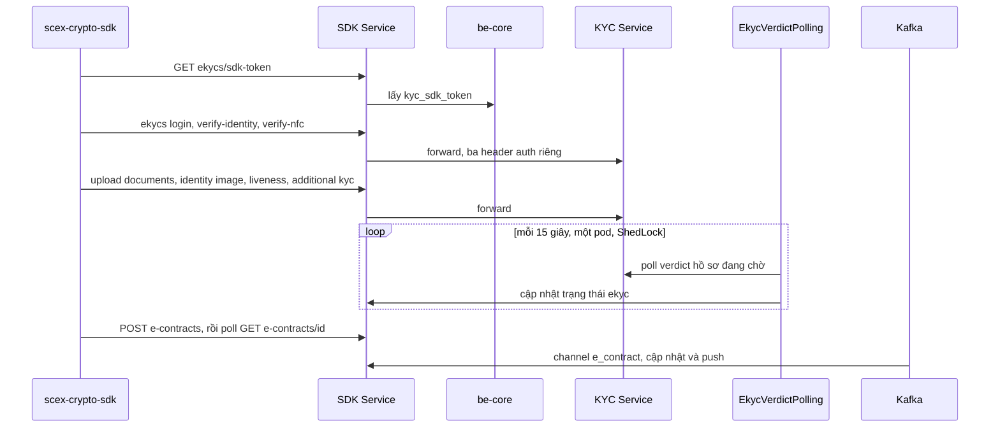

Job `reconcile-ekyc-verdict` chỉ chạy trên một instance nhờ ShedLock (`lockAtMostFor` mặc định PT30S). Upload multipart giới hạn `MAX_FILE_SIZE` (mặc định 10 MB) ở cả gateway và service. Ảnh giấy tờ và file người dùng có thể đi tiếp sang file-service (read timeout 60s).

#### 3.5 Sự kiện core tới push realtime

Chín channel: `coin_deposit`, `coin_withdrawal`, `fiat_deposit`, `fiat_withdrawal`, `wallet_transfer`, `balanceAccounts`, `orders`, `order_status_events`, `e_contract`.

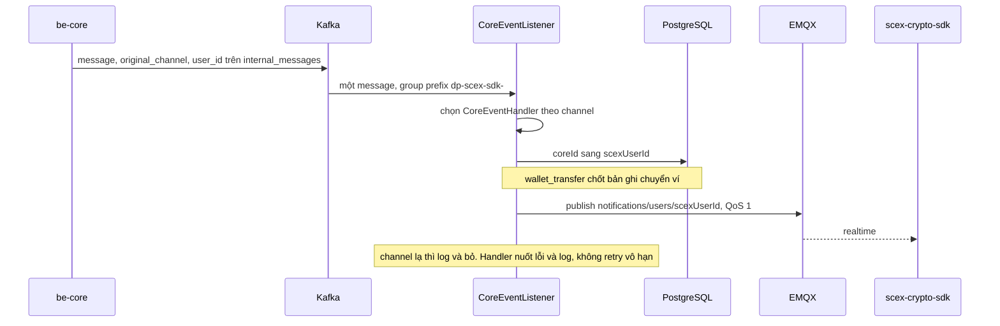

Service chuyển tiếp event lên EMQX và không ghi nguyên message vào PostgreSQL. Ngoài bước map `coreId` và chốt `wallet_transfer`, push là best-effort: số dư và trạng thái giao dịch lấy lại bằng REST. Producer email OTP ghi topic `base_notification.internal` (`acks=all`, idempotent, retries 5). OTP cuộc gọi đi Feign voice-otp, timeout 10s.

Mini app reconnect thì gọi lại API notification. Token MQTT để subscribe nằm ở mục 3.7.

#### 3.6 Chuyển đổi crypto sang VND

Luồng này không vào SDK Service. `X-User-ID` = `coreUserId`, có thể null nếu token phát trước khi có tài khoản core.

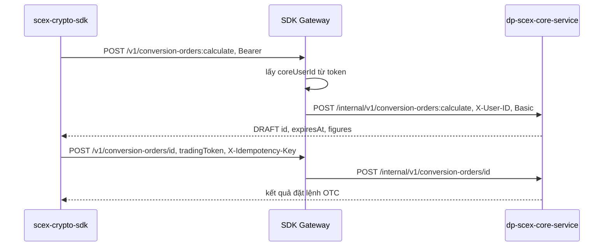

Nhóm route còn lại: `conversion-pairs`, `conversion-fee-rates`, `conversion-orders` đọc theo id, và `terms-documents` (`GET` theo `termsCode`, `POST :accept`). Token phát khi `coreUserId` còn null thì conversion trả mã dạng `*_ACCOUNT_NOT_READY`. User đăng nhập lại sau khi đã có tài khoản core.

#### 3.7 MQTT access token

SDK đi qua SDK Gateway. `scex-fe` đi qua `dp-scex-gateway-service`. Cả hai gọi cùng `POST /internal/v1/mqtt-access-tokens`.

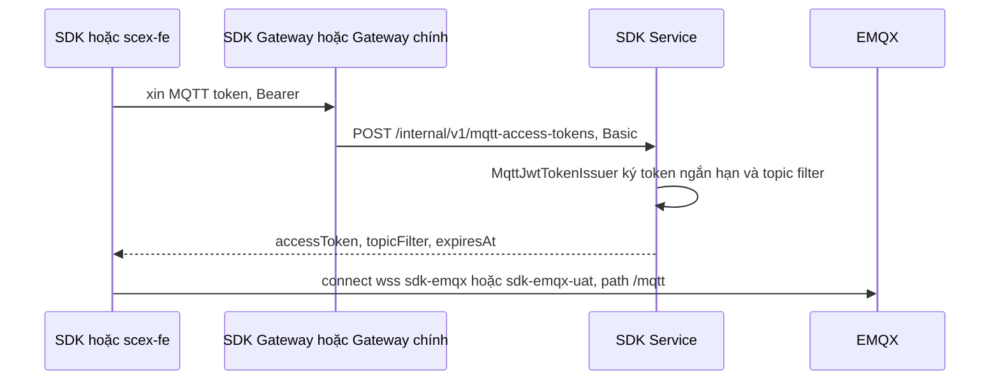

Service publish bằng `tcp://10.69.8.65:1883`. Client subscribe bằng WebSocket trên host `sdk-emqx.scex.com.vn` hoặc `sdk-emqx-uat.scex.com.vn`.

### 4. Danh sách các thành phần chính

Sizing lấy theo SA 20/10/2026. Repo gateway và repo service không có Helm/K8s manifest. Số pod theo tài liệu kiến trúc của từng service. CPU/RAM là ước lượng. Cần đối chiếu cấu hình triển khai thực tế của DevOps.

| Thành phần                                       | Chức năng chính                                          | Tech stack                                                                                                     | Sizing (ước lượng)                                                                                                                             | Repository                                                                  |
| ------------------------------------------------ | -------------------------------------------------------- | -------------------------------------------------------------------------------------------------------------- | ---------------------------------------------------------------------------------------------------------------------------------------------- | --------------------------------------------------------------------------- |
| Mobile SDK `scex-crypto-sdk`                     | Client nhúng trong app đối tác                           | iOS / Android                                                                                                  | Ngoài hai trang SA backend                                                                                                                     | Không có trong nguồn Confluence của HLD này                                 |
| SDK Gateway                                      | BFF: JWT, rate limit, khoảng 133 route tới 3 backend     | Spring Boot 4.0.3, Java 25, Modulith, JJWT 0.12, Bucket4j 8.10, HttpClient 5.2, Springdoc 3.0, virtual threads | 2 pod; khoảng 0.5 vCPU, 512 MiB–1 GiB RAM/pod; port 8092; pool 200 tổng / 20 mỗi route; timeout 5s / 30s                                       | `gitlab.scex.com.vn/digital/backend/gateway/dp-scex-sdk-gateway-service`    |
| SDK Service REST `/scex-sdk-service/internal/**` | Khoảng 41 controller, khoảng 118 route                   | Spring MVC, Spring Security Basic, OpenFeign, JJWT                                                             | 2–3 pod; khoảng 1 vCPU, 1.5–2 GiB RAM/pod; image `eclipse-temurin:25-jre`; Hikari max 10/pod; Feign 30s (voice-otp 10s, file-service read 60s) | `gitlab.scex.com.vn/digital/backend/dp-scex-sdk-service` (module `service`) |
| Kafka consumer `CoreEventListener`               | 9 `CoreEventHandler` → MQTT                              | Spring Kafka, JSON deserializer, nuốt lỗi rồi log, SASL_SSL, SCRAM-SHA-512                                     | Một consumer group chung, prefix `dp-scex-sdk-`. Offset reset mặc định `latest`                                                                | cùng repo service                                                           |
| Kafka producer                                   | Email OTP                                                | Spring Kafka, idempotent, `acks=all`, retries 5                                                                | Thấp                                                                                                                                           | cùng repo service                                                           |
| Schedulers                                       | eKYC verdict, retry mở tài khoản, purge token và session | `@Scheduled`, ShedLock                                                                                         | Verdict 15s; retry mở tài khoản 5 phút; purge mỗi ngày. Async pool core 2, max 8, queue 500                                                    | cùng repo service                                                           |
| PostgreSQL schema                                | State onboarding, token, lệnh, audit                     | PostgreSQL, JPA, Liquibase (`ddl-auto: none`)                                                                  | Trung bình. `order_execution` và `action_audit_log` tăng theo giao dịch                                                                        | cùng repo service (`db/changelog`)                                          |
| Redis + Caffeine                                 | Cache settings và partner key                            | Spring Data Redis (SSL) + Caffeine L1                                                                          | Nhỏ                                                                                                                                            | cùng repo service                                                           |

Bảng PostgreSQL do SDK Service sở hữu: `scex_user`, `partner`, `partner_client`, `partner_consent`, `partner_auth_session`, `refresh_tokens`, `otps`, `otp_configs`, `ekyc`, `ekyc_ocr_infos`, `ekyc_liveness_infos`, `econtracts`, `user_identity_images`, `order_execution`, `wallet_transfers`, `default_order_symbol`, `action_audit_log`, `shedlock`. Context Liquibase `demo` có seed và chỉ dùng ngoài production.

`order-types` và `order-default-symbol` đọc cấu hình local, không gọi downstream. Market `coin-infos`, `symbols`, `exchange-rates`, `last-prices` lấy từ be-core. `order-book`, `recent-trades`, `klines`, `ticker-24hr` lấy từ market-data.

### 5. Các thành phần phụ thuộc

| Thành phần                    | Loại (Internal/External) | Chức năng                                                                     | Cách kết nối                                                                                                        | Authen/Author                                                                                                                     | Fallback khi down                                                                                            |
| ----------------------------- | ------------------------ | ----------------------------------------------------------------------------- | ------------------------------------------------------------------------------------------------------------------- | --------------------------------------------------------------------------------------------------------------------------------- | ------------------------------------------------------------------------------------------------------------ |
| `dp-scex-sdk-gateway-service` | Internal (upstream)      | Cửa vào của mini app                                                          | HTTPS công khai, port service 8092, sau LB 443                                                                      | JWT RS256 do SDK Service ký                                                                                                       | Mini app không gọi được SDK                                                                                  |
| `dp-scex-gateway-service`     | Internal (upstream)      | Lấy MQTT token cho `scex-fe`                                                  | HTTPS → `POST /internal/v1/mqtt-access-tokens`                                                                      | HTTP Basic                                                                                                                        | `scex-fe` không lấy được MQTT token                                                                          |
| `dp-scex-sdk-service`         | Internal                 | Nghiệp vụ SDK, khoảng 120 route                                               | HTTP `INTERNAL_SERVICE_BASE_URL` + `/scex-sdk-service`, timeout gateway 5s / 30s                                    | Basic secret `internal-services.services.scex-sdk`; `scexUserId` trong path hoặc body                                             | Lỗi kết nối trả 5xx. Không retry, không circuit breaker                                                      |
| `dp-scex-core-service`        | Internal                 | Chuyển đổi, điều khoản                                                        | HTTP + `/scex-core-service`                                                                                         | Basic `SCEX_CORE_INTERNAL_BASIC_AUTH`; `X-User-ID` = `coreUserId`                                                                 | Chỉ 9 route conversion / legal terms lỗi. Cùng kiểu không retry                                              |
| `dp-feature-flag-service`     | Internal                 | Config và feature flag                                                        | HTTP + `/ff-service`                                                                                                | Basic secret `feature-flag`                                                                                                       | Hai route flag lỗi. Client SDK nên có giá trị mặc định                                                       |
| be-core / LPEX-CORE           | External (CORE IT)       | User, mở tài khoản, lệnh, ví, nạp/rút, notification, settings, Smart OTP, 2FA | Feign `scex-core`, khoảng 20 client, timeout 30s. UAT `https://internal-api-uat.scex.com.vn/be-core`                | Header `DX-Internal-App: b2b2c` (`create_without_verification` dùng `digital`), `DX-User-ID` = coreId, `X-Trading-Token` cho lệnh | Lỗi trả về client. Mở tài khoản: `RetryOpenAccountScheduler` mỗi 5 phút. Sign-in lookup lỗi thì từ chối      |
| market-data                   | External (CORE IT)       | Klines, order book, ticker                                                    | Feign `market-data`, timeout 30s. UAT `https://internal-api-uat.scex.com.vn/market-data`                            | Mạng nội bộ                                                                                                                       | Market API trả lỗi                                                                                           |
| KYC Service                   | External (LPEX)          | eKYC session, CCCD, NFC, liveness, verdict                                    | Feign `kyc-core`, timeout 30s. UAT `https://kyc-api-uat.scex.com.vn`                                                | Ba header phiên KYC, không dùng interceptor của be-core                                                                           | Bước eKYC trả lỗi. Job verdict chạy lại lượt sau                                                             |
| voice-otp                     | External                 | OTP cuộc gọi                                                                  | Feign `voice-otp`, timeout 10s, path `/base-notification-voice-otp-api`                                             | Campaign id                                                                                                                       | Kênh CALL lỗi. OTP SMS/email đi đường khác                                                                   |
| file-service                  | External                 | Upload file và ảnh giấy tờ                                                    | Feign `file-service`, read 60s, path `/file-service`                                                                | Mạng nội bộ                                                                                                                       | Upload lỗi                                                                                                   |
| Partner OAuth (v1/v2)         | External (đối tác)       | Đổi access code, userinfo                                                     | Feign `partner-oauth`, URL theo dòng `partner_client`, timeout 10s, không retry                                     | Client id / secret của partner                                                                                                    | Sign-in v1/v2 của partner đó lỗi                                                                             |
| Partner `id_token` (v3)       | External (đối tác)       | Partner ký JWT phía họ                                                        | Không gọi mạng. Verify offline bằng `partner_client.id_token_public_key`                                            | RS256 hoặc ES256, `iss`, `aud` = clientKey, `nonce` một lần, clock skew 60s                                                       | Sign-in v3 không phụ thuộc partner online. Key cũ chưa cập nhật thì mọi sign-in v3 của partner đó bị từ chối |
| PostgreSQL                    | Infra                    | Toàn bộ state onboarding và log lệnh                                          | JDBC Hikari, max 10 connection mỗi pod                                                                              | user / password                                                                                                                   | SDK Service không phục vụ được nghiệp vụ có state                                                            |
| Redis                         | Infra                    | Cache settings, partner key                                                   | Spring Data Redis, SSL. UAT `10.69.30.40:36379`                                                                     | user / password                                                                                                                   | Caffeine L1 giữ giá trị đã cache. Miss thì gọi core                                                          |
| Kafka                         | Infra                    | Sự kiện core và email OTP                                                     | SASL_SSL, SCRAM-SHA-512, 3 broker                                                                                   | user / password consumer và producer                                                                                              | Mất push realtime. Email OTP lỗi                                                                             |
| EMQX                          | Infra                    | Push notification                                                             | Spring Integration MQTT, QoS 1, prefix `notifications/users/`. UAT `tcp://10.69.8.65:1883`                          | user / password của service khi publish                                                                                           | Push mất. Danh sách notification vẫn đọc được qua API                                                        |
| Khoá JWT                      | Config                   | Ký và verify access token                                                     | Private key ở SDK Service (`jwt.private-key`). Public key ở SDK Gateway (`jwt.public-key`, base64 PEM) và phía EMQX | —                                                                                                                                 | Lệch khoá: mọi route có token trả 401                                                                        |

### 6. Sơ đồ kiến trúc deployment thực tế

#### Sơ đồ triển khai

Mini app vào qua LB. SDK Gateway và SDK Service chạy trên Cloud K8s. Feature Flag và Core nằm cùng tầng service, do gateway gọi. Dữ liệu và CORE IT nằm phía sau SDK Service.

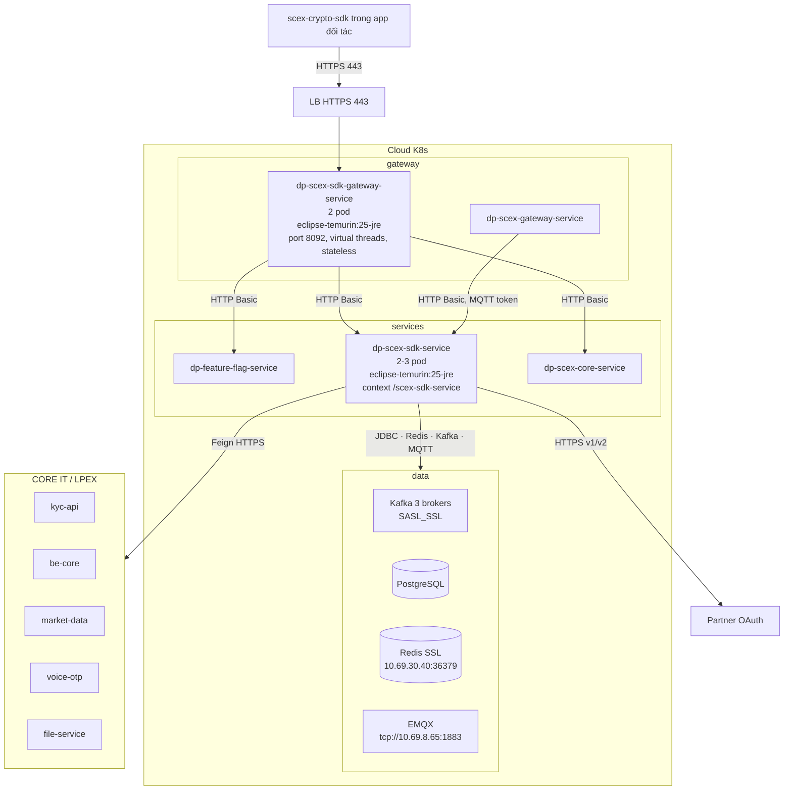

`dp-scex-gateway-service` nằm cùng cụm gateway và gọi SDK Service trên mạng nội bộ để lấy MQTT token. LB 443 chỉ vào SDK Gateway.

#### Các config quan trọng

Giá trị dưới đây là UAT hoặc mặc định trong repo. Không ghi secret. Production dùng cùng tên biến; giá trị prod không lưu trong repo.

SDK Gateway:

| Key                                                       | Giá trị (UAT / mặc định)            | Ý nghĩa                                                                  |
| --------------------------------------------------------- | ----------------------------------- | ------------------------------------------------------------------------ |
| `SERVER_PORT`                                             | `8092`                              | Cổng trong pod                                                           |
| `INTERNAL_SERVICE_BASE_URL`                               | env (local `http://localhost:8080`) | Origin chung của các backend                                             |
| `INTERNAL_CONNECT_TIMEOUT` / `INTERNAL_READ_TIMEOUT`      | `5000` / `30000` ms                 | Timeout gọi downstream                                                   |
| `INTERNAL_POOL_MAX_TOTAL` / `INTERNAL_POOL_MAX_PER_ROUTE` | `200` / `20`                        | Pool HttpClient 5                                                        |
| `internal-services.services.*.secret`                     | secret                              | Basic credential từng backend. Phải khớp SDK Service, Core, Feature Flag |
| `jwt.public-key`                                          | secret                              | Khớp `jwt.private-key` của SDK Service cùng môi trường                   |
| `RATE_LIMIT_ENABLED`, public rps/burst, auth rps/burst    | `true`, `5/10`, `20/40`             | Giới hạn tính theo từng pod                                              |
| `SWAGGER_ENABLED`                                         | `true` ở sit/uat, `false` ở prod    | Springdoc                                                                |
| `MAX_FILE_SIZE` / `MAX_REQUEST_SIZE`                      | `10MB`                              | Upload eKYC và file                                                      |
| `spring.threads.virtual.enabled`                          | `true`                              | Virtual threads                                                          |
| `server.compression`                                      | bật, từ 2KB, JSON/text              | Nén response                                                             |

SDK Service:

| Key                                                    | Giá trị (UAT / mặc định)                           | Ý nghĩa                                                                    |
| ------------------------------------------------------ | -------------------------------------------------- | -------------------------------------------------------------------------- |
| context-path                                           | `/scex-sdk-service`                                | Mọi path nội bộ tính sau context này                                       |
| `spring.profiles.active`                               | `demo` trong `application.yml`                     | Bật `/_demo/**` và seed Liquibase context `demo`. Production phải override |
| `SERVICE_SCEX_CORE_URL`                                | `https://internal-api-uat.scex.com.vn/be-core`     | be-core                                                                    |
| `SERVICE_MARKET_DATA_URL`                              | `https://internal-api-uat.scex.com.vn/market-data` | market-data                                                                |
| `SERVICE_KYC_CORE_URL`                                 | `https://kyc-api-uat.scex.com.vn`                  | KYC Service                                                                |
| `SERVICE_VOICE_OTP_URL`, `SERVICE_FILE_SERVICE_URL`    | host `internal-uat.scex.com.vn`                    | voice-otp, file-service                                                    |
| `SCEX_CORE_INTERNAL_APP`                               | `b2b2c`                                            | Header `DX-Internal-App`                                                   |
| `KAFKA_EVENTS_TOPIC` / `KAFKA_BASE_NOTIFICATION_TOPIC` | `internal_messages` / `base_notification.internal` | Consume và produce                                                         |
| `KAFKA_DEFAULT_CONSUMER_GROUP_ID_PREFIX`               | `dp-scex-sdk-`                                     | Consumer group                                                             |
| `KAFKA_AUTO_OFFSET_RESET`                              | `latest`                                           |                                                                            |
| `MQTT_BROKER_URL` / `MQTT_NOTIFICATION_TOPIC_PREFIX`   | `tcp://10.69.8.65:1883` / `notifications/users/`   | EMQX                                                                       |
| `jwt.private-key`                                      | secret                                             | Khoá ký access token                                                       |
| `SCEX_TOKEN_TTL_SECONDS`                               | env                                                | TTL access token                                                           |
| `SCEX_PARTNER_AUTH_SESSION_TTL_SECONDS`                | `300`                                              | TTL session v3                                                             |
| clock skew `id_token`                                  | `60` giây                                          |                                                                            |
| `scheduler.reconcile-ekyc-verdict.fixed-delay`         | `15000`                                            | Nhịp poll verdict                                                          |
| `ASYNC_EXECUTOR_*`                                     | core 2, max 8, queue 500                           | Thread pool async                                                          |
| Hikari                                                 | max 10 mỗi pod                                     | Pool PostgreSQL                                                            |

Biến bắt buộc trên production (không để giá trị mặc định trong repo): PostgreSQL, `JWT_PRIVATE_KEY` / `jwt.private-key`, Basic credential giữa gateway và service, URL be-core, market-data, KYC, voice-otp, `SCEX_CORE_INTERNAL_APP`, Kafka SASL, MQTT, giới hạn upload, và profile khác `demo`.

#### Môi trường

| Môi trường | Gateway          | SDK Service                                                   | Ghi chú                                                                                           |
| ---------- | ---------------- | ------------------------------------------------------------- | ------------------------------------------------------------------------------------------------- |
| SIT        | branch `sit`     | branch `sit`                                                  | Swagger gateway bật                                                                               |
| UAT        | branch `uat`     | branch `uat`                                                  | be-core và market-data `internal-api-uat`, KYC `kyc-api-uat`, MQTT phía service `10.69.8.65:1883` |
| Sandbox    | branch `sandbox` | branch `sandbox`                                              | Môi trường cho đối tác tích hợp thử                                                               |
| Production | branch `prod`    | Chưa có branch `prod` trên remote tại thời điểm SA 20/10/2026 | Swagger gateway tắt. Giá trị prod không lưu trong repo                                            |
| `main`     | Chỉ README       | Chỉ khung, không deploy được                                  | Code chạy nằm trên `sit` / `uat`                                                                  |

### 7. Observability & Monitoring

Cả hai service expose Actuator `health` cho liveness và readiness, `show-details: never`. Chưa có `micrometer-registry-prometheus`, nên không có `/actuator/prometheus`. Dockerfile của SDK Service không gắn OpenTelemetry agent. Chưa có custom metric.

| Nguồn         | Hiện trạng                                                                            |
| ------------- | ------------------------------------------------------------------------------------- |
| Actuator      | Chỉ `health`. Probe Kubernetes dùng nhóm liveness/readiness                           |
| Log gateway   | MDC `session_id`, `trace_id`. `RestClientLoggingInterceptor` log outbound ở mức DEBUG |
| Log service   | `trace_id` và `device_id` (MDC, `TraceIdAspect` cho listener và scheduler)            |
| Audit         | Bảng `action_audit_log` ghi hành động bảo mật                                         |
| Custom metric | Chưa có                                                                               |

Vì lỗi nghiệp vụ của SDK Service nằm trong field `code` của envelope, đối soát một request cần đọc log và body, không chỉ HTTP status ở phía sau gateway. Gateway vẫn trả status thật cho lỗi do chính gateway sinh ra (401, 429, 500).

#### Troubleshoot

| Triệu chứng                                              | Kiểm tra                                                                                                                                                               |
| -------------------------------------------------------- | ---------------------------------------------------------------------------------------------------------------------------------------------------------------------- |
| Mọi route có token trả 401                               | `jwt.public-key` của gateway không khớp khoá ký của SDK Service cùng môi trường                                                                                        |
| Client nhận 429                                          | Vượt 5 rps public hoặc 20 rps theo user. Ngưỡng tính theo từng pod                                                                                                     |
| Client nhận lỗi không rõ nguồn                           | Body là nguyên văn backend. Log `_infra._http` (DEBUG) cho biết backend nào                                                                                            |
| Conversion trả lỗi tài khoản chưa sẵn sàng               | Token phát khi `coreUserId` còn null. User đăng nhập lại sau khi có tài khoản core                                                                                     |
| IP client sai trong log backend                          | Ingress chưa gắn `X-Forwarded-For`. Gateway lấy hop đầu tiên                                                                                                           |
| User kẹt sau verify OTP, chưa có `coreId`                | Log `RetryOpenAccountJobUseCase`. be-core có lỗi mở tài khoản                                                                                                          |
| eKYC không chuyển trạng thái                             | Log `EkycVerdictPollingScheduler`. Lock `ReconcileEkycVerdict` trong `shedlock`                                                                                        |
| Sign-in `PERMISSION_DENIED`                              | Email hoặc phone đã có ở local (đã verify) hoặc ở core. Lookup core lỗi cũng bị từ chối                                                                                |
| Sign-in v3 "Thông tin đăng nhập từ đối tác không hợp lệ" | Log `PartnerIdTokenVerifierImpl`: chữ ký (cập nhật `id-token-public-key`), sai `iss` / `aud`, `exp` quá clock skew 60s, thiếu `sub` hoặc `nonce`, alg khác RS256/ES256 |
| Sign-in v3 "Phiên đăng nhập không hợp lệ"                | `sessionId` hết hạn (300s), đã dùng, hoặc nonce không khớp. Gọi lại `createSession`                                                                                    |
| Refresh token bị từ chối                                 | `X-Device-ID` khác thiết bị lúc sign-in                                                                                                                                |
| Lệnh bị core từ chối vì header                           | `X-Trading-Token` hết hạn, hoặc `DX-Internal-App` không đi kèm `orders/create`                                                                                         |
| Không nhận push nạp tiền hoặc lệnh                       | Consumer group `dp-scex-sdk-*`, log handler. Channel chưa có handler thì log unknown channel. EMQX down thì push mất, API notification vẫn đọc được                    |

#### Known issues

- `spring.profiles.active: demo` đặt trong cấu hình gốc của SDK Service. Production phải override, nếu không `/_demo/**` và seed Liquibase context `demo` được bật.
- Rate limit Bucket4j nằm trong bộ nhớ từng pod. Hai pod nhân đôi ngưỡng thực tế của một IP hoặc một user.
- Push MQTT là best-effort. Handler sự kiện core nuốt lỗi và log, không retry vô hạn. Số dư và trạng thái giao dịch lấy từ REST.
- Ghi xuống be-core không retry. Kết quả khi timeout nằm ở log đối soát và ở be-core.
- Access token đã cấp còn dùng được đến hết TTL, kể cả sau khi refresh token đã revoke.
- Idempotency key của đặt lệnh và chuyển ví, cùng `order_execution` và `action_audit_log`, được giữ trong PostgreSQL.
