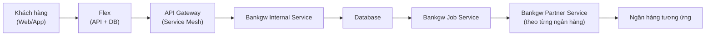
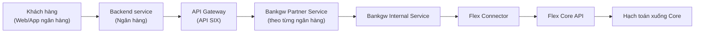
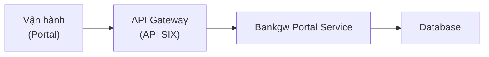
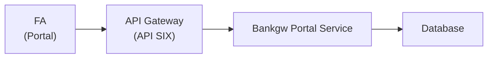

# HIGH LEVEL DESIGN — Kết nối thu chi hộ với VCB

# 1. Giới thiệu

| Mục                  | Nội dung                                                                                            |
| -------------------- | --------------------------------------------------------------------------------------------------- |
| Mục đích             | Xây dựng hệ thống kết nối thu chi hộ với VCB, giúp khách hàng có thêm lựa chọn nạp/rút tiền từ VCB. |
| Phạm vi              | Toàn bộ hệ thống LPTrade, Portal.                                                                   |
| Đối tượng người dùng | Khách hàng, OPS, FA, Vận hành.                                                                      |

# 2. Yêu cầu tổng quan

## 2.1 Yêu cầu chức năng chính

| Chức năng                 | Mô tả                                                                   | Đối tượng  |
| ------------------------- | ----------------------------------------------------------------------- | ---------- |
| Luồng thu hộ              | Nạp tiền chứng khoán qua từng ngân hàng liên kết.                       | Khách hàng |
| Luồng chi hộ              | Chuyển tiền từ tài khoản chứng khoán ra ngân hàng thụ hưởng đã đăng ký. | Khách hàng |
| Cấu hình tham số hệ thống | Giờ COT, số tiền mỗi giao dịch/khách hàng, và các hạn mức tương tự.     | Vận hành   |
| Quản lý thu hộ            | Theo dõi và xử lý món thu hộ.                                           | FA         |
| Quản lý chi hộ            | Theo dõi và xử lý món chi hộ.                                           | FA         |

## 2.2 Yêu cầu phi chức năng

| Nhóm               | Yêu cầu                                     |
| ------------------ | ------------------------------------------- |
| Năng lực           | Hệ thống hỗ trợ 2.000 người dùng đồng thời. |
| Thời gian phản hồi | Dưới 2 giây cho 95% request.                |
| Độ sẵn sàng        | 99,9%.                                      |

# 3. Kiến trúc tổng thể

## 3.1 Mô hình ngữ cảnh (Context Diagram)

### Luồng chi hộ

Khách hàng (Web/App) → Flex (API + DB) → API Gateway (Service Mesh) → Bankgw Internal Service → Database → Bankgw Job Service → Bankgw Partner Service (theo từng ngân hàng) → điều hướng tới ngân hàng tương ứng.

### Luồng thu hộ

Khách hàng (Web/App ngân hàng) → Backend service (ngân hàng) → API Gateway (API SIX) → Bankgw Partner Service (theo từng ngân hàng) → Bankgw Internal Service → Flex Connector → Flex Core API → hạch toán xuống Core.

### Cấu hình tham số

Vận hành (Portal) → API Gateway (API SIX) → Bankgw Portal Service → Database.

### Quản lý thu/chi hộ

FA (Portal) → API Gateway (API SIX) → Bankgw Portal Service → Database.

## 3.2 Các thành phần chính

| Lớp             | Công nghệ                   | Ghi chú                          |
| --------------- | --------------------------- | -------------------------------- |
| Frontend Portal | Microservices (React.js)    | Portal vận hành / FA.            |
| Backend         | Microservices (Spring Boot) | Các service Bankgw.              |
| Database        | PostgreSQL                  | Dữ liệu giao dịch (transaction). |
| Tích hợp        | Ngân hàng liên kết          | VPBank, BIDV, LPBank.            |

## 3.3 Kiến trúc tổng thể

Chú giải luồng trên sơ đồ:

| Ký hiệu      | Luồng                                                     |
| ------------ | --------------------------------------------------------- |
| Nét đứt xám  | Luồng đồng bộ, thao tác DB.                               |
| Nét đứt xanh | Luồng thu hộ.                                             |
| Nét đứt đỏ   | Luồng chi hộ.                                             |
| Nét đứt cam  | Luồng quản lý thu chi hộ và cấu hình tham số trên portal. |

# 4. Mô tả chi tiết kiến trúc

## 4.1 Kiến trúc logic

| Thành phần                  | Trách nhiệm                                                                       |
| --------------------------- | --------------------------------------------------------------------------------- |
| Bankgw-Internal-Service     | Xử lý logic chi hộ và thu hộ.                                                     |
| Bankgw-Partner-....-Service | Tích hợp tới các ngân hàng liên kết.                                              |
| Bankgw-Portal-Service       | Quản lý chi hộ, cấu hình tham số chi hộ, quản lý thu hộ, cấu hình tham số thu hộ. |
| Bankgw-Job-Service          | Job đi chi.                                                                       |
| Bankgw-Migration-Service    | Service khởi tạo cấu trúc DB (DDL).                                               |
| Flex-Connector-Service      | Dịch vụ ngoài Bankgw, xử lý hạch toán xuống core Flex.                            |
| Flex-Core-Api               | Dịch vụ ngoài Bankgw, xử lý đẩy chi hộ sang Bankgw.                               |
| Bankgw-portal-Web-Service   | Portal.                                                                           |

## 4.2 Kiến trúc vật lý (Deployment)

| Hạng mục           | Lựa chọn                |
| ------------------ | ----------------------- |
| Cloud              | CMC Cloud               |
| Kubernetes cluster | Multiple node           |
| CI/CD              | Có (chi tiết tại mục 7) |

# 5. Thiết kế bảo mật

| Hạng mục      | Thiết kế                                                         |
| ------------- | ---------------------------------------------------------------- |
| Xác thực      | Theo từng đối tác ngân hàng.                                     |
| Mã hóa        | Theo từng đối tác ngân hàng.                                     |
| Authorization | Role-based: phân quyền chức năng cho Vận hành / FA qua Keycloak. |
| Audit log     | ELK Stack (Elasticsearch, Logstash, Kibana).                     |

# 6. Hiệu năng và mở rộng

- **Load Balancer:** Nginx.
- **Message Queue:** Kafka, dùng để bắn noti cho các dịch vụ khác khi nạp/rút tiền thành công. Chỉ bổ sung khi cần, vì hiện tại core Flex đã bắn tín hiệu từ connector.

# 7. Triển khai và vận hành

| Hạng mục   | Thiết kế                              |
| ---------- | ------------------------------------- |
| CI/CD      | GitLab → Docker Registry → Kubernetes |
| Monitoring | Prometheus + Grafana                  |
| Logging    | ELK                                   |
| Backup DB  | Hàng ngày (RDS snapshot)              |

# 8. Rủi ro và quyết định kiến trúc

## 8.1 Rủi ro

Response từ ngân hàng trả về có thể không chính xác: giao dịch báo thất bại, nhưng sau đó vẫn có thể thành công.

## 8.2 Quyết định

Không dùng luồng retry khi thất bại. Portal quản lý thu/chi hộ phải có chức năng để FA xử lý manual.
