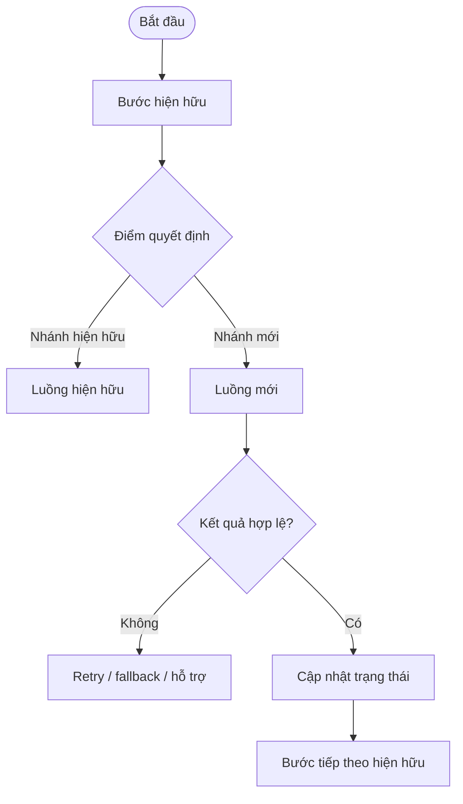
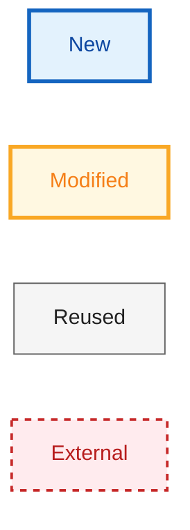
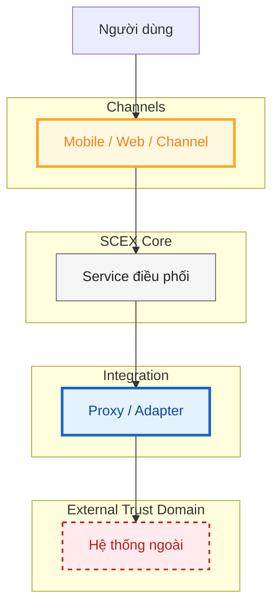
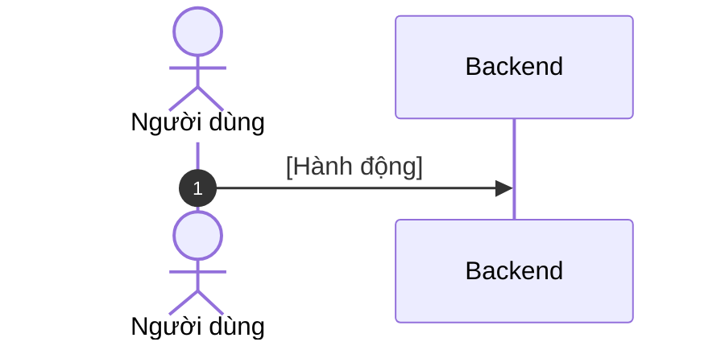
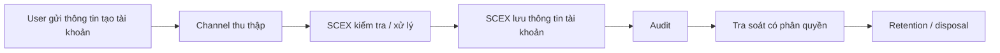
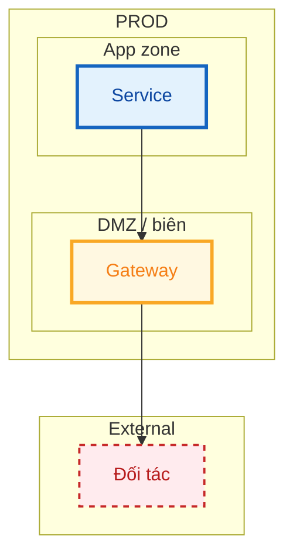

# HIGH LEVEL DESIGN — [TÊN GIẢI PHÁP]

> **Mã tài liệu:** [HLD-{DOMAIN}-{SYSTEM}]  
> **Phiên bản:** [0.1]  
> **Trạng thái:** [Draft | In Review | Approved | Superseded]  
> **Mức độ bảo mật:** [Public | Internal | Confidential | Restricted]

---

# 1. Quản trị tài liệu

## 1.1 Thông tin tài liệu

| Thuộc tính                         | Giá trị                 |
| ---------------------------------- | ----------------------- |
| Tên giải pháp/hệ thống             | [Điền]                  |
| Mã tài liệu                        | [HLD-{DOMAIN}-{SYSTEM}] |
| Business Owner                     | [Điền]                  |
| System/Service Owner               | [Điền]                  |
| Solution Architect                 | [Điền]                  |
| Tech Lead(s)                       | [Điền]                  |
| Security/Privacy Reviewer          | [Điền]                  |
| Infrastructure/Operations Reviewer | [Điền]                  |
| Repository/Link                    | [Điền]                  |
| Tài liệu thay thế bởi/thay thế cho | [N/A hoặc mã tài liệu]  |

## 1.2 Lịch sử thay đổi

| Phiên bản | Ngày         | Tác giả | Thay đổi chính | Trạng thái |
| --------- | ------------ | ------- | -------------- | ---------- |
| 0.1       | [YYYY-MM-DD] | [Tên]   | Khởi tạo       | Draft      |

## 1.3 Review và phê duyệt

| Vai trò               | Người/đơn vị | Phạm vi review                    | Kết quả                     | Ngày   | Bằng chứng/link |
| --------------------- | ------------ | --------------------------------- | --------------------------- | ------ | --------------- |
| Business Owner        | [Điền]       | Mục tiêu, phạm vi, ưu tiên        | [Pending/Approved/Rejected] | [Điền] | [Điền]          |
| Solution Architecture | [Điền]       | Kiến trúc, tiêu chuẩn, quyết định | [Điền]                      | [Điền] | [Điền]          |
| An toàn thông tin     | [Điền]       | Security, privacy, risk/control   | [Điền]                      | [Điền] | [Điền]          |
| Hạ tầng/Vận hành/SRE  | [Điền]       | Deployability, operability, DR    | [Điền]                      | [Điền] | [Điền]          |
| Data Owner/DPO        | [Điền/N/A]   | Data governance, privacy          | [Điền]                      | [Điền] | [Điền]          |
| Pháp chế/Compliance   | [Điền/N/A]   | Căn cứ pháp lý, nghĩa vụ tuân thủ | [Điền]                      | [Điền] | [Điền]          |
| ARB                   | [Điền/N/A]   | Quyết định vượt thẩm quyền dự án  | [Điền]                      | [Điền] | [Điền]          |

## 1.4 Tài liệu tham chiếu

| ID     | Tài liệu/tiêu chuẩn       | Phiên bản/ngày | Vai trò trong HLD | Link   |
| ------ | ------------------------- | -------------- | ----------------- | ------ |
| REF-01 | Business Requirements/PRD | [Điền]         | Nguồn yêu cầu     | [Điền] |
| REF-02 | [Điền]                    | [Điền]         | [Điền]            | [Điền] |

## 1.5 Thuật ngữ và từ viết tắt

| Thuật ngữ | Định nghĩa trong phạm vi tài liệu     |
| --------- | ------------------------------------- |
| [Điền]    | [Điền; tránh chỉ mở rộng từ viết tắt] |

---

# 2. Tóm tắt điều hành

## 2.1 Vấn đề và giá trị giải pháp

[Trong 1–3 đoạn, mô tả vấn đề hiện tại, đối tượng chịu ảnh hưởng, giá trị mong đợi và lý do cần thay đổi ở thời điểm này. Không mô tả chi tiết kỹ thuật tại đây.]

## 2.2 Giải pháp đề xuất

[Mô tả ngắn cách tiếp cận, phạm vi thay đổi lớn, thành phần mới/thay đổi/tái sử dụng và điểm khác biệt chính so với hiện trạng.]

## 2.3 Kết quả và chỉ số thành công

Bảng này là chỉ số mà Business Owner và SRE cùng chịu trách nhiệm. Khi bài toán có giao dịch online, phải có đủ ba loại: `Kết quả nghiệp vụ`, `SLO trải nghiệm`, và `SLO/SLA vận hành`. Không chỉ KPI doanh thu/người dùng. Chi tiết NFR: mục 9.2. Observability/alert: mục 8.7.

Số ví dụ trong Target (`< 2 giây`, `< 5 phút/tháng`) là placeholder, không phải NFR mặc định của SCEX.

| ID     | Loại              | Kết quả mong đợi                                     | Chỉ số/đơn vị                    | Baseline | Target                           | Thời điểm đo | Owner          |
| ------ | ----------------- | ---------------------------------------------------- | -------------------------------- | -------- | -------------------------------- | ------------ | -------------- |
| BR-01  | Kết quả nghiệp vụ | [Điền]                                               | [Điền]                           | [Điền]   | [Điền]                           | [Điền]       | [Điền]         |
| SLO-01 | SLO trải nghiệm   | Thời gian xử lý giao dịch do hệ thống kiểm soát      | p95 latency                      | [Điền]   | [ví dụ: < 2 giây]                | [Điền]       | Product/SRE    |
| SLO-02 | SLO vận hành      | Sẵn sàng dịch vụ                                     | Availability hoặc downtime/tháng | [Điền]   | [ví dụ: downtime < 5 phút/tháng] | [Điền]       | SRE            |
| SLA-01 | SLA dependency    | [Đối tác ngoài, nếu có; N/A nếu không có dependency] | [Timeout/ACK/quota]              | [Điền]   | [Điền]                           | [Điền]       | [Vendor owner] |

## 2.4 Tóm tắt phạm vi

### Trong phạm vi

- [Điền]

### Ngoài phạm vi

- [Điền]

### Giai đoạn sau

- [Điền]

## 2.5 Tác động và quyết định cần phê duyệt

| Hạng mục                                   | Tóm tắt                        |
| ------------------------------------------ | ------------------------------ |
| Người dùng bị ảnh hưởng                    | [Điền]                         |
| Hệ thống/dữ liệu bị ảnh hưởng              | [Điền]                         |
| Thay đổi quy trình vận hành                | [Điền]                         |
| Rủi ro cao nhất                            | [Điền]                         |
| Chi phí/capacity chính                     | [Điền hoặc link business case] |
| Quyết định cần cấp có thẩm quyền phê duyệt | [Điền hoặc N/A]                |

---

# 3. Bối cảnh

## 3.1 Phạm vi giải pháp

[Định nghĩa system-of-interest: ranh giới trách nhiệm, trust domain (trong/ngoài SCEX), và vòng đời/giai đoạn được bao phủ. Nêu rõ hệ thống nào chỉ nhận trạng thái/kết quả chứ không được thiết kế lại trong HLD này. Phạm vi chi tiết: mục 2.4.]

## 3.2 Hiện trạng và thay đổi

| Nội dung | Hiện trạng | Sau thay đổi |
| -------- | ---------- | ------------ |
| [Điền]   | [Điền]     | [Điền]       |

[Một đoạn ngắn: đây là mở rộng luồng hiện hữu, thay thế, hay năng lực mới?]

## 3.3 Các nguyên tắc kiến trúc

Mỗi nguyên tắc phải khóa một ranh giới, ownership hoặc hành vi fail-safe. Không viết slogan chung chung.

1. [Ví dụ: Mỗi loại trạng thái/dữ liệu chỉ có một owner được phép kết luận; hệ thống khác chỉ đọc hoặc đề xuất.]
2. [Ví dụ: Mọi tương tác xuyên ranh giới tin cậy đi qua contract cô lập; không phụ thuộc implementation phía ngoài.]
3. [Ví dụ: Khi kết quả chưa xác định (lỗi, timeout, trùng lặp), hệ thống giữ trạng thái an toàn — không tự cấp quyền hay ghi nhận hoàn tất.]

## 3.4 Giả định và ràng buộc

### Giả định

| ID     | Giả định | Cơ sở  | Owner xác nhận | Hạn xác nhận | Tác động nếu sai | Trạng thái               |
| ------ | -------- | ------ | -------------- | ------------ | ---------------- | ------------------------ |
| ASM-01 | [Điền]   | [Điền] | [Điền]         | [Điền]       | [Điền]           | [Open/Validated/Invalid] |

### Ràng buộc

| ID     | Ràng buộc | Loại                                           | Nguồn/owner | Hệ quả kiến trúc | Có thể thay đổi?     |
| ------ | --------- | ---------------------------------------------- | ----------- | ---------------- | -------------------- |
| CST-01 | [Điền]    | [Business/Legal/Technology/Time/Budget/Legacy] | [Điền]      | [Điền]           | [Có/Không/Điều kiện] |

Không phê duyệt HLD nếu một giả định chưa xác nhận có thể làm thay đổi kiến trúc nền tảng, mô hình dữ liệu, ranh giới tin cậy hoặc RTO/RPO.

---

# 4. Luồng nghiệp vụ

## 4.1 Thay đổi đối với luồng hiện hữu

> Thể hiện happy path, điểm quyết định và fallback quan trọng. Không đưa logic màn hình hoặc xử lý code-level.

## 4.2 Các luồng nghiệp vụ trong phạm vi

| Luồng  | Điểm bắt đầu | Kết quả thành công | Thất bại/fallback |
| ------ | ------------ | ------------------ | ----------------- |
| [Điền] | [Điền]       | [Điền]             | [Điền]            |

---

# 5. Application architecture

## 5.1 Kiến trúc logic

> System-of-interest ở trung tâm. Phân biệt thành phần mới, thay đổi, tái sử dụng và trust domain bên ngoài. Không thể hiện class hoặc package. Sequence diagram mục 6 không bắt buộc tô màu lifecycle.

Hai lớp ký hiệu, không trộn ý nghĩa:

| Lớp                            | Dùng cho                     | Cách thể hiện                                           |
| ------------------------------ | ---------------------------- | ------------------------------------------------------- |
| Delta thành phần (node)        | Reviewer soi thay đổi        | `classDef` + viền theo bảng dưới                        |
| Trust domain / zone (subgraph) | Vùng trách nhiệm, môi trường | Fill nhạt theo vùng; không dùng cùng màu với delta node |

| Loại     | Ý nghĩa                                 | Ký hiệu node                                                  |
| -------- | --------------------------------------- | ------------------------------------------------------------- |
| New      | Thành phần mới                          | Viền xanh, `stroke-width:3px`, fill `#E3F2FD` — `:::new`      |
| Modified | Thành phần sửa đổi                      | Viền vàng, `stroke-width:3px`, fill `#FFF8E1` — `:::modified` |
| Reused   | Tái sử dụng, trách nhiệm không đổi      | Viền xám, `stroke-width:1px`, fill `#F5F5F5` — `:::reused`    |
| External | Hệ thống bên ngoài / ngoài trust domain | Viền đỏ nét đứt, fill `#FFEBEE` — `:::external`               |

[Mô tả 5–10 quyết định/đặc điểm quan trọng nhất của kiến trúc logic. Không lặp lại nội dung đọc được trực tiếp từ sơ đồ. Nêu chuỗi hop chính và ranh giới front-channel nếu có.]

## 5.2 Thành phần, chức năng và công nghệ

| Thành phần                           | Chức năng chính        | Công nghệ/triển khai                             |
| ------------------------------------ | ---------------------- | ------------------------------------------------ |
| [Tên] (**new** / **update** / reuse) | [Trách nhiệm duy nhất] | [Stack hiện hữu / thành phần mới / TBD có owner] |

## 5.3 Ranh giới và tích hợp

| Giao diện (theo 5.1) | Mục đích | Quy tắc mức cao                                           |
| -------------------- | -------- | --------------------------------------------------------- |
| [A → B]              | [Điền]   | [AuthN/AuthZ, ownership, sync/async, ai được phép gọi ai] |

[Một đoạn: chiều outbound/inbound, thành phần nào không được gọi thẳng qua ranh giới, contract compatibility.]

## 5.4 Quy tắc xử lý lỗi và consistency

- Retry chỉ áp dụng cho lỗi transport/throttling khi thao tác idempotent. Không tự retry thao tác nghiệp vụ không an toàn (consent, thanh toán, cấp quyền).
- [Cơ chế idempotency/dedup: key nào, ai enforce, TTL.]
- [Timeout kỹ thuật và session/transaction TTL là hai khái niệm khác nhau; ghi rõ giá trị.]
- Duplicate callback/state command phải trả cùng logical outcome hoặc bị bỏ qua an toàn.
- Invalid, expired, replayed, mismatched hoặc ambiguous result không được thay đổi state đã chốt.
- Partial failure giữa commit nghiệp vụ và audit phải fail-safe/reconcile; không hoàn tất âm thầm khi thiếu evidence bắt buộc.
- Dependency ngoài unavailable: cung cấp fallback đã được phê duyệt; không transparent failover sang nguồn chưa được duyệt.
- Channel không được tin kết quả trên redirect/deep-link/return URL; server phải validate.

---

# 6. Sequence diagram (runtime view)

Chỉ vẽ các scenario làm thay đổi quyết định kiến trúc: giao dịch chính, lỗi downstream, timeout/retry, duplicate/replay, partial failure hoặc fallback. Không cần sequence cho mọi use case.

Mỗi luồng: một mermaid sequence + ghi chú invariant (TTL, idempotency, token không rời server, không tin result client, ...). Hop trung gian thuần túy (gateway nội bộ không giữ state) có thể không vẽ nếu đã nêu tại mục 5.

## 6.1 [Tên luồng chính]

## 6.2 [Tên luồng tiếp theo nếu cần]

[Thêm sequence khi luồng khác làm thay đổi ranh giới, protocol hoặc ownership. Nếu không có, ghi `N/A — chỉ một luồng kiến trúc trong phạm vi`.]

---

# 7. Data architecture

## 7.1 Luồng dữ liệu mức cao

> Thể hiện collection → processing → storage → sharing → audit → retention/disposal. Đánh dấu chỗ vượt trust/organization boundary.

## 7.2 Dữ liệu SCEX cần quản lý

| Nhóm dữ liệu          | System of record | Lưu trữ tối thiểu                         | Quy tắc                                           |
| --------------------- | ---------------- | ----------------------------------------- | ------------------------------------------------- |
| [Transaction/state]   | [CMP]            | [ID, purpose, state, timestamps, TTL]     | [Server-side; terminal-state protection]          |
| [Business attributes] | [CMP]            | [Chỉ field được duyệt]                    | [Classification; match rule; residency/retention] |
| [Evidence / audit]    | [CMP]            | [Outcome, actor, timestamp, evidence ref] | [Tách khỏi general log; append/integrity]         |
| [Telemetry]           | [Observability]  | [Latency, error category, correlation]    | [Không dùng thay audit; không chứa secret/PII]    |

## 7.3 Quy tắc dữ liệu

Mỗi quy tắc phải khóa ownership, minimization, chia sẻ hoặc auditability. Không viết slogan chung chung.

1. [Ví dụ: Mỗi nhóm dữ liệu chỉ có một system of record; hệ thống khác chỉ đọc hoặc sao chép có kiểm soát.]
2. [Ví dụ: Chỉ lưu field cần cho mục đích đã duyệt; phân loại, che giấu, mã hóa và retention theo data class.]
3. [Ví dụ: Dữ liệu vượt ranh giới tổ chức/tin cậy phải có quy tắc chia sẻ đã phê duyệt và bằng chứng tương ứng.]
4. [Ví dụ: Truy vấn/xuất dữ liệu nhạy cảm phải ghi nhận người truy cập, mục đích, phạm vi và kết quả.]

---

# 8. Deployment và sizing

## 8.1 Mô hình triển khai logic

> Thể hiện environment, region/site, zone, network/security zone, ingress/egress và dependency hạ tầng. Không đưa instance ID hoặc secret. Quy ước delta node giống mục 5.1; subgraph fill là zone/môi trường, không dùng cùng màu với New/Modified/Reused/External.

| Loại     | Ký hiệu node                    |
| -------- | ------------------------------- |
| New      | Viền xanh — `:::new`            |
| Modified | Viền vàng — `:::modified`       |
| Reused   | Viền xám — `:::reused`          |
| External | Viền đỏ nét đứt — `:::external` |

[TBD — sơ đồ triển khai; Owner: Architecture/SRE; Gate: design review trước build.]

## 8.2 Phân bổ triển khai

| Node/platform | Environment       | Location/zone | Workload | HA/scaling | Network/trust zone | Managed by | Version/lifecycle |
| ------------- | ----------------- | ------------- | -------- | ---------- | ------------------ | ---------- | ----------------- |
| [Điền]        | [DEV/UAT/PROD/DR] | [Điền]        | [Điền]   | [Điền]     | [Điền]             | [Điền]     | [Điền]            |

## 8.3 Môi trường và phát hành

| Chủ đề              | DEV                     | TEST/UAT | PROD                        | DR     |
| ------------------- | ----------------------- | -------- | --------------------------- | ------ |
| Topology parity     | [Điền]                  | [Điền]   | [Điền]                      | [Điền] |
| Data policy         | [Synthetic/Masked/etc.] | [Điền]   | [Điền]                      | [Điền] |
| External dependency | [Mock/Sandbox/Real]     | [Điền]   | [Điền]                      | [Điền] |
| Release strategy    | [Điền]                  | [Điền]   | [Rolling/Blue-green/Canary] | [Điền] |
| Rollback / go-no-go | [Điền]                  | [Điền]   | [Authority + trigger]       | [Điền] |

### Zero-downtime migration strategy

Rollback không thay thế fallback nghiệp vụ (mục 5.4). Nếu chưa chốt: `TBD — Owner: SRE/Architecture; Gate: design review trước build`.

- Chiến lược phát hành ứng dụng: `[Rolling | Blue-Green | Canary | Feature flag]` — ghi rõ phạm vi (service nào, % traffic, cohort).
- Chiến lược dữ liệu (nếu có schema/state mới): `[Expand/contract | Dual-write | Shadow write | N/A]` — ghi chiều đọc/ghi, thời điểm cắt dual-write, và thành phần nào là source of truth trong giai đoạn chuyển.
- Tương thích ngược: phiên bản N và N-1 phải cùng phục vụ trong cửa sổ cắt chuyển; contract ngoài (đối tác) không được breaking trong cửa sổ đó.

### Trigger rollback

Rollback phải nêu được (1) tín hiệu đo được, (2) thẩm quyền, (3) traffic vs schema, (4) phiên/transaction đang dở không bị hoàn tất sai.

| Điều kiện kích hoạt             | Tín hiệu/ngưỡng | Ai quyết định  | Hành động rollback                   | Hệ quả dữ liệu/phiên          |
| ------------------------------- | --------------- | -------------- | ------------------------------------ | ----------------------------- |
| SLO/error budget vượt ngưỡng    | [Điền]          | [SRE/go-no-go] | [Revert traffic / tắt flag / về N-1] | [Phiên/transaction đang dở]   |
| Dependency ngoài fail kéo dài   | [Điền]          | [Điền]         | [Điền]                               | [Điền]                        |
| Lỗi dữ liệu/incompatible schema | [Điền]          | [Điền]         | [Điền]                               | [Có/không reverse dual-write] |

## 8.4 Dữ liệu đầu vào cần có

| Đầu vào                       | Nguồn         | Bắt buộc khi        | Owner  | Gate   |
| ----------------------------- | ------------- | ------------------- | ------ | ------ |
| Forecast TPS/RPS/concurrent   | Product/SRE   | Mọi dịch vụ online  | [Điền] | [Điền] |
| Payload size / data volume    | Product/Data  | Có lưu hoặc truyền  | [Điền] | [Điền] |
| SLO latency p95/p99           | Product/SRE   | Có NFR hiệu năng    | [Điền] | [Điền] |
| RTO/RPO và failure domain     | SRE/Owner     | Dịch vụ production  | [Điền] | [Điền] |
| License / phí đối tác / quota | FinOps/Vendor | Có dependency ngoài | [Điền] | [Điền] |

## 8.5 Công thức sizing tối thiểu

[Ghi công thức hoặc giả định sizing: peak = normal × headroom; số replica tối thiểu; connection pool; storage = volume × retention × replication. Nếu chưa có số, dùng TBD kèm Owner/Gate.]

| Thành phần | Đơn vị scale | Giả định workload | Công thức / headroom | Ghi chú |
| ---------- | ------------ | ----------------- | -------------------- | ------- |
| [Điền]     | [Pod/node/…] | [Điền]            | [Điền]               | [Điền]  |

## 8.6 Kết quả sizing cần phê duyệt

| Hạng mục            | Giá trị đề xuất | Cần phê duyệt bởi | Trạng thái |
| ------------------- | --------------- | ----------------- | ---------- |
| Compute / replica   | [Điền]          | [SRE/Platform]    | [TBD]      |
| Storage / retention | [Điền]          | [Data/SRE]        | [TBD]      |
| Quota / rate limit  | [Điền]          | [Vendor/SRE]      | [TBD]      |
| Chi phí vận hành    | [Điền]          | [FinOps]          | [TBD]      |

## 8.7 Observability

| Signal  | Source/instrumentation | Key SLI/use                       | Alert/dashboard owner |
| ------- | ---------------------- | --------------------------------- | --------------------- |
| Metrics | [Điền]                 | [Availability/latency/error rate] | [Điền]                |
| Logs    | [Điền]                 | [Điền]                            | [Điền]                |
| Traces  | [Điền/N/A]             | [Điền]                            | [Điền]                |
| Events  | [Điền]                 | [Deploy/config/business/security] | [Điền]                |

Telemetry không thay audit evidence và không chứa secret/PII/biometric.

| Condition | Signal/threshold | Severity    | Routing | Automated/manual response | Runbook    |
| --------- | ---------------- | ----------- | ------- | ------------------------- | ---------- |
| [Điền]    | [Điền]           | [Sev1–Sev4] | [Điền]  | [Điền]                    | [Link/TBD] |

## 8.8 Dependencies

| Dependency | Owner/SLA | Failure symptom | Detection | Fallback/degradation | Escalation | Exit strategy |
| ---------- | --------- | --------------- | --------- | -------------------- | ---------- | ------------- |
| [Điền]     | [Điền]    | [Điền]          | [Điền]    | [Điền]               | [Điền]     | [Điền]        |

---

# 9. Bảo mật, dữ liệu cá nhân, tuân thủ và NFR

[Một đoạn bối cảnh: tài sản cần bảo vệ, dữ liệu cá nhân/nhạy cảm, quy định áp dụng, mô hình kết nối. Số liệu chưa có thì TBD. Không tự thêm control/profile khi contract đối tác đã chốt.]

## 9.1 Kênh kết nối và ranh giới tin cậy

Trust boundary dựa trên **ownership, control plane, identity, policy enforcement và mức tin cậy**, không chỉ network segment.

| Hop     | Cơ chế bảo mật                        | Hệ quả HLD                                      |
| ------- | ------------------------------------- | ----------------------------------------------- |
| [A ↔ B] | [TLS/mTLS/VPN/JWE/api_key/allowlist…] | [Ai được gọi ai; không tự thêm control đã chốt] |

Invariant:

- [Chuỗi hop bắt buộc; thành phần nào không được gọi thẳng.]
- [Inbound callback kết thúc ở đâu; ai ACK, ai notify async.]
- [Front-channel nếu có: không đi qua proxy nội bộ; token/secret không rời server.]

## 9.2 Yêu cầu đo được

| ID          | Nhóm         | Yêu cầu/target                                | Cách kiểm chứng          |
| ----------- | ------------ | --------------------------------------------- | ------------------------ |
| NFR-SEC-01  | Security     | [AuthN/AuthZ, replay, token, least privilege] | [Test/review]            |
| NFR-PERF-01 | Performance  | [p95/p99 latency, timeout, throughput]        | [Load/latency test]      |
| NFR-REL-01  | Resilience   | [Fallback, RTO/RPO, degraded mode]            | [Failover/UAT]           |
| NFR-PRV-01  | Privacy      | [Consent, minimization, mask PII trong log]   | [DPO review + log scan]  |
| NFR-AUD-01  | Audit        | [Event bắt buộc, retention, retrieval]        | [Completeness/retrieval] |
| NFR-AVL-01  | Availability | [SLO dịch vụ]                                 | [Monitor/SLO review]     |

---

# 10. Quyết định kiến trúc và vấn đề còn mở

## 10.1 Quyết định kiến trúc đã chốt

Không chép toàn bộ ADR vào HLD. Một quyết định khó đảo ngược nên có ADR riêng; HLD chỉ tóm tắt.

| Quyết định | Trạng thái                                         |
| ---------- | -------------------------------------------------- |
| [Điền]     | [Chốt theo BRD / Architecture invariant / ADR-xxx] |

## 10.2 Các vấn đề phải chốt

Không để issue blocker mở khi chuyển trạng thái tài liệu sang Approved.

| OI    | Cần chốt | Owner  | Gate                                        |
| ----- | -------- | ------ | ------------------------------------------- |
| OI-01 | [Điền]   | [Điền] | [Design review / trước UAT / trước go-live] |

---
