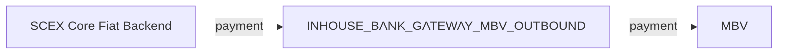
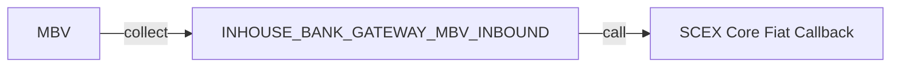
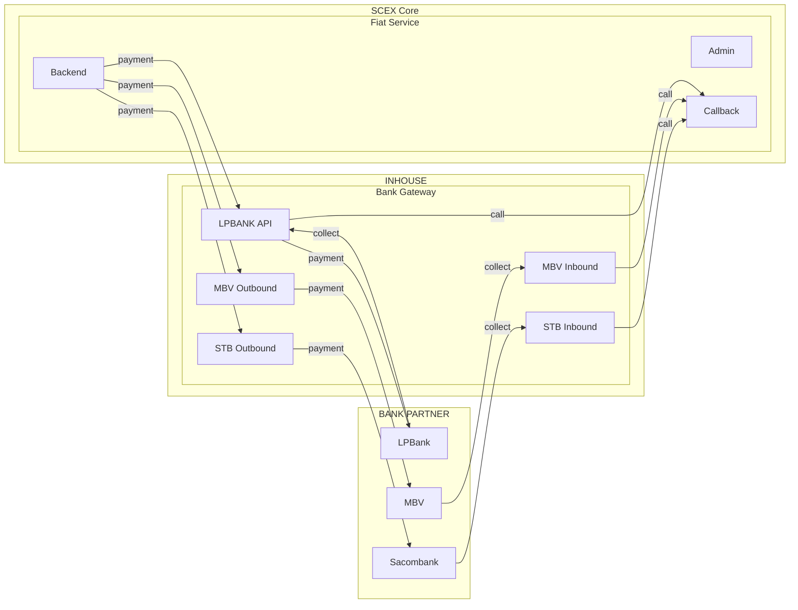

# HIGH LEVEL DESIGN — Kết nối thu chi hộ với MBV

# 1. Giới thiệu

| Mục            | Nội dung                                                             |
| -------------- | -------------------------------------------------------------------- |
| Mục đích       | Kết nối thu chi hộ từ MBV (Inhouse Bank Gateway) với SCEX Core.      |
| Phạm vi        | SCEX Core Fiat Service, Inhouse Bank Gateway, đối tác ngân hàng MBV. |
| Đối tượng dùng | Khách hàng, vận hành (Fiat Service).                                 |

# 2. Yêu cầu tổng quan

**Luồng thu/chi hộ đã hoạt động và liên kết với LPBank, STB, tài liệu kiến trúc này mô tả và bổ sung thêm 2 cấu phần `INHOUSE_BANK_GATEWAY_MBV_OUTBOUND` và `INHOUSE_BANK_GATEWAY_MBV_INBOUND` để liên với với MBV**

## 2.1 Yêu cầu chức năng chính

| Chức năng    | Mô tả                                                                                                            | Đối tượng                       |
| ------------ | ---------------------------------------------------------------------------------------------------------------- | ------------------------------- |
| Luồng chi hộ | Fiat Backend gửi `payment` tới `INHOUSE_BANK_GATEWAY_MBV_OUTBOUND`. Service này gửi `payment` tới ngân hàng MBV. | Fiat Backend, MBV Outbound, MBV |
| Luồng thu hộ | Ngân hàng MBV gửi `collect` tới `INHOUSE_BANK_GATEWAY_MBV_INBOUND`. Service này `call` Fiat Callback.            | MBV, MBV Inbound, Fiat Callback |

## 2.2 Yêu cầu phi chức năng

| Nhóm               | Yêu cầu                           |
| ------------------ | --------------------------------- |
| Năng lực           | Hỗ trợ 1000 người dùng đồng thời. |
| Thời gian phản hồi | P99 < 3s                          |
| Độ sẵn sàng        | 99.9%                             |

# 3. Kiến trúc tổng thể

## 3.1 Các luồng nghiệp vụ

### Luồng chi hộ

Fiat Backend gửi `payment` tới `INHOUSE_BANK_GATEWAY_MBV_OUTBOUND`. Outbound gửi `payment` tới ngân hàng MBV.

### Luồng thu hộ

Ngân hàng MBV gửi `collect` tới `INHOUSE_BANK_GATEWAY_MBV_INBOUND`. Inbound `call` Fiat Callback.

## 3.2 Các thành phần chính

| Biên         | Thành phần                                                              | Ghi chú                                                          |
| ------------ | ----------------------------------------------------------------------- | ---------------------------------------------------------------- |
| SCEX Core    | Fiat Service: Admin, Callback, Backend                                  | Backend khởi tạo chi hộ. Callback nhận cuộc gọi từ luồng thu hộ. |
| Inhouse      | Keycloak; Bank Gateway                                                  | Keycloak chưa có quan hệ trên sơ đồ.                             |
| Bank Gateway | `INHOUSE_BANK_GATEWAY_MBV_INBOUND`, `INHOUSE_BANK_GATEWAY_MBV_OUTBOUND` | MBV tách hai service cho `payment` và `collect`.                 |
| Bank Partner | MBV                                                                     | Nhận `payment` từ outbound, gửi `collect` tới inbound.           |

## 3.3 Kiến trúc tổng thể

Luồng MBV được thể hiện:

# 4. Mô tả chi tiết kiến trúc

## 4.1 Kiến trúc logic

| Thành phần                          | Trách nhiệm                                                         |
| ----------------------------------- | ------------------------------------------------------------------- |
| SCEX Core Fiat Backend              | Gửi `payment` tới `INHOUSE_BANK_GATEWAY_MBV_OUTBOUND`.              |
| `INHOUSE_BANK_GATEWAY_MBV_OUTBOUND` | Nhận `payment` từ Fiat Backend và gửi `payment` sang ngân hàng MBV. |
| MBV                                 | Nhận `payment` từ outbound. Gửi `collect` tới inbound.              |
| `INHOUSE_BANK_GATEWAY_MBV_INBOUND`  | Nhận `collect` từ ngân hàng MBV và `call` Fiat Callback.            |
| SCEX Core Fiat Callback             | Nhận cuộc gọi từ `INHOUSE_BANK_GATEWAY_MBV_INBOUND`.                |
| SCEX Core Fiat Admin                | Fiat admin                                                          |

## 4.2 Kiến trúc vật lý (Deployment)

| Hạng mục     | Lựa chọn               |
| ------------ | ---------------------- |
| SCEX Core    | K8s trên private cloud |
| Inhouse      | K8s trên public cloud  |
| Bank Partner | Ngân hàng đối tác MBV. |

# 5. Thiết kế bảo mật

| Hạng mục      | Thiết kế                          |
| ------------- | --------------------------------- |
| Xác thực      | Theo từng ngân hàng.              |
| Mã hóa        | Theo từng ngân hàng               |
| Authorization | Mô hình thành phần chưa quy định. |
| Audit log     | OTel, Grafna, ELK                 |

# 6. Hiệu năng và mở rộng

- TBD

# 7. Triển khai và vận hành

- CI/CD: GitLab → Docker Registry → Kubernetes
- Monitoring: Prometheus + Grafana
- Logging: ELK
- Backup DB: Hàng ngày (RDS snapshot)

# 8. Rủi ro và quyết định kiến trúc

## 8.1 Rủi ro

Response từ ngân hàng trả về có thể không chính xác (thất bài nhưng sau đó có thể thành công)

## 8.2 Quyết định

Không sử dụng luồng retry khi thất bại mà phải có chức năng trên màn hình quản lý thu/chi hộ để FA có thể xử lý manual
