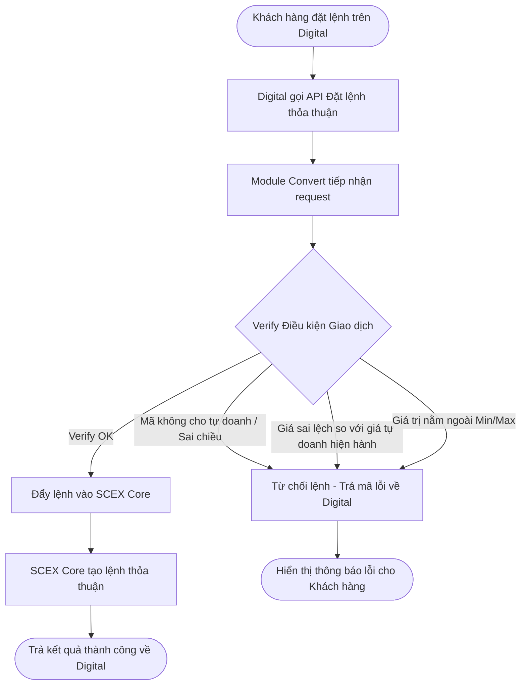
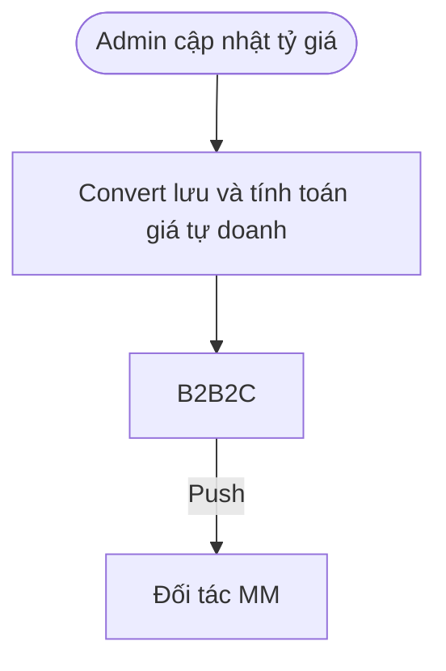
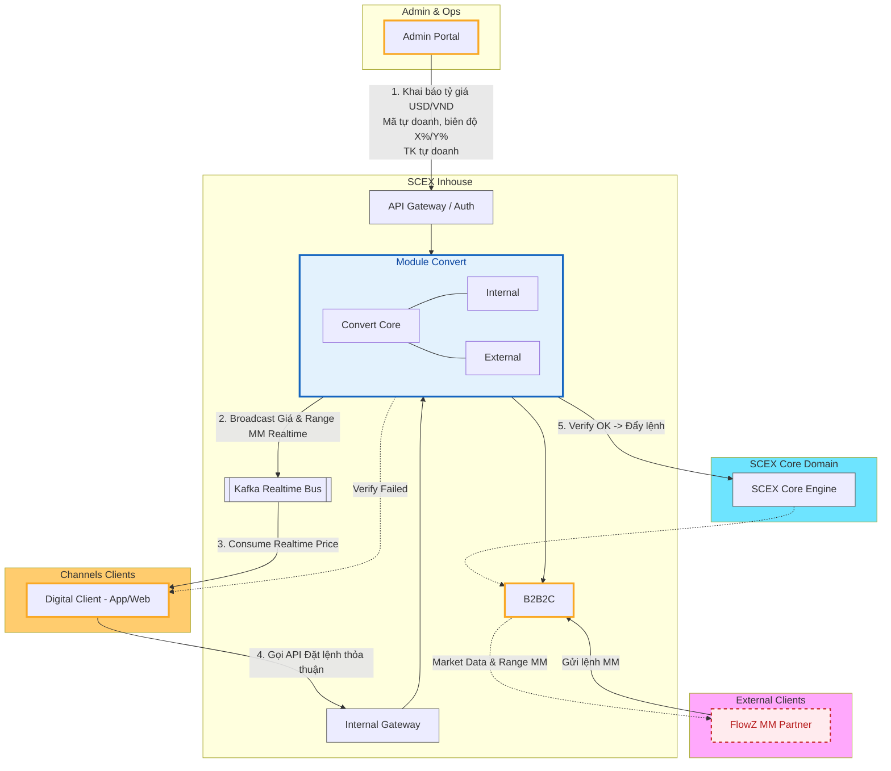
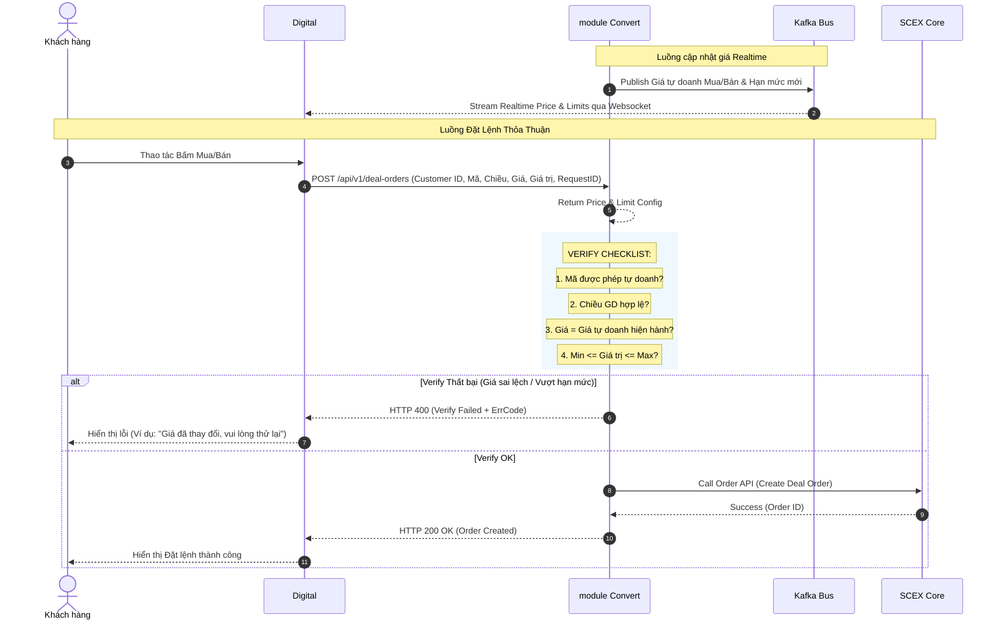
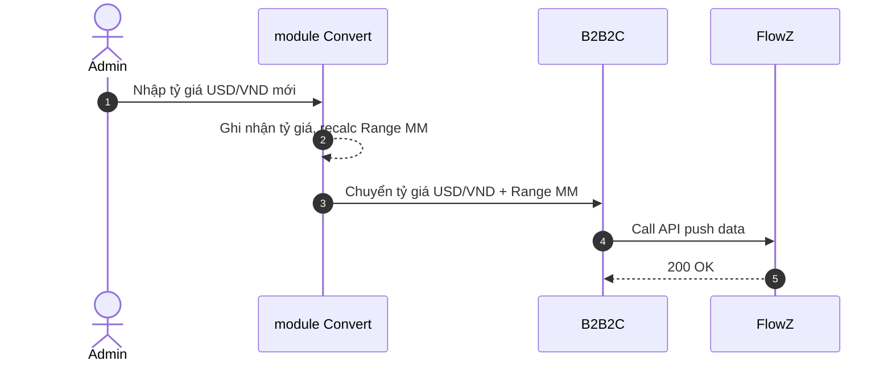
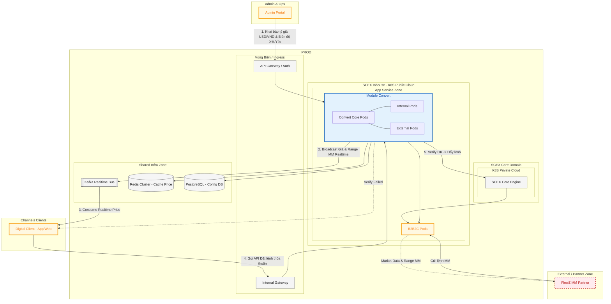

# HIGH LEVEL DESIGN — Hệ thống Tự doanh & Tích hợp Market Maker

> **Mã tài liệu:** HLD-INHOUSE-CONVERT-MM  
> **Phiên bản:** [0.1]  
> **Trạng thái:** Draft  
> **Mức độ bảo mật:** Internal

---

# 1. Quản trị tài liệu

## 1.1 Thông tin tài liệu

| Thuộc tính                         | Giá trị                                   |
| ---------------------------------- | ----------------------------------------- |
| Tên giải pháp/hệ thống             | Hệ thống Tự doanh & Tích hợp Market Maker |
| Mã tài liệu                        | [HLD-{DOMAIN}-{SYSTEM}]                   |
| Business Owner                     | Khối Tự doanh                             |
| System/Service Owner               | PTSP                                      |
| Solution Architect                 | SDO                                       |
| Tech Lead(s)                       | chien.nv                                  |
| Security/Privacy Reviewer          | ATTT                                      |
| Infrastructure/Operations Reviewer | [Điền]                                    |
| Repository/Link                    | [Điền]                                    |
| Tài liệu thay thế bởi/thay thế cho | [N/A]                                     |
| Ngày review tiếp theo              | [YYYY-MM-DD]                              |

## 1.2 Lịch sử thay đổi

| Phiên bản | Ngày       | Tác giả | Thay đổi chính | Trạng thái |
| --------- | ---------- | ------- | -------------- | ---------- |
| 0.1       | 2026-09-09 | duc.mm  | Khởi tạo       | Draft      |

## 1.3 Review và phê duyệt

| Vai trò               | Người/đơn vị | Phạm vi review                    | Kết quả                     | Ngày   | Bằng chứng/link |
| --------------------- | ------------ | --------------------------------- | --------------------------- | ------ | --------------- |
| Business Owner        | [Điền]       | Mục tiêu, phạm vi, ưu tiên        | [Pending/Approved/Rejected] | [Điền] | [Điền]          |
| Solution Architecture | [Điền]       | Kiến trúc, tiêu chuẩn, quyết định | [Điền]                      | [Điền] | [Điền]          |
| An toàn thông tin     | [Điền]       | Security, privacy, risk/control   | [Điền]                      | [Điền] | [Điền]          |
| Hạ tầng/Vận hành/SRE  | [Điền]       | Deployability, operability, DR    | [Điền]                      | [Điền] | [Điền]          |

## 1.4 Tài liệu tham chiếu

| ID     | Tài liệu/tiêu chuẩn       | Phiên bản/ngày | Vai trò trong HLD | Link                                                                                                                                                                    |
| ------ | ------------------------- | -------------- | ----------------- | ----------------------------------------------------------------------------------------------------------------------------------------------------------------------- |
| REF-01 | Business Requirements/PRD | [Điền]         | Nguồn yêu cầu     | [CF](https://confluence.scex.com.vn/spaces/ICM/pages/10558613/2.+BRD+%E2%80%93+T%C3%A0i+Li%E1%BB%87u+M%C3%B4+T%E1%BA%A3+Y%C3%AAu+C%E1%BA%A7u+Nghi%E1%BB%87p+V%E1%BB%A5) |
| REF-02 | [Điền]                    | [Điền]         | [Điền]            | [Điền]                                                                                                                                                                  |

## 1.5 Thuật ngữ và từ viết tắt

| Thuật ngữ         | Định nghĩa trong phạm vi tài liệu                                                                                |
| ----------------- | ---------------------------------------------------------------------------------------------------------------- |
| SCEX Core         | Hệ thống nhân xử lý giao dịch, quản lý tài khoản và lưu trữ sổ lệnh/khớp lệnh trung tâm.                         |
| Digital           | Kênh giao dịch phía người dùng (Mobile App / Web Trading Platform).                                              |
| MM (Market Maker) | Đối tác tạo thanh khoản trên thị trường (ví dụ: FlowZ, QuantX, Zigi).                                            |
| Lệnh thỏa thuận   | Giao dịch thỏa thuận trực tiếp giữa Khách hàng và Tài khoản Tự doanh của SCEX.                                   |
| Range giá MM      | Khoảng giá (Giá thấp – Giá cao) USDT/VND tính từ tỷ giá USD/VND và biên độ Y% để đối tác MM làm căn cứ đẩy lệnh. |

---

# 2. Tóm tắt điều hành

## 2.1 Vấn đề và giá trị giải pháp

Hiện tại, SCEX cần mở rộng năng lực giao dịch tự doanh và cung cấp thanh khoản tự động cho cặp giao dịch USDT/VND cũng như các mã Crypto khác. Giải pháp nhằm mục tiêu:

- Cho phép cấu hình tài khoản tự doanh
- Cho phép cấu hình linh hoạt tỷ giá cơ sở USD/VND, cấu hình mã tự doanh, biên độ giá tự doanh (X%) và biên độ giá MM (Y%).
- Cho phép Digital đặt lệnh thỏa thuận, kiểm soát chặt chẽ rủi ro giao dịch (verify trước khi đẩy vào Core)
- Cung cấp dữ liệu giá/hạn mức Realtime cho Digital (qua Kafka) và đẩy đủ dữ liệu tham chiếu cho đối tác Market Maker FlowZ.

## 2.2 Giải pháp đề xuất

- **Phân hệ Quản lý Cấu hình & Tính toán giá (module Convert):**
  - Quản lý tài khoản tự doanh
  - Cập nhật tỷ giá USD/VND liên ngân hàng, và lấy tỷ giá crypto từ SCEX
  - Quản lý mã tự doanh, biên độ giá tự doanh, biên độ giá MM
  - Tính toán giá Mua/Bán tự doanh theo công thức $Giá = Giá\_Tham\_Chiếu \times (1 \pm X\%)$ và Range giá MM $USD/VND \times (1 \pm Y\%)$.
  - Đóng vai trò Chokepoint bắt buộc. Mọi lệnh thỏa thuận từ Digital phải đi qua verify thành công trước khi được tạo trong Core.

- **Realtime Data Streaming:** Publish tức thời biến động giá, hạn mức giao dịch tối thiểu/tối đa tới Digital.
- **B2B2C Gateway:** Tái sử dụng B2B2C hiện có (QuantX, Zigi) để kết nối đối tác FlowZ. **Thêm luồng push data** cho đối tác.

## 2.3 Kết quả và chỉ số thành công

| ID     | Loại              | Kết quả mong đợi                                            | Chỉ số/đơn vị                   | Baseline | Target       | Thời điểm đo | Owner         |
| ------ | ----------------- | ----------------------------------------------------------- | ------------------------------- | -------- | ------------ | ------------ | ------------- |
| BR-01  | Kết quả nghiệp vụ | Tự động hóa 100% luồng tính giá & chặn lệnh vi phạm hạn mức | % vi phạm hạn mức chui vào Core | 0%       | **0%**       | Realtime     | Product / BE  |
| SLO-01 | SLO trải nghiệm   | Latency verify & phản hồi đặt lệnh thỏa thuận từ Digital    | p95 latency                     | N/A      | **< 200 ms** | Peaking      | BE Lead / SRE |
| SLO-02 | SLO vận hành      | Độ sẵn sàng luồng Broadcast giá Realtime                    | Availability                    | 99.0%    | **99.9%**    | Monthly      | SRE           |
| SLA-01 | SLA dependency    | Latency phản hồi lệnh / sync trạng thái từ đối tác FlowZ    | Response time                   | N/A      | **< 500 ms** | Realtime     | B2B Owner     |

## 2.4 Tóm tắt phạm vi

### Trong phạm vi

##### Convert

- Tài khoản tự doanh, mã tự doanh, biên độ giá tự doanh (X%), biên độ MM (Y%), hạn mức giao dịch Mua/Bán min/max.
- Cập nhật, quản lý giá USD/VND liên ngân hàng; lấy giá trị trường các mã Crypto tại SCEX
- Tính toán giá tham chiếu, giá tự doanh Mua/Bán, Range giá MM.
- Publish dữ liệu giá & hạn mức Realtime qua Kafka cho Digital.
- Tiếp nhận API đặt lệnh thỏa thuận từ Digital, verify điều kiện nghiệp vụ và đẩy lệnh thành công vào SCEX Core.
- Tính năng đặt lệnh cho tự doanh [Check lại]

##### MM

- Tích hợp chuẩn dữ liệu và luồng giao dịch với FlowZ theo luồng B2B2C hiện hữu (không phải lệnh thỏa thuận)-
- Push data (range giá) cho đối tác

### Ngoài phạm vi

- Thay đổi Matching Engine nội bộ của SCEX Core.
- Nạp FIAT, Crypto cho tài khoản tự doanh

### Giai đoạn sau

- Các yêu cầu bổ sung sau.

## 2.5 Tác động và quyết định cần phê duyệt

| Hạng mục                                   | Tóm tắt                                                                                                                                                                                                                                                                                            |
| ------------------------------------------ | -------------------------------------------------------------------------------------------------------------------------------------------------------------------------------------------------------------------------------------------------------------------------------------------------- |
| Người dùng bị ảnh hưởng                    | Khách hàng giao dịch thỏa thuận trên Digital, Vận hành Tự doanh, Đối tác FlowZ.                                                                                                                                                                                                                    |
| Hệ thống/dữ liệu bị ảnh hưởng              | SCEX Core: nhận lệnh thỏa thuận; publish giá crypto vào kafka cho Inhouse; đánh dấu user nào là _tự doanh_ Inhouse: thêm module **Convert**; Kafka (thêm topic Realtime Price); Portal Admin: thêm module admin **Convert**  B2B2C: thêm đối tác FlowZ, publish tỷ giá/range giá cho đối tác |
| Thay đổi quy trình vận hành                | Quản lý cấu hình mã tự doanh, hạn mức. Quản lý tỷ giá USD/VND, giá các crypto khi biến động                                                                                                                                                                                                        |
| Rủi ro cao nhất                            | Trượt giá (Slippage) khi giá tham chiếu biến động liên tục trong lúc khách hàng bấm đặt  lệnh.                                                                                                                                                                                                  |
| Chi phí/capacity chính                     | Tăng cường Kafka Cluster throughput để gánh realtime streaming giá.                                                                                                                                                                                                                                |
| Quyết định cần cấp có thẩm quyền phê duyệt | -                                                                                                                                                                                                                                                                                                  |

---

# 3. Bối cảnh

## 3.1 Phạm vi giải pháp

System-of-interest bao gồm module Inhouse **Convert** và **B2B2C**. Trust domain nằm trọn trong hạ tầng SCEX Core, Inhouse và Digital (App/Web client); đối tác FlowZ thuộc môi trường truy cập ngoài/vùng biên kết nối qua API Gateway/VPN Site-to-site.

## 3.2 Hiện trạng và thay đổi

| Nội dung             | Hiện trạng                                    | Sau thay đổi                                                                                          |
| -------------------- | --------------------------------------------- | ----------------------------------------------------------------------------------------------------- |
| Quản lý giá tự doanh | Chưa có                                       | Tự động tính toán giá Mua/Bán tự doanh và Range giá MM dựa trên Tỷ giá USD/VND nhập vào và % Biên độ. |
| Đặt lệnh thỏa thuận  | Luồng admin đặt lệnh/duyệt hiện có trong Core | Lệnh đi qua **Convert** tập trung, verify trước khi đẩy thằng vào core, không qua lớp check nào nữa.  |
| Tích hợp MM          | Đã hỗ trợ QuantX, Zigi Labs.                  | Chuẩn hóa tích hợp thêm đối tác FlowZ dùng chung luồng B2B2C hiện có, bổ sung kênh public giá cho MM  |

## 3.3 Các nguyên tắc kiến trúc

Mỗi nguyên tắc phải khóa một ranh giới, ownership hoặc hành vi fail-safe. Không viết slogan chung chung.

1. **Single Source of Truth for Price:** Tỷ giá USD/VND và công thức cấu hình tại `Convert` là nguồn tính toán giá hợp lệ duy nhất; Digital tuyệt đối không tự tính toán giá nghiệp vụ.
2. **Strict Pre-Trade Verification:** Verify thành công là điều kiện bắt buộc để đưa lệnh vào Core. Lệnh chưa Verify thành công tuyệt đối không được tạo/gửi vào Core.
3. **Fail-safe On Price Stale:** Khi dữ liệu giá Realtime bị gián đoạn/mất kết nối Kafka quá thời gian quy định ($T_{stale}$), luồng đặt lệnh thỏa thuận phải lập tức chuyển sang trạng thái tạm dừng (Reject Order) để tránh rủi ro biến động giá.

## 3.4 Giả định và ràng buộc

### Giả định

| ID     | Giả định                                             | Cơ sở                                               | Owner xác nhận | Hạn xác nhận | Tác động nếu sai                 | Trạng thái |
| ------ | ---------------------------------------------------- | --------------------------------------------------- | -------------- | ------------ | -------------------------------- | ---------- |
| ASM-01 | Tỷ giá USD/VND luôn có ít nhất 1 bản ghi có hiệu lực | BRD quy định tại mỗi thời điểm có 1 tỷ giá hiệu lực | Business Owner | 2026-09-09   | Không tính được giá USDT/VND     | Validated  |
| ASM-02 | SCEX Core có sẵn API nhận Lệnh thỏa thuận từ BE      | Luồng đặt lệnh thỏa thuận trên Portal hiện hữu      | Remi           | -            | Phải viết lại API nhận lệnh Core | Open       |

### Ràng buộc

| ID     | Ràng buộc                                  | Loại                | Nguồn/owner | Hệ quả kiến trúc                                             | Có thể thay đổi?   |
| ------ | ------------------------------------------ | ------------------- | ----------- | ------------------------------------------------------------ | ------------------ |
| CST-01 | FlowZ kết nối theo chuẩn luồng hiện có     | Technology / Legacy | Team B2B2C  | B2B2C phải tuân thủ chuẩn API/AuthN hiện tại của QuantX/Zigi | Có (Giai đoạn sau) |
| CST-02 | Khai báo tỷ giá USD/VND phải nhập thủ công | Business            | BRD 2.1     | Phải xây dựng màn hình AdminPortal nhập liệu và lưu lịch sử  | Có (Giai đoạn sau) |

---

# 4. Luồng nghiệp vụ

## 4.1 Luồng tổng thể Đặt lệnh thỏa thuận

## 4.2 Luồng cung cấp dữ liệu cho MM

## 4.3 Các luồng nghiệp vụ trong phạm vi

| Luồng                      | Điểm bắt đầu                                                   | Kết quả thành công                                                                     | Thất bại/fallback                                                 |
| -------------------------- | -------------------------------------------------------------- | -------------------------------------------------------------------------------------- | ----------------------------------------------------------------- |
| Khai báo Tỷ giá USD/VND    | Admin nhập tỷ giá mới                                          | Hệ thống cập nhật Tỷ giá hiện hành, lưu History, kích hoạt recalculate giá             | Trả lỗi Validation (ví dụ: tỷ giá $\le 0$). Giữ nguyên tỷ giá cũ. |
| Khai báo Cấu hình Tự doanh | Admin chọn Mã Crypto & nhập % Biên độ Mua/Bán, Hạn mức Min/Max | Lưu cấu hình, Broadcast sự kiện thay đổi qua Kafka                                     | Trả lỗi logic (ví dụ: Min > Max).                                 |
| Broadcast Giá Realtime     | Giá tham chiếu hoặc Cấu hình thay đổi                          | Publish Message mới lên Kafka                                                          | Retry publish / Log alert SRE nếu Kafka unreachable.              |
| Đặt lệnh Thỏa thuận        | Khách hàng submit lệnh trên Digital                            | Lệnh Verify OK $\rightarrow$ Đẩy Core thành công $\rightarrow$ Trả kết quả cho Digital | Reject lệnh tại module Convert, trả mã lỗi chi tiết.              |

---

# 5. Application architecture

## 5.1 Kiến trúc logic

## 5.2 Thành phần, chức năng và công nghệ

| Thành phần                     | Chức năng chính                                                                                                                                                                                                                                                                                  | Công nghệ/triển khai                          |
| ------------------------------ | ------------------------------------------------------------------------------------------------------------------------------------------------------------------------------------------------------------------------------------------------------------------------------------------------ | --------------------------------------------- |
| **Convert (new)**              | Quản lý khai báo tỷ giá USD/VND, biên độ $X\%$, $Y\%$, hạn mức min/max. Tính toán giá Mua/Bán tự doanh và Range MM Realtime. Thực hiện kiểm tra 5 điều kiện bắt buộc (Trạng thái mã, Chiều GD, Giá hiện hành, Hạn mức giá trị Min/Max, Điều kiện nghiệp vụ khác) trước khi đưa lệnh vào Core. | Java (Spring Framework), Redis Caching. Kafka |
| **B2B2C (modified)**           | Wrapper chuẩn hóa kết nối REST/WS với đối tác FlowZ; đẩy Range giá MM và nhận lệnh từ FlowZ.                                                                                                                                                                                                     | Java (Spring Framework)                       |
| **Admin Portal (modified)**    | Trang admin quản lý                                                                                                                                                                                                                                                                              | [Điền]                                        |
| **Kafka Realtime Bus (reuse)** | Pub/Sub Message Queue phục vụ phát dữ liệu giá realtime.                                                                                                                                                                                                                                         | Apache Kafka Cluster.                         |
| **SCEX Core**                  | Nhân xử lý tài khoản, khớp lệnh thỏa thuận và hạch toán số dư.                                                                                                                                                                                                                                   | -                                             |

## 5.3 Ranh giới và tích hợp

| Giao diện                              | Mục đích                                                              | Quy tắc mức cao                                                 |
| -------------------------------------- | --------------------------------------------------------------------- | --------------------------------------------------------------- |
| **Digital $\rightarrow$ Convert**      | Lấy danh sách mã, nhận giá Realtime, Đặt lệnh thỏa thuận.             | REST API Internal/AuthN. Subscribes Kafka Topic.                |
| **Convert BE $\rightarrow$ SCEX Core** | Đẩy lệnh thỏa thuận sau khi Verify OK.                                | REST API Internal/AuthN. Kafka.                                 |
| **B2B2C $\leftrightarrow$ FlowZ**      | Cung cấp dữ liệu thị trường, Tỷ giá USD/VND, Range MM & Nhận lệnh MM. | REST API, Websocket, VPN Site-to-Site theo luồng B2B2C hiện có. |

## 5.4 Quy tắc xử lý lỗi và consistency

- **Verify Error Handling:** Nếu bất kỳ điều kiện nào không thỏa mãn (ví dụ: Giá khách hàng gửi lệch quá biên độ cho phép so với Giá tự doanh Realtime tại thời điểm Verify), BE từ chối ngay lập tức, trả HTTP 400 Bad Request kèm mã lỗi nghiệp vụ rõ ràng (ví dụ: `ERR_PRICE_EXPIRED`, `ERR_LIMIT_EXCEEDED`).
- **Idempotency:** Request đặt lệnh từ Digital bắt buộc kèm `request_id` duy nhất. BE Verifier sử dụng Redis Distributed Lock kiểm tra Deduplication trong cửa sổ 60s.
- **Fail-safe Policy:** Khi hệ thống không lấy được Tỷ giá USD/VND hiện hành, toàn bộ tính năng đặt lệnh tự doanh USDT/VND lập tức chuyển sang trạng thái "Tạm dừng" (Inactive).

---

# 6. Sequence diagram (runtime view)

## 6.1 Luồng Đặt lệnh thỏa thuận từ Digital (Happy Path & Verify Failed)

## 6.2 Luồng Push tỷ giá USD/VND tới FlowZ

---

# 7. Deployment và sizing

## 7.1 Mô hình triển khai logic

| Loại     | Ký hiệu node                    |
| -------- | ------------------------------- |
| New      | Viền xanh — `:::new`            |
| Modified | Viền vàng — `:::modified`       |
| Reused   | Viền xám — `:::reused`          |
| External | Viền đỏ nét đứt — `:::external` |

## 7.2 Phân bổ triển khai

| Node/platform | Environment | Location/zone | Workload                 | HA/scaling                                    | Network/trust zone | Managed by | Version/lifecycle |
| ------------- | ----------- | ------------- | ------------------------ | --------------------------------------------- | ------------------ | ---------- | ----------------- |
| K8s           | PROD        | Public Cloud  | Core, Internal, External | 2-4 Replicas, Auto-scale theo CPU > 75% / RPS | [Điền]             | [Điền]     | [Điền]            |
| Kafka Cluster | PROD        | [Điền]        | [Điền]                   | [Điền]                                        | [Điền]             | [Điền]     | [Điền]            |
| Redis         | PROD        | [Điền]        | [Điền]                   | [Điền]                                        | [Điền]             | [Điền]     | [Điền]            |
| PostgreSQL    | PROD        | [Điền]        | [Điền]                   | [Điền]                                        | [Điền]             | [Điền]     | [Điền]            |
| K8s           | UAT         | Public Cloud  | Core, Internal, External | Non-HA                                        | [Điền]             | [Điền]     | [Điền]            |

## 7.3 Môi trường và phát hành

| Chủ đề              | DEV                    | TEST/UAT               | PROD                         | DR     |
| ------------------- | ---------------------- | ---------------------- | ---------------------------- | ------ |
| Topology parity     | local/docker           | K8s UAT                | K8s Production, Public Cloud | [Điền] |
| Data policy         | Dữ liệu test hoàn toàn | Dữ liệu test hoàn toàn | Dữ liệu thật                 | [Điền] |
| External dependency | Dùng mock              | Tích hợp tren UAT      | Live API                     | [Điền] |
| Release strategy    | Override               | Override               | Clean Install                | [Điền] |
| Rollback / go-no-go | -                      | -                      | Revert/Rollback              | [Điền] |

### Zero-downtime migration strategy

- Triển khai Rolling Update kết hợp Backward Compatibility cho API Contract
- Graceful Shutdown

### Trigger rollback

- Http 5xx tăng đột biến
- Latency tăng đột biến
- Phát hiện lỗi sai logic

## 7.4 Dữ liệu đầu vào cần có

| Đầu vào                     | Nguồn        | Bắt buộc khi       | Owner  | Gate   |
| --------------------------- | ------------ | ------------------ | ------ | ------ |
| Forecast TPS/RPS/concurrent | Product/SRE  | Mọi dịch vụ online | [Điền] | [Điền] |
| Payload size / data volume  | Product/Data | Có lưu hoặc truyền | [Điền] | [Điền] |
| SLO latency p95/p99         | Product/SRE  | Có NFR hiệu năng   | [Điền] | [Điền] |
| RTO/RPO và failure domain   | SRE/Owner    | Dịch vụ production | [Điền] | [Điền] |

## 7.5 Công thức sizing tối thiểu

[Điền]

## 7.6 Kết quả sizing cần phê duyệt

| Hạng mục            | Giá trị đề xuất | Cần phê duyệt bởi | Trạng thái |
| ------------------- | --------------- | ----------------- | ---------- |
| Compute / replica   | [Điền]          | [TBD]             | [TBD]      |
| Storage / retention | [Điền]          | [TBD]             | [TBD]      |
| Quota / rate limit  | [Điền]          | [TBD]             | [TBD]      |

## 7.7 Observability

| Signal  | Source/instrumentation    | Key SLI/use                                                                                   | Alert/dashboard owner |
| ------- | ------------------------- | --------------------------------------------------------------------------------------------- | --------------------- |
| Metrics | Prometheus/OTEL           | Throughput, Error Rate, Latency, Availability & Health, Resource Utilization, Connection Pool | [Điền]                |
| Logs    | Structured JSON Logs, ELK |                                                                                               | [Điền]                |
| Traces  | OTEL                      | Distributed Tracing luồng Đặt lệnh                                                            | [Điền]                |
| Events  | Kafka, K8s Event          | Deployment Events, failover redis/db                                                          | [Điền]                |

## 7.8 Dependencies

| Dependency       | Owner/SLA          | Failure symptom                 | Detection                              | Fallback/degradation | Escalation | Exit strategy |
| ---------------- | ------------------ | ------------------------------- | -------------------------------------- | -------------------- | ---------- | ------------- |
| SCEX Core Engine | (Core) SLA 99.9%   | Timeout / Connection Refused    | Health check                           | Block Lệnh           | [Điền]     | [Điền]        |
| Kafka Cluster    | (Shared) SLA 99.9% | Không nhận/gửi được event kafka | Consumer Lag Metrics / Drop connection | [Điền]               | SRE Team   | [Điền]        |
| Redis            | (Shared) SLA 99.9% | Latency cao, connection error   | Connection Error                       | [Điền]               | SRE Team   | [Điền]        |
| Database         | (Shared) SLA 99.9% | Mất/treo kết nối                | Connection Error                       | [Điền]               | DBA        | [Điền]        |

---

# 8. Bảo mật, tuân thủ và NFR

[Điền]

## 8.1 Kênh kết nối và ranh giới tin cậy

Trust boundary dựa trên **ownership, control plane, identity, policy enforcement và mức tin cậy**, không chỉ network segment.

| Hop                 | Cơ chế bảo mật            | Hệ quả HLD                                |
| ------------------- | ------------------------- | ----------------------------------------- |
| [Digital ↔ Inhouse] | API Key, Kafka SASL       | Digital gọi API đặt lệnh, subcriber kafka |
| [B2B2C ↔ FlowZ]     | API Key, VPN, [Websocket] | FlowZ đặt lệnh                            |

## 8.2 Yêu cầu đo được

| ID          | Nhóm        | Yêu cầu/target                                                         | Cách kiểm chứng           |
| ----------- | ----------- | ---------------------------------------------------------------------- | ------------------------- |
| NFR-SEC-01  | Security    | Chống tấn công Replay Attack trên API Đặt lệnh (Nonce/Timestamp check) | Security Penetration Test |
| NFR-PERF-01 | Performance | Latency Verify lệnh tại Convert $\le 100ms$ (p99)                      | Load Test via JMeter / K6 |
| NFR-AUD-01  | Audit       | 100% lệnh bị Reject tại bước Verify đều phải ghi Log Lý do             | Audit Log Verification    |

---

# 9. Quyết định kiến trúc và vấn đề còn mở

## 9.1 Quyết định kiến trúc đã chốt

Không chép toàn bộ ADR vào HLD. Một quyết định khó đảo ngược nên có ADR riêng; HLD chỉ tóm tắt.

| Quyết định | Trạng thái                                                                                                |
| ---------- | --------------------------------------------------------------------------------------------------------- |
| ADR-01     | Sử dụng Kafka làm Backbone để Publish/Subscribe thông tin giá Realtime cho Digital.                       |
| ADR-02     | Ép buộc "pre-trade verification" tập trung tại module Convert. Chỉ đẩy lệnh sang SCEX Core khi đã verify. |
| ADR-03     | Tái sử dụng module B2B2C.                                                                                 |

## 9.2 Các vấn đề phải chốt

Không để issue blocker mở khi chuyển trạng thái tài liệu sang Approved.

| OI    | Cần chốt | Owner  | Gate   |
| ----- | -------- | ------ | ------ |
| OI-01 | [Điền]   | [Điền] | [Điền] |

---
