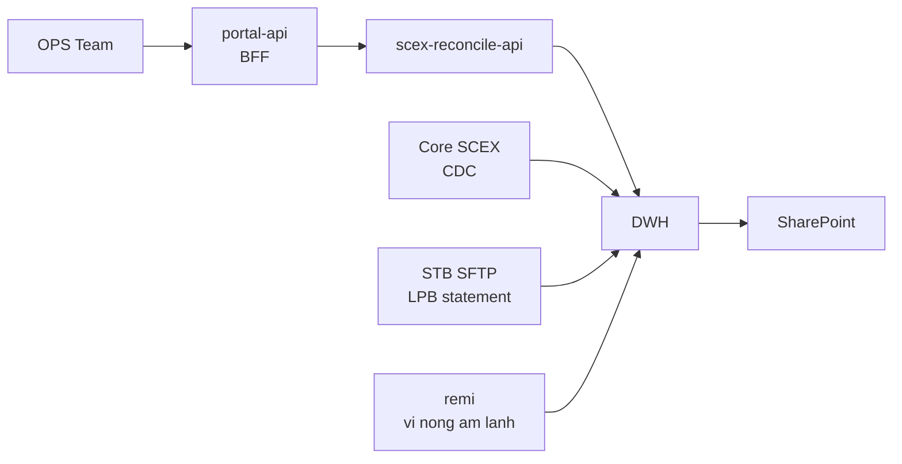
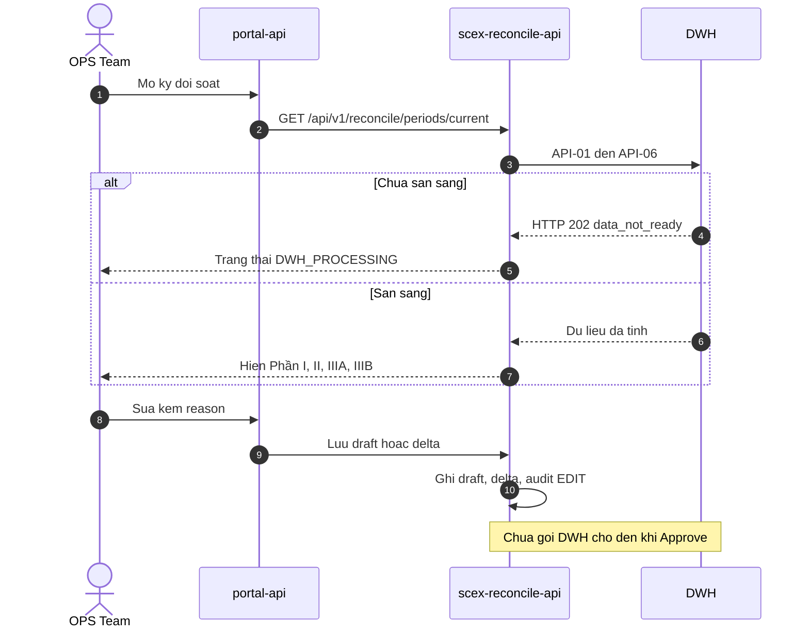
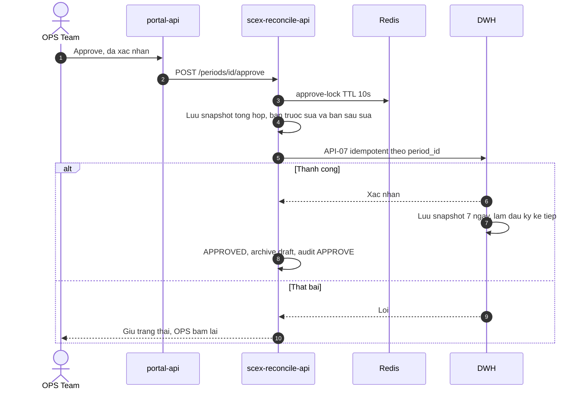
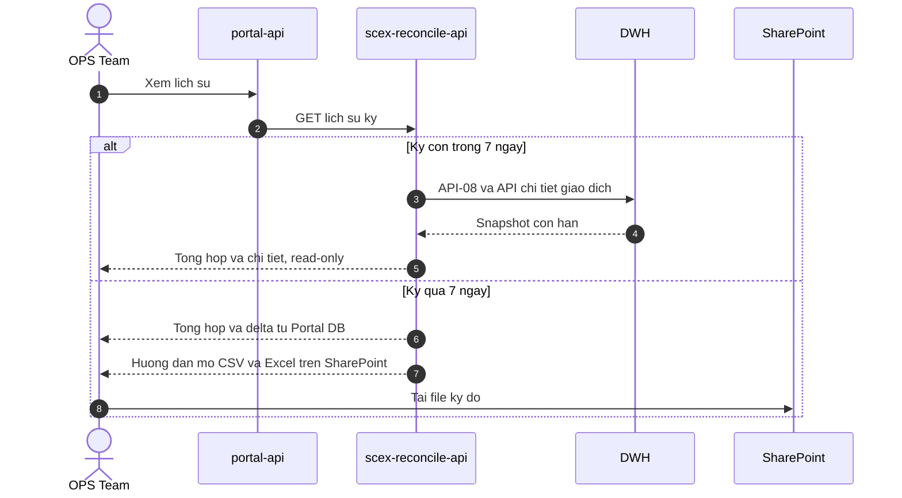

# HIGH LEVEL DESIGN — Hệ thống Đối soát Dữ liệu Tài chính (Reconcile Portal)

# 1. Giới thiệu

| Mục                  | Nội dung                                                                                                                                                                                                                                                                                                                                                    |
| -------------------- | ----------------------------------------------------------------------------------------------------------------------------------------------------------------------------------------------------------------------------------------------------------------------------------------------------------------------------------------------------------- |
| Mục đích             | Xây dựng module đối soát dữ liệu tài chính trên Inhouse Portal để OPS kiểm tra, chỉnh sửa khi lệch và phê duyệt kết quả đối soát do DWH tính sẵn, thay cho đối soát thủ công trên Excel. Phạm vi cốt lõi là bảo toàn tài sản khách hàng: tiền VND (tài khoản ngân hàng Sacombank, LPBank) và tài sản mã hóa (ví nóng, ví ấm, ví lạnh trên hệ thống `remi`). |
| Phạm vi              | `Inhouse Portal` (`portal-api`, BFF), `scex-reconcile-api`, `reconcile-migration`, schema `scex_reconcile` trên EDB PostgreSQL, Redis, Keycloak, 8 API của DWH và SharePoint. DWH tính toán, giữ snapshot 7 ngày và xuất file. Portal không tính sổ, không gọi thẳng ngân hàng và không gọi thẳng `remi`.                                                   |
| Đối tượng người dùng | OPS (`RECONCILE_OPS_VIEWER`, `RECONCILE_OPS_OPERATOR`, `RECONCILE_OPS_MANAGER`), Admin IT (xem audit log, quản trị role). Khách hàng không truy cập module này.                                                                                                                                                                                             |

# 2. Yêu cầu tổng quan

## 2.1 Yêu cầu chức năng chính

Ba kỳ/ngày: Sáng (`SANG`) `08:00`, Chiều (`CHIEU`) `16:00`, Tối (`TOI`) `23:00`. Cuối kỳ đã chốt là đầu kỳ sau. DWH chạy cron, không chờ OPS duyệt.

- **Phần I — Tổng VND:** Đối chiếu tổng tiền VND của khách hàng giữa số dư tính từ phát sinh, số dư trên hệ thống và số dư sao kê ngân hàng. Khớp khi bằng tuyệt đối. Lệch không chặn duyệt.
- **Phần II — Tổng TSMH theo từng đồng:** Đối chiếu offchain giữa sổ và số trên hệ thống. Đối chiếu onchain bằng tổng ví nóng, ấm, lạnh trên `remi` với số trên hệ thống. Khớp khi bằng tuyệt đối.
- **Phần IIIA / IIIB:** Bảng kê theo khách hàng. IIIB tách thêm theo tài sản. Phân trang phía server, lọc Khớp / Không khớp, drill-down giao dịch trong kỳ.
- **Xem kỳ (`FR-01`):** Kỳ đang mở và các kỳ trong ngày. DWH `HTTP 202` thì `DWH_PROCESSING`; lỗi gọi thì `DWH_ERROR`. Kỳ đã duyệt xem ở lịch sử.
- **Sửa nháp (`FR-03`):** Sửa Phần I/II hoặc thêm, sửa, xóa giao dịch Phần III. Bắt buộc `reason`. Nháp ở Portal, chưa gửi DWH. Discard về số gốc. Hai OPS sửa cùng kỳ thì người ghi sau bị từ chối theo `version`.
- **Duyệt (`FR-04`):** Một lần gọi `API-07` (`Approve = Confirm + Edit`), idempotent theo `period_id`. Thành công thì kỳ bất biến và thành đầu kỳ sau. Lỗi thì OPS bấm lại, không tự retry.
- **Lịch sử (`FR-05`):** Trong 7 ngày xem chi tiết qua DWH. Quá 7 ngày Portal còn snapshot tổng hợp và delta; file giao dịch đầy đủ nằm trên SharePoint.
- **Audit (`FR-06`) và xuất Excel (`FR-07`):** Audit chỉ thêm, kể cả Admin IT không sửa xóa được. Export `.xlsx` từ dữ liệu đang xem; quá 7 ngày export tổng hợp và delta, không kèm full giao dịch.

## 2.2 Yêu cầu phi chức năng

- **Phản hồi DWH:** Phần I/II và danh sách tổng hợp dưới 3 giây; chi tiết giao dịch dưới 2 giây; approve dưới 5 giây. Portal thêm không quá 1 giây.
- **Sẵn sàng DWH:** `99,5%` trong `07:00–22:00` UTC+7. Bảo trì báo trước ít nhất 24 giờ.
- **Toàn vẹn:** Approve idempotent theo `period_id`. Kỳ `APPROVED` không ghi đè. So khớp bằng tuyệt đối.
- **Đồng thời:** Redis `approve-lock` 10 giây cho cùng `period_id`. Optimistic lock `@Version` khi hai OPS cùng sửa.
- **Lưu trữ:** Theo BRD Portal. Portal giữ snapshot tổng hợp Phần I, II, IIIA, IIIB (bản gốc và bản đã sửa, không gồm từng giao dịch), bản nháp, delta và audit, để xem lại không giới hạn 7 ngày. DWH giữ snapshot 7 ngày. File chi tiết đầy đủ (CSV gốc, và Excel đã sửa nếu kỳ có edit) nằm trên SharePoint.
- **Bảo mật và audit:** HTTPS. OPS dùng JWT Keycloak. Mọi sửa số có `reason`. Audit append-only.

# 3. Kiến trúc tổng thể

## 3.1 Mô hình ngữ cảnh (Context Diagram)

OPS mở Portal. `portal-api` chuyển tiếp `Authorization` và `x-request-id`, không có database. `scex-reconcile-api` là bên duy nhất gọi DWH. DWH lấy số dư và giao dịch từ Core SCEX qua CDC, sao kê Sacombank qua SFTP, sao kê LPBank qua API `/payment/statement`, số dư ví nóng/ấm/lạnh từ `remi`. DWH xuất file chi tiết đầy đủ lên SharePoint. Portal không nối `bankgw` và không đọc Core trực tiếp.



### Luồng xem kỳ và chỉnh sửa nháp

OPS chọn kỳ. Service gọi `API-01` đến `API-06`. DWH chưa tính xong thì trả `HTTP 202`, Portal để `DWH_PROCESSING`. Dữ liệu sẵn sàng thì hiện kết quả. Sửa Phần I/II hoặc thêm, sửa, xóa giao dịch Phần III chỉ ghi draft và delta trên schema `scex_reconcile`, kèm audit, chưa gọi DWH.



### Luồng phê duyệt

Khớp thì approve dữ liệu gốc. Không khớp thì approve kèm bản đã sửa. Cả hai đều là một lần `API-07`. Portal lưu snapshot tổng hợp (bản trước sửa và bản sau sửa) trước khi gọi DWH. Redis khóa `period_id`. Thành công thì kỳ `APPROVED`. File giao dịch đầy đủ nằm trên SharePoint; Portal không quản lý file đó.



### Luồng lịch sử

Trong 7 ngày, chi tiết giao dịch khách hàng còn trên DWH (`API-08` và API chi tiết), Portal hiển thị đầy đủ và chỉ đọc. Quá 7 ngày, DWH đã xóa snapshot; Portal đọc snapshot tổng hợp và delta của chính nó, rồi trỏ OPS sang file CSV gốc và Excel đã sửa trên SharePoint.



## 3.2 Các thành phần chính

| Lớp              | Thành phần                                      | Công nghệ                    | Ghi chú                                                                                                                           |
| ---------------- | ----------------------------------------------- | ---------------------------- | --------------------------------------------------------------------------------------------------------------------------------- |
| Frontend Portal  | `INHOUSE_PORTAL_REC`                            | React.js trên Inhouse Portal | Màn đối soát kỳ, lịch sử, audit, export.                                                                                          |
| BFF              | `portal-api`                                    | BFF hiện hữu                 | Không database. Proxy 1:1 dưới `/api/v1/reconcile/*`, chuyển `Authorization` và `x-request-id`.                                   |
| Backend          | `scex-reconcile-api` (`INHOUSE_REC_API`)        | Spring Boot 3.5.14, Java 21  | Nghiệp vụ đối soát, draft, delta, approve, audit, job, Feign sang DWH.                                                            |
| Migration        | `reconcile-migration` (`INHOUSE_REC_MIGRATION`) | Liquibase, chạy lúc startup  | Changelog `001`–`007`+ trên schema `scex_reconcile`. Đồng bộ client role và realm role Keycloak qua Admin API. Không có REST API. |
| Database         | `INHOUSE_INFRA_POSTGRESQL`                      | EDB Advanced Server          | Schema `scex_reconcile`. HikariCP mỗi pod tối đa 5 connection, tối thiểu 1 idle.                                                  |
| Cache và khóa    | `INHOUSE_INFRA_REDIS`                           | Redis                        | Cache token và distributed lock `approve-lock`.                                                                                   |
| Định danh        | `INHOUSE_KC`                                    | Keycloak                     | OAuth2 resource server, `KEYCLOAK_ISSUER_URI`.                                                                                    |
| Tính toán        | DWH                                             | AWS, ngoài cụm Inhouse       | Cron `08:00` / `16:00` / `23:00`, 8 API, snapshot 7 ngày, xuất SharePoint.                                                        |
| Lưu file dài hạn | SharePoint                                      | Microsoft SharePoint         | CSV gốc và Excel đã sửa. Portal không quản lý file.                                                                               |
| Nguồn số liệu    | Core SCEX, ngân hàng, `remi`                    | CDC, SFTP, API statement, ví | Chỉ DWH đọc. Portal không nối trực tiếp.                                                                                          |

## 3.3 Kiến trúc tổng thể

```mermaid
flowchart LR
    subgraph INHOUSE[INHOUSE]
        OPS@{shape: person, label: "OPS"}
        KC[Keycloak]

        subgraph INHOUSE_PORTAL["PORTAL (BFF)"]
            INHOUSE_PORTAL_REC[Portal Reconcile]
        end

        subgraph INHOUSE_REC[Reconcile]
            INHOUSE_REC_API[Reconcile API]
            INHOUSE_REC_MIGRATION[Reconcile Migration]
        end

        subgraph INHOUSE_INFRA[Infra Service]
            PG@{shape: db, label: "PostgreSQL<br/>schema scex_reconcile"}
            REDIS@{shape: h-cyl, label: "REDIS"}
        end

        OPS -->|Truy cap| INHOUSE_PORTAL_REC
        INHOUSE_PORTAL_REC -->|OIDC| KC
        INHOUSE_PORTAL_REC -->|API| INHOUSE_REC_API
        INHOUSE_REC_API -->|Validate JWT| KC
        INHOUSE_REC_API --> PG
        INHOUSE_REC_API --> REDIS
        INHOUSE_REC_MIGRATION --> PG
        INHOUSE_REC_MIGRATION -->|Sync role| KC
    end

    subgraph DATA[DATA]
        DWH[DWH]
        CORE[Core SCEX CDC]
        BANK[STB SFTP va LPB]
        REMI[remi]
        SP[SharePoint]
    end

    INHOUSE_REC_API -->|8 API| DWH
    CORE --> DWH
    BANK --> DWH
    REMI --> DWH
    DWH -->|CSV va Excel| SP
```

Phân chia lưu trữ:

| Dữ liệu                                                                                            | DWH               | Inhouse Portal                                   | SharePoint            |
| -------------------------------------------------------------------------------------------------- | ----------------- | ------------------------------------------------ | --------------------- |
| Tính toán đối soát                                                                                 | Có                | Không                                            | Không                 |
| Snapshot tổng hợp Phần I, II, IIIA, IIIB, bản gốc và bản đã sửa, không gồm từng giao dịch của user | Không giữ dài hạn | Có                                               | Có, trong file export |
| Snapshot chi tiết giao dịch từng user, bản gốc và bản đã sửa                                       | Có, 7 ngày        | Không, chỉ lưu delta                             | Có                    |
| Draft chưa approve                                                                                 | Không             | Có                                               | Không                 |
| Audit trail chi tiết                                                                               | Không             | Có                                               | Không                 |
| Xuất file gốc hoặc file đã sửa                                                                     | Xuất              | Portal có export Excel riêng từ dữ liệu đang xem | Lưu file do DWH xuất  |
| Chi tiết giao dịch user sau 7 ngày                                                                 | Không             | Không                                            | Có                    |

Chú giải luồng:

| Luồng                                         | Mô tả                                                          |
| --------------------------------------------- | -------------------------------------------------------------- |
| OPS → Portal Reconcile → Reconcile API        | Xem, sửa nháp, discard, approve, lịch sử, audit, export.       |
| Reconcile API → Keycloak, Redis, PostgreSQL   | Kiểm JWT, khóa approve, ghi kỳ, draft, delta, audit.           |
| Reconcile Migration → PostgreSQL, Keycloak    | DDL Liquibase và cấp role lúc startup.                         |
| Core, ngân hàng, `remi` → DWH → Reconcile API | Nguồn số liệu chỉ đi vào DWH. Portal lấy số đã tính qua 8 API. |
| DWH → SharePoint                              | File chi tiết đầy đủ: CSV gốc, và Excel đã sửa nếu kỳ có edit. |

# 4. Mô tả chi tiết kiến trúc

## 4.1 Kiến trúc logic

### Trách nhiệm các thành phần

| Thành phần            | Trách nhiệm                                                                                                                                                                                         |
| --------------------- | --------------------------------------------------------------------------------------------------------------------------------------------------------------------------------------------------- |
| `portal-api`          | Cổng vào duy nhất của OPS. Không nghiệp vụ, không database. Proxy 1:1 và giữ header xác thực, `x-request-id`.                                                                                       |
| `scex-reconcile-api`  | Tải kỳ, trộn dữ liệu DWH với draft, lưu snapshot tổng hợp và delta Phần III, discard, approve có khóa Redis, gọi Feign DWH, ghi audit, chạy job vòng đời kỳ và job tóm tắt kỳ đã duyệt, xuất Excel. |
| `reconcile-migration` | Tạo và nâng schema `scex_reconcile`. Provision role Keycloak. Không phục vụ traffic OPS.                                                                                                            |
| DWH                   | Xác định biên kỳ, tính Phần I, II, IIIA, IIIB, trả 8 API, giữ snapshot 7 ngày, nhận approve, dùng số đã duyệt làm đầu kỳ kỳ sau, xuất file lên SharePoint.                                          |
| SharePoint            | Kho file chi tiết đầy đủ. Sau 7 ngày Portal dẫn OPS tới file này.                                                                                                                                   |

Bên trong `scex-reconcile-api`, các khối logic tách theo việc OPS làm: đọc kỳ và gọi DWH, ghi draft cùng delta, điều phối approve, xuất file, ghi audit tập trung, và hai job nền. Pool `dwh-sync` (core và max 10, queue 500) đồng bộ dữ liệu từ DWH. Pool `export` (page-fetch 5, part-fetch 4, queue 200) xuất file.

### Danh mục API Portal

`portal-api` publish dưới `/api/v1/reconcile/*`.

| API                                          | Mục đích                                                         |
| -------------------------------------------- | ---------------------------------------------------------------- |
| `GET /periods/current`                       | Kỳ đang mở.                                                      |
| `GET /periods/today`                         | Các kỳ trong ngày.                                               |
| `GET /periods/{id}/cash-summary`             | Phần I. Bản gốc DWH và bản draft.                                |
| `GET /periods/{id}/crypto-summary`           | Phần II theo từng `assetCode`.                                   |
| `GET /periods/asset-codes`                   | Danh mục mã tài sản cho dropdown Phần II.                        |
| `GET /periods/{id}/cash-summary/customers`   | IIIA tổng hợp, phân trang, lọc, sắp xếp.                         |
| `GET /periods/{id}/crypto-summary/customers` | IIIB tổng hợp theo khách hàng và tài sản.                        |
| API chi tiết giao dịch IIIA và IIIB          | Drill-down giao dịch của một khách hàng.                         |
| `POST /periods/{id}/discard`                 | Hủy nháp, về dữ liệu DWH.                                        |
| `POST /periods/{id}/approve`                 | Confirm, kèm edit nếu có.                                        |
| `GET /periods/{id}/export`                   | Xuất `.xlsx` kỳ đang xem.                                        |
| API lịch sử và audit                         | Danh sách kỳ đã xử lý, chi tiết kỳ, danh sách audit, xuất audit. |

### API DWH

| API      | Chức năng                                         | SLA         |
| -------- | ------------------------------------------------- | ----------- |
| `API-01` | Get Phần I                                        | Dưới 3 giây |
| `API-02` | Get Phần II                                       | Dưới 3 giây |
| `API-03` | Get IIIA tổng hợp, phân trang                     | Dưới 3 giây |
| `API-04` | Get IIIA chi tiết giao dịch, phân trang           | Dưới 2 giây |
| `API-05` | Get IIIB tổng hợp, phân trang                     | Dưới 3 giây |
| `API-06` | Get IIIB chi tiết giao dịch, phân trang           | Dưới 2 giây |
| `API-07` | Approve, gồm cả edit, idempotent theo `period_id` | Dưới 5 giây |
| `API-08` | Lịch sử các kỳ                                    | Dưới 3 giây |

Feign client `dwh-reconcile-client`: connect timeout 5 giây, read timeout 30 giây.

### Mô hình dữ liệu trên schema `scex_reconcile`

Ba thực thể tối thiểu trên schema `scex_reconcile`. Theo BRD Portal, Portal lưu snapshot tổng hợp Phần I, II và bảng kê tổng hợp IIIA, IIIB (bản gốc và bản đã sửa), không lưu full transaction.

| Thực thể                           | Nội dung                                                                                                                                                                                                                               |
| ---------------------------------- | -------------------------------------------------------------------------------------------------------------------------------------------------------------------------------------------------------------------------------------- |
| `reconciliation_period`            | `period_type` (`SANG`, `CHIEU`, `TOI`), `period_date`, `start_time`, `end_time`, `status`, `draft_data_json` khi đang sửa, `has_edits`, `approved_by`, `approved_at`, `confirmation_code`, `version`.                                  |
| `reconciliation_transaction_delta` | `period_id`, `part_type` (`IIIA` hoặc `IIIB`), `customer_uid`, `transaction_id` (trống nếu thêm mới), `change_type` (`ADD`, `EDIT`, `DELETE`), `transaction_type`, `old_data_json`, `new_data_json`, `reason`, người tạo và thời điểm. |
| `audit_log`                        | `timestamp`, `user_id`, `user_name`, `period_id`, `action`, `detail_json`. Chỉ `INSERT`.                                                                                                                                               |

`transaction_type` trên delta theo BRD Portal: nạp tiền, rút tiền, thanh toán mua, nhận tiền bán, phí, thuế, điều chỉnh.

### Trạng thái kỳ

| Trạng thái       | Ý nghĩa                   | Việc OPS được làm             |
| ---------------- | ------------------------- | ----------------------------- |
| `DWH_PROCESSING` | DWH đang tính, `HTTP 202` | Chờ, tải lại                  |
| `DWH_ERROR`      | Gọi DWH lỗi               | Thử lại                       |
| `PENDING`        | Đã có số, chưa sửa        | Xem, sửa, duyệt               |
| `DRAFT`          | Đang có nháp              | Xem, sửa tiếp, discard, duyệt |
| `APPROVED`       | Đã duyệt                  | Chỉ xem ở lịch sử             |

### Quy tắc nghiệp vụ đã chốt

1. Portal không cộng sổ cái và không tự chỉnh cho khớp. Mọi số gốc do DWH tính. Sửa số là thao tác tay, có `reason`.
2. Draft không sang DWH. Chỉ `API-07` mang bản đã xác nhận.
3. Kỳ trước đã duyệt: DWH lấy số đã duyệt làm số dư đầu kỳ của kỳ sau. Kỳ trước chưa duyệt: DWH vẫn chạy và tự dùng số nó đã tính. Nếu OPS duyệt kèm sửa sau khi DWH đã mở kỳ sau, kỳ sau vẫn đứng trên số cũ. OPS cần duyệt trong ca.
4. Phần III chỉ lưu delta. Snapshot tổng hợp giữ trên Portal. Sau 7 ngày Portal không dựng lại danh sách giao dịch gốc; chi tiết đầy đủ nằm trên SharePoint.
5. Approve lỗi không tự retry. Bấm lại an toàn vì idempotent theo `period_id`.
6. Hai OPS sửa cùng kỳ: người có `version` cũ bị từ chối.

### Nguồn CDC vào DWH

CDC từ Core-BE sang DWH trên AWS. SIM dùng `be_sim` và `be_ledger_sim`. UAT dùng `be_uat` và `be_ledger_uat`. PROD cùng hướng, nguồn Core-BE trên Private Cloud.

Bảng nghiệp vụ đồng bộ gồm `balance_snapshots`, `coin_deposits`, `coin_withdrawals`, `email_addresses`, `fiat_deposits`, `fiat_withdrawals`, `login_sessions`, `orders`, `phone_numbers`, `symbol_infos`, `system_transaction_logs`, `trades`, `user_daily_activities`, `user_transaction_logs`, `users`. Sổ cái gồm `ledger_entries` và `ledger_entry_groups`.

## 4.2 Deployment

| Hạng mục         | Lựa chọn                                                                                                                               |
| ---------------- | -------------------------------------------------------------------------------------------------------------------------------------- |
| Cloud và cluster | Kubernetes trên CMC Cloud, nhiều node                                                                                                  |
| Image            | `eclipse-temurin:21-jre`, timezone `Asia/Ho_Chi_Minh`, JVM qua `JAVA_OPTS`                                                             |
| Registry         | `portalv3-registry.cloud.cmctelecom.vn/project-scex-3360-...`                                                                          |
| Runtime          | Java 21, Spring Boot 3.5.14                                                                                                            |
| Database         | Postgresq, schema `scex_reconcile`                                                                                                     |
| Cache            | Redis dùng chung hạ tầng Inhouse, key-space của reconcile                                                                              |
| Cấu hình process | `scex-reconcile-api` stateless, scale ngang, không sticky session. `reconcile-migration` chạy lúc startup rồi kết thúc vai trò phục vụ |

# 5. Thiết kế bảo mật

| Hạng mục                 | Thiết kế                                                                                                                                                                                                                                          |
| ------------------------ | ------------------------------------------------------------------------------------------------------------------------------------------------------------------------------------------------------------------------------------------------- |
| Xác thực OPS             | Keycloak OAuth2. `portal-api` chuyển header `Authorization`. `scex-reconcile-api` là resource server, kiểm JWT bằng `KEYCLOAK_ISSUER_URI`.                                                                                                        |
| Xác thực Portal sang DWH | HTTPS, token-based.                                                                                                                                                                                                                               |
| Phân quyền               | `reconcile-migration` tạo role lúc startup. `RECONCILE_OPS_VIEWER` chỉ xem. `RECONCILE_OPS_OPERATOR` xem, sửa và duyệt. `RECONCILE_OPS_MANAGER` thêm audit log và export báo cáo. Admin IT quản trị, xem toàn bộ audit log, quản lý user và role. |
| Audit log                | Append-only. Thu hồi `UPDATE` và `DELETE` trên bảng audit, kể cả Admin IT. Mỗi sự kiện có người, thời điểm, kỳ, action, chi tiết thay đổi, `reason` khi là sửa số.                                                                                |
| Dữ liệu nhạy cảm         | Bảng kê theo UID và tên khách hàng, sao kê và số dư. Chỉ role reconcile được gọi API. Log ứng dụng correlation theo `requestId`, không ghi secret Keycloak hay token DWH.                                                                         |

# 6. Hiệu năng và mở rộng

- **Pool database:** HikariCP `maximum-pool-size=5`, `minimum-idle=1` mỗi pod. Pool nhỏ để scale bằng số pod, không phình pool trên một pod.
- **Tách I/O:** `dwh-sync` core/max 10, queue 500. `export` page-fetch concurrency 5, part-fetch concurrency 4, queue 200.
- **Job:** `period-lifecycle-job` mỗi 300.000 ms. `approved-summary-job` mỗi 300.000 ms, batch 20 bản ghi mỗi lần, không quét full bảng.
- **Khóa approve:** Redis `approve-lock-ttl-seconds=10` cộng `@Version` trên dòng kỳ.
- **Timeout phụ thuộc:** Feign connect 5 giây, read 30 giây, để thread không treo khi DWH chậm.
- **Scale:** Pod không giữ session. Tăng replica Kubernetes khi tải xem bảng kê hoặc export tăng.
- **Phân trang:** IIIA và IIIB phân trang phía server. Portal không kéo full giao dịch về để lọc trên trình duyệt.
- **Dung lượng:** Portal giữ snapshot tổng hợp và delta, không lưu full transaction Phần III. Chi tiết quá 7 ngày nằm trên file SharePoint.

# 7. Triển khai và vận hành

| Hạng mục     | Thiết kế                                                                                                                                     |
| ------------ | -------------------------------------------------------------------------------------------------------------------------------------------- |
| CI/CD        | GitLab `gitlab.scex.com.vn/reconcile/*` → image Docker → registry CMC Cloud → Kubernetes CMC Cloud                                           |
| Migration    | `reconcile-migration` chạy Liquibase `001`–`007`+ trên schema `scex_reconcile` và sync role Keycloak khi startup. Không bấm tay từng script. |
| Health       | Spring Actuator `health`, `info`, `metrics`, `prometheus`. Liveness và readiness cho Kubernetes.                                             |
| API docs     | Swagger UI springdoc, bật tắt bằng `SPRINGDOC_ENABLED`.                                                                                      |
| Logging      | `HttpLoggingFilter` gắn `requestId`. Log level riêng cho DWH client và period service.                                                       |
| Monitoring   | Prometheus từ Actuator.                                                                                                                      |
| Backup DB    | Do DBA và hạ tầng CMC Cloud quản lý.                                                                                                         |
| File dài hạn | SharePoint là kho file chi tiết đầy đủ. Portal không backup file này.                                                                        |
| Múi giờ      | Container `Asia/Ho_Chi_Minh`. Biên kỳ đối soát tính theo giờ này.                                                                            |

# 8. Rủi ro và quyết định kiến trúc

## 8.1 Rủi ro

1. **Kỳ đã duyệt không sửa được.** Sai sau approve không có API ghi đè. Xử lý ngoại lệ nằm ngoài service.
2. **Đầu kỳ lệch nếu duyệt muộn.** DWH không chờ approve. Duyệt kèm sửa sau khi kỳ sau đã tính thì kỳ sau vẫn dùng số chưa sửa.
3. **Mất chi tiết sau 7 ngày nếu SharePoint lệch.** Portal còn snapshot tổng hợp và delta. CSV hoặc Excel thiếu trên SharePoint thì không dựng lại giao dịch gốc.

## 8.2 Quyết định

1. **DWH tính, Portal làm việc.** Portal không tính đối soát, không cắt kỳ, không gọi ngân hàng, không đọc Core. Đã chốt ở tổng quan sản phẩm và kiến trúc v1.1.
2. **Một service riêng `scex-reconcile-api`.** `portal-api` giữ vai BFF không database. Draft, delta và audit cần schema riêng `scex_reconcile`.
3. **Approve là một lệnh.** `API-07` vừa xác nhận vừa nhận bản sửa. Không có API đẩy sửa trước. Không tự retry. Idempotent theo `period_id`, khóa Redis 10 giây khi nhiều pod.
4. **Chỉ lưu delta Phần III trên Portal.** Snapshot tổng hợp giữ ở Portal để xem lịch sử sau 7 ngày. Full transaction để DWH 7 ngày và SharePoint dài hạn.
5. **Audit bất biến ở database.** Thu hồi `UPDATE` và `DELETE`, không chỉ chặn ở ứng dụng. Mọi sửa số có `reason`.
6. **Migration tách process.** `reconcile-migration` chạy Liquibase và sync role lên Keycloak, không gắn vào binary phục vụ API.
