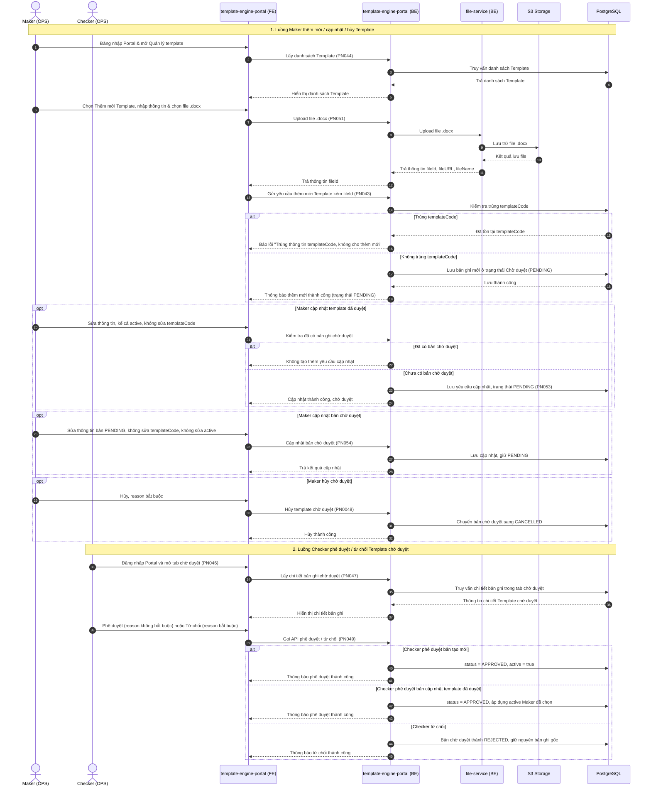
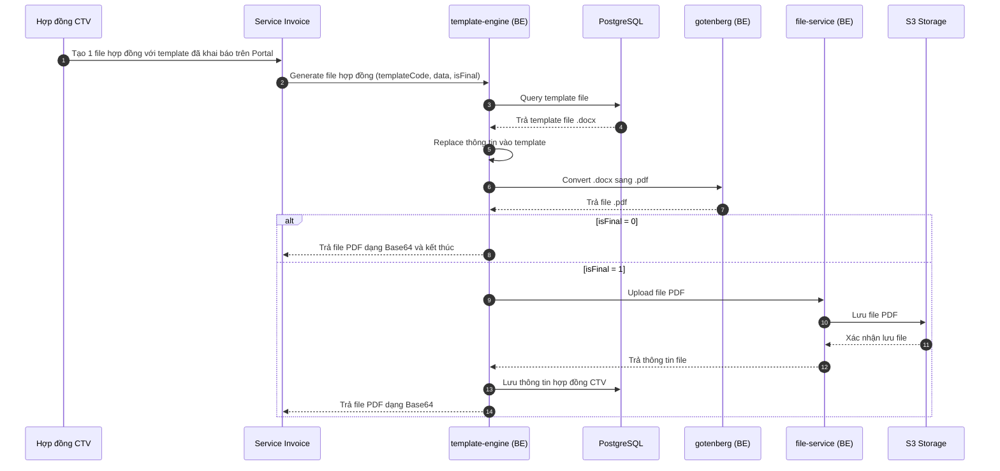
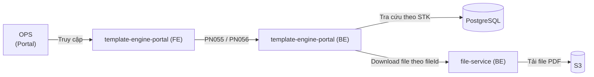

# HIGH LEVEL DESIGN — Hệ thống Quản lý Biểu mẫu và Sinh Tài liệu (Template Engine)

# 1. Giới thiệu

| Mục                  | Nội dung                                                                                                                                                                                                                                                                                                                                                                                                                                                        |
| -------------------- | --------------------------------------------------------------------------------------------------------------------------------------------------------------------------------------------------------------------------------------------------------------------------------------------------------------------------------------------------------------------------------------------------------------------------------------------------------------- |
| Mục đích             | Xây dựng hệ thống quản lý tập trung các biểu mẫu tài liệu (`.docx`) theo quy trình phê duyệt **Maker - Checker** trên Portal; sinh file hợp đồng `.pdf` theo luồng SRS (Service Invoice sinh hợp đồng CTV, rẽ nhánh `isFinal`) và quản lý, tra cứu tài liệu theo số tài khoản chứng khoán (STK).                                                                                                                                                    |
| Phạm vi              | Hệ thống Portal (`Portal → File → Quản lý template`, `Portal → File → Quản lý tài liệu`), cụm dịch vụ `Template Engine`, `File Service`, hạ tầng lưu trữ (`PostgreSQL`, `Redis`, `S3`) và 9 nhóm sản phẩm trên biểu mẫu / màn tài liệu: Trái phiếu (`IBOND`), Chứng chỉ quỹ (`FUND`), Phái sinh (`DERIVATIVE`), Tài khoản (`ACCOUNT`), Chứng quyền (`WARRANT`), The one (`THE_ONE`), Cộng tác viên (`CTV`), Margin (`MARGIN`), LOOP (`LOOP`).          |
| Đối tượng người dùng | Nhân viên vận hành OPS (`Maker`, `Checker`, `Viewer`), Quản trị viên (`Admin`) thao tác trên Portal. Luồng sinh file trong SRS do Service Invoice gọi, cho hợp đồng CTV.                                                                                                                                                                                                                                                                             |

# 2. Yêu cầu tổng quan

## 2.1 Yêu cầu chức năng chính

| Chức năng                                  | Mô tả                                                                                                                                                                                                                                                                                                                                                                                                                                              | Đối tượng                                         |
| ------------------------------------------ | -------------------------------------------------------------------------------------------------------------------------------------------------------------------------------------------------------------------------------------------------------------------------------------------------------------------------------------------------------------------------------------------------------------------------------------------------- | ------------------------------------------------- |
| Danh sách template (`PN044`, `PN045`)      | Tab Danh sách template: lọc theo `templateCode`, `name`, `category`, `status`, `active`, ngày tạo (`fromDate`–`toDate`). Sắp xếp theo `updatedAt` mới nhất lên đầu.                                                                                                                                                                                                                                                                                                                                            | OPS (`Maker`, `Checker`, `Viewer`, `Admin`)       |
| Danh sách chờ duyệt (`PN046`, `PN047`)     | Tab chờ duyệt, gồm bản ghi `PENDING`, `REJECTED`, `CANCELLED`. Xem chi tiết bản ghi trong tab này.                                                                                                                                                                                                                                                                                                                                                                                                               | OPS (`Maker`, `Checker`, `Viewer`, `Admin`)       |
| Thêm mới / Cập nhật / Hủy template (Maker) | Maker tải file `.docx` có tham số động, tạo mới, cập nhật template đã duyệt hoặc bản chờ duyệt, hoặc hủy chờ duyệt. Tạo mới và cập nhật đều về `PENDING`. `templateCode` chỉ khai báo khi tạo mới, không sửa khi cập nhật. `active` chỉ sửa trên màn cập nhật template đã duyệt. Trước khi cập nhật bản đã duyệt, hệ thống kiểm tra đã có bản chờ duyệt hay chưa. Hủy bắt buộc `reason`.                                                                                                                            | OPS (`Maker`, `Admin`)                            |
| Phê duyệt / Từ chối template (Checker)     | Checker phê duyệt hoặc từ chối qua `PN049`. Duyệt bản tạo mới: `APPROVED` và `active = true` (màn tạo mới không có trường `active`). Duyệt bản cập nhật template đã duyệt: `APPROVED` và áp dụng `active` Maker đã chọn (`true` hoặc `false`). Từ chối: `REJECTED`, `reason` bắt buộc, giữ nguyên bản ghi gốc. `reason` khi phê duyệt tối đa 1000 ký tự và không bắt buộc.                                                                                                                                      | OPS (`Checker`, `Admin`)                          |
| Sinh file hợp đồng CTV                     | Service Invoice tạo file hợp đồng với template đã khai báo. Base query template, replace thông tin, convert `.docx` sang `.pdf` qua `gotenberg`, rồi kiểm tra `isFinal`. `isFinal = 0`: trả Base64 cho Service Invoice và kết thúc. `isFinal = 1`: upload PDF lên S3, lưu thông tin hợp đồng CTV, trả Base64 cho Service Invoice.                                                                                                                                                                                 | Service Invoice, hợp đồng CTV                    |
| Quản lý và tra cứu tài liệu                | Portal quản lý tài liệu theo STK sau khi file được lưu. Lọc theo `templateCode`, `fileName`, số tài khoản (tìm tương đối), `category`, ngày hiệu lực (`generatedAt`). Xem chi tiết gọi download theo `fileId` và hiển thị popup. Với hợp đồng CTV partner chỉ lấy hợp đồng có trạng thái hợp đồng `ACTIVE`.                                                                                                                                                                                                     | OPS (`Maker`, `Checker`, `Viewer`, `Admin`)       |

## 2.2 Yêu cầu phi chức năng

| Nhóm                       | Yêu cầu                                                                                                                                                                                                                       |
| -------------------------- | ----------------------------------------------------------------------------------------------------------------------------------------------------------------------------------------------------------------------------- |
| Kiểm soát phê duyệt        | Thêm mới và cập nhật đều qua **Maker - Checker** và nằm ở `PENDING` cho tới khi Checker duyệt. Từ chối không đổi bản ghi gốc. Cập nhật template đã duyệt phải kiểm tra chưa có bản chờ duyệt.                                                                                                                                                                                  |
| Ràng buộc dữ liệu đầu vào  | Khi tạo mới, `templateCode` không trùng, tối đa 100 ký tự (chữ, số, `_`). `name` tối đa 100 ký tự, không space đầu/cuối. `fileName` trên màn tài liệu tối đa 100 ký tự. `reason` tối đa 1000 ký tự: bắt buộc khi từ chối và khi hủy, không bắt buộc khi phê duyệt. Ngày tạo template: `fromDate` / `toDate`, `YYYY-MM-DD`, từ ngày không lớn hơn đến ngày, khoảng tối đa 1 năm. File tải lên là `.docx`. |
| Phân quyền truy cập (RBAC) | Phân quyền Portal trên Keycloak theo 4 nhóm (`portal-file-admin`, `portal-file-maker`, `portal-file-checker`, `portal-file-view`).                                                                                                                                                                                                                                                |
| Lưu trữ và tra cứu         | `isFinal = 0` trả Base64 và không ghi S3, không ghi hồ sơ. `isFinal = 1` upload PDF lên S3 và lưu thông tin hợp đồng CTV. Màn quản lý tài liệu tra cứu theo STK; với hợp đồng CTV partner chỉ lấy trạng thái hợp đồng `ACTIVE`. `ACTIVE` này là trạng thái hợp đồng, khác cờ `active` của template.                                                                              |

# 3. Kiến trúc tổng thể

## 3.1 Mô hình ngữ cảnh (Context Diagram)

### Luồng thêm mới, cập nhật và phê duyệt Template File (Maker - Checker)

Maker (Portal) → `Portal Template Engine (FE)` → `template-engine-portal (BE)` → `File Service` (upload file `.docx` lên `S3`) → Kiểm tra trùng `templateCode` khi tạo mới và lưu bản ghi `PENDING` vào `PostgreSQL`. Cập nhật bản đã duyệt phải kiểm tra chưa có bản chờ duyệt; `templateCode` không đổi. Checker phê duyệt hoặc từ chối qua `PN049`: duyệt tạo mới thì `active = true`, duyệt cập nhật thì giữ `active` Maker đã chọn; từ chối thì `REJECTED` và giữ bản ghi gốc.



### Luồng sinh file hợp đồng tự động (Generate Contract File)

Hợp đồng CTV yêu cầu tạo file với template đã khai báo trên Portal. Service Invoice gọi `template-engine (BE)`. Base query template file, replace thông tin, convert `.docx` sang `.pdf` qua `gotenberg`, rồi kiểm tra `isFinal`:

- `isFinal = 0`: trả file `.pdf` dạng **Base64** cho Service Invoice và kết thúc.
- `isFinal = 1`: upload PDF lên `S3` qua `file-service`, lưu thông tin hợp đồng CTV, trả **Base64** cho Service Invoice. Portal quản lý tài liệu theo STK ở luồng riêng (`PN055`, `PN056`).



### Luồng quản lý và tra cứu tài liệu hợp đồng trên Portal

Người dùng vận hành (OPS) → `template-engine-portal (FE)` → `template-engine-portal (BE)` → truy vấn danh sách tài liệu theo STK từ `PostgreSQL` (`PN055`; số tài khoản tìm tương đối; hợp đồng CTV partner chỉ lấy trạng thái hợp đồng `ACTIVE`) → gọi `file-service (BE)` tải file PDF từ `S3` để xem popup (`PN056`).



## 3.2 Các thành phần chính

| Lớp              | Thành phần                    | Công nghệ               | Ghi chú                                                                                                   |
| ---------------- | ----------------------------- | ----------------------- | --------------------------------------------------------------------------------------------------------- |
| Frontend Portal  | `template-engine-portal (FE)` | React.js                | Giao diện Portal (`Portal Template Engine`) cho OPS quản lý biểu mẫu và tra cứu tài liệu hợp đồng.        |
| Backend Portal   | `template-engine-portal (BE)` | Spring Boot             | Xử lý nghiệp vụ Portal cho OPS: quản lý biểu mẫu, luồng phê duyệt Maker - Checker, tra cứu tài liệu.      |
| Backend Core     | `template-engine (BE)`        | Spring Boot             | Nhận yêu cầu generate từ Service Invoice, query template, replace, gọi `gotenberg` convert PDF, xử lý `isFinal`. |
| DB Migration     | `Migration`                   | Migration Service       | Dịch vụ khởi tạo và quản lý cấu trúc cơ sở dữ liệu (DDL) trên PostgreSQL.                                 |
| Document Convert | `gotenberg (BE)`              | Open Source (Gotenberg) | Dịch vụ chuyển đổi định dạng file từ `.docx` sang `.pdf`.                                                 |
| Platform Service | `file-service (BE)`           | Spring Boot             | Dịch vụ nền tảng thực hiện upload và download file vật lý với Object Storage S3.                          |
| Database & Cache | `PostgreSQL`, `Redis`         | PostgreSQL, Redis       | PostgreSQL lưu biểu mẫu, bản chờ duyệt và thông tin hợp đồng CTV. Portal BE và Engine đều nối Redis trên sơ đồ kiến trúc. |
| Object Storage   | `S3`                          | S3 Object Storage       | Lưu trữ file biểu mẫu gốc (`.docx`) và file tài liệu/hợp đồng đã sinh (`.pdf`).                           |
| Tích hợp nội bộ  | `Service Invoice`             | Service nội bộ          | SRS: Service Invoice gọi Engine để sinh file hợp đồng CTV.                                                |

## 3.3 Kiến trúc tổng thể

```mermaid
flowchart LR
    subgraph INHOUSE[INHOUSE]
        INHOUSE_ACTOR@{shape: user, label: "Actor (OPS)"}
        INHOUSE_SERVICES[Các service inhouse]

        subgraph INHOUSE_PORTAL["PORTAL (BFF)"]
            INHOUSE_PORTAL_TEMPLATE_ENGINE[Portal Template Engine]
        end

        subgraph INHOUSE_TEMPLATE_ENGINE[Template Engine]
            INHOUSE_TEMPLATE_ENGINE_MIGRATION[Migration]
            INHOUSE_TEMPLATE_ENGINE_PORTAL[Portal]
            INHOUSE_TEMPLATE_ENGINE_CORE[Engine]
            INHOUSE_TEMPLATE_ENGINE_GOTENBERG[gotenberg]
        end

        subgraph INHOUSE_BASE[Platform Service]
            INHOUSE_BASE_FILE[File Service]
        end

        subgraph INHOUSE_INFRA[Infra Service]
            INHOUSE_INFRA_POSTGRESQL@{shape: db, label: "PostgreSQL"}
            INHOUSE_INFRA_REDIS@{shape: h-cyl, label: "REDIS"}
            INHOUSE_INFRA_S3@{shape: disk, label: "S3"}
        end

        INHOUSE_ACTOR -->|Truy cập| INHOUSE_PORTAL_TEMPLATE_ENGINE
        INHOUSE_PORTAL_TEMPLATE_ENGINE -->|API| INHOUSE_TEMPLATE_ENGINE_PORTAL
        INHOUSE_SERVICES -->|API| INHOUSE_TEMPLATE_ENGINE_CORE

        INHOUSE_TEMPLATE_ENGINE_PORTAL --> INHOUSE_INFRA_POSTGRESQL
        INHOUSE_TEMPLATE_ENGINE_PORTAL --> INHOUSE_INFRA_REDIS
        INHOUSE_TEMPLATE_ENGINE_PORTAL -->|API| INHOUSE_BASE_FILE

        INHOUSE_TEMPLATE_ENGINE_MIGRATION --> INHOUSE_INFRA_POSTGRESQL

        INHOUSE_TEMPLATE_ENGINE_CORE -->|API| INHOUSE_TEMPLATE_ENGINE_GOTENBERG
        INHOUSE_TEMPLATE_ENGINE_CORE --> INHOUSE_INFRA_POSTGRESQL
        INHOUSE_TEMPLATE_ENGINE_CORE --> INHOUSE_INFRA_REDIS
        INHOUSE_TEMPLATE_ENGINE_CORE -->|API| INHOUSE_BASE_FILE

        INHOUSE_BASE_FILE -->|API| INHOUSE_INFRA_S3
    end
```

Chú giải luồng trên sơ đồ:

| Luồng kết nối                                             | Mô tả                                                                                                                                |
| --------------------------------------------------------- | ------------------------------------------------------------------------------------------------------------------------------------ |
| `Actor (OPS)` → `Portal Template Engine` → `Portal`       | Luồng người dùng vận hành thao tác quản lý biểu mẫu (Maker - Checker) và tra cứu tài liệu hợp đồng qua REST API.                     |
| `Các service inhouse` → `Engine`                          | Trên sơ đồ kiến trúc, service inhouse gọi Engine. SRS mô tả caller là Service Invoice, hồ sơ lưu là hợp đồng CTV.                    |
| `Engine` → `gotenberg`                                    | Bước convert `.docx` sang `.pdf` sau khi replace thông tin template.                                                                 |
| `Portal` / `Engine` → `File Service` → `S3`               | Portal upload/xóa/tải file theo SRS (`PN051`, `PN052`, `PN056`). Engine upload PDF khi `isFinal = 1`.                                |
| `Portal` / `Engine` → `PostgreSQL`, `Redis`               | Đọc/ghi biểu mẫu, chờ duyệt, hợp đồng CTV. Cả Portal BE và Engine nối Redis.                                                        |
| `Migration` → `PostgreSQL`                                | Khởi tạo và nâng cấp schema (DDL). Migration không nối Redis.                                                                       |

# 4. Mô tả chi tiết kiến trúc

## 4.1 Kiến trúc logic

### Trách nhiệm các thành phần

| Thành phần                                             | Trách nhiệm                                                                                                                                                                                                                                    |
| ------------------------------------------------------ | ---------------------------------------------------------------------------------------------------------------------------------------------------------------------------------------------------------------------------------------------- |
| `Portal Template Engine` (`template-engine-portal` FE) | Cung cấp giao diện trên Portal (`Portal → File → Quản lý template` và `Portal → File → Quản lý tài liệu`) cho OPS tìm kiếm, thêm mới, cập nhật, hủy, phê duyệt/từ chối biểu mẫu và tra cứu, xem popup chi tiết file hợp đồng theo STK.         |
| `Portal` (`template-engine-portal` BE)                 | API Portal `PN043`–`PN056`; kiểm tra trùng `templateCode` khi tạo mới; kiểm tra bản chờ duyệt trước `PN053`; Maker-Checker (`PENDING`, `APPROVED`, `REJECTED`, `CANCELLED`); upload/xóa/tải file qua `File Service`. |
| `Engine` (`template-engine` BE)                        | Nhận generate từ Service Invoice; query template file; replace; gọi `gotenberg` convert `.pdf`; `isFinal = 0` trả Base64; `isFinal = 1` upload S3 và lưu hợp đồng CTV rồi trả Base64.   |
| `Migration`                                            | Thực thi các script khởi tạo và nâng cấp cấu trúc bảng dữ liệu (DDL) trên `PostgreSQL`.                                                                                                                                                        |
| `gotenberg`                                            | Convert file `.docx` sang `.pdf` ở bước convert của luồng sinh hợp đồng.                                                                                                                                                                      |
| `File Service` (`file-service` BE)                     | Dịch vụ nền tảng quản lý lưu trữ và truy xuất file vật lý trên `S3` (trả về `fileId`, `fileURL`, `fileName` khi upload và luồng dữ liệu file khi download).                                                                                    |
| `Service Invoice` / hợp đồng CTV                      | Service Invoice gọi generate. Hợp đồng CTV là hồ sơ được tạo từ template đã khai báo và được lưu khi `isFinal = 1`.                                                                                                                            |

### Danh mục API trong phạm vi (SOW)

| Mã API   | Tên API                              | Phân hệ xử lý                 | Mô tả chức năng                                                                                                     |
| -------- | ------------------------------------ | ----------------------------- | ------------------------------------------------------------------------------------------------------------------- |
| `PN043`  | API thêm mới template                | `template-engine-portal (BE)` | Tạo mới bản ghi template gắn với `fileId` vừa upload; kiểm tra trùng `templateCode`, lưu trạng thái `PENDING`.      |
| `PN044`  | API lấy danh sách template           | `template-engine-portal (BE)` | Tab Danh sách template. Lọc `templateCode`, `name`, `category`, `status`, `active`, `fromDate`–`toDate` (tối đa 1 năm). Sắp xếp `updatedAt` mới nhất lên đầu. |
| `PN045`  | API xem chi tiết template đã duyệt   | `template-engine-portal (BE)` | Lấy thông tin chi tiết của một bản ghi template đã được phê duyệt.                                                  |
| `PN046`  | API lấy danh sách template chờ duyệt | `template-engine-portal (BE)` | Truy vấn danh sách các bản ghi template trong tab chờ duyệt (`PENDING`, `REJECTED`, `CANCELLED`).                   |
| `PN047`  | API xem chi tiết template chờ duyệt  | `template-engine-portal (BE)` | Lấy thông tin chi tiết của bản ghi template trong danh sách chờ duyệt.                                              |
| `PN0048` | API hủy template chờ duyệt           | `template-engine-portal (BE)` | Maker hủy yêu cầu chờ duyệt (bắt buộc nhập ghi chú `reason` tối đa 1000 ký tự), chuyển sang `CANCELLED`.            |
| `PN049`  | API phê duyệt / từ chối chờ duyệt    | `template-engine-portal (BE)` | Cùng một mã cho phê duyệt và từ chối. Duyệt tạo mới: `APPROVED`, `active = true`. Duyệt cập nhật: `APPROVED` và áp dụng `active` Maker đã chọn. Từ chối: `REJECTED`, `reason` bắt buộc, giữ bản ghi gốc. `reason` khi duyệt không bắt buộc, tối đa 1000 ký tự. |
| `PN051`  | API upload file `.docx`              | `Portal BE` → `File Service`  | Upload file biểu mẫu `.docx` lên S3 và trả về `fileId`, `fileURL`, `fileName`.                                      |
| `PN052`  | API xóa file đính kèm                | `Portal BE` → `File Service`  | Xóa file đính kèm đã tải lên.                                                                                       |
| `PN053`  | API cập nhật template đã duyệt       | `template-engine-portal (BE)` | Không sửa `templateCode`. Được sửa `active`. Kiểm tra chưa có bản chờ duyệt rồi tạo yêu cầu `PENDING`.                                        |
| `PN054`  | API cập nhật template chờ duyệt      | `template-engine-portal (BE)` | Cập nhật bản `PENDING`. Không sửa `templateCode`. Không sửa `active`.                                                                              |
| `PN055`  | API lấy danh sách tài liệu           | `template-engine-portal (BE)` | Tra cứu theo STK (`customerId`, tìm tương đối), `templateCode`, `fileName`, `category`, `generatedAt`. Hợp đồng CTV partner chỉ lấy trạng thái hợp đồng `ACTIVE`. |
| `PN056`  | API download / xem chi tiết tài liệu | `Portal BE` → `File Service`  | Tải nội dung file tài liệu theo `fileId` để hiển thị trên popup xem chi tiết.                                                                   |
| —        | API generate file hợp đồng          | `template-engine (BE)`        | SRS mô tả luồng, chưa gán mã SOW (trang Internal API để trống). Service Invoice gọi generate cho hợp đồng CTV. `isFinal = 0` trả Base64. `isFinal = 1` upload S3, lưu hợp đồng CTV, trả Base64. |

### Danh mục sản phẩm và trạng thái dữ liệu

- **Phạm vi sản phẩm (`category`):**
  1. `IBOND` — Trái phiếu
  2. `FUND` — Chứng chỉ quỹ
  3. `DERIVATIVE` — Phái sinh
  4. `ACCOUNT` — Tài khoản
  5. `WARRANT` — Chứng quyền
  6. `THE_ONE` — The one
  7. `CTV` — Cộng tác viên
  8. `MARGIN` — Margin
  9. `LOOP` — LOOP
- **Trạng thái phê duyệt bản ghi (`status`):** `PENDING` (Chờ duyệt), `APPROVED` (Đã duyệt), `REJECTED` (Từ chối), `CANCELLED` (Đã hủy).
- **Trạng thái hoạt động của template (`active`, bản đã duyệt):** `true` (Hoạt động), `false` (Dừng hoạt động). Màn tạo mới không có trường này; duyệt tạo mới gán `true`. Màn cập nhật template đã duyệt cho sửa `active`. Bản chờ duyệt không cho sửa `active`.
- **Trạng thái hợp đồng CTV partner trên màn tài liệu:** chỉ lấy hợp đồng `ACTIVE`. Đây không phải cờ `active` của template.

## 4.2 Kiến trúc vật lý (Deployment)

| Hạng mục            | Thành phần trên sơ đồ kiến trúc                                                                 |
| ------------------- | ----------------------------------------------------------------------------------------------- |
| Portal (BFF)        | `template-engine-portal (FE)` — React                                                           |
| Template Engine     | `template-engine-portal (BE)`, `template-engine (BE)`, `gotenberg`, `Migration` — Spring Boot / open source |
| Platform Service    | `file-service (BE)` — Spring Boot                                                               |
| Lưu trữ             | `PostgreSQL`, `Redis`, `S3`                                                                     |

# 5. Thiết kế bảo mật

| Hạng mục             | Thiết kế                                                                                                                                                 |
| -------------------- | -------------------------------------------------------------------------------------------------------------------------------------------------------- |
| Xác thực (AuthN)     | Người dùng vận hành trên Portal xác thực tập trung qua **Keycloak**.                                                                                        |
| Phân quyền (AuthZ)   | Phân quyền dựa trên Role-Based Access Control (RBAC) trên Keycloak theo 4 Group và 4 Role chuyên biệt cho hệ thống Quản lý file.                         |
| Kiểm soát nguyên tắc | Tách biệt quyền giữa `Maker` (`FILE_TEM_CREATE`) và `Checker` (`FILE_TEM_APPROVE`); kiểm soát định dạng chỉ cho phép upload file mẫu `.docx`.            |
| Bảo mật lưu trữ file | File `.docx` và `.pdf` được lưu trữ trên `S3` thông qua lớp trung gian `File Service`; người dùng xem/tải file thông qua API được kiểm soát quyền.       |
| Audit & Truy vết     | Lưu vết đầy đủ thông tin người tạo (`createdBy`), ngày tạo (`createdAt`), người cập nhật (`updatedBy`), ngày cập nhật (`updatedAt`) và lý do (`reason`). |

### Ma trận phân quyền trên Keycloak (Quản lý file)

| Group                 | Role               | Tên quyền                    | Màn hình áp dụng                                                    | Ghi chú thao tác được phép                                     |
| --------------------- | ------------------ | ---------------------------- | ------------------------------------------------------------------- | -------------------------------------------------------------- |
| `portal-file-admin`   | `FILE_TEM_VIEW`    | Danh sách template           | Danh sách template, Danh sách template chờ duyệt                    | Xem danh sách và chi tiết template                             |
| `portal-file-admin`   | `FILE_TEM_CREATE`  | Thêm mới template            | Thêm mới template, Danh sách template, Danh sách template chờ duyệt | Thêm mới, Cập nhật template, Hủy template, Upload file `.docx` |
| `portal-file-admin`   | `FILE_TEM_APPROVE` | Phê duyệt / từ chối template | Danh sách template chờ duyệt                                        | Phê duyệt hoặc từ chối template chờ duyệt                      |
| `portal-file-admin`   | `FILE_VIEW`        | Danh sách file               | Danh sách file tài liệu                                             | Tra cứu và xem chi tiết file tài liệu hợp đồng theo STK        |
| `portal-file-maker`   | `FILE_TEM_VIEW`    | Danh sách template           | Danh sách template, Danh sách template chờ duyệt                    | Xem danh sách và chi tiết template                             |
| `portal-file-maker`   | `FILE_TEM_CREATE`  | Thêm mới template            | Thêm mới template, Danh sách template, Danh sách template chờ duyệt | Thêm mới, Cập nhật template, Hủy template, Upload file `.docx` |
| `portal-file-maker`   | `FILE_VIEW`        | Danh sách file               | Danh sách file tài liệu                                             | Tra cứu và xem chi tiết file tài liệu hợp đồng theo STK        |
| `portal-file-checker` | `FILE_TEM_VIEW`    | Danh sách template           | Danh sách template, Danh sách template chờ duyệt                    | Xem danh sách và chi tiết template                             |
| `portal-file-checker` | `FILE_TEM_APPROVE` | Phê duyệt / từ chối template | Danh sách template chờ duyệt                                        | Phê duyệt hoặc từ chối template chờ duyệt                      |
| `portal-file-checker` | `FILE_VIEW`        | Danh sách file               | Danh sách file tài liệu                                             | Tra cứu và xem chi tiết file tài liệu hợp đồng theo STK        |
| `portal-file-view`    | `FILE_TEM_VIEW`    | Danh sách template           | Danh sách template, Danh sách template chờ duyệt                    | Chỉ xem danh sách và chi tiết template                         |
| `portal-file-view`    | `FILE_VIEW`        | Danh sách file               | Danh sách file tài liệu                                             | Chỉ xem danh sách và chi tiết file tài liệu hợp đồng           |

# 6. Hiệu năng và mở rộng

[TBD]

# 7. Triển khai và vận hành

| Hạng mục      | Thiết kế                                                                                          |
| ------------- | ------------------------------------------------------------------------------------------------- |
| Schema DB     | Service `Migration` thực thi DDL trên `PostgreSQL`.                                               |
| File          | Biểu mẫu `.docx` và PDF khi `isFinal = 1` đi qua `File Service` lên `S3`.                         |
| Phê duyệt     | Maker-Checker trên Portal, phân quyền Keycloak nhóm `portal-file-*`.                              |

# 8. Rủi ro và quyết định kiến trúc

## 8.1 Rủi ro

1. **Rủi ro sai sót biểu mẫu đang vận hành:** Việc chỉnh sửa trực tiếp file biểu mẫu `.docx` hoặc cập nhật nhầm cấu hình biểu mẫu đang áp dụng trên môi trường thực tế có thể làm sai lệch nội dung pháp lý của các hợp đồng sinh ra cho khách hàng.
2. **Rủi ro lưu hồ sơ khi xem trước:** Service Invoice có thể gọi generate với `isFinal = 0` nhiều lần. Nếu mỗi lần đều upload S3 và ghi hồ sơ hợp đồng CTV thì phát sinh dữ liệu không phải bản hoàn tất.
3. **Rủi ro nghẽn hiệu năng khi chuyển đổi định dạng tài liệu:** Tác vụ chuyển đổi từ `.docx` sang `.pdf` tiêu tốn nhiều CPU/Memory hơn so với các API nghiệp vụ thông thường.

## 8.2 Quyết định

1. **Maker - Checker theo SRS:** Tạo mới và cập nhật đều về `PENDING`. Cập nhật bản đã duyệt kiểm tra chưa có bản chờ duyệt; không sửa `templateCode`. `active` chỉ sửa trên màn cập nhật template đã duyệt, không sửa trên bản chờ duyệt. Duyệt tạo mới: `APPROVED` và `active = true`. Duyệt cập nhật: `APPROVED` và áp dụng `active` Maker đã chọn. Từ chối: `REJECTED`, `reason` bắt buộc, giữ bản ghi gốc. `reason` khi phê duyệt không bắt buộc.
2. **`isFinal` theo SRS quản lý tài liệu:** `isFinal = 0` thì replace, convert, trả Base64 và kết thúc. `isFinal = 1` thì upload PDF lên S3, lưu thông tin hợp đồng CTV, trả Base64. Portal quản lý tài liệu theo STK; hợp đồng CTV partner trên màn này chỉ lấy trạng thái hợp đồng `ACTIVE`.
3. **Convert bằng `gotenberg`:** Bước convert `.docx` sang `.pdf` gọi `gotenberg`. Portal OPS và Engine generate là hai service trên sơ đồ kiến trúc.
