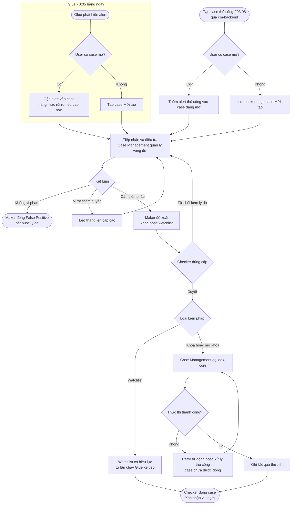
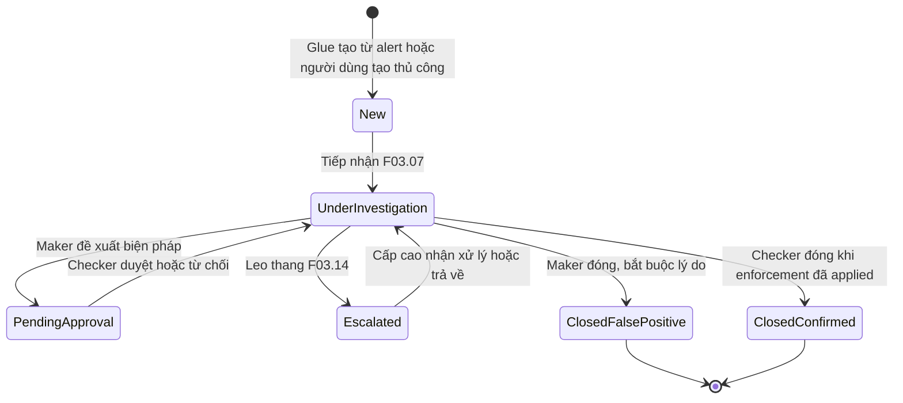
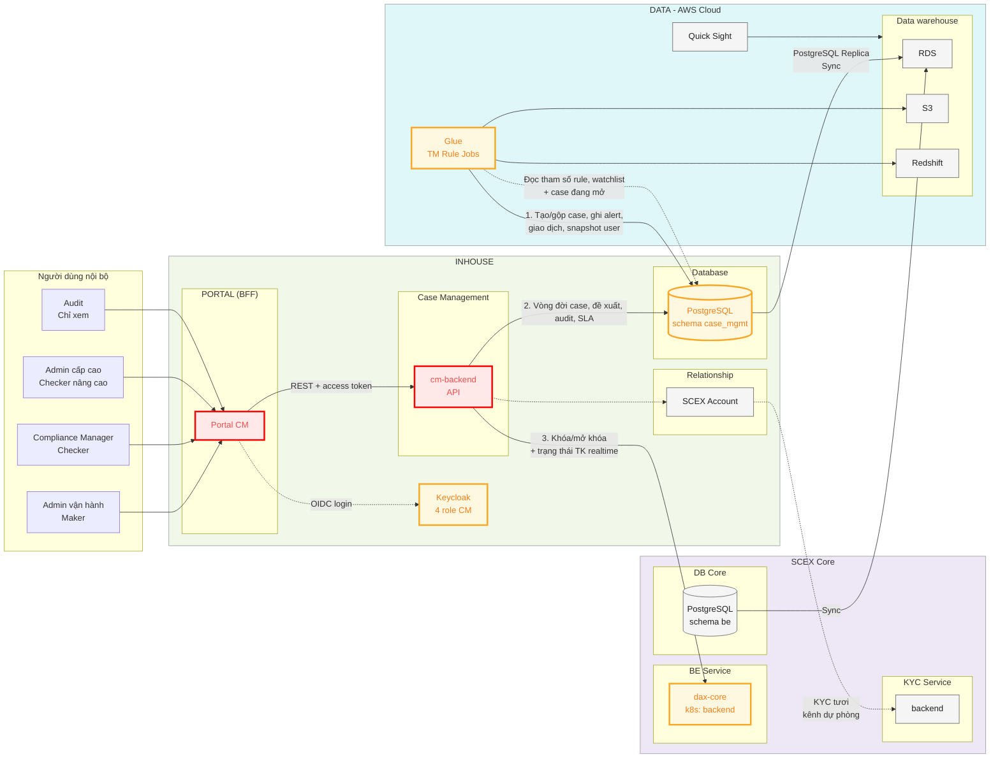
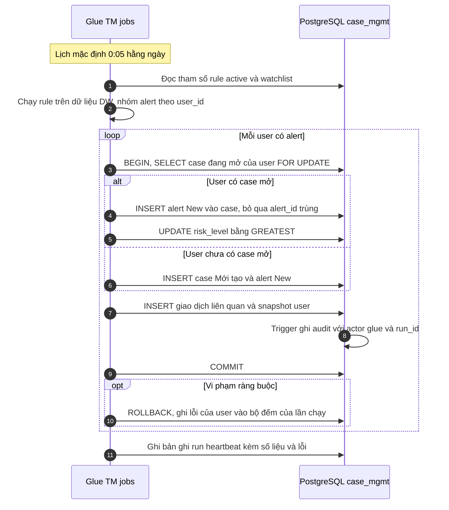
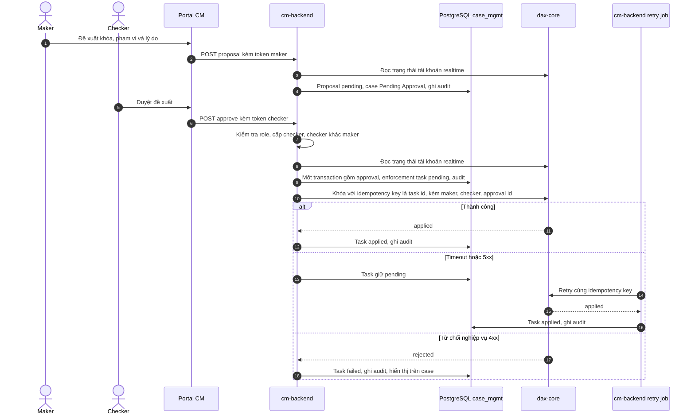
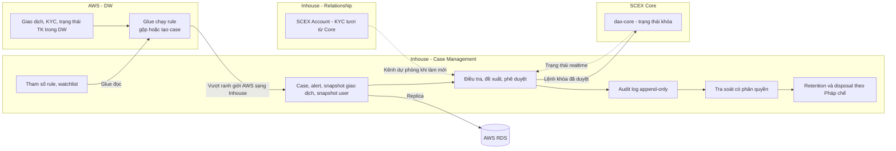
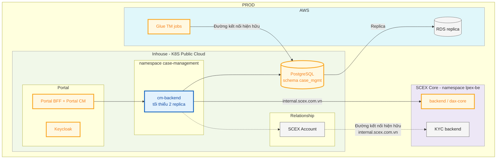

# HIGH LEVEL DESIGN — CASE MANAGEMENT CHO TRANSACTION MONITORING

> **Mã tài liệu:** HLD-INHOUSE-CASE-MANAGEMENT  
> **Phiên bản:** 0.1  
> **Trạng thái:** Draft  
> **Mức độ bảo mật:** Confidential

---

# 1. Quản trị tài liệu

## 1.1 Thông tin tài liệu

| Thuộc tính                         | Giá trị                                                       |
| ---------------------------------- | ------------------------------------------------------------- |
| Tên giải pháp/hệ thống             | Case Management cho Compliance / AML / Transaction Monitoring |
| Mã tài liệu                        | HLD-INHOUSE-CASE-MANAGEMENT                                   |
| Business Owner                     | [Điền — Compliance/AML]                                       |
| System/Service Owner               | PTSP                                                          |
| Solution Architect                 | duc.mm                                                        |
| Tech Lead(s)                       | hiep.tq                                                       |
| Security/Privacy Reviewer          | ATTT                                                          |
| Infrastructure/Operations Reviewer | [Điền]                                                        |
| Repository/Link                    | -                                                             |
| Tài liệu thay thế bởi/thay thế cho | N/A                                                           |
| Ngày review tiếp theo              | -                                                             |

## 1.2 Lịch sử thay đổi

| Phiên bản | Ngày       | Tác giả | Thay đổi chính | Trạng thái |
| --------- | ---------- | ------- | -------------- | ---------- |
| 0.1       | 2026-09-28 | duc.mm  | Khởi tạo       | Draft      |

## 1.3 Review và phê duyệt

| Vai trò               | Người/đơn vị | Phạm vi review                                             | Kết quả | Ngày   | Bằng chứng/link |
| --------------------- | ------------ | ---------------------------------------------------------- | ------- | ------ | --------------- |
| Business Owner        | [Điền]       | Mục tiêu, phạm vi, ưu tiên, luật nghiệp vụ (ASM-05..08)    | Pending | [Điền] | [Điền]          |
| Solution Architecture | SDO          | Kiến trúc, tiêu chuẩn, quyết định                          | Pending | [Điền] | [Điền]          |
| An toàn thông tin     | ATTT         | Kênh CM → dax-core, quyền ghi của Glue, PII KYC, audit     | Pending | [Điền] | [Điền]          |
| Hạ tầng/Vận hành/SRE  | [Điền]       | Đường mạng, deployability, backup/DR                       | Pending | [Điền] | [Điền]          |
| Data Warehouse        | [Điền]       | Contract ghi case/alert/giao dịch/snapshot user, lịch chạy | Pending | [Điền] | [Điền]          |
| DBA                   | [Điền]       | Database, CDC                                              | Pending | [Điền] | [Điền]          |

## 1.4 Tài liệu tham chiếu

| ID     | Tài liệu/tiêu chuẩn           | Phiên bản/ngày | Vai trò trong HLD                        | Link                                                |
| ------ | ----------------------------- | -------------- | ---------------------------------------- | --------------------------------------------------- |
| REF-01 | BRD Transaction Monitoring    | v1             | Nguồn yêu cầu nghiệp vụ                  | [Confluence](https://confluence.scex.com.vn/x/GB_h) |
| REF-02 | Function List Case Management | 1.0            | Danh sách chức năng, phạm vi kì tháng 10 | [Confluence](https://confluence.scex.com.vn/x/SCmh) |
| REF-03 | Tài liệu thiết kế SCEX Core   | -              | Cung cấp các API phía SCEX Core          |                                                     |

## 1.5 Thuật ngữ và từ viết tắt

| Thuật ngữ        | Định nghĩa trong phạm vi tài liệu                                                                                                                                          |
| ---------------- | -------------------------------------------------------------------------------------------------------------------------------------------------------------------------- |
| TM rule          | Rule Transaction Monitoring chạy trên AWS Glue, trên dữ liệu Data Warehouse (DW)                                                                                           |
| Alert            | Một lần rule TM trigger trên một user, kèm danh sách giao dịch liên quan; có vòng đời riêng New / In Progress / Resolved                                                   |
| Case             | Hồ sơ điều tra gắn với một user; gộp một hoặc nhiều alert; tại một thời điểm mỗi user có tối đa một case mở. Glue tạo case từ alert, Case Management quản lý vòng đời case |
| Snapshot user    | Thông tin KYC và trạng thái tài khoản của user do DW gửi kèm case tại thời điểm Glue chạy; dùng để hiển thị, không phải dữ liệu tươi                                       |
| Maker / Checker  | Maker đề xuất biện pháp; Checker (khác người) duyệt hoặc từ chối; cấp checker phụ thuộc loại biện pháp và mức rủi ro                                                       |
| Biện pháp        | Hành động có tác động lên user: khóa tính năng, khóa tài khoản (2 mức), mở khóa, đưa vào watchlist, report SAR                                                             |
| Enforcement task | Bản ghi yêu cầu thực thi một biện pháp đã duyệt lên dax-core, có trạng thái `pending / applied / failed`                                                                   |
| Bản ghi run      | Bản ghi Glue ghi vào DB Case Management sau mỗi lần chạy rule (heartbeat): thời điểm, kết quả, số alert phát hiện, số case tạo mới, số alert gộp, số user bị lỗi           |

---

# 2. Tóm tắt điều hành

## 2.1 Vấn đề và giá trị giải pháp

SCEX đã có bộ rule Transaction Monitoring chạy trên nền dữ liệu DW để phát hiện giao dịch nghi vấn, nhưng chưa có nơi tập trung để tiếp nhận, gán người xử lý, điều tra và ra quyết định. Các biện pháp tác động lên user (khóa tính năng, khóa tài khoản) chưa có cơ chế kiểm soát chéo được hệ thống enforce, và chưa có log bất biến để chứng minh với audit nội bộ và cơ quan quản lý.

Case Management giải quyết ba việc: không bỏ sót alert (mọi alert đều thành case hoặc gộp vào case), mọi biện pháp tác động lên user đều qua maker/checker được hệ thống chặn, và mọi thao tác đều có log append-only.

## 2.2 Giải pháp đề xuất

Xây dựng module **Case Management** trong Inhouse gồm: **Portal CM** (module mới trong Portal BFF hiện hữu), **cm-backend** (API nghiệp vụ, quản lý vòng đời case, job SLA và retry enforcement) và schema mới trên PostgreSQL Inhouse.

- **Glue** (DW) chạy rule 1 lần/ngày lúc 0:05, tạo case từ alert theo rule (hoặc gộp alert vào case đang mở của user) và ghi thẳng case, alert, giao dịch liên quan và snapshot user (KYC, trạng thái tài khoản) vào DB Case Management. Glue đọc tham số rule và watchlist từ DB này trước mỗi lần chạy.
- **Phân định trách nhiệm:** Glue tạo case nhưng không quản lý vòng đời case. Case Management không tạo case từ alert, chỉ quản lý toàn bộ vòng đời case sau khi được tạo; DW không cần đồng bộ ngược trạng thái case.
- **dax-core** là điểm thực thi khóa/mở khóa duy nhất; API mới trên dax-core do team Remi phát triển.
- **SCEX Account** (service hiện hữu của Relationship, lấy thông tin account từ Core) được tái sử dụng làm kênh dự phòng để lấy thông tin KYC tươi khi snapshot từ DW chưa đủ. cm-backend không gọi thẳng KYC service.
- **Keycloak** (tái sử dụng từ Portal BFF) cấp danh tính và 4 role: Admin vận hành, Compliance Manager, Admin cấp cao, Audit.

## 2.3 Kết quả và chỉ số thành công

| ID     | Loại              | Kết quả mong đợi                                            | Chỉ số/đơn vị                                                                         | Baseline | Target | Thời điểm đo  | Owner      |
| ------ | ----------------- | ----------------------------------------------------------- | ------------------------------------------------------------------------------------- | -------- | ------ | ------------- | ---------- |
| BR-01  | Kết quả nghiệp vụ | Không bỏ sót alert                                          | % alert Glue phát hiện (theo bản ghi run) có trong DB Case Management và gắn với case | N/A      | 100%   | Hằng ngày     | Compliance |
| BR-02  | Kết quả nghiệp vụ | Mọi biện pháp tác động user có checker khác maker, đúng cấp | % enforcement task có approval hợp lệ                                                 | N/A      | 100%   | Audit định kỳ | Compliance |
| BR-03  | Kết quả nghiệp vụ | Case xử lý trong SLA                                        | Số case quá hạn SLA theo mức rủi ro                                                   | N/A      | [Điền] | Hằng tuần     | Compliance |
| SLO-01 | SLO vận hành      | Case sẵn sàng trên Portal sau lịch chạy                     | Thời gian từ mốc lịch (0:05) tới khi bản ghi run của Glue hoàn tất                    | N/A      | [Điền] | Hằng ngày     | Team DW    |
| SLO-02 | SLO vận hành      | Biện pháp đã duyệt được thực thi                            | p95 thời gian từ approval tới enforcement `applied`                                   | N/A      | [Điền] | Liên tục      | SRE        |
| SLO-03 | SLO vận hành      | Sẵn sàng dịch vụ                                            | Availability cm-backend                                                               | N/A      | [Điền] | Hằng tháng    | SRE        |
| SLA-01 | SLA dependency    | API khóa/mở khóa trên dax-core                              | Timeout, availability                                                                 | N/A      | [Điền] | Hằng tháng    | Team Remi  |

## 2.4 Tóm tắt phạm vi

### Trong phạm vi

##### Glue

- Logic tạo alert, gộp theo user và tạo case tự động trong DB Case Management (F02.01–F02.03); thay đổi job Glue (team DW).
- Đọc tham số rule và watchlist từ DB Case Management khi chạy.

##### Case Management

- Định nghĩa bảng, ràng buộc và quyền cho contract ghi alert/case từ Glue.
- Quản lý vòng đời case, điều tra, tạo case thủ công, maker/checker, leo thang, đóng case (F03.01–F03.16).
- Watchlist (F04.01).
- Đánh dấu case quá hạn SLA (F07.02). SLA theo mức rủi ro (F07.01) cấu hình dạng biến cấu hình backend, chưa có UI.
- Tham số rule lưu trong DB để Glue đọc (bản tối giản của F05.02), chưa có UI và luồng duyệt.

##### SCEX Core

- API mới khóa/mở khóa trên dax-core (team Remi) phục vụ luồng maker/checker từ Case Management.
- Tái sử dụng SCEX Account (Relationship) làm kênh dự phòng lấy thông tin KYC.

### Ngoài phạm vi

- Logic rule TM và nguồn dữ liệu DW (HLD này chỉ quy định contract ghi case và tham số). Rule mới hoặc logic mới hoàn toàn do team DW phát triển.
- Gửi báo cáo tự động tới cơ quan quản lý.
- Điểm thực thi khóa ngoài dax-core
- Thay đổi app/web phía user cuối.

### Giai đoạn sau

- Dashboard tổng quan (F01.01).
- UI cấu hình rule có maker/checker và lịch sử thay đổi (F05.01–F05.04).
- Báo cáo SAR (F06.01–F06.03, có thể cần S3).
- UI cấu hình SLA (F07.01).
- Email thông báo (F08.01).

## 2.5 Tác động và quyết định cần phê duyệt

| Hạng mục                                   | Tóm tắt                                                                                                                     |
| ------------------------------------------ | --------------------------------------------------------------------------------------------------------------------------- |
| Người dùng bị ảnh hưởng                    | 4 role nội bộ dùng Portal CM; user cuối bị khóa tính năng/tài khoản theo quyết định đã duyệt                                |
| Hệ thống/dữ liệu bị ảnh hưởng              | Mới: Portal CM, cm-backend, schema `case_mgmt`. Sửa: dax-core, job Glue, Keycloak. Tái sử dụng: SCEX Account (Relationship) |
| Thay đổi quy trình vận hành                | Compliance xử lý alert trên Portal CM; khóa/mở khóa user chỉ qua maker/checker                                              |
| Rủi ro cao nhất                            | [Điền]                                                                                                                      |
| Chi phí/capacity chính                     | 1 deployment mới trên K8S Inhouse và một schema; khối lượng thấp                                                            |
| Quyết định cần cấp có thẩm quyền phê duyệt | ATTT: Lưu snapshot KYC trong DB Case Management và replica dữ liệu case sang AWS. Pháp chế: retention                       |

---

# 3. Bối cảnh

## 3.1 Phạm vi giải pháp

System-of-interest là **Case Management** gồm Portal CM, cm-backend và schema `case_mgmt`. Mọi thành phần liên quan đều thuộc SCEX nhưng nằm trên ba control plane khác nhau: Inhouse (K8S), SCEX Core (namespace `lpex-be`, `lpex-kyc-service`) và AWS (DW).

Case Management là system of record của case, alert, đề xuất, phê duyệt, enforcement task, audit log, watchlist và tham số rule. Case tự động do Glue tạo ra, nhưng từ thời điểm được tạo, vòng đời case thuộc hoàn toàn về Case Management. Các hệ thống sau không được thiết kế lại trong HLD này, chỉ định nghĩa contract:

- **Glue:** chạy rule, tạo case hoặc gộp alert vào case đang mở, ghi alert, giao dịch và snapshot user; đọc tham số rule và watchlist. Không quản lý vòng đời case, không nhận đồng bộ ngược.
- **dax-core:** owner trạng thái khóa của user. Case Management chỉ gửi yêu cầu, đọc trạng thái và lưu kết quả.
- **KYC service:** owner hồ sơ KYC. Case Management không gọi thẳng; khi cần dữ liệu tươi hơn snapshot từ DW thì đọc qua SCEX Account.
- **SCEX Account (Relationship):** service Inhouse hiện hữu, lấy thông tin account từ Core. Case Management tái sử dụng API sẵn có, chỉ đọc.

## 3.2 Hiện trạng và thay đổi

| Nội dung       | Hiện trạng                                                                                                                             | Sau thay đổi                                                                                                                      |
| -------------- | -------------------------------------------------------------------------------------------------------------------------------------- | --------------------------------------------------------------------------------------------------------------------------------- |
| Alert TM       | Glue chạy rule trên DW; chưa có nơi tiếp nhận tập trung                                                                                | Glue chạy 1 lần/ngày lúc 0:05, tạo/gộp case và ghi alert, giao dịch vào DB Case Management; Case Management quản lý vòng đời case |
| Tham số rule   | Nằm trong job Glue                                                                                                                     | Glue expose tham số, đọc giá trị từ DB Case Management khi chạy                                                                   |
| Watchlist      | Chưa có                                                                                                                                | Bảng watchlist trong DB Case Management; Glue đọc khi chạy rule                                                                   |
| Khóa tài khoản | dax-core có `users.status` (`pending / active / suspended / banned / closed`). Chưa xác nhận có API cho hệ thống ngoài gọi (team Remi) |
| Thông tin KYC  | Nằm trong KYC service                                                                                                                  | DW gửi snapshot KYC và trạng thái tài khoản kèm case; SCEX Account (Relationship) là kênh dự phòng khi cần dữ liệu tươi           |
| Phân quyền     | Portal BFF dùng Keycloak                                                                                                               | Thêm 4 role Case Management                                                                                                       |
| Audit          | Chưa có                                                                                                                                | Audit log append-only trong DB Case Management                                                                                    |
| Data Warehouse | Chưa có                                                                                                                                | Ghi case, alert, giao dịch, snapshot user vào DB Case Management; đọc tham số rule và watchlist trước mỗi lần chạy                |

## 3.3 Các nguyên tắc kiến trúc

1. **dax-core là owner duy nhất của trạng thái khóa user.** Case Management không tự kết luận user đã bị khóa khi chưa nhận phản hồi thành công từ dax-core. Trạng thái tài khoản trên case (F03.02) hiển thị theo snapshot từ DW kèm mốc thời gian; khi người dùng làm mới, và luôn luôn trước khi đề xuất hoặc duyệt khóa/mở khóa, cm-backend đọc trạng thái realtime từ dax-core.
2. **Glue tạo case, Case Management sở hữu vòng đời.** Glue là writer duy nhất của case và alert tự động: chỉ được tạo case ở trạng thái Mới tạo, thêm alert, giao dịch, snapshot user và nâng mức rủi ro. Mọi chuyển trạng thái, gán người phụ trách, đề xuất và đóng case chỉ đi qua cm-backend. DW không đọc lại trạng thái case để đồng bộ ngược.
3. **Không có tác động lên user nếu không có phê duyệt hợp lệ.** cm-backend kiểm tra role, cấp checker và điều kiện checker ≠ maker.
4. **Mọi thay đổi đều phải ghi audit và commit trong cùng transaction.** Không có thay đổi nào thiếu audit.
5. **Kết quả không xác định là trạng thái an toàn.** Khi dax-core timeout hoặc lỗi, enforcement task giữ `pending/failed` và được retry idempotent. Case không được đóng Xác nhận vi phạm khi còn task chưa `applied`.
6. **Mỗi user có tối đa một case mở.** Ràng buộc này được enforce ở tầng DB, không chỉ ở logic ứng dụng.

## 3.4 Giả định và ràng buộc

### Giả định

| ID     | Giả định                                                                                                                                                                           | Cơ sở                                           | Tác động nếu sai                                                                                                       |
| ------ | ---------------------------------------------------------------------------------------------------------------------------------------------------------------------------------- | ----------------------------------------------- | ---------------------------------------------------------------------------------------------------------------------- |
| ASM-01 | Glue chạy rule 1 lần/ngày, mặc định lúc 0:05; mốc giờ có thể dời để tránh trùng lịch đối soát                                                                                      | Biên bản họp với team DW                        | Đổi SLO-01 và cách mô tả độ trễ alert                                                                                  |
| ASM-02 | "Toàn bộ giao dịch của user" (F03.04) là các giao dịch DW gửi kèm alert, trong cửa sổ dữ liệu của rule                                                                             | DW gửi giao dịch kèm alert                      | Nếu cần toàn bộ lịch sử: phải thêm luồng đồng bộ giao dịch hoặc cho CM đọc                                             |
| ASM-12 | Snapshot KYC và trạng thái tài khoản phản ánh dữ liệu DW tại lần chạy gần nhất (trễ tối đa khoảng 1 ngày), đủ cho điều tra; khi cần dữ liệu tươi thì dùng SCEX Account và dax-core | Biên bản họp với team DW                        | Nếu snapshot không đủ: phải gọi SCEX Account on-demand làm kênh chính                                                  |
| ASM-13 | API sẵn có của SCEX Account trả đủ các trường KYC Case Management cần hiển thị, không phải sửa SCEX Account                                                                        | SCEX Account đang lấy thông tin account từ Core | Phải bổ sung API trên SCEX Account hoặc thiếu trường khi làm mới                                                       |
| ASM-03 | API dax-core hỗ trợ khóa theo tính năng (rút, nạp, spot, tạo lệnh) và 2 mức khóa tài khoản, và chặn được cả nạp/rút VND                                                            | "Khóa tài khoản do dax-core nắm"                | Nếu dax-core không chặn được nạp/rút VND: phải thêm `scex-fiat-service` làm điểm thực thi thứ hai (giao dịch phân tán) |
| ASM-05 | Cấp checker = cấp cao hơn giữa cấp theo loại biện pháp và cấp theo mức rủi ro case. BRD §6.1 chưa phân loại case mức **Cao**; tạm xếp vào cấp cao (fail-safe)                      | BRD §6.1                                        | Đổi ma trận routing                                                                                                    |
| ASM-06 | Mở khóa (F03.13) là một đề xuất gắn với case đã đóng, không mở lại case; log được ghi vào case gốc                                                                                 | BRD §5: khóa vô thời hạn                        | Đổi state machine và mô hình dữ liệu                                                                                   |
| ASM-07 | Checker từ chối thì case về Đang điều tra. Checker duyệt thì case về Đang điều tra chờ thực thi và đóng. Case Leo thang chuyển cho Admin cấp cao, sau đó về Đang điều tra          | BRD §4, §6                                      | Đổi state machine                                                                                                      |
| ASM-08 | Alert mới gộp vào case đang Chờ phê duyệt không hủy đề xuất đang chờ; checker thấy alert mới                                                                                       | BRD §2: gộp khi case chưa đóng                  | Cần thêm luồng hủy/làm lại đề xuất                                                                                     |
| ASM-09 | Case và audit log lưu tối thiểu 5 năm, không xóa trong thời hạn                                                                                                                    | Nghĩa vụ lưu hồ sơ PCRT; cần Pháp chế xác nhận  | Đổi sizing storage và chính sách disposal                                                                              |
| ASM-10 | Portal BFF chuyển tiếp access token Keycloak xuống cm-backend; role Case Management là client role trong realm hiện hữu                                                            | Portal BFF dùng Keycloak                        | Đổi cách cm-backend xác định actor                                                                                     |
| ASM-11 | Observability dùng stack hiện hữu                                                                                                                                                  | Hạ tầng hiện hữu                                | Đổi mục 8.7                                                                                                            |

### Ràng buộc

| ID     | Ràng buộc                                                                                                 | Loại         | Nguồn/owner   | Hệ quả kiến trúc                                                                                                                  | Có thể thay đổi? |
| ------ | --------------------------------------------------------------------------------------------------------- | ------------ | ------------- | --------------------------------------------------------------------------------------------------------------------------------- | ---------------- |
| CST-01 | Go-live kì tháng 10 với phạm vi theo function list                                                        | Time         | Product       | Dashboard, SAR, UI rule/SLA để kì sau                                                                                             | Không            |
| CST-02 | API mới trên dax-core do team Remi làm, không phải team Case Management                                   | Organization | Team Remi     | Tiến độ enforcement phụ thuộc bên ngoài; cần feature flag tắt enforcement (mục 8.3)                                               | Không            |
| CST-03 | Glue đọc/ghi trực tiếp DB Case Management, không qua API                                                  | Legacy       | Team DW       | Contract dựa trên bảng và view; tài khoản DB least-privilege, phân quyền đến mức cột; ràng buộc nghiệp vụ tối thiểu phải nằm ở DB | Không            |
| CST-04 | dax-core tin các header `DX-*` vô điều kiện và chỉ được bảo vệ ở tầng mạng                                | Technology   | -             | Kênh CM → dax-core cần control bổ sung (mục 9.1)                                                                                  | Điều kiện        |
| CST-05 | Kì tháng 10 không có UI cho tham số rule và SLA                                                           | Time         | Function list | Thay đổi tham số đi qua quy trình change ngoài hệ thống (OI-10)                                                                   | Có, kì sau       |
| CST-06 | Log điều tra bất biến, chỉ bổ sung                                                                        | Compliance   | BRD §2, §3.5  | Audit append-only, ghi cùng transaction                                                                                           | Không            |
| CST-07 | Rule mới hoặc logic rule mới hoàn toàn phải do team DW lập trình; Portal chỉ chỉnh tham số của rule đã có | Organization | Biên bản họp  | Thêm rule mới cần kế hoạch với team DW; bảng tham số và syntax do hai bên thống nhất                                              | Không            |

---

# 4. Luồng nghiệp vụ

## 4.1 Thay đổi đối với luồng hiện hữu

Vòng đời case:

Ràng buộc chuyển trạng thái (enforce tại cm-backend):

- Trạng thái Mới tạo là điểm duy nhất Glue chạm tới. Mọi chuyển trạng thái sau đó chỉ do cm-backend thực hiện.
- Chỉ được đóng case khi mọi alert trong case ở trạng thái Resolved (BRD §4.2). Alert mới do Glue gộp vào sau thời điểm đóng sẽ không vào case đã đóng mà tạo case mới (mục 5.4).
- Chỉ được đóng Xác nhận vi phạm khi có ít nhất một đề xuất đã duyệt và mọi enforcement task đều `applied`.
- Alert có vòng đời riêng New → In Progress → Resolved, không phụ thuộc trạng thái case.
- Phần chuyển trạng thái sau khi duyệt, từ chối và leo thang theo ASM-07.

## 4.2 Các luồng nghiệp vụ trong phạm vi

| Luồng                                             | Điểm bắt đầu                                     | Kết quả thành công                                                                                                | Thất bại/fallback                                                                                                                                    |
| ------------------------------------------------- | ------------------------------------------------ | ----------------------------------------------------------------------------------------------------------------- | ---------------------------------------------------------------------------------------------------------------------------------------------------- |
| L1. Glue tạo/gộp case (F02.01–F02.03)             | Glue chạy rule lúc 0:05                          | Glue gộp alert New vào case mở hoặc tạo case Mới tạo, ghi giao dịch và snapshot user, nâng mức rủi ro nếu cần     | Dữ liệu vi phạm ràng buộc DB: transaction của user đó rollback, được đếm lỗi trong bản ghi run và phát cảnh báo cho team DW; không bị bỏ qua âm thầm |
| L2. Tiếp nhận và điều tra (F03.01–F03.07, F03.09) | Người dùng mở danh sách case                     | Có người phụ trách; ghi chú và chuyển trạng thái đều có audit; tab KYC hiển thị snapshot kèm mốc thời gian        | Cần dữ liệu tươi: bấm làm mới để đọc SCEX Account và dax-core. Hai hệ thống này lỗi: vẫn hiển thị snapshot, báo lỗi làm mới                          |
| L3. Tạo case thủ công (F03.08)                    | Người dùng tra User ID                           | cm-backend sinh alert thủ công; gộp vào case mở hoặc tạo case Mới tạo, cùng ràng buộc một case mở mỗi user như L1 | User ID không tồn tại: từ chối                                                                                                                       |
| L4. Đề xuất và duyệt khóa (F03.11, F03.12)        | Maker đề xuất khóa tính năng hoặc tài khoản      | Checker duyệt, dax-core thực thi, enforcement `applied`                                                           | Từ chối: trả maker kèm lý do. dax-core lỗi: xem 5.4                                                                                                  |
| L5. Watchlist (F03.10, F04.01)                    | Maker đề xuất đưa vào watchlist                  | Checker duyệt, watchlist active; Glue áp dụng ở lần chạy kế tiếp                                                  | Từ chối: trả maker                                                                                                                                   |
| L6. Mở khóa (F03.13)                              | Maker đề xuất mở khóa trên case đã đóng (ASM-06) | Checker duyệt, dax-core mở khóa                                                                                   | Như L4                                                                                                                                               |
| L7. Leo thang (F03.14)                            | Maker hoặc Compliance Manager leo thang          | Case chuyển Admin cấp cao                                                                                         | —                                                                                                                                                    |
| L8. Đóng case (F03.15, F03.16)                    | Người dùng đóng case                             | Case đóng FP (maker, có lý do) hoặc Confirmed (checker)                                                           | Còn alert chưa Resolved hoặc enforcement chưa `applied`: chặn đóng                                                                                   |
| L9. Quá hạn SLA (F07.02)                          | Scheduled job định kỳ trong cm-backend           | Case vượt SLA theo mức rủi ro được đánh dấu Quá hạn                                                               | SLA của mức rủi ro để trống: không đánh dấu                                                                                                          |
| L10. Glue đọc tham số và watchlist                | Glue bắt đầu chạy job, trước khi tính toán       | Rule chạy với tham số và watchlist đang active                                                                    | DB không đọc được: job fail, không chạy bằng giá trị mặc định ngầm (OI-05)                                                                           |

---

# 5. Application architecture

## 5.1 Kiến trúc logic

Các quyết định chính:

1. **cm-backend là deployable duy nhất của Case Management.** cm-backend phục vụ request-response cho Portal các tính năng phát triển thêm sau này cần background job sẽ tách module riêng.
2. **Glue tạo case trực tiếp trong DB, Case Management quản lý vòng đời.** Glue chạy logic gộp theo user và nâng mức rủi ro (F02.01–F02.03) rồi ghi thẳng vào bảng case, alert, giao dịch và snapshot user. Case Management không có bước tiếp nhận hay xử lý lại alert. Tính toàn vẹn được giữ bằng ràng buộc ở DB: partial unique index một case mở mỗi user, idempotent theo `alert_id`, quyền theo cột và trigger audit (mục 5.4, 7.3).
3. **Giao dịch là snapshot từ DW.** Case Management không gọi dax-core hay fiat-service để lấy giao dịch. Giao dịch hiển thị ở F03.04 phản ánh trạng thái tại thời điểm rule chạy, nên Portal hiển thị kèm mốc thời gian snapshot.
4. **Case Management là system of record của tham số rule và watchlist.** Người dùng sửa tham số trên Portal, lưu vào DB Case Management; Glue kéo bảng tham số mới nhất trước mỗi lần chạy, nên thay đổi chỉ có hiệu lực từ lần chạy kế tiếp. Cấu trúc bảng và syntax tham số do hai bên thống nhất.
5. **dax-core là điểm thực thi duy nhất.** cm-backend gọi dax-core ngay sau khi commit phê duyệt; scheduled job retry của cm-backend xử lý các task còn `pending`. Vì chỉ có một đích thực thi, không phát sinh giao dịch phân tán (điều kiện: ASM-03).
6. **KYC và trạng thái tài khoản dùng snapshot từ DW làm kênh chính.** DW gửi snapshot kèm case ở mỗi lần chạy. SCEX Account và dax-core là kênh lấy dữ liệu tươi: gọi khi người dùng làm mới, và dax-core luôn được đọc trước khi đề xuất hoặc duyệt khóa/mở khóa. Snapshot KYC là PII nên được bảo vệ theo 7.3.
7. **Tái sử dụng SCEX Account thay vì gọi thẳng KYC service.** SCEX Account (Relationship) đã lấy thông tin account từ Core; cm-backend gọi vào đây để không mở thêm kênh Inhouse → KYC service và không phát sinh API mới phía Core cho KYC.
8. **Danh tính người thao tác lấy từ Keycloak token.** cm-backend tự verify token và lấy role. Portal CM chỉ là BFF, không phải điểm quyết định phân quyền.
9. **Case Management gọi thẳng dax-core, không qua `callback_server`.** Control bù lại cho quyết định này ở mục 9.1.

## 5.2 Thành phần, chức năng và công nghệ

| Thành phần                                   | Chức năng chính                                                                                                                                                                                 | Công nghệ/triển khai                           |
| -------------------------------------------- | ----------------------------------------------------------------------------------------------------------------------------------------------------------------------------------------------- | ---------------------------------------------- |
| Portal CM (**new**)                          | Màn hình danh sách/chi tiết case, đề xuất, phê duyệt, watchlist; không chứa logic phân quyền nghiệp vụ                                                                                          | Module trong Portal BFF hiện hữu               |
| cm-backend (**new**)                         | API nghiệp vụ, state machine vòng đời case, tạo case thủ công, maker/checker, routing cấp checker, audit, gọi dax-core và SCEX Account; scheduled job đánh dấu quá hạn SLA và retry enforcement | Spring Framework                               |
| PostgreSQL — schema `case_mgmt` (**update**) | System of record: case, alert, giao dịch snapshot, snapshot user, đề xuất, phê duyệt, enforcement task, audit, watchlist, tham số rule, bản ghi run                                             | PostgreSQL Inhouse hiện hữu                    |
| Keycloak (**update**)                        | Đăng nhập, 4 client role Case Management                                                                                                                                                        | Keycloak của Portal BFF                        |
| dax-core (**update**, team Remi)             | API khóa/mở khóa theo tính năng và 2 mức tài khoản; API truy vấn trạng thái khóa                                                                                                                | scex-be, service `backend` namespace `lpex-be` |
| SCEX Account (reuse, Relationship)           | API sẵn có lấy thông tin account/KYC từ Core; Case Management dùng làm kênh dự phòng khi cần dữ liệu tươi                                                                                       | Service hiện hữu trong Inhouse                 |
| KYC backend (reuse)                          | Owner hồ sơ KYC; được SCEX Account gọi, Case Management không gọi thẳng                                                                                                                         | KYC service                                    |
| Glue TM jobs (**update**, team DW)           | Chạy rule lúc 0:05; tạo/gộp case, ghi alert, giao dịch, snapshot user và bản ghi run; đọc tham số rule, watchlist và case đang mở                                                               | AWS Glue                                       |
| RDS, S3, Redshift, QuickSight (reuse)        | DW và BI; nhận replica DB Case Management                                                                                                                                                       | AWS                                            |

## 5.3 Ranh giới và tích hợp

| ID   | Giao diện (theo 5.1)                    | Mục đích                           | Quy tắc mức cao                                                                                                                                                                                                                                        |
| ---- | --------------------------------------- | ---------------------------------- | ------------------------------------------------------------------------------------------------------------------------------------------------------------------------------------------------------------------------------------------------------ |
| I-01 | Portal CM → cm-backend                  | Mọi thao tác nghiệp vụ             | REST, sync; Bearer token Keycloak; cm-backend verify chữ ký, audience, expiry và phân quyền theo role                                                                                                                                                  |
| I-02 | Portal CM ↔ Keycloak                    | Đăng nhập                          | OIDC; role cấp qua client role                                                                                                                                                                                                                         |
| I-03 | Glue → bảng case                        | Tạo/gộp case                       | SQL, mỗi user một transaction; tài khoản `glue_writer` chỉ có INSERT trên case, alert, giao dịch, snapshot user, bản ghi run và UPDATE riêng cột `risk_level` của case; idempotent theo `alert_id` từ DW; mỗi lần chạy ghi một bản ghi run (heartbeat) |
| I-04 | Glue → tham số rule, watchlist, case mở | Cấu hình rule, quyết định gộp      | SELECT trên view chỉ chứa bản active và view case đang mở theo user (`case_id`, `user_id`, `risk_level`); không đọc được ghi chú, đề xuất, audit                                                                                                       |
| I-05 | cm-backend → dax-core                   | Khóa/mở khóa, trạng thái tài khoản | REST, sync; endpoint mới do team Remi publish; idempotency key = `enforcement_task_id`; request mang ID maker, checker, case, approval và phạm vi khóa; control xác thực theo 9.1                                                                      |
| I-06 | cm-backend → SCEX Account               | Hồ sơ KYC tươi                     | REST, read-only, tái sử dụng API sẵn có; kênh dự phòng khi người dùng làm mới; kết quả chỉ hiển thị, không ghi đè snapshot từ DW                                                                                                                       |
| I-07 | PostgreSQL → AWS RDS                    | Replica cho DW/BI                  | Cơ chế replica hiện hữu; phạm vi bảng chờ duyệt (OI-08)                                                                                                                                                                                                |

Chiều gọi: Case Management chỉ gọi ra dax-core và SCEX Account, không nhận callback và không gọi thẳng KYC service. Glue chỉ tương tác qua bảng, không gọi API, và không đọc lại trạng thái case ngoài view case đang mở. Case Management không đi qua dax-api (dax-api luôn đóng dấu `app_api` và dành cho user cuối). Case Management cũng không dùng lại kênh giả danh user bằng `DX-User-ID` cho lệnh admin. Contract của dax-core do team Remi version hóa, contract của SCEX Account do Relationship version hóa; mọi thay đổi breaking phải có phiên bản mới.

## 5.4 Quy tắc xử lý lỗi và consistency

- **Glue ghi idempotent:** `alert_id` từ DW là unique; ghi trùng thì bị bỏ qua (`ON CONFLICT DO NOTHING`). Khi Glue chạy lại, user đã có case mở nên đi nhánh gộp, không sinh case trùng.
- **Một case mở trên mỗi user:** partial unique index trên `case(user_id)` với điều kiện chưa đóng. Glue xử lý mỗi user trong một transaction: `SELECT ... FOR UPDATE` case đang mở; có thì INSERT alert vào case và `risk_level = GREATEST(risk_level, severity)`; chưa có thì INSERT case Mới tạo. Nếu INSERT case vi phạm unique index (case thủ công F03.08 vừa được tạo), Glue retry transaction của user đó theo nhánh gộp.
- **Glue và cm-backend không chạy chồng trên cùng case:** cm-backend khóa row case (`SELECT ... FOR UPDATE`) trước khi đóng hoặc chuyển trạng thái. Khi Glue gộp alert trước, lệnh đóng thấy alert New và bị chặn. Khi case được đóng trước, view case đang mở không còn case đó và Glue tạo case mới.
- **Dữ liệu Glue ghi sai contract:** thiếu `user_id`, rule không xác định, severity ngoài danh mục thì bị ràng buộc DB (`NOT NULL`, `CHECK`, FK) chặn; transaction của user đó rollback, được đếm lỗi kèm lý do trong bản ghi run và phát cảnh báo cho team DW. Không có dữ liệu nửa vời nằm trong bảng case.
- **Audit bản ghi do Glue tạo:** trigger trên bảng case và alert ghi audit với actor là `glue` và `run_id`, trong cùng transaction với thao tác ghi.
- **Enforcement:** approval, enforcement task (`pending`) và audit được ghi trong cùng một transaction. Sau khi commit, cm-backend gọi dax-core:
  - Timeout hoặc 5xx: task giữ `pending`; scheduled job retry của cm-backend thử lại với backoff, dùng cùng idempotency key.
  - dax-core từ chối nghiệp vụ (4xx): task chuyển `failed`, không tự retry; hiển thị trên case để người dùng xử lý.
  - Các task khóa/mở khóa của cùng một user được thực thi theo thứ tự tạo; không áp dụng một task cũ hơn sau task mới hơn.
- **Timeout:** timeout kết nối và timeout đọc khi gọi dax-core là TBD. Đề xuất không có TTL; case không có TTL, SLA chỉ đánh dấu quá hạn.
- **Bấm duyệt trùng:** mỗi đề xuất chỉ có một quyết định; lần duyệt thứ hai trả về cùng kết quả.
- **Audit thất bại:** rollback toàn bộ thay đổi nghiệp vụ; không có thay đổi nào tồn tại mà thiếu audit.
- **dax-core unavailable:** Portal vẫn điều tra được bình thường; enforcement xếp hàng `pending`; cảnh báo vận hành khi vượt ngưỡng. Không có fallback thực thi khóa qua kênh khác.
- **SCEX Account unavailable:** tab KYC vẫn hiển thị snapshot từ DW, chỉ chức năng làm mới báo lỗi; không chặn thao tác trên case.
- **Glue không chạy:** phát hiện qua bản ghi heartbeat của mỗi lần chạy (I-03), không dựa vào việc có hay không có case mới.

---

# 6. Sequence diagram (runtime view)

## 6.1 Glue tạo/gộp case

Invariant:

- Chỉ Glue tạo case tự động và chỉ ở trạng thái Mới tạo. Glue không đổi trạng thái, người phụ trách hay bất kỳ trường vòng đời nào của case.
- Chạy lại job Glue không sinh alert hay case trùng.
- Unique index "một case mở mỗi user" là chốt chặn cuối cùng cho race condition giữa Glue và tạo case thủ công.
- Sau khi COMMIT, case hiển thị ngay trên Portal; không có bước xử lý trung gian phía Case Management.

## 6.2 Đề xuất khóa, phê duyệt và thực thi trên dax-core

Invariant:

- Kiểm tra checker khác maker và đúng cấp thực hiện ở cm-backend, dựa trên subject Keycloak.
- Chưa có task `applied` thì không được đóng case Xác nhận vi phạm.
- Mở khóa (F03.13) dùng cùng luồng với `action = unlock`. Watchlist (F03.10) dùng cùng luồng duyệt nhưng không gọi dax-core.
- Checker từ chối: không tạo enforcement task; case về Đang điều tra kèm lý do.

---

# 7. Data architecture

## 7.1 Luồng dữ liệu mức cao

## 7.2 Dữ liệu SCEX cần quản lý

| Nhóm dữ liệu                          | System of record                                 | Lưu trữ tối thiểu                                                                                                          | Quy tắc                                                                                                                  |
| ------------------------------------- | ------------------------------------------------ | -------------------------------------------------------------------------------------------------------------------------- | ------------------------------------------------------------------------------------------------------------------------ |
| Case, alert                           | Case Management (Glue tạo bản ghi ban đầu)       | Mã case, user ID, trạng thái, mức rủi ro, người phụ trách, SLA, timestamps; alert ID, rule, severity, trạng thái, `run_id` | Glue chỉ tạo case Mới tạo, thêm alert và nâng mức rủi ro; chuyển trạng thái chỉ qua cm-backend                           |
| Giao dịch liên quan                   | DW (Case Management giữ bản snapshot)            | ID giao dịch, alert tham chiếu, loại, số tiền, loại tiền, thời gian, đối tác, trạng thái tại thời điểm snapshot            | Read-only, không cập nhật sau khi nhận                                                                                   |
| Hồ sơ KYC                             | KYC service (Case Management giữ snapshot từ DW) | Các trường KYC DW gửi kèm case, mốc thời gian snapshot, `run_id`                                                           | Mỗi lần chạy thêm bản snapshot mới, không sửa bản cũ; dữ liệu tươi đọc qua SCEX Account và không ghi đè snapshot         |
| Trạng thái khóa tài khoản             | dax-core                                         | Snapshot từ DW để hiển thị; enforcement task và kết quả                                                                    | Không dùng snapshot hay bản lưu của Case Management làm trạng thái chuẩn; trước khi đề xuất/duyệt khóa luôn đọc dax-core |
| Đề xuất, phê duyệt, enforcement task  | Case Management                                  | Loại biện pháp, phạm vi, lý do, maker, checker, cấp, quyết định, kết quả thực thi                                          | Bất biến sau quyết định                                                                                                  |
| Watchlist, tham số rule, cấu hình SLA | Case Management                                  | Giá trị, trạng thái active, người thay đổi, thời điểm                                                                      | Glue chỉ đọc bản active                                                                                                  |
| Audit log                             | Case Management                                  | Actor (subject Keycloak), hành động, đối tượng, giá trị trước/sau, timestamp                                               | Append-only, tách khỏi application log                                                                                   |
| Telemetry                             | Observability                                    | Latency, error category, correlation ID, case ID                                                                           | Không chứa nội dung KYC hay ghi chú điều tra                                                                             |

## 7.3 Quy tắc dữ liệu

[Điền]

# 8. Deployment và sizing

## 8.1 Mô hình triển khai logic

## 8.2 Phân bổ triển khai

[Điền]

## 8.3 Môi trường và phát hành

[Điền]

## 8.4 Công thức sizing tối thiểu

| Thành phần | Đơn vị scale | Giả định workload           | Công thức / headroom                                                                                                                           | Ghi chú                      |
| ---------- | ------------ | --------------------------- | ---------------------------------------------------------------------------------------------------------------------------------------------- | ---------------------------- |
| cm-backend | Pod          | Người dùng nội bộ, tải thấp | `max(2, peak RPS / RPS mỗi pod × 1.5)`                                                                                                         | Tối thiểu 2 replica để có HA |
| PostgreSQL | GB           | [Điền]                      | `(alert/ngày × (1 + giao dịch/alert) + user có alert/ngày × snapshot user + audit/ngày) × kích thước bản ghi × 365 × số năm lưu × hệ số index` | Số năm lưu theo ASM-09       |

## 8.5 Observability

| Signal  | Source/instrumentation                                             | Key SLI/use                                                             |
| ------- | ------------------------------------------------------------------ | ----------------------------------------------------------------------- |
| Metrics | cm-backend (Prometheus)                                            | Latency, Error khi call Core...                                         |
| Logs    | Structured log (ELK)                                               | Có case ID, alert ID, correlation ID; không có KYC hay ghi chú điều tra |
| Traces  | OpenTelemetry nếu stack hỗ trợ; truyền `traceparent` sang dax-core | Latency end-to-end của enforcement                                      |
| Events  | Hiện có k8s event                                                  |                                                                         |

---

# 9. Bảo mật, dữ liệu cá nhân, tuân thủ và NFR

Tài sản cần bảo vệ: quyền ra lệnh khóa/mở khóa tài khoản user, snapshot KYC (PII) lưu trong DB Case Management, quyền ghi case của Glue, và dữ liệu điều tra AML. Dữ liệu điều tra thuộc loại nhạy cảm: việc user đang bị điều tra hoặc bị report không được lộ ra kênh user cuối. Thông điệp dax-core trả cho user khi bị khóa cần Pháp chế duyệt (OI-09). Người dùng là 4 role nội bộ; hệ thống không có public ingress.

## 9.1 Kênh kết nối và ranh giới tin cậy

| Hop                             | Cơ chế bảo mật                                                                                                                                | Hệ quả HLD                                                                                                                                                                                                                                                                                                                                                                |
| ------------------------------- | --------------------------------------------------------------------------------------------------------------------------------------------- | ------------------------------------------------------------------------------------------------------------------------------------------------------------------------------------------------------------------------------------------------------------------------------------------------------------------------------------------------------------------------- |
| Người dùng nội bộ ↔ Portal CM   | HTTPS, Keycloak OIDC; đề xuất bắt buộc MFA cho role checker (ATTT quyết định)                                                                 | Portal chỉ ẩn/hiện nút theo role; quyết định phân quyền nằm ở cm-backend                                                                                                                                                                                                                                                                                                  |
| Portal CM → cm-backend          | Trong cluster; Bearer token Keycloak                                                                                                          | cm-backend verify token và lấy actor từ subject; không nhận header danh tính do Portal tự đặt                                                                                                                                                                                                                                                                             |
| Glue (AWS) → PostgreSQL Inhouse | Đường kết nối hiện hữu; mã hóa đường truyền:[Điền](bắt buộc vì mang PII KYC); tài khoản `glue_writer` và `glue_reader` riêng; allowlist nguồn | Hop vượt control plane AWS sang Inhouse; least privilege theo 7.3, UPDATE chỉ trên cột `risk_level`                                                                                                                                                                                                                                                                       |
| cm-backend → dax-core           | **Quyết định: gọi thẳng, không qua `callback_server`.** dax-core hiện tin header `DX-*` vô điều kiện và chỉ được bảo vệ ở tầng mạng (CST-04)  | Control tối thiểu (OI-02): (1) endpoint mới nằm trong route group nội bộ riêng, không dùng lại cơ chế giả danh user bằng `DX-User-ID`; (2) NetworkPolicy/allowlist chỉ cho pod Case Management; (3) đề xuất có thêm chữ ký HMAC hoặc secret riêng cho caller, như các signer của `callback_server`; (4) request mang ID maker, checker, approval và được dax-core ghi log |
| cm-backend → SCEX Account       | Nội bộ Inhouse; cơ chế auth theo SCEX Account hiện hữu:[Điền]                                                                                 | Read-only, kênh dự phòng; Case Management không mở kênh riêng tới KYC service                                                                                                                                                                                                                                                                                             |
| PostgreSQL → AWS RDS            | Replica hiện hữu                                                                                                                              | Phạm vi dữ liệu chờ OI-08                                                                                                                                                                                                                                                                                                                                                 |

Invariant:

- Chỉ cm-backend được gọi API khóa trên dax-core. Portal CM không gọi thẳng SCEX Core.
- Glue chỉ ghi vào case, alert, giao dịch, snapshot user và bản ghi run; không đổi được trạng thái, người phụ trách hay trường vòng đời nào của case.
- Ma trận quyền theo cột Actor trong function list (REF-02) được enforce ở cm-backend. Role Audit chỉ đọc.
- Điều kiện checker khác maker so sánh theo subject Keycloak, không theo tên hiển thị.

## 9.2 Yêu cầu đo được

| ID          | Nhóm         | Yêu cầu/target                                                                                                 | Cách kiểm chứng                                                                   |
| ----------- | ------------ | -------------------------------------------------------------------------------------------------------------- | --------------------------------------------------------------------------------- |
| NFR-SEC-01  | Security     | Maker không duyệt được đề xuất của chính mình                                                                  | Test API: tự duyệt phải trả về 403                                                |
| NFR-SEC-02  | Security     | Routing cấp checker đúng ma trận ASM-05                                                                        | Test theo ma trận loại biện pháp × mức rủi ro                                     |
| NFR-SEC-03  | Security     | Tài khoản DB của Glue chỉ có quyền tối thiểu theo 7.3                                                          | Review grants                                                                     |
| NFR-SEC-05  | Security     | Glue không đổi được vòng đời case                                                                              | Test bằng `glue_writer`: UPDATE `status`, người phụ trách, DELETE phải bị từ chối |
| NFR-SEC-04  | Security     | API khóa trên dax-core chỉ nhận request từ Case Management                                                     | Gọi thử từ pod khác phải bị chặn                                                  |
| NFR-PERF-01 | Performance  | p95 latency API cm-backend:[Điền]                                                                              | Load test                                                                         |
| NFR-PERF-02 | Performance  | Thời lượng một lần chạy Glue (từ 0:05 tới bản ghi run hoàn tất):[Điền]                                         | Đo trên UAT                                                                       |
| NFR-REL-01  | Resilience   | Không mất alert: số alert phát hiện trong bản ghi run bằng số alert đã ghi cộng số alert của user lỗi có lý do | Query đối soát hằng ngày                                                          |
| NFR-REL-03  | Resilience   | Glue chạy lại và Glue chạy song song với tạo case thủ công không sinh case/alert trùng                         | Test chạy lại job và race trên UAT                                                |
| NFR-REL-02  | Resilience   | Retry enforcement idempotent; không có task `pending` quá[Điền]                                                | Giả lập dax-core timeout trên UAT                                                 |
| NFR-PRV-01  | Privacy      | Snapshot KYC chỉ đọc được qua cm-backend theo role, mọi lần xem có audit; không log PII                        | Review grants, test phân quyền và quét log                                        |
| NFR-AUD-01  | Audit        | 100% hành động có audit trong cùng transaction; UPDATE/DELETE trên audit bị từ chối                            | Test                                                                              |
| NFR-AUD-02  | Audit        | Retention theo ASM-09; truy xuất log của một case trong thời gian[Điền]                                        | Test truy xuất                                                                    |
| NFR-AVL-01  | Availability | Availability cm-backend:[Điền]                                                                                 | Monitor/SLO review                                                                |

---
