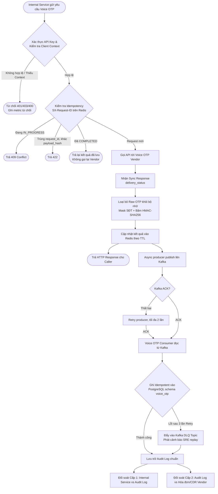
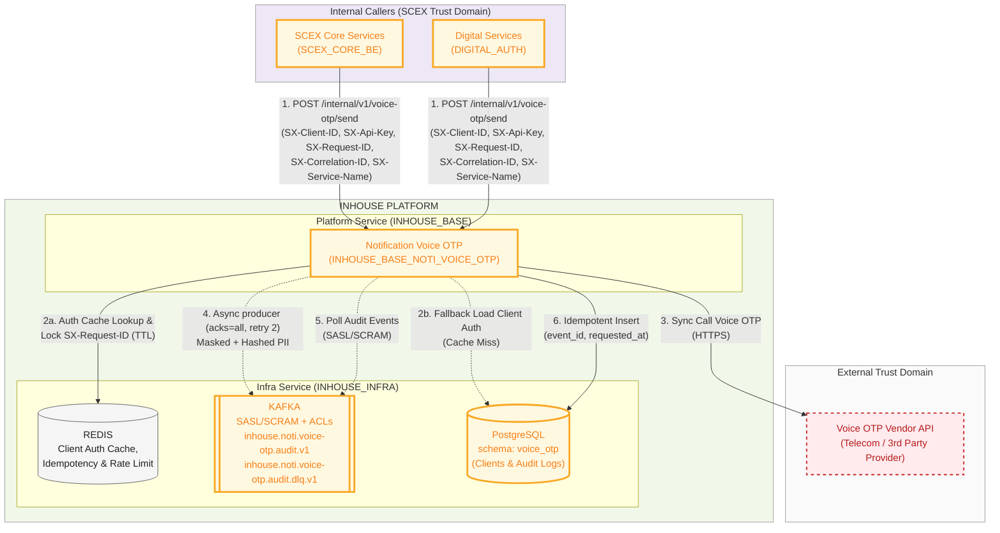
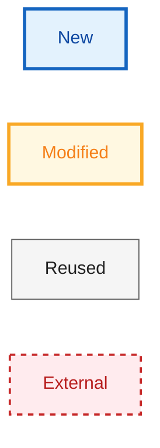
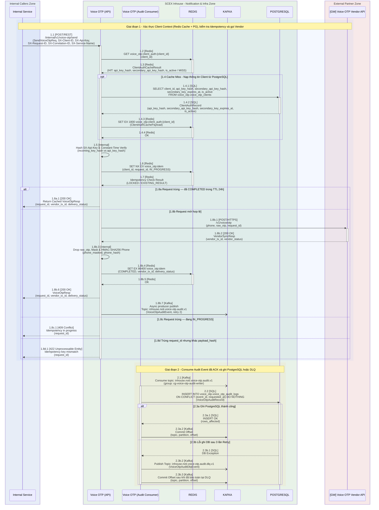
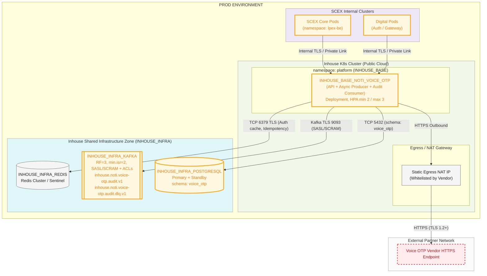

# HIGH LEVEL DESIGN — NOTIFICATION VOICE OTP (`INHOUSE_BASE_NOTI_VOICE_OTP`)

> **Mã tài liệu:** HLD-INHOUSE-VOICE-OTP  
> **Phiên bản:** 0.1  
> **Trạng thái:** Draft  
> **Mức độ bảo mật:** Internal

---

# 1. Quản trị tài liệu

## 1.1 Thông tin tài liệu

| Thuộc tính                         | Giá trị                                                       |
| ---------------------------------- | ------------------------------------------------------------- |
| Tên giải pháp/hệ thống             | Notification Voice OTP (`INHOUSE_BASE_NOTI_VOICE_OTP`)        |
| Mã tài liệu                        | HLD-INHOUSE-VOICE-OTP                                         |
| Business Owner                     | Khối Vận hành / FinOps & Các đơn vị nghiệp vụ (Core, Digital) |
| System/Service Owner               | PTSP (Platform Service)                                       |
| Solution Architect                 | duc.mm (SDO)                                                  |
| Tech Lead(s)                       | truong.bv                                                     |
| Security/Privacy Reviewer          | ATTT                                                          |
| Infrastructure/Operations Reviewer | SRE / DevOps                                                  |
| Repository/Link                    | [Gitlab](https://gitlab.scex.com.vn/base/base-notification)   |
| Tài liệu thay thế bởi/thay thế cho | N/A                                                           |
| Ngày review tiếp theo              | N/A                                                           |

## 1.2 Lịch sử thay đổi

| Phiên bản | Ngày       | Tác giả | Thay đổi chính                                                                              | Trạng thái |
| --------- | ---------- | ------- | ------------------------------------------------------------------------------------------- | ---------- |
| 0.1       | 2026-10-14 | duc.mm  | Khởi tạo thiết kế HLD cho module Notification Voice OTP và luồng Event-Driven Audit Logging | Draft      |

## 1.3 Review và phê duyệt

| Vai trò               | Người/đơn vị | Phạm vi review                                                               | Kết quả | Ngày  | Bằng chứng/link |
| --------------------- | ------------ | ---------------------------------------------------------------------------- | ------- | ----- | --------------- |
| Business Owner        | FinOps / Ops | Mục tiêu đối soát 2 cấp, phân bổ chi phí theo Client Context, SLO nghiệp vụ  | Pending | [TBD] | [TBD]           |
| Solution Architecture | SDO          | Kiến trúc Event-Driven qua Kafka, Idempotency Redis, Data model PostgreSQL   | Pending | [TBD] | [TBD]           |
| An toàn thông tin     | ATTT         | Xác thực API Key, Kafka SASL/SCRAM & ACLs, PII Masking/Hashing, Drop Raw OTP | Pending | [TBD] | [TBD]           |
| Hạ tầng/Vận hành/SRE  | SRE / DevOps | Kafka retention/replication, Zero Data Loss, Redis HA, alerting              | Pending | [TBD] | [TBD]           |
| Data Owner/DPO        | DPO          | Tuân thủ bảo vệ dữ liệu cá nhân (SĐT), không lưu trữ mã OTP nguyên bản       | Pending | [TBD] | [TBD]           |
| Pháp chế/Compliance   | Pháp chế     | Thời hạn lưu trữ dữ liệu audit log phục vụ đối soát và kiểm toán             | Pending | [TBD] | [TBD]           |

## 1.4 Tài liệu tham chiếu

| ID     | Tài liệu/tiêu chuẩn                                   | Phiên bản/ngày | Vai trò trong HLD                                               | Link                                                             |
| ------ | ----------------------------------------------------- | -------------- | --------------------------------------------------------------- | ---------------------------------------------------------------- |
| REF-01 | Cấu trúc và Quy chuẩn Logging Ứng dụng SCEX           | 1.0            | Quy chuẩn JSON flatten log và không ghi PII vào application log |                                                                  |
| REF-02 | Nghị định 13/2023/NĐ-CP & Luật Bảo vệ dữ liệu cá nhân | Current        | Quy định bảo vệ dữ liệu cá nhân (số điện thoại người dùng)      | [Văn bản](https://vanban.chinhphu.vn/?pageid=27160&docid=207759) |

## 1.5 Thuật ngữ và từ viết tắt

| Thuật ngữ                     | Định nghĩa trong phạm vi tài liệu                                                                                                                                      |
| ----------------------------- | ---------------------------------------------------------------------------------------------------------------------------------------------------------------------- |
| `INHOUSE_BASE_NOTI_VOICE_OTP` | Dịch vụ nền tảng (Platform Service) thuộc cụm Inhouse chịu trách nhiệm nhận yêu cầu từ các Internal Service, gọi nhà cung cấp Voice OTP và ghi nhận Audit Log.         |
| Caller / Internal Service     | Các dịch vụ nội bộ trong hệ sinh thái SCEX (SCEX Core, Digital Auth) gọi vào API của `INHOUSE_BASE_NOTI_VOICE_OTP` để yêu cầu phát cuộc gọi OTP.                       |
| Client Context                | Bộ thông tin định danh và ngữ cảnh bắt buộc do Caller truyền lên (`SX-Client-ID`, `SX-Api-Key`, `SX-Request-ID`, `SX-Correlation-ID`, `SX-Service-Name`).              |
| Voice OTP Vendor              | Đối tác viễn thông/nhà cung cấp dịch vụ Voice OTP bên ngoài SCEX nhận lệnh thực hiện cuộc gọi thoại đọc mã OTP tới số điện thoại người dùng cuối.                      |
| Raw OTP                       | Mã xác thực một lần dạng rõ (plaintext) do Caller truyền sang để đọc cho người dùng; tuyệt đối không được lưu log, Kafka hay Database tại tầng Notification.           |
| PII Masking & Hashing         | Kỹ thuật che giấu số điện thoại (ví dụ `+8491***6789`) kết hợp băm mật mã một chiều có khóa (`HMAC-SHA256`) để vừa bảo vệ PII vừa cho phép tra cứu/đối soát chính xác. |
| CDR (Call Detail Record)      | File dữ liệu chi tiết cuộc gọi và bảng kê tính cước do Voice OTP Vendor xuất định kỳ (hằng ngày/hằng tháng) để đối soát và thanh toán.                                 |

---

# 2. Tóm tắt điều hành

## 2.1 Vấn đề và giá trị giải pháp

Hệ thống gửi Voice OTP hiện tại đang được dùng chung cho nhiều Internal Service trong toàn hệ thống SCEX nhưng thiếu cơ chế quản trị định danh bên gọi (Client Context), thiếu phân quyền cô lập và chưa có luồng ghi nhận Audit Log chuẩn hóa, bền vững. Hệ quả là vận hành và FinOps không thể bóc tách, thống kê hay đối soát được sản lượng sử dụng cũng như phân bổ chi phí chính xác cho từng Internal Service; đồng thời thường xuyên xảy ra tình trạng lệch dữ liệu không rõ nguyên nhân khi đối chiếu với file hóa đơn/CDR của nhà cung cấp (Vendor).

Giải pháp xây dựng kiến trúc **Event-Driven Audit Logging qua Kafka** cho module `INHOUSE_BASE_NOTI_VOICE_OTP`, chuẩn hóa Client Context, áp dụng phân quyền truy cập chặt chẽ (API Key ở tầng ứng dụng và SASL/SCRAM + ACLs ở tầng Kafka), thực thi bảo vệ dữ liệu cá nhân (loại bỏ Raw OTP, mask và hash số điện thoại) và lưu trữ bền vững trên PostgreSQL. Luồng gọi Voice OTP trả kết quả không đợi Kafka. Async producer đẩy audit event (`acks=all`, retry). Event đã được Kafka ACK thì Consumer ghi PostgreSQL hoặc DLQ.

## 2.2 Giải pháp đề xuất

Xây dựng và chuẩn hóa module **`INHOUSE_BASE_NOTI_VOICE_OTP`** nằm trong hạ tầng Inhouse (Base Service), kết nối với các thành phần hạ tầng sẵn có (`REDIS`, `KAFKA`, `POSTGRESQL`):

- **Chuẩn hóa API, Xác thực `client_id/secrets` (PostgreSQL + Redis Cache) & Client Context:** Mọi Internal Service khi gọi API gửi Voice OTP bắt buộc truyền bộ header định danh (`SX-Client-ID`, `SX-Api-Key`, `SX-Request-ID`, `SX-Correlation-ID`, `SX-Service-Name`). Danh mục `client_id` và bản băm khóa bí mật (`api_key_hash` — tuyệt đối không lưu plaintext) được lưu trữ trong `POSTGRESQL` (`voice_otp.voice_otp_clients`) và kết hợp **Caching Layer trên `REDIS`** (`voice_otp:client_auth:{client_id}`) theo mô hình Cache-Aside để xác thực với độ trễ `< 1–2ms`. Khi cấp mới hoặc rotate key, `api_key` dạng rõ chỉ hiển thị **duy nhất một lần**.
- **Chống trùng lặp (Idempotency):** Sử dụng `REDIS` để khóa và kiểm tra trùng lặp theo cặp `(SX-Client-ID, SX-Request-ID)` kèm TTL, ngăn chặn tuyệt đối việc retry từ Caller làm phát sinh cuộc gọi kép tốn chi phí.
- **Tích hợp đồng bộ với Vendor & Tách luồng Async Audit qua Kafka:** Sau khi gọi đồng bộ (Sync) tới API của Voice OTP Vendor và nhận phản hồi, service loại bỏ mã Raw OTP khỏi bộ nhớ, thực hiện mask + `HMAC-SHA256` số điện thoại, rồi trả kết quả cho Caller. Tiến trình async producer đẩy `VoiceOtpAuditEvent` lên Kafka (`acks=all`); nếu publish thất bại thì retry. Consumer ghi PostgreSQL.
- **Consumer nội bộ & Lưu trữ đối soát 2 cấp trên PostgreSQL:** Worker/Consumer thuộc `INHOUSE_BASE_NOTI_VOICE_OTP` consume event từ Kafka (cơ chế at-least-once, có retry và Dead Letter Queue - DLQ) để ghi idempotent vào `POSTGRESQL` (`schema voice_otp`), cung cấp nguồn dữ liệu chuẩn duy nhất (System of Record) cho đối soát Cấp 1 (Internal Services vs Voice OTP) và Cấp 2 (Voice OTP vs Vendor).

## 2.3 Kết quả và chỉ số thành công

| ID     | Loại              | Kết quả mong đợi                                                                                 | Chỉ số/đơn vị                                                           | Baseline               | Target                                   | Thời điểm đo           | Owner             |
| ------ | ----------------- | ------------------------------------------------------------------------------------------------ | ----------------------------------------------------------------------- | ---------------------- | ---------------------------------------- | ---------------------- | ----------------- |
| BR-01  | Kết quả nghiệp vụ | Bóc tách được 100% sản lượng và chi phí Voice OTP theo từng Internal Service                     | % request có đầy đủ `client_id`, `request_id` hợp lệ trong Audit Log    | -                      | **100%**                                 | Hằng ngày / tháng      | FinOps / PTSP     |
| SLO-01 | SLO trải nghiệm   | Thời gian xử lý API gửi Voice OTP nội bộ nhanh nhờ tách ghi log async qua Kafka                  | `p95 latency` xử lý tại `INHOUSE_BASE_NOTI_VOICE_OTP` (overhead nội bộ) | -                      | **< 200 ms**                             | Liên tục (Realtime)    | PTSP / SRE        |
| SLO-02 | SLO vận hành      | Event audit đã được Kafka ACK không bị mất trên đường ghi DB                                     | Tỷ lệ event Kafka đã ACK có trong PostgreSQL hoặc DLQ                   | Thiếu hụt log          | **100% event đã ACK nằm ở DB hoặc DLQ**  | Liên tục / Hằng ngày   | SRE / PTSP        |
| SLO-03 | Kết quả nghiệp vụ | Đối soát khớp hoàn toàn sản lượng và trạng thái với nhà cung cấp Voice OTP và các bên gọi nội bộ | Tỷ lệ khớp dữ liệu đối soát 2 cấp (sau khi loại trừ sai lệch có lý do)  | Lệch với hóa đơn       | **100%**                                 | Kỳ đối soát ngày/tháng | FinOps / Vận hành |
| SLA-01 | SLA dependency    | Nhà cung cấp Voice OTP phản hồi API khởi tạo cuộc gọi đúng cam kết hợp đồng                      | Timeout / Availability của Sync API phía Vendor                         | Theo hợp đồng hiện hữu | **Timeout <= 3s, Availability >= 99.5%** | Hằng tháng             | Vendor Owner      |

## 2.4 Tóm tắt phạm vi

### Trong phạm vi

- Thiết kế REST API gửi Voice OTP trên `INHOUSE_BASE_NOTI_VOICE_OTP` với cơ chế xác thực `Client-ID` / `API Key` (lưu trữ băm mật mã trên `POSTGRESQL` kết hợp Caching Layer trên `REDIS`, chính sách cấp/rotate key hiển thị 1 lần duy nhất) và chuẩn hóa `Client Context`.
- Cơ chế Idempotency chống gọi trùng bằng `SX-Request-ID` và `REDIS` (TTL).
- Cơ chế bảo vệ dữ liệu nhạy cảm: hủy bỏ Raw OTP ngay sau khi gọi Vendor; che giấu (`phone_masked`) và băm một chiều có khóa (`phone_hash` bằng `HMAC-SHA256`) đối với số điện thoại.
- Luồng Event-Driven Audit Logging bất đồng bộ qua `KAFKA` (async producer, retry 2 lần khi publish thất bại, Consumer nội bộ, Topic DLQ).
- Thiết lập phân quyền cô lập trên cụm Kafka dùng chung qua `SASL/SCRAM` và `Kafka ACLs`.
- Thiết kế cơ sở dữ liệu trên `POSTGRESQL` (`schema voice_otp`) lưu trữ Audit Log và dữ liệu phục vụ truy vấn/đối soát 2 cấp.

### Ngoài phạm vi

- Thiết kế chi tiết giao diện người dùng (UI) cho màn hình quản trị hoặc màn hình đối soát.
- Không có luồng callback gọi về từ Vendor.
- Logic nghiệp vụ sinh mã OTP, quản lý vòng đời hiệu lực mã OTP và xác thực mã OTP (vẫn thuộc trách nhiệm của từng Internal Service gọi sang).

### Giai đoạn sau

- Xây dựng giao diện UI Dashboard tự động hóa đối soát và cảnh báo bất thường chi phí theo thời gian thực trên Portal.

## 2.5 Tác động và quyết định cần phê duyệt

| Hạng mục                                   | Tóm tắt                                                                                                                                                        |
| ------------------------------------------ | -------------------------------------------------------------------------------------------------------------------------------------------------------------- |
| Người dùng bị ảnh hưởng                    | Các Internal Service (cần bổ sung đủ 5 header `SX-*` khi gọi API); đội ngũ Vận hành / FinOps thực hiện đối soát chi phí.                                       |
| Hệ thống/dữ liệu bị ảnh hưởng              | Mới/Nâng cấp: `INHOUSE_BASE_NOTI_VOICE_OTP`, schema `voice_otp` trên `POSTGRESQL`, topic và ACL mới trên `KAFKA`, key-space trên `REDIS`.                      |
| Thay đổi quy trình vận hành                | Cấp phát `Client-ID` & `API Key` riêng cho từng Internal Service; thiết lập quy trình giám sát DLQ trên Kafka và quy trình đối soát 2 cấp định kỳ.             |
| Rủi ro cao nhất                            | Kafka từ chối publish sau 2 lần retry của async producer thì event audit không được giữ.                                                                       |
| Chi phí/capacity chính                     | Dung lượng lưu trữ bảng `voice_otp_audit_logs` trên PostgreSQL (partition theo tháng) và throughput/storage cho topic Kafka tương ứng với tổng lưu lượng OTP.  |
| Quyết định cần cấp có thẩm quyền phê duyệt | ATTT/DPO phê duyệt phương án lưu trữ `phone_masked` + `phone_hash` (`HMAC-SHA256`); Pháp chế/Kế toán xác nhận thời hạn lưu trữ (Retention) phục vụ quyết toán. |

---

# 3. Bối cảnh

## 3.1 Phạm vi giải pháp

**System-of-interest** là dịch vụ **`INHOUSE_BASE_NOTI_VOICE_OTP`** nằm trong nhóm `INHOUSE_BASE` (Platform Service) thuộc cụm K8s Inhouse. Hệ thống đóng vai trò cổng điều phối tập trung cho kênh Voice OTP:

- **Inbound Trust Boundary:** Tiếp nhận yêu cầu từ các Internal Service thuộc các miền `SCEX_CORE` (ví dụ: `SCEX_CORE_BE`) và `DIGITAL` (ví dụ: `DIGITAL_AUTH`). Các hệ thống gọi chỉ truyền số điện thoại đích, mã OTP cần đọc và ngữ cảnh gọi (`Client Context`), không trực tiếp gọi ra Vendor và không can thiệp vào luồng ghi Audit Log.
- **Internal Infra Boundary:** Tương tác với `REDIS` để kiểm soát Idempotency/Rate-limit, `KAFKA` để publish event bất đồng bộ, và `POSTGRESQL` (`schema voice_otp`) làm System of Record cho dữ liệu Audit Log phục vụ đối soát.
- **External Trust Boundary:** Kết nối đồng bộ qua HTTPS tới hệ thống API của **Voice OTP Vendor** nằm ngoài trust domain của SCEX.

## 3.2 Hiện trạng và thay đổi

| Nội dung                      | Hiện trạng                                                                                                                                                 | Sau thay đổi                                                                                                                                                                                                     |
| ----------------------------- | ---------------------------------------------------------------------------------------------------------------------------------------------------------- | ---------------------------------------------------------------------------------------------------------------------------------------------------------------------------------------------------------------- |
| `INHOUSE_BASE_NOTI_VOICE_OTP` | Dùng chung endpoint, không bắt buộc định danh từng service; Audit Log ghi không đầy đủ hoặc ghi rời rạc vào file log ứng dụng, dễ thất lạc và khó truy vấn | Bổ sung xác thực `Client-ID` / `API Key`. Ghi nhận Audit Log theo kiến trúc Event-Driven: publish async vào `KAFKA` sau khi nhận response từ Vendor, Consumer ghi bền vững vào `POSTGRESQL` (`schema voice_otp`) |
| Internal Service              | Gọi API gửi Voice OTP mà không truyền hoặc không chuẩn hóa thông tin định danh                                                                             | Bổ sung `Client Context` (`SX-Client-ID`, `SX-Api-Key`, `SX-Request-ID`, `SX-Correlation-ID`, `SX-Service-Name`) khi gửi yêu cầu                                                                                 |
| Vận hành                      | Không có nguồn số liệu tập trung theo từng Internal Service; đối soát lệch với hóa đơn/CDR của Vendor                                                      | Lấy nguồn đối soát chính xác từ database PostgreSQL của `INHOUSE_BASE_NOTI_VOICE_OTP` (`schema voice_otp`) — System of Record cho sản lượng và chi phí theo từng Internal Service                                |

## 3.3 Các nguyên tắc kiến trúc

1. **Async-first Audit:** Ghi PostgreSQL không nằm trên đường chờ của Caller. Sau Sync Response từ Vendor, luồng HTTP trả response và giao event đã khử PII cho async producer. Producer đẩy lên Kafka (`acks=all`) và retry 2 lần nếu thất bại.
2. **Least Privilege & Isolation:** Mỗi Internal Service gọi vào Voice OTP phải có định danh và khóa xác thực riêng. Trên cụm Kafka, chỉ `INHOUSE_BASE_NOTI_VOICE_OTP` được cấp quyền Produce/Consume thông qua cơ chế xác thực `SASL/SCRAM` và phân quyền `ACLs`; các service khác không có quyền đọc hay ghi.
3. **Data Minimization & Privacy:** Tuyệt đối không lưu trữ hoặc truyền mã `Raw OTP` và số điện thoại nguyên bản (`Raw PII`) lên Kafka hay cơ sở dữ liệu PostgreSQL. Mã OTP chỉ tồn tại trên RAM trong thời gian gọi Vendor; số điện thoại phải được che giấu (`phone_masked`) và băm một chiều có khóa (`phone_hash` qua `HMAC-SHA256`) ngay tại `INHOUSE_BASE_NOTI_VOICE_OTP` trước khi tạo sự kiện audit.
4. **Idempotency hai lớp tách biệt:** Redis chặn retry của Caller theo cặp `(client_id, SX-Request-ID)`. Consumer ghi PostgreSQL chặn Kafka gửi lại theo `PRIMARY KEY (event_id, requested_at)`. Hai lớp không dùng chung một khóa.

## 3.4 Giả định và ràng buộc

### Giả định

| ID     | Giả định                                                                                                                          | Cơ sở                                        | Owner xác nhận | Hạn xác nhận      | Tác động nếu sai                                                                                                   | Trạng thái |
| ------ | --------------------------------------------------------------------------------------------------------------------------------- | -------------------------------------------- | -------------- | ----------------- | ------------------------------------------------------------------------------------------------------------------ | ---------- |
| ASM-01 | Sync Response từ API của Voice OTP Vendor luôn trả về mã giao dịch duy nhất (`vendor_tx_id`) và mã trạng thái tiếp nhận rõ ràng   | Tài liệu tích hợp API của đối tác Voice OTP  | Vendor Owner   | Trước Design Gate | Nếu Vendor không trả `vendor_tx_id` đồng bộ, đối soát Cấp 2 phải khớp theo tổ hợp `(phone_hash, cửa sổ thời gian)` | Open       |
| ASM-02 | Hóa đơn/file CDR đối soát định kỳ từ Vendor có chứa `vendor_tx_id` (hoặc `request_id` do SCEX truyền sang) và thời gian phát sinh | Quy trình đối soát cước viễn thông hiện hành | FinOps / Ops   | Trước UAT         | Cần xây dựng bộ parser chuẩn hóa file CDR và thuật toán khớp mờ (fuzzy time-window matching) nếu thiếu ID          | Open       |
| ASM-03 | Tất cả các Internal Service (Caller) có khả năng sinh và truyền `SX-Request-ID` (UUID) duy nhất cho mỗi lần yêu cầu gửi OTP       | Quy chuẩn API nội bộ SCEX                    | Tech Leads     | Trước Build       | Các Caller cũ chưa truyền `SX-Request-ID` sẽ bị từ chối (`400 Bad Request`) sau thời gian ân hạn chuyển đổi        | Open       |

### Ràng buộc

| ID     | Ràng buộc                                                                                                               | Loại               | Nguồn/owner    | Hệ quả kiến trúc                                                                                                        | Có thể thay đổi? |
| ------ | ----------------------------------------------------------------------------------------------------------------------- | ------------------ | -------------- | ----------------------------------------------------------------------------------------------------------------------- | ---------------- |
| CST-01 | Sử dụng cụm hạ tầng dùng chung sẵn có của Inhouse (`KAFKA`, `REDIS`, `POSTGRESQL`)                                      | Technology / Infra | SRE / Platform | Phải thiết lập cô lập tài nguyên bằng schema riêng (`voice_otp`), key prefix riêng và Kafka ACLs + SASL/SCRAM           | Không            |
| CST-02 | Tuân thủ quy định bảo vệ dữ liệu cá nhân và bảo mật xác thực: không lưu Raw OTP và không để lộ SĐT nguyên bản trong log | Legal / Security   | ATTT / DPO     | Phải thực hiện Masking + `HMAC-SHA256` trước khi đẩy vào Kafka; quản lý khóa `HMAC_SECRET_KEY` tập trung trên Vault/K8s | Không            |
| CST-03 | Chỉ sử dụng Sync Response từ Vendor, không có luồng Webhook/Callback bất đồng bộ từ Vendor trong giai đoạn này          | Technology / Scope | Kiến trúc chốt | Trạng thái ghi nhận trong Audit Log là trạng thái bàn giao thành công/thất bại tại thời điểm Vendor phản hồi Sync API   | Có (Giai đoạn 2) |
| CST-04 | Đảm bảo latency luồng chính `< 200ms` (SLO-01) và giữ event audit đã vào Kafka (SLO-02)                                 | Business / NFR     | Product / SRE  | Async producer lên Kafka, retry 2 lần khi thất bại; ghi DB nằm ở Consumer                                               | Không            |

---

# 4. Luồng nghiệp vụ

## 4.1 Thay đổi đối với luồng hiện hữu

Luồng mới bổ sung kiểm soát `Client Context`, khóa trùng lặp trên Redis trước khi gọi Vendor, async producer đẩy Audit Event lên Kafka (retry 2 lần), và đối soát 2 cấp trên PostgreSQL.

## 4.2 Các luồng nghiệp vụ trong phạm vi

| Luồng                                   | Điểm bắt đầu                                                                   | Kết quả thành công                                                                                                                                     | Thất bại/fallback                                                                                                                                                                                                                 |
| --------------------------------------- | ------------------------------------------------------------------------------ | ------------------------------------------------------------------------------------------------------------------------------------------------------ | --------------------------------------------------------------------------------------------------------------------------------------------------------------------------------------------------------------------------------- |
| **L1. Gửi Voice OTP và khóa trùng**     | Internal Service gọi `POST /internal/v1/voice-otp/send` kèm đủ 5 header `SX-*` | Xác thực hợp lệ, khóa `SX-Request-ID` trên Redis, gọi Vendor, trả kết quả. Overhead nội bộ `p95 < 200ms`, không tính thời gian Vendor                  | Sai key/context: `401/403/400`. Vượt rate limit: `429`. Đang `IN_PROGRESS`: `409`. Khác `payload_hash`: `422`. Đã `COMPLETED`: trả kết quả đã lưu. Read timeout / `502` / `504`: không retry Vendor, `delivery_status = UNKNOWN`. |
| **L2. Async producer và ghi Audit Log** | Đã có Sync Response từ Vendor                                                  | Raw OTP đã hủy, SĐT đã mask + hash, async producer đẩy Kafka (`acks=all`, retry 2 lần). Consumer ghi `ON CONFLICT (event_id, requested_at) DO NOTHING` | Producer hết 2 lần retry vẫn lỗi: alert Sev1, không ghi outbox local. Consumer lỗi sau 3 lần: đẩy DLQ, commit sau DLQ ACK, alert Sev1.                                                                                            |

---

# 5. Application architecture

## 5.1 Kiến trúc logic

> System-of-interest ở trung tâm (`INHOUSE_BASE_NOTI_VOICE_OTP`). Phân biệt thành phần mới, thay đổi, tái sử dụng và trust domain bên ngoài.

Hai lớp ký hiệu, không trộn ý nghĩa:

| Lớp                            | Dùng cho                     | Cách thể hiện                                           |
| ------------------------------ | ---------------------------- | ------------------------------------------------------- |
| Delta thành phần (node)        | Reviewer soi thay đổi        | `classDef` + viền theo bảng dưới                        |
| Trust domain / zone (subgraph) | Vùng trách nhiệm, môi trường | Fill nhạt theo vùng; không dùng cùng màu với delta node |

| Loại     | Ý nghĩa                                 | Ký hiệu node                                                  |
| -------- | --------------------------------------- | ------------------------------------------------------------- |
| New      | Thành phần mới                          | Viền xanh, `stroke-width:3px`, fill `#E3F2FD` — `:::new`      |
| Modified | Thành phần sửa đổi                      | Viền vàng, `stroke-width:3px`, fill `#FFF8E1` — `:::modified` |
| Reused   | Tái sử dụng, trách nhiệm không đổi      | Viền xám, `stroke-width:1px`, fill `#F5F5F5` — `:::reused`    |
| External | Hệ thống bên ngoài / ngoài trust domain | Viền đỏ nét đứt, fill `#FFEBEE` — `:::external`               |

Các quyết định cấu trúc (cơ chế chi tiết ở mục 3.3, 5.4 và 8.1):

1. **Một cổng điều phối:** Mọi Internal Service gửi Voice OTP qua `INHOUSE_BASE_NOTI_VOICE_OTP`, không gọi thẳng Vendor.
2. **Xác thực Client Context:** Mỗi request bắt buộc đủ 5 header `SX-*` (`SX-Client-ID`, `SX-Api-Key`, `SX-Request-ID`, `SX-Correlation-ID`, `SX-Service-Name`). Mỗi Caller có `SX-Client-ID` và `SX-Api-Key` riêng; `api_key_hash` nằm ở PostgreSQL và được cache trên Redis (mục 8.1).
3. **Idempotency trước khi gọi Vendor:** Redis khóa theo `(client_id, SX-Request-ID)` để chặn cuộc gọi trùng (mục 5.4).
4. **Tách critical path và audit:** HTTP trả Caller ngay sau Sync Response; async producer đẩy Kafka, Consumer của cùng service ghi PostgreSQL và phục vụ đối soát 2 cấp (mục 3.3, 5.4).
5. **Khử PII và cô lập Kafka:** Bỏ Raw OTP, mask và hash số điện thoại trước khi event rời bộ nhớ; chỉ principal của Voice OTP được Produce/Consume topic audit (mục 8.1).

## 5.2 Thành phần, chức năng và công nghệ

| Thành phần                                   | Chức năng chính                                                                                | Công nghệ/triển khai           |
| -------------------------------------------- | ---------------------------------------------------------------------------------------------- | ------------------------------ |
| **`INHOUSE_BASE_NOTI_VOICE_OTP` (modified)** | Xác thực Client Context, khóa idempotency, gọi Vendor, khử PII rồi publish và ghi audit event. | Microservice trên K8s Inhouse  |
| **Internal Callers (modified)**              | Gọi `POST /internal/v1/voice-otp/send` kèm đủ 5 header `SX-*`.                                 | Service hiện hữu Core, Digital |

## 5.3 Ranh giới và tích hợp

| ID   | Giao diện                        | Mục đích                                 | Quy tắc mức cao                                                                                                                         |
| ---- | -------------------------------- | ---------------------------------------- | --------------------------------------------------------------------------------------------------------------------------------------- |
| I-01 | Internal Callers → Voice OTP API | Yêu cầu gửi Voice OTP                    | HTTPS nội bộ, Sync; bắt buộc đủ 5 header `SX-*` (`SX-Client-ID`, `SX-Api-Key`, `SX-Request-ID`, `SX-Correlation-ID`, `SX-Service-Name`) |
| I-02 | Voice OTP ↔ Redis                | Auth cache, idempotency, rate limit      | TLS + Redis ACL; key `voice_otp:client_auth:{client_id}`, `voice_otp:idem:{client_id}:{request_id}`, `voice_otp:rl:{client_id}`         |
| I-03 | Voice OTP → Vendor               | Gửi lệnh gọi OTP                         | HTTPS qua Egress NAT whitelist, Sync; không có webhook inbound                                                                          |
| I-04 | Producer → Kafka                 | Publish audit event                      | SASL/SCRAM + TLS; `WRITE` topic `inhouse.noti.voice-otp.audit.v1`; `acks=all`                                                           |
| I-05 | Consumer ↔ Kafka                 | Consume event, đẩy DLQ                   | `READ` `inhouse.noti.voice-otp.audit.v1` (group `cg-voice-otp-audit-writer`); `READ`/`WRITE` `inhouse.noti.voice-otp.audit.dlq.v1`      |
| I-06 | Voice OTP → PostgreSQL           | Đọc Client khi cache miss, ghi Audit Log | TLS; user `voice_otp_app`: `SELECT` trên `voice_otp_clients`; `SELECT`/`INSERT` trên `voice_otp_audit_logs`; không có `UPDATE`/`DELETE` |

**Chiều gọi và cô lập ranh giới:**

- Mọi kết nối tới Voice OTP Vendor là **chiều outbound duy nhất** đi qua `INHOUSE_BASE_NOTI_VOICE_OTP`; không mở bất kỳ inbound webhook/callback nào từ Vendor vào mạng nội bộ SCEX trong phạm vi giai đoạn này.
- Các Internal Service tuyệt đối không được ghi thẳng vào topic Kafka hay schema `voice_otp` của PostgreSQL; mọi bản ghi audit phải được sinh ra từ chính `INHOUSE_BASE_NOTI_VOICE_OTP` sau khi có kết quả thực thi để đảm bảo tính xác thực của bằng chứng đối soát.

## 5.4 Quy tắc xử lý lỗi và consistency

- **Retry Vendor:** chỉ retry khi lỗi xảy ra trước lúc gửi payload (connect timeout, TLS handshake). Read timeout, `502`, `504` thì không retry, ghi `delivery_status = UNKNOWN` để đối soát Cấp 2 kiểm tra riêng. Vendor có idempotent theo `request_id` hay không còn mở tại OI-02 (mục 9.1).
- **Idempotency (Redis),** key `voice_otp:idem:{client_id}:{request_id}`:
  - `SET NX EX 10` với trạng thái `IN_PROGRESS` + `payload_hash`.
  - Request trùng khi đang `IN_PROGRESS` → `409`.
  - Đã `COMPLETED` (TTL 24h) → trả kết quả đã lưu, không gọi Vendor, không sinh event mới.
  - Trùng `request_id` nhưng khác `payload_hash` → `422`.
  - `SUBMITTED` hoặc `UNKNOWN` (Read timeout / `502` / `504`): ghi `COMPLETED` kèm `delivery_status` tương ứng, TTL 24h, để chặn Caller retry gây gọi lặp.
  - `FAILED` rõ ràng từ Vendor: ghi `COMPLETED` với `delivery_status = FAILED`, TTL 24h; replay trả kết quả lỗi, không gọi lại Vendor.
  - Lỗi trước lúc gửi payload (connect timeout, TLS handshake): `DEL` khóa `IN_PROGRESS` để Caller retry cùng `SX-Request-ID` (cuộc gọi chưa rời SCEX).
- **Timeout:** Vendor connect `500ms` + read `2000ms`. SLO-01 chỉ đo overhead nội bộ, không tính thời gian Vendor (`p95 < 200ms`).
- **Publish Kafka (async producer):**
  - Không ghi outbox xuống đĩa local. Event đã khử PII được giao cho async producer (`acks=all`, `enable.idempotence=true`). Luồng HTTP không đợi Kafka ACK.
  - Consumer tắt auto-commit, chỉ commit offset sau khi `INSERT ... ON CONFLICT (event_id, requested_at) DO NOTHING` thành công.
  - Consumer retry 3 lần với exponential backoff khi lỗi ghi PostgreSQL. Vẫn lỗi thì đẩy DLQ, commit sau khi DLQ ACK, alert Sev1.
- **Redis lỗi (fail-open có đánh dấu):**
  - Xác thực: dùng near-cache trong Pod (TTL ≤ 60s) và fallback xuống PostgreSQL. Trong lúc Redis lỗi, lệnh revoke có thể trễ tối đa bằng TTL near-cache.
  - Idempotency: dùng cache trong RAM từng Pod, nên vẫn có thể gọi trùng giữa các Pod. Event mang cờ `idem_degraded = true` để đối soát xử lý.
  - Fail-open hay fail-closed (`503`) cần ATTT/Product chốt → OI-01 (mục 9.1).
- **Auth cache:** Cache-Aside TTL 30 phút ± jitter. Negative cache 60s cho `client_id` không tồn tại. Mọi thay đổi trên `voice_otp_clients` thì `COMMIT` xong phải `DEL` key cache ngay.

---

# 6. Sequence diagram (runtime view)

## 6.1 Luồng gửi Voice OTP, Idempotency và Async Audit Logging (`SD-NOTI-voice-otp-send-01`)

**Bảng SD-NOTI-voice-otp-send-01 — Chi tiết luồng Gửi Voice OTP & Async Audit Logging**

| STT        | Source                         | Target                     | Protocol     | API / Endpoint / Topic                                                 | Description                                                                                                            | Payload / Schema                                                                                                                  | Error & Retry Policy                                                                                                                                       | Data Classification | Trace ID            |
| ---------- | ------------------------------ | -------------------------- | ------------ | ---------------------------------------------------------------------- | ---------------------------------------------------------------------------------------------------------------------- | --------------------------------------------------------------------------------------------------------------------------------- | ---------------------------------------------------------------------------------------------------------------------------------------------------------- | ------------------- | ------------------- |
| **1.1**    | Internal Caller                | Voice OTP API              | REST / HTTPS | `POST /internal/v1/voice-otp/send`                                     | Internal Service gửi yêu cầu gọi Voice OTP kèm đủ 5 header `SX-*`                                                      | **Headers:** `SX-Client-ID`, `SX-Api-Key`, `SX-Request-ID`, `SX-Correlation-ID`, `SX-Service-Name` **Body:** `SendVoiceOtpReq` | Timeout: 3s Retry: cùng `SX-Request-ID` 400/401/403 nếu thiếu hoặc sai header 429 nếu vượt rate limit                                             | Sensitive (PII+OTP) | I-01 / BR-01        |
| **1.2**    | Voice OTP API                  | `INHOUSE_INFRA_REDIS`      | TCP / Redis  | `GET voice_otp:client_auth:{client_id}`                                | Tra cứu thông tin xác thực Client và `api_key_hash` từ Redis Caching Layer                                             | Key: `voice_otp:client_auth:{client_id}`                                                                                          | Timeout: 10ms Nếu Redis lỗi: đọc L1 Local Cache hoặc fallback thẳng xuống PostgreSQL                                                                    | Confidential        | I-02 / NFR-PERF-01  |
| **1.3**    | `INHOUSE_INFRA_REDIS`          | Voice OTP API              | TCP / Redis  | Redis Reply                                                            | Trả Cache Hit (`api_key_hash`, `secondary_api_key_hash`, `is_active`) hoặc Cache Miss (`null`)                         | `ClientAuthCacheResult` (`HIT: api_key_hash, secondary_api_key_hash, is_active / MISS`)                                           | Nếu hit Negative Cache (`NOT_FOUND`): từ chối ngay `401 Unauthorized`, không query DB                                                                      | Confidential        | I-02                |
| **1.4.1**  | Voice OTP API                  | `INHOUSE_INFRA_POSTGRESQL` | TCP / SQL    | `SELECT ... FROM voice_otp.voice_otp_clients WHERE client_id = ?`      | (Khi Cache Miss) SELECT `client_id`, `api_key_hash`, `secondary_api_key_hash`, `secondary_key_expires_at`, `is_active` | `client_id`                                                                                                                       | Query timeout: 500ms; chỉ chạy khi Redis Cache Miss                                                                                                        | Confidential        | I-06 / NFR-SEC-01   |
| **1.4.2**  | `INHOUSE_INFRA_POSTGRESQL`     | Voice OTP API              | TCP / SQL    | SQL ResultSet                                                          | Trả bản ghi cấu hình xác thực của Client (chỉ chứa mã băm, không có plaintext key)                                     | `api_key_hash`, `secondary_api_key_hash`, `secondary_key_expires_at`, `is_active`                                                 | Nếu không tồn tại trong DB: chuẩn bị ghi Negative Cache                                                                                                    | Confidential        | I-06                |
| **1.4.3**  | Voice OTP API                  | `INHOUSE_INFRA_REDIS`      | TCP / Redis  | `SET EX 1800 voice_otp:client_auth:{client_id}`                        | Nạp cấu hình xác thực Client vào Redis Cache (TTL 30 phút; hoặc 60s nếu `NOT_FOUND`)                                   | `ClientAuthCachePayload`                                                                                                          | Timeout: 10ms; lỗi ghi cache không chặn luồng chính                                                                                                        | Confidential        | I-02 / NFR-PERF-01  |
| **1.4.4**  | `INHOUSE_INFRA_REDIS`          | Voice OTP API              | TCP / Redis  | `OK`                                                                   | Xác nhận đã lưu Cache xác thực Client                                                                                  | `OK`                                                                                                                              | —                                                                                                                                                          | Internal            | I-02                |
| **1.5**    | Voice OTP API                  | Voice OTP API              | Internal     | `ClientContextGuard.validate()`                                        | Băm `HMAC-SHA256(raw_key, PEPPER)`, so sánh constant-time với `api_key_hash`                                           | `incoming_key_hash`, `api_key_hash`, `secondary_api_key_hash`, `is_active`                                                        | Từ chối ngay với `401 Unauthorized` (sai/hết hạn key) hoặc `403 Forbidden` (`is_active = false`)                                                           | Confidential        | NFR-SEC-01          |
| **1.6**    | Voice OTP API                  | `INHOUSE_INFRA_REDIS`      | TCP / Redis  | `SET voice_otp:idem:{client_id}:{request_id}`                          | Kiểm tra và khóa nguyên tử `SX-Request-ID` với trạng thái `IN_PROGRESS`                                                | Value: `{status: IN_PROGRESS, payload_hash}` TTL: `10s`                                                                        | Timeout: 20ms Fallback: In-memory cache nếu Redis lỗi                                                                                                   | Internal            | I-02 / NFR-REL-01   |
| **1.7**    | `INHOUSE_INFRA_REDIS`          | Voice OTP API              | TCP / Redis  | Redis Reply                                                            | Trả trạng thái khóa mới (`LOCKED`) hoặc bản ghi đã tồn tại (`EXISTING_RESULT`)                                         | `{state, cached_response}`                                                                                                        | `409 Conflict` nếu request đang `IN_PROGRESS`; `422` nếu trùng key nhưng khác `payload_hash`                                                               | Internal            | I-02                |
| **1.8a.1** | Voice OTP API                  | Internal Caller            | HTTP         | `200 OK` (Idempotent Hit)                                              | Trả về kết quả `COMPLETED` đã lưu trên Redis, không gọi lại Vendor, không sinh event mới                               | **Resp:** `VoiceOtpResp` (`request_id`, `vendor_tx_id`, `delivery_status`, `idempotent_replayed: true`)                           | Không gọi Vendor, không publish event mới                                                                                                                  | Internal            | SLO-01 / NFR-REL-01 |
| **1.8b.1** | Voice OTP API                  | Voice OTP Vendor API       | REST / HTTPS | `POST /v1/voice/otp`                                                   | Gọi đồng bộ sang đối tác Voice OTP để khởi tạo cuộc gọi đọc mã OTP                                                     | `phone`, `raw_otp`, `request_id`, `caller_id_number`                                                                              | Connect timeout: 500ms, Read timeout: 2000ms **Không tự retry** khi Read Timeout (tránh lặp cuộc gọi)                                                   | Sensitive (PII+OTP) | I-03 / SLA-01       |
| **1.8b.2** | Voice OTP Vendor API           | Voice OTP API              | HTTPS        | `200 OK` / Vendor Error                                                | Vendor trả về mã giao dịch `vendor_tx_id` và trạng thái tiếp nhận đồng bộ                                              | `VendorSyncResp` (`vendor_tx_id`, `vendor_status`, `vendor_code`)                                                                 | Submit thành công → `delivery_status = SUBMITTED`. Read timeout / `502` / `504` → `UNKNOWN` (không retry). Lỗi từ chối rõ → `FAILED`                       | Internal            | I-03 / SLO-03       |
| **1.8b.3** | Voice OTP API                  | Voice OTP API              | Internal     | `PiiSanitizer.sanitizeAndDiscardOtp()`                                 | Xóa bỏ `raw_otp` khỏi bộ nhớ; tạo `phone_masked` và băm `HMAC-SHA256`                                                  | Input: `phone`, `raw_otp` → Output: `phone_masked` (`+8491***6789`), `phone_hash`                                                 | `raw_otp` không còn tồn tại sau bước này                                                                                                                   | Confidential        | NFR-PRV-01          |
| **1.8b.4** | Voice OTP API                  | `INHOUSE_INFRA_REDIS`      | TCP / Redis  | `SET EX 86400 voice_otp:idem:{client_id}:{request_id}`                 | Ghi `COMPLETED` (TTL 24h) khi `delivery_status` là `SUBMITTED`, `UNKNOWN` hoặc `FAILED` rõ                             | `{status: COMPLETED, vendor_tx_id, delivery_status}`                                                                              | Lỗi trước payload: `DEL` `IN_PROGRESS`, không ghi `COMPLETED` (mục 5.4). Timeout: 20ms; lỗi cập nhật Redis chỉ log warn, không chặn trả kết quả cho Caller | Internal            | I-02                |
| **1.8b.5** | `INHOUSE_INFRA_REDIS`          | Voice OTP API              | TCP / Redis  | `OK`                                                                   | Xác nhận đã cập nhật cache Idempotency                                                                                 | `OK`                                                                                                                              | —                                                                                                                                                          | Internal            | I-02                |
| **1.8b.6** | Voice OTP API                  | Internal Caller            | HTTP         | `200 OK`                                                               | Trả kết quả cho Caller; không đợi Kafka ACK và không ghi outbox local                                                  | **Resp:** `VoiceOtpResp` (`request_id`, `vendor_tx_id`, `delivery_status`)                                                        | SLO-01 chỉ đo overhead nội bộ, không tính Vendor (`p95 < 200ms`; ngân sách thiết kế `< 50ms`)                                                              | Internal            | I-01 / SLO-01       |
| **1.8b.7** | Voice OTP API (async producer) | `INHOUSE_INFRA_KAFKA`      | Kafka / SASL | Topic: `inhouse.noti.voice-otp.audit.v1`                               | Async producer publish event đã khử PII. Không có local outbox                                                         | Schema: `VoiceOtpAuditEvent` (key = `event_id`, không chứa `raw_otp` hay raw `phone`)                                             | `acks=all`, `enable.idempotence=true`, **retry 2 lần**. Hết 2 lần vẫn lỗi → alert Sev1                                                                     | Confidential        | I-04 / SLO-02       |
| **1.8c.1** | Voice OTP API                  | Internal Caller            | HTTP         | `409 Conflict`                                                         | Request trùng trong lúc Redis còn `IN_PROGRESS`                                                                        | `request_id`                                                                                                                      | Không gọi Vendor, không sinh event                                                                                                                         | Internal            | I-02                |
| **1.8d.1** | Voice OTP API                  | Internal Caller            | HTTP         | `422 Unprocessable Entity`                                             | Trùng `request_id` nhưng khác `payload_hash`                                                                           | `request_id`                                                                                                                      | Không gọi Vendor, không ghi đè kết quả đã lưu                                                                                                              | Internal            | I-02                |
| **2.1**    | Voice OTP Audit Consumer       | `INHOUSE_INFRA_KAFKA`      | Kafka / SASL | Topic: `inhouse.noti.voice-otp.audit.v1` (`cg-voice-otp-audit-writer`) | Consumer poll batch sự kiện Audit từ Kafka                                                                             | Batch `VoiceOtpAuditEvent`                                                                                                        | `enable.auto.commit=false`; xác thực `SASL/SCRAM-SHA-512`                                                                                                  | Confidential        | I-05 / SLO-02       |
| **2.2**    | Voice OTP Audit Consumer       | `INHOUSE_INFRA_POSTGRESQL` | TCP / SQL    | `INSERT INTO voice_otp.voice_otp_audit_logs`                           | Ghi bền vững bản ghi Audit (`ON CONFLICT (event_id, requested_at) DO NOTHING`)                                         | Table: `voice_otp.voice_otp_audit_logs`                                                                                           | Transaction timeout: 2s Retry: 3 lần với Exponential Backoff khi lỗi kết nối DB                                                                         | Confidential        | I-06 / SLO-02       |
| **2.3a.1** | `INHOUSE_INFRA_POSTGRESQL`     | Voice OTP Audit Consumer   | TCP / SQL    | SQL Result                                                             | Xác nhận đã ghi bản ghi Audit thành công vào PostgreSQL                                                                | `rows_affected`                                                                                                                   | —                                                                                                                                                          | Internal            | I-06                |
| **2.3a.2** | Voice OTP Audit Consumer       | `INHOUSE_INFRA_KAFKA`      | Kafka / SASL | `commitSync()`                                                         | Commit offset sau khi đã lưu bền vững vào DB                                                                           | `topic`, `partition`, `offset`                                                                                                    | Nếu commit lỗi và đọc lại: bước `2.2` bỏ qua an toàn nhờ `PRIMARY KEY (event_id, requested_at)`                                                            | Internal            | I-05 / SLO-02       |
| **2.3b.1** | `INHOUSE_INFRA_POSTGRESQL`     | Voice OTP Audit Consumer   | TCP / SQL    | SQL Exception                                                          | Báo lỗi ghi DB sau 3 lần retry                                                                                         | `error_code`, `error_message`                                                                                                     | Kích hoạt nhánh bảo toàn dữ liệu qua DLQ                                                                                                                   | Internal            | I-06                |
| **2.3b.2** | Voice OTP Audit Consumer       | `INHOUSE_INFRA_KAFKA`      | Kafka / SASL | Topic: `inhouse.noti.voice-otp.audit.dlq.v1`                           | Đẩy event đã consume nhưng không ghi được DB sang DLQ để replay                                                        | Schema: `VoiceOtpAuditDlqEvent` (gồm event gốc + metadata lỗi)                                                                    | `acks=all`; commit offset chỉ sau DLQ ACK; cảnh báo tức thời (**Alert Sev1**) cho SRE để replay                                                            | Confidential        | I-05 / SLO-02       |
| **2.3b.3** | Voice OTP Audit Consumer       | `INHOUSE_INFRA_KAFKA`      | Kafka / SASL | `commitSync()`                                                         | Commit offset bản ghi đã chuyển sang DLQ để không làm tắc nghẽn partition                                              | `topic`, `partition`, `offset`                                                                                                    | Chỉ commit sau khi broker xác nhận đã ghi thành công vào topic DLQ                                                                                         | Internal            | I-05 / SLO-02       |

**Invariant của luồng 6.1:** Chính sách lỗi và retry của từng bước nằm ở cột Error & Retry Policy trong bảng trên. Không lưu plaintext API key, Raw OTP và Raw PII (mục 8.1). Producer và Consumer xử lý lỗi theo mục 5.4.

---

# 7. Deployment và sizing

## 7.1 Mô hình triển khai logic

> Thể hiện environment, zone, network/security zone, ingress/egress và dependency hạ tầng. Quy ước delta node giống mục 5.1; subgraph fill là zone/môi trường.

`lpex-be` là namespace SCEX Core hiện hữu (cùng quy ước với HLD Transaction Monitor), không đổi tên.

`INHOUSE_BASE_NOTI_VOICE_OTP` chạy **Deployment**. Audit event do async producer đẩy lên Kafka, không ghi outbox xuống đĩa local nên không gắn PVC cho outbox.

## 7.2 Công thức sizing tối thiểu

Giả định cơ sở (Baseline & Peak), sizing lấy cận trên:

- Lưu lượng: `1,000 – 2,000 cuộc gọi/ngày`. Trung bình ở cận trên: $2{,}000 / 86{,}400 \approx 0.023 \text{ RPS}$.
- Đỉnh điểm: toàn bộ `2,000` cuộc dồn vào `1` giờ cao điểm $\Rightarrow 2{,}000 / 3{,}600 \approx 0.6 \text{ RPS}$, làm tròn **`1 RPS`**. Headroom $\times 3 \Rightarrow$ thiết kế chịu tải **`3 RPS`**.
- Kích thước trung bình 1 bản ghi: Redis Value $\approx 250 \text{ Bytes}$; Kafka Event $\approx 600 \text{ Bytes}$; PostgreSQL Row (kèm 3 index) $\approx 1.2 \text{ KB}$.
- Năng lực 1 Pod (`limit 1 vCPU`): $\approx 50 \text{ RPS}$.

| Thành phần                    | Đơn vị scale            | Giả định workload                 | Công thức / headroom                                                                                          | Ghi chú                                                                                           |
| ----------------------------- | ----------------------- | --------------------------------- | ------------------------------------------------------------------------------------------------------------- | ------------------------------------------------------------------------------------------------- |
| `INHOUSE_BASE_NOTI_VOICE_OTP` | Pod (`1 vCPU, 1GB RAM`) | Peak thiết kế `3 RPS`             | $3 / 50 \approx 0.06 \Rightarrow$ **`1` Pod**. HA và rolling update dùng HPA **min 2, max 3**                 | Deployment. Không PVC outbox. Producer retry 2 lần trên bộ nhớ tiến trình. Không đặt replica tĩnh |
| `INHOUSE_INFRA_REDIS`         | Memory (MB)             | `2,000 req/ngày`, TTL `24h`       | $2{,}000 \times 250 \text{ B} \times 2 \text{ (overhead)} \approx \mathbf{1 \text{ MB}}$                      | Rất nhẹ, dùng chung cụm Redis Inhouse hiện hữu                                                    |
| `INHOUSE_INFRA_KAFKA`         | Partition & Disk        | `2,000 evt/ngày`, giữ `7 ngày`    | $2{,}000 \times 600 \text{ B} \times 7 \times 3 \text{ (RF)} \approx \mathbf{25 \text{ MB}}$                  | `3 Partitions` cho topic chính, `1 Partition` cho topic DLQ. Tăng partition khi vượt `3 RPS`      |
| `INHOUSE_INFRA_POSTGRESQL`    | Storage (GB/năm)        | `2,000 dòng/ngày`, giữ `12 tháng` | $2{,}000 \times 1.2 \text{ KB} \times 365 \times 1.3 \text{ (bloat/WAL)} \approx \mathbf{1.1 \text{ GB/năm}}$ | Partition theo từng tháng (`voice_otp_audit_logs_y2026m10`...)                                    |

## 7.3 Kết quả sizing cần phê duyệt

| Hạng mục            | Giá trị đề xuất                                                                                                                | Cần phê duyệt bởi | Trạng thái |
| ------------------- | ------------------------------------------------------------------------------------------------------------------------------ | ----------------- | ---------- |
| Compute / replica   | HPA **min 2, max 3** Pod (`request: 500m CPU, 512Mi RAM`; `limit: 1000m CPU, 1Gi RAM`). Tải thiết kế `3 RPS` nằm trong `1` Pod | SRE / Platform    | Pending    |
| Storage / retention | PostgreSQL `~1.1 GB/năm` (online 12 tháng); Kafka `~25 MB` (DLQ gần như rỗng)                                                  | DBA / SRE         | Pending    |
| Quota / rate limit  | Rate-limit mặc định `1 RPS / Client-ID`, tổng ngưỡng bảo vệ Vendor `3 RPS`                                                     | Vendor / SRE      | Pending    |
| Chi phí vận hành    | Tận dụng cụm K8s, Kafka, Redis, PostgreSQL sẵn có của Inhouse (chi phí tăng thêm không đáng kể ở mức `2.000` cuộc/ngày)        | FinOps            | Pending    |

## 7.4 Observability

Toàn bộ log ứng dụng của `INHOUSE_BASE_NOTI_VOICE_OTP` tuân thủ nghiêm ngặt quy chuẩn JSON (`REF-01`).

| Signal  | Source/instrumentation                          | Key SLI/use                                                                                                                                   | Alert/dashboard owner |
| ------- | ----------------------------------------------- | --------------------------------------------------------------------------------------------------------------------------------------------- | --------------------- |
| Metrics | Prometheus (Micrometer / OpenTelemetry Metrics) | `voice_otp_internal_duration_ms` (SLI cho SLO-01), `voice_otp_vendor_duration_ms`, `voice_otp_kafka_dlq_total`, `voice_otp_producer_failures` | SRE / PTSP            |
| Logs    | JSON Flatten Log → ELK / Kibana (`REF-01`)      | Có đầy đủ `timestamp`, `trace_id`, `span_id`, `http_request_id`, `scex_correlation_id`, `client_id`; **tuyệt đối không có `raw_otp`/SĐT**     | PTSP / ATTT           |
| Traces  | OpenTelemetry W3C Trace Context (`traceparent`) | Nối mạch trace từ `Internal Caller` → `Voice OTP API` → `Kafka Header` → `Audit Consumer` → `PostgreSQL`                                      | SRE / PTSP            |
| Events  | Cấu hình `voice_otp_clients`                    | Sự kiện thay đổi cấu hình `voice_otp_clients`                                                                                                 | FinOps / Vận hành     |

## 7.5 Dependencies

| Dependency                     | Owner/SLA                            | Failure symptom                                | Detection                                | Fallback/degradation                                                                                                                                          | Escalation        | Exit strategy                                               |
| ------------------------------ | ------------------------------------ | ---------------------------------------------- | ---------------------------------------- | ------------------------------------------------------------------------------------------------------------------------------------------------------------- | ----------------- | ----------------------------------------------------------- |
| **Voice OTP Vendor API**       | Vendor Owner (`SLA >= 99.5%`, `<3s`) | HTTP 5xx, Read Timeout, từ chối kết nối        | Metric `voice_otp_vendor_errors_total`   | Không retry khi read timeout / `502` / `504`; ghi `delivery_status = UNKNOWN` để đối soát Cấp 2. Lỗi từ chối rõ → `FAILED`                                    | Vendor Support    | Thiết kế Adapter đa đối tác để chuyển đổi sang Vendor thứ 2 |
| **`INHOUSE_INFRA_KAFKA`**      | SRE / Platform (`99.95%`)            | Producer không nhận ACK, Broker không khả dụng | Metric `voice_otp_producer_failures`     | Async producer retry 2 lần (`acks=all`). Hết 2 lần vẫn lỗi thì alert Sev1. Không ghi outbox local                                                             | On-call SRE       | Hạ tầng chuẩn của SCEX Inhouse                              |
| **`INHOUSE_INFRA_REDIS`**      | SRE / Platform (`99.9%`)             | Connection timeout / Cluster election          | Metric `voice_otp_redis_errors_total`    | Fail-open có đánh dấu: near-cache auth (TTL ≤ 60s) + RAM idempotency từng Pod, event gắn `idem_degraded = true`. Chốt fail-open hay `503` tại OI-01 (mục 9.1) | On-call SRE       | Hạ tầng chuẩn của SCEX Inhouse                              |
| **`INHOUSE_INFRA_POSTGRESQL`** | DBA / SRE (`99.95%`)                 | Consumer không `INSERT` được bản ghi Audit     | Consumer retry fail + Cảnh báo `DLQ > 0` | Giữ sự kiện an toàn trên Kafka (retention 7 ngày) hoặc chuyển vào Topic DLQ (retention 30 ngày) chờ DB phục hồi                                               | On-call DBA / SRE | Hạ tầng chuẩn của SCEX Inhouse                              |

---

# 8. Bảo mật, dữ liệu cá nhân, tuân thủ và NFR

Tài sản cần bảo vệ trong giải pháp này bao gồm: (1) **Mã xác thực `Raw OTP`** đang trên đường truyền (nếu lộ sẽ dẫn tới chiếm đoạt tài khoản/giao dịch của người dùng), (2) **Dữ liệu cá nhân (PII — số điện thoại người dùng)** theo Nghị định 13/2023/NĐ-CP và Luật Bảo vệ dữ liệu cá nhân, (3) **Tính toàn vẹn và chống chối bỏ của dữ liệu Audit Log** phục vụ đối soát tài chính với Vendor và phân bổ chi phí nội bộ, và (4) **Quyền truy cập cụm Kafka dùng chung và hạn mức gọi Vendor**.

## 8.1 Kênh kết nối và ranh giới tin cậy

Trust boundary được kiểm soát chặt chẽ dựa trên định danh (`Client-ID`, `SASL Principal`), kiểm soát quyền tối thiểu (`Least Privilege ACLs`) và khử dữ liệu nhạy cảm ngay tại biên xử lý:

| Hop                                                            | Cơ chế bảo mật                                                                                                                                                                         | Hệ quả HLD                                                                                                                                                                                                 |
| -------------------------------------------------------------- | -------------------------------------------------------------------------------------------------------------------------------------------------------------------------------------- | ---------------------------------------------------------------------------------------------------------------------------------------------------------------------------------------------------------- |
| **Internal Callers ↔ `INHOUSE_BASE_NOTI_VOICE_OTP`**           | Internal HTTPS/TLS; xác thực bằng `SX-Client-ID` và `SX-Api-Key`. Chỉ lưu `api_key_hash = HMAC-SHA256(raw_key, PEPPER)` trên PostgreSQL và Redis. Key hiển thị một lần khi cấp/rotate. | Mỗi Internal Service có credential riêng; so khớp constant-time. Khi Redis sẵn sàng, rotate/revoke xóa cache ngay sau `COMMIT`. Khi Redis lỗi, revoke có thể trễ bằng TTL near-cache (mục 5.4).            |
| **`INHOUSE_BASE_NOTI_VOICE_OTP` ↔ `INHOUSE_INFRA_REDIS`**      | TLS + Redis ACL. User riêng của Voice OTP chỉ được truy cập prefix `voice_otp:*`.                                                                                                      | Redis đang chứa `api_key_hash`. User khác trên cụm Redis dùng chung không đọc được key-space này.                                                                                                          |
| **`INHOUSE_BASE_NOTI_VOICE_OTP` ↔ `INHOUSE_INFRA_KAFKA`**      | Giao thức `SASL_SSL` (`SASL/SCRAM-SHA-512`) kết hợp `Kafka ACLs` nghiêm ngặt trên cụm Kafka dùng chung.                                                                                | Principal `svc_voice_otp` chỉ có quyền `WRITE`/`READ` trên topic `inhouse.noti.voice-otp.audit.v1` và `inhouse.noti.voice-otp.audit.dlq.v1`. Các service khác trên cụm Kafka dùng chung bị chặn hoàn toàn. |
| **`INHOUSE_BASE_NOTI_VOICE_OTP` ↔ `INHOUSE_INFRA_POSTGRESQL`** | Kết nối nội bộ qua TLS; tài khoản DB riêng (`voice_otp_app`) chỉ có quyền trên `schema voice_otp`.                                                                                     | User `voice_otp_app` có `SELECT` trên `voice_otp_clients` và `SELECT`/`INSERT` trên `voice_otp_audit_logs`; thu hồi `UPDATE`/`DELETE`/`TRUNCATE`.                                                          |
| **`INHOUSE_BASE_NOTI_VOICE_OTP` → Voice OTP Vendor**           | Outbound HTTPS (TLS 1.2+); xác thực bằng API Token/Signature của Vendor; giới hạn IP nguồn tại Egress NAT Gateway.                                                                     | Chỉ `INHOUSE_BASE_NOTI_VOICE_OTP` giữ secret kết nối Vendor và được phép đi qua Egress NAT ra Vendor; các Internal Service không được gọi thẳng ra Vendor.                                                 |

**Invariant bảo mật:**

- **Chuỗi hop bắt buộc:** `Internal Caller` → `INHOUSE_BASE_NOTI_VOICE_OTP` → `Voice OTP Vendor`. Không thành phần nào được phép đi tắt qua chuỗi này.
- **Không lưu trữ Plaintext API Key, Raw OTP và Raw PII:** `SX-Api-Key` chỉ hiển thị 1 lần duy nhất khi khởi tạo/rotate và chỉ được lưu dưới dạng băm (`api_key_hash`) trong PostgreSQL và Redis; `raw_otp` bị hủy ngay trên bộ nhớ sau khi gọi Vendor; số điện thoại bắt buộc được mask (`+8491***6789`) và băm `HMAC-SHA256` với khóa bí mật lưu trên Secret Manager/Vault trước khi đi vào Redis, Kafka hay PostgreSQL.
- **Cô lập tuyệt đối trên Kafka dùng chung:** Mọi kết nối ẩn danh (`ANONYMOUS`) hoặc từ principal của service khác tới topic `inhouse.noti.voice-otp.*` đều bị từ chối bởi Kafka Authorizer (`ACL Deny by Default`).

## 8.2 Yêu cầu đo được

| ID          | Nhóm         | Yêu cầu/target                                                                                                                                                                                  | Cách kiểm chứng                                                                                                                                      |
| ----------- | ------------ | ----------------------------------------------------------------------------------------------------------------------------------------------------------------------------------------------- | ---------------------------------------------------------------------------------------------------------------------------------------------------- |
| NFR-SEC-01  | Security     | 100% request thiếu/sai `SX-Client-ID` / `SX-Api-Key` bị từ chối (`401/403`); **0% `api_key` lưu dạng plaintext**; hash là `HMAC-SHA256(raw_key, PEPPER)`; key chỉ hiển thị 1 lần khi tạo/rotate | PenTest và inspection DB/Redis: chỉ có `api_key_hash`. Khi Redis sẵn sàng, revoke có hiệu lực sau `DEL` cache. Khi Redis lỗi, xem mục 5.4            |
| NFR-SEC-02  | Security     | Chống gọi trùng 100% với cùng `(client_id, SX-Request-ID)` trong TTL 24 giờ, trừ khi Redis lỗi (xem mục 5.4 và OI-01)                                                                           | Integration test bắn đồng thời và bắn lặp cùng `SX-Request-ID` → chỉ gọi Vendor đúng 1 lần khi Redis sẵn sàng                                        |
| NFR-PERF-01 | Performance  | **`p95` overhead nội bộ `< 200ms`** (`SLO-01`), không tính thời gian Vendor. Ngân sách thiết kế phần nội bộ `< 50ms`. Auth cache Redis `< 2ms`                                                  | Load test Peak `3 RPS` (mục 7.2); metric `voice_otp_internal_duration_ms` tách riêng `voice_otp_vendor_duration_ms`                                  |
| NFR-REL-01  | Resilience   | **SLO-02:** 100% event Kafka đã ACK có trong PostgreSQL hoặc DLQ. Producer retry 2 lần; không có local outbox. Hết 2 lần vẫn lỗi thì alert Sev1                                                 | Chaos test ngắt PostgreSQL: event đã nằm trên Kafka được ghi DB hoặc DLQ sau khi phục hồi. Ngắt Kafka: producer thất bại sau 2 lần retry và bắn Sev1 |
| NFR-PRV-01  | Privacy      | **0% bản ghi chứa `raw_otp` hoặc số điện thoại nguyên bản** trên Kafka, Redis, PostgreSQL và hệ thống Application Log (ELK)                                                                     | Quét tự động (Regex/DLP scan) trên payload Kafka, bảng `voice_otp_audit_logs` và Kibana index                                                        |
| NFR-AUD-01  | Audit        | **Đối soát khớp 100% (`SLO-03`)** giữa Internal Services với Audit Log (Cấp 1) và giữa Audit Log với file hóa đơn/CDR của Vendor (Cấp 2)                                                        | Chạy nghiệm thu đối soát Cấp 1 và Cấp 2 trên tập dữ liệu UAT và kỳ đối soát Production                                                               |
| NFR-AVL-01  | Availability | Độ sẵn sàng của `INHOUSE_BASE_NOTI_VOICE_OTP` đạt `>= 99.9%` (không cao hơn SLA Redis). **Không tính lỗi do Vendor** (Vendor `99.5%` nằm ở SLA-01). Nâng cấp không gián đoạn dịch vụ            | Uptime probe loại trừ lỗi Vendor; kiểm thử rolling trên Deployment dưới tải                                                                          |

---

# 9. Vấn đề còn mở

## 9.1 Các vấn đề phải chốt

Mọi mục dưới đây phải được chốt trước khi tài liệu chuyển sang Approved.

| OI    | Cần chốt                                                                                                                                                             | Owner          | Gate          |
| ----- | -------------------------------------------------------------------------------------------------------------------------------------------------------------------- | -------------- | ------------- |
| OI-01 | Khi Redis lỗi: giữ fail-open có đánh dấu (near-cache auth TTL ≤ 60s, idempotency trên RAM từng Pod, event gắn `idem_degraded = true`) hay chuyển fail-closed (`503`) | ATTT / Product | Design review |
| OI-02 | Vendor có idempotent theo `request_id` hay không. Nếu không, retry connect timeout có thể phát sinh cuộc gọi kép                                                     | Vendor Owner   | Trước UAT     |

---
