**TRADING ENGINE EXPLORER**

Tài liệu kiến trúc, triển khai & vận hành

**Phiên bản:** 1.0.0-a8

**Ngày:** 2026-09-28

**Phạm vi:** Kiến trúc, luồng dữ liệu, triển khai, vận hành

# 1. Tổng quan

**TE Explorer biến luồng event của Trading Engine (TE) thành dữ liệu tra cứu, giám sát và truy vết được.**

TE là core của sàn giao dịch coin tập trung, kiến trúc event sourcing trên Kafka + S3 — hoạt động như một "hộp đen" khó monitor. Explorer **đọc song song** các Kafka topic của TE bằng consumer group riêng, lưu vào ClickHouse và cung cấp Web Console / API / MCP cho đội vận hành.

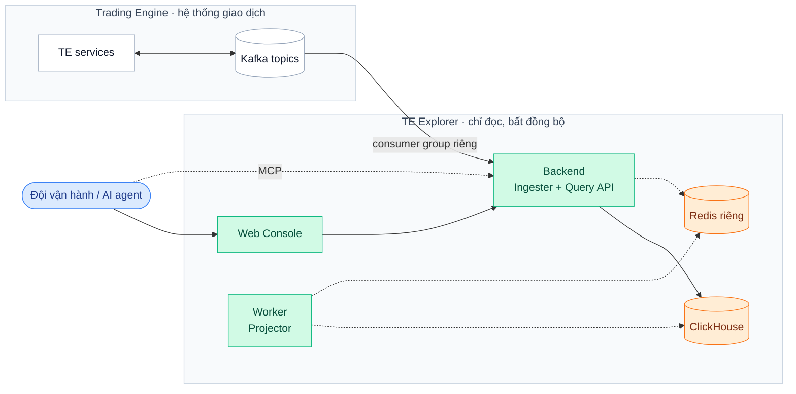

**Nguyên tắc cốt lõi:** Explorer không nằm trên đường xử lý lệnh, không ghi vào Kafka, không dùng chung group/offset/Redis keyspace với TE. Explorer lỗi hay chậm thì TE vẫn chạy bình thường.

# 2. Kiến trúc & cấu phần

## 2.1 Tổng thể

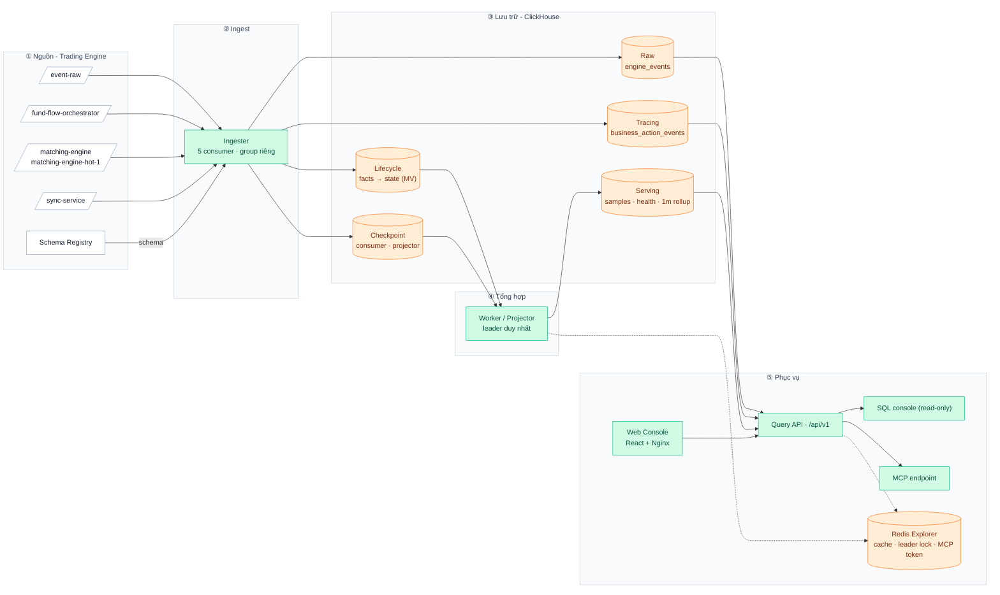

Dữ liệu đi **một chiều**: Kafka → Ingester → ClickHouse → Worker → bảng serving → API. Không cấu phần nào ghi ngược vào TE. S3 của TE hiện **không** được Explorer sử dụng (chỉ có khai báo config, chưa có luồng đọc).

## 2.2 Cấu phần

| **Cấu phần**           | **Trách nhiệm**                                                                                               | **Phụ thuộc**                      | **Source**                         |
| ---------------------- | ------------------------------------------------------------------------------------------------------------- | ---------------------------------- | ---------------------------------- |
| **Ingester**           | Consume Kafka, decode protobuf qua Schema Registry, lọc event, phân loại lifecycle, ghi batch, lưu checkpoint | Kafka, Schema Registry, ClickHouse | `internal/kafka`                   |
| **Worker (Projector)** | Từ lifecycle state dựng completed samples, in-flight health, rollup 1 phút; ghi pipeline status               | ClickHouse, Redis (leader lock)    | `internal/reconcile`               |
| **Query API**          | Auth, tra cứu event/order/deposit/withdrawal, timeline, metrics, dashboard                                    | ClickHouse, Redis (cache, token)   | `internal/query, internal/routers` |
| **SQL console**        | Chạy SQL tùy ý ở chế độ `readonly=1`, giới hạn rows/bytes/thời gian                                           | ClickHouse                         | `internal/sqlconsole`              |
| **MCP**                | Cho AI agent gọi các query API + SQL qua token riêng                                                          | Redis (token)                      | `internal/routers/mcp.go`          |
| **Web Console**        | Dashboard, tìm kiếm, timeline, payload, SQL, quản lý MCP token                                                | Query API                          | `te-explore-fe/src`                |
| **Migration job**      | Áp schema ClickHouse trước khi rollout (Helm hook)                                                            | ClickHouse                         | `migrations/`                      |

### Vai trò runtime

Backend là **một binary**; vai trò bật bằng ENV. Không đặt cờ nào ⇒ bật cả ba (dùng cho local).

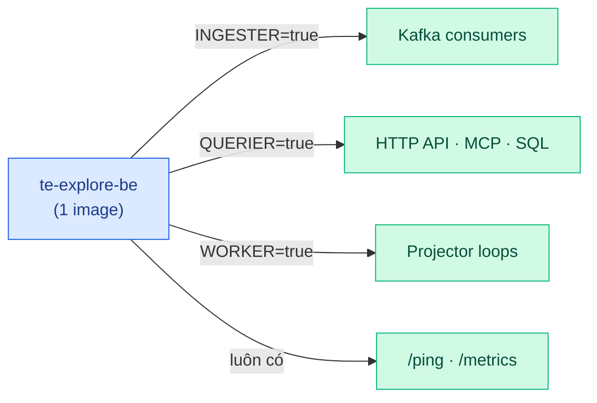

| **Deployment (Helm)** | **INGESTER** | **QUERIER** | **WORKER** | **Scale**                                                                |
| --------------------- | ------------ | ----------- | ---------- | ------------------------------------------------------------------------ |
| `te-explore-be`       | ✅           | ✅          | ❌         | Ingest song song tối đa = số partition; thêm replica cũng nhân tải query |
| `te-explore-worker`   | ❌           | ❌          | ✅         | Chỉ 1 leader làm việc; replica thêm chỉ để failover                      |
| `te-explore-fe`       | —            | —           | —          | Stateless                                                                |

## 2.3 Mô hình dữ liệu ClickHouse

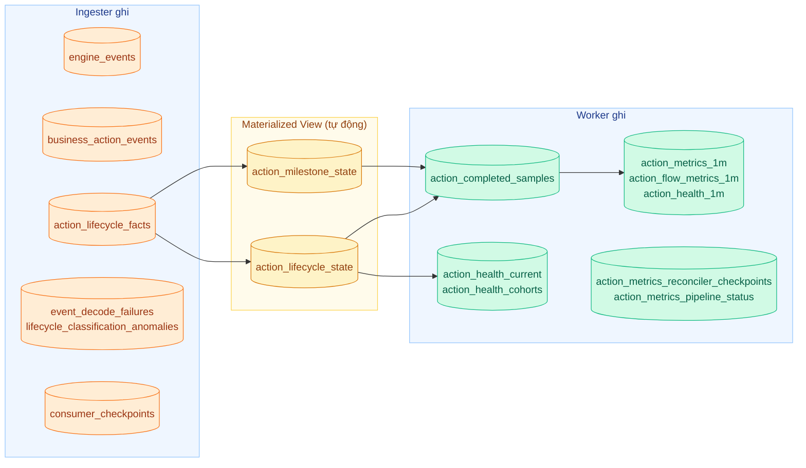

| **Lớp**   | **Bảng**                                                                                          | **Engine / khóa**                                                                 | **Ý nghĩa**                                                        |
| --------- | ------------------------------------------------------------------------------------------------- | --------------------------------------------------------------------------------- | ------------------------------------------------------------------ |
| Raw       | `engine_events`                                                                                   | `ReplacingMergeTree`, key (`topic`, `partition`, `offset`)                        | 1 dòng / Kafka record: payload, user/entity ID, vị trí Kafka       |
| Tracing   | `business_action_events`                                                                          | `ReplacingMergeTree`, key theo `action_type`, `entity_type`, `action_id`, `role…` | Gom event của cùng 1 nghiệp vụ (order, deposit, withdrawal, trade) |
| Lifecycle | `action_lifecycle_facts` → `action_lifecycle_state`, `action_milestone_state`                     | Facts: `ReplacingMergeTree`; State: `AggregatingMergeTree` qua MV                 | Mốc bắt đầu / phase / kết thúc của từng action                     |
| Serving   | `action_completed_samples`, `action_health_*`, `action_*_*1m`                                     | Worker ghi qua staging + `REPLACE PARTITION`                                      | Dữ liệu đã tổng hợp cho dashboard, histogram, in-flight            |
| Tiến độ   | `consumer_checkpoints`, `action_metrics_reconciler_checkpoints`, `action_metrics_pipeline_status` | `ReplacingMergeTree`                                                              | Resume ingest, cursor worker, freshness                            |
| Lỗi       | `event_decode_failures`, `lifecycle_classification_anomalies`                                     | `ReplacingMergeTree`                                                              | Dead-letter decode, event không khớp rule lifecycle                |

- **Idempotent khi replay:** key theo vị trí Kafka ⇒ đọc lại cùng offset chỉ tạo bản trùng tạm thời, được gộp khi merge (dùng `FINAL`/khử trùng khi cần số chính xác).
- **Retention:** TTL theo `expires_at` — mặc định **30 ngày**, một số event log hệ thống **72 giờ**; `pipeline_status` 30 ngày; completed samples 365 ngày. Explorer **không** phải kho lưu trữ vĩnh viễn của TE.
- **Thời gian:** lưu UTC; Web Console đổi timezone khi hiển thị.

## 2.4 Redis

| **Mục đích**       | **Key (prefix recent-events-storer:)** | **TTL**         | **Mất Redis thì**                           |
| ------------------ | -------------------------------------- | --------------- | ------------------------------------------- |
| Leader lock Worker | `action-metrics-projector`             | 30 s            | Worker dừng tổng hợp; ingest vẫn chạy       |
| Fencing generation | `action-metrics-generation` (INCR)     | —               | Leader cũ bị chặn ghi khi generation đổi    |
| Cache dashboard    | `dashboard:utc1:*`                     | 60 s (cấu hình) | API dashboard trả lỗi                       |
| MCP token          | theo user + token ID                   | 1–30 ngày       | MCP bị từ chối; login console vẫn dùng được |

Session đăng nhập console là **bearer token ký HMAC, không lưu Redis**. Key là cố định ⇒ mỗi môi trường Explorer cần Redis DB riêng.

## 2.5 Cô lập với TE

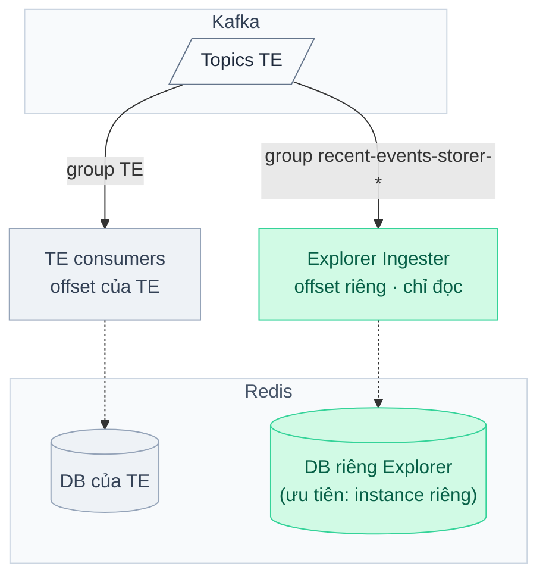

| **Tài nguyên** | **Yêu cầu bắt buộc**                                                                                             | **Lưu ý**                                                                                               |
| -------------- | ---------------------------------------------------------------------------------------------------------------- | ------------------------------------------------------------------------------------------------------- |
| Kafka          | Group ID riêng (`recent-events-storer-*`), credential riêng, ACL **chỉ READ** topic + quản lý group của Explorer | Code chỉ chặn trùng group trong cấu hình Explorer, không biết group của TE — kiểm tra khi review config |
| Redis          | Instance riêng; nếu dùng chung thì **DB index khác** TE (`REDIS_DB`)                                             | Khác DB chỉ tách keyspace, vẫn chung CPU/RAM/eviction. Redis là dependency bắt buộc khi khởi động       |
| ClickHouse     | Database riêng của Explorer                                                                                      | Query API có giới hạn range (168 h), limit, timeout; SQL console `readonly=1`                           |
| Mạng/IO        | Giới hạn tốc độ khi replay `earliest` lượng lớn                                                                  | Đọc Kafka vẫn cạnh tranh IO broker với TE                                                               |

# 3. Luồng xử lý

## 3.1 Ingest: Kafka → ClickHouse

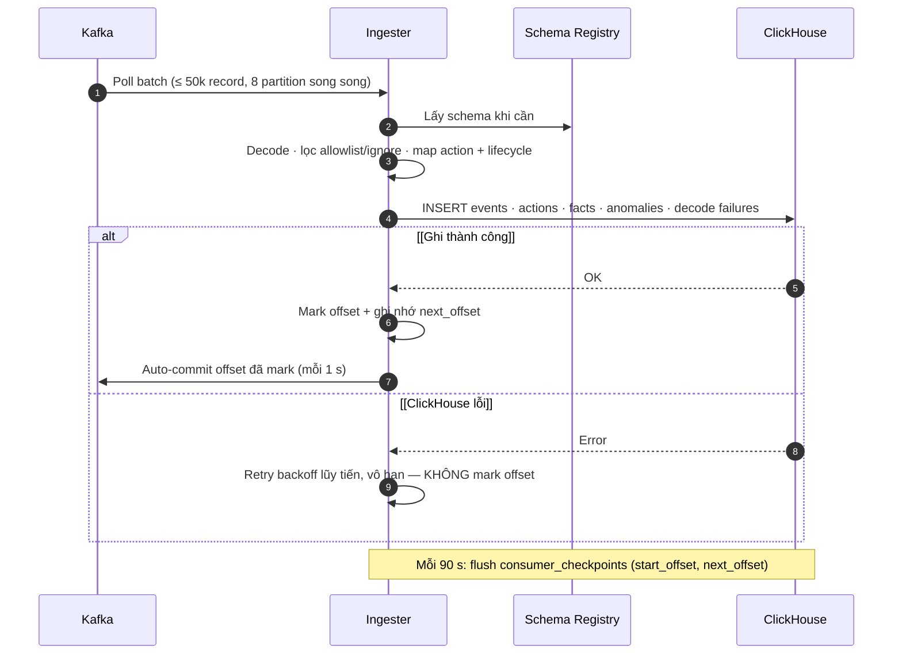

| **Quy tắc**                                               | **Hệ quả**                                                                                                          |
| --------------------------------------------------------- | ------------------------------------------------------------------------------------------------------------------- |
| Ghi ClickHouse **trước**, mark offset **sau**             | At-least-once; không mất event, có thể ghi trùng khi restart (được khử trùng theo (`topic`, `partition`, `offset`)) |
| Tuần tự trong partition, song song giữa partition         | Không có thứ tự toàn cục giữa các topic — tracing dựa vào `event_time` + action ID                                  |
| Event decode lỗi vẫn được ghi vào `event_decode_failures` | Batch không bị kẹt vì 1 record hỏng; cần điều tra và xử lý riêng                                                    |
| Event bị lọc (ngoài allowlist hoặc `ignores`)             | Không lưu, nhưng offset vẫn tiến                                                                                    |
| ClickHouse down                                           | Ingester đứng chờ, lag tăng; TE không bị ảnh hưởng                                                                  |

### Consumer đang cấu hình

| **Consumer**            | **Topic**                | **Group ID**                                 | **Lọc**                                      |
| ----------------------- | ------------------------ | -------------------------------------------- | -------------------------------------------- |
| `ingress`               | `event-raw`              | `recent-events-storer-event-raw`             | Mọi event (`*`) trừ `ignores`                |
| `fund-flow`             | `fund-flow-orchestrator` | `recent-events-storer-fund-flow`             | Mốc điều phối deposit/withdrawal/order/trade |
| `matching-engine`       | `matching-engine`        | `recent-events-storer-matching-engine`       | `*_order.fund_locked`, `cancel_requested`    |
| `matching-engine-hot-1` | `matching-engine-hot-1`  | `recent-events-storer-matching-engine-hot-1` | Như trên                                     |
| `terminal`              | `sync-service`           | `recent-events-storer-sync-service`          | Mốc settle / fail / fill progress            |

Danh sách đầy đủ: config/config.yaml → kafka.consumers. TE thêm topic hoặc event type mới ⇒ phải cập nhật allowlist.

## 3.2 Resume sau restart / rebalance

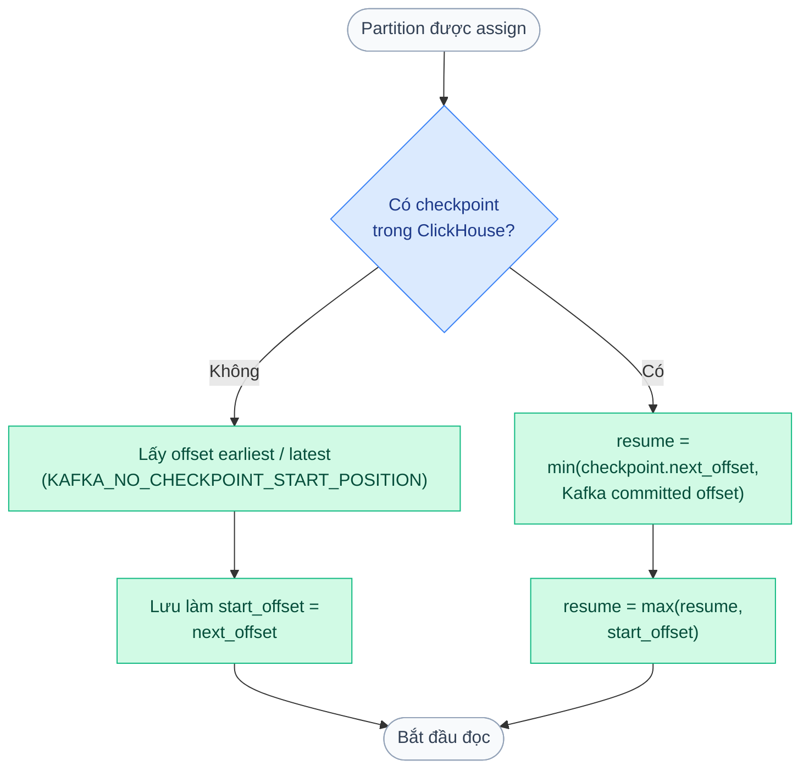

- Luôn chọn offset **bảo thủ** (nhỏ hơn) ⇒ có thể đọc lại một đoạn, không bỏ sót.
- `start_offset` là mốc sàn: reset offset Kafka về trước mốc này **không có tác dụng**.
- Log để xác nhận: `Selected conservative Kafka resume offset` (kèm `source: clickhouse_checkpoint` / `kafka_committed_offset` / `*_no_checkpoint`).

## 3.3 Tổng hợp: Worker / Projector

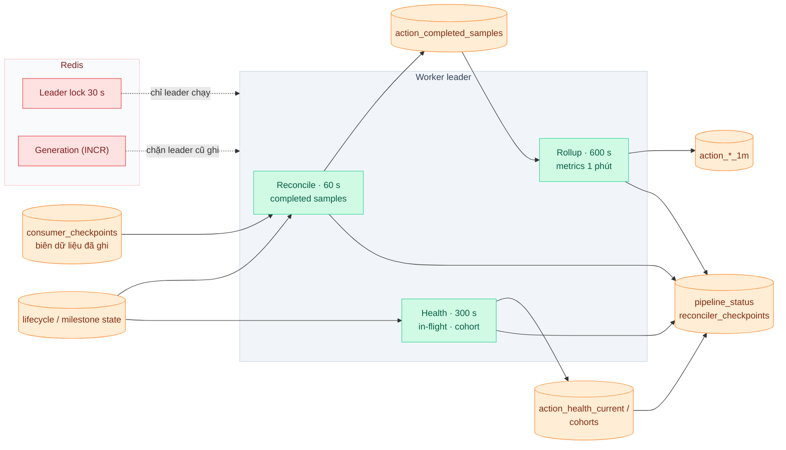

- Worker **không đọc Kafka**; chỉ đọc ClickHouse và chỉ xử lý tới offset đã có trong `consumer_checkpoints`.
- Chỉ **1 leader** chạy; mỗi lần lên leader lấy generation mới, mọi lần ghi kiểm tra generation ⇒ tránh 2 worker ghi đè nhau.
- Ghi serving qua bảng `*_staging `rồi `REPLACE PARTITION` ⇒ người đọc không thấy dữ liệu nửa vời.
- Chu kỳ là **tần suất chạy**, không phải SLA độ trễ. Dashboard là eventual consistency — luôn xem `data_freshness_at` / `pipeline-status`.

## 3.4 Truy vấn: Console / MCP → API

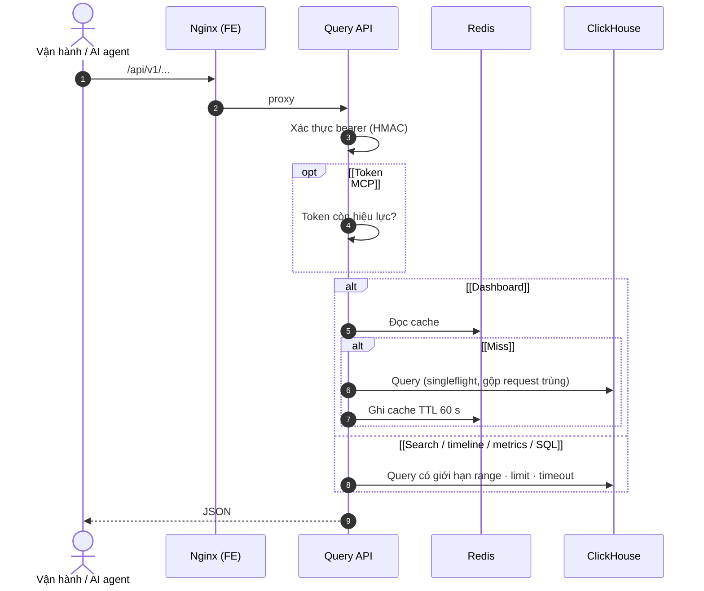

| **Kênh**          | **Xác thực**                                                               | **Giới hạn chính**                        |
| ----------------- | -------------------------------------------------------------------------- | ----------------------------------------- |
| Web Console       | `POST /api/v1/auth/login` (Basic) → bearer token ký HMAC                   | Range ≤ 168 h, limit ≤ 500, timeout 15 s  |
| MCP (/api/v1/mcp) | Bearer token MCP, tạo trong console, lưu Redis TTL 1–30 ngày, thu hồi được | Như query API + SQL                       |
| SQL console       | Bearer console                                                             | `readonly=1`, ≤ 1000 rows, ≤ 8 MB, ≤ 15 s |

Danh sách endpoint: `GET /api/v1/query-apis` hoặc `query_catalog.go`.

## 3.5 Tracing một giao dịch

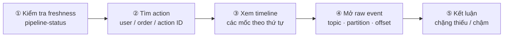

Ví dụ vòng đời limit order qua các topic:

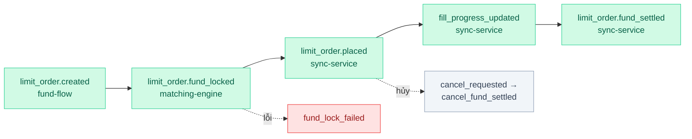

Thiếu mốc? Kiểm tra theo thứ tự trước khi kết luận TE lỗi: **lag Kafka → allowlist/ignore → `event_decode_failures` → retention TTL → khoảng thời gian / timezone**.

# 4. Triển khai

## 4.1 Topology Kubernetes

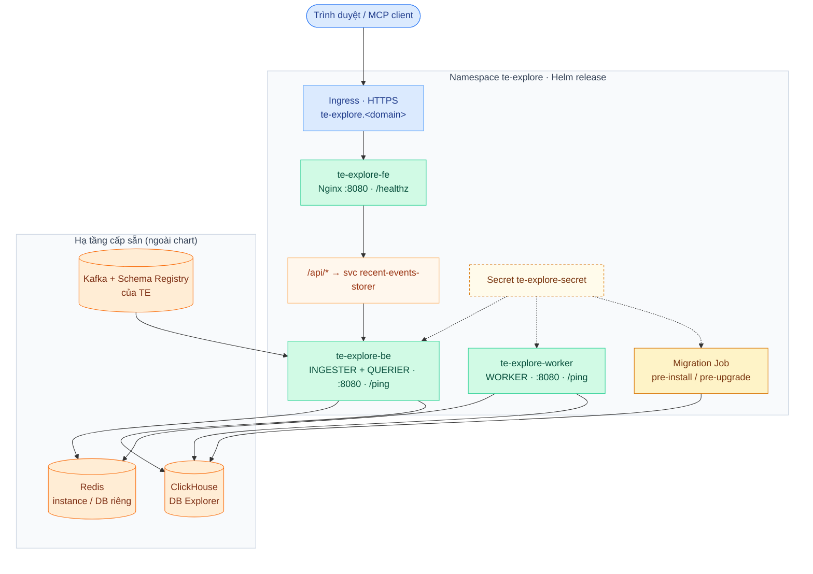

| **Workload**        | **Image**                    | **Tài nguyên mặc định**   | **Probe**  |
| ------------------- | ---------------------------- | ------------------------- | ---------- |
| `te-explore-be`     | `te-explore-be`              | 2 CPU / 8 GiB             | `/ping`    |
| `te-explore-worker` | `te-explore-be` (cùng image) | 2 CPU / 8 GiB             | `/ping`    |
| `te-explore-fe`     | `te-explore-fe`              | 0.1–0.5 CPU / 128–256 MiB | `/healthz` |

`/ping` chỉ chứng minh process sống — **không** chứng minh ingest/worker đang chạy tiến. Xem §5 Vận hành.

## 4.2 Chuẩn bị hạ tầng

| **Hạng mục** | **Checklist**                                                                                                                                       |
| ------------ | --------------------------------------------------------------------------------------------------------------------------------------------------- |
| Kafka        | ☐ User/credential riêng · ☐ ACL READ các topic ở §3.1 · ☐ ACL cho group `recent-events-storer-*` · ☐ Broker advertised address truy cập được từ pod |
| ClickHouse   | ☐ Database riêng (DSN `http(s)://…/?database=…`) · ☐ Quyền DDL cho migration, read/write cho app · ☐ Dung lượng đủ cho retention                    |
| Redis        | ☐ Instance riêng **hoặc** DB index khác TE · ☐ Mỗi môi trường Explorer 1 DB riêng                                                                   |
| K8s          | ☐ Namespace · ☐ Image pull secret · ☐ Secret te-explore-secret · ☐ Hostname + TLS ingress                                                           |

## 4.3 Cấu hình chính

Thứ tự ưu tiên: **ENV có prefix ENV_PREFIX_KEY** → ENV thường → `config.yaml`. Mẫu đầy đủ: `.env.sample`.

| **Nhóm**     | **Biến**                                                              | **Ghi chú**                                                                                                   |
| ------------ | --------------------------------------------------------------------- | ------------------------------------------------------------------------------------------------------------- |
| Vai trò      | INGESTER, QUERIER, WORKER                                             | Đọc trực tiếp ENV; không đặt gì = bật cả 3                                                                    |
| Kafka        | KAFKA*BROKERS, KAFKA_SCHEMAREGISTRYADDR, KAFKA_SASL\_\*, KAFKA_TLS*\* | Topic/group/allowlist khai báo trong YAML kafka.consumers (không truyền qua ENV)                              |
| Điểm bắt đầu | KAFKA_NO_CHECKPOINT_START_POSITION                                    | earliest \| latest; chỉ áp dụng khi **chưa có checkpoint**. YAML mặc định latest, convox.js đặt earliest      |
| ClickHouse   | CLICKHOUSE_DSN, CLICKHOUSE_TLS_CA_FILE, CLICKHOUSE_RETENTION_DAYS     | Migration job đọc biến **không prefix**. Luôn đặt rõ retention: mặc định migration 180 ngày ≠ runtime 30 ngày |
| Redis        | REDIS*ADDR, REDIS_PASSWORD, REDIS_DB, REDIS_TLS*\*                    | Bắt buộc — backend không khởi động nếu không kết nối được                                                     |
| Console      | RECENT_CONSOLE_USERNAME, RECENT_CONSOLE_PASSWORD                      | Đổi khỏi giá trị mặc định                                                                                     |
| Worker       | ACTION*METRICS_ENABLED, ACTION_METRICS*\*\_SECONDS                    | Chu kỳ reconcile / health / rollup                                                                            |
| Quan sát     | OTEL\_\*, LOG\_\*                                                     | /metrics Prometheus luôn bật                                                                                  |

TLS: dùng CA PEM mount vào container (\*\_TLS_CA_FILE), giữ \*\_INSECURE_SKIP_VERIFY=false. Chart hiện **chưa** có volume mount CA — cần bổ sung khi dùng private CA. Chưa hỗ trợ mTLS client cert.

## 4.4 Release

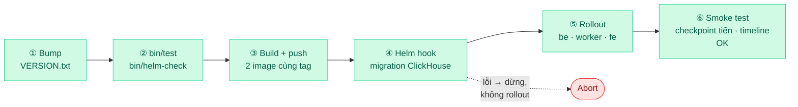

```
npm --prefix te-explore-fe ci

bin/test && bin/helm-check

DOCKER_REGISTRY_URL=\<registry> ENV=\<env> NAMESPACE=te-explore bin/deploy
```

- bin/deploy = bin/build-images + bin/publish-k8s (Helm --atomic). Image đã có sẵn ⇒ chỉ chạy bin/publish-k8s.
- Topology nguồn ở convox.js → sinh helm-chart/values.generated.yaml. Sửa nguồn, không sửa file generated.
- Migration chỉ tiến, bỏ qua file đã chạy. **Helm rollback không rollback schema/dữ liệu ClickHouse.** V20260724000400 có DROP + tạo lại bảng — backup trước khi nâng cấp DB cũ.

**Hoàn tất khi:** pod ready · login được · consumer_checkpoints tiến khi có event mới · pipeline-status bắt kịp · tra được timeline 1 giao dịch đã biết.

## 4.5 Chạy local

```
cp te-explore-be/.env.sample te-explore-be/.env # trỏ tới Kafka/ClickHouse/Redis local, KHÔNG dùng group/DB của TE

sh te-explore-be/migrations/migrate.sh # cần CLICKHOUSE_DSN

bin/dev be # backend :10031, bật cả 3 vai trò

bin/dev fe # Vite :4174, proxy /api → backend
```

| **Lệnh**                      | **Kiểm chứng**                                                                  |
| ----------------------------- | ------------------------------------------------------------------------------- |
| bin/test                      | Go unit test + integration ClickHouse/Redis thật (Docker) + frontend test/build |
| bin/test-timezone-integration | Migration, query, projection trên ClickHouse thật với nhiều timezone            |
| bin/test-mcp-integration      | Vòng đời MCP token trên Redis thật                                              |
| bin/helm-check                | Lint + render chart                                                             |

# 5. Vận hành

## 5.1 Ba mốc tươi của dữ liệu

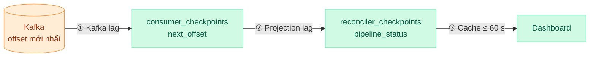

Kafka lag thấp **chưa đủ** để kết luận dashboard đúng. Search/timeline đọc raw (chỉ phụ thuộc ①); dashboard/histogram/in-flight phụ thuộc cả ①②③.

## 5.2 Giám sát

| **Tầng**              | **Tín hiệu**                                                                                               | **Nguồn**                     |
| --------------------- | ---------------------------------------------------------------------------------------------------------- | ----------------------------- |
| Kafka → Ingester      | Lag theo group recent-events-storer-\*; log insert failed; Kafka offsets remain uncommitted; log rebalance | Kafka monitoring, log backend |
| Ingester → ClickHouse | consumer_checkpoints.updated_at tiến ~90 s/lần; số dòng event_decode_failures mới                          | ClickHouse, SQL console       |
| Worker                | GET /api/v1/metrics/pipeline-status: source_next_offset vs projected_next_offset, last_error               | API / Console                 |
| API                   | HTTP 5xx, latency, lỗi Redis                                                                               | /metrics, log, OTel           |
| Hạ tầng               | ClickHouse disk/parts/merge; Redis memory/latency; tải broker                                              | Monitoring hạ tầng            |
| **TE**                | Latency/lag của TE khi Explorer replay lớn hoặc dùng chung Redis                                           | Monitoring của TE             |

SQL kiểm tra nhanh (SQL console):

```sql
-- Tiến độ ingest theo partition

SELECT consumer_id, topic, partition, argMax(next_offset, updated_at) AS next_offset, max(updated_at) AS updated_at

FROM consumer_checkpoints GROUP BY consumer_id, topic, partition ORDER BY updated_at;

-- Decode lỗi 1 giờ gần nhất

SELECT topic, count() FROM event_decode_failures

WHERE kafka_timestamp > now() - INTERVAL 1 HOUR GROUP BY topic;
```

## 5.3 Chẩn đoán sự cố

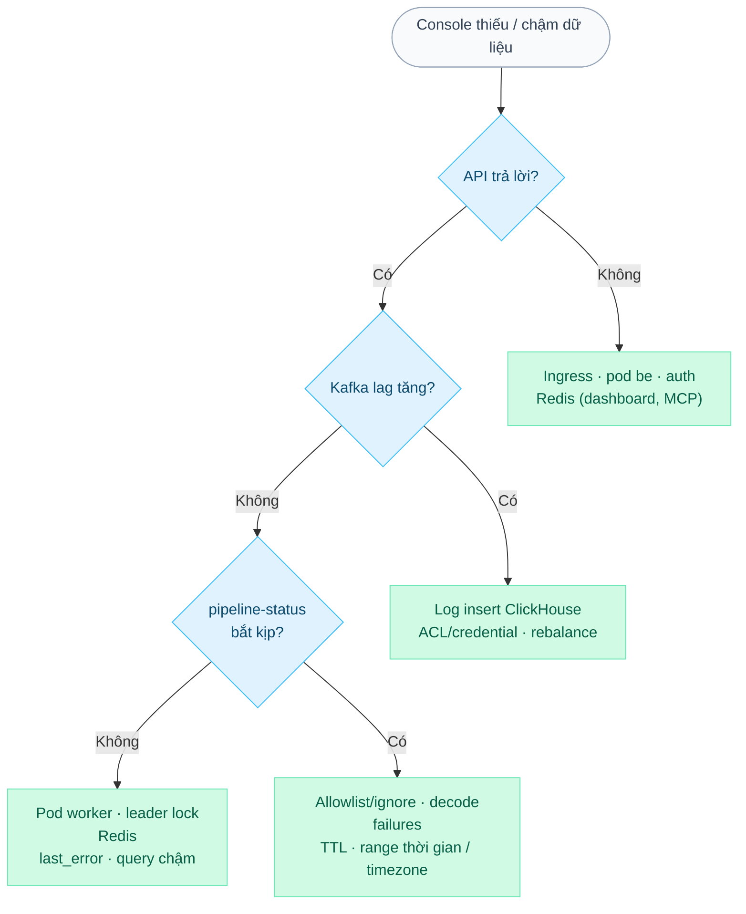

| **Sự cố**                    | **Hành vi hệ thống**                                                          | **Xử lý**                                                                                                            |
| ---------------------------- | ----------------------------------------------------------------------------- | -------------------------------------------------------------------------------------------------------------------- |
| ClickHouse không ghi được    | Ingester retry vô hạn, không commit offset; lag tăng                          | Khôi phục ClickHouse → ingest tự chạy tiếp, không mất dữ liệu                                                        |
| Kafka / Schema Registry lỗi  | Client tự reconnect; record decode lỗi vào event_decode_failures              | Sửa kết nối/schema; thống kê record lỗi                                                                              |
| Redis lỗi                    | Worker mất leader → dừng tổng hợp; dashboard/MCP lỗi; pod mới không khởi động | Khôi phục Redis đúng DB. **Không** FLUSHALL/FLUSHDB nếu dùng chung với TE                                            |
| Worker dừng                  | Ingest + search vẫn đúng; dashboard cũ dần                                    | Kiểm tra pod, ACTION_METRICS_ENABLED, log leader                                                                     |
| Explorer gây tải lên TE      | —                                                                             | **Scale te-explore-be về 0 trước** (dừng cả ingest và API), điều tra sau. Checkpoint giữ nguyên, bật lại sẽ đọc tiếp |
| Event đã quá retention Kafka | Không đọc lại được                                                            | Chưa có luồng nạp từ S3 — ghi nhận khoảng thiếu                                                                      |

## 5.4 Restart · replay · rollback

| **Thao tác**                      | **Cách làm**                                                                                               | **Lưu ý**                                                                              |
| --------------------------------- | ---------------------------------------------------------------------------------------------------------- | -------------------------------------------------------------------------------------- |
| **Restart / scale**               | kubectl rollout restart bình thường                                                                        | Đọc lại một đoạn nhỏ là bình thường (khử trùng theo offset)                            |
| **Đọc từ đầu cho môi trường mới** | DB ClickHouse mới + KAFKA_NO_CHECKPOINT_START_POSITION=earliest                                            | Chỉ có tác dụng khi chưa có checkpoint; giới hạn tài nguyên để không tranh IO với TE   |
| **Backfill / debug 1 partition**  | Chạy instance cô lập với KAFKA*EVENTSTORESCOPE*\* (đọc trực tiếp topic/partition/offset, không dùng group) | Dùng DB ClickHouse + Redis DB riêng. **Không** xóa checkpoint của môi trường đang chạy |
| **Rollback app**                  | Helm rollback về image trước                                                                               | Kiểm tra tương thích schema; Helm **không** rollback ClickHouse — cần backup riêng     |

## 5.5 Checklist sau deploy / sự cố

```shell
kubectl -n te-explore get pods,jobs

kubectl -n te-explore logs deploy/te-explore-be --tail=100 | grep -E "resume offset|insert failed"

kubectl -n te-explore logs deploy/te-explore-worker --tail=100
```

☐ Pod ready, migration job thành công

☐ Log có Selected conservative Kafka resume offset cho mọi partition

☐ consumer_checkpoints tiến; không có decode failure bất thường

☐ pipeline-status bắt kịp sau 1–2 chu kỳ worker

☐ Tra được timeline 1 giao dịch mới

☐ Chỉ số của TE (lag, latency, Redis) không bị ảnh hưởng
