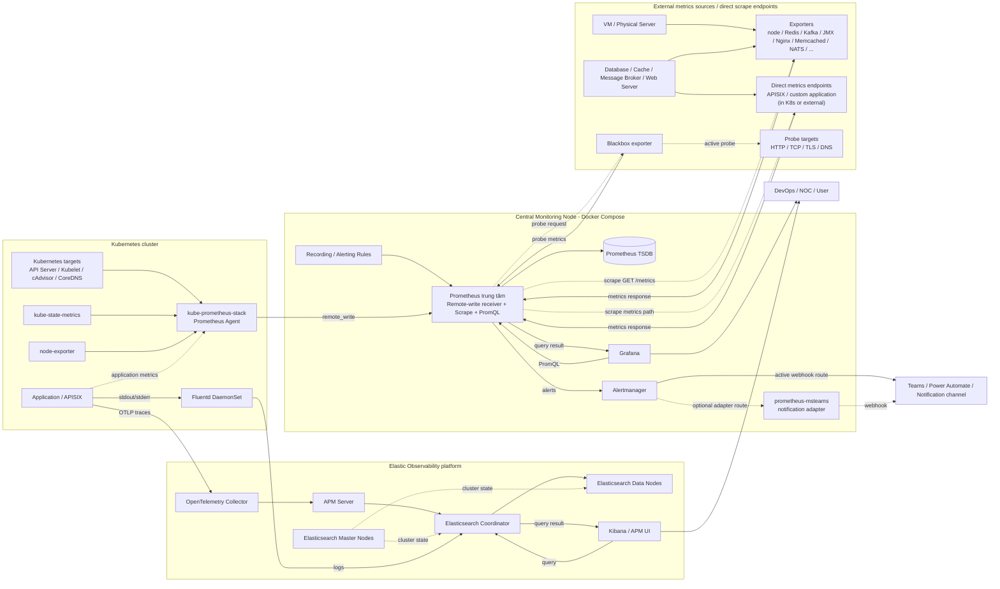
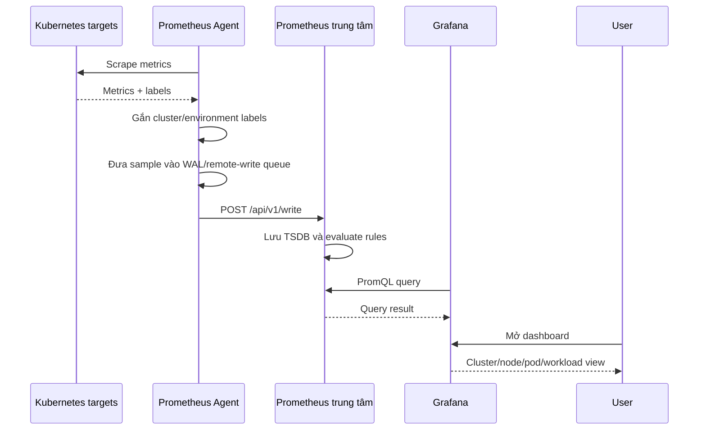
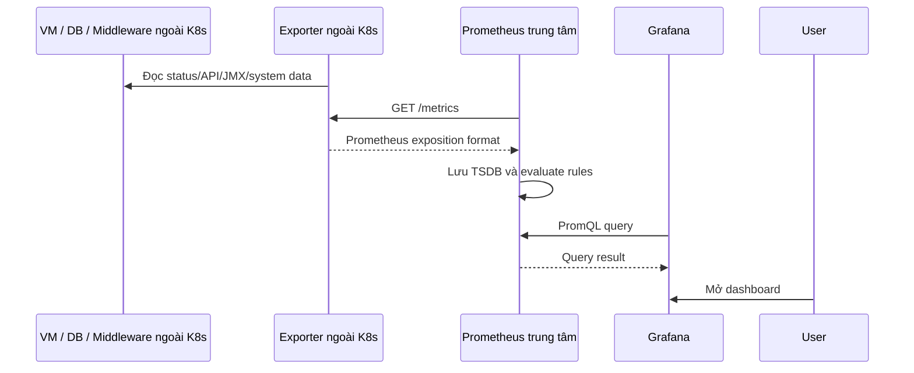
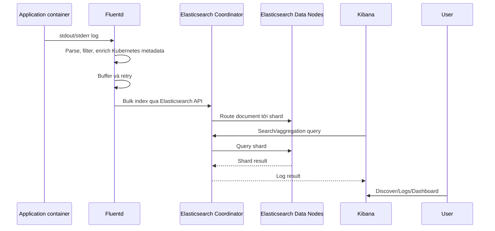
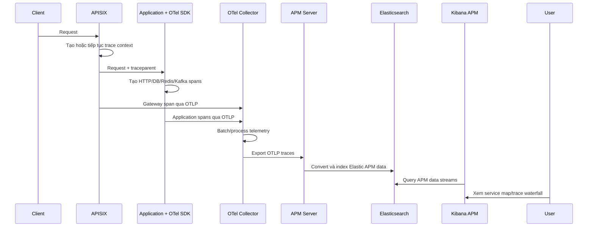

# Mô hình luồng Observability (draft)

## 1. Phạm vi

Tài liệu mô tả blueprint observability dùng chung cho các môi trường. Endpoint và địa chỉ cụ thể được cấu hình riêng theo từng môi trường nhưng không làm thay đổi kiến trúc.

Hệ thống gồm bốn luồng chính:

1. Kubernetes metrics: `kube-prometheus-stack → remote_write → Prometheus → Grafana → View`.
2. Exporter metrics: `Exporters → Prometheus → Grafana → View`.
3. Logs: `Fluentd → Elasticsearch → Kibana → View`.
4. Traces: `Application → OpenTelemetry → APM Server → Elasticsearch → Kibana APM → Trace`.

## 2. Sơ đồ tổng thể



## 3. Mô hình node và vai trò

### 3.1 Thành phần trong mỗi Kubernetes cluster

| Thành phần | Kiểu triển khai | Vai trò |
|---|---|---|
| Prometheus Operator | Deployment | Quản lý Prometheus Agent, ServiceMonitor và PodMonitor |
| Prometheus Agent | StatefulSet do Operator quản lý | Scrape metrics và remote-write về Prometheus trung tâm |
| kube-state-metrics | Deployment | Chuyển trạng thái object Kubernetes thành metrics |
| node-exporter | DaemonSet | Thu thập CPU, RAM, disk, filesystem và network của node |
| Fluentd | DaemonSet | Đọc log container trên từng node và gửi Elasticsearch |
| OTel SDK/Agent | Nằm trong hoặc gắn với application | Tạo trace/span và truyền trace context |

### 3.2 Thành phần ngoài Kubernetes

| Thành phần | Vị trí | Vai trò |
|---|---|---|
| node-exporter | Trên VM/physical server | Expose CPU, RAM, disk, filesystem và network metrics |
| Redis exporter | Gần Redis hoặc trên monitoring node | Đọc Redis status và expose Prometheus metrics |
| Kafka exporter | Có kết nối tới Kafka cluster | Expose topic, partition và consumer lag metrics |
| JMX exporter | Trên JVM/Kafka process hoặc sidecar | Chuyển JMX metrics sang Prometheus format |
| Nginx exporter/VTS | Trên hoặc gần Nginx | Expose request, status code, traffic và upstream metrics |
| Memcached exporter | Gần Memcached | Expose cache, connection, item và hit/miss metrics |
| NATS exporter | Gần NATS cluster | Expose server, connection, route và message metrics |
| Blackbox exporter | Trên monitoring node | Probe HTTP, TCP, TLS, DNS hoặc endpoint availability |
| Custom exporter/S3 quota monitor | Trên monitoring node hoặc gần hệ thống nguồn | Expose metrics nghiệp vụ hoặc quota riêng |
| Direct application metrics endpoint | Service có metrics endpoint | Cho Prometheus scrape trực tiếp, không cần exporter trung gian |
| Exporter khác | Gần database/cache/middleware tương ứng | Chuyển số liệu của hệ thống nguồn sang Prometheus format |

Các exporter này **không thuộc kube-prometheus-stack và không cần nằm trong Kubernetes**. Prometheus trung tâm kết nối trực tiếp tới từng exporter để scrape metrics.

Blackbox exporter là trường hợp đặc biệt: Prometheus gọi Blackbox exporter kèm target cần kiểm tra; Blackbox exporter mới chủ động probe target rồi trả kết quả probe về Prometheus. Prometheus không scrape `/metrics` trực tiếp từ target được probe.

### 3.3 Central Monitoring Node

Cấu hình trong `core-sim/monitor` xác nhận Prometheus trung tâm, Grafana, Alertmanager và prometheus-msteams được chạy bằng Docker Compose trên cùng một monitoring node:

| Container/node logic | Input | Xử lý | Output |
|---|---|---|---|
| Prometheus trung tâm | Remote-write từ Prometheus Agent; scrape exporters/direct endpoints | Lưu TSDB, nạp rules, evaluate alerts và phục vụ PromQL | Query result cho Grafana; alert cho Alertmanager |
| Grafana | PromQL query tới Prometheus | Render dashboard | Metrics view cho người dùng |
| Alertmanager | Alerts từ Prometheus | Group, deduplicate và quản lý notification | Webhook tới notification channel |
| prometheus-msteams | Webhook từ Alertmanager khi được chọn làm adapter | Chuyển đổi message format | Microsoft Teams/notification endpoint |

Luồng trên Central Monitoring Node:

```text
Prometheus Agent ──remote_write──┐
                                │
Exporters ngoài K8s ←─scrape────┤
Direct metrics endpoints ←──────┤
                                ▼
                       Prometheus trung tâm
                         ├─→ TSDB
                         ├─→ Rule evaluation ─→ Alertmanager ─→ Notification
                         └─← PromQL ─────────── Grafana ─→ View
```

Prometheus trung tâm đã bật remote-write receiver, lưu dữ liệu bền vững trên volume, nạp các rule files và scrape cả exporters lẫn direct application metrics endpoints. Alertmanager hiện có active webhook route gửi thẳng tới notification channel; container prometheus-msteams đã được deploy nhưng chỉ nằm trong luồng khi Alertmanager được cấu hình trỏ qua adapter này.

### 3.4 Các thành phần observability tập trung

| Thành phần | Vai trò |
|---|---|
| OpenTelemetry Collector | Nhận OTLP, xử lý batch và chuyển trace tới APM Server |
| APM Server | Chuyển OTLP thành Elastic APM data model và ghi Elasticsearch |
| Elasticsearch Coordinator | Điểm vào ingest/query, định tuyến request đến data nodes |
| Elasticsearch Data Nodes | Lưu logs, traces, indexes và thực hiện search/aggregation |
| Elasticsearch Master Nodes | Quản lý cluster state và master election |
| Kibana | Hiển thị logs, service map, APM và distributed traces |

## 4. Luồng Kubernetes metrics



### Mô tả

1. `kube-prometheus-stack` triển khai Prometheus Operator, Prometheus Agent, kube-state-metrics, node-exporter và các ServiceMonitor.
2. Prometheus Agent chủ động scrape metrics từ API Server, kubelet, cAdvisor, CoreDNS, kube-state-metrics, node-exporter và application endpoints.
3. ServiceMonitor/PodMonitor hoặc annotation xác định endpoint, metrics path, scheme và port cần scrape.
4. Agent gắn các external labels như `cluster` và `environment` để Prometheus trung tâm phân biệt nguồn dữ liệu.
5. Khối cấu hình `remoteWrite` gửi metrics đến endpoint `/api/v1/write` của Prometheus trung tâm.
6. Prometheus trung tâm trên Central Monitoring Node lưu metrics trong TSDB, chạy recording/alerting rules và phục vụ PromQL.
7. Grafana dùng Prometheus trung tâm làm datasource để hiển thị dashboard.

### Ý nghĩa của `write config`

`write config` không phải một node. Đây là khối `remoteWrite` của Prometheus Agent:

```text
Prometheus Agent
  → remote-write queue
  → Prometheus remote-write receiver
  → Prometheus TSDB
  → Grafana datasource
  → Dashboard view
```

Prometheus trung tâm phải bật remote-write receiver. Queue trên Agent chỉ giúp retry và chịu gián đoạn ngắn hạn; dữ liệu lâu dài được lưu tại Prometheus trung tâm.

### Cấu hình hiện tại cần hiểu đúng

- `kube-prometheus-stack` đang chạy theo Prometheus Agent mode.
- Agent có nhiệm vụ scrape và remote-write, không phải server dùng để query, lưu dài hạn hoặc evaluate rules.
- Grafana trong chart bị tắt; Grafana tập trung query Prometheus trung tâm.
- Alerting rules cần được evaluate tại Prometheus trung tâm. Alertmanager cục bộ không nằm trong data path của Agent mode.

## 5. Luồng exporter metrics

Đây là nhánh metrics riêng dành cho VM, physical server, database, cache, message broker, web server và các hệ thống **nằm ngoài Kubernetes**.



### Mô tả

1. Exporter lấy thông tin từ service hoặc hệ điều hành và chuyển thành Prometheus metrics.
2. Prometheus trung tâm chủ động scrape exporter theo `scrape_configs`.
3. Exporter không chủ động push metrics vào Prometheus.
4. Prometheus lưu metrics, evaluate rules và gửi alert sang Alertmanager khi điều kiện thỏa mãn.
5. Grafana query Prometheus để hiển thị dashboard cho Redis, Kafka, JVM, node, Nginx, Memcached, NATS, Blackbox và các hệ thống khác.

Application/APISIX metrics có thể được thu theo hai cách: Prometheus Agent discovery trong Kubernetes hoặc Prometheus trung tâm scrape trực tiếp một endpoint được công bố ra ngoài. Mỗi endpoint nên có một bên sở hữu scrape chính để tránh cùng một series bị ingest hai lần.

Luồng mạng và chiều dữ liệu cần hiểu như sau:

```text
VM / Physical Server ───────────────→ node-exporter ───────┐
Redis ──────────────────────────────→ Redis exporter ──────┤
Kafka ──────────────────────────────→ Kafka/JMX exporter ──┤
Nginx ──────────────────────────────→ Nginx exporter ──────┤
HTTP/TCP/DNS endpoints ← probe bởi Blackbox exporter ─────┤
                                                           │
Prometheus trung tâm ─── scrape GET /metrics ──────────────┘
Prometheus trung tâm ←── metrics response ─────────────────┘
Prometheus trung tâm ─── query result ─→ Grafana ─→ View
```

## 6. Luồng logs



### Mô tả

1. Application ghi log ra `stdout/stderr`.
2. Container runtime ghi log xuống filesystem của Kubernetes node.
3. Fluentd chạy dạng DaemonSet, vì vậy mỗi node có một Fluentd pod đọc log container trên node đó.
4. Fluentd parse JSON/logfmt/regex, thêm metadata Kubernetes và chuẩn hóa field.
5. Fluentd buffer, retry và gửi bulk request trực tiếp tới Elasticsearch Coordinator.
6. Coordinator định tuyến document tới primary/replica shard trên Data Nodes.
7. Kibana query Elasticsearch để hiển thị logs trong Discover, Logs UI hoặc dashboard.

Luồng hiện tại không có Logstash:

```text
Container logs
  → Fluentd
  → Elasticsearch Coordinator
  → Elasticsearch Data Nodes
  → Kibana
  → User view
```

Nếu application ghi `trace_id` và `span_id`, Fluentd chuẩn hóa thành `trace.id` và `span.id` để liên kết log với trace trong Kibana.

## 7. Luồng traces



### Mô tả

1. APISIX hoặc application nhận/tạo W3C `traceparent`.
2. OTel SDK/agent tạo spans cho HTTP, database, cache, message broker và các tác vụ nội bộ.
3. APISIX và application gửi spans tới OpenTelemetry Collector qua OTLP.
4. Collector gom batch, xử lý attributes, retry và chuyển traces tới APM Server.
5. APM Server xác thực, validate và chuyển OTLP thành Elastic APM transaction/span/error.
6. APM Server ghi dữ liệu vào Elasticsearch.
7. Kibana APM query Elasticsearch để hiển thị service inventory, service map, latency, throughput, error rate và trace waterfall.

```text
Client
  → APISIX
  → Application/OTel instrumentation
  → OpenTelemetry Collector
  → APM Server
  → Elasticsearch
  → Kibana APM
  → Trace view
```

Tất cả service phải truyền `traceparent`; nếu một service làm mất context, Kibana sẽ hiển thị nhiều trace rời thay vì một distributed trace end-to-end.

### Các pipeline phụ đã có trong OTel Collector

Cấu hình Collector hiện tại không chỉ có traces mà còn định nghĩa metrics và logs:

```text
OTLP traces  → OTel Collector → APM Server → Elasticsearch → Kibana APM
OTLP logs    → OTel Collector → Elasticsearch
OTLP metrics → OTel Collector → Prometheus-format endpoint
                            └→ APM Server
```

Trong đó, trace là luồng end-to-end chính đã thể hiện trong blueprint. Nhánh OTLP logs có thể ghi thẳng Elasticsearch, độc lập với Fluentd. Nhánh OTLP metrics đã expose một Prometheus-format endpoint tại Collector, nhưng chưa thấy scrape job tương ứng trong cấu hình Prometheus trung tâm; vì vậy chưa coi đây là luồng hoàn chỉnh tới Grafana.

## 8. Kết nối logic giữa các thành phần

| Source | Destination | Giao thức/port thông dụng | Mục đích |
|---|---|---|---|
| Prometheus Agent | Prometheus trung tâm | HTTP(S) `9090`, `/api/v1/write` | Remote-write Kubernetes metrics |
| Prometheus trung tâm | Exporters ngoài Kubernetes | HTTP(S), `/metrics` hoặc path riêng | Scrape VM/database/cache/middleware metrics |
| Grafana | Prometheus trung tâm | HTTP(S) `9090` | PromQL query |
| Prometheus trung tâm | Alertmanager | HTTP(S) `9093` | Gửi alerts |
| Alertmanager | Notification webhook hoặc prometheus-msteams | HTTP(S) webhook | Gửi notification |
| Fluentd | Elasticsearch Coordinator | HTTPS `9200` | Bulk index logs |
| Application/APISIX | OTel Collector | OTLP/gRPC `4317` hoặc OTLP/HTTP `4318` | Gửi traces |
| Application | OTel Collector | OTLP/gRPC hoặc OTLP/HTTP | Gửi logs/metrics khi application bật các signal này |
| OTel Collector | APM Server | OTLP/HTTP `8200` | Gửi traces tới Elastic APM |
| OTel Collector | Elasticsearch Coordinator | HTTPS, Elasticsearch API | Ghi OTLP logs trực tiếp |
| Prometheus trung tâm | OTel Collector metrics endpoint | HTTP(S), Prometheus format | Nhánh metrics cần bổ sung scrape job nếu đưa vào Grafana |
| APM Server | Elasticsearch Coordinator | HTTPS `9200` | Index APM data |
| Kibana | Elasticsearch Coordinator | HTTPS `9200` | Query logs và traces |
| Elasticsearch nodes | Elasticsearch nodes | Transport TLS `9300` | Cluster communication |
| User | Grafana/Kibana | HTTPS `443` qua load balancer/reverse proxy | Truy cập giao diện |

## 9. Phân biệt push và pull

| Luồng | Kiểu | Bên khởi tạo kết nối |
|---|---|---|
| Kubernetes target → Prometheus Agent | Pull | Prometheus Agent scrape target |
| Prometheus Agent → Prometheus trung tâm | Push | Agent remote-write |
| Exporter → Prometheus trung tâm | Pull | Prometheus trung tâm scrape exporter |
| Fluentd → Elasticsearch | Push | Fluentd gửi bulk logs |
| Application → OTel Collector | Push | OTel SDK/agent gửi telemetry |
| OTel Collector → APM Server | Push | Collector export traces |
| OTel Collector → Elasticsearch | Push | Collector export OTLP logs |
| OTel Collector metrics endpoint → Prometheus | Pull | Chỉ hoàn chỉnh khi Prometheus trung tâm có scrape job |
| Grafana → Prometheus | Query | Grafana gửi PromQL |
| Kibana → Elasticsearch | Query | Kibana gửi search/aggregation request |

## 10. Gap và quyết định cần chốt

| Hạng mục | Trạng thái kiểm tra | Việc cần chốt/bổ sung |
|---|---|---|
| Bốn luồng chính metrics, exporters, logs và traces | Đã có node và chiều kết nối end-to-end | Không thiếu node chính |
| Elasticsearch Master Nodes | Đã bổ sung vào sơ đồ | Master chỉ quản lý cluster state, không phải endpoint ingest/query cho agent |
| OTel metrics → Prometheus → Grafana | Collector đã expose metrics; Prometheus trung tâm chưa có scrape job tương ứng | Bổ sung scrape job nếu cần xem OTLP/Collector metrics trên Grafana |
| Application/APISIX metrics | Có khả năng được Agent scrape và đồng thời được Prometheus trung tâm scrape trực tiếp | Chọn scrape ownership, job name và labels để tránh duplicate series |
| OTLP logs và Fluentd logs | Cả hai đường đều tồn tại trong cấu hình | Chốt loại log nào đi Fluentd, loại nào đi OTLP để tránh ingest trùng |
| Fluent Bit host logs → syslog | Có cấu hình Fluent Bit gửi host logs tới syslog receiver, nhưng chưa thấy cấu hình từ receiver đó tới Elasticsearch trong phạm vi đã kiểm tra | Chỉ thêm vào blueprint chính khi cung cấp/xác nhận cấu hình syslog receiver và downstream |
| Secrets và TLS | Là cấu hình riêng theo môi trường, không thể hiện giá trị trong sơ đồ | Dùng secret manager/Kubernetes Secret hoặc file secret; không hard-code credential trong repository |

Như vậy, tài liệu không còn thiếu node trong **bốn luồng chính**. Các mục còn mở là nhánh phụ hoặc quyết định ownership/configuration, không làm thay đổi blueprint chung giữa các môi trường.

## 11. Tóm tắt cho SA

Mỗi môi trường sử dụng cùng một blueprint:

- Kubernetes metrics được Prometheus Agent trong `kube-prometheus-stack` scrape và remote-write về Prometheus trung tâm.
- VM, physical server, database, cache, Kafka, Nginx và các hệ thống ngoài Kubernetes expose metrics qua exporter; Prometheus trung tâm scrape trực tiếp các exporter này.
- Central Monitoring Node chạy Prometheus, Grafana, Alertmanager và notification adapter bằng Docker Compose.
- Prometheus trung tâm lưu TSDB, evaluate rules; Grafana query Prometheus; Alertmanager gửi notification.
- Fluentd thu log trên từng Kubernetes node rồi ghi trực tiếp vào Elasticsearch.
- Application/APISIX gửi trace qua OTel Collector và APM Server trước khi lưu Elasticsearch.
- Kibana query Elasticsearch để hiển thị logs và distributed traces.

```text
Metrics: Kubernetes → Prometheus Agent → Prometheus → Grafana → View
Metrics: Ngoài K8s → Exporter ←[scrape]─ Prometheus trung tâm → Grafana → View
Logs:    Application → Fluentd → Elasticsearch → Kibana → View
Traces:  Application → OTel Collector → APM Server → Elasticsearch → Kibana APM → Trace
```

Khác biệt giữa các môi trường chỉ nằm ở endpoint, credential, label, capacity và retention; quan hệ giữa các node và chiều dữ liệu không thay đổi.
