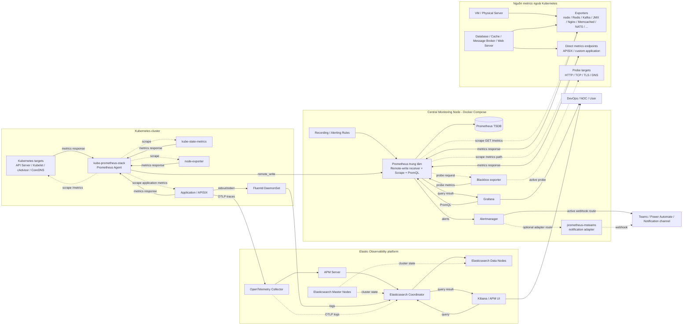
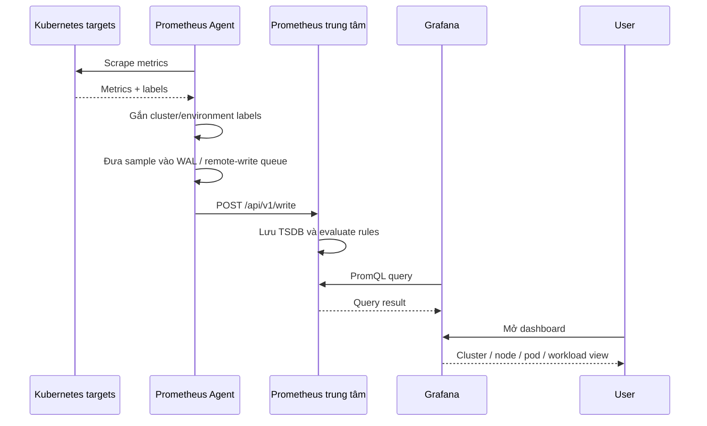
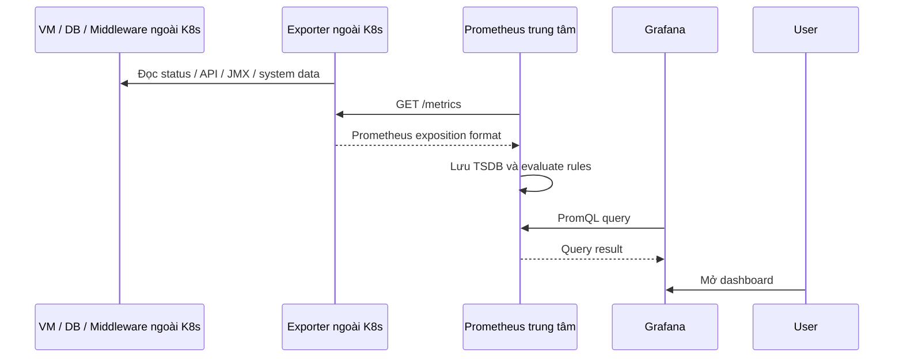
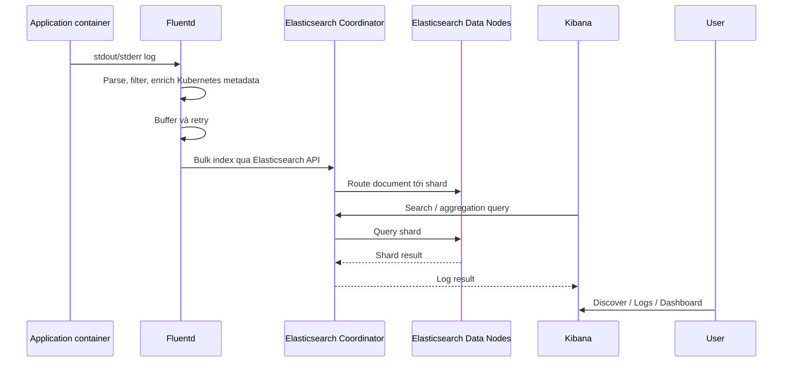
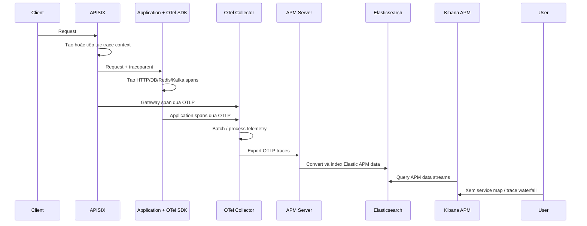

# ARCHITECTURE SPECIFICATION: OBSERVABILITY & FEEDBACK LOOP

| Thuộc tính         | Giá trị                                                                       |
| ------------------ | ----------------------------------------------------------------------------- |
| Mã tài liệu        | SCEX-ARC-OBS-001                                                              |
| Phiên bản          | 0.1                                                                           |
| Trạng thái         | Draft                                                                         |
| Owner              | SDO                                                                           |
| Người phê duyệt    | -                                                                             |
| Ngày cập nhật      | 2026-08-26                                                                    |
| Phạm vi áp dụng    | Hệ thống SCEX (Production)                                                    |
| Tài liệu liên quan | (incident-management-and-post-mortems, disaster-recovery-and-backup-strategy) |

**Changelog**

| Phiên bản | Ngày       | Người thực hiện | Thay đổi          |
| --------- | ---------- | --------------- | ----------------- |
| 0.1       | 2026-08-26 | `duc.mm`        | Khởi tạo tài liệu |

**Quy ước đọc tài liệu**

- `[cần bổ sung]` — nội dung chưa có dữ liệu/chưa được quyết định, phải điền trước khi tài liệu chuyển sang trạng thái Approved.
- **(Hiện có)** — đã được xác nhận tồn tại trong cấu hình/hạ tầng SCEX tại thời điểm lập tài liệu.
- **(Đề xuất)** — SCEX chưa triển khai, tài liệu này đề xuất bổ sung.
- Tài liệu này là **tài liệu duy nhất** về observability: vừa mô tả kiến trúc luồng dữ liệu (mục 2.7–2.10), vừa quy định chuẩn, chính sách và quy trình (các mục còn lại).

---

## 1. TỔNG QUAN VÀ NGUYÊN TẮC THIẾT KẾ (OVERVIEW & PRINCIPLES)

### 1.1. Mục tiêu

Thiết lập hệ thống giám sát toàn diện (Observability) và vòng phản hồi (Feedback Loop) cho toàn bộ hệ thống SCEX, nhằm:

- Phát hiện sự cố gần thời gian thực (Real-time Detection) trước khi khách hàng báo lỗi.
- Giảm thời gian phát hiện sự cố (MTTD) và thời gian khắc phục (MTTR).
- Cung cấp bằng chứng vận hành (evidence) phục vụ audit nội bộ, kiểm tra tuân thủ và đánh giá tác động bảo vệ dữ liệu cá nhân.
- Tạo cơ sở dữ liệu định lượng cho việc cải tiến liên tục chất lượng dịch vụ.

### 1.2. Phạm vi

**Trong phạm vi:**

- Metrics, Logs, Traces của ứng dụng và hạ tầng trong Kubernetes cluster.
- Metrics của hệ thống ngoài Kubernetes: VM, physical server, database, cache, message broker, web server.
- Cảnh báo (Alerting), phân cấp sự cố (Severity), luồng trực on-call và escalation.
- Vòng phản hồi: tự động hoá khắc phục, post-mortem, chỉ số vận hành.
- Giám sát chính hệ observability (meta-monitoring).

**Ngoài phạm vi:**

- Giám sát an toàn thông tin chuyên sâu (SIEM/SOC correlation rules, threat hunting) — thuộc tài liệu của ATTT. [cần bổ sung: tên tài liệu và ranh giới chuyển giao dữ liệu log giữa observability platform và SIEM]
- Business Intelligence / Data Warehouse reporting — thuộc phạm vi DWH.
- Giám sát on-chain / blockchain node. [cần bổ sung]

### 1.3. Tiêu chuẩn tham chiếu

| Tiêu chuẩn            | Nội dung ánh xạ vào tài liệu này                                                                                                                                                                                   |
| --------------------- | ------------------------------------------------------------------------------------------------------------------------------------------------------------------------------------------------------------------ |
| NIST SP 800-204       | Logging, Distributed Tracing và Service Mesh Telemetry cho kiến trúc microservices                                                                                                                                 |
| NIST SP 800-53 Rev. 5 | AU-2 (Event Logging), AU-3 (Content of Audit Records), AU-6 (Audit Review & Analysis), AU-8 (Time Stamps), AU-9 (Protection of Audit Information), AU-11 (Audit Record Retention), AU-12 (Audit Record Generation) |
| TCVN 11930:2017       | Mục 9.2.1.4 — ghi, lưu trữ và đồng bộ thời gian (NTP) cho nhật ký hệ thống                                                                                                                                         |
| ISO/IEC 27035-1/2/3   | Quy trình phát hiện (Detection), phân loại độ ưu tiên (Triage), kích hoạt cảnh báo và escalation path                                                                                                              |
| ISO/IEC 20000-1:2018  | Clause 8.6.1 — Incident & Service Request Management; giám sát trạng thái dịch vụ và ngưỡng cảnh báo gắn với SLA/SLO                                                                                               |
| COBIT 2019            | DSS01 (Managed Operations), DSS02 (Managed Service Requests and Incidents) — KPI vận hành và vòng phản hồi cải tiến                                                                                                |
| Google SRE Workbook   | Golden Signals, SLO/Error Budget, Blameless Post-mortem                                                                                                                                                            |

> Lưu ý về ánh xạ: yêu cầu **thời gian lưu trữ** log ánh xạ vào NIST **AU-11** (Audit Record Retention), không phải AU-2 (chọn sự kiện cần log) hay AU-6 (review/phân tích). Bảng compliance matrix tại mục 7 dùng ánh xạ này.

### 1.4. Nguyên tắc thiết kế

| #   | Nguyên tắc                            | Diễn giải                                                                                                    | Hệ quả bắt buộc                                                  |
| --- | ------------------------------------- | ------------------------------------------------------------------------------------------------------------ | ---------------------------------------------------------------- |
| P1  | **Observability by Design**           | Mọi service khi đóng gói phải tích hợp sẵn cơ chế expose Metrics, Logs, Traces theo chuẩn mở                 | Service không expose đủ 3 signal không được duyệt lên Production |
| P2  | **Vendor-neutral instrumentation**    | Ứng dụng chỉ phụ thuộc OpenTelemetry API/SDK và Prometheus exposition format, không phụ thuộc backend cụ thể | Thay backend (Elastic → khác) không phải sửa code ứng dụng       |
| P3  | **Correlation-first**                 | Mọi signal phải mang đủ nhãn để nối chéo được: `service.name`, `trace.id`, `cluster`, `environment`          | Log không có `trace.id` bị coi là không đạt chuẩn                |
| P4  | **Actionable Alerting**               | Cảnh báo chỉ gửi khi cần con người can thiệp; mọi alert phải có runbook                                      | Alert không có runbook link không được merge                     |
| P5  | **Single Source of Truth per signal** | Mỗi signal có đúng một đường ingest chính và một bên sở hữu                                                  | Cấm hai pipeline cùng ingest một series/log stream (xem mục 2.5) |
| P6  | **Monitor the monitor**               | Hệ observability phải tự giám sát và có cơ chế deadman's switch                                              | Xem mục 5                                                        |
| P7  | **Blameless culture**                 | Post-mortem tập trung vào hệ thống và quy trình, không quy kết cá nhân                                       | Xem mục 6.3                                                      |

---

## 2. KIẾN TRÚC OBSERVABILITY — 4 SIGNAL (MELT)

MELT = **M**etrics, **E**vents, **L**ogs, **T**races. Tài liệu này dùng 4 signal; trong đó Events được xử lý cùng đường ingest với Logs nhưng có yêu cầu retention và audit riêng (mục 2.3).

Sơ đồ luồng dữ liệu end-to-end, danh sách node và vai trò, bảng port và bảng phân biệt push/pull nằm tại mục **2.7 – 2.10** của chính tài liệu này. Các mục 2.1–2.6 dưới đây quy định chuẩn cho từng signal.

### 2.1. Metrics (Chỉ số định lượng)

**Mô hình đo lường bắt buộc**

| Đối tượng                      | Phương pháp          | Chỉ số                                                                                                                                             |
| ------------------------------ | -------------------- | -------------------------------------------------------------------------------------------------------------------------------------------------- |
| API / Microservice             | **RED**              | Rate (req/s), Errors (%), Duration (p50/p95/p99)                                                                                                   |
| Dịch vụ hướng người dùng       | **Golden Signals**   | Latency, Traffic, Errors, Saturation                                                                                                               |
| Node / VM / Hạ tầng            | **USE**              | Utilization, Saturation, Errors                                                                                                                    |
| Middleware (DB, cache, broker) | USE + chỉ số đặc thù | Connection pool, replication lag, consumer lag, hit/miss ratio                                                                                     |
| Nghiệp vụ (Business)           | Chỉ số nghiệp vụ     | [cần bổ sung: danh mục business metric bắt buộc — ví dụ số lệnh đặt/giây, tỉ lệ khớp lệnh, số eKYC thành công/thất bại, số giao dịch nạp/rút treo] |

**Công nghệ**

| Vai trò            | Công nghệ SCEX                                                                                             | Trạng thái |
| ------------------ | ---------------------------------------------------------------------------------------------------------- | ---------- |
| Thu thập trong K8s | `kube-prometheus-stack` — Prometheus Operator + Prometheus Agent (StatefulSet)                             | (Hiện có)  |
| Thu thập ngoài K8s | Prometheus trung tâm scrape trực tiếp exporter (node/Redis/Kafka/JMX/Nginx/Memcached/NATS/Blackbox/custom) | (Hiện có)  |
| Vận chuyển         | `remote_write` từ Prometheus Agent về Prometheus trung tâm                                                 | (Hiện có)  |
| Lưu trữ            | Prometheus TSDB trên Central Monitoring Node (Docker Compose)                                              | (Hiện có)  |
| Rule evaluation    | Recording / Alerting rules tại Prometheus trung tâm                                                        | (Hiện có)  |
| Trực quan hoá      | Grafana (Grafana trong chart kube-prometheus-stack bị tắt)                                                 | (Hiện có)  |

**Tham số thu thập**

| Tham số                                  | Production                              | Non-Production                            | Ghi chú                                                                           |
| ---------------------------------------- | --------------------------------------- | ----------------------------------------- | --------------------------------------------------------------------------------- |
| Scrape interval                          | 15s                                     | [cần bổ sung: đề xuất 30–60s để giảm tải] | Giá trị hiện tại trong cấu hình: [cần bổ sung: xác nhận từ file cấu hình thực tế] |
| Scrape timeout                           | [cần bổ sung]                           | [cần bổ sung]                             | Phải nhỏ hơn scrape interval                                                      |
| Evaluation interval (rules)              | [cần bổ sung]                           | [cần bổ sung]                             |                                                                                   |
| Retention TSDB                           | [cần bổ sung: đề xuất 15–30 ngày local] | [cần bổ sung]                             | Nếu cần lưu dài hạn phải bổ sung remote storage — xem mục 2.6                     |
| Remote-write queue capacity / max shards | [cần bổ sung]                           | [cần bổ sung]                             | Quyết định khả năng chịu gián đoạn kết nối Agent → trung tâm                      |

**Kiểm soát cardinality (bắt buộc)**

Nhiều cluster cùng `remote_write` vào một Prometheus tập trung là nguyên nhân phổ biến nhất gây OOM node giám sát. Quy định:

- Mọi cấu hình `remoteWrite` phải có `writeRelabelConfigs` để drop metrics không dùng đến.
- Cấm dùng nhãn có cardinality không giới hạn: `user_id`, `order_id`, `request_id`, `trace_id`, email, số điện thoại, địa chỉ IP của người dùng cuối, URL đầy đủ có tham số động.
- Nhãn bắt buộc tối thiểu do Agent gắn qua `externalLabels`: `cluster`, `environment`. [cần bổ sung: bổ sung `region`, `tenant` hay không]
- Ngưỡng cảnh báo cardinality: [cần bổ sung: số series tối đa cho phép trên Prometheus trung tâm và ngưỡng warning]
- Danh sách allowlist/denylist metrics: [cần bổ sung]

### 2.2. Logs (Nhật ký ứng dụng)

**Chuẩn hoá định dạng**

Bắt buộc structured log dạng **JSON một dòng** (one JSON object per line), không dùng multiline JSON.

| Trường                                                         | Bắt buộc                       | Kiểu                          | Ghi chú                                                    |
| -------------------------------------------------------------- | ------------------------------ | ----------------------------- | ---------------------------------------------------------- |
| `@timestamp`                                                   | Có                             | RFC3339 / ISO8601 có timezone | Đồng bộ NTP — TCVN 11930 mục 9.2.1.4                       |
| `log.level`                                                    | Có                             | enum                          | `TRACE`, `DEBUG`, `INFO`, `WARN`, `ERROR`, `FATAL`         |
| `service.name`                                                 | Có                             | string                        | Trùng khớp với `service.name` trong traces (nguyên tắc P3) |
| `service.version`                                              | Có                             | string                        | Phục vụ đối chiếu lỗi theo phiên bản deploy                |
| `message`                                                      | Có                             | string                        | Nội dung người đọc được                                    |
| `trace.id`                                                     | Có nếu request có context      | string                        | Chuẩn Elastic Common Schema (ECS)                          |
| `span.id`                                                      | Có nếu request có context      | string                        |                                                            |
| `error.stack_trace`                                            | Có khi level ≥ ERROR           | string                        |                                                            |
| `error.type`                                                   | Có khi level ≥ ERROR           | string                        | Class/mã lỗi                                               |
| `http.request.method`, `url.path`, `http.response.status_code` | Có với log truy cập            |                               |                                                            |
| `event.category` / `event.action`                              | Có với audit event             |                               | Xem mục 2.3                                                |
| `user.id`                                                      | Chỉ ID nội bộ, đã pseudonymize | string                        | **Cấm** ghi PII thô — xem mục 7.2                          |

- Ứng dụng ghi log ra `stdout/stderr`, **không** tự ghi file trong container.
- Trường tuân theo Elastic Common Schema (ECS) vì backend là Elasticsearch. [cần bổ sung: quyết định chính thức chọn ECS hay OpenTelemetry Semantic Conventions làm chuẩn duy nhất — hiện hai chuẩn đang cùng tồn tại do có cả Fluentd và OTLP logs]

**Công nghệ**

| Vai trò                          | Công nghệ SCEX                                               | Trạng thái                                    |
| -------------------------------- | ------------------------------------------------------------ | --------------------------------------------- |
| Log shipper (container logs)     | Fluentd DaemonSet                                            | (Hiện có)                                     |
| Log shipper (host logs)          | Fluent Bit → syslog receiver                                 | (Hiện có nhưng chưa hoàn chỉnh — xem mục 2.5) |
| Đường ingest phụ                 | OTLP logs từ OpenTelemetry Collector ghi thẳng Elasticsearch | (Hiện có)                                     |
| Lưu trữ / tìm kiếm               | Elasticsearch (Master / Coordinator / Data nodes)            | (Hiện có)                                     |
| Trực quan hoá                    | Kibana (Discover / Logs UI / Dashboard)                      | (Hiện có)                                     |
| Aggregator trung gian (Logstash) | Không sử dụng                                                | Không có trong luồng hiện tại                 |

**Xử lý multiline log**

Log stacktrace Java/.NET bị container runtime cắt thành nhiều dòng. Fluentd phải cấu hình `concat` filter (hoặc tương đương) để gộp lại trước khi gửi Elasticsearch, nếu không mỗi dòng stacktrace thành một document rời và không truy vấn được.

- Cấu hình hiện tại: [cần bổ sung: xác nhận Fluentd đã có multiline/concat filter chưa]
- Pattern nhận diện đầu dòng log: [cần bổ sung]
- Giới hạn số dòng gộp tối đa: [cần bổ sung]

**Chính sách lưu trữ (Retention) và ILM**

Ánh xạ NIST AU-11, TCVN 11930:2017.

| Tầng                      | Thời gian                                                                             | Mục đích                    | Trạng thái |
| ------------------------- | ------------------------------------------------------------------------------------- | --------------------------- | ---------- |
| Hot (truy vấn nhanh, SSD) | 30 ngày                                                                               | Điều tra sự cố vận hành     | (Đề xuất)  |
| Warm                      | [cần bổ sung]                                                                         | Truy vấn không thường xuyên | (Đề xuất)  |
| Cold / Archive (mã hoá)   | Tối thiểu 3–6 tháng                                                                   | Tuân thủ, audit             | (Đề xuất)  |
| Audit / security event    | [cần bổ sung: thường yêu cầu dài hơn log vận hành, cần xác nhận với ATTT và pháp chế] | Điều tra pháp lý            | (Đề xuất)  |
| Delete                    | Sau thời hạn cold                                                                     |                             | (Đề xuất)  |

- Elasticsearch **ILM policy**: [cần bổ sung: tên policy, rollover theo size/age, chuyển tầng, thời điểm delete]. **Đây là hạng mục bắt buộc**: không có ILM thì index log phình vô hạn tới khi hết disk và làm sập cluster.
- Index naming / data stream convention: [cần bổ sung]
- Số shard/replica cho mỗi tầng: [cần bổ sung]
- Snapshot repository và tần suất snapshot: [cần bổ sung — liên kết tài liệu disaster-recovery-and-backup-strategy]
- Mã hoá at-rest cho tầng cold: [cần bổ sung: cơ chế và khoá được quản lý ở đâu]

### 2.3. Events (Sự kiện hệ thống và audit)

Events dùng chung đường ingest với Logs nhưng có yêu cầu riêng vì phục vụ audit, không phục vụ debug.

| Loại event                         | Nguồn            | Yêu cầu                                                 | Trạng thái                                                                                    |
| ---------------------------------- | ---------------- | ------------------------------------------------------- | --------------------------------------------------------------------------------------------- |
| Kubernetes Events                  | API Server       | Ghi nhận pod evict, OOMKilled, scheduling failure       | [cần bổ sung: hiện có thu Kubernetes Events về Elasticsearch không, hay chỉ có container log] |
| Audit log truy cập dữ liệu cá nhân | Ứng dụng         | Ai truy cập dữ liệu nào, khi nào — NIST AU-2/AU-3/AU-12 | [cần bổ sung]                                                                                 |
| Kubernetes API audit log           | API Server audit | Thao tác quản trị cluster                               | [cần bổ sung]                                                                                 |
| Deployment / release event         | CI/CD            | Đối chiếu sự cố với lần deploy gần nhất                 | [cần bổ sung: cơ chế đẩy annotation deploy vào Grafana/Elasticsearch]                         |
| Thay đổi cấu hình / quyền          | [cần bổ sung]    |                                                         | [cần bổ sung]                                                                                 |

**Chống sửa/xoá bản ghi audit (NIST AU-9)**: [cần bổ sung: cơ chế bảo vệ — append-only index, tách cluster/tenant riêng, giới hạn quyền xoá, WORM storage]

### 2.4. Traces (Theo dõi luồng request)

**Cơ chế**

- `traceId` / `spanId` được tạo tại điểm vào hệ thống (APISIX) hoặc tại service đầu tiên nếu request không đi qua gateway, và truyền tiếp bằng W3C header `traceparent` (kèm `tracestate` nếu dùng).
- **Mọi service phải propagate `traceparent`.** Một service làm mất context sẽ khiến Kibana hiển thị nhiều trace rời thay vì một distributed trace end-to-end.
- Span bắt buộc phải tạo cho: HTTP inbound/outbound, truy vấn database, thao tác cache, publish/consume message broker, và các tác vụ nội bộ có thời gian thực thi đáng kể.

**Công nghệ**

| Vai trò                           | Công nghệ SCEX                                                                              | Trạng thái |
| --------------------------------- | ------------------------------------------------------------------------------------------- | ---------- |
| Instrumentation                   | OpenTelemetry SDK / auto-instrumentation agent trong ứng dụng                               | (Hiện có)  |
| Gateway tracing                   | APISIX plugin OpenTelemetry                                                                 | (Hiện có)  |
| Collector                         | OpenTelemetry Collector (nhận OTLP, batch, process)                                         | (Hiện có)  |
| Chuyển đổi sang Elastic APM model | Elastic APM Server                                                                          | (Hiện có)  |
| Lưu trữ                           | Elasticsearch                                                                               | (Hiện có)  |
| Trực quan hoá                     | Kibana APM (service inventory, service map, trace waterfall, latency/throughput/error rate) | (Hiện có)  |

**Topology triển khai OTel Collector**: [cần bổ sung: hiện là gateway tập trung (một cụm Collector dùng chung) hay DaemonSet per-node, hay hai tầng agent+gateway. Nếu là gateway tập trung thì cần nêu số replica và cơ chế HA vì đây là điểm nghẽn của toàn bộ luồng trace]

**Tỷ lệ lấy mẫu (Sampling)**

| Loại luồng                                          | Tỷ lệ đề xuất               | Cơ chế                                                        |
| --------------------------------------------------- | --------------------------- | ------------------------------------------------------------- |
| Trace có lỗi (error/exception)                      | 100%                        | Tail sampling tại Collector theo status code                  |
| Trace vượt ngưỡng latency                           | 100%                        | Tail sampling theo duration threshold — ngưỡng: [cần bổ sung] |
| Luồng nghiệp vụ trọng yếu (đặt lệnh, nạp/rút, eKYC) | [cần bổ sung: đề xuất 100%] | [cần bổ sung]                                                 |
| Luồng thành công thông thường                       | 5–10%                       | Probabilistic sampling                                        |

- Cấu hình sampling hiện tại: [cần bổ sung: hiện đang head sampling ở SDK hay tail sampling ở Collector, tỉ lệ bao nhiêu]
- Lưu ý kỹ thuật: tail sampling chỉ hoạt động đúng khi **mọi span của cùng một trace đi qua cùng một instance Collector**; nếu Collector có nhiều replica phải bật load-balancing exporter theo `traceId`. [cần bổ sung: xác nhận đã cấu hình chưa]
- Retention APM data stream / ILM: [cần bổ sung]

### 2.5. Quyền sở hữu đường ingest (Ingest Ownership)

Theo nguyên tắc P5, mỗi signal chỉ có một đường ingest chính. Các xung đột đang tồn tại phải được chốt:

| Xung đột                          | Hiện trạng                                                                                                                                                | Quyết định cần chốt                                                                                                                                                                                                              |
| --------------------------------- | --------------------------------------------------------------------------------------------------------------------------------------------------------- | -------------------------------------------------------------------------------------------------------------------------------------------------------------------------------------------------------------------------------- |
| Application/APISIX metrics        | Có thể vừa bị Prometheus Agent discovery trong K8s, vừa bị Prometheus trung tâm scrape trực tiếp endpoint public                                          | [cần bổ sung: chọn một bên sở hữu; quy định job name và label để phát hiện duplicate series]                                                                                                                                     |
| Logs: Fluentd vs OTLP logs        | Cả hai đường đều tồn tại trong cấu hình, cùng đích Elasticsearch                                                                                          | [cần bổ sung: chốt loại log nào đi Fluentd, loại nào đi OTLP; hoặc tắt một đường]                                                                                                                                                |
| Host logs qua Fluent Bit → syslog | Có cấu hình Fluent Bit gửi tới syslog receiver, nhưng chưa xác nhận cấu hình từ receiver đó tới Elasticsearch                                             | [cần bổ sung: cung cấp cấu hình downstream, hoặc loại khỏi blueprint chính]                                                                                                                                                      |
| OTLP metrics từ Collector         | Collector đã expose endpoint Prometheus-format nhưng Prometheus trung tâm chưa có scrape job tương ứng; nhánh này còn có đường thứ hai đi sang APM Server | [cần bổ sung: bổ sung scrape job nếu cần xem trên Grafana, hoặc tắt pipeline metrics ở Collector; đồng thời chốt có giữ đường sang APM Server hay không, để một metric không tồn tại song song ở cả Prometheus và Elasticsearch] |

### 2.6. Trực quan hoá và Dashboard chuẩn

| Tầng dashboard                    | Nội dung                                                           | Người dùng chính   | Trạng thái                                                    |
| --------------------------------- | ------------------------------------------------------------------ | ------------------ | ------------------------------------------------------------- |
| L0 — Executive / Service Health   | Trạng thái dịch vụ, SLO compliance, error budget còn lại           | Lãnh đạo, NOC      | (Đề xuất) — [cần bổ sung]                                     |
| L1 — Service (RED/Golden Signals) | Latency p95/p99, error rate, throughput, saturation theo service   | SRE, Dev           | (Đề xuất) — [cần bổ sung]                                     |
| L2 — Infrastructure (USE)         | Node, pod, disk, network, K8s workload                             | SRE, QLHT          | (Hiện có một phần) — [cần bổ sung danh sách dashboard cụ thể] |
| L3 — Middleware                   | Redis, Kafka (consumer lag), JVM, Nginx, Memcached, NATS, database | SRE, DBA           | (Hiện có một phần) — [cần bổ sung]                            |
| L4 — Business                     | Chỉ số nghiệp vụ                                                   | Nghiệp vụ, Product | [cần bổ sung]                                                 |

**Single pane of glass**: hiện Grafana chỉ có datasource Prometheus, còn logs/traces phải xem ở Kibana. Người vận hành phải nhảy giữa hai UI khi điều tra sự cố, làm tăng MTTR.

- Quyết định cần chốt: [cần bổ sung: thêm Elasticsearch datasource vào Grafana để nối metrics → logs → traces trong một UI, hay chấp nhận hai UI và bổ sung deep-link giữa Grafana và Kibana]

**Quản trị dashboard**: [cần bổ sung: dashboard-as-code (JSON trong git) hay tạo tay trên UI; quy trình review khi thêm/sửa dashboard]

---

### 2.7. Mô hình node và vai trò

Blueprint dưới đây dùng chung cho mọi môi trường. Khác biệt giữa các môi trường chỉ nằm ở endpoint, credential, label, capacity và retention; quan hệ giữa các node và chiều dữ liệu không thay đổi.

**2.7.1. Thành phần trong mỗi Kubernetes cluster**

| Thành phần          | Kiểu triển khai                    | Vai trò                                                 |
| ------------------- | ---------------------------------- | ------------------------------------------------------- |
| Prometheus Operator | Deployment                         | Quản lý Prometheus Agent, ServiceMonitor và PodMonitor  |
| Prometheus Agent    | StatefulSet do Operator quản lý    | Scrape metrics và remote-write về Prometheus trung tâm  |
| kube-state-metrics  | Deployment                         | Chuyển trạng thái object Kubernetes thành metrics       |
| node-exporter       | DaemonSet                          | Thu thập CPU, RAM, disk, filesystem và network của node |
| Fluentd             | DaemonSet                          | Đọc log container trên từng node và gửi Elasticsearch   |
| OTel SDK / Agent    | Nằm trong hoặc gắn với application | Tạo trace/span và truyền trace context                  |

Kubernetes targets được scrape: API Server, kubelet, cAdvisor, CoreDNS, kube-state-metrics, node-exporter và application endpoints.

**2.7.2. Thành phần ngoài Kubernetes**

| Thành phần                          | Vị trí                                       | Vai trò                                                        |
| ----------------------------------- | -------------------------------------------- | -------------------------------------------------------------- |
| node-exporter                       | Trên VM / physical server                    | Expose CPU, RAM, disk, filesystem và network metrics           |
| Redis exporter                      | Gần Redis hoặc trên monitoring node          | Đọc Redis status và expose Prometheus metrics                  |
| Kafka exporter                      | Có kết nối tới Kafka cluster                 | Expose topic, partition và consumer lag metrics                |
| JMX exporter                        | Trên JVM/Kafka process hoặc sidecar          | Chuyển JMX metrics sang Prometheus format                      |
| Nginx exporter / VTS                | Trên hoặc gần Nginx                          | Expose request, status code, traffic và upstream metrics       |
| Memcached exporter                  | Gần Memcached                                | Expose cache, connection, item và hit/miss metrics             |
| NATS exporter                       | Gần NATS cluster                             | Expose server, connection, route và message metrics            |
| Blackbox exporter                   | **Trên monitoring node**                     | Probe HTTP, TCP, TLS, DNS hoặc endpoint availability           |
| Custom exporter / S3 quota monitor  | Trên monitoring node hoặc gần hệ thống nguồn | Expose metrics nghiệp vụ hoặc quota riêng                      |
| Direct application metrics endpoint | Service có metrics endpoint                  | Cho Prometheus scrape trực tiếp, không cần exporter trung gian |
| Exporter khác                       | Gần database/cache/middleware tương ứng      | Chuyển số liệu hệ thống nguồn sang Prometheus format           |

Các exporter này **không thuộc `kube-prometheus-stack` và không cần nằm trong Kubernetes**. Prometheus trung tâm kết nối trực tiếp tới từng exporter để scrape.

**Blackbox exporter là trường hợp đặc biệt**: Prometheus gọi Blackbox exporter kèm target cần kiểm tra; Blackbox exporter mới chủ động probe target rồi trả kết quả probe về Prometheus. Prometheus **không** scrape `/metrics` trực tiếp từ target được probe. Vì Blackbox chạy trên monitoring node, nó nằm trong vùng Central Monitoring Node chứ không thuộc nhóm "nguồn metrics bên ngoài" — đây là điểm hai bản tài liệu trước đó ghi không thống nhất và nay được chốt theo mô tả này.

**2.7.3. Central Monitoring Node**

Prometheus trung tâm, Grafana, Alertmanager và prometheus-msteams chạy bằng **Docker Compose trên cùng một monitoring node**.

| Container / node logic | Input                                                                  | Xử lý                                                | Output                                           |
| ---------------------- | ---------------------------------------------------------------------- | ---------------------------------------------------- | ------------------------------------------------ |
| Prometheus trung tâm   | Remote-write từ Prometheus Agent; scrape exporters và direct endpoints | Lưu TSDB, nạp rules, evaluate alerts, phục vụ PromQL | Query result cho Grafana; alert cho Alertmanager |
| Grafana                | PromQL query tới Prometheus                                            | Render dashboard                                     | Metrics view cho người dùng                      |
| Alertmanager           | Alerts từ Prometheus                                                   | Group, deduplicate, quản lý notification             | Webhook tới notification channel                 |
| prometheus-msteams     | Webhook từ Alertmanager khi được chọn làm adapter                      | Chuyển đổi message format                            | Microsoft Teams / notification endpoint          |

Prometheus trung tâm **đã bật remote-write receiver**, lưu dữ liệu bền vững trên volume, nạp các rule files, và scrape cả exporters lẫn direct application metrics endpoints.

> Hệ quả kiến trúc: cả 4 container trên nằm trên **một node duy nhất** — xem mục 5.1 (OBS-01).

**2.7.4. Thành phần observability tập trung (Elastic platform)**

| Thành phần                 | Vai trò                                                       |
| -------------------------- | ------------------------------------------------------------- |
| OpenTelemetry Collector    | Nhận OTLP, xử lý batch và chuyển trace tới APM Server         |
| APM Server                 | Chuyển OTLP thành Elastic APM data model và ghi Elasticsearch |
| Elasticsearch Coordinator  | Điểm vào ingest/query, định tuyến request đến data nodes      |
| Elasticsearch Data Nodes   | Lưu logs, traces, indexes; thực hiện search/aggregation       |
| Elasticsearch Master Nodes | Quản lý cluster state và master election                      |
| Kibana                     | Hiển thị logs, service map, APM và distributed traces         |

Elasticsearch dùng **kiến trúc tách vai trò** (master / coordinator / data riêng biệt). Master node **chỉ** quản lý cluster state, không phải endpoint ingest/query — mọi client (Fluentd, APM Server, Kibana, OTel Collector) đều đi qua Coordinator.

### 2.8. Sơ đồ kiến trúc tổng thể



**Quy ước mũi tên của sơ đồ này** (bắt buộc đọc kèm, vì cùng một hình có cả quan hệ pull và push):

| Kiểu mũi tên      | Ý nghĩa                                                            |
| ----------------- | ------------------------------------------------------------------ |
| Nét đứt (`-.->`)  | Bên khởi tạo kết nối / gửi yêu cầu (scrape request, probe request) |
| Nét liền (`-->`)  | Dữ liệu trả về, hoặc luồng push do bên gửi chủ động                |
| Nhãn trên mũi tên | Giao thức hoặc loại dữ liệu cụ thể                                 |

Bảng đối chiếu push/pull đầy đủ ở mục 2.10.

### 2.9. Bốn luồng dữ liệu end-to-end

Tóm tắt:

```text
Luồng 1 — Kubernetes metrics: kube-prometheus-stack → remote_write → Prometheus trung tâm → Grafana → View
Luồng 2 — Exporter metrics:   Exporters ←[scrape]─ Prometheus trung tâm → Grafana → View
Luồng 3 — Logs:               Application → Fluentd → Elasticsearch → Kibana → View
Luồng 4 — Traces:             Application → OTel Collector → APM Server → Elasticsearch → Kibana APM → Trace
```

**2.9.1. Luồng Kubernetes metrics**



1. `kube-prometheus-stack` triển khai Prometheus Operator, Prometheus Agent, kube-state-metrics, node-exporter và các ServiceMonitor.
2. Prometheus Agent chủ động scrape metrics từ API Server, kubelet, cAdvisor, CoreDNS, kube-state-metrics, node-exporter và application endpoints.
3. ServiceMonitor / PodMonitor hoặc annotation xác định endpoint, metrics path, scheme và port cần scrape.
4. Agent gắn external labels `cluster` và `environment` để Prometheus trung tâm phân biệt nguồn dữ liệu.
5. Khối cấu hình `remoteWrite` gửi metrics đến endpoint `/api/v1/write` của Prometheus trung tâm.
6. Prometheus trung tâm lưu metrics trong TSDB, chạy recording/alerting rules và phục vụ PromQL.
7. Grafana dùng Prometheus trung tâm làm datasource để hiển thị dashboard.

**Ý nghĩa của `remoteWrite` (thường bị hiểu nhầm là một node riêng)** — nó là một khối cấu hình của Prometheus Agent, không phải thành phần độc lập:

```text
Prometheus Agent
  → remote-write queue
  → Prometheus remote-write receiver
  → Prometheus TSDB
  → Grafana datasource
  → Dashboard view
```

**Bốn điểm bắt buộc hiểu đúng về Agent mode** (sai một trong bốn điểm này sẽ dẫn tới cấu hình alert không bao giờ chạy):

- `kube-prometheus-stack` đang chạy ở **Prometheus Agent mode**.
- Agent chỉ có nhiệm vụ scrape và remote-write; **không** phải server dùng để query, lưu dài hạn hay evaluate rules.
- Grafana trong chart bị tắt; Grafana tập trung query Prometheus trung tâm.
- Alerting rules **phải** được evaluate tại Prometheus trung tâm. Alertmanager cục bộ trong cluster không nằm trong data path của Agent mode.
- Queue trên Agent chỉ giúp retry và chịu gián đoạn **ngắn hạn**; dữ liệu lâu dài được lưu tại Prometheus trung tâm. Đây là lý do sự cố Central Monitoring Node gây mất dữ liệu (mục 5.1).

**2.9.2. Luồng exporter metrics (hệ thống ngoài Kubernetes)**



1. Exporter lấy thông tin từ service hoặc hệ điều hành và chuyển thành Prometheus metrics.
2. Prometheus trung tâm chủ động scrape exporter theo `scrape_configs`.
3. Exporter **không** chủ động push metrics vào Prometheus.
4. Prometheus lưu metrics, evaluate rules và gửi alert sang Alertmanager khi điều kiện thoả mãn.
5. Grafana query Prometheus để hiển thị dashboard cho Redis, Kafka, JVM, node, Nginx, Memcached, NATS, Blackbox và các hệ thống khác.

```text
VM / Physical Server ───────────────→ node-exporter ───────┐
Redis ──────────────────────────────→ Redis exporter ──────┤
Kafka ──────────────────────────────→ Kafka/JMX exporter ──┤
Nginx ──────────────────────────────→ Nginx exporter ──────┤
HTTP/TCP/DNS endpoints ←── probe bởi Blackbox exporter ────┤
                                                           │
Prometheus trung tâm ─── scrape GET /metrics ──────────────┘
Prometheus trung tâm ←── metrics response ─────────────────┘
Prometheus trung tâm ─── query result ─→ Grafana ─→ View
```

Application/APISIX metrics có thể được thu theo **hai** cách: Prometheus Agent discovery trong Kubernetes, hoặc Prometheus trung tâm scrape trực tiếp một endpoint công bố ra ngoài. Mỗi endpoint phải có **một** bên sở hữu scrape chính để tránh cùng một series bị ingest hai lần — xem mục 2.5 (OBS-09).

**2.9.3. Luồng logs**



1. Application ghi log ra `stdout/stderr`.
2. Container runtime ghi log xuống filesystem của Kubernetes node.
3. Fluentd chạy dạng DaemonSet, mỗi node có một Fluentd pod đọc log container trên node đó.
4. Fluentd parse JSON/logfmt/regex, thêm metadata Kubernetes và chuẩn hoá field.
5. Fluentd buffer, retry và gửi bulk request **trực tiếp** tới Elasticsearch Coordinator.
6. Coordinator định tuyến document tới primary/replica shard trên Data Nodes.
7. Kibana query Elasticsearch để hiển thị logs trong Discover, Logs UI hoặc dashboard.

```text
Container logs → Fluentd → Elasticsearch Coordinator → Elasticsearch Data Nodes → Kibana → User view
```

**Luồng hiện tại không có Logstash** — Fluentd ghi thẳng Elasticsearch. Mọi việc parse/enrich/chuẩn hoá field phải làm tại Fluentd, không có tầng trung gian để bù.

Nếu application ghi `trace_id` và `span_id`, Fluentd chuẩn hoá thành `trace.id` và `span.id` (chuẩn ECS) để liên kết log với trace trong Kibana. Đây là cơ chế thực thi nguyên tắc P3 và trường bắt buộc tại mục 2.2.

**2.9.4. Luồng traces**



1. APISIX hoặc application nhận/tạo W3C `traceparent`.
2. OTel SDK/agent tạo spans cho HTTP, database, cache, message broker và các tác vụ nội bộ.
3. APISIX và application gửi spans tới OpenTelemetry Collector qua OTLP.
4. Collector gom batch, xử lý attributes, retry và chuyển traces tới APM Server.
5. APM Server xác thực, validate và chuyển OTLP thành Elastic APM transaction/span/error.
6. APM Server ghi dữ liệu vào Elasticsearch.
7. Kibana APM query Elasticsearch để hiển thị service inventory, service map, latency, throughput, error rate và trace waterfall.

```text
Client → APISIX → Application/OTel instrumentation → OpenTelemetry Collector → APM Server → Elasticsearch → Kibana APM → Trace view
```

**Các pipeline phụ đã tồn tại trong OTel Collector** — Collector hiện định nghĩa cả metrics và logs, không chỉ traces:

```text
OTLP traces  → OTel Collector → APM Server → Elasticsearch → Kibana APM   (luồng chính, hoàn chỉnh)
OTLP logs    → OTel Collector → Elasticsearch                              (độc lập với Fluentd → OBS-10)
OTLP metrics → OTel Collector → Prometheus-format endpoint                 (chưa có scrape job → OBS-12)
                            └→ APM Server
```

Nhánh OTLP metrics đã expose endpoint Prometheus-format tại Collector nhưng **chưa có scrape job tương ứng** trong cấu hình Prometheus trung tâm, nên chưa phải luồng hoàn chỉnh tới Grafana. Lưu ý nhánh này còn có đường thứ hai đi sang APM Server.

### 2.10. Kết nối logic, port và chiều khởi tạo

**2.10.1. Bảng kết nối logic**

Endpoint và địa chỉ cụ thể được cấu hình riêng theo từng môi trường; port dưới đây là port thông dụng của từng thành phần.

| Source               | Destination                                  | Giao thức / port                              | Mục đích                                                  |
| -------------------- | -------------------------------------------- | --------------------------------------------- | --------------------------------------------------------- |
| Prometheus Agent     | Prometheus trung tâm                         | HTTP(S) `9090`, `/api/v1/write`               | Remote-write Kubernetes metrics                           |
| Prometheus trung tâm | Exporters ngoài Kubernetes                   | HTTP(S), `/metrics` hoặc path riêng           | Scrape VM/database/cache/middleware metrics               |
| Prometheus trung tâm | Direct application metrics endpoints         | HTTP(S), metrics path                         | Scrape APISIX / custom application                        |
| Prometheus trung tâm | Blackbox exporter                            | HTTP(S)                                       | Gửi probe request kèm target                              |
| Blackbox exporter    | Probe targets                                | HTTP / TCP / TLS / DNS                        | Active probe                                              |
| Grafana              | Prometheus trung tâm                         | HTTP(S) `9090`                                | PromQL query                                              |
| Prometheus trung tâm | Alertmanager                                 | HTTP(S) `9093`                                | Gửi alerts                                                |
| Alertmanager         | Notification webhook hoặc prometheus-msteams | HTTP(S) webhook                               | Gửi notification                                          |
| Fluentd              | Elasticsearch Coordinator                    | HTTPS `9200`                                  | Bulk index logs                                           |
| Application / APISIX | OTel Collector                               | OTLP/gRPC `4317` hoặc OTLP/HTTP `4318`        | Gửi traces                                                |
| Application          | OTel Collector                               | OTLP/gRPC hoặc OTLP/HTTP                      | Gửi logs/metrics khi application bật các signal này       |
| OTel Collector       | APM Server                                   | OTLP/HTTP `8200`                              | Gửi traces tới Elastic APM                                |
| OTel Collector       | Elasticsearch Coordinator                    | HTTPS, Elasticsearch API                      | Ghi OTLP logs trực tiếp                                   |
| Prometheus trung tâm | OTel Collector metrics endpoint              | HTTP(S), Prometheus format                    | Nhánh cần bổ sung scrape job nếu đưa vào Grafana (OBS-12) |
| APM Server           | Elasticsearch Coordinator                    | HTTPS `9200`                                  | Index APM data                                            |
| Kibana               | Elasticsearch Coordinator                    | HTTPS `9200`                                  | Query logs và traces                                      |
| Elasticsearch nodes  | Elasticsearch nodes                          | Transport TLS `9300`                          | Cluster communication                                     |
| User                 | Grafana / Kibana                             | HTTPS `443` qua load balancer / reverse proxy | Truy cập giao diện                                        |

**2.10.2. Phân biệt push và pull**

| Luồng                                        | Kiểu                | Bên khởi tạo kết nối                                            |
| -------------------------------------------- | ------------------- | --------------------------------------------------------------- |
| Kubernetes target → Prometheus Agent         | Pull                | Prometheus Agent scrape target                                  |
| Prometheus Agent → Prometheus trung tâm      | **Push**            | Agent remote-write                                              |
| Exporter → Prometheus trung tâm              | Pull                | Prometheus trung tâm scrape exporter                            |
| Probe target → Blackbox exporter             | Pull (active probe) | Blackbox exporter probe target, sau khi Prometheus gọi Blackbox |
| Fluentd → Elasticsearch                      | **Push**            | Fluentd gửi bulk logs                                           |
| Application → OTel Collector                 | **Push**            | OTel SDK/agent gửi telemetry                                    |
| OTel Collector → APM Server                  | **Push**            | Collector export traces                                         |
| OTel Collector → Elasticsearch               | **Push**            | Collector export OTLP logs                                      |
| OTel Collector metrics endpoint → Prometheus | Pull                | Chỉ hoàn chỉnh khi Prometheus trung tâm có scrape job           |
| Grafana → Prometheus                         | Query               | Grafana gửi PromQL                                              |
| Kibana → Elasticsearch                       | Query               | Kibana gửi search/aggregation request                           |

Hệ quả cần lưu ý khi thiết kế firewall/network policy: các luồng **Pull** yêu cầu Prometheus trung tâm mở được kết nối **đi vào** vùng chứa target, còn các luồng **Push** yêu cầu chiều ngược lại. Hai nhóm này không thể dùng chung một quy tắc mạng.

## 3. SLI / SLO VÀ ERROR BUDGET

Alerting phải bám vào SLO chứ không bám vào ngưỡng tài nguyên đơn lẻ, nếu không sẽ sinh ra cảnh báo không phản ánh trải nghiệm khách hàng (CPU 90% nhưng dịch vụ vẫn tốt) và bỏ sót cảnh báo thật (CPU thấp nhưng dịch vụ trả lỗi).

### 3.1. Định nghĩa SLI/SLO theo dịch vụ

| Dịch vụ                  | SLI (cách đo)                                   | SLO mục tiêu               | Cửa sổ đo       | Ghi chú                                                               |
| ------------------------ | ----------------------------------------------- | -------------------------- | --------------- | --------------------------------------------------------------------- |
| API Gateway (APISIX)     | Tỉ lệ request trả HTTP < 500                    | [cần bổ sung: ví dụ 99.9%] | 30 ngày rolling |                                                                       |
| Đặt lệnh / Trading Core  | Tỉ lệ lệnh được nhận và phản hồi thành công     | [cần bổ sung]              | [cần bổ sung]   | Liên kết `docs/hld/trading`                                           |
| Matching Engine          | Latency p99 từ nhận lệnh tới khớp               | [cần bổ sung]              | [cần bổ sung]   |                                                                       |
| eKYC / VNeID integration | Tỉ lệ giao dịch định danh hoàn tất              | [cần bổ sung]              | [cần bổ sung]   | Phụ thuộc hệ thống bên thứ ba — cần tách SLO nội bộ và SLO end-to-end |
| Nạp / Rút                | Tỉ lệ giao dịch hoàn tất trong ngưỡng thời gian | [cần bổ sung]              | [cần bổ sung]   |                                                                       |
| Đăng nhập / SSO          | Tỉ lệ đăng nhập thành công                      | [cần bổ sung]              | [cần bổ sung]   |                                                                       |
| Web / App frontend       | Availability + latency                          | [cần bổ sung]              | [cần bổ sung]   |                                                                       |

- Danh mục dịch vụ trọng yếu (tier-1) và ngưỡng SLA cam kết với khách hàng: [cần bổ sung — cần đối chiếu với hợp đồng/điều khoản dịch vụ]
- Phân biệt **SLA** (cam kết với khách hàng, có hệ quả pháp lý), **SLO** (mục tiêu nội bộ, thường chặt hơn SLA), **SLI** (phép đo thực tế): [cần bổ sung: bảng đối chiếu SLA ↔ SLO cho từng dịch vụ]

### 3.2. Error Budget

- Error budget = `100% − SLO`, tính trên cửa sổ rolling.
- **Chính sách khi cạn error budget**: [cần bổ sung: ví dụ — dừng release feature mới, chuyển toàn bộ effort sang reliability work cho tới khi budget phục hồi. Cần được lãnh đạo phê duyệt để có hiệu lực.]
- **Burn rate alert** (cảnh báo tốc độ tiêu error budget) — đây là loại alert nên dùng cho P1/P2 thay vì ngưỡng tĩnh:

| Cảnh báo  | Điều kiện                  | Severity đề xuất |
| --------- | -------------------------- | ---------------- |
| Fast burn | Tiêu 2% budget trong 1 giờ | P1               |
| Slow burn | Tiêu 5% budget trong 6 giờ | P2               |

- Ngưỡng cụ thể cho SCEX: [cần bổ sung: hiệu chỉnh sau khi có SLO ở mục 3.1]
- Công cụ tính error budget: [cần bổ sung: recording rules trong Prometheus, hoặc Grafana SLO plugin, hoặc Sloth/Pyrra]

---

## 4. ALERTING, ON-CALL VÀ MA TRẬN PHÂN LOẠI SỰ CỐ

### 4.1. Kiến trúc kênh cảnh báo hiện tại

```text
Prometheus trung tâm (rule evaluation)
  → Alertmanager (group / deduplicate / silence / inhibit)
      ├─ active webhook route ──────────────→ Notification channel (Teams / Power Automate)
      └─ optional adapter route → prometheus-msteams → Teams
```

- Rule evaluation **bắt buộc** ở Prometheus trung tâm. Prometheus Agent trong cluster chạy ở Agent mode nên không evaluate rules; Alertmanager cục bộ trong cluster không nằm trong data path.
- `prometheus-msteams` đã được deploy nhưng chỉ nằm trong luồng khi Alertmanager được cấu hình trỏ qua adapter này.
- **Chưa có cảnh báo phát sinh từ Elasticsearch.** Nghĩa là lỗi chỉ xuất hiện trong log hoặc trong APM (ví dụ tỉ lệ exception tăng vọt nhưng HTTP vẫn 200) hiện **không** sinh ra cảnh báo nào. Đây là khoảng trống phải xử lý:
  - [cần bổ sung: bật Elastic Alerting / Watcher cho log-based và APM-based rule, hoặc đẩy chỉ số dẫn xuất từ Elasticsearch sang Prometheus để evaluate tập trung. Cần chốt một trong hai hướng.]
- Không dùng PagerDuty/OpsGenie/Slack. Kênh thông báo thực tế của SCEX là Microsoft Teams. Mọi yêu cầu "gọi điện tự động" trong ma trận dưới đây do đó là **(Đề xuất)** và cần công cụ bổ sung.

### 4.2. Ma trận phân loại sự cố (Severity Matrix)

| Severity            | Tiêu chí (Condition)                                                                                                                              | Kênh thông báo                                                               | Thời gian phản hồi (Acknowledge) | Thời gian khắc phục mục tiêu |
| ------------------- | ------------------------------------------------------------------------------------------------------------------------------------------------- | ---------------------------------------------------------------------------- | -------------------------------- | ---------------------------- |
| **P1 — Critical**   | Dịch vụ cốt lõi ngừng hoàn toàn; vi phạm SLA; đứt luồng đặt lệnh / khớp lệnh / nạp-rút; mất dữ liệu; sự cố an toàn thông tin                      | Teams channel cảnh báo P1 + gọi điện/SMS **(Đề xuất — cần bổ sung công cụ)** | < 15 phút, 24/7                  | [cần bổ sung]                |
| **P2 — High**       | Suy giảm hiệu năng nghiêm trọng (error rate > 5%, latency p99 vượt SLO); một tính năng quan trọng lỗi nhưng có workaround; fast-burn error budget | Teams channel cảnh báo + escalation nếu không ack                            | < 30 phút, 24/7                  | [cần bổ sung]                |
| **P3 — Medium**     | Lỗi cục bộ không ảnh hưởng đa số người dùng; vượt ngưỡng tài nguyên (disk/CPU/memory); slow-burn error budget                                     | Teams channel warning                                                        | < 2 giờ, trong giờ hành chính    | [cần bổ sung]                |
| **P4 — Low / Info** | Cảnh báo mang tính thông tin; dung lượng đĩa sắp đầy còn nhiều thời gian; certificate sắp hết hạn (> 14 ngày)                                     | Email / Teams log channel                                                    | 24 giờ, trong giờ hành chính     | [cần bổ sung]                |

- Tên/ID channel Teams tương ứng từng severity: [cần bổ sung]
- Ngưỡng số cụ thể cho từng alert rule: [cần bổ sung — cần một bảng phụ lục liệt kê từng rule: tên rule, biểu thức PromQL, `for` duration, severity, runbook link, owner]
- Định nghĩa "dịch vụ cốt lõi": [cần bổ sung: danh mục tier-1 service — phải khớp với mục 3.1]

### 4.3. Nhãn và annotation bắt buộc cho mỗi alert rule

Alertmanager routing và runbook phụ thuộc vào nhãn, nên đây là quy chuẩn bắt buộc, không phải khuyến nghị:

| Nhãn / Annotation           | Bắt buộc | Ví dụ                               | Mục đích                                   |
| --------------------------- | -------- | ----------------------------------- | ------------------------------------------ |
| `severity`                  | Có       | `P1` / `P2` / `P3` / `P4`           | Routing                                    |
| `service`                   | Có       | `trading-core`                      | Xác định owner                             |
| `team`                      | Có       | `sre` / `backend` / `platform`      | Routing tới đúng nhóm                      |
| `cluster`, `environment`    | Có       | `prod`                              | Tránh cảnh báo non-prod gọi người trực đêm |
| `annotations.summary`       | Có       | Một dòng, nói rõ cái gì sai         | Nội dung thông báo                         |
| `annotations.description`   | Có       | Ngữ cảnh + giá trị hiện tại         |                                            |
| `annotations.runbook_url`   | Có       | Link tới runbook                    | Nguyên tắc P4                              |
| `annotations.dashboard_url` | Nên có   | Link Grafana đã filter đúng service | Giảm MTTR                                  |

- Kho runbook đặt ở đâu: [cần bổ sung: đề xuất đặt trong repo này, thư mục `4-infrastructure-devops-and-sre/incident-management-and-post-mortems/runbooks/`]
- Danh sách runbook đã có: [cần bổ sung]

### 4.4. Chống nhiễu cảnh báo (Alert Fatigue Control)

| Cơ chế                                | Mục đích                                                         | Trạng thái                                                                                      |
| ------------------------------------- | ---------------------------------------------------------------- | ----------------------------------------------------------------------------------------------- |
| `group_by` trong Alertmanager         | Gom nhiều alert cùng nguyên nhân thành một thông báo             | [cần bổ sung: cấu hình hiện tại group theo nhãn nào]                                            |
| `for` duration trên rule              | Loại bỏ spike tức thời                                           | [cần bổ sung: quy định tối thiểu, ví dụ ≥ 2 phút với alert hạ tầng]                             |
| `inhibit_rules`                       | Khi node down thì không gửi thêm alert cho từng pod trên node đó | [cần bổ sung]                                                                                   |
| Silence / Maintenance window          | Tắt cảnh báo có kế hoạch khi deploy hoặc bảo trì                 | [cần bổ sung: ai có quyền tạo silence, thời hạn tối đa, có bắt buộc ghi lý do không]            |
| Loại bỏ alert non-prod khỏi kênh 24/7 | Chỉ Production được phép gọi người trực ngoài giờ                | [cần bổ sung]                                                                                   |
| Rà soát alert định kỳ                 | Xoá/hiệu chỉnh alert bị bỏ qua thường xuyên                      | [cần bổ sung: tần suất rà soát, đề xuất hàng tháng, kèm chỉ số "tỉ lệ alert bị ack rồi bỏ qua"] |

### 4.5. Quy trình On-call và Escalation Path (ISO/IEC 27035)

```text
1. Detect      Prometheus / Alertmanager (hoặc Elastic Alerting khi có) phát hiện vi phạm ngưỡng
2. Notify      Alertmanager gửi theo route tương ứng severity
3. Acknowledge Kỹ sư on-call xác nhận tiếp nhận trong thời hạn tại mục 4.2
4. Escalate    Không ack sau [cần bổ sung: đề xuất 10 phút] → gọi Backup on-call → Lead SRE → Head of Infra
5. Triage      Phân loại lại severity nếu cần, mở kênh xử lý sự cố
6. Mitigate    Ưu tiên khôi phục dịch vụ (rollback / scale / failover) trước khi tìm nguyên nhân gốc
7. Resolve     Xác nhận dịch vụ trở lại trong SLO, đóng incident
8. Review      Post-incident review — xem mục 6.3
```

**Thông tin cần bổ sung cho quy trình on-call:**

- Danh sách người tham gia lịch trực và vai trò (Primary / Backup / Incident Commander / Communications Lead): [cần bổ sung]
- Lịch trực và cách xoay vòng (tuần/ca): [cần bổ sung]
- Công cụ quản lý lịch trực và gọi điện tự động: [cần bổ sung — hiện chưa có; nếu không đầu tư công cụ thì phải nêu rõ cơ chế thủ công thay thế và giới hạn của nó]
- Số điện thoại/kênh liên lạc dự phòng khi Teams không truy cập được: [cần bổ sung]
- Ngưỡng và quy trình thông báo ra bên ngoài (khách hàng, cơ quan quản lý) khi sự cố ảnh hưởng dịch vụ hoặc liên quan dữ liệu cá nhân: [cần bổ sung — phối hợp với Pháp chế và ATTT, có ràng buộc thời hạn báo cáo theo quy định về bảo vệ dữ liệu cá nhân]
- Định nghĩa vai trò Incident Commander và thời điểm bắt buộc chỉ định: [cần bổ sung]
- Kênh/phòng họp xử lý sự cố (war room): [cần bổ sung]

---

## 5. ĐỘ TIN CẬY CỦA CHÍNH HỆ OBSERVABILITY (RESILIENCE & META-MONITORING)

Nguyên tắc P6. Đây là mục dễ bị bỏ qua nhất và cũng là mục có hậu quả nặng nhất: nếu hệ giám sát chết mà không ai biết, hệ thống đang ở trạng thái "mù" trong khi mọi người tin rằng vẫn đang được giám sát.

### 5.1. Điểm lỗi đơn (Single Point of Failure)

| Thành phần                                                                                          | Rủi ro                                                                      | Hệ quả nếu chết                                                                                                                    | Trạng thái xử lý                                                     |
| --------------------------------------------------------------------------------------------------- | --------------------------------------------------------------------------- | ---------------------------------------------------------------------------------------------------------------------------------- | -------------------------------------------------------------------- |
| **Central Monitoring Node** (Docker Compose: Prometheus + Grafana + Alertmanager + msteams adapter) | Toàn bộ metrics, rule evaluation và alerting nằm trên **một node duy nhất** | Mất khả năng phát hiện sự cố trên toàn hệ thống; WAL của Prometheus Agent chỉ chịu được gián đoạn ngắn nên mất luôn dữ liệu sau đó | [cần bổ sung: đây là gap kiến trúc P0 — cần quyết định phương án]    |
| OpenTelemetry Collector                                                                             | Nếu là gateway tập trung một replica                                        | Mất toàn bộ trace                                                                                                                  | [cần bổ sung]                                                        |
| Elasticsearch Coordinator                                                                           | Nếu chỉ có một instance                                                     | Mất đường ingest logs và traces — mọi client (Fluentd, APM Server, OTel Collector, Kibana) đều đi qua Coordinator                  | Kiến trúc tách vai trò đã có; [cần bổ sung: số lượng instance]       |
| Elasticsearch Master                                                                                | Mất quorum                                                                  | Cluster không hoạt động                                                                                                            | Master node dedicated đã có; [cần bổ sung: số lượng — cần số lẻ ≥ 3] |
| Alertmanager                                                                                        | Một instance                                                                | Alert được sinh nhưng không gửi được                                                                                               | [cần bổ sung: có chạy cluster mode không]                            |

**Phương án cần chốt cho Central Monitoring Node** (cần chọn, không để trống):

- [cần bổ sung] Phương án A — giữ single node, chấp nhận rủi ro, bù bằng: backup định kỳ TSDB + quy trình phục hồi có kiểm thử + tăng WAL/queue của Agent để chịu gián đoạn dài hơn. Cần ghi rõ RTO/RPO chấp nhận được.
- [cần bổ sung] Phương án B — hai node Prometheus chạy song song cùng nhận remote-write (HA pair), Alertmanager cluster mode 2–3 instance để deduplicate alert, Grafana trỏ vào cả hai qua load balancer.
- [cần bổ sung] Phương án C — chuyển sang giải pháp lưu trữ metrics phân tán/dài hạn (Thanos, Mimir, VictoriaMetrics) nếu nhu cầu retention dài hạn và HA cùng lúc.

**Chỉ số cần cam kết cho chính hệ observability:**

| Chỉ số                                                    | Giá trị                                                          |
| --------------------------------------------------------- | ---------------------------------------------------------------- |
| RTO của hệ giám sát                                       | [cần bổ sung]                                                    |
| RPO của dữ liệu metrics                                   | [cần bổ sung]                                                    |
| RTO/RPO của dữ liệu logs & traces                         | [cần bổ sung]                                                    |
| Backup TSDB / Elasticsearch snapshot: tần suất và nơi lưu | [cần bổ sung — liên kết `disaster-recovery-and-backup-strategy`] |
| Đã kiểm thử phục hồi lần cuối                             | [cần bổ sung]                                                    |

### 5.2. Meta-monitoring và Deadman's Switch

| Hạng mục cần giám sát                    | Cách giám sát                                                                                                              | Trạng thái                                                                                                          |
| ---------------------------------------- | -------------------------------------------------------------------------------------------------------------------------- | ------------------------------------------------------------------------------------------------------------------- |
| Prometheus trung tâm còn sống            | Deadman's switch: một alert luôn firing được gửi ra hệ thống ngoài; nếu hệ thống ngoài **ngừng nhận** được nó thì báo động | [cần bổ sung — bắt buộc bổ sung]                                                                                    |
| Prometheus Agent trong từng cluster      | `up{}` + `prometheus_remote_storage_*` (samples failed/dropped/pending, queue full)                                        | [cần bổ sung]                                                                                                       |
| Remote-write có bị drop sample           | `prometheus_remote_storage_samples_dropped_total` tăng                                                                     | [cần bổ sung]                                                                                                       |
| Exporter còn sống                        | `up{job=~"...exporter"} == 0`                                                                                              | [cần bổ sung]                                                                                                       |
| Blackbox probe                           | `probe_success == 0`, `probe_ssl_earliest_cert_expiry` (cảnh báo cert sắp hết hạn)                                         | [cần bổ sung: đã có probe cho những endpoint nào]                                                                   |
| Fluentd còn gửi log                      | Số document mới trong index theo thời gian; buffer queue length; retry count                                               | [cần bổ sung]                                                                                                       |
| Elasticsearch cluster health             | `status != green`, unassigned shards, disk watermark, JVM heap                                                             | [cần bổ sung]                                                                                                       |
| OTel Collector                           | Số span nhận/xuất, tỉ lệ refuse/drop, queue size                                                                           | [cần bổ sung]                                                                                                       |
| APM Server                               | Tỉ lệ event bị từ chối, độ trễ ghi Elasticsearch                                                                           | [cần bổ sung]                                                                                                       |
| Alertmanager gửi notification thành công | `alertmanager_notifications_failed_total`                                                                                  | [cần bổ sung]                                                                                                       |
| Cardinality Prometheus                   | Tổng số series, top metric theo series count                                                                               | [cần bổ sung]                                                                                                       |
| Đồng bộ thời gian NTP trên mọi node      | Độ lệch đồng hồ (clock skew) — TCVN 11930 mục 9.2.1.4                                                                      | [cần bổ sung — bắt buộc, vì lệch giờ làm sai toàn bộ tương quan log/trace và làm mất giá trị pháp lý của audit log] |

**Nơi nhận deadman's switch**: phải là hệ thống **độc lập** với Central Monitoring Node (ví dụ dịch vụ heartbeat bên ngoài hoặc cron trên máy khác), vì nếu dùng chính Prometheus đó để tự giám sát thì khi nó chết sẽ không có ai báo. [cần bổ sung: chọn cơ chế cụ thể]

### 5.3. Sizing và capacity

| Hạng mục                            | Giá trị hiện tại | Ngưỡng cảnh báo | Ghi chú |
| ----------------------------------- | ---------------- | --------------- | ------- |
| Số series trên Prometheus trung tâm | [cần bổ sung]    | [cần bổ sung]   |         |
| Dung lượng TSDB                     | [cần bổ sung]    | [cần bổ sung]   |         |
| Dung lượng Elasticsearch theo tầng  | [cần bổ sung]    | [cần bổ sung]   |         |
| Tốc độ ingest log (GB/ngày, docs/s) | [cần bổ sung]    | [cần bổ sung]   |         |
| Tốc độ ingest trace (span/s)        | [cần bổ sung]    | [cần bổ sung]   |         |
| Kế hoạch tăng trưởng 6–12 tháng     | [cần bổ sung]    |                 |         |

---

## 6. FEEDBACK LOOP VÀ CẢI TIẾN LIÊN TỤC

### 6.1. Vòng phản hồi tổng thể

```text
Observe (MELT)
  → Detect (alert rule / SLO burn rate)
    → Respond (on-call, mitigate)
      → Learn (post-mortem, RCA)
        → Improve (action item vào backlog: sửa code / sửa cấu hình / sửa alert / sửa runbook)
          → Verify (đo lại bằng chính chỉ số ở bước Observe)
            ↺ quay lại Observe
```

Điểm mấu chốt: bước **Verify** phải dùng lại chính chỉ số đã phát hiện sự cố, nếu không "đã sửa" chỉ là tuyên bố chứ không phải bằng chứng.

### 6.2. Tự động hoá phản hồi (Automated Remediation / Self-Healing)

| Cơ chế                                              | Mục đích                                                                   | Công cụ                                                                                     | Trạng thái                                                                                                                                                           |
| --------------------------------------------------- | -------------------------------------------------------------------------- | ------------------------------------------------------------------------------------------- | -------------------------------------------------------------------------------------------------------------------------------------------------------------------- |
| **Auto-scaling (HPA)**                              | Tăng/giảm pod theo CPU/RAM                                                 | Kubernetes HPA                                                                              | [cần bổ sung: đã bật cho service nào, ngưỡng bao nhiêu]                                                                                                              |
| Auto-scaling theo custom/queue metric               | Scale theo consumer lag, độ dài queue                                      | KEDA hoặc HPA + Prometheus Adapter                                                          | [cần bổ sung: có triển khai không]                                                                                                                                   |
| Cluster autoscaler                                  | Tăng/giảm node                                                             | [cần bổ sung]                                                                               | [cần bổ sung]                                                                                                                                                        |
| **Liveness / Readiness / Startup probe**            | Tự khởi động lại container treo, không route traffic vào pod chưa sẵn sàng | Kubernetes                                                                                  | [cần bổ sung: đã chuẩn hoá cho mọi service chưa — đây là cơ chế self-healing rẻ nhất và phải làm trước mọi cơ chế khác]                                              |
| **PodDisruptionBudget**                             | Bảo đảm số replica tối thiểu khi node bảo trì                              | Kubernetes                                                                                  | [cần bổ sung]                                                                                                                                                        |
| **Circuit breaking / Retry / Timeout / Rate limit** | Ngăn lỗi lan truyền giữa các service                                       | APISIX (gateway) + thư viện resilience trong ứng dụng                                       | [cần bổ sung: hiện triển khai ở tầng nào; SCEX dùng APISIX chứ không dùng service mesh nên các cơ chế này phải nằm ở gateway và trong code, không có sẵn từ sidecar] |
| **Automated Rollback**                              | Tự khôi phục phiên bản trước khi error rate tăng vọt sau deploy            | [cần bổ sung: công cụ CD hiện tại — Argo CD Rollouts / Argo CD thuần / Jenkins / GitLab CI] | [cần bổ sung — liên kết `ci-cd-pipelines-and-release-process`]                                                                                                       |
| Canary / Blue-Green + phân tích tự động             | Giảm bán kính ảnh hưởng của release                                        | [cần bổ sung]                                                                               | [cần bổ sung]                                                                                                                                                        |
| Scripted remediation (tự xoá pod lỗi, tự dọn disk)  | Xử lý sự cố lặp lại đã biết                                                | [cần bổ sung]                                                                               | [cần bổ sung]                                                                                                                                                        |

**Nguyên tắc an toàn cho tự động hoá** (bắt buộc nếu triển khai bất kỳ cơ chế nào ở trên):

- Mọi hành động tự động phải ghi log/event để post-mortem truy vết được là "hệ thống tự làm" chứ không phải người làm.
- Phải có giới hạn tần suất (ví dụ tối đa N lần rollback/giờ) để tránh vòng lặp tự động làm sự cố nặng thêm.
- Phải có cơ chế tắt khẩn cấp (kill switch) cho tự động hoá.
- [cần bổ sung: xác nhận ba điều kiện trên cho từng cơ chế đã bật]

### 6.3. Post-Incident Review (PIR) và văn hoá không quy kết

| Hạng mục                    | Quy định                                                                                                                                        | Trạng thái                                        |
| --------------------------- | ----------------------------------------------------------------------------------------------------------------------------------------------- | ------------------------------------------------- |
| Bắt buộc PIR                | Với mọi sự cố P1 và P2                                                                                                                          | (Đề xuất)                                         |
| Thời hạn tổ chức            | Trong vòng 48 giờ sau khi đóng incident                                                                                                         | (Đề xuất)                                         |
| Phương pháp RCA             | 5 Whys và/hoặc Fishbone; với sự cố phức tạp dùng timeline-based analysis                                                                        | [cần bổ sung: chọn phương pháp chuẩn]             |
| Nguyên tắc                  | Blameless — phân tích hệ thống và quy trình, không quy kết cá nhân                                                                              | (Đề xuất)                                         |
| Đầu ra bắt buộc             | Timeline, tác động (số người dùng/giao dịch/thời gian), nguyên nhân gốc, các yếu tố góp phần, action item có người chịu trách nhiệm và deadline | (Đề xuất)                                         |
| Action item                 | Đưa vào backlog Dev/SRE, có theo dõi tới khi đóng                                                                                               | [cần bổ sung: theo dõi ở đâu — Jira? công cụ nào] |
| Lưu trữ báo cáo             | [cần bổ sung: đề xuất `4-infrastructure-devops-and-sre/incident-management-and-post-mortems/`]                                                  | [cần bổ sung]                                     |
| Mẫu báo cáo PIR             | [cần bổ sung: tạo template chuẩn]                                                                                                               | [cần bổ sung]                                     |
| Rà soát action item quá hạn | [cần bổ sung: tần suất và người chủ trì]                                                                                                        | [cần bổ sung]                                     |

**Câu hỏi bắt buộc trong mỗi PIR (đóng vòng phản hồi về chính hệ observability):**

1. Hệ giám sát có phát hiện được sự cố này không? Nếu không — thiếu signal nào?
2. Alert có gửi tới đúng người, đúng thời điểm không? Nếu chậm — chậm ở bước nào?
3. Người xử lý có runbook không? Runbook có đúng không?
4. Đã cần bao lâu để **xác định** nguyên nhân? Dữ liệu nào còn thiếu làm chậm việc này?
5. Cần thêm/sửa/xoá alert hay dashboard nào?

### 6.4. Chỉ số hiệu quả vận hành (COBIT DSS01/DSS02 Metrics)

| Chỉ số                                | Định nghĩa                                                | Mục tiêu                     | Cách đo                                                                                               | Trạng thái    |
| ------------------------------------- | --------------------------------------------------------- | ---------------------------- | ----------------------------------------------------------------------------------------------------- | ------------- |
| **MTTD** (Mean Time To Detect)        | Từ lúc sự cố bắt đầu tới lúc hệ thống/con người phát hiện | [cần bổ sung]                | [cần bổ sung: cần mốc thời gian "sự cố bắt đầu" — thường lấy từ metric chứ không từ lúc alert firing] | [cần bổ sung] |
| **MTTA** (Mean Time To Acknowledge)   | Từ lúc alert gửi tới lúc on-call ack                      | [cần bổ sung]                | [cần bổ sung]                                                                                         | [cần bổ sung] |
| **MTTR** (Mean Time To Restore)       | Từ phát hiện tới khôi phục dịch vụ                        | [cần bổ sung]                | [cần bổ sung]                                                                                         | [cần bổ sung] |
| **MTBF** (Mean Time Between Failures) | Khoảng giữa hai sự cố                                     | [cần bổ sung]                | [cần bổ sung]                                                                                         | [cần bổ sung] |
| **SLO compliance**                    | % thời gian đạt SLO                                       | Theo mục 3.1                 | Recording rules                                                                                       | [cần bổ sung] |
| **Error Budget Burn Rate**            | Tốc độ tiêu error budget                                  | Theo mục 3.2                 | Recording rules                                                                                       | [cần bổ sung] |
| **Change Failure Rate**               | % lần deploy gây sự cố                                    | [cần bổ sung]                | Đối chiếu deployment event với incident                                                               | [cần bổ sung] |
| **Alert noise ratio**                 | % alert được ack rồi không dẫn tới hành động nào          | [cần bổ sung: đề xuất < 20%] | [cần bổ sung]                                                                                         | [cần bổ sung] |
| **% service đạt chuẩn observability** | Service expose đủ metrics + structured log + trace        | 100% với tier-1              | Checklist mục 8.1                                                                                     | [cần bổ sung] |

- Tần suất báo cáo các chỉ số trên và người nhận báo cáo: [cần bổ sung: đề xuất báo cáo tháng cho Head of Infra, báo cáo quý cho lãnh đạo]

---

## 7. BẢO MẬT, QUYỀN TRUY CẬP VÀ TUÂN THỦ

### 7.1. Bảo vệ hệ thống observability

| Hạng mục                                     | Quy định                                                                                                                                                                                                                                                       | Trạng thái                                                                                                                                                                                                                                                                                |
| -------------------------------------------- | -------------------------------------------------------------------------------------------------------------------------------------------------------------------------------------------------------------------------------------------------------------- | ----------------------------------------------------------------------------------------------------------------------------------------------------------------------------------------------------------------------------------------------------------------------------------------- |
| Xác thực người dùng Grafana                  | [cần bổ sung: SSO/LDAP/AD hay local account]                                                                                                                                                                                                                   | [cần bổ sung]                                                                                                                                                                                                                                                                             |
| Xác thực người dùng Kibana                   | [cần bổ sung]                                                                                                                                                                                                                                                  | [cần bổ sung]                                                                                                                                                                                                                                                                             |
| Phân quyền (RBAC)                            | [cần bổ sung: ai xem được dashboard nào; ai xem được log chứa dữ liệu khách hàng; ai sửa được alert rule]                                                                                                                                                      | [cần bổ sung]                                                                                                                                                                                                                                                                             |
| TLS trên mọi hop                             | Đã xác nhận HTTPS/TLS ở các hop: Fluentd → Elasticsearch (`9200`), APM Server → Elasticsearch (`9200`), Kibana → Elasticsearch (`9200`), Elasticsearch ↔ Elasticsearch (transport TLS `9300`), User → Grafana/Kibana (`443` qua load balancer / reverse proxy) | [cần bổ sung: các hop còn ghi là HTTP(S) chưa rõ đã bật TLS chưa — Prometheus Agent → Prometheus trung tâm (`9090/api/v1/write`), Prometheus trung tâm → exporters, Prometheus → Alertmanager (`9093`), OTel Collector → APM Server (`8200`), Application → OTel Collector (`4317/4318`)] |
| Xác thực service-to-service                  | [cần bổ sung: remote-write endpoint của Prometheus trung tâm có yêu cầu xác thực không, hay chỉ dựa vào network]                                                                                                                                               | [cần bổ sung]                                                                                                                                                                                                                                                                             |
| Quản lý secret/credential                    | Dùng secret manager hoặc Kubernetes Secret / file secret; **cấm hard-code credential trong repository**                                                                                                                                                        | (Đã quy định)                                                                                                                                                                                                                                                                             |
| Xoay vòng credential                         | [cần bổ sung: tần suất và quy trình]                                                                                                                                                                                                                           | [cần bổ sung]                                                                                                                                                                                                                                                                             |
| Đồng bộ thời gian NTP                        | Bắt buộc trên mọi node — TCVN 11930 mục 9.2.1.4                                                                                                                                                                                                                | [cần bổ sung: nguồn NTP và cơ chế giám sát clock skew]                                                                                                                                                                                                                                    |
| Bảo vệ audit log khỏi bị sửa/xoá (NIST AU-9) | [cần bổ sung]                                                                                                                                                                                                                                                  | [cần bổ sung]                                                                                                                                                                                                                                                                             |

### 7.2. Dữ liệu cá nhân trong telemetry

Đây là mục có ràng buộc pháp lý, không chỉ kỹ thuật. SCEX xử lý dữ liệu eKYC, thông tin định danh công dân và dữ liệu giao dịch, nên log/trace rất dễ trở thành nơi lưu dữ liệu cá nhân ngoài kiểm soát.

| Quy định                                      | Nội dung                                                                                                                                               | Trạng thái                                                                                                                                            |
| --------------------------------------------- | ------------------------------------------------------------------------------------------------------------------------------------------------------ | ----------------------------------------------------------------------------------------------------------------------------------------------------- |
| Cấm ghi PII thô vào log                       | Cấm ghi: số CCCD, họ tên đầy đủ, ngày sinh, địa chỉ, số điện thoại, email, ảnh chân dung/base64 ảnh, dữ liệu sinh trắc, token/OTP, số thẻ, private key | [cần bổ sung: xác nhận đã rà soát log hiện tại chưa]                                                                                                  |
| Masking / pseudonymization                    | Nếu buộc phải ghi, phải masking theo quy chuẩn thống nhất                                                                                              | [cần bổ sung: quy chuẩn masking cụ thể — cần đồng bộ với quy ước masking đã dùng trong tài liệu tích hợp VNeID]                                       |
| Cấm PII trong nhãn metrics                    | Nhãn Prometheus tồn tại lâu và cardinality cao — tuyệt đối không đưa PII vào label                                                                     | (Đã quy định tại mục 2.1)                                                                                                                             |
| Cấm PII trong span attributes                 | Kiểm soát cả attribute do auto-instrumentation tự sinh (ví dụ full URL có query param chứa dữ liệu cá nhân)                                            | [cần bổ sung: cấu hình processor lọc attribute ở OTel Collector]                                                                                      |
| Cơ chế redaction tự động                      | Filter tại Fluentd / Collector để chặn PII trước khi vào Elasticsearch                                                                                 | [cần bổ sung — đây là lớp phòng vệ cần có vì không thể tin 100% vào kỷ luật của developer]                                                            |
| Thời hạn lưu và xoá                           | Phải nhất quán với chính sách xoá dữ liệu cá nhân                                                                                                      | [cần bổ sung: đối chiếu với hồ sơ đánh giá tác động BVDLCN — nếu chính sách nói xoá dữ liệu sau X ngày mà log vẫn giữ bản sao thì cam kết bị vi phạm] |
| Xử lý yêu cầu xoá dữ liệu của chủ thể dữ liệu | Log/trace có phải xoá theo không, và làm thế nào                                                                                                       | [cần bổ sung — vấn đề khó, cần quyết định của Pháp chế + ATTT]                                                                                        |
| Chuyển dữ liệu ra ngoài lãnh thổ              | Nếu telemetry được lưu/xử lý ở hạ tầng nước ngoài                                                                                                      | [cần bổ sung: xác nhận nơi lưu trữ thực tế của Elasticsearch và Prometheus]                                                                           |

### 7.3. Ma trận tuân thủ (Compliance Matrix)

| Tiêu chuẩn / Control               | Yêu cầu                                                | Đáp ứng bởi mục            | Bằng chứng (Evidence)                                               | Trạng thái                                                                             |
| ---------------------------------- | ------------------------------------------------------ | -------------------------- | ------------------------------------------------------------------- | -------------------------------------------------------------------------------------- |
| NIST SP 800-204 §3.4               | Service Mesh Telemetry & Distributed Tracing           | 2.4                        | Cấu hình OTel Collector + APM Server, screenshot service map Kibana | Một phần — SCEX dùng APISIX thay service mesh, cần nêu rõ cơ chế tương đương           |
| NIST AU-2                          | Chọn sự kiện cần ghi log                               | 2.2, 2.3                   | Danh mục event bắt buộc                                             | [cần bổ sung]                                                                          |
| NIST AU-3                          | Nội dung bản ghi audit                                 | 2.2 (bảng trường bắt buộc) | Schema log JSON                                                     | (Đã quy định)                                                                          |
| NIST AU-6                          | Rà soát, phân tích và báo cáo audit                    | 4.1, 6.4                   | Alert rule, báo cáo định kỳ                                         | [cần bổ sung: chưa có alert từ Elasticsearch nên phần "phân tích log" chưa đáp ứng đủ] |
| NIST AU-8 / TCVN 11930 mục 9.2.1.4 | Dấu thời gian và đồng bộ NTP                           | 2.2, 5.2, 7.1              | Cấu hình NTP, chỉ số clock skew                                     | [cần bổ sung]                                                                          |
| NIST AU-9                          | Bảo vệ thông tin audit khỏi truy cập/sửa/xoá trái phép | 2.3, 7.1                   | Cấu hình RBAC, append-only                                          | [cần bổ sung]                                                                          |
| NIST AU-11                         | Thời gian lưu trữ bản ghi audit                        | 2.2 (ILM)                  | ILM policy                                                          | [cần bổ sung]                                                                          |
| NIST AU-12                         | Khả năng sinh bản ghi audit                            | 2.3                        |                                                                     | [cần bổ sung]                                                                          |
| ISO/IEC 27035 Clause 7 & 8         | Phát hiện, báo cáo, đánh giá và ứng phó sự cố          | 4.2, 4.5, 6.3              | Severity matrix, escalation path, báo cáo PIR                       | Một phần — thiếu công cụ on-call và mẫu PIR                                            |
| ISO/IEC 20000-1:2018 §8.6.1        | Quản lý sự cố gắn với cam kết dịch vụ                  | 3, 4.2                     | SLO/SLA, thời gian phản hồi                                         | [cần bổ sung: chưa có SLO số]                                                          |
| COBIT 2019 DSS01                   | Vận hành được quản lý, có KPI                          | 6.4                        | Báo cáo chỉ số vận hành                                             | [cần bổ sung]                                                                          |
| COBIT 2019 DSS02                   | Quản lý yêu cầu dịch vụ và sự cố                       | 4.5, 6.3                   | Quy trình on-call, PIR                                              | [cần bổ sung]                                                                          |
| Quy định về bảo vệ dữ liệu cá nhân | Không lưu PII ngoài kiểm soát; xoá theo thời hạn       | 7.2                        | Cấu hình redaction, ILM                                             | [cần bổ sung — rủi ro cao]                                                             |

---

## 8. PHỤ LỤC

### 8.1. Checklist chuẩn observability cho mỗi service (Definition of Ready)

Service chỉ được duyệt lên Production khi đủ các mục sau:

- [ ] Expose endpoint `/metrics` theo Prometheus exposition format, có ServiceMonitor/PodMonitor hoặc annotation tương ứng.
- [ ] Có đủ chỉ số RED cho mọi endpoint public.
- [ ] Ghi log JSON một dòng ra `stdout`, đủ các trường bắt buộc tại mục 2.2.
- [ ] Không ghi PII vào log, metrics label hay span attribute (mục 7.2).
- [ ] Nhận và propagate header `traceparent`; tạo span cho HTTP/DB/cache/broker.
- [ ] `service.name` nhất quán giữa metrics, logs và traces.
- [ ] Có liveness / readiness probe.
- [ ] Có ít nhất một dashboard L1 và một alert rule gắn SLO.
- [ ] Mọi alert rule có `severity`, `service`, `team` và `runbook_url`.
- [ ] Có runbook cho từng alert.
- [ ] Đã khai báo SLI/SLO trong mục 3.1.

### 8.2. Danh mục vấn đề còn mở (Open Issues Register)

| ID     | Vấn đề                                                                                                   | Mục liên quan | Mức độ              | Người quyết định | Trạng thái |
| ------ | -------------------------------------------------------------------------------------------------------- | ------------- | ------------------- | ---------------- | ---------- |
| OBS-01 | Central Monitoring Node là điểm lỗi đơn cho toàn bộ metrics + alerting; chưa có phương án HA hay RTO/RPO | 5.1           | P0                  | [cần bổ sung]    | Mở         |
| OBS-02 | Chưa có ILM/retention policy cho Elasticsearch → index log phình vô hạn                                  | 2.2           | P0                  | [cần bổ sung]    | Mở         |
| OBS-03 | Chưa có meta-monitoring và deadman's switch cho chính hệ giám sát                                        | 5.2           | P0                  | [cần bổ sung]    | Mở         |
| OBS-04 | Chưa có chiến lược sampling trace được chốt (head vs tail, tỉ lệ)                                        | 2.4           | P0                  | [cần bổ sung]    | Mở         |
| OBS-05 | Chưa có kiểm soát cardinality ở `remote_write` → rủi ro OOM Prometheus trung tâm                         | 2.1           | P0                  | [cần bổ sung]    | Mở         |
| OBS-06 | Chưa có SLI/SLO số cho bất kỳ dịch vụ nào → alerting không bám SLO                                       | 3.1           | P0                  | [cần bổ sung]    | Mở         |
| OBS-07 | Không có cảnh báo phát sinh từ Elasticsearch → lỗi chỉ thấy trong log/APM không báo ra được              | 4.1           | P1                  | [cần bổ sung]    | Mở         |
| OBS-08 | Chưa có công cụ quản lý lịch trực và gọi điện tự động cho P1                                             | 4.5           | P1                  | [cần bổ sung]    | Mở         |
| OBS-09 | Xung đột ingest: application/APISIX metrics có thể bị scrape hai lần                                     | 2.5           | P1                  | [cần bổ sung]    | Mở         |
| OBS-10 | Xung đột ingest: logs đi cả Fluentd và OTLP                                                              | 2.5           | P1                  | [cần bổ sung]    | Mở         |
| OBS-11 | Fluent Bit host logs → syslog chưa có cấu hình downstream tới Elasticsearch                              | 2.5           | P1                  | [cần bổ sung]    | Mở         |
| OBS-12 | OTLP metrics endpoint ở Collector chưa có scrape job tương ứng                                           | 2.5           | P2                  | [cần bổ sung]    | Mở         |
| OBS-13 | Không có single pane of glass: Grafana chưa có datasource Elasticsearch                                  | 2.6           | P1                  | [cần bổ sung]    | Mở         |
| OBS-14 | Chưa xác định topology và HA của OTel Collector                                                          | 2.4, 5.1      | P1                  | [cần bổ sung]    | Mở         |
| OBS-15 | Chưa có xử lý multiline log (stacktrace) ở Fluentd                                                       | 2.2           | P1                  | [cần bổ sung]    | Mở         |
| OBS-16 | Chưa chốt chuẩn trường duy nhất: ECS hay OpenTelemetry Semantic Conventions                              | 2.2           | P1                  | [cần bổ sung]    | Mở         |
| OBS-17 | Chưa có cơ chế redaction PII tự động trong pipeline telemetry                                            | 7.2           | P1 — rủi ro pháp lý | [cần bổ sung]    | Mở         |
| OBS-18 | Chưa có RBAC/SSO xác định cho Grafana và Kibana                                                          | 7.1           | P1                  | [cần bổ sung]    | Mở         |
| OBS-19 | Chưa xác nhận giám sát clock skew / NTP trên toàn bộ node                                                | 5.2, 7.1      | P1                  | [cần bổ sung]    | Mở         |
| OBS-20 | Chưa có ranh giới chuyển giao log giữa observability platform và SIEM của ATTT                           | 1.2           | P2                  | [cần bổ sung]    | Mở         |
| OBS-21 | Chưa có kho runbook và mẫu báo cáo PIR                                                                   | 4.3, 6.3      | P2                  | [cần bổ sung]    | Mở         |
| OBS-22 | Chưa có danh mục business metrics bắt buộc                                                               | 2.1           | P2                  | [cần bổ sung]    | Mở         |

### 8.3. Thuật ngữ

| Thuật ngữ                 | Giải thích                                                                             |
| ------------------------- | -------------------------------------------------------------------------------------- |
| MELT                      | Metrics, Events, Logs, Traces — bốn loại dữ liệu telemetry                             |
| SLI / SLO / SLA           | Chỉ số đo được / Mục tiêu nội bộ / Cam kết với khách hàng                              |
| Error Budget              | Phần "được phép lỗi" còn lại, bằng `100% − SLO`                                        |
| MTTD / MTTA / MTTR / MTBF | Thời gian trung bình để phát hiện / xác nhận / khôi phục / giữa hai lần lỗi            |
| Deadman's switch          | Cảnh báo hoạt động theo chiều ngược: báo động khi **ngừng** nhận được tín hiệu định kỳ |
| Cardinality               | Số chuỗi thời gian (series) khác nhau sinh ra từ tổ hợp nhãn của một metric            |
| Head / Tail sampling      | Quyết định lấy mẫu trace ngay từ đầu / sau khi trace đã hoàn tất                       |
| ILM                       | Index Lifecycle Management — tự động chuyển tầng và xoá index Elasticsearch            |
| Blameless post-mortem     | Phân tích sự cố tập trung vào hệ thống, không quy kết cá nhân                          |
| PIR                       | Post-Incident Review                                                                   |
| RCA                       | Root Cause Analysis                                                                    |
| RTO / RPO                 | Thời gian phục hồi mục tiêu / Mức mất dữ liệu tối đa cho phép                          |
